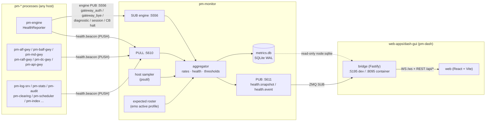

Version: 0.3.1

Date: 2026-10-18

Status: In implementation — progress in
[`EduMatcher-Operator-Dashboard-Workplan.md`](EduMatcher-Operator-Dashboard-Workplan.md)

> **Changelog v0.3.1 — after WP-A1**
>
> - §11.1 now points at `spec/messages/health.yaml` as the wire shape and
>   lists how it differs from the v0.3.0 TypeScript sketch (no maps or tuples
>   on the wire, `GatewayStats`/`ActiveBreach`/`RateStats` defined,
>   `ProcessHealth.group`/`metrics` added). The `json_payload` fallback A1
>   allowed for was not needed.
> - The bus family is **`health`** (`health.beacon`, `health.snapshot`,
>   `health.event`), not `monitor`: the API gateway's `/admin/monitor`
>   WebSocket already sends frames typed `"monitor.snapshot"` (trader-gui's
>   admin monitor), and `pm-msgen grep-literals` flagged the clash. Decided
>   with Johan 2026-10-18. Transport names (`monitor_push`/`monitor_pub`),
>   the `monitor` publisher, the `monitor:` config section and `pm-monitor`
>   are unchanged (I9).
> - §7.4 `host` is ≤ 128 characters, not 64 (I3 in the workplan).
> - Phase A review: `health.beacon` gained `starting` (§7.4, §10 HUNG rule),
>   because a slow but healthy start-up would otherwise read as HUNG; reporter
>   docs corrected and restart-after-stop fixed (I45–I46).
> - After B7: `pm-config-gen` writes the `monitor` block (`--monitor`,
>   `--monitor-*`, `--monitor-threshold RULE:WARN:CRIT`), refusing what
>   `pm-config-deploy` would refuse (I98).
> - WP-B7: E2's process and CLI documentation pulled forward (operator-guide
>   chapter `060-health-monitor.md`, reference manual, formal specification,
>   `pm-help`), plus `pm-monitor-cli health --extended`; `pm-config-show` now
>   shows the monitor ports on pm-monitor's own default bind (I96–I97).
> - WP-B6 (added after the A+B review): `pm-monitor-cli` -- `health`,
>   `status` (exit code = exchange status), `events [--follow]`; the profile
>   checks `monitor` with it. The scheduler's engine round-trips now tick the
>   beacon while they wait (I93–I95).
> - A+B review (the interaction of the two phases): the engine's trade
>   counters reset at PRE_OPEN although the spec defines a COUNTER as
>   monotonic since process start -- now exported with a carry (§8.2); the API
>   gateway beacons its `--instance`, not the config entry name, so the roster
>   matches it; verifier `M031` warns when `monitor.host` cannot reach
>   `monitor.bind_address`; `tests/test_health_contract.py` pins every name,
>   kind, identity and timing constant the two sides share (I89–I92).
> - Phase B review: a loop step can no longer kill pm-monitor; a stop is
>   recorded (final-beacon grace); a gone engine or gateway no longer shows
>   stale connections and gauges; RSS growth waits out start-up; "daily"
>   engine counters get no first-value exception (they reset at PRE_OPEN);
>   `enabled: false` idles instead of exiting; `pm-mm-bot` caps its idle
>   poll at 0.5 s so it is not DEGRADED forever (I80–I88).
> - After WP-B5: `pm-monitor` starts in every built-in profile but `micro`;
>   the bots beacon (§8.5 rows added); the scheduler's liveness chunk is 0.5 s,
>   because at 1 s an idle scheduler read DEGRADED (I76–I79).
> - After WP-B4: `metrics.db` as built (§9.5): a `series` table with
>   `WITHOUT ROWID` sample tables (3.3× smaller; Q3 answered, defaults kept),
>   `counter_last` for exact restarts, `n` for merging split minutes, a
>   single-writer lock (I69–I75).
> - After WP-B3: §9.2, §9.4 and §9.6 record what was built: bucketed rate
>   windows and the first-value rule, the fixed threshold rules and their
>   hysteresis, and that a breach on no process degrades the exchange. B4
>   restores the day from `metrics.db` and fills `avg_per_day`. Reject
>   ratios divide by all inbound requests, quotes included (I59–I68).
> - After WP-B2: `ProcessHealth.starting` added (closes B2.5). The exchange
>   status is DOWN for a stopped or unknown engine too, and a STOPPED process
>   the profile expects impairs it (§10). `PROCESS_STATUS` events are published
>   from B2, so `health.event` was adopted there rather than in B3 (I52–I58).
> - After WP-B1: the loop lives in `monitor/collector.py` (`Monitor`),
>   `main.py` is the CLI only (§16). Two live processes claiming one identity
>   show as the newer incarnation, never as a restart every beacon. The
>   snapshot size is a live gauge (`monitor.snapshot_bytes`). `ProcessHealth`
>   does not carry the beacon's `starting` flag: B2 decides whether it must
>   (B2.5) (I47–I51).
> - After WP-A6: every process of the `default` profile beacons. No WP had
>   assigned the participant bots (`pm-mm-bot`, `pm-ai-swarm`) although Q2
>   wants them in their own group: added as B5.4. `stats.records_dropped` and
>   `audit.decode_errors` added. The scheduler ticks on every 1 s wake-up but
>   can go ≈ 4 s without one during an engine round-trip (I38–I43).
> - After WP-A5: RALF/DC did not disconnect slow or idle clients (they marked
>   them close-after-flush, which a non-reading client never reaches); fixed
>   right after A5 with a 5 s close grace (I33, I44). `loop_lag_ms` includes
>   each loop's designed wait (engine ≤ 200 ms idle, API ≈ 250 ms), which B2's
>   DEGRADED rule (> 1000 ms) already tolerates (I32–I37).
> - After WP-A4: the per-book metrics are `engine.book_*`, not `book.*`
>   (`book.` is the prefix of the parameterised topic `book.{symbol}`).
>   Gateway labels are bounded in the engine itself: unconfigured ids count
>   as `(unknown)`. Perf-gate results are in A4.10 (I24–I30).
> - After WP-A3: codes are S124–S131 and M029–M030. "PULL/PUB distinct"
>   needs no code of its own, since M018 already reports it. `bind_address`
>   is stored as authored and resolved by pm-monitor at bind time (B1.2).
>   The monitor ports count in M018 and config-show even when the block is
>   absent (I11–I13).
> - A2, A4, A5 and B1 gained watch-outs from A1: generated constructors
>   validate, so a bad sample raises in the sampler thread.

> **Changelog v0.3.0 — re-checked against the tree after v0.50.x**
>
> - F21 was stale: v0.50.0 added `engine.locale.session_timezone` (default
>   `Europe/Stockholm`), and `pm-stats`/`pm-clearing` no longer take
>   `--timezone`. `pm-monitor` reads the same setting, with no CLI flag
>   (§9.4, A3, B1, B3, B4).
> - F18 was stale: S122 and S123 are taken; new codes start at **S124**.
> - New F22: `pm-stats`, `pm-audit`, `pm-clearing` and `pm-index` already
>   answer a REP ping on 5561–5564 (`healthcheck.py`), which `pm-opctl-cli`
>   uses. Added to §4. They are now `FIXED_LISTENERS` in `gateway_ports.py`
>   (done alongside this review). M018 now also checks every configured
>   listener against `resolved_fixed_listeners()`, so A3.4 only has to
>   register the monitor ports.
> - New F23/F24 and WP-E1 tasks for scope that was missing: the
>   `deployment/curl` stack (`compose.yaml`, `compose.ai-sim.yaml`,
>   `edumatcher.sh`), the `deployment/docker/compose.ai-sim.yaml` stack, the
>   SELinux `:ro,z` mount, the Dockerfile `EXPOSE` list, the `mkbld.sh`
>   `version.json` loop, and the GHCR workflow. The workflow already publishes
>   `book-gui`, so the image is in scope, not a follow-up.
> - Corrected that `entrypoint.sh` starts nothing itself; it only runs the
>   profile. `mm-demo`, `ai-swarm` and `ai-sim` all extend
>   `DEFAULT_PROCESSES`, so both container defaults get `pm-monitor` (B5).
> - UI aligned with the family:
>   - The wordmark is `EduMatcher` + `pm-dash` + version, as in every TopBar.
>   - Health tokens reuse the family's existing tones rather than introducing
>     Grafana hex values.
>   - The Tailwind `ok`/`warning`/`error` aliases are re-pointed, not
>     duplicated.
>   - `--missing` (dark) and `--stopped` (light) failed the plan's own
>     contrast test and were replaced. Series colours are tested at 3:1
>     (graphical objects), not 4.5:1 (§12, D1).
> - Smaller fixes:
>   - `pm-monitor` gets `--verbose` like every profile process.
>   - K4 label validation is limited to `gateway`/`symbol` labels.
>   - The "five GUIs" comment becomes "six GUIs".

> **Changelog v0.2.0 — implementation plan detailed and checked against the code**
>
> - §18 rewritten: every work package now has an objective, dependencies,
>   "might change if", numbered tasks each with its verifying test, a done
>   criterion and pitfalls, written for a developer new to the code base.
> - §18.1 lists the 20 findings from checking the design against the tree on
>   2026-10-11. The ones that changed the design are corrected in place:
>   the `monitor` config section follows the existing "always present,
>   `enabled` resolved" rule of `CompiledConfig` (§14); `engine.poll_batch_max`
>   is replaced by `engine.busy_pct` because the engine handles exactly one
>   message per poll (§8.4); the ALF/BALF metrics reuse the existing
>   `_global_stats` counters (§8.5); `pm-stats`/`pm-audit` tick from their
>   receive thread and `pm-scheduler` must stop sleeping in 30 s chunks (§7.3);
>   container reachability now goes through `EDUMATCHER_GATEWAY_BIND_HOST`
>   (`open_gateway_binds()` no longer exists) (§15.2).

# EduMatcher — Operator Dashboard (`pm-dash`, `web-apps/dash-gui`) and Health Instrumentation (`pm-monitor`) Design and Implementation Plan

## Table of Contents

1. [Summary](#1-summary)
2. [Requirements](#2-requirements)
3. [Decisions taken before this design](#3-decisions-taken-before-this-design)
4. [Observability audit — what exists today](#4-observability-audit--what-exists-today)
5. [Gap analysis — what needs new instrumentation](#5-gap-analysis--what-needs-new-instrumentation)
6. [Architecture](#6-architecture)
7. [New instrumentation: the health beacon](#7-new-instrumentation-the-health-beacon)
8. [New instrumentation: per-process metric catalogue](#8-new-instrumentation-per-process-metric-catalogue)
9. [`pm-monitor` — the collector](#9-pm-monitor--the-collector)
10. [Health model — healthy, degraded, hung, dead](#10-health-model--healthy-degraded-hung-dead)
11. [Bridge ↔ browser protocol](#11-bridge--browser-protocol)
12. [Screen design](#12-screen-design)
13. [Widget library](#13-widget-library)
14. [Configuration](#14-configuration)
15. [Container, Makefile, ports and versioning](#15-container-makefile-ports-and-versioning)
16. [Repository layout](#16-repository-layout)
17. [Test strategy](#17-test-strategy)
18. [Implementation plan — work packages](#18-implementation-plan--work-packages)
19. [Risks and open questions](#19-risks-and-open-questions)

---

## 1. Summary

EduMatcher has no single place where an operator can see whether the exchange
is healthy. The pieces exist, but they are scattered and partial:

- `pm-opctl-cli list` shows PID, RSS and uptime from `ps`, but only on demand,
  only on the host that started the profile, and only from a process that is
  *alive*. It cannot tell a hung process from a working one (its own README
  says so: a ZMQ `tcp` check succeeds while the application loop is stuck).
- `pm-log-srv`'s `processes` table knows who connected and when they last
  spoke, but its `HB` frame comes from a **background thread** and is sent
  only when the connection is idle. A process whose main loop is deadlocked
  keeps heartbeating forever.
- The engine knows everything about orders, trades, participants and books,
  but keeps almost none of it as counters, and publishes only a few polled
  snapshots (`system.gateways`, `system.volume`).

This design adds three things:

1. **A health beacon** (`edumatcher.health`) that every long-running `pm-*`
   process emits every 2 s: its own memory, CPU, threads, file descriptors,
   **main-loop age** (time since the main loop last completed an iteration),
   and a small set of application counters and gauges. The main-loop age is
   what makes hung-process detection possible.
2. **`pm-monitor`**, a new Python process that collects the beacons, samples
   the host (CPU, memory, disk), listens to the engine's lifecycle events
   (connects, disconnects, halts, session transitions, diagnostics), derives
   rates and health states, persists a downsampled history to `metrics.db`,
   and republishes a live 1 Hz snapshot.
3. **`pm-dash`** (`web-apps/dash-gui`), a Grafana-style web dashboard with
   the same structure, tooling, theme mechanism and container setup as
   `book-gui`. Its bridge reads `pm-monitor`'s live feed over ZeroMQ and its
   history from a read-only `metrics.db` — exactly the shape of `log-gui`
   (live from LALF-PS, history from `log.db`).

No Grafana, no Prometheus, no time-series database. One new Python dependency
(`psutil`) and no new npm chart library: `recharts` is already used by
`log-gui` and `trader-gui`; gauges and the state timeline are small
hand-written SVG components.

## 2. Requirements

| # | Requirement (from the request) | Where addressed |
|---|---|---|
| R1 | Total memory usage | §8.1 host metrics, §12.3 row *Overview* |
| R2 | Memory per exchange process | §7 beacon `rss_bytes`, §12.3 row *Processes* |
| R3 | Submitted orders — total, avg per min / hour / day | §8.2 `engine.orders_in`, §9.4 rate derivation, §12.3 row *Trading* |
| R4 | Concluded trades | §8.2 `engine.trades`, §12.3 row *Trading* |
| R5 | Connected participants | §8.2 `engine.participants_connected`, §12.3 row *Participants* |
| R6 | Orders per participant — total, avg per min / hour / day | §8.2 labelled counters, §12.3 participant table |
| R7 | Connections / disconnections | §8.2 counters + §9.2 lifecycle events, §12.3 state timeline |
| R8 | CPU usage | §7 beacon `cpu_pct`, §8.1 host CPU |
| R9 | Number of order books and memory per order book | §8.3 book gauges + memory estimate |
| R10 | Hung / healthy processes | §7.3 main-loop age, §10 health model |
| R11 | Other vital health information | §8.4–§8.6 (latency, rejects, drops, feed gaps, disk, DB sizes, diagnostics) |
| R12 | Web app with the same structure as existing web-apps | §15, §16 |
| R13 | Dark and light theme | §12.5 |
| R14 | Speed-meter gauges, graphs, big numbers, Grafana-like colours | §12, §13 |
| R15 | Identify missing instrumentation and health messages | §5, §7, §8 |

**Non-goals.** No alert delivery (e-mail, Slack, paging) — threshold breaches
are logged as `WARNING` through the normal log path, so `log-gui`'s existing
alerting picks them up (§9.6). No process control from the dashboard (start,
stop, restart stays in `pm-opctl-cli`). No user-configurable dashboard editor
— the layout is fixed in code. No PromQL-like query language. No
authentication (§3).

## 3. Decisions taken before this design

Settled with Johan on 2026-10-11:

| Question | Decision | Consequence |
|---|---|---|
| Where are metrics collected? | **A new `pm-monitor` process** | Neither `pm-log-srv` nor `pm-api-gwy` takes on a second job. |
| How are CPU and memory sampled? | **Add `psutil`** as a runtime dependency | Same code on macOS and Linux; host totals, FDs and threads for free. `psutil` is already in `poetry.lock` as a transitive dev dependency; it becomes a direct one. |
| How much history? | **Persist to `metrics.db`** with downsampling | Day-level averages and post-mortems survive a restart of `pm-monitor` or of the engine. |
| Who may open the dashboard? | **No authentication**, like `log-gui` | Internal operator tool on the trusted network; the same posture as LALF-PS. Bind to loopback by default (§15.2). |

## 4. Observability audit — what exists today

Every source below was read in the tree on 2026-10-11.

| Source | What it gives | Limits that matter here |
|---|---|---|
| `pm-opctl-cli list` / `health` (`emo/cli.py`) | Per process in the active profile: PID alive, `tcp` connect or `healthcheck` result, uptime and RSS via `ps -o etime=,rss=` | On demand only, no history. Only the profile started on this host. `tcp` succeeds against a hung process (libzmq accepts in its I/O thread). No CPU. |
| `<DATA>/emo/active-profile` + profile definition | Which processes **should** be running | Not consumed by anything but `pm-opctl-cli`. Reused by `pm-monitor` (§9.3). |
| `pm-log-srv` `processes` table (`log_srv/schema.py`) | One row per LALF session: process, instance, PID, host, `connected_at`, `last_seen_at`, `disconnected_at`, `log_count` | `HB` is sent by the `TcpLogHandler` **background thread**, only when the socket is idle — proves the interpreter is alive, not that the main loop runs. Probe connections create a second row per PID (see `log-gui` Connections view). |
| `pm-log-srv` `server_stats` | Lifetime totals: events, connections, truncated, errors | Lifetime only, no rates. |
| Engine `system.gateways.{GW}` (polled) | Every configured participant: id, role, description, `connected` | No connect time, no counters, polled request/reply. |
| Engine `system.gateway_auth.{GW}` / `system.gateway_bye.{GW}` (broadcast) | Every accepted/rejected connect and every disconnect, with `reason` (`heartbeat_timeout` when the engine expired a silent session) | Events only — nobody counts them. |
| Engine `system.volume.{GW}` (polled) | Per symbol and total: qty, value, trade count — the engine's own running counters (`OrderBook.daily_qty/daily_value_ticks/daily_trades`) | Trades only; nothing about orders. Reset only by engine restart. |
| Engine `system.diagnostic` (broadcast) | Absorbed internal failures, with a per-component running `count` (`MAINTENANCE_FLUSH`, `DISPATCH_ERROR`, `UNDECODABLE_MESSAGE`, `UNROUTED_TOPIC`) | Only fires on a failure, so a zero count is never published. |
| Engine `_debug_counts` (`_dbg_count`) | A rich set of decision counters | Only accumulated when the logger is at `DEBUG`, flushed to the log as text, then cleared. Not usable as metrics. |
| `pm-api-gwy` `GET /api/v1/healthz` | `ok`, `active_gateways` (this instance only), `dropped_events` | Per instance; dropped count is the only rate-like figure. |
| `stats.db` `order_events` (`pm-stats`) | Every ack / reject / fill / cancel / amend / expire with `gateway_id`, `symbol`, `ts`; indexed `(gateway_id, ts)` | Correct source for **historical** per-participant reports, but a full-table aggregation per refresh is the wrong tool for a 1 Hz dashboard, and it records outcomes, not inbound submissions. |
| `stats.db` `feed_gaps` | Detected sequence gaps in the engine trade stream | Nobody surfaces it live. |
| `pm-{stats,audit,clearing,index}-cli health` (`healthcheck.py`) | pgrep for the process, then a ping to a REP socket that the **receive loop** answers (5561 / 5562 / 5563 / 5564, `EDUMATCHER_*_HEALTH_PORT`), plus a data-file check under `--extended`. `pm-opctl-cli` uses it as the `healthcheck` of those four processes | On demand, exit code only, four processes only. It is the one existing loop-liveness probe (F22). The REP ports are `FIXED_LISTENERS` in `gateway_ports.py`. |
| ALF/BALF/MD gateways | `self._clients` dict per gateway; `max_connections` enforced | Count is never exported. |

**Conclusion.** Liveness by PID and the participant roster exist. Everything
the request calls a *rate*, every per-participant order figure, per-book
sizes and memory, CPU, and any *continuous* hung-process signal do **not**.
The four recorders' REP pings prove a loop is alive, but only on demand and
without history.

## 5. Gap analysis — what needs new instrumentation

| # | Metric requested | Available today? | Gap | New instrumentation (section) |
|---|---|---|---|---|
| G1 | Total memory (host) | No | Nothing samples the host | `pm-monitor` host sampler via `psutil.virtual_memory()` (§8.1) |
| G2 | Memory per process | Partly (`ps` on demand, same host) | Continuous, cross-host, history | Beacon `rss_bytes` (§7.2) |
| G3 | CPU per process / host | No | — | Beacon `cpu_pct`, host `cpu_percent(percpu=True)` (§7.2, §8.1) |
| G4 | Orders submitted (total, rates) | No | Engine has no inbound-order counter | `engine.orders_in{gateway}` counter (§8.2) |
| G5 | Orders per participant | Only historically via `order_events` | No live counter | Same counter, labelled by gateway (§8.2) |
| G6 | Trades | Yes, polled (`system.volume`) | Not pushed, not in history | Engine beacon carries `engine.trades{symbol}`, `engine.traded_qty{symbol}`, `engine.traded_value{symbol}` from the existing book counters (§8.2) |
| G7 | Connected participants | Yes, polled (`system.gateways`) | Not pushed | Gauge `engine.participants_connected` (§8.2) |
| G8 | Connections / disconnections | Events only | Never counted | Counters `engine.connects`, `engine.disconnects`, `engine.heartbeat_timeouts`, `engine.auth_rejects` + lifecycle events persisted by `pm-monitor` (§8.2, §9.2) |
| G9 | Number of order books | Derivable from reference data | Not exported | Gauge `engine.books` (§8.3) |
| G10 | Memory per order book | **No** | Python has no per-object-graph memory API that is cheap | `OrderBook.memory_estimate()` (§8.3) |
| G11 | Hung processes | **No** (PID + `tcp` cannot see it) | No signal from the main loop | Beacon `loop_age_ms` / `loop_lag_ms` (§7.3) |
| G12 | Engine processing latency | No | — | `engine.handle_us` p50/p99/max per interval (§8.4) |
| G13 | Reject ratio | Only historically | — | `engine.rejects{gateway}` (§8.2) |
| G14 | Gateway client counts and drops | No | `_clients` never exported | Per-gateway gauges/counters (§8.5) |
| G15 | Log ingest rate, DB and audit-file growth | Lifetime totals only | — | `pm-log-srv` counters + `pm-monitor` file sizes (§8.5, §8.1) |
| G16 | Expected-but-missing processes | Only via `pm-opctl-cli list` | — | `pm-monitor` reads the active profile (§9.3) |
| G17 | Engine diagnostics | Broadcast on failure | Counts not visible when zero | Engine beacon carries `engine.diagnostics{component}` (§8.4) |
| G18 | Session state, halts | Yes, broadcast | Not on any operator timeline | `pm-monitor` subscribes and records annotations (§9.2) |

New **messages** needed (all in a new `spec/messages/health.yaml`, generated
by `pm-msgen` like every other family):

| Message | Topic | Transport | Direction |
|---|---|---|---|
| `beacon` | `health.beacon` | `monitor_push` (new) | every `pm-*` process → `pm-monitor` |
| `snapshot` | `health.snapshot` | `monitor_pub` (new) | `pm-monitor` → dashboard bridge, 1 Hz |
| `event` | `health.event` | `monitor_pub` | `pm-monitor` → bridge, on each status change / lifecycle event |

No new engine bus topic is needed: the engine's metrics travel in its own
beacon like every other process's.

`pm-msgen` validates `doc.published_by` against a closed set
(`msgen/spec.py:PUBLISHERS`). Two values are added: `health_reporter` (the
beacon is sent by every process through the shared module, so naming one
process role would be wrong) and `monitor`.

## 6. Architecture



Why this shape:

- **Beacons are pushed, not scraped.** A pull/scrape model needs every
  process to bind an HTTP port; EduMatcher processes are ZeroMQ clients that
  mostly bind nothing. A `PUSH` socket per process is one line of setup, is
  non-blocking with a high-water mark, and costs nothing when `pm-monitor` is
  down (messages are dropped at HWM, never block the sender — §7.5).
- **Counters, not events.** The engine increments plain integers on its hot
  path and ships the totals every 2 s. `pm-monitor` turns totals into rates
  by differencing (§9.4). This keeps the matching path free of any
  per-message publish and makes `pm-monitor` restart-safe: it loses at most
  one interval, never the day's totals.
- **Live over ZMQ, history from SQLite** — the same split `log-gui` already
  uses against `pm-log-srv`, so the bridge code has a working model to copy.
- **The bridge never joins the engine bus.** It only talks to `pm-monitor`.

## 7. New instrumentation: the health beacon

### 7.1 Module

New package `src/edumatcher/health/`:

```python
class HealthReporter:
    """Samples this process and PUSHes health.beacon every interval."""

    def __init__(self, process: str, instance: str | None = None) -> None: ...
    def start(self) -> None: ...          # starts the sampler thread
    def tick(self) -> None: ...           # main loop: "I completed an iteration"
    def publish(self, metrics: Sequence[MetricSample]) -> None: ...
                                          # main loop: latest app metrics snapshot
    def stop(self) -> None: ...           # sends a final beacon (final=True)
```

Each long-running process creates one reporter in `main()` after it has read
its configuration, calls `tick()` once per main-loop iteration, and calls
`publish()` from its main loop when `reporter.due()` says an interval has
passed. When the compiled config says `monitor.enabled: false`,
`HealthReporter` is never constructed (§14); the reporter itself has no
disabled mode.

The reporter is created in each process's `main()` (or `run()`), never in a
constructor such as `Engine.__init__`: the unit-test harnesses build those
objects without sockets (`tests/engine_harness.py:make_engine`), and a
reporter there would start a thread and open a ZMQ socket in every test.

### 7.2 Threading — why two halves

| Half | Runs on | Does |
|---|---|---|
| `tick()` / `publish()` | the process's **main loop** | Stores `time.monotonic()` into one float; every interval stores an immutable tuple of `MetricSample` built from the process's own counters. Never touches a socket. |
| sampler | a daemon thread | Every `beacon_interval_sec`: reads `psutil.Process()` (RSS, CPU, threads, FDs), reads the last tick time and the last published tuple, builds `health.beacon`, sends it on its own `PUSH` socket. |

The split exists for one reason: **if the main loop hangs, the thread keeps
reporting** — with a growing `loop_age_ms`. A beacon built on the main loop
would simply stop, and silence cannot distinguish "hung" from "dead" or from
"network partition". The thread never reads application state directly
(only the tuple the main loop hands over), so there is no locking and no
`dict changed size during iteration` risk.

### 7.3 Main-loop age and loop lag

| Field | Meaning | How |
|---|---|---|
| `loop_age_ms` | Time since the main loop last called `tick()` | `now − last_tick` at sample time |
| `loop_lag_ms` | Worst iteration duration in the interval | `tick()` records `max(now − previous_tick)` and resets it at each sample |

Placement per process kind (all verified loop shapes, §4 of the audit):

| Process kind | Loop | Where `tick()` goes |
|---|---|---|
| `pm-engine`, `pm-index`, `pm-market-sim` | `zmq.Poller.poll(timeout=200)` (market-sim: 50 ms) | Top of the `while self._running:` body — at least 5 ticks/s even when idle |
| `pm-scheduler` | `time.sleep` in `_sleep_until_wallclock`, chunks of up to `WALLCLOCK_RECHECK_SEC` = **30 s** | Inside the `_sleep_until_wallclock` loop, and the chunk lowered to 1 s. Otherwise an idle scheduler reads as HUNG (finding F8, §18.1) |
| `pm-stats`, `pm-audit` | The **receive thread** (`_receive_loop`) does all the work; the main thread only `join()`s it | In `_receive_loop`, not on the main thread — the thread that matters is the one that must not stall (F7) |
| `pm-clearing` | `poller.poll(timeout=300)` main loop + a timer thread | Main poll loop |
| `pm-alf-gwy`, `pm-balf-gwy`, `pm-md-gwy`, `pm-ralf-gwy`, `pm-dc-gwy`, `pm-log-srv` | Non-blocking loop with `time.sleep(0.005–0.01)` (ALF: `selectors`) | Top of the loop (~100 ticks/s; `tick()` is one float store) |
| `pm-api-gwy` | asyncio under uvicorn | A dedicated task: `await asyncio.sleep(0.25); reporter.tick()`. `loop_lag_ms` then measures **event-loop lag** (sleep overshoot), the standard asyncio stall signal |
| `pm-mm-bot`, `pm-ai-swarm` | participant bots | Optional; included when started from an `emo` profile (they are exchange clients, not exchange processes — §12.3 shows them in a separate group) |

Short-lived CLIs (`pm-*-cli`, `pm-config-*`, `pm-setup`, `pm-help`, …) and
the TUIs (`pm-viewer`, `pm-board`, `pm-ticker`, `pm-orders`,
`pm-alf-console`) do **not** emit beacons.

### 7.4 `health.beacon` fields

| Field | Type | Unit | Notes |
|---|---|---|---|
| `process` | string ≤ 32 | — | Same name the process uses in its LALF `HELLO` (`CLIENT`): the module's existing `_CLIENT_NAME` constant (`"pm-engine"`, …); `pm-log-srv` has none and uses the literal |
| `instance` | string ≤ 32, optional | — | e.g. `desk` / `dashboards` for `pm-api-gwy` |
| `pid` | int | — | |
| `host` | string ≤ 128 | — | `socket.gethostname()` (128 as `LogRow.host`: a longer FQDN failing validation would silence the process) |
| `boot_id` | string ≤ 16 | — | Random per process start; a change means restart even if PID is reused |
| `seq` | int ≥ 0 | — | Per `boot_id`; gaps = lost beacons |
| `started_at_ns` | int | epoch_nanos | Process start |
| `interval_sec` | float | seconds | The sender's beacon interval; the monitor's silence timers use it |
| `rss_bytes` | int | bytes | `memory_info().rss` |
| `cpu_pct` | float | percent of one core | `cpu_percent(None)` since previous sample |
| `threads` | int | — | `num_threads()` |
| `fds` | int, optional | — | `num_fds()` (POSIX only; absent on Windows) |
| `loop_age_ms` | float | ms | §7.3 |
| `loop_lag_ms` | float | ms | §7.3 |
| `final` | bool | — | `True` on the last beacon of a clean shutdown → status `STOPPED`, not `DEAD` |
| `starting` | bool | — | Added in the Phase A review: `True` until the main loop has ticked once. The reporter starts in `main()`, before the loop exists, so start-up work (engine GTC restore, clearing prune, index initialise) would otherwise read as a stale `loop_age_ms`. Derived in the sampler thread (no tick since `start()`), so `tick()` pays nothing |
| `metrics` | list of `MetricSample` | — | Application metrics, §8 |

`MetricSample` (a list entry, never a map — the spec family's convention):

| Field | Type | Notes |
|---|---|---|
| `name` | string ≤ 64 | Dotted, e.g. `engine.orders_in` |
| `kind` | enum `COUNTER` / `GAUGE` | Counters are monotonic since process start |
| `label` | string ≤ 32, default `""` | One dimension at most: a gateway id, a symbol, a component. Cardinality is bounded by configuration |
| `value` | float | |

### 7.5 Transport and failure behaviour

- New transports in `spec/transports.yaml`: `monitor_push` (PUSH → PULL,
  `MONITOR_PULL_ADDR`) and `monitor_pub` (PUB → SUB, `MONITOR_PUB_ADDR`).
- The sampler's `PUSH` socket: `SNDHWM = 10`, `LINGER = 0`,
  `send(..., zmq.NOBLOCK)`; on `zmq.Again` the beacon is dropped and a local
  counter increments (reported in the next beacon as
  `health.beacons_dropped`). **A down `pm-monitor` never slows or blocks any
  exchange process.**
- Wire encoding: the usual two frames `[topic, json_payload]`. At 2 s × ~15
  processes this is < 10 messages/s; JSON is fine.

## 8. New instrumentation: per-process metric catalogue

Naming: `<process-family>.<metric>`. `C` = counter (since process start),
`G` = gauge. "Label" is the single dimension.

### 8.1 Host and files — sampled by `pm-monitor` itself

| Metric | K | Label | Source |
|---|---|---|---|
| `host.cpu_pct` | G | `""` and `cpu0..N` | `psutil.cpu_percent(percpu=True)` |
| `host.load1` / `load5` / `load15` | G | | `psutil.getloadavg()` |
| `host.mem_total_bytes` / `mem_used_bytes` / `mem_available_bytes` | G | | `virtual_memory()` |
| `host.swap_used_bytes` | G | | `swap_memory()` |
| `host.disk_free_bytes` / `disk_total_bytes` | G | | `disk_usage(DATA_DIR)` |
| `files.size_bytes` | G | `log.db`, `stats.db`, `audit`, `clearing.db`, `metrics.db`, `gtc` | `os.stat` on the paths `edumatcher.config` already defines (`LOG_DB_FILE`, `STATS_DB_FILE`, `AUDIT_LOG_FILE`, …) |

Host metrics describe the host `pm-monitor` runs on. In the container
deployment that is the whole exchange; in a cross-host deployment the
per-process `rss_bytes`/`cpu_pct` remain correct per host, and the
dashboard groups processes by `host` (§12.3).

### 8.2 Engine — trading and participants

Held in a new `EngineMetrics` object (`engine/metrics.py`, plain `dict[str, int]`
counters, no locking — single-threaded engine). Increment sites are the
existing handler funnels.

| Metric | K | Label | Increment / read site |
|---|---|---|---|
| `engine.orders_in` | C | gateway | Every inbound new-order request **before** validation — what the participant *submitted* (R3, R6) |
| `engine.rejects` | C | gateway | Every ack with `accepted=False` on `order.ack.`, `combo.ack.`, `oco.ack.`, `quote.ack.` — there is no single reject funnel today (28 `self._reject(...)` calls, 14 inline `accepted=False` sites, several local `_reject` closures), so WP-A4 adds one helper (F4) |
| `engine.rejects_by_code` | C | reason | The same rejects by reason (I123): the ack's `RejectCode`, or for quotes, combos and OCOs (text only) a label from the reason (`MM_MAX_SPREAD`, `MM_MIN_QTY`, … `UNKNOWN`); every reason published, zeros included |
| `engine.cancels_in` | C | gateway | Inbound cancel requests |
| `engine.amends_in` | C | gateway | Inbound amend requests |
| `engine.quotes_in` | C | gateway | Inbound quote messages (market makers) |
| `engine.fills` | C | gateway | Two increments per trade (buy and sell gateway) in `_publish_trade`, the single trade-publication path every flow already goes through |
| `engine.trades` | C | symbol | Read from the existing `OrderBook.daily_trades` — no new increment. *A+B review (I89):* exported as `EngineMetrics.trade_totals()` = the book's daily figure plus everything carried over its PRE_OPEN resets, so it is a true COUNTER (monotonic since process start) like every other; the same for `traded_qty` and `traded_value` |
| `engine.traded_qty` | C | symbol | Existing `OrderBook.daily_qty` |
| `engine.traded_value` | C | symbol | Existing `daily_value_ticks`, converted at the boundary like `system.volume` |
| `engine.participants_connected` | G | `""` and role | `sum(s.connected for s in self._sessions.values())` |
| `engine.participant_connected` | G | gateway | 0/1 — feeds the state timeline |
| `engine.connects` | C | gateway | `_handle_gateway_connect`, accepted |
| `engine.auth_rejects` | C | gateway | `_handle_gateway_connect`, rejected (its two `make_gateway_auth(accepted=False)` sites — these are *not* order rejects) |
| `engine.disconnects` | C | gateway | `_handle_gateway_disconnect` (all reasons) |
| `engine.heartbeat_timeouts` | C | gateway | `_expire_silent_gateways` |
| `engine.resting_orders` | G | gateway | `len(book._orders_by_gateway[gw])` summed over books — the index already exists |

"Total orders" for the exchange is the sum over labels, computed by
`pm-monitor`; the engine does not keep a second unlabelled counter that could
disagree.

### 8.3 Engine — order books

Computed by the engine once every `book_metrics_interval_sec` (default 10 s),
not every beacon: all of it is O(number of books), none of it O(orders).

| Metric | K | Label | Source |
|---|---|---|---|
| `engine.books` | G | | `len(self.books)` |
| `engine.book_resting_orders` | G | symbol | `len(book._order_index)` |
| `engine.book_stop_orders` | G | symbol | `len(_buy_stops) + len(_sell_stops) + len(_trailing_stops)` |
| `engine.book_bid_levels` / `engine.book_ask_levels` | G | symbol | `len(_bid_qty)`, `len(_ask_qty)` |
| `engine.book_heap_entries` | G | symbol | `len(_bids) + len(_asks)` — includes lazily-invalidated entries |
| `engine.book_heap_garbage_pct` | G | symbol | `100 × (heap_entries − live entries) / heap_entries` — shows whether `_compact_heaps` is keeping up |
| `engine.book_est_bytes` | G | symbol | `OrderBook.memory_estimate()` below |
| `engine.book_halted` | G | symbol | 0/1 from `_halted_symbols` (a `dict[str, bool]`) |

**Memory per order book (G10).** Python offers no cheap exact answer:
`sys.getsizeof` is shallow, `tracemalloc` costs 30–50 % throughput and cannot
attribute by book, and a recursive walk is O(orders). The estimate therefore
is

```
est_bytes = Σ sys.getsizeof(container)      # the 9 containers in __slots__
          + n_orders  × ORDER_BYTES          # one Order (slots dataclass) + its id strings
          + n_entries × ENTRY_BYTES          # one _HeapEntry (slots) + key tuple
          + n_trades  × TRADE_BYTES          # recent_trades deque
```

`ORDER_BYTES`, `ENTRY_BYTES` and `TRADE_BYTES` are **measured, not guessed**:
a unit test builds a book with 10 000 representative orders under
`tracemalloc`, divides, and asserts the constants in `engine/metrics.py` are
within ±15 % of the measurement — so they cannot rot silently when `Order`
gains a field. The dashboard labels the figure "est." everywhere. The sum of
all `engine.book_est_bytes` divided by engine RSS is shown as "books share of
engine memory", which is the operationally useful number.

### 8.4 Engine — processing health

| Metric | K | Label | Source |
|---|---|---|---|
| `engine.msgs_in` | C | | Every PULL message dispatched |
| `engine.handle_us_p50` / `_p99` / `_max` | G | | **Order entry** (new, cancel, amend, quote, combo, OCO) only: `time.perf_counter_ns()` around the dispatch of **1 message in 16** (plus every message until an order is timed in a window), percentiles over the samples of the **last 60 s**, at most 1024 (A4.10 decision; revised, see below) |
| `engine.handle_us_p99_ex_gc` | G | | The same p99 with each sample's GC time (from `gc.callbacks`) taken out |
| `engine.handle_samples` | G | | Samples behind the percentiles; under 100 the nearest-rank p99 is their maximum |
| `engine.other_us_p99` / `_max` | G | | Every other PULL message: heartbeats, connects, queries (book snapshots, order lists), admin |
| `engine.gc_pause_us_max` | G | | Longest single collection in the last 60 s, every collection timed via `gc.callbacks` |
| `engine.gc_time_pct` | G | | Share of the beacon interval spent in GC |
| `engine.gc_collections` | C | | Collections since process start |
| `engine.busy_pct` | G | | Share of wall time in the interval spent inside `_dispatch_pull_message` + `_run_maintenance`. The engine receives **exactly one** message per poll iteration (`run()`), so a "batch size" does not exist; ZeroMQ does not expose PULL-queue depth either. Busy % approaching 100 is the saturation signal: messages are arriving faster than they are handled (F3) |
| `engine.diagnostics` | C | component | The existing `_error_count`, `_unknown_topic_count`, `_undecodable_count`, `_flush_error_count` — published even when zero (G17) |
| `engine.session_state` | G | | Enum ordinal of `_session_state`; `pm-monitor` maps it back to the name |
| `engine.halted_symbols` | G | | `len(_halted_symbols)` |
| `engine.gtc_flush_ms` | G | | Duration of the last `_flush_persistence` call that actually wrote |

**Revision 2026-10-25 — trustworthy latency.** The figures above replaced
per-beacon-window percentiles over all PULL messages, which misled in two
ways, both measured against timing every message (20 000 resting orders, a
mix of adds, cancels, aggressive orders, heartbeats and 2 % book snapshot
requests):

- A 2 s window at classroom rates holds a few dozen samples, and the
  nearest-rank p99 of fewer than 100 is their maximum: the "p99" was the
  worst message of each window.
- Mixing topics: a book snapshot request on a 20 000-order book costs
  ≈ 2.2 ms against ≈ 25 µs for an add or cancel, so 2 % of them put the mixed
  p99 at 2.2 ms while the order-entry p99 was 130 µs.

With the order-entry split and the 60 s horizon, the sampled p50/p99 agreed
with timing every order message within a few percent (29.9 / 126.6 µs vs
28.9 / 130.2 µs). The sampled maximum cannot (213 µs vs 1.6 ms true); the
GC metrics catch the largest stalls regardless (a 70 ms gen-2 collection
that no sampled message hit).

The engine metrics are assembled by a new `_flush_metrics` entry in the
`_run_maintenance` flush tuple. That gives it the existing per-flush guard
and `MAINTENANCE_FLUSH` diagnostic for free: a bug in metrics code can never
stop the circuit-breaker timers behind it.

### 8.5 Gateways and services

| Process | Metric | K | Label | Source |
|---|---|---|---|---|
| `pm-alf-gwy` | `gwy.<key>` for every key of the **existing** `_global_stats` dict | C (G for `connected_clients`) | | `connected_clients`, `commands_received_total`, `commands_forwarded_total`, `commands_rejected_total`, `errors_total`, `disconnects_total`, `slow_client_disconnects`, `auth_failures` — already maintained, only exported (F5) |
| `pm-balf-gwy` | `gwy.<key>` of its `_global_stats` | C / G | | `connected_clients`, `frames_received_total`, `frames_forwarded_total`, `frames_rejected_total`, `protocol_errors_total`, `slow_client_disconnects`, `auth_failures`, … — exported as they are |
| ALF / BALF | `gwy.clients_max` | G | | `config.max_connections` |
| `pm-md-gwy` | `md.clients` / `md.clients_max` | G | | `len(self._clients)`, `config.max_connections` |
| | `md.msgs_out` | C | | Fan-out send path |
| | `md.disconnects` | C | reason | `_disconnect(session, reason=…)` — reasons in use: `peer_closed`, `slow_client`, `close_after_flush`, `auth_timeout`, `idle_timeout`. The MD gateway does not drop messages for a slow client, it disconnects it (F6), so `slow_client` is the back-pressure signal |
| `pm-ralf-gwy`, `pm-dc-gwy` | `gwy.clients`, `gwy.msgs_out`, `gwy.disconnects{reason}`, `gwy.slow_clients`, `gwy.closing_clients` | G / C / C / C / G | | Same shape as MD, plus two signals added in A5: `slow_clients` counts sessions flagged slow (once each), `closing_clients` the sessions draining their final line. Since the I33 fix a closing session is disconnected after at most 5 s (`CLOSE_GRACE_SEC`), so `closing_clients` stays small |
| `pm-api-gwy` | `api.ws_sessions` | G | channel | Count of open WebSockets per router (`events`, `market-data`, `admin/monitor`, `admin/sim`) |
| | `api.http_requests` / `api.http_5xx` | C | | A one-line Starlette middleware |
| | `api.dropped_events` | C | sink | The existing `EngineClient.dropped_events` — already a `dict[str, int]` keyed by sink (F10) |
| | `api.engine_timeouts` | C | | `TimeoutError` in `await_topic` |
| `pm-log-srv` | `log.events_in` | C | | Existing `total_log_events` path |
| | `log.sessions` | G | | Authenticated LALF sessions |
| | `log.writer_queue` | G | | `LogWriter._queue.qsize()` (a `queue.Queue`; approximate, which is fine for a gauge) |
| | `log.ps_subscriptions` | G | | LALF-PS leases |
| `pm-stats` | `stats.events_recorded` | C | | Receive-thread write path. `pm-stats` writes inline in its receive thread — it has **no writer queue**, so no queue gauge (F7) |
| | `stats.records_dropped` | C | | Added in A6: an engine event whose handler raised, i.e. was not persisted |
| | `stats.feed_gaps` | C | | Same place that inserts into `feed_gaps` |
| `pm-audit` | `audit.records` / `audit.bytes` | C | | Writer path (lines accepted into the write buffer) |
| | `audit.decode_errors` | C | | Added in A6: frames that could not be decoded and so are missing from the trail |
| `pm-clearing` | `clearing.trades_settled` | C | | Settlement path |
| `pm-scheduler` | `sched.next_transition_in_s` | G | | Seconds until next scheduled transition |
| `pm-mm-bot` (B5.4) | `mmbot.msgs_out` / `mmbot.msgs_in` | C | | Messages sent to and received from the engine bus |
| | `mmbot.symbols_active` | G | | Symbols being quoted |
| `pm-ai-swarm` (B5.4) | `swarm.workers` / `swarm.workers_alive` / `swarm.workers_gave_up` / `swarm.agents` | G | | The supervisor's view of its worker processes |
| | `swarm.worker_restarts` | C | | Workers restarted after dying |

### 8.6 Every process — supplied by `HealthReporter`

`health.beacons_dropped` (C), `health.gc_gen2` (C, `gc.get_stats()[2]["collections"]`
— long gen-2 pauses show up as `loop_lag_ms` spikes, and this shows why),
`health.samples_rejected` (C, added in A2: application samples dropped in the
sampler thread because they failed spec validation, e.g. a label over 32
characters — the beacon itself still goes out).

## 9. `pm-monitor` — the collector

### 9.1 Process shape

Single-threaded `zmq.Poller` loop (the EduMatcher norm), plus the
`HealthReporter` for itself — `pm-monitor` monitors its own memory and loop
like everyone else. Entry point `pm-monitor = "edumatcher.monitor.main:main"`;
it logs through the normal LALF client.

Loop, 200 ms tick:

1. Drain `PULL :5610` → update per-`(process, instance, host)` state.
2. Drain `SUB` on the engine PUB → lifecycle events (§9.2).
3. Every 1 s: sample host (§8.1), evaluate health (§10) and thresholds
   (§9.6), publish `health.snapshot`.
4. Every 10 s: write raw samples batch to `metrics.db`.
5. Every 60 s: roll raw → 1-minute buckets; every 60 min: apply retention.

As built (Phase B review, I80, I88): each step runs guarded — an
unexpected error costs that step, is counted in `monitor.loop_errors` and
logged once a minute with its traceback, and the loop goes on. On SIGTERM
pm-monitor keeps collecting for `FINAL_GRACE_SEC` (1.5 s), because
`pm-opctl-cli stop` and `docker stop` signal every process at once and the
final beacons arrive after pm-monitor's own signal; then it publishes and
stores one last snapshot, so a stop is recorded as STOPPED with events.

### 9.2 Engine bus subscriptions (events only)

| Topic prefix | Becomes `health.event` kind |
|---|---|
| `system.gateway_auth.` | `CONNECT` / `AUTH_REJECT` (with reason) |
| `system.gateway_bye.` | `DISCONNECT` (with reason — `heartbeat_timeout` is highlighted) |
| `system.diagnostic` | `DIAGNOSTIC` |
| `session.state` | `SESSION` (state transition) |
| `circuit_breaker.halt.` / `.resume.` | `HALT` / `RESUME` |

Plus internally generated: `PROCESS_STATUS` (every health-state change of a
process, §10), `THRESHOLD` (breach / clear). These are the dashboard's
annotations and its event log.

As implemented in B3 (`monitor/events.py`): the subject is the gateway id,
the diagnostic component, the symbol, or `session` for `SESSION`; the
detail is the reason, `detail (xN): error`, `PREV -> STATE`, or the halt
level and source. A CONNECT sets the participant's `connected_since`. The
engine's own `engine.session_state` gauge (an ordinal) also feeds
`session_state`, so the snapshot has it even when pm-monitor started after
the last transition.

### 9.3 Expected roster

At start and when the file changes, `pm-monitor` reads
`<DATA>/emo/active-profile` and the matching profile (built-in or
`emo-config.yaml`) through `edumatcher.emo.cli.load_profiles()` — the same
function `pm-opctl-cli` uses. A process in the profile that has never sent a
beacon is `MISSING`. Without an active profile (processes started by hand)
the roster is "whatever has beaconed", and nothing is `MISSING`.

The mapping profile-entry → beacon is by the first word of `command`
(`pm-api-gwy`) plus `--instance` when present — the same rule
`matches_command` already applies. Only programs that beacon are expected
(`monitor/roster.py:BEACONING_PROCESSES`), so a profile entry that never
beacons cannot read MISSING forever. MISSING is judged only once pm-monitor
has run for one silence period (`silent_after × beacon_interval_sec`), so a
monitor (re)start does not announce every process missing and back.

### 9.4 Rates — what "avg per min / hour / day" means

For a counter `c` with samples `(t_i, v_i)`:

- **Increment** `Δ_i = v_i − v_{i−1}`; if `v_i < v_{i−1}` the process
  restarted (or `boot_id` changed) and `Δ_i = v_i`. This is what lets
  "orders today" survive an engine restart.
- **Total today** = Σ Δ since the start of the trading day in the exchange
  session timezone: `compiled.engine.locale.session_timezone` (IANA name,
  default `DEFAULT_SESSION_TIMEZONE` = `Europe/Stockholm` when no artifact
  is deployed). `pm-stats` and `pm-clearing` resolve it the same way, with no
  CLI flag, so `pm-monitor`'s "today" is `pm-stats`' "today" (F21). It reuses
  `stats/trading_day.py` (`resolve_timezone`, `timezone_name`).
- **Rate now** (`/s`, `/min`) = Σ Δ over the last 60 s ÷ 60 (× 60).
- **Avg per minute** = Σ Δ over the last 60 min ÷ 60.
- **Avg per hour** = total today ÷ hours elapsed since the session opened
  (first `SESSION` transition out of `CLOSED` today, else midnight).
- **Avg per day** = mean of `daily_totals` over the last 7 trading days that
  have data.

As implemented in B3 (`monitor/rates.py`, I60–I61): each figure keeps
"today" plus three bucketed windows (60 s in 1 s buckets, 5 min in 5 s,
60 min in 1 min), at most 60 buckets each whatever the beacon rate, so
memory is fixed per figure and only the figures the snapshot shows are
kept, not one window per series. A counter's **first** value (pm-monitor
started after the process) never enters a window; it counts towards today
only when the process started on the current trading date, and is otherwise
a baseline (since B4, a pm-monitor restart resumes exactly from
`metrics.db`, so only a first-ever start loses the morning). The engine's
"daily" book counters (`engine.trades`, `traded_qty`, `traded_value`) are
no exception: the engine zeroes them on the move to PRE_OPEN, not at
midnight, and never with sessions off (Phase B review, I82).

All four are computed in `pm-monitor` and shipped in `health.snapshot`, so the
browser never re-derives them and every client agrees.

### 9.5 `metrics.db`

SQLite, WAL mode, same conventions as `stats.db`/`log.db` (UTC ISO-8601
`ts`, append-only tables, `(filter, ts)` indexes).

```sql
CREATE TABLE samples_raw (          -- retention: monitor.retention.raw_hours (24)
    ts      TEXT NOT NULL,
    source  TEXT NOT NULL,          -- "process/instance@host" or "host"
    name    TEXT NOT NULL,
    label   TEXT NOT NULL DEFAULT '',
    value   REAL NOT NULL
);
CREATE INDEX idx_raw ON samples_raw(name, label, ts);

CREATE TABLE samples_1m (           -- retention: monitor.retention.minute_days (7)
    ts      TEXT NOT NULL,          -- bucket start
    source  TEXT NOT NULL,
    name    TEXT NOT NULL,
    label   TEXT NOT NULL DEFAULT '',
    v_min   REAL, v_avg REAL, v_max REAL, v_last REAL,
    delta   REAL,                   -- counters: reset-corrected increment in the bucket
    PRIMARY KEY (name, label, source, ts)
);

CREATE TABLE daily_totals (         -- kept indefinitely (tiny)
    date    TEXT NOT NULL,          -- trading date in session_timezone
    name    TEXT NOT NULL,
    label   TEXT NOT NULL DEFAULT '',
    total   REAL NOT NULL,
    PRIMARY KEY (date, name, label)
);

CREATE TABLE events (               -- retention: minute_days
    seq     INTEGER PRIMARY KEY AUTOINCREMENT,
    ts      TEXT NOT NULL,
    kind    TEXT NOT NULL,
    subject TEXT NOT NULL,          -- gateway id, process key, symbol
    detail  TEXT NOT NULL DEFAULT ''
);
CREATE INDEX idx_ev_ts ON events(ts);
```

Size check: ~15 processes × ~25 series + per-symbol/per-gateway series
(≈ 20 symbols × 8 + 30 participants × 9) ≈ 800 series. Raw at 2 s for 24 h
≈ 35 M rows — too many. Therefore **raw is written at 10 s resolution**
(the last value per series per 10 s; `pm-monitor` keeps full 2 s resolution
in memory for the last 15 minutes) → ≈ 7 M rows/day, ~350 MB. That is still
large for an educational install, so the default `raw_hours` is **6**
(≈ 90 MB) and 1-minute buckets cover the rest (≈ 8 M rows / 7 days,
~400 MB). These numbers are estimates to confirm in WP-B4 (§19, Q3).

**As built in B4 (`monitor/store.py`, I69–I75).** The schema above, with
these changes:

- A `series(id, source, name, label)` table; `samples_raw(series, ts,
  value)` and `samples_1m(series, ts, v_min, v_avg, v_max, v_last, n,
  delta)` refer to it by id and are `WITHOUT ROWID` tables keyed on
  `(series, ts)`. The views `v_samples_raw` and `v_samples_1m` spell the
  series out for anyone writing SQL. `ts` stays ISO-8601 text.
- `samples_1m.n` (samples in the bucket), so a minute split by a pm-monitor
  restart is merged rather than overwritten. Minutes are rolled up from every
  2 s sample in memory, not from the 10 s raw rows.
- `daily_totals.source` (part of the key), so a restart restores each
  gateway's figures to its own process.
- `counter_last(source, name, label, boot_id, value, ts)`, written in the
  same transaction as `daily_totals`: after a restart pm-monitor primes its
  counters from it, so the first beacon of a process that kept running
  counts exactly what happened while pm-monitor was down.
- `events.severity`; `metrics_meta` pins the session timezone (F21).
- A single writer, enforced by an exclusive lock on `metrics.db.lock`.

**Measured (B4.5, `tests/test_monitor_store_perf.py`, `-m perf`):** the
`s30-complex` shape (30 symbols, 8 gateways, 15 processes, 715 series)
writes 10.0 MB/h raw and 2.5 MB/h of minutes: **≈ 480 MB** at the defaults
(6 h raw + 7 days of minutes). The §9.5 shape with 30 participants (979
series): 13.8 + 3.4 MB/h, **≈ 650 MB**. The first, denormalised schema
(source/name/label text in every row) measured 3.3× that, 1.6–2.2 GB, which
is what the `series` table fixed. Q3: the defaults stand.

### 9.6 Thresholds

Static, from configuration (§14), evaluated every second in `pm-monitor`:

| Rule (default) | Warn | Critical |
|---|---|---|
| Host CPU | 80 % | 95 % |
| Host memory used | 80 % | 92 % |
| Disk free on data dir | < 15 % | < 5 % |
| Process `loop_age_ms` | > 1 000 | > `hung_after_sec` (5 s) → HUNG |
| Engine `handle_us_p99` | > 5 000 µs | > 20 000 µs |
| Process RSS growth | > 50 % over 1 h | > 100 % over 1 h |
| Reject ratio (exchange) | > 10 % / 5 min | > 30 % / 5 min |
| `engine.book_heap_garbage_pct` | > 50 % | > 80 % |
| `md.disconnects{slow_client}`, `gwy.slow_client_disconnects`, `api.dropped_events`, `stats.feed_gaps` | any increase in 5 min | — |

A breach or clear produces a `THRESHOLD` event and a single `WARNING` /
`ERROR` log line through LALF (`"threshold engine.handle_us_p99 CRIT 12345 > 10000"`),
so `log-gui` alerting already covers notification. No second alerting system.

As implemented in B3 (`monitor/thresholds.py`, I62–I65): rule names are
the configuration keys, plus five fixed ones — `loop_age_ms` (warn only), `audit_archive_errors`,
`slow_client_disconnects`, `api_dropped_events`, `stats_feed_gaps`, and
`audit_archive_errors` (pm-audit's archiver failed; Zstd-Audit Z4) (any
increase in 5 min). A level rises at once and eases after three
consecutive lower seconds, to the highest level of that run; a reading that
stops arriving counts as OK. Log lines read `threshold host_cpu_pct WARN 81
> 80 on host` (WARNING / ERROR, the clear at INFO). A breach on a process
key makes that process DEGRADED; one on anything else (`host`,
`exchange`, a symbol) makes the exchange DEGRADED. The reject ratio is
rejected acks over **all** inbound requests (orders, combos, OCOs,
cancels, amends, quotes — the set `engine.rejects` counts) and is judged
from 20 requests in 5 min; heap garbage from 100 heap entries (I67–I68).
"Memory used" is
`total − available`. A process recovering from HUNG passes through
DEGRADED for thirty seconds while its `loop_age_ms` warning clears.

## 10. Health model — healthy, degraded, hung, dead

Evaluated per process every second in `pm-monitor`:

| State | Colour | Condition (first match wins) |
|---|---|---|
| `STOPPED` | grey | Last beacon had `final=True` |
| `MISSING` | dark red | In the active profile, never beaconed since `pm-monitor` started |
| `DEAD` | red | No beacon for `silent_after × interval_sec` **and** (same host) `psutil.pid_exists(pid)` is false, or (other host) no beacon for 2 × that |
| `SILENT` | red | No beacon for `silent_after × interval_sec`, PID still exists — the whole interpreter is stuck (e.g. a C extension holding the GIL) or the PUSH path is broken |
| `HUNG` | magenta | Beacons arrive but `loop_age_ms > hung_after_sec × 1000` — the sampler thread runs, the main loop does not. While a beacon says `starting`, B2 applies a longer start-up grace instead of `hung_after_sec` (a process stuck starting must still surface, just later) |
| `DEGRADED` | amber | Any warn/critical threshold on this process, or `loop_lag_ms > 1000` |
| `HEALTHY` | green | Otherwise |
| `RESTARTED` (overlay) | blue badge | `boot_id` changed in the last 10 min |

`HUNG` vs `SILENT` vs `DEAD` is the main improvement over today: three
different failures that currently all look like either "running" or "✗".

Exchange-level status (the big tile in the top bar): `DOWN` if `pm-engine`
is `DEAD`/`SILENT`/`HUNG`/`MISSING`; `IMPAIRED` if any other expected process
is; `DEGRADED` if anything is `DEGRADED`; else `OPERATIONAL`.

As implemented in B2 (I52–I57, `monitor/state.py`):

- `DOWN` also when the engine is `STOPPED` or pm-monitor has never heard of
  one: a stopped engine is a stopped exchange.
- With an active profile only its processes can impair the exchange, and
  one that is `STOPPED` does (the profile says it should run). Without a
  profile every beaconing exchange process counts, and `STOPPED` was on
  purpose.
- Boundaries are strict: silent means *more than* `silent_after × interval`,
  hung *more than* `hung_after_sec`.
- The start-up grace is `STARTUP_GRACE_SEC` = 120 s of `loop_age_ms` while
  the beacon says `starting`; `ProcessHealth.starting` shows it.
- HUNG judges `loop_age_ms` as sent. Adding the time since the beacon
  arrived would push the scheduler's ≈ 4 s engine round-trip (I40) over
  the 5 s default.
- A process that stood still as a whole (SIGSTOP, a suspended host) is
  SILENT, and only SILENT: when it runs again its first beacons carry the
  stillness in `loop_age_ms` and then in `loop_lag_ms`, which read as HUNG
  and DEGRADED (found by the end-to-end suite, I108). A silence past the
  SILENT limit is therefore credited against both until the loop has ticked
  again (`ProcessState.accept`); a loop hung before the stillness is HUNG
  again at most one interval later than without it.
- The same-host PID check also compares the process start time with
  `started_at_ns` (a reused PID is not the process) and counts a zombie as
  dead.
- A process the profile does not expect is forgotten after an hour without
  a beacon (`FORGET_AFTER_SEC`).

## 11. Bridge ↔ browser protocol

The bridge holds one ZMQ `SUB` to `pm-monitor :5611` and one read-only
`node:sqlite` handle on `metrics.db`, regardless of browser count (the
`log-gui` pattern).

### 11.1 WebSocket `/ws`

```ts
type ServerMsg =
  | { type: "hello"; version: string; monitor: "UP" | "DOWN"; sessionTz: string }
  | { type: "snapshot"; data: MonitorSnapshot }       // on connect + 1 Hz
  | { type: "event"; data: MonitorEvent }             // as they happen
  | { type: "monitor_state"; monitor: "UP" | "DOWN" }; // no snapshot for 3 s

// MonitorSnapshot / MonitorEvent: see below.
```

**The wire shape is `spec/messages/health.yaml`** (implemented in WP-A1),
not a TypeScript sketch. `dash-types` (C2.5) mirrors it; the bridge passes
the payload through with snake_case keys or maps them 1:1 to camelCase, but
never re-derives a figure. Summary of the generated records:

| Record | Fields |
|---|---|
| `health.snapshot` | `ts` (ISO-8601 UTC ms), `seq`, `exchange`, `host`, `processes[]`, `trading`, `participants[]`, `books[]`, `gateways[]`, `thresholds[]` |
| `ExchangeStatus` | `status` (OPERATIONAL/DEGRADED/IMPAIRED/DOWN), `session_state`, `trading_date`, `session_timezone` |
| `HostStats` | `cpu_pct`, `cpu_per_core[]`, `load1`/`load5`/`load15`, `mem_total/used/available_bytes`, `swap_used_bytes`, `disk_free/total_bytes`, `files[]` of `FileSize{name, size_bytes}` |
| `ProcessHealth` | `key`, `process`, `instance` (null), `host`, `group` (EXCHANGE/BOT), `pid`, `state` (7 values, §10), `restarted_recently`, `starting` (B2), `uptime_sec`, `rss_bytes`, `cpu_pct`, `threads`, `fds` (null), `loop_age_ms`, `loop_lag_ms`, `last_beacon_age_ms`, `spark{rss[], cpu[]}` (≤ 60 each), `metrics[]` (the latest beacon's `MetricSample`s, as sent) |
| `RateStats` | `today`, `per_sec_now`, `avg_per_min`, `avg_per_hour`, `avg_per_day` (null before a full day) — §9.4 |
| `TradingStats` | `orders: RateStats`, `trades: RateStats`, `traded_value_today`, `reject_pct_5m`, `handle_p50_us`, `handle_p99_us`, `busy_pct` |
| `ParticipantStats` | `id`, `role`, `connected`, `connected_since` (null), `orders: RateStats`, `reject_pct`, `fills_today`, `resting_orders`, `connects_today`, `disconnects_today`, `heartbeat_timeouts_today` |
| `BookStats` | `symbol`, `resting_orders`, `stop_orders`, `bid_levels`, `ask_levels`, `est_bytes`, `heap_garbage_pct`, `trades_today`, `halted` |
| `GatewayStats` | `key`, `kind` (ALF/BALF/MD/RALF/DC/API/LOG), `clients`, `clients_max` (null), `msgs_per_sec`, `disconnects_today`, `slow_disconnects_today` |
| `ActiveBreach` | `rule`, `subject`, `level` (WARN/CRIT), `value`, `threshold`, `since` |
| `health.event` | `seq` (= `metrics.db` `events.seq`), `ts`, `kind` (§9.2 kinds + PROCESS_STATUS/THRESHOLD), `severity` (INFO/WARN/CRIT), `subject`, `detail` |

Differences from the v0.3.0 sketch, all forced by the spec family's rules
or by gaps in the sketch: `files` was a map and `load` a positional tuple
(both excluded on the wire); `GatewayStats` and `ActiveBreach` were never
defined; the orders/trades rate fields repeated, so they became one
`RateStats` record (a participant's "/min now" is `per_sec_now × 60`, a
display conversion); `group`, `metrics`, `busy_pct`, `session_timezone` and
the event `severity` were added. `ProcessHealth.metrics` makes every metric
name the UI reads (D3.1) reachable without a spec change, at the cost of
roughly 25 KB per snapshot for the engine's labelled series — B1 measures it.

The snapshot is ~20–60 KB at 30 participants and 20 symbols; 1 Hz is fine
on a LAN. Sparkline arrays are only included for processes. Measured in A1
at ≈ 65 KB with the engine's full per-gateway and per-symbol metric list.
*As built (final review, I123):* at the AI-trader simulation's 300 symbols
and 112 participants the snapshot was 474 KB, 394 KB of it the engine's
labelled samples. pm-monitor now leaves those out of the engine's process
record (the trading, participants and books blocks carry them derived):
about 120 KB there. metrics.db keeps labelled series by the minute only, of
the engine's only those the dashboard reads, and a counter only in minutes it
moved: 1.29 → 0.19 MB a minute while trading.

### 11.2 REST (history)

| Endpoint | Returns |
|---|---|
| `GET /api/series?name=&label=&source=&from=&to=` | `{ points: [ts, v][] }` — picks `samples_raw` or `samples_1m` by range (≤ `raw_hours` → raw), at most 1 000 points (server-side bucketing) |
| `GET /api/series/multi?name=&labels=a,b,c&from=&to=` (or `sources=a,b&label=`) | Several labels of one metric, or one label across processes; one resolution and the same bucket starts for all (I114) |
| `GET /api/rate?name=&label=&from=&to=&bucket=1m\|1h` (or `names=a,b`) | Counter increments per bucket (from `delta`), summed over several counters with `names=` (I116) |
| `GET /api/rate/by-label?name=&range=&bucket=` | One counter's increments per bucket, one series per label — orders/min by participant (I116) |
| `GET /api/daily?name=&label=&days=30` | `daily_totals` rows |
| `GET /api/events?from=&to=&kind=&subject=` | Event log / annotations; `subject=` gives one process's, participant's or symbol's events, for its drawer (I117) |
| `GET /api/thresholds` | Every threshold rule pm-monitor judges by, from the deployed artifact or its defaults (I113, I115) |
| `GET /api/bridge/status` | Bridge's own state: monitor uplink, DB path, version, and the cross-app base URLs (`links`, I117) |

Ranges: `5m`, `15m`, `1h`, `6h`, `24h`, `7d` — the Grafana time picker set.

As built (WP-C2, review fixes I105–I107): request times are epoch ms or
ISO-8601 with `Z` or an offset (a zoneless time is a 400 — whose 08:00?),
`range=` is an alternative to `from=`, and a parameter given twice is a
400; every response time is epoch ms. `source=` is
optional and required only when several processes record the name (a
`proc.*` vital is recorded by every process — the dashboard passes the
`ProcessHealth.key`, which *is* the series source). `/api/rate` and
`/api/daily` sum over sources, and over labels when none is given (rates add
up; gauges do not, which is why `/api/series` refuses to merge). The raw
table answers unless the minute table holds rows in the range from before
the first raw row (retention thinned the raw rows there); then the minute
table does — so the bridge needs no copy of `raw_hours` and cannot disagree
with it, and a gap followed by a restart stays at 10 s resolution.
Buckets start on the session clock: the latest snapshot's
`session_timezone`, else the zone `metrics_meta` pins, else UTC — an hourly
bar is an hour of the exchange's day even at +05:30. `/api/events` also
takes `after_seq=` (catch-up) and `limit=` (≤ 1000, newest kept). Errors:
400 for bad input, 404 `unknown_series`, 503 `metrics_db_unavailable` for a
missing file and for any SQLite failure (in the container that includes
"pm-monitor stopped": a clean stop removes `-wal`/`-shm`, which the
read-only mount cannot recreate). The handle follows the file at its path,
so a `metrics.db` replaced by `pm-opctl-cli clear --all` is picked up.
pm-monitor numbers events itself (`events.seq` is stored, not assigned), so
a failed write never lets a later event reuse a published `seq`. Snapshot and event payloads
reach the browser unchanged in snake_case; `dash-types/src/health.ts` is
pinned to the spec by `tests/test_dash_types_mirror.py`.

## 12. Screen design

### 12.1 Layout principles (from Grafana)

- **Rows of panels** in a 24-column grid, each row collapsible and
  remembered per browser (`localStorage`, try/catch).
- **Status first**: the top row answers "is the exchange OK?" in under a
  second from across the room.
- **Every number has a context**: a sparkline, a threshold colour, or a
  delta.
- **Shared time range and crosshair**: one time picker drives every chart;
  hovering a chart draws the same vertical line on all charts in view.
- **Annotations**: events (§9.2) appear as thin vertical markers on every
  time-series chart, coloured by kind, with a tooltip.

### 12.2 Top bar

```
┌───────────────────────────────────────────────────────────────────────────────────────────────┐
│ ▣ EduMatcher pm-dash v0.1.0 │ ● OPERATIONAL │ CONTINUOUS · 2026-10-11 │ ⏱ Last 1h ▾ │ ⟳ 10s ▾ │ ☾ │ ⚙ │
└───────────────────────────────────────────────────────────────────────────────────────────────┘
```

`TopBar.tsx` follows `book-gui` exactly: an `h-12` `bg-bg-subtle` bar with
a bottom border, and a monospace wordmark of three spans. `EduMatcher` is
bold in `text-fg`, the app tag `pm-dash` is in `text-accent` (orange), and
`v{version}` is in `text-brand-version` (green). The theme toggle uses
`lucide-react` `Sun`/`Moon`, and settings use the copied `SettingsPopover`.
The bridge connection shows as `StatusDot` (as built: LIVE / CONNECTING /
OFFLINE, I111) on the right, as in book-gui. The status pill takes the
exchange status colour. A red banner appears under the bar when the bridge
or `pm-monitor` is unreachable ("pm-monitor down — data frozen at 11:42:05"),
and all panels dim.

### 12.3 Rows

```
Row 1 — OVERVIEW
┌──────────────┬──────────────┬──────────────┬──────────────┬──────────────┬──────────────┐
│ PROCESSES    │ PARTICIPANTS │ ORDERS TODAY │ TRADES TODAY │ ORDERS / s   │ ENGINE p99   │
│  14 / 15     │   23 / 30    │   184 302    │    41 776    │    212.4     │   640 µs     │
│ 1 DEGRADED   │ ▁▂▃▅▆▆▇ conn │ ~3 071 /min  │ ~696 /min    │ ▁▃▅▇▆▅▆▇█▆   │ ▂▂▃▂▂▅▂▂▂▂   │
├──────────────┴───┬──────────┴───────┬──────┴───────────┬──┴──────────────┴──────────────┤
│   ╭─────╮        │   ╭─────╮        │   ╭─────╮        │ EXCHANGE MEMORY (stacked area  │
│  ╱  62% ╲  CPU   │  ╱  71% ╲  MEM   │  ╱  38% ╲  DISK  │ by process, last 1h)           │
│  ‾‾‾‾‾‾‾  host   │  ‾‾‾‾‾‾‾  11.3G  │  ‾‾‾‾‾‾‾  used   │ ▁▁▂▂▂▃▃▃▃▃▄▄▄▄▄▄▄▄▄▄           │
└──────────────────┴──────────────────┴──────────────────┴────────────────────────────────┘

Row 2 — PROCESSES
┌───────────────────────────────────────────────────────────────────────────────────────────┐
│ ● pm-engine        HEALTHY   up 05:12  RSS 412 MB ▁▂▂▃▃  CPU 38% ▃▅▄▆▅  loop 3ms  lag 41ms │
│ ● pm-api-gwy/desk  HEALTHY   up 05:12  RSS 118 MB ▁▁▁▁▂  CPU  6% ▁▂▁▁▂  loop 0ms  lag 12ms │
│ ◐ pm-stats         DEGRADED  up 05:12  RSS 96 MB  ▁▁▁▁▁  CPU 71% ▅▆▇▇█  events/s 0 ⚠          │
│ ◆ pm-clearing      HUNG      up 05:12  RSS 88 MB           CPU  0%      loop 14.2 s ⚠      │
│ ✕ pm-index         MISSING   (in profile "default", never seen)                            │
│ ── Participant bots ───────────────────────────────────────────────────────────────────── │
│ ● pm-mm-bot        HEALTHY   …                                                             │
├───────────────────────────────────────────┬───────────────────────────────────────────────┤
│ MEMORY PER PROCESS (bar gauge, sorted)    │ CPU PER PROCESS (lines, last range)           │
│ pm-engine     ███████████████████ 412 MB  │                                               │
│ pm-api-gwy    █████ 118 MB                │                                               │
│ pm-stats      ████ 96 MB                  │                                               │
└───────────────────────────────────────────┴───────────────────────────────────────────────┘

Row 3 — TRADING ACTIVITY
┌───────────────────────────────────────────┬───────────────────────────────────────────────┐
│ ORDERS / min (stacked bars, top 8          │ TRADES / min + TRADED VALUE (dual axis)       │
│ participants + "other")                    │                                               │
├─────────────┬─────────────┬───────────────┼───────────────────────────────────────────────┤
│ avg / min   │ avg / hour  │ avg / day (7d)│ REJECT RATIO % (line, threshold bands)         │
│   3 071     │  184 260    │   1.21 M      │                                               │
└─────────────┴─────────────┴───────────────┴───────────────────────────────────────────────┘

Row 4 — PARTICIPANTS
┌───────────────────────────────────────────────────────────────────────────────────────────┐
│ STATE TIMELINE (one lane per participant, green = connected, red tick = heartbeat timeout) │
│ MM-01   ████████████████████████████████████████████                                      │
│ TR-07   ████████  ██████████▌ ████████████████████                                        │
├───────────────────────────────────────────────────────────────────────────────────────────┤
│ ID     Role  Conn  Since  Orders today  /min now  avg/min  avg/h   avg/d  Rej%  Rest  C/D/HB│
│ MM-01  MM    ●     08:58  61 220        ▅ 212     201      12 060  …      0.3   40    1/0/0 │
│ TR-07  TRD   ●     10:41  1 804         ▂ 12      9        540     …      14.2▲ 6     3/2/1 │
└───────────────────────────────────────────────────────────────────────────────────────────┘

Row 5 — ORDER BOOKS
┌──────────────────┬────────────────────────────────────────────────────────────────────────┐
│ BOOKS   20       │ Symbol Resting Stops BidLv AskLv  Est. mem   Heap garbage  Trades  State │
│ BOOK MEM ≈ 61 MB │ AAA    1 204   12    84    91     4.1 MB ▇   12 %  ▂       8 102   ●    │
│ (15 % of engine) │ BBB    88      0     12    14     0.3 MB ▁   71 %  ▇ ⚠     214     HALT │
└──────────────────┴────────────────────────────────────────────────────────────────────────┘

Row 6 — GATEWAYS & INFRASTRUCTURE
┌─────────────────────┬─────────────────────┬─────────────────────┬─────────────────────────┐
│ ALF clients  ◔ 12/64│ MD clients  ◔ 31/256│ API WS sessions  9  │ Log ingest  412 ev/s ▃▅ │
│ BALF clients ◔ 3/64 │ MD slow disc.  0    │ API dropped evts 0  │ Feed gaps today  0      │
├─────────────────────┴─────────────────────┴─────────────────────┴─────────────────────────┤
│ DATA FILES (bar gauge): log.db 1.2 GB · stats.db 340 MB · audit 820 MB · metrics.db 110 MB │
│ ENGINE DIAGNOSTICS: MAINTENANCE_FLUSH 0 · DISPATCH_ERROR 0 · UNDECODABLE 0 · UNROUTED 2   │
└───────────────────────────────────────────────────────────────────────────────────────────┘

Row 7 — EVENT LOG (newest first; filter by kind)
11:42:05  DISCONNECT   TR-07  heartbeat_timeout
11:30:00  SESSION      CONTINUOUS → CLOSING_AUCTION
11:12:44  PROCESS      pm-clearing  HEALTHY → HUNG
```

Interactions:

- Clicking a process row opens a **detail drawer**: RSS / CPU / threads /
  FDs / loop age / loop lag charts plus its application metrics, and a
  "open in log-gui" link (`log-gui` URL configurable, filtered by process).
- Clicking a participant opens its drawer: orders/min, rejects, fills,
  resting orders and its connect/disconnect events.
- Clicking a symbol opens its drawer plus an "open in book-gui" link.
- Any stat tile or gauge: hover shows the threshold definition.

### 12.4 Routes

`/` (all rows), `/process/:key`, `/participant/:id`, `/book/:symbol` — the
drawers are also deep-linkable for sharing a URL in an incident. The time
range is a query parameter (`?from=now-1h`), as in Grafana.

### 12.5 Theme and colours

Same mechanism as `book-gui` and `log-gui`: CSS variables swapped by a
`.dark` class on `<html>`, dark by default, toggle in the top bar, font-size
scaling (XS…XXL) via the shared `useFontSizeStore` pattern.

Copy `book-gui`'s `index.css` base tokens (`--bg`, `--bg-subtle`,
`--bg-inset`, `--bg-raised`, `--border`, `--border-strong`,
`--border-subtle`, `--fg`, `--fg-subtle`, `--fg-faint`, `--accent`,
`--accent-fg`, `--brand-version`, `--live`, `--offline`, `--zoom`)
unchanged, together with its `tailwind.config.ts` colour map and
`fontFamily.mono`, so the apps look like one family. Drop the price tokens
(`--up*`, `--down*`, `--flash-*`, `--halt*`, `--auction*`); this app has no
prices.

**Deliberate difference.** `book-gui` reserves green/red for price direction
only. This app shows no prices, so green/amber/red mean **health**, which is
the operator convention and Grafana's. Where the family already has a tone
for the meaning, the health token **reuses its hex value** (same green as
`--live`, amber as `--halt`, red as `--offline`, blue as `--auction`), so a
"healthy" green in dash-gui is the "LIVE" green in book-gui. New tokens:

| Token | Dark | Light | Used for |
|---|---|---|---|
| `--ok` | `#26d07c` | `#067647` | HEALTHY, below warn |
| `--warn` | `#ffb020` | `#8a5a00` | DEGRADED, warn band |
| `--crit` | `#ff4d5e` | `#c8102e` | DEAD / SILENT / critical band |
| `--hung` | `#b877d9` | `#8250df` | HUNG (distinct from dead on purpose) |
| `--missing` | `#e8798a` | `#82071e` | MISSING |
| `--stopped` | `#8792a6` (= `--fg-subtle`) | `#55606f` (= `--fg-subtle`) | STOPPED, no data |
| `--info` | `#4d9fff` | `#0b5fce` | RESTARTED badge, session annotations |
| `--series-1 … --series-8` | Grafana classic palette: `#7eb26d #eab839 #6ed0e0 #ef843c #e24d42 #1f78c1 #ba43a9 #705da0` | darkened variants with ≥ 3:1 contrast on white | Categorical series (processes, participants) |

Contrast rule: every status token is used as text, so it needs ≥ 4.5:1
against `--bg` and `--bg-subtle` in both themes. All values above meet that;
the v0.2 `--missing` dark `#8f3b47` (2.7:1) and `--stopped` light
`#808b9c` (3.5:1) did not. Series colours are lines and areas (WCAG 1.4.11
non-text), so ≥ 3:1. Never use a series colour for text.

Tailwind: book-gui's config already declares `ok`, `error` and `warning` as
*aliases* (`var(--up)`, `var(--down)`, `var(--halt)`). In dash-gui, point
them at `var(--ok)`, `var(--crit)` and `var(--warn)` rather than adding a
second set of names. Add `hung`, `missing`, `stopped`, `info` and
`series-1…8`.

State is never shown by colour alone: every state also has a glyph
(`● ◐ ◆ ✕ ○`) and a text label, for colour-blind operators and for
screenshots pasted into incident notes.

## 13. Widget library

All in `apps/web/src/components/widgets/`. Time-series and bar widgets wrap
`recharts` (already a dependency of `log-gui` and `trader-gui`, same major
version `^2.15.0`). Gauge and state timeline are hand-written SVG: `recharts`
has no gauge, and adding Apache ECharts only for one widget type would put a
second chart library in the family.

| Widget | Implementation | Props (essentials) |
|---|---|---|
| `Gauge` | SVG, ~120 lines. 240° arc; background track; coloured threshold bands (`ok`/`warn`/`crit`); needle or filled arc (setting); big value in the centre; unit and min/max labels | `value, min, max, thresholds: {warn, crit}, unit, label, invert?` (`invert` for "disk free", where low is bad) |
| `StatTile` | div + inline SVG sparkline | `value, unit, label, spark?: number[], sub?: string, thresholds?, colorMode: "value" \| "background"` (Grafana's two stat modes) |
| `TimeSeries` | `recharts` `LineChart` / `AreaChart` (stacked) | `series[], range, annotations[], thresholds?, unit, stacked?` — draws threshold lines/bands and annotation markers via `ReferenceLine` / `ReferenceArea` |
| `RateBars` | `recharts` `BarChart` stacked | `buckets[], series[]` — orders/min by participant |
| `BarGauge` | CSS grid of horizontal bars, gradient by threshold | `items: {label, value}[], max, unit, thresholds?` |
| `StateTimeline` | SVG lanes | `lanes: {id, segments: {from, to, state}[], marks: {ts, kind}[]}[]` |
| `HealthTable` | Plain table + inline sparkline + state glyph | Process and participant tables |
| `EventLog` | Virtualised list | `events[]` |
| `Row` | Collapsible section header with a count badge (e.g. "PROCESSES · 1 degraded") | |

Shared hook `useCrosshair()` (zustand) broadcasts the hovered timestamp so
every `TimeSeries` draws the same `ReferenceLine`.

Formatting helpers: bytes (`KiB/MiB/GiB`, binary), rates (`/s`, `/min`),
µs/ms auto-scaling, durations `HH:MM`, and large counts with thin-space
grouping — one `lib/format.ts`, unit-tested.

Times (as built in the C2 review, I106): every displayed time — chart axes
and tooltips, the event log, "data frozen at", any `since` — is on the
exchange's session clock (`useDashStore.sessionTz`), never the browser's.
`lib/time.ts` (`formatTime`, `formatDate`, `formatDateTime`) is the only
place an instant becomes text; `test/time.test.ts` fails on
`toLocale*String`, the local `Date` getters or `Intl.DateTimeFormat`
anywhere else. A chart library's own time axis must be given a
`tickFormatter` from it (Recharts' default formats in the browser's zone).

## 14. Configuration

New optional top-level section in the authored `engine_config.yaml`,
compiled into the artifact like every other section (and therefore part of
the config digest — see the project note on schema changes invalidating
deployed artifacts):

```yaml
monitor:
  enabled: true               # default true, as for log_server
  bind_address: 127.0.0.1     # pm-monitor PULL/PUB bind (EDUMATCHER_GATEWAY_BIND_HOST overrides)
  host: 127.0.0.1             # where processes send beacons
  pull_port: 5610
  pub_port: 5611
  beacon_interval_sec: 2
  hung_after_sec: 5
  silent_after_beacons: 3
  book_metrics_interval_sec: 10
  retention:
    raw_hours: 6
    minute_days: 7
  thresholds:                 # every key optional; defaults in §9.6
    host_cpu_pct: { warn: 80, crit: 95 }
    host_mem_pct: { warn: 80, crit: 92 }
    disk_free_pct: { warn: 15, crit: 5 }
    engine_handle_p99_us: { warn: 5000, crit: 20000 }
    reject_pct_5m: { warn: 10, crit: 30 }
    rss_growth_pct_1h: { warn: 50, crit: 100 }
    heap_garbage_pct: { warn: 50, crit: 80 }
```

- **Follows the existing `log_server` convention exactly** (corrected in
  v0.2.0, finding F2). `CompiledConfig`'s rule is "a section is present even
  when its subsystem is disabled, because *disabled* is itself a resolved
  value". So the compiled artifact always carries a `MonitorConfig`; an
  absent YAML block resolves to defaults with `enabled: true`. With
  `enabled: false` no process constructs a `HealthReporter` and `pm-monitor`
  exits with a clear message. With `enabled: true` and no `pm-monitor`
  running, beacons are dropped at the PUSH socket's HWM (§7.5) — harmless.
- **No example needs editing.** None of the 32 bundled
  `docs/examples/ref_data/*/engine_config.yaml` authors a `log_server` block
  either; they all run on defaults, and so will `monitor`.
- Adding a field to `CompiledConfig` changes the artifact's shape:
  `config_artifact.SCHEMA_VERSION` goes from **4 to 5**, and every deployed
  artifact must be recompiled with `pm-config-deploy` (an old one is refused
  with the existing "redeploy" error — no compatibility path).
- Validation: `cverifier` layer 2 schema (next free codes **S124+**; S122
  and S123 are taken; plus the
  key set in `_PROCESS_BLOCK_KEYS` that drives S121 "unknown key") and layer 3
  semantics (next free codes **M029+**): `warn` < `crit`, except
  `disk_free_pct` where `warn` > `crit`; `hung_after_sec > beacon_interval_sec`;
  ports not colliding with any listener in `gateway_ports.py`, including its
  `FIXED_LISTENERS` (engine, index, market-sim and the 5561–5564 health REP
  sockets, F22). *As built (A3):* S124 mapping, S125 `enabled` bool, S126
  ports, S127 host strings, S128 timings, S129 retention, S130 threshold
  bands, S131 loader drift net; M029 band order, M030 hung vs. interval;
  `pull_port == pub_port` and every other clash are M018. `pm-config-show` gets a
  MONITORING panel and `monitor` joins `extract.KNOWN_TOP_LEVEL`;
  `config-gui` support is a follow-up (§19.3).
- `gateway_ports.py` gains the two listeners so `pm-config-show` and the
  port-collision checks know them.

Bridge environment (`apps/bridge/src/config.ts`), mirroring `log-gui`:

| Variable | Default | |
|---|---|---|
| `HOST` / `PORT` | `127.0.0.1` / `5195` (dev), `8095` (container) | |
| `MONITOR_HOST` | `127.0.0.1` | `edumatcher` in compose |
| `MONITOR_PUB_PORT` | `5611` | |
| `METRICS_DB_PATH` | `$EDUMATCHER_DATA_DIR/metrics.db` | `/backend-data/metrics.db` in compose (read-only mount) |
| `LOG_GUI_URL` / `BOOK_GUI_URL` | unset | Enables the cross-app links |
| `CORS_ORIGIN` | `*` | |

## 15. Container, Makefile, ports and versioning

### 15.1 Ports

Following the `web-apps/README.md` numbering scheme with **N = 5**:

| What | Port |
|---|---|
| Container web | `8095` |
| Dev web (Vite) | `8195` |
| Dev bridge | `5195` |
| `pm-monitor` PULL / PUB | `5610` / `5611` |

All verified unused in `src/`, `deployment/` and `web-apps/` (re-checked
2026-10-18). Nearby fixed ports that are easy to miss: 5561–5564 are the
recorders' health REP sockets (F22). The Dockerfile `EXPOSE`s 5555–5565,
5570, 5580, 5590, 5600–5602, 8080, 8081 and 22, and gains `5610 5611` like
the log server's 5601/5602 (B5.3).

### 15.2 Packaging

- `web-apps/dash-gui/` is a copy of `book-gui`'s skeleton: npm workspaces,
  `Dockerfile`, `docker-compose.yml` + `docker-compose.linux.yml`,
  `Makefile` with the same target names (`install build typecheck test lint
  dev dev-web dev-bridge cbuild up down restart logs ps cdist ghcr-*`),
  `TopBar.tsx` reading `version.json`. `APP_NAME := edumatcher-dash-gui`,
  `SERVICE_NAME := dash-gui`, `WEB_PORT ?= 8095`.
- No API key plumbing (unlike `book-gui`), since `pm-monitor` needs none.
- The bridge binds `127.0.0.1` by default; compose publishes it as
  `${BIND_ADDR:-127.0.0.1}:8095`, like every other GUI.
- `deployment/docker/compose.guis.yaml`: new `dash-gui` service
  (`MONITOR_HOST: edumatcher`, `./data` read-only at `/backend-data` with
  `:ro,z` so SELinux hosts can read it, as in `deployment/curl`).
- `emo` built-in profiles: start `pm-monitor` right after `pm-log-srv` (so
  it is up before the engine and sees the engine's first beacon), with
  `tcp: "127.0.0.1:5610"`. Add it to `DEFAULT_PROCESSES` and
  `MINI_PROCESSES`, not to `MICRO_PROCESSES`. `MM_DEMO_PROCESSES`,
  `AI_SWARM_PROCESSES` and `AI_SIM_PROCESSES` all start with
  `*DEFAULT_PROCESSES`, so they inherit it. That covers every container
  default: `EM_PROFILE=default` in `deployment/docker`, `mm-demo` in
  `deployment/curl`, and `ai-sim` in the `edumatcher-ai-sim` image.
  `entrypoint.sh` needs no change; it only runs
  `pm-opctl-cli start "${PROFILE}"`.
- Container reachability: `pm-monitor` resolves its bind host with
  `edumatcher.config.resolve_gateway_bind_host(cfg.bind_address)`, so the
  `EDUMATCHER_GATEWAY_BIND_HOST=0.0.0.0` that `deployment/docker/compose.yaml`
  already sets opens it for the `dash-gui` container. (The
  `entrypoint.sh:open_gateway_binds()` sed of earlier deployments no longer
  exists — F9.)
- `web-apps/Makefile`: `up-dash` / `down-dash` / `logs-dash`, and the app in
  `up`/`down`.
- `web-apps/README.md`: new row in the app table and the dependency table.
- `deployment/docker/compose.ai-sim.yaml`, `deployment/curl/compose.yaml`
  and `deployment/curl/compose.ai-sim.yaml`: a `dash-gui` service pulling
  `ghcr.io/${GHCR_OWNER:-johan162}/edumatcher-dash-gui:${EM_VERSION:-latest}`,
  with container names `edumatcher-dash-gui` / `edumatcher-sim-dash-gui`,
  `MONITOR_HOST` set to the backend service, and `./data:/backend-data:ro,z`.
  `deployment/curl/edumatcher.sh` adds the container to both `CONTAINERS`
  lists and prints its URL (`DASH_GUI_PORT`, default 8095); `install.sh` and
  `deployment/curl/README.md` list it (E1.4).
- `.github/workflows/publish-images.yml`: the seventh matrix entry
  `edumatcher-dash-gui` (context `web-apps/dash-gui`). It already publishes
  the other five GUIs, and the curl stack pulls from GHCR, so without this
  the curl stack cannot start (E1.5).
- `scripts/mkbld.sh`: add `dash` to the
  `for app in trader terminal log config book` loop that writes each
  `apps/web/src/version.json`. The `web-apps/*` npm test step picks the new
  directory up by itself (E1.6).
- `pyproject.toml`: `psutil` under `[tool.poetry.dependencies]`;
  `types-psutil` under the dev group (mypy runs `strict = true`, and psutil
  ships no inline types); `pm-monitor` under `[tool.poetry.scripts]`.

## 16. Repository layout

```
src/edumatcher/
  health/
    __init__.py
    reporter.py          HealthReporter (§7)
    samples.py           MetricSample helpers, counter registry
  monitor/
    __init__.py
    main.py              pm-monitor entry point: CLI, config, logging
    collector.py         Monitor: sockets, poll loop, 1 Hz snapshot (§9.1)
    config.py            monitor section loader
    state.py             per-process state (B1), health evaluation (§10, B2)
    activity.py          beacon metrics → trading/participants/books/gateways (B3)
    events.py            engine bus lifecycle topics → health.event (§9.2)
    timefmt.py           the family's ISO-8601 UTC timestamp
    rates.py             counter → increment/rate/avg (§9.4)
    host.py              psutil host sampler (§8.1)
    roster.py            expected processes from emo profile (§9.3)
    thresholds.py        §9.6
    store.py             metrics.db schema, writer, minute roll-up, retention, restart (§9.5)
  engine/
    metrics.py           EngineMetrics + OrderBook memory constants (§8.2–§8.4)
spec/messages/health.yaml
spec/transports.yaml      + monitor_push, monitor_pub

web-apps/dash-gui/
  apps/
    bridge/src/
      config.ts
      main.ts
      server.ts           Fastify: /ws, /api/*, static
      monitor-uplink.ts   ZMQ SUB to pm-monitor, UP/DOWN state
      metrics-db.ts       read-only node:sqlite queries (§11.2)
      ws-fanout.ts
      logging/logger.ts
    web/src/
      App.tsx, main.tsx, index.css, version.json
      components/layout/  AppShell.tsx TopBar.tsx StatusStrip.tsx TimePicker.tsx
      components/widgets/ Gauge.tsx StatTile.tsx TimeSeries.tsx RateBars.tsx
                          BarGauge.tsx StateTimeline.tsx HealthTable.tsx EventLog.tsx Row.tsx
      components/shared/  SettingsPopover.tsx Drawer.tsx
      views/              DashboardView.tsx ProcessDrawer.tsx ParticipantDrawer.tsx BookDrawer.tsx
      store/              useDashStore.ts useFontSizeStore.ts usePrefsStore.ts useCrosshair.ts
      lib/                format.ts ws.ts api.ts thresholds.ts
  packages/dash-types/src/ index.ts ws.ts
  Dockerfile  docker-compose.yml  docker-compose.linux.yml  Makefile  README.md
```

## 17. Test strategy

| Layer | Tests |
|---|---|
| `health` | Reporter sends at interval; `loop_age_ms` grows when `tick()` stops while beacons keep coming (the hung case); `final=True` on stop; HWM drop path never blocks (no monitor bound) |
| Engine metrics | Each counter increments exactly once per handler path, including reject paths; `participants_connected` matches `system.gateways`; trade counters equal `system.volume`; book gauges on a scripted book; **memory constants within ±15 % of a `tracemalloc` measurement** (§8.3); perf: `test_max_tps` must not regress more than 2 % with metrics on |
| `pm-monitor` | Rates with counter resets and `boot_id` change; trading-day boundary in `session_timezone`; every health state of §10 from synthetic beacon streams (incl. HUNG vs SILENT vs DEAD); MISSING from an emo profile; threshold breach → event + log line; downsampling and retention; reads its own beacon |
| Bridge | Uplink UP/DOWN transitions; `/api/series` picks raw vs 1m by range and caps points; DB opened read-only (write attempt fails) |
| Web | `Gauge` geometry and threshold colouring incl. `invert`; `StatTile` modes; format helpers; snapshot → store; theme toggle swaps tokens; vitest + Testing Library, as `book-gui` |
| End to end | `make up-all` in `deployment/docker`; kill `-STOP` the clearing process → dashboard shows `SILENT`; inject a sleep in a test hook of `pm-stats`' main loop → `HUNG`; stop `pm-monitor` → banner, then recovery |

Python changes verified with black, flake8, mypy, pyright (project rule).

## 18. Implementation plan — work packages

This section is written for a developer who has not worked in the
EduMatcher tree before. Every file, function and constant named below was
checked against the tree on 2026-10-11; §18.1 lists what that check found.
Each task ends with the test that proves it. A WP is not done until its
**Done when** holds and the project checks pass: `make _check` (black,
flake8, mypy strict, pyright, `pm-msgen check`) for Python; `npm run
typecheck && npm test` in the app for TypeScript. Never commit — propose a
commit message per WP.

### 18.1 Findings from checking the design against the code

| # | Finding | Where | Effect on the design |
|---|---|---|---|
| F1 | `doc.published_by` must be in the closed set `msgen/spec.py:PUBLISHERS` | `spec.py:71`, checked at `:1079` | Add `health_reporter` and `monitor` (A1) |
| F2 | `CompiledConfig` carries every section even when disabled ("disabled is itself a resolved value"); `log_server` has `enabled: bool = True` | `config_artifact.py:91`, `log_srv/config.py` | §14 corrected: `monitor.enabled`, default true; examples untouched (A3) |
| F3 | The engine receives exactly **one** message per `poll()` iteration | `engine/main.py:run()` | `engine.poll_batch_max` replaced by `engine.busy_pct` (§8.4, A4) |
| F4 | No single reject funnel: `self._reject(...)` ×28, inline `accepted=False` ×14 (2 of them are gateway-auth, not orders), plus local `_reject` closures in risk handlers | `engine/main.py` | A4 adds one counting helper and a harness invariant that catches any missed site |
| F5 | ALF and BALF already keep a `_global_stats: dict[str, int]` of counters | `alf_gwy/gateway.py:263`, `balf_gwy/gateway.py:~265` | Export, don't re-implement (§8.5, A5) |
| F6 | `pm-md-gwy` never drops for a slow client; it disconnects it (`reason="slow_client"`) | `md_gateway/gateway.py:361`, `_disconnect():1033` | `md.disconnects{reason}` instead of a drops counter (A5) |
| F7 | `pm-stats` and `pm-audit` do all work in a receive thread; the main thread only `join()`s it. `pm-stats` writes inline (no writer queue) | `stats/main.py:1687,1851`, `audit/main.py:384` | Tick from `_receive_loop`; no `stats.writer_queue` (A6) |
| F8 | `pm-scheduler` sleeps in chunks of up to `WALLCLOCK_RECHECK_SEC` = 30 s | `scheduler/main.py:_sleep_until_wallclock` | Would always read as HUNG; tick inside the chunk loop with 1 s chunks (A6) |
| F9 | `entrypoint.sh:open_gateway_binds()` no longer exists; listeners open via `EDUMATCHER_GATEWAY_BIND_HOST` + `config.resolve_gateway_bind_host()` | `config.py:130`, `deployment/docker/compose.yaml:43` | `pm-monitor` binds through `resolve_gateway_bind_host()` (B1, B5) |
| F10 | `EngineClient.dropped_events` is a read-only property returning a `dict[str, int]` copy keyed by sink | `api_gateway/engine_client.py:133,596` | Label `sink` (A5) |
| F11 | Engine books live in `self.books` (public); `_halted_symbols` is `dict[str, bool]`; total fills already counted in `self._fills_published`; every trade goes through `_publish_trade` | `engine/main.py:449,491,459,3000` | Increment sites fixed (A4) |
| F12 | mypy runs `strict = true`; psutil ships no types | `pyproject.toml [tool.mypy]` | `types-psutil` dev dependency (A2) |
| F13 | Engine unit tests build `Engine` through `tests/engine_harness.py:make_engine` with a `FakeSock`; handlers are called directly | `tests/engine_harness.py:33,112` | Reporter created in `main()`, not `__init__`; metrics testable with the harness (A4) |
| F14 | Every process except `pm-log-srv` has a module constant `_CLIENT_NAME` (`"pm-engine"`, …) | 25 modules | Beacon `process` = `_CLIENT_NAME` (A2, A4–A6) |
| F15 | `book-gui`'s bridge has neither ZeroMQ nor SQLite; `log-gui`'s has both (`zeromq ^6.1.2`, `node:sqlite` `DatabaseSync` read-only), image `node:22-slim` | `web-apps/log-gui/apps/bridge/src/lalf-ps-uplink.ts`, `log-db.ts` | Copy those two files' patterns, not book-gui's uplink (C2) |
| F16 | `_run_maintenance()` runs a tuple of flushes, each guarded and reported as `MAINTENANCE_FLUSH` diagnostic on failure | `engine/main.py:6650` | Engine metrics assembled in a new `_flush_metrics` entry (A4) |
| F17 | The 32 bundled `engine_config.yaml` are generated by `pm-config-gen` (`docs/examples/ref_data/*/mkrefdata.sh`); none authors `log_server` | `docs/examples/ref_data/` | No example change (A3) |
| F18 | cverifier: last codes S123 and M028 (S122/S123 were added after v0.2 of this plan); S121 is driven by `_PROCESS_BLOCK_KEYS`, which `tests/test_cverifier.py` pins to the loader dataclasses; `config_show/extract.py:KNOWN_TOP_LEVEL` decides "UNRECOGNISED TOP-LEVEL KEYS" | `cverifier/layer2_schema.py:1972,2006,2750`, `config_show/extract.py:49` | New codes start at S124 / M029 (A3) |
| F19 | Adding a `CompiledConfig` field changes the artifact shape; `SCHEMA_VERSION = 4` | `config_artifact.py:53` | Bump to 5; redeploy required (A3) |
| F20 | `pm-opctl-cli` exposes `load_profiles()`, `read_active_profile()`, `matches_command()`; built-in lists `DEFAULT_PROCESSES` / `MICRO_PROCESSES` / `MINI_PROCESSES` / `MM_DEMO_PROCESSES` / `AI_SWARM_PROCESSES` / `AI_SIM_PROCESSES`; the last three start with `*DEFAULT_PROCESSES` | `emo/cli.py:172–411` | Reused by `pm-monitor` roster (B2) and extended (B5) |
| F21 | The exchange session timezone is `engine.locale.session_timezone` (v0.50.0, default `Europe/Stockholm`). `pm-stats` and `pm-clearing` read it from the compiled config (no `--timezone` flag) and pin it in their store's meta table; helpers in `stats/trading_day.py` | `engine/config_loader.py:74`, `stats/main.py:2384`, `clearing/main.py:1100` | `pm-monitor` resolves it the same way, with no CLI flag, and pins it in `metrics.db` (B1, B3, B4) |
| F22 | `pm-stats`, `pm-audit`, `pm-clearing` and `pm-index` bind a REP socket that their receive loop answers (5561–5564, env-overridable); `*-cli health` pings it and `pm-opctl-cli` uses that as `healthcheck` | `healthcheck.py`, `config.py:116–150` | Listed in §4 and recorded as `FIXED_LISTENERS` in `gateway_ports.py`. M018 checks configured listeners against each other and against `resolved_fixed_listeners()`, so registering the monitor ports (A3.5) is enough. Beacons do not replace them; the CLI health commands stay |
| F23 | The released stack is `deployment/curl` (GHCR images, `edumatcher.sh` with fixed `CONTAINERS` lists). `publish-images.yml` already publishes all five GUIs; both stacks mount `./data` with `:ro,z` for SELinux (except the older `deployment/docker/compose.guis.yaml`) | `deployment/curl/*`, `.github/workflows/publish-images.yml:34–57` | dash-gui added to both stacks and the workflow (E1.4, E1.5) |
| F24 | `scripts/mkbld.sh` writes each GUI's `version.json` from a hard-coded app list | `scripts/mkbld.sh:384` | Add `dash` (E1.6) |

### 18.2 Overview

| WP | Content | Depends on | Est. |
|---|---|---|---|
| **Phase A — instrumentation** | | | |
| A1 | Message spec `health.yaml`, transports, publishers, generated code | — | 0.5 d |
| A2 | `edumatcher.health` (`HealthReporter`), `psutil` | A1, A3 | 1.5 d |
| A3 | `monitor` config section end to end | — | 1.5 d |
| A4 | Engine metrics and reporter | A2 | 3 d |
| A5 | Gateway metrics and reporters (ALF, BALF, MD, RALF, DC, API) | A2 | 1.5 d |
| A6 | Service metrics and reporters (log-srv, stats, audit, clearing, scheduler, index, market-sim) | A2 | 1.5 d |
| **Phase B — collector** | | | |
| B1 | `pm-monitor` skeleton, process state, live snapshot | A1–A3 | 1.5 d |
| B2 | Health model and expected roster | B1 | 1 d |
| B3 | Rates, engine-bus events, thresholds, host sampler | B1 | 2 d |
| B4 | `metrics.db` store, downsampling, retention | B3 | 1.5 d |
| B5 | Start-up integration: `emo` profiles, container | B1 | 0.5 d |
| B6 | `pm-monitor-cli`: health, status, events (added after the A+B review) | B4, B5 | 1 d |
| B7 | Process and CLI documentation, `health --extended` (E2's first half, pulled forward) | B6 | 1 d |
| **Phase C — bridge** | | | |
| C1 | Scaffold `web-apps/dash-gui` | — | 0.5 d |
| C2 | Bridge: monitor uplink, `/ws`, history REST | B1, B4, C1 | 2 d |
| **Phase D — web** | | | |
| D1 | App shell, top bar, time picker, theme, settings | C1 | 1 d |
| D2 | Widget library | D1 | 3 d |
| D3 | Dashboard rows 1–7 | C2, D2 | 2 d |
| D4 | Drawers and deep links | D3 | 1 d |
| **Phase E — integration and docs** | | | |
| E1 | Compose (docker + curl stacks), GHCR workflow, `mkbld.sh`, Makefiles, READMEs | C1, B5 | 1 d |
| E2 | Operator-guide chapter and reference docs | D4, A3 | 1 d |
| E3 | End-to-end scenarios | all | 1.5 d |
| | **Total** | | **≈ 33.5 d** |

The estimate grew from 27 d (v0.1.0) because the reject funnel (F4), the
scheduler sleep change (F8) and the config-artifact version bump (F19) are
real work the first estimate did not see.

Phase A is valuable on its own: once beacons exist, `pm-opctl-cli list`
could show HUNG too (follow-up, §19.3).

---

### WP-A1 — Message spec and generated bindings

**Objective:** Declare `health.beacon`, `health.snapshot` and
`health.event` in the spec so Python code gets generated, validating
constructors and parsers, exactly like every other bus message.

**Depends on:** —

**Might change if:**
- Q2 (§19.2) is answered "bots do not beacon" — no change to the spec, only
  to who wires it.
- The snapshot grows beyond what a nested-record spec can express
  comfortably (deep nesting of `ProcessHealth` → sparkline arrays). The
  generator supports `nested` and `list` of records (`RECORD_TYPES`) and
  `list` of scalars (`item: string` in `log.yaml`), which covers §11.1; if a
  shape turns out unsupported, the snapshot payload falls back to a
  `json_payload` whose inner schema is documented, not generated (decision to
  be recorded in §11).
- F1: if the maintainers prefer one publisher value per process role over
  `health_reporter`, the `published_by` list of `beacon` becomes long; the
  spec is otherwise unaffected.

**Tasks:**
- **A1.1** Add to `spec/transports.yaml` two transports:
  `monitor_push` (`pattern: PUSH`, `subscriber_pattern: PULL`,
  `address_config_key: MONITOR_PULL_ADDR`) and `monitor_pub` (`PUB`/`SUB`,
  `MONITOR_PUB_ADDR`). The key is symbolic; the linter rejects anything that
  looks like a literal address. *Verify with tests that* `pm-msgen lint`
  passes and that `tests/test_msgen_spec.py`'s transport checks accept them.
- **A1.2** Add `"health_reporter"` and `"monitor"` to `PUBLISHERS` in
  `src/edumatcher/msgen/spec.py`. *Verify with tests that* a spec using
  `published_by: [monitor]` loads, and an unknown publisher still raises
  `SpecError` with the "nearest" hint (extend `tests/test_msgen_spec.py`).
- **A1.3** Write `spec/messages/health.yaml` with `types:` `MetricSample`
  (`name` ≤ 64, `kind` enum `COUNTER`/`GAUGE`, `label` ≤ 32 default `""`,
  `value` float) and the three messages. Field list for `beacon` is §7.4.
  Follow `system.yaml` style: `doc.motivation`, `published_by`, `since: "1.2"`,
  `see_also`, `encoding: { frames: [topic, json_payload] }`. *Verify with
  tests that* `pm-msgen lint` passes.
- **A1.4** Run `make msgen` (= `poetry run pm-msgen generate`). It writes
  `src/edumatcher/models/generated/health.py`, updates `registry.py`, the C
  headers and the generated protocol-reference Markdown. *Verify with tests
  that* `pm-msgen check` reports no drift (this is what `make msgen-check`
  runs in CI).
- **A1.5** New `tests/test_msgen_health.py`, modelled on
  `tests/test_msgen_system.py`. *Verify with tests that* each message
  round-trips `make_*` → `decode` → `parse_*` unchanged; `validate()` rejects
  an over-long `process`, a negative `seq`, a `kind` outside the enum; a beacon
  with zero `metrics` is valid.

**Tests:** `tests/test_msgen_health.py` (new), `tests/test_msgen_spec.py`
(extended), `pm-msgen check`.

**Done when:** `make _check` is green, `models/generated/health.py` exists
and is committed together with the spec, and the generated reference doc
lists the three messages.

**Watch out for:**
- Never edit files under `models/generated/` by hand — `pm-msgen check`
  fails the build.
- Topic parameters (`{gateway_id}`) are dropped from the payload by default
  (`include:` rules, see `gateway_auth` in `system.yaml`). The monitor topics
  have no parameters, so this does not bite here — but don't add one without
  reading that note.
- Maps are not used on the wire in this spec family ("Was a map keyed by
  symbol" comments throughout `system.yaml`); keep `metrics` a list.

---

### WP-A2 — `HealthReporter`

**Objective:** One small shared module that any long-running process can
use to emit `health.beacon` every `beacon_interval_sec`, from a daemon
thread, with main-loop age and lag (§7).

**Depends on:** A1 (generated `make_health_beacon`), A3 (`MonitorConfig`
in the compiled artifact for host/port/interval).

**Might change if:**
- A3 lands after A2 starts: write A2 against a constructor taking
  `host`, `port`, `interval_sec` explicitly, and add the
  `from_compiled_config()` factory when A3 is in.
- `psutil.Process().num_fds()` is unavailable on a target OS (Windows): the
  field is already optional.
- Profiling in A4 shows `cpu_percent` sampling or `gc.get_stats()` costs
  more than budgeted (K2) — then sample every second beacon.

**Tasks:**
- **A2.1** Add `psutil` to `[tool.poetry.dependencies]` and `types-psutil`
  to the dev group; `poetry lock`. *Verify with tests that* `import psutil`
  type-checks under `mypy --strict` and pyright (run `make _check`).
- **A2.2** Create `src/edumatcher/health/samples.py`: a `Counter` and
  `Gauge` helper is **not** wanted (no abstractions for single use); provide
  only `def counter(name, value, label="") -> MetricSample` and `gauge(...)`
  constructors returning the generated `MetricSample`. *Verify with tests
  that* they produce `kind` `COUNTER`/`GAUGE` and validate.
- **A2.3** Create `src/edumatcher/health/reporter.py` with `HealthReporter`
  (§7.1): `__init__(process, instance, host, port, interval_sec)`,
  `start()`, `tick()`, `due() -> bool`, `publish(samples: tuple[MetricSample, ...])`,
  `stop()`, and `@classmethod from_compiled_config(process, instance) ->
  HealthReporter | None` (returns `None` when `monitor.enabled` is false).
  `tick()` only updates `self._last_tick` and `self._max_gap` (two floats);
  `publish()` only replaces one tuple reference. *Verify with tests that*
  `tick()` and `publish()` touch no socket (a mock socket records zero calls
  from the calling thread).
- **A2.4** The sampler thread: create the `PUSH` socket **in the thread**
  (ZMQ sockets are not thread-safe; see the threading note in
  `log_srv/pubsub.py`), `SNDHWM=10`, `LINGER=0`, `connect()` to
  `tcp://{host}:{port}`; every interval read `psutil.Process()` (`memory_info().rss`,
  `cpu_percent(None)`, `num_threads()`, `num_fds()` if present), compute
  `loop_age_ms`, `loop_lag_ms`, build the beacon with `boot_id`
  (`secrets.token_hex(8)` once), `seq`, `started_at_ns`, and send with
  `zmq.NOBLOCK`; on `zmq.Again` increment `beacons_dropped`. *Verify with
  tests that* (a) with a bound `PULL` in the test, beacons arrive every
  interval with increasing `seq`; (b) with **no** peer bound, `stop()`
  returns within 1 s and the main thread never blocked (time the calls).
- **A2.5** Hung semantics. *Verify with tests that* when the test stops
  calling `tick()` for 3 s, beacons keep arriving and `loop_age_ms` grows
  past 2 900; when ticks resume, it drops below 100.
- **A2.6** `stop()` sends one final beacon with `final=True`, joins the
  thread, closes the socket. *As built:* the socket is closed with a 500 ms
  linger, because LINGER 0 would discard exactly this beacon and turn every
  clean shutdown into DEAD; every other beacon still uses LINGER 0. *Verify with tests that* the last received
  beacon has `final=True`.
- **A2.7** Add `health.beacons_dropped` and `health.gc_gen2` to every beacon
  (§8.6). *Verify with tests that* both are present on the first beacon.

**Tests:** `tests/test_health_reporter.py` (new). Use `tmp_path`-free
in-process ZMQ (`inproc://` cannot cross the socket-in-thread boundary
cleanly — use `tcp://127.0.0.1:<free port>`, as other ZMQ tests in the tree do).

**Done when:** the reporter can be dropped into any process with three
lines (`from_compiled_config`, `start`, `tick` in the loop) and the six
behaviours above are covered.

**Watch out for:**
- `psutil.Process().cpu_percent(None)` returns `0.0` on the first call by
  definition; call it once in `start()` and discard.
- Do not read application objects from the sampler thread. The only
  shared state is the tick floats and the published tuple; anything else is
  a data race (`dict changed size during iteration`).
- `daemon=True` thread: a process that exits without `stop()` simply stops
  beaconing — that is correct (DEAD/SILENT is then the monitor's job).
- Do not log from the sampler thread on every drop; one WARNING per minute at
  most, otherwise a down monitor floods the log server.
- `make_health_beacon` validates (A1). A sample with an over-long label or
  name raises `MessageValidationError` **in the sampler thread**; catch it per
  beacon, drop only the offending samples (or the beacon), count it, and keep
  the thread alive — an uncaught exception there would turn a labelling bug
  into a SILENT process. Truncate `socket.gethostname()` to 128.

---

### WP-A3 — The `monitor` configuration section

**Objective:** Make `monitor` a first-class engine-config section: loader,
compiled artifact, validation, `pm-config-show` and the port registry — the
same shape as `log_server` (§14).

**Depends on:** —

**Might change if:**
- The open question on threshold configurability is answered "fixed in
  code": then `thresholds` is dropped from the schema (fewer keys is better).
- Another WP in flight bumps `SCHEMA_VERSION` first — coordinate; there must
  be exactly one bump per release, and its comment must list both changes.

**Tasks:**
- **A3.1** `src/edumatcher/monitor/config.py`: frozen dataclass
  `MonitorConfig` (fields of §14, defaults there, `enabled: bool = True`),
  `ThresholdBand(warn: float, crit: float)`, loader
  `load_monitor_config(path)` reading the optional `monitor:` block,
  `validate_monitor_section(raw)` raising `ValueError`, and
  `load_default_monitor_config()` returning the compiled section (copy the
  shape of `log_srv/config.py`: `load_default_log_server_config()` does the
  deferred `config_artifact` import to avoid an import cycle). *Verify with
  tests that* an absent block yields defaults with `enabled=True`, every
  invalid value raises with the field path in the message.
- **A3.2** Add `monitor: MonitorConfig` to `CompiledConfig`
  (`config_artifact.py`), fill it in `config_deploy.compile_config()`, bump
  `SCHEMA_VERSION` to 5 with a comment line `5: added monitor`. *Verify
  with tests that* encode → decode round-trips the section, the content
  digest covers it (changing a monitor field changes `content_sha256`), and a
  version-4 artifact is refused with the existing "redeploy with
  pm-config-deploy" error (`tests/test_config_artifact.py`).
- **A3.3** cverifier layer 2: `_check_monitor(raw, results)` registered in
  the list at `layer2_schema.py:53–73`, codes **S124–S12x** (types, port
  range, positive intervals, threshold mapping shape), and
  `"monitor": frozenset({...})` in `_PROCESS_BLOCK_KEYS` so S121 reports a
  misspelt key. Finish with the same "run the runtime validator too" step
  `_check_log_server` does. *Verify with tests that* each new code fires on
  a crafted bad config and `tests/test_cverifier.py`'s pin of
  `_PROCESS_BLOCK_KEYS` to the dataclass fields passes.
- **A3.4** cverifier layer 3: codes **M029+** — `warn < crit` (inverted
  for `disk_free_pct`), `hung_after_sec > beacon_interval_sec`. (PULL/PUB
  ports distinct turned out to be M018 already — both ports are in its
  inventory — so no M031; I13.) Collisions with other configured listeners and with
  `gateway_ports.resolved_fixed_listeners()` (engine 5555–5557, index
  5558/5559, health REP 5561–5564; F22) come from M018 once A3.5 registers
  the ports. *Verify with tests that* each rule fires,
  `monitor.pull_port: 5561` is reported as M018, and a valid config produces
  no M029+.
- **A3.5** `gateway_ports.py`: two `ExtraPortSpec` entries for 5610/5611
  under a `monitor` spec. *Verify with tests that* the existing port-collision
  test sees them (configure `monitor.pull_port: 5600` → collision reported).
- **A3.6** `pm-config-show`: add `"monitor"` to
  `config_show/extract.py:KNOWN_TOP_LEVEL` and a MONITORING panel in
  `panels.py` (enabled, endpoint, interval, hung/silent, retention,
  thresholds). *Verify with tests that* a config with a `monitor` block no
  longer lists it under UNRECOGNISED TOP-LEVEL KEYS and the panel renders in
  both terminal and PDF renderers (follow the
  `require_mm_seed_quotes` fix pattern from 2026-09-25).
- **A3.7** `edumatcher/config.py`: `MONITOR_HOST`, `MONITOR_PULL_PORT`,
  `MONITOR_PUB_PORT` module defaults with the same explanatory comment block
  as the `LOG_SRV_*` constants. *Verify with tests that* `MonitorConfig()`
  defaults equal them.

**Tests:** `tests/test_monitor_config.py` (new), `tests/test_cverifier.py`,
`tests/test_config_artifact.py`, `tests/test_config_show.py`,
`tests/test_config_generated_fields_reach_artifact.py` (extend: the new
section reaches the artifact).

**Done when:** `pm-config-deploy` of any bundled example produces an
artifact with a `monitor` section; `pm-cverifier` passes all 32 examples
unchanged; `pm-config-show` shows the panel.

**Watch out for:**
- **Breaking change, intended.** Every developer's deployed artifact stops
  loading after this WP until they run `pm-config-deploy` again. Say so in the
  commit message and the CHANGELOG; do not add a fallback.
- The config digest note in project memory: a schema change alone breaks
  every deployed artifact — test with a fresh `EDUMATCHER_DATA_DIR`.
- Keep cverifier's L2 key set and the dataclass in lock-step; the pinning test
  exists precisely because they drifted before.

---

### WP-A4 — Engine metrics and reporter

**Objective:** The engine counts what §8.2–§8.4 lists, publishes it in its
beacon, and its main loop ticks — with no measurable throughput loss.

**Depends on:** A2.

**Might change if:**
- Q5 is answered "accepted orders only" — `engine.orders_in` moves from
  the top of `_handle_new_order` to the accept-ack path.
- The `test_max_tps` gate fails: fall back to counting in
  `_dispatch_pull_message` by topic (one dict increment per message) and
  derive per-gateway counts there, instead of increments spread across
  handlers.
- The memory-estimate guard test shows ±15 % cannot be met with constants
  (e.g. because `Order` objects vary widely in size): then per-order bytes
  is computed from `sys.getsizeof` of a sample of live orders at each
  `book_metrics_interval_sec` (bounded sample, still O(1)).

**Tasks:**
- **A4.1** `src/edumatcher/engine/metrics.py`: `EngineMetrics` with plain
  `dict[str, int]` counters per §8.2 name and a `samples(engine) ->
  tuple[MetricSample, ...]` that reads the counters and the gauges. Owned by
  `Engine` as `self.metrics`, created in `__init__` (no sockets, so the test
  harness can use it). *Verify with tests that* a fresh engine reports all
  counters at 0 and every configured gateway appears as a label with 0
  (zeroes must be published — G17).
- **A4.2** Inbound counters: increment `orders_in`, `cancels_in`,
  `amends_in`, `quotes_in` at the top of `_handle_new_order`,
  `_handle_cancel`, `_handle_amend`, `_handle_quote_new` (combo and OCO
  orders count as `orders_in` too, at `_handle_combo_order` /
  `_handle_oco_order`), keyed by the clamped gateway id the handler already
  computes. *Verify with tests that* N submissions through
  `engine_harness.order_payload` give `orders_in[gw] == N`, including
  submissions that are then rejected.
- **A4.3** Reject funnel (F4). Add `Engine._count_reject(gateway_id)` and
  call it from `_reject()` and from every inline `make_ack_msg(...,
  accepted=False)` / combo / OCO / quote reject site (not from the two
  `gateway_auth` sites — those are `auth_rejects`). *Verify with tests that*
  a new harness invariant `assert_reject_count_matches(engine, pub_sock)` —
  total `engine.metrics.rejects` equals the number of published
  `order.ack.*`, `combo.ack.*`, `oco.ack.*`, `quote.ack.*` frames with
  `accepted == False` — holds. Wire that invariant into the teardown of the
  existing engine test modules that exercise reject paths
  (`test_amend.py`, risk/kill-switch tests, combo/OCO tests); a missed site
  then fails an existing test, not a new one.
- **A4.4** Trades and fills: in `_publish_trade`, increment
  `fills[buy_gateway_id]` and `fills[sell_gateway_id]`; trades/qty/value
  read from `OrderBook.daily_trades/daily_qty/daily_value_ticks`. *Verify
  with tests that* after a scripted crossing, `fills` per side and
  `engine.trades{symbol}` equal what `_handle_volume_request` returns in
  `system.volume`.
- **A4.5** Participants: `connects`, `auth_rejects` in
  `_handle_gateway_connect`; `disconnects` in `_handle_gateway_disconnect`;
  `heartbeat_timeouts` in `_expire_silent_gateways` (before it calls the
  disconnect handler, so a timeout counts in both, as designed);
  `participants_connected` and per-gateway 0/1 from `self._sessions`.
  *Verify with tests that* connect/disconnect/heartbeat-expiry sequences
  (use `test_api_gateway_heartbeat.py`'s approach, monkeypatching
  `time.monotonic`) give the expected counts and that the gauge equals the
  `connected` count of `system.gateways`.
- **A4.6** Book gauges and memory estimate (§8.3): add
  `OrderBook.memory_estimate()` and a `book_stats()` returning resting,
  stops, levels, heap entries and garbage %. Constants `ORDER_BYTES`,
  `ENTRY_BYTES`, `TRADE_BYTES` in `engine/metrics.py`. *Verify with tests
  that* (a) gauges match a scripted book (use `engine_invariants`' helpers to
  build it); (b) **guard test**: build a 10 000-order book under
  `tracemalloc`, compare `memory_estimate()` with the traced allocation
  delta — within ±15 %; the test message tells the developer to re-measure
  the constants when it fails.
- **A4.7** Processing metrics (§8.4): in `run()`, `time.perf_counter_ns()`
  around `_dispatch_pull_message` into a fixed 1024-slot ring (index wraps,
  no allocation), busy-time accumulator around dispatch +
  `_run_maintenance`; `diagnostics{component}` from the existing four
  counters; `session_state`, `halted_symbols`, `gtc_flush_ms` (time
  `_flush_persistence` only when it actually wrote). *Verify with tests
  that* p50/p99/max are computed correctly from a known ring, and busy %
  is between 0 and 100.
- **A4.8** `_flush_metrics` (F16): add it to the `_run_maintenance` tuple;
  when `self._reporter` is set and `due()`, build samples (book stats only
  every `book_metrics_interval_sec`) and `publish()`. *Verify with tests
  that* an exception inside `samples()` is caught and becomes a
  `MAINTENANCE_FLUSH` diagnostic with `detail="_flush_metrics"`, and the
  circuit-breaker flush after it still runs.
- **A4.9** Wire the reporter in `engine/main.py:main()`:
  `HealthReporter.from_compiled_config("pm-engine", None)`, `start()` before
  `engine.run()`, `tick()` as the first statement in the `while
  self._running:` body, `stop()` in `_shutdown()`. *Verify with tests that*
  starting the engine against a test `PULL` yields a beacon with
  `process == "pm-engine"` and `loop_age_ms < 400` while idle.
- **A4.10** Performance gate. *Verify with tests that*
  `pytest -m perf tests/test_perf.py::...::test_max_tps` is no more than 2 %
  slower than on the base commit (run both 5× on the same machine, compare
  medians; record numbers in the PR description).
  *As measured (2026-10-19, interleaved base/new runs, medians of per-run
  medians; one run's own spread is ~9 %, so 5 runs cannot resolve 2 %):*
  −1.93 % (15+15 runs) and −2.33 % (21+21 runs) after optimisation, i.e. at
  the limit. Of that, about −0.75 % appears on the *unchanged* base engine
  merely by importing the health stack (larger GC heap; no single import
  stands out above noise). `test_max_tps` calls `_handle_new_order` directly,
  so it does not see the run-loop additions (`tick()`, dispatch timing):
  ≈ 0.38 µs per message more, ≈ 1 % at this benchmark's ≈ 36 µs per order.
  Hot-path shape that got it here: `fills` keyed by raw id with plain dict
  increments (labels applied at sample time), `order_in()` specialised,
  explicit-keyword ack wrapper (a `**kwargs` wrapper cost ≈ 200 ns per ack).
  **Decision (Johan, 2026-10-19): time 1 message in N.** The run loop times
  one message and one maintenance pass in `SAMPLE_EVERY` = 16, plus the first
  message after every beacon window (so a quiet engine still reports a
  latency); `msgs_in` stays exact via loop-local counts. `engine.handle_us_*`
  are percentiles/max *of the sampled messages*; `engine.busy_pct` is
  estimated as mean sampled duration × count. `tick()` still runs every
  iteration. Result: run-loop additions ≈ 230 ns/message (was ≈ 380, of which
  `tick()` ≈ 160), and `test_max_tps` −1.67 % (15+15 interleaved runs).

**Tests:** `tests/test_engine_metrics.py` (new), `tests/engine_invariants.py`
(+ `assert_reject_count_matches`), `tests/test_perf.py` (gate).

**Done when:** all counters of §8.2–§8.4 appear in the engine's beacon, the
reject invariant holds across the existing engine test suite, and the perf
gate passes.

**Watch out for:**
- A FOK order can receive an accepted ACK and then a second `accepted=False`
  ACK (`engine/main.py:~1684`). That is one order, one reject — which is what
  the invariant counts. Do not "fix" it to zero.
- Gateway ids must be clamped (`_clamp_wire_id`) before they become labels,
  or an attacker-controlled id creates unbounded label cardinality (K4).
  `MetricSample.label` is ≤ 32 characters, which equals the clamp bound for
  gateway ids and exceeds the 16 of symbols; a label longer than 32 fails
  validation in the sampler thread (see A2).
- `perf` tests are skipped in normal CI (`-m perf`), so the gate must be run
  deliberately. Measured in A2: `tick()` costs ≈ 160 ns, paid once per engine
  message.
- Tests: `tests/conftest.py:_no_health_beacons` makes
  `HealthReporter.from_compiled_config` return `None` in every test (no
  beacons into a developer's live pm-monitor). A test that needs a real
  reporter uses `@pytest.mark.real_health_reporter` and its own port.
- Don't use `_dbg_count` for metrics: it only counts at DEBUG level and is
  cleared every summary.

---

### WP-A5 — Gateway metrics and reporters

**Objective:** Every gateway process beacons and exports its client counts,
message counters and disconnect reasons (§8.5).

**Depends on:** A2.

**Might change if:**
- The ALF/BALF `_global_stats` keys are renamed by other work — the export
  is a loop over the dict, so renames flow through, but dashboard rows (D3)
  reference names and must follow.
- The API gateway moves to multiple workers (uvicorn `workers > 1`): each
  worker would beacon separately; `instance` then needs a worker suffix.

**Tasks:**
- **A5.1** `pm-alf-gwy` and `pm-balf-gwy`: in each gateway's loop, call
  `reporter.tick()`; when `due()`, publish one sample per `_global_stats`
  item (`connected_clients` as GAUGE, the rest COUNTER) plus
  `gwy.clients_max`. *Verify with tests that* after a scripted logon and a
  rejected command (reuse `tests/test_alf_gwy_gateway_unit.py` fixtures) the
  published samples equal the `_global_stats` values.
- **A5.2** `pm-md-gwy`: count `md.msgs_out` in the fan-out send path and
  `md.disconnects{reason}` at the top of `_disconnect()`; gauge
  `len(self._clients)`. Tick at the top of the `while self._running:` loop in
  `gateway.py:run()`. *Verify with tests that* forcing a slow client (fill
  its `out_queue` past `max_client_queue`, as the existing slow-client test
  does) increments `md.disconnects{slow_client}`.
- **A5.3** `pm-ralf-gwy`, `pm-dc-gwy`: same shape as A5.2 (clients,
  msgs_out, disconnects by reason). *Verify with tests that* connect/close
  through the existing unit fixtures moves the counters.
- **A5.4** `pm-api-gwy`: an asyncio task started in `create_app`'s
  `lifespan` (next to `heartbeat_task`) that loops
  `await asyncio.sleep(0.25); reporter.tick()` and publishes when due;
  `api.ws_sessions{channel}` (increment/decrement in each WS router's
  accept/finally), `api.http_requests`/`api.http_5xx` via one
  `@app.middleware("http")`, `api.dropped_events{sink}` from
  `engine.dropped_events`, `api.engine_timeouts` where `await_topic` raises.
  The reporter's `instance` is the `--instance` name (`desk`/`dashboards`).
  *Verify with tests that* with FastAPI's `TestClient`, a request and a WS
  connect/disconnect move the counters, and that blocking the event loop
  for 1 s in a test endpoint shows `loop_lag_ms ≥ 900`.

**Tests:** `tests/test_gateway_metrics.py` (new, one class per gateway),
extended `tests/test_api_gateway_runtime.py`. *As built:* all API tests are in
`test_gateway_metrics.py` and drive the ASGI app directly -- Starlette's
`TestClient` needs `httpx`, which this project does not depend on.

**Done when:** all six gateway processes beacon with the §8.5 metrics and
`HEALTHY` loop ages when idle.

**Watch out for:**
- ALF uses `selectors`; BALF/MD/RALF/DC loops sleep 5–10 ms. Put `tick()`
  in the loop body, not in a callback that only runs on I/O.
- The API gateway's `EngineClient` runs its own receive thread
  (`engine_client.py:165`); do not tick from it — the event loop is the thing
  that must not stall.
- Don't add the reporter to `pm-alf-console`, `pm-calf-spy` etc.: CLIs and
  TUIs do not beacon (§7.3).

---

### WP-A6 — Service metrics and reporters

**Objective:** The non-gateway services beacon, with the tick in the loop
that actually does their work (F7, F8).

**Depends on:** A2.

**Might change if:**
- F8: maintainers reject shortening the scheduler's sleep chunk; then the
  reporter must accept a per-process `hung_after_sec` override carried in the
  beacon (one more field in A1) and the scheduler declares 90 s.
- `pm-stats` gains a writer queue in other work — then `stats.writer_queue`
  comes back.

**Tasks:**
- **A6.1** `pm-log-srv`: tick at the top of the `while self._running:` loop
  (`server.py:186`), `log.events_in` (existing increment site for
  `total_log_events`), `log.sessions`, `log.writer_queue`
  (`self._writer._queue.qsize()`), `log.ps_subscriptions`. Process name is
  the literal `"pm-log-srv"` (F14). *Verify with tests that* sending three
  LOG frames moves `log.events_in` by 3.
- **A6.2** `pm-stats`: tick inside `_receive_loop`; `stats.events_recorded`
  and `stats.feed_gaps` at their write sites. The reporter is created in
  `run()` before the thread starts. *Verify with tests that* blocking the
  receive loop (monkeypatch a handler to sleep) raises `loop_age_ms` while
  the main thread is idle in `join()`.
- **A6.3** `pm-audit`: same as A6.2 (`_receive` thread), plus
  `audit.records`/`audit.bytes`. *Verify with tests that* N recorded
  messages give `audit.records == N`.
- **A6.4** `pm-clearing`: tick in the main poll loop (`main.py:377`),
  `clearing.trades_settled`. *Verify with tests that* the clearing harness
  (`tests/clearing_harness.py`) moves the counter.
- **A6.5** `pm-scheduler` (F8): call `tick()` inside
  `_sleep_until_wallclock`'s loop and pass `max_chunk=1.0` from its callers
  (the function already re-derives the remaining time every chunk, so a
  shorter chunk only makes it re-check more often); gauge
  `sched.next_transition_in_s` from the value the scheduler computes before
  waiting. *Verify with tests that* the existing scheduler wall-clock tests
  (`tests/test_scheduler_holidays_and_wallclock.py`) still pass and a 5 s wait produces ≥ 4 ticks.
- **A6.6** `pm-index`, `pm-market-sim`: tick at the top of their poll loops;
  no application metrics in this plan. *Verify with tests that* each beacons
  `HEALTHY` loop ages when idle (one smoke test each).

**Tests:** `tests/test_service_metrics.py` (new), existing scheduler/stats/
audit/clearing tests unchanged and green.

**Done when:** every process in the `default` emo profile beacons.

**Watch out for:**
- `pm-stats` and `pm-audit`: ticking from the main thread would report
  HEALTHY while the receive thread is dead — the exact false positive this
  design exists to remove.
- *As built:* the scheduler ticks through the `is_running()` closure every
  wait already calls on each wake-up, and sleeps in `LIVENESS_CHUNK_SEC` = 1 s
  chunks (`WALLCLOCK_RECHECK_SEC` stays 30 s, a test pins it). An engine
  round-trip (2 s send timeout + 2 s confirm) can pass ≈ 4 s without a tick:
  inside `hung_after_sec` = 5, but M030 alone would allow a lower setting --
  B2 should keep this in mind.
- `pm-log-srv` logs through itself? No — it uses stderr/file. The reporter's
  own warnings must therefore not assume LALF.

---

### WP-B1 — `pm-monitor` skeleton

**Objective:** A runnable `pm-monitor` that receives beacons, keeps
per-process state and publishes `health.snapshot` at 1 Hz (without
health rules, rates or persistence yet).

**Depends on:** A1, A2, A3.

**Might change if:**
- The snapshot size (§11.1, 20–60 KB) proves too large at 1 Hz for the
  bridge or the browser — then `snapshot` every 5 s plus a small `delta` at
  1 Hz (needs a spec change in A1). The first thing to trim is
  `ProcessHealth.metrics` for the engine (its per-gateway/per-symbol series
  are already summarised in `participants` and `books`).
- Measured in A1 (15 processes, engine with 430 labelled samples, 30
  participants, 20 books, full sparklines): **≈ 65 KB** per snapshot and
  **0.8 ms** for `make_health_snapshot` including validation. Validation
  cost is a non-issue at 1 Hz; size is just above the §11.1 estimate.

**Tasks:**
- **B1.1** `src/edumatcher/monitor/main.py`: argparse (`--version` via
  `add_version_argument`, `--log-level`, `--verbose` as in `pm-stats`),
  logging through `resolve_handler` with `client_name="pm-monitor"`, load
  `MonitorConfig`, and resolve the session timezone from
  `compiled.engine.locale.session_timezone` (fallback
  `DEFAULT_SESSION_TIMEZONE`, `parser.error` on an unknown name, exactly as
  `stats/main.py` does; F21). Exit 2 with a clear message when `enabled` is
  false (*changed in the Phase B review, I84:* it prints the message and
  idles until stopped, exit 0, because every built-in profile runs it and the
  container's minute-by-minute `list --restart` would restart an exiting
  pm-monitor forever). Register `pm-monitor = "edumatcher.monitor.main:main"` in
  `pyproject.toml`. *Verify with tests that* `pm-monitor --version` works,
  `enabled: false` exits non-zero with the message, and an artifact with
  `locale.session_timezone: America/New_York` is the timezone logged at
  INFO.
- **B1.2** Sockets: `PULL` bound to
  `tcp://{resolve_gateway_bind_host(cfg.bind_address)}:{pull_port}`, `PUB`
  on `pub_port` (F9). `MonitorConfig.bind_address` is the *authored* value
  (A3, I12), so this call is the only place the env override applies — do
  not skip it; `zmq.Poller` loop with a 200 ms timeout. *Verify with
  tests that* `EDUMATCHER_GATEWAY_BIND_HOST=0.0.0.0` changes the bind host.
- **B1.3** `monitor/state.py`: `ProcessState` keyed by
  `(process, instance, host)` holding last beacon, receive time, `boot_id`,
  ring of last 60 RSS/CPU values, latest metric samples. *Verify with tests
  that* a new `boot_id` resets the ring and sets `restarted_at`.
- **B1.4** 1 Hz snapshot publish (`make_health_snapshot`) with the process
  list (state still `HEALTHY`/`UNKNOWN` placeholder until B2). *Verify with
  tests that* a test `SUB` receives a snapshot within 1.5 s containing a
  process that beaconed.
- **B1.5** `pm-monitor` runs its own `HealthReporter` sending to itself
  (`host` = its own endpoint). *Verify with tests that* the snapshot lists
  `pm-monitor`.

**Tests:** `tests/test_monitor_main.py` (new).

**Done when:** `pm-monitor` + `pm-engine` started by hand show both
processes in a `pm-monitor` snapshot read with a 10-line Python SUB script.

**Watch out for:**
- Stamp state with the **receive** time (K6); never trust sender clocks for
  ages.
- Bound the number of tracked sources (e.g. 256) so a misconfigured client
  loop cannot grow memory without limit; count rejects.
- (From A2) A process that beaconed while pm-monitor was down has up to
  SNDHWM = 10 queued beacons, delivered as a burst when the PULL binds. Drain
  the PULL completely before evaluating state, and keep the beacon with the
  highest `seq` per `boot_id`, so a stale `loop_age_ms` from the burst is never
  judged on its own.

**Outcome (2026-10-19):** `monitor/collector.py` holds the `Monitor` class
(sockets, loop, snapshot) so tests drive it without `main()`; `main.py` is
the CLI. A beacon from an *older* incarnation (`started_at_ns` lower than
the current one's) is stale, so two live processes with one identity show
as the newer one with `monitor.beacons_stale` rising. pm-monitor's own
beacon carries `monitor.snapshot_bytes` and `monitor.snapshot_build_ms`,
which answers the size question on a live exchange (a bare `pm-engine`
without a deployed config: ≈ 3.9 KB with two processes). Until B2/B3 the
snapshot's state is `STOPPED` after a final beacon, else `HEALTHY`, and the
exchange status is a fixed `OPERATIONAL`: build nothing on those figures.

---

### WP-B2 — Health model and expected roster

**Objective:** Implement §10 (HEALTHY … MISSING) and the exchange-level
status, using the active `pm-opctl-cli` profile as the expected roster.

**Depends on:** B1.

**Might change if:**
- A6's scheduler fix is rejected (F8) — the per-process hung override then
  feeds into the HUNG rule here.
- Cross-host deployments become a target: DEAD vs SILENT for remote hosts
  relies on timing only (§10), which may need a longer grace.

**Tasks:**
- **B2.1** `monitor/state.py:evaluate(now)` returning one of the seven
  states, first match wins, in the §10 order. *Verify with tests that* a
  table-driven test with synthetic beacon histories hits every state,
  including the boundary (exactly `silent_after × interval`).
- **B2.2** Same-host PID check with `psutil.pid_exists(pid)` when
  `beacon.host == socket.gethostname()`. *Verify with tests that* a beacon
  with a PID of a just-exited child process yields DEAD, with the test's own
  PID yields SILENT.
- **B2.3** `monitor/roster.py`: `read_active_profile()` + `load_profiles()`
  from `edumatcher.emo.cli` (F20); map each profile entry to the expected
  `(process, instance)` by first command word and `--instance`, as
  `matches_command` does; re-read when the active-profile file's mtime
  changes. *Verify with tests that* with `EDUMATCHER_DATA_DIR=tmp_path` and a
  written active profile `mini`, every `mini` process without a beacon is
  `MISSING`, and with no active profile nothing is.
- **B2.4** Exchange status rule (§10, last paragraph) and the
  `PROCESS_STATUS` event on every state change. *Verify with tests that*
  engine HUNG → `DOWN`; stats DEGRADED → `DEGRADED`; bots never affect it.
- **B2.5** (added after B1, I47) The beacon's `starting` flag is in
  `ProcessState.beacon` but not in `ProcessHealth`, so the dashboard cannot
  tell "healthy" from "healthy, still starting". Decide with the start-up
  grace whether `ProcessHealth` gains `starting` (a spec change, cheap
  before C2) and replace B1's placeholder states (`collector.Monitor.snapshot`).

**Tests:** `tests/test_monitor_health.py`, `tests/test_monitor_roster.py`.

**Done when:** killing (`SIGKILL`), stopping (`SIGSTOP`), and blocking the
loop of a child process in a test produce DEAD, SILENT and HUNG respectively.

**Watch out for:**
- `emo` process names like `"market-data-gwy (md-gwy)"` are display names;
  match on the command, never on `name`.
- PID reuse: always prefer `boot_id` to PID for identity.

**Outcome (2026-10-19):** rules in `monitor/state.py`
(`ProcessState.evaluate`, `exchange_status`, `process_alive`), roster in
`monitor/roster.py`, judgement and `PROCESS_STATUS` events in
`monitor/collector.py`. B2.5 decided: `ProcessHealth.starting` added. The
"done when" is an automated test
(`tests/test_monitor_health.py::test_kill_stop_and_block_read_dead_silent_hung`),
and a hand run with the `micro` profile showed `pm-log-srv` MISSING
(IMPAIRED), then DEAD and DOWN within 6 s of a `kill -9` of the engine.
Refinements to §9.3 and §10 are listed there (I52–I58).

---

### WP-B3 — Rates, engine-bus events, thresholds, host sampler

**Objective:** Turn counters into the totals/rates of §9.4, record
lifecycle events (§9.2), sample the host (§8.1) and evaluate thresholds
(§9.6).

**Depends on:** B1.

**Might change if:**
- Q5 changes what `orders_in` means (A4) — formulas are unaffected, labels in
  the snapshot may be.
- The session-open definition for "avg per hour" is disputed: today it is
  the first `session.state` broadcast out of `CLOSED` on the trading date,
  else midnight in the session timezone.

**Tasks:**
- **B3.1** `monitor/rates.py`: per `(source, name, label)` keep last value;
  `increment(prev, cur, boot_changed)` with reset handling (§9.4); rolling
  60 s and 60 min windows (deque of `(t, Δ)`), total today, avg/min, avg/h.
  *Verify with tests that* a counter sequence 10, 20, 5 (restart), 15 gives
  increments 10, 5, 10; and a day boundary in `Europe/Stockholm` resets
  "today" at local midnight (use `stats/trading_day.resolve_timezone`).
- **B3.2** `SUB` to `ENGINE_PUB_ADDR` with prefixes `system.gateway_auth.`,
  `system.gateway_bye.`, `system.diagnostic`, `session.state`,
  `circuit_breaker.halt.`, `circuit_breaker.resume.`; parse with the
  generated `parse_*` functions; emit `health.event`. *Verify with tests
  that* each topic produces the right `kind`/`subject`/`detail`, and a
  `gateway_bye` with `reason="heartbeat_timeout"` is flagged.
- **B3.3** `monitor/host.py`: §8.1 metrics with psutil; file sizes from
  `edumatcher.config` path constants (`LOG_DB_FILE`, `STATS_DB_FILE`,
  `AUDIT_LOG_FILE`, `CLEARING_DB_FILE`, …) resolved through
  `resolve_data_path`. *Verify with tests that* with a `tmp_path` data dir
  the reported sizes equal the files written there; missing files report 0.
- **B3.4** `monitor/thresholds.py`: evaluate §9.6 rules every second with
  hysteresis (clear only after 3 consecutive OK seconds); on breach/clear emit
  `THRESHOLD` event and one log line at WARNING (warn) / ERROR (crit).
  *Verify with tests that* a value oscillating around the threshold produces
  one breach and one clear, not a flood (`caplog`).
- **B3.5** Snapshot gains `trading`, `participants`, `books`, `gateways`,
  `host`, `thresholds` blocks (§11.1). *Verify with tests that* a scripted
  stream of engine beacons yields the expected `ordersToday`,
  `ordersAvgPerMin` and per-participant figures.

**Tests:** `tests/test_monitor_rates.py`, `tests/test_monitor_events.py`,
`tests/test_monitor_thresholds.py`, `tests/test_monitor_host.py`.

**Done when:** a hand-run stack with `pm-mm-bot` trading shows non-zero,
plausible rates in the snapshot and a disconnect appears as an event.

**Watch out for:**
- The engine bus carries everything; subscribe to the listed prefixes only,
  or `pm-monitor` decodes every book snapshot.
- The session timezone must come from the compiled config, as `pm-stats`
  does (F21); a separate flag would let "orders today" and the stats daily
  rollup disagree near midnight. Log the resolved timezone at INFO.

**Outcome (2026-10-19):** `monitor/rates.py` (increments, bucketed
windows), `monitor/activity.py` (beacon metrics → trading, participant,
book and gateway blocks; gateways mapped by process name, I37),
`monitor/events.py` (engine bus → events), `monitor/host.py`,
`monitor/thresholds.py`, wired in `monitor/collector.py`. Refinements to
§9.2, §9.4 and §9.6 are listed there (I59–I68). A hand run (engine,
ALF gateway, `pm-mm-bot`, `pm-ai-trader`) showed plausible orders, trades,
p99 and gateway figures, kept the morning's orders across a pm-monitor
restart, and reported the trader's disconnect as an event.

---

### WP-B4 — `metrics.db`

**Objective:** Persist samples, 1-minute buckets, daily totals and events
(§9.5) with retention, so the bridge can serve history.

**Depends on:** B3.

**Might change if:**
- The size measurement (Q3) says 6 h raw / 7 d minute is too much or too
  little — only defaults change.
- The bridge needs a query this schema cannot answer cheaply — add an index,
  not a table.

**Tasks:**
**Outcome (2026-10-19):** `monitor/store.py` (`MetricsStore`), wired in
`monitor/collector.py` (`store_tick()` after each snapshot,
`_resume_from()` at start) and `monitor/main.py`; `METRICS_DB_FILE` in
`config.py`; `metrics.db` in `pm-opctl-cli clear --all`, the dashboard's
file sizes and the generated SQLite schema reference. Schema changes and
the Q3 measurement are in §9.5 (I69–I75). A 10-minute run of engine, ALF
gateway, AI trader and pm-monitor filled `samples_1m`.

- (From B3, I60) Restore today's totals from `daily_totals` at start and
  reconcile them with B3's first-value rule (§9.4), so a pm-monitor restart
  neither loses nor double-counts the day. `RateStats.avg_per_day` is `null`
  until B4 computes it from `daily_totals`. Add `metrics.db` to
  `monitor/host.py:default_files()`.
- (From B2, I58) `health.event` is already published by B2 with a
  per-start `seq`; B4 makes that `seq` the `events.seq` of the stored row.
- **B4.1** `monitor/store.py`: schema of §9.5, WAL mode, `METRICS_DB_FILE`
  constant in `edumatcher/config.py` next to `STATS_DB_FILE`; open/create
  like `log_srv/schema.open_db`. *Verify with tests that* the schema is
  created idempotently and a second writer is refused (or documented as not
  supported).
- **B4.2** Raw writes every 10 s, one row per series (last value), batched in
  one transaction. *Verify with tests that* 60 s of 2 s beacons produce 6
  rows per series.
- **B4.3** Minute roll-up (min/avg/max/last/delta) and daily totals upsert.
  *Verify with tests that* bucket values equal a hand computation, and
  `delta` is reset-corrected.
- **B4.4** Retention job hourly: delete raw older than `raw_hours`, minute
  and events older than `minute_days`; `PRAGMA incremental_vacuum`. *Verify
  with tests that* rows outside the window are gone and inside remain.
- **B4.5** Size measurement for Q3: a benchmark script
  (`tests/perf` style, `-m perf`) simulating the `s30-complex` example for
  24 h of samples; record the file size in §9.5. *Verify with tests that*
  the script runs and prints MB per hour.
- **B4.6** Add `metrics.db` to `pm-opctl-cli clear` scopes if that command
  enumerates data files (check `clear_data` in `emo/cli.py`). *Verify with
  tests that* clearing removes it.

**Tests:** `tests/test_monitor_store.py`.

**Done when:** after a 10-minute run, `sqlite3 metrics.db 'select count(*)
from samples_1m'` is non-zero and retention keeps the file bounded.

**Watch out for:**
- The bridge opens the file read-only while `pm-monitor` writes: WAL is
  required, and long-running write transactions block nothing only in WAL.
- Use UTC ISO-8601 with milliseconds for `ts`, like every other EduMatcher
  store; trading dates in `daily_totals` use the session timezone. Pin it in
  a `meta` row on first open and refuse a mismatch with the same message
  shape as `pm-stats`' `stats_meta` check (F21). Otherwise a
  `locale.session_timezone` change silently re-buckets history.

---

### WP-B5 — Start-up integration

**Objective:** `pm-monitor` starts automatically with every built-in
profile except `micro`, and so in every container image.

**Depends on:** B1.

**Might change if:**
- The container stops using `pm-opctl-cli` profiles — then the start goes
  into `entrypoint.sh` directly.

**Tasks:**
- **B5.1** `emo/cli.py`: insert
  `{"name": "monitor", "command": ["pm-monitor", "--verbose"], "tcp": "127.0.0.1:5610"}`
  directly after `log` in `DEFAULT_PROCESSES` and `MINI_PROCESSES`; not in
  `MICRO_PROCESSES`. `mm-demo`, `ai-swarm` and `ai-sim` inherit it through
  `*DEFAULT_PROCESSES` (F20). *Verify with tests that* `pm-opctl-cli init`
  writes the entry, `start mini` launches it, and every built-in profile
  except `micro` contains exactly one `pm-monitor` entry (existing emo tests,
  extended).
- **B5.2** Container: confirm `EDUMATCHER_GATEWAY_BIND_HOST` reaches
  `pm-monitor` (it inherits the environment from `pm-opctl-cli`). *Verify
  with tests that* inside the container `ss -ltn` (or
  `python -c "import psutil; ..."`) shows `0.0.0.0:5610/5611` — part of E3.
- **B5.3** Add `5610 5611` to the `EXPOSE` line in
  `deployment/docker/Dockerfile` (documentation, like 5601/5602). Do **not**
  publish them in any compose file; the GUIs reach the backend on the compose
  network. Users who want them on the host use the existing `compose.zmq.yaml`
  overlay pattern, which is a follow-up (done in E1, I119: the overlays
  publish 5611, never 5610). Document the decision in the compose
  comment. *Verify with tests that* `make up-all` works without publishing.

- **B5.4** (added after A6, I38) Participant bots: `pm-mm-bot` and
  `pm-ai-swarm` beacon when started from an emo profile, through the same
  `HealthReporter.start_from_compiled_config()` + `tick_and_publish()` pair as
  every exchange process; pm-monitor's B2 roster marks them `group: BOT`, so
  they never affect the exchange status. Add both to
  `monitor/roster.py:BEACONING_PROCESSES` and drop them from the exception
  set in `tests/test_monitor_roster.py`, or the mm-demo and ai-swarm
  profiles never expect them (B2, I55). *Verify with tests that* each bot's
  main loop ticks (the A5/A6 recording-reporter pattern) and that a bot run
  without a deployed monitor section still starts.

**Tests:** `tests/test_emo_cli.py` (extended).

**Done when:** `pm-opctl-cli start` followed by `pm-opctl-cli list` shows
`monitor` running with its `tcp` check passing.

**Watch out for:**
- Start order: `pm-monitor` after `pm-log-srv` (so it can log) and before the
  engine (so the engine's first beacons are not lost).

**Outcome (2026-10-19):** `monitor` sits between `log` and the next
process in `default` and `mini` (and so `mm-demo`, `ai-swarm`, `ai-sim`);
`micro` has none. `pm-opctl-cli start mini` + `list` showed it running with
its tcp check passing, and the profile's snapshot read OPERATIONAL with
every process HEALTHY once the scheduler fix below was in. `EXPOSE` gained
5610 5611; no compose file publishes them (the compose comment says why; a
test pins it). Bots beacon: `pm-mm-bot` from its quoting loop (start-up reads
as `starting`), `pm-ai-swarm` from its supervisor loop; both are in the
roster's `BEACONING_PROCESSES`. B5.2 (the bind host inside the container) needs
an image build and stays with E3. Insights I76–I79.

---

### WP-B6 — `pm-monitor-cli`

*Added after the A+B review (2026-10-19), at the maintainer's request.*

**Objective:** A read-only query CLI for pm-monitor, as `pm-stats-cli`,
`pm-audit-cli` and `pm-clearing-cli` are for their recorders, so an operator
with only a shell -- SSH into the container, a CI job, E3's scenarios -- can
see what the dashboard will show. `pm-opctl-cli` manages processes (PID and a
TCP probe); it cannot tell HUNG from SILENT, knows nothing of other hosts,
rates, thresholds or history. Nothing here writes, so it has no side effects.

**Depends on:** B4 (events in `metrics.db`), B5 (the profile entry).

**Tasks:**
- **B6.1** `monitor/cli.py`, entry point `pm-monitor-cli`. Global options:
  `--version`, `--host`/`--port` (default: the deployed `monitor` section's
  `host` and `pub_port`), `--db` (default `METRICS_DB_FILE`), `--format
  table|json`, `--timeout` (seconds to wait for a snapshot, default 3 -- the
  bridge's "monitor down" rule).
- **B6.2** `health [-q] [-v]`: healthy when a `health.snapshot` arrives
  within the timeout. Snapshots come from pm-monitor's main loop, so this
  proves the loop runs -- no REP socket needed, unlike the recorders. `-q`
  prints nothing and exits 0 / -1 like the siblings; `-v` adds the PIDs, the
  snapshot's age and sequence. The `monitor` profile entry uses it as its
  `healthcheck` instead of the TCP probe, which only proved the socket bound.
- **B6.3** `status`: one snapshot as a table (exchange status, session,
  trading summary, every process with state, PID, uptime, RSS, CPU, loop lag,
  last-beacon age and the restarted badge, active breaches); `--format json`
  prints the snapshot as received. Exit code from the exchange status: 0
  OPERATIONAL, 1 DEGRADED, 3 IMPAIRED, 4 DOWN, 5 pm-monitor unreachable (2
  stays the usage-error code argparse and the sibling CLIs use).
- **B6.4** `events [--since ISO] [--kind K] [--subject TEXT] [--limit N]`:
  the event log from `metrics.db`, opened read-only with short reads (I87);
  `--follow` then prints live `health.event`s as they arrive, from the PUB,
  skipping any `seq` already printed; `--count N` stops after N live events
  (scripts, tests).

**Tests:** `tests/test_monitor_cli.py`.

**Done when:** against a running profile, `pm-monitor-cli status` shows the
same states the dashboard snapshot does and exits 0, `pm-opctl-cli list` shows
`monitor` with `healthcheck passed`, and stopping the engine makes `status`
exit 4.

**Watch out for:**
- The CLI must never write `metrics.db` or keep a read transaction open.
- A SUB joins late (slow joiner); wait for the *next* snapshot, never
  assume one is waiting.

**Outcome (2026-10-19):** `monitor/cli.py`, entry point `pm-monitor-cli`.
The `monitor` profile entry's check is now `pm-monitor-cli health -q`. A
real `mm-demo` run: `list` showed `healthcheck passed`; `status` printed all
16 processes HEALTHY and exited 0; stopping the engine made it exit 4, and
stopping the profile made it exit 5; `events --follow --kind
PROCESS_STATUS` printed the history and then the live `HEALTHY -> STOPPED`.
`--follow` subscribes before reading the history and fills any `seq` gap
from `metrics.db`, so no event is lost between the two. The run also
showed the scheduler DEGRADED for 6 s at start-up: its engine round-trips
polled up to 2 s without ticking; they now poll in 0.5 s slices that tick
(I93–I95).

---

### WP-B7 — Process and CLI documentation

*Added after B6 (2026-10-19), at the maintainer's request: E2's documentation
of `pm-monitor` and `pm-monitor-cli`, pulled forward because Phase B is
complete and in every profile, while the dashboard chapter waits for D4.*

**Tasks (all done):**
- **B7.1** `pm-monitor-cli health --extended` (parity with `pm-stats-cli`):
  `metrics.db` integrity, schema, pinned timezone against the deployed one,
  write access; `-v` adds size, WAL size and row counts. Strictly read-only:
  a `mode=ro` connection and `os.access`, never a writable connection.
- **B7.2** Operator guide: new chapter
  `part-6-observe-and-recover/060-health-monitor.md` (beacons, the health
  states and exchange status, thresholds and events, rates, `metrics.db`,
  the `monitor` section, `pm-monitor-cli` with exit codes and a cookbook,
  troubleshooting), in `book.toml` and `mkdocs.yml`.
- **B7.3** Reference manual: `pm-monitor` in the port tables; `pm-monitor`
  and `pm-monitor-cli` sections; `Configuring pm-monitor` and the `monitor`
  rows in the schema tables; the formal specification (`MonitorSpec`, §6.8,
  CV23).
- **B7.4** `pm-help` entries for both commands (was E2.3).
- **B7.5** Stale pages: architecture overview (process table, beacons),
  containers-and-networks (service layer, health checks), running the
  exchange (data files, profiles, start order), configuration workflow
  (`pm-config-show` sample), config verifier (wrong link).
- **B7.6** `tests/test_docs_monitor_config.py`: the reference example and the
  formal specification's defaults equal `MonitorConfig()` (was E2.2's test).

**Outcome (2026-10-19):** all of the above; `mkdocs build --strict` clean.
Writing the docs found a real bug: `pm-config-show` printed the monitor ports
as bound on `0.0.0.0` when `bind_address` was absent, while pm-monitor binds
its own default `127.0.0.1` (I96). The CHANGELOG stays with the release
(E2.4).

---

### WP-C1 — Scaffold `web-apps/dash-gui`

**Objective:** An empty but buildable, testable and containerised app with
the family's structure, ready for C2 and D1.

**Depends on:** —

**Might change if:**
- Q1 renames the app — rename before anything else lands.

**Tasks:**
- **C1.1** Copy `web-apps/book-gui` to `web-apps/dash-gui` without
  `node_modules`, `dist`, logs; rename packages to `@edumatcher/dash-web`,
  `@edumatcher/dash-bridge`, `@edumatcher/dash-types`; drop
  `packages/lalf-client` unless the bridge logs to LALF (it should — keep it,
  as book-gui does). *Verify with tests that* `npm install && npm run
  typecheck && npm test` pass on the empty app.
- **C1.2** Replace book-specific code with placeholders: bridge serves the
  static app and `/api/bridge/status`; web renders the AppShell with an
  empty dashboard. *Verify with tests that* a bridge test hits
  `/api/bridge/status` → 200.
- **C1.3** Bridge dependencies: add `zeromq ^6.1.2` (as log-gui, F15);
  remove what book-gui used only for its market-data upstream. *Verify with
  tests that* the Docker build (`make cbuild`) succeeds — zeromq is a native
  module and must build in `node:22-slim`.
- **C1.4** Makefile: `APP_NAME := edumatcher-dash-gui`,
  `SERVICE_NAME := dash-gui`, `WEB_PORT ?= 8095`; remove the API-key
  derivation block; dev ports 8195/5195. `docker-compose*.yml` accordingly.
  *Verify with tests that* `make up` serves the page on 8095.

**Tests:** vitest in both apps (smoke), `make cbuild`.

**Done when:** `make dev` shows an empty dashboard shell on 8195 and `make up`
on 8095.

**Watch out for:**
- book-gui's Makefile header explains the read-only API key; delete that
  text rather than leaving it misleading.
- Keep the `version.json` / TopBar pattern intact (R9 of the Book-GUI design
  applies to the family).

---

### WP-C2 — Bridge: monitor uplink, `/ws`, history REST

**Objective:** Implement §11: one ZMQ SUB to `pm-monitor`, a WebSocket
fan-out to browsers, and read-only history from `metrics.db`.

**Depends on:** B1, B4, C1.

**Might change if:**
- B1's snapshot is split into snapshot + delta — the fan-out passes through
  either; types in `dash-types` change.
- The deployment ever puts `pm-monitor` on another host than the data
  directory: history would then need a request/reply on `pm-monitor`
  instead of the SQLite file (same caveat as log-gui has today).

**Tasks:**
- **C2.1** `monitor-uplink.ts`, modelled on
  `log-gui/apps/bridge/src/lalf-ps-uplink.ts` (decode two frames; topic +
  JSON); state `UP`/`DOWN` (no snapshot for 3 s); reconnect is automatic in
  ZMQ SUB. *Verify with tests that* with a test ZMQ PUB in the vitest
  process, snapshots arrive and silence flips state to `DOWN` after 3 s.
- **C2.2** `ws-fanout.ts`: on connect send `hello` + the latest snapshot;
  then forward `snapshot`, `event`, `monitor_state`. Drop for slow clients
  (bounded buffer, like book-gui). *Verify with tests that* two clients
  receive the same snapshot and a client that does not read is closed, not
  buffered without bound.
- **C2.3** `metrics-db.ts` with `node:sqlite` `DatabaseSync(path, {
  readOnly: true })`, as `log-gui/apps/bridge/src/log-db.ts`; queries of
  §11.2 with server-side bucketing to ≤ 1 000 points; choose
  `samples_raw` vs `samples_1m` by range. (From B4, I70) Samples refer to
  `series(id)`: look the series up once and range-scan the
  `(series, ts)` key, or read the `v_samples_*` views; build the fixture DB
  with `edumatcher.monitor.store.MetricsStore` so it can never drift from
  the real schema. `/api/events` can use `seq` (= `health.event.seq`) to
  fetch what a reconnecting browser missed. (From the Phase B review, I87)
  Never hold a read transaction open between requests: a long-lived reader
  stops WAL checkpoints and `metrics.db-wal` grows without bound.
  *Verify with tests that* against a
  fixture DB (created by a small Python script in `test/fixtures`), each
  endpoint returns the expected points, and a write through the handle
  throws.
- **C2.4** REST routes in `server.ts` with parameter validation (unknown
  metric → 400, range > 7 d → 400). *Verify with tests that* invalid input
  is rejected with 400 and valid input returns 200.
- (From C1, I99) The scaffold already has `/ws` (not book-gui's
  `/ws/stream`), the `hello` and `monitor_state` frames, `BridgeConfig.monitor`
  (`MONITOR_HOST`, `MONITOR_PUB_PORT`, `MONITOR_DOWN_AFTER_SEC`) and
  `metricsDbPath` (`METRICS_DB_PATH`, default `<data dir>/metrics.db`).
  `hello.sessionTz` is a fixed `"UTC"` placeholder until the uplink has a
  snapshot to take `exchange.session_timezone` from; `monitor` is fixed
  `DOWN`. zeromq is already a dependency, allowed in `allowScripts`, and
  loads in the image.
- **C2.5** `packages/dash-types`: the §11.1 TypeScript types, shared by
  bridge and web. *Verify with tests that* `tsc --noEmit` passes in both
  apps against the shared types.

**Tests:** `apps/bridge/src/**/*.test.ts` (vitest).

**Done when:** a browser WebSocket client (or `wscat`) against the bridge
receives 1 Hz snapshots from a running `pm-monitor`, and `/api/series`
returns history.

**Watch out for:**
- `node:sqlite` requires Node ≥ 22.5; the images are `node:22-slim` — fine,
  but the `engines` field says `>=20`; raise it to `>=22.5` in this app.
- Never let the browser pass raw SQL fragments; metric names and labels are
  bound parameters.

---

### WP-D1 — App shell, top bar, time picker, theme

**Objective:** The frame every panel lives in: top bar (§12.2), exchange
status pill, session badge, time-range picker, refresh selector, theme and
font-size settings, disconnected banner.

**Depends on:** C1.

**Might change if:**
- A shared web component package is introduced for the family — then the
  AppShell/TopBar/font-size store come from there instead of a copy.

**Tasks:**
- **D1.1** `index.css` and `tailwind.config.ts`: book-gui's base tokens and
  colour map, plus the health and series tokens and the re-pointed
  `ok`/`warning`/`error` aliases of §12.5, for both themes. *Verify with
  tests that* a contrast test computes ≥ 4.5:1 for every status token and
  ≥ 3:1 for every `--series-*` token against `--bg` and `--bg-subtle` in both
  themes.
- **D1.2** `TopBar.tsx`: wordmark `EduMatcher` / `pm-dash` / `v{version}`
  in the book-gui spans and classes (§12.2), status pill
  (colour + glyph + text), session badge, `StatusDot` for the bridge
  connection. *Verify with tests that* each
  exchange status renders its text and glyph (not colour only).
- **D1.3** `TimePicker.tsx` + URL sync (`?from=now-1h`), refresh selector;
  state in `useDashStore`. *Verify with tests that* choosing 6 h updates the
  URL and the store, and loading a URL with `from=now-24h` selects 24 h.
- **D1.4** Disconnected banner when `monitor_state` is `DOWN` or the WS is
  closed; panels dim. *Verify with tests that* the banner shows the last
  snapshot time. (From the C2 review: the store keeps the last snapshot on
  DOWN/CLOSED — `connection()` says it is stale — and the banner formats its
  `ts` with `lib/time.ts` in `sessionTz`. A reconnect's event catch-up goes
  through `addEvents`, which merges by `seq`.)
- **D1.5** Settings popover: theme, font size (XS…XXL, as book-gui), stat-tile
  colour mode. Preferences in `localStorage` with try/catch. *Verify with
  tests that* a thrown `localStorage` does not break rendering.

As built (WP-D1, I110–I111):
- **Refresh selector:** sets how often history panels re-query the bridge (`useDashStore.refresh`, `REFRESH_MS`): Off / 10s / 30s / 1m / 5m, default 10s. Live figures are pushed at 1 Hz regardless, and 10 s is the finest history.
- **StatusDot:** shows the bridge socket only (LIVE / CONNECTING / OFFLINE); pm-monitor's state is the banner's.
- **Time range:** `?from=now-<range>` is the range's only source. The picker writes the URL and AppShell copies it into the store; an unknown value means the default 1 h. The range names are `RANGE_NAMES` in dash-types, shared with the bridge.
- **Status pill:** colour, glyph and text from `lib/status.ts`; "○ NO DATA" before the first snapshot.
- **Banner:** `DisconnectedBanner` says "pm-monitor down" or "pm-dash-bridge unreachable, reconnecting", then "data frozen at HH:MM:SS" on the session clock. `main` gets `.stale` and `data-stale`.
- **Preferences:** persisted through `lib/storage.ts`, so a throwing `localStorage` is never fatal.
- **Browser check:** `make test-e2e` also checks the built page in headless Chrome against the live exchange.

**Tests:** `apps/web/src/**/*.test.tsx`.

**Done when:** the empty dashboard switches theme and range and shows the
live status pill from a real bridge.

**Watch out for:**
- book-gui reserves green/red for price direction; this app deliberately
  does not (§12.5). Do not copy the comment that says otherwise into
  `index.css`.

---

### WP-D2 — Widget library

**Objective:** The reusable widgets of §13, each with tests, independent of
the dashboard data.

**Depends on:** D1.

**Might change if:**
- `recharts ^2.15` proves too slow for 8 series × 1 000 points with
  crosshair sync — then down-sample client-side to the pixel width first;
  only if that fails, revisit the chart library (would need a decision
  record like `EduMatcher-GUI-ECharts-Adaptation.md`).

**Tasks:**
- **D2.1** `Gauge.tsx` (SVG, 240° arc, threshold bands, needle/arc mode,
  `invert`). *Verify with tests that* the arc end angle for value = min,
  mid, max is 150°, 270°, 30° (or whatever convention is chosen, asserted
  numerically), band colours follow thresholds, `invert` swaps them, and
  out-of-range values clamp.
- **D2.2** `StatTile.tsx` (value, unit, sparkline, sub-text, colour mode).
  *Verify with tests that* both colour modes apply the threshold colour to
  the right element.
- **D2.3** `TimeSeries.tsx` (recharts Line/Area, stacked, threshold
  `ReferenceArea`, annotation `ReferenceLine`s, crosshair via
  `useCrosshair`). *Verify with tests that* annotations render one marker
  per event in range and none outside it.
- **D2.4** `RateBars.tsx`, `BarGauge.tsx`. *Verify with tests that* top-N +
  "other" aggregation sums to the total.
- **D2.5** `StateTimeline.tsx` (SVG lanes, segments, marks). *Verify with
  tests that* segment x/width map linearly to the time range and a mark at
  the range edge is drawn inside.
- **D2.6** `HealthTable.tsx`, `EventLog.tsx`, `Row.tsx` (collapsible,
  remembered). *Verify with tests that* sorting and collapse state work.
- **D2.7** `lib/format.ts` (bytes, rates, µs/ms, durations, grouping).
  *Verify with tests that* edge values (0, 1023, 1024, 1.5 GiB, 999 µs →
  "999 µs", 1000 µs → "1.00 ms") format as specified.

**Tests:** one `*.test.tsx` per widget; `format.test.ts`.

**Done when:** all widgets render in a test page in both themes with
synthetic data.

As built (WP-D2, I112):
- **Where things are:**
  - widgets in `components/widgets/`, plus `Sparkline` and `ChartBox` (responsive in the app, fixed `width` in tests);
  - helpers `lib/format.ts`, `lib/thresholds.ts` (pm-monitor's strict `>`/`<` rule, and the hover text), `lib/topn.ts` and `lib/status.ts`;
  - stores `useCrosshair` and `useRowStore` (persisted).
- **Gauge geometry:** SVG angles, clockwise from +x: min, mid and max at 150°, 270° and 30°.
- **Stat-tile background mode:** writes `--bg` on the status colour; every status token is ≥ 4.5:1 against `--bg`, so the pair is readable both ways.
- **Formatting:** percent has one decimal below 100.
- **Gallery:** the test page is `/widgets`, unlinked and outside the live shell, with deterministic data. `make test-e2e` checks it in Chrome in both themes: real chart sizes, and the theme's colours computed on the SVG.

Data contracts the rows must keep (from the D2 review, I114):
- **One chart, one `/api/series/multi` call:** a metric's labels (`labels=`), or one label across processes (`sources=`, e.g. CPU per process). This puts every series at one resolution and on the same bucket starts. TimeSeries then treats a missing bucket as a real gap (a line breaks; a stacked layer counts 0).
- **RateBars:** gets `/api/rate` buckets plus `bucketMs` (60 000 for `bucket=1m`). It lays the whole grid itself, so empty buckets need not be sent.
- **No value:**
  - widgets take `null` and non-finite numbers as "no value" and show "—";
  - `levelOf` gives null for them;
  - nothing needs to be filtered first.
- **Count axes:** pass `integer` to TimeSeries, so a small range does not tick 0, 0.25, 0.5…
- **Times:** each time is an instant (ISO or epoch ms) with `useDashStore.sessionTz`. An invalid one shows "—" and never throws.
- **Thresholds:** `{warn, crit, invert}` with pm-monitor's strict rule; their source is D3's open point (I113).
- **Widget roots:** every widget root carries `data-widget`, so the e2e overflow check covers each one a row adds.

**Watch out for:**
- Recharts in jsdom: `ResponsiveContainer` has zero size; give tests a fixed
  width/height (log-gui's Dashboard tests show how).
- Never encode state by colour alone (glyph + text, §12.5).

---

### WP-D3 — Dashboard rows 1–7

**Objective:** Assemble §12.3 from the widgets and live data.

**Depends on:** C2, D2.

**Might change if:**
- A4–A6 metric names change — the row components read names from one
  constants file (`lib/metrics.ts`) so a rename is one edit.
- Q2 excludes bots — the "Participant bots" group disappears.

**Threshold definitions (from D2, I113; resolved, I115):** the snapshot
carries only active breaches, so the rows take the rules from
`GET /api/thresholds` and turn each into a widget's `thresholds` prop with
`lib/thresholds.ts` `fromRule()`. The endpoint returns every rule
`ActiveBreach.rule` can name, each `{warn, crit, invert, configurable}`:
- **The seven configurable rules:** from the deployed artifact's `monitor.thresholds`, which is what pm-monitor read when it started. With no artifact deployed they are pm-monitor's built-in defaults, which is what it then runs on.
- **Rules fixed in pm-monitor's code:** `loop_age_ms` (WARN above 1 s), and `api_dropped_events`, `stats_feed_gaps`, `audit_archive_errors` and `slow_client_disconnects` (any increase over 5 min).
- **The bridge's own copy:** of the defaults, inverted rules and fixed rules, pinned to the Python by `tests/test_dash_thresholds_mirror.py`.
- **A broken artifact:** an artifact that is there but cannot be used is a 503 `thresholds_unavailable`, never a quiet fallback to defaults.
- **A redeployed artifact:** shows at once, but pm-monitor uses the new values only after its restart, as for every process.

**Tasks:**
- **D3.1** `lib/metrics.ts`: all metric names used by the UI in one place.
  *Verify with tests that* every name exists in a fixture snapshot produced
  by B3's tests (copy the JSON into `test/fixtures`), so a renamed metric
  fails here.
- **D3.2** Row 1 Overview (stat tiles + three gauges + stacked memory).
  *Verify with tests that* a fixture snapshot renders the expected numbers.
- **D3.3** Row 2 Processes (table, bar gauge, CPU lines; bots group).
  *Verify with tests that* the seven states each render their glyph.
- **D3.4** Row 3 Trading, Row 4 Participants (timeline + table with avg
  min/h/day), Row 5 Order books, Row 6 Gateways & infra, Row 7 Event log.
  *Verify with tests that* participant avg columns show "—" when
  `ordersAvgPerDay` is `null` (fewer than one full day of data).
- **D3.5** History wiring: each time-series fetches `/api/series` for the
  selected range, appends live points from snapshots. *Verify with tests
  that* switching range refetches once, and live points append without a
  refetch.

**Tests:** `views/DashboardView.test.tsx` with fixture snapshot and mocked
REST.

**Done when:** against a running stack all seven rows show live data.

As built (WP-D3, I116):
- **Code:** rows in `views/rows/`, each subscribed to its own slice of the store.
- **Data sources:**
  - live figures from the snapshot;
  - sparklines from a ring of the last 60 snapshots;
  - vitals history via one `/api/series/multi?sources=` per chart (`ProcessSeriesChart`), live points appended once per bucket (`hooks/history.ts`);
  - rates from `/api/rate` (`names=` sums counters) and `/api/rate/by-label`, refetched each refresh interval;
  - the connection timeline from CONNECT/DISCONNECT events plus the snapshot's state;
  - the reject ratio computed exactly as `reject_pct_5m`.
- **Tile colours:** for the "any increase" rules (dropped events, slow disconnects, feed gaps) they come from pm-monitor's active breaches.
- **Metric names:** in `lib/metrics.ts`, pinned to the producers (`tests/test_dash_metrics_mirror.py`) and to a captured snapshot (`test/fixtures/snapshot.json`).
- **Deviation:** trades/min and traded value are two charts, not one dual-axis chart.
- **E2E:** `make test-e2e` checks every row against pm-monitor's own snapshot in Chrome, and that the live page does not overflow.

**Watch out for:**
- 1 Hz re-render of the whole tree: memoise rows on their slice of the
  snapshot (zustand selectors), or the page will burn CPU on a lobby display.

---

### WP-D4 — Drawers and deep links

**Objective:** Process, participant and book drawers (§12.3 interactions)
with routes (§12.4).

**Depends on:** D3.

**Might change if:**
- `log-gui` or `book-gui` change their URL schemes — the cross-links use
  `LOG_GUI_URL`/`BOOK_GUI_URL` plus a path; keep that path in one function.

**Tasks:**
- **D4.1** Routes `/process/:key`, `/participant/:id`, `/book/:symbol`
  opening the drawer over the dashboard. *Verify with tests that* loading a
  deep link opens the right drawer and closing it restores `/` with the same
  query string.
- **D4.2** Drawer content (charts per §12.3). *Verify with tests that* an
  unknown key shows a "not found" state, not a crash.
- **D4.3** Cross-app links, shown only when the env URLs are configured
  (served by `/api/bridge/status`). *Verify with tests that* links are
  absent when unset.

**Tests:** `views/*Drawer.test.tsx`.

**Done when:** an incident URL pasted into a new browser opens the same view.

**Watch out for:**
- Process keys contain `/` and `@` (`pm-api-gwy/desk@host`); URL-encode them.

As built (WP-D4, I117):
- **Routes:** the drawers are child routes of the dashboard's own route. Opening or closing one keeps the rows mounted, so their history is not fetched again. Every id is one encoded path segment, and every URL the app makes is in `lib/links.ts`:
  - `drawerPath`;
  - log-gui's `/logs?processes=<process>`;
  - book-gui's `/book/<symbol>`.
- **Navigation:** opening and closing a drawer keeps the query string (`hooks/drawer.ts`).
- **Drawer:** a non-modal panel over the right of `main`. It is positioned there, not fixed to the viewport, so it stays under the top bar at every font size and dims with the panels when data is frozen. Focus moves to its title; Escape or the close button closes it.
- **Content:**
  - **Process:** its six stored vitals (`/api/series?source=<key>`), its application metrics as last sent, its events, and the log-gui link.
  - **Participant:** orders, rejects and fills per minute (`/api/rate?label=<id>`), its resting orders, and its events.
  - **Book:** trades and traded value per minute, resting orders, estimated memory, heap garbage against its rule, its events, and the book-gui link.
- **Shared charts:** `views/charts.tsx` holds `CounterBars` and `SeriesChart`, one request per chart.
- **States:** before the first snapshot the drawer waits. A subject the snapshot does not hold is "not found". A process that has never beaconed shows no charts.
- **Bridge:** `LOG_GUI_URL` and `BOOK_GUI_URL` are read as http(s) base URLs; anything else means no link. They are served as `links` in `/api/bridge/status`. `/api/events` takes `subject=`.
- **Widgets:** every chart and gauge now shows its label as a visible title (`PanelTitle`), as §12.3's mockups do. D2 and D3 had drawn them untitled.

WP-D review (I118):
- **Colours are pm-monitor's verdict.** Every coloured figure takes its level from the snapshot (`useBreachLevel(rule, subject)`, `breachLevel`):
  - the processes tile from `exchange.status`;
  - the gauges, the p99 tile, loop age per process and heap garbage per book from active breaches.

  pm-monitor applies hysteresis and minimum samples, and judges only some subjects (books with enough heap entries, live processes), so the dashboard's own reading of a value against its band could disagree with it. The thresholds still draw the bands and the hover text, and the rules and links are reloaded every refresh interval.
- **Live values only while beacons arrive.** A SILENT, DEAD or STOPPED process's record keeps its last figures, so a chart appends a live point only for HEALTHY, DEGRADED or HUNG processes (`beaconing`). "Memory per process" lists only those.
- **Events:** one already held is a duplicate, because pm-monitor stores an event before publishing it. Only an older seq that the tab does not hold means a new numbering.
- **No 1 Hz redraws:** `RateBars` is memoised and its callers pass stable series; `test/redraws.test.tsx` counts recharts renders across live snapshots.
- **URLs:**
  - the range is read from the URL when the store is created;
  - `process/*` takes a key typed in with a raw `/`;
  - a path that is no view goes to `/` keeping `?from=`.

---

### WP-E1 — Compose, Makefiles, READMEs

**Objective:** `dash-gui` starts with the rest of the stack in both
deployments (`deployment/docker` and the released `deployment/curl`), is
published to GHCR, and is documented where the other apps are.

**Depends on:** C1, B5.

**Might change if:**
- `deployment/docker/compose.guis.yaml` gets `:z` on its existing
  `log-gui` mount in other work. dash-gui uses `:ro,z` either way.

**Tasks:**
- **E1.1** `deployment/docker/compose.guis.yaml`: `dash-gui` service
  (`MONITOR_HOST: edumatcher`, `MONITOR_PUB_PORT: "5611"`,
  `METRICS_DB_PATH: /backend-data/metrics.db`,
  `CONFIG_ARTIFACT_PATH: /backend-data/ref_data/engine_config.json`,
  `./data:/backend-data:ro,z`,
  port `${BIND_ADDR:-127.0.0.1}:${DASH_GUI_PORT:-8095}:8095`). Without
  `CONFIG_ARTIFACT_PATH` the bridge looks in its own data directory, finds
  no artifact, and serves pm-monitor's default bands without a word while
  pm-monitor judges by the artifact's (I118). Plus
  the drawers' cross-links (I117) as URLs the operator's browser reaches,
  not container names: `LOG_GUI_URL: http://${BIND_ADDR:-127.0.0.1}:${LOG_GUI_PORT:-8091}`
  and `BOOK_GUI_URL: http://${BIND_ADDR:-127.0.0.1}:${BOOK_GUI_PORT:-8094}`.
  *Verify with tests that* `make up-all` starts it and `make down-all`
  removes it.
- **E1.2** `web-apps/Makefile`: `up-dash`, `down-dash`, `logs-dash`; include
  in `up`/`down`/`ps`; header comment "five GUIs" becomes "six GUIs".
  *Verify with tests that* `make -n up` lists dash-gui.
- **E1.3** `web-apps/README.md`: app table row (`dash-gui`, `pm-dash`,
  8195/5195, 8095) and dependency table (`pm-monitor` required, `metrics.db`
  read-only). `web-apps/dash-gui/README.md` from book-gui's template.
  *Verify with tests that* the docs build (`make -C docs` or mkdocs) has no
  broken links.
- **E1.4** Released and simulation stacks (F23):
  - Add a `dash-gui` service to `deployment/curl/compose.yaml`,
    `deployment/curl/compose.ai-sim.yaml` and
    `deployment/docker/compose.ai-sim.yaml`, modelled on each file's
    `log-gui` service.
  - Use the GHCR image, container name `edumatcher-dash-gui` /
    `edumatcher-sim-dash-gui`, `MONITOR_HOST` set to the backend service
    name, `./data:/backend-data:ro,z`, and port
    `${BIND_ADDR:-127.0.0.1}:${DASH_GUI_PORT:-8095}:8095`.
  - `deployment/curl/edumatcher.sh`: add the container to both `CONTAINERS`
    lists (normal and `--sim`) and an "Operator Dashboard" line to the URL
    listing.
  - `install.sh` and `deployment/curl/README.md`: list the new GUI.

  *Verify with tests that* `./edumatcher.sh up` and `./edumatcher.sh --sim
  up` on a fresh install directory start it, `./edumatcher.sh status` lists
  it, and on an SELinux-enforcing Linux host the bridge can open
  `metrics.db`.
- **E1.5** `.github/workflows/publish-images.yml`: add
  `edumatcher-dash-gui` (context `web-apps/dash-gui`) to the build matrix and
  to the summary list. *Verify with tests that* a `workflow_dispatch` run
  pushes the image, or that `act`/a dry review shows the new matrix leg.
- **E1.6** `scripts/mkbld.sh`: add `dash` to the `version.json` loop
  (`for app in trader terminal log config book dash`; F24). *Verify with
  tests that* `scripts/mkbld.sh` writes
  `web-apps/dash-gui/apps/web/src/version.json` with the project version.
- **E1.7** (From C1, I100) `scripts/mkghrelease.sh` lists every published
  image when the image workflow finishes; add `edumatcher-dash-gui` to that
  list next to `edumatcher-book-gui`. The bridge's `hello.version` and
  `/api/bridge/status` version come from `apps/bridge/package.json`, which
  nothing bumps (0.1.0, as in every GUI's packages): either have
  `mkbld.sh` set it as well, or make the bridge report the `version.json`
  build version — the dashboard must not show two different versions.

**Tests:** manual + E3.

**Done when:** a clean `make up-all` shows the dashboard on 8095 with data,
and so does a fresh `deployment/curl` install pulling the published image.

**Watch out for:**
- The deployment collision trap (project memory): `deployment/docker` and
  `deployment/curl` use fixed container names; a new service must follow the
  `${CONTAINER_NAME:-edumatcher}-dash-gui` pattern so the existing
  foreign-stack check covers it.

As built (WP-E1, I119):
- **Services:** `dash-gui` in `deployment/docker/compose.guis.yaml` (built from source) and in the three GHCR-pulling files (`deployment/curl/compose.yaml`, both `compose.ai-sim.yaml`). Each sets `MONITOR_HOST: edumatcher`, `METRICS_DB_PATH` and `CONFIG_ARTIFACT_PATH` under `/backend-data` (`:ro,z`), and gets its own `dash-gui-logs` volume for the LALF failover log.
- **Cross-links:** `LOG_GUI_URL`/`BOOK_GUI_URL` default to `http://localhost:<port>`, the address `up-all` prints. `.env` overrides them for a remote browser; `BIND_ADDR=0.0.0.0` would have made `http://0.0.0.0:…` links.
- **ZMQ overlays:** both `compose.zmq.yaml` publish 5611, so `pm-monitor-cli` and a dash-gui dev bridge on the host can reach pm-monitor. `make dev-env GUI=dash-gui` prints the bridge's environment and warns without it.
- **Version:** the bridge reports `apps/web/src/version.json` (what `mkbld.sh` writes and the top bar shows) rather than its never-bumped `package.json`; the image copies that file in.
- **SELinux (found running `make up-all` on an enforcing host):** the source stack's backend mounted `./data` without `:z`, so the exchange could not create `/data/ref_data` and crash-looped. It came up only once a GUI's `:ro,z` mount had relabelled the directory, after `up-all`'s 60 s wait, and so without the read-only credential. `compose.yaml`, `compose.ai-sim.yaml` (backend and log-gui) and `compose.ssh.yaml` now relabel every host mount.
- **Tests:** `tests/test_deployment_guis.py` checks that every GUI is in each place listed above, by each file's naming pattern, and that every host bind mount in both deployments carries `z`.
- **Verified on Fedora (podman, SELinux enforcing):**
  - a clean `make up-all` deploys at once and shows the dashboard LIVE on 8095;
  - the bridge reads `metrics.db` through the read-only mount while pm-monitor writes, and its history grows;
  - pm-monitor stopped: the `-wal` survives while the bridge has the file open, so history stays readable; pm-monitor restarted: UP again;
  - a fresh curl install from the GHCR-named images: `start` and `status` list it, LIVE, with thresholds from the artifact;
  - the same with `--sim`.

---

### WP-E2 — Documentation

**Objective:** Operators can read the dashboard; the reference manual
documents the `monitor` block and the new messages.

**Depends on:** D4, A3.

**Might change if:**
- The docs beginner-review conventions change the chapter template
  (project memory: docs conventions for new user-guide chapters).

**Tasks:**
- **E2.1** New chapter
  `docs/books/operator-guide/part-6-observe-and-recover/070-operator-dashboard.md`
  (`060-health-monitor.md` is B7's): starting it and reading each row; link
  to `060-health-monitor.md` for the health states, thresholds and
  `metrics.db` rather than repeating them. Say that every colour on the
  dashboard is pm-monitor's verdict (its active breaches and the exchange
  status), while the bands drawn are the rule; that a redeployed
  artifact's bands show within one refresh interval but pm-monitor judges
  by them only after its restart; and that a drawer's URL is the view to
  paste in an incident (I117, I118). *Verify with tests that* the operator-guide
  book builds and the chapter is in its `SUMMARY`/index.
- **E2.2** *Done in B7* (the `monitor` block in both reference pages, with
  the doc test). Add `pm-dash` to the reference manual's process and port
  tables.
- **E2.3** *Done in B7* for `pm-monitor` and `pm-monitor-cli`.
- **E2.4** CHANGELOG: breaking artifact change (SCHEMA_VERSION 5), new
  process, new app. *Verify with tests that* — review only.
- **E2.5** (From E1, I119) The pages that list the web GUIs by name, and
  must now list the Operator Dashboard (`pm-dash`, 8095):
  - the operator guide: `part-1-install-and-deploy/010-installation.md`,
    `030-container-deployment-walkthrough.md` and
    `part-3-run/010-running-the-exchange.md`;
  - `quick-start/part-1-see-it-run/040-the-browser-applications.md`;
  - `training-guide/000-installation.md`;
  - architecture and development: `part-4-developing/020-development-workflow.md`
    (`make dev-env GUI=dash-gui`, which needs `make up-all ZMQ=1` for 5611),
    `050-containers-and-networks.md` and `part-5-releasing/010-release-process.md`;
  - the AI-traders book's simulation chapters (`110-the-simulation-container.md`,
    `130-watching-the-market.md`, `020-ten-minute-start.md`).

  *Verify with tests that* `grep -l book-gui` over `docs/books` names no
  page that lacks `dash-gui` unless it is about book-gui itself.

**Tests:** docs build.

**Done when:** a new operator can follow the chapter from start to a
working dashboard.

**Watch out for:**
- The generated protocol reference (A1.4) already documents the messages —
  link to it, don't duplicate.

As built (WP-E2, I120):
- **Chapter:** `operator-guide/part-6-observe-and-recover/070-operator-dashboard.md`, in `book.toml` and the generated nav. It covers starting it three ways, the top bar, time and the session clock, what the colours mean, the seven rows, drawers and their URLs, settings, configuration, security and troubleshooting, and links to `060-health-monitor.md` rather than repeating it. Three screenshots from a running exchange are in `docs/assets/dash-gui/`.
- **Reference manual:** a "Web applications" table (all six GUIs: container, dev web and bridge ports, what each talks to) in the port reference, and a glossary entry.
- **E2.5:** every page that lists the GUIs now lists the dashboard: installation, container walkthrough, running the exchange, quick start, training guide, the architecture chapters, the AI-traders book and the participant front-end chapters. The architecture chapters' counts were already stale (four apps). `tests/test_docs_gui_lists.py` fails a page that names three or more GUI ports without 8095, or a range ending at 8094.
- **Found while taking the screenshots:** the stacked "Exchange memory" chart dipped to zero at some buckets. pm-monitor stamped each raw sample with its beacon's arrival time, so one process's 10 s row could fall either side of a bucket boundary while another's did not. Raw rows are now stamped with the flush time (`store.py`, tested); every series of one flush shares a bucket.
- **CHANGELOG (E2.4)** is written at release with `scripts/mkchlogentry.sh <version>`; the maintainer picks the version. Draft for that entry:

  ```
  ### ✨ Additions
  - Added `pm-monitor`, which collects a health beacon from every long-running process, judges each process and the exchange (HEALTHY … DEAD; OPERATIONAL … DOWN), computes rates, watches thresholds and keeps history in `metrics.db`
  - Added `pm-monitor-cli` (`health`, `status`, `events`) for scripts and the terminal
  - Added the Operator Dashboard (`pm-dash`, web-apps/dash-gui, port 8095): every process's health, trading activity, participants, order books, gateways and events, live and over time, with deep links to a process, participant or book
  - Added the dashboard to both container deployments, the AI-trader simulation and the published images
  ### ⚠️ Breaking changes
  - The deployed configuration artifact is SCHEMA_VERSION 5 (new `monitor:` section); redeploy every configuration with `pm-config-deploy`
  ### 🐛 Bug Fixes
  - Fixed the source-built container stack failing on SELinux-enforcing hosts: the exchange's data mount lacked `:z`
  ### 📚 Documentation
  - Added the Health Monitoring and Operator Dashboard chapters to the Operator's Guide
  ```

---

### WP-E3 — End-to-end scenarios

**Objective:** Prove the whole chain on the real container stack, including
the failure states the design exists for.

**Depends on:** all.

**Might change if:**
- Podman ignores image `HEALTHCHECK` (project memory) — nothing here may
  depend on container health status.

**Tasks:**
- **E3.1** Happy path: `make up-all`, run `pm-mm-bot` + a few AI traders;
  *verify* every expected process is HEALTHY, orders/trades rates are
  non-zero and match `pm-stats-cli` daily figures within one minute.
- **E3.2** `podman exec edumatcher pkill -STOP -f pm-clearing` → SILENT within
  `silent_after × interval` (+1 s); `-CONT` → HEALTHY. *Verify* via the
  dashboard and the `PROCESS_STATUS` events.
- **E3.3** HUNG. An unmodified production process cannot be made to hang
  on demand, and no debug hook is added to production code for it. HUNG is
  therefore proven in `tests/test_monitor_e2e.py` with a helper process that
  runs a real `HealthReporter` and stops calling `tick()` for 10 s. On the
  container, *verify* the opposite: no process is ever reported HUNG during
  a 30-minute E3.1 run (no false positives — this is what catches a missed
  `tick()` placement, K8).
- **E3.4** `kill -9` the engine → DEAD, exchange status DOWN, banner in the
  dashboard; `pm-opctl-cli list --restart` → RESTARTED badge.
- **E3.5** Stop `pm-monitor` → bridge `monitor_state DOWN`, banner; restart →
  totals for today continue (not reset), proving §9.4's restart safety.
- **E3.6** Reachability: inside the container, `ss -ltn` shows 5610/5611 on
  `0.0.0.0` (K7), and the dash-gui container's bridge status says `UP`.

**Tests:** a scripted checklist in `deployment/docker/README.md` (manual),
plus `tests/test_monitor_e2e.py` for E3.2/E3.4/E3.5 against locally spawned
processes (skipped unless `-m e2e`).

As built ahead of E3 (after C2, I109): `tests/test_monitor_e2e.py` runs the
whole chain locally with `make test-e2e` (marker `e2e`, deselected by
default, serial, skipped when an exchange port is taken). `pm-opctl-cli
start mini` on the deployed `s10-basic` in a scratch data directory, a
pm-monitor feed subscriber, the real dash bridge (tsx) and a `/ws` client:
every profile process HEALTHY with its pid-file PID (A+B); a TRADER01
session's 5 fills and 1 resting order in the trading, participant, gateway
and book figures, its CONNECT/DISCONNECT events, `daily_totals` and the
event rows (E3.1 in small); the same live on the tab and over `/api/daily`,
`/api/series`, `/api/events` (C); SIGSTOP/SIGCONT of pm-stats as exactly
HEALTHY → SILENT → HEALTHY and IMPAIRED → OPERATIONAL (E3.2); a pm-monitor
SIGTERM shown as `monitor_state` DOWN/UP, with today's totals unchanged and
event numbering continued after `pm-opctl-cli list --restart` (E3.5); and a
SIGKILLed engine DEAD with the exchange DOWN, a CRIT event on the tab, then
restarted with `restarted_recently` (E3.4). HUNG stays proven by
`test_monitor_health.py::test_kill_stop_and_block_read_dead_silent_hung`.
E3 still owes the container runs.

**Done when:** all six scenarios pass on Podman/macOS and Docker/Linux.

**Watch out for:**
- "I can reach it from the host" proves nothing about container-to-container
  (project memory, loopback-bind trap) — check from inside the GUI container.
- Two stacks (`deployment/docker` vs `deployment/curl`) must not run side by
  side during the test.

As built (WP-E3, I122):
- **The suite:** `tests/test_container_e2e.py`, marker `container`, deselected by default. `make test-container` builds every image from the checkout (`NOBUILD=1` skips that), then runs `deployment/docker`'s `make up-all` and checks the six scenarios in one stack, in order: E3.6, E3.1 + the E3.3 soak, E3.2, E3.5, E3.4, then E3.3's verdict. It sees what an operator sees: the dashboard's own `/ws` and REST from the host, the page in headless Chrome, and commands inside the containers. E3.6's checks run from inside the dash-gui container.
- **Safety:** it skips while an EduMatcher stack exists or `data/` holds an exchange. It empties `data/` (from inside a container, since the files are the container users') only if it found it empty, and removes a `.env` the build created.
- **What a few scenarios use:**
  - E3.1 runs `pm-mm-bot` (MM01) and two `pm-ai-trader`s (TRADER01 market-taker, TRADER02 noise-retail), stopped in a `finally`. It compares pm-monitor's trades today with `pm-stats-cli trades --date`.
  - E3.3's soak is `E3_SOAK_MIN` (30). The feed keeps only the latest snapshot and a HUNG tally, not 2000 snapshots.
- **Process matching:** processes are matched as `bin/<name>( |$)`, so a `pm-<name>-cli` health check run by pm-opctl is never hit.
- **Found:**
  - `make test`, `test-short`, `test-html` and `stress-test` passed `-m "not perf"`. That replaces the default marker filter, so they ran the e2e suite, and would have brought up the container stack. They now leave the default, as CI does.
  - A nested `make` inherits `MAKEFLAGS`, so the test clears it.
- **Platforms:** Podman/Linux (Fedora, SELinux enforcing) is run here. Podman/macOS and Docker/Linux remain for the maintainer, with `make test-container` or the manual checklist in `deployment/docker/README.md`.

## 19. Risks and open questions

### 19.1 Risks

| # | Risk | Mitigation |
|---|---|---|
| K1 | Counter increments on the engine hot path cost throughput | Plain `dict[str,int]` `+=` keyed by already-interned gateway ids; latency ring writes one int; percentiles computed once per interval. Gate on `test_max_tps` (≤ 2 % regression) in A4 |
| K2 | `psutil` sampling in a thread contends for the GIL | One sample every 2 s, ~50 µs; negligible. `cpu_percent(None)` is non-blocking |
| K3 | Book memory estimate is wrong | Measured constants with a guard test (§8.3); labelled "est." in the UI |
| K4 | Label cardinality explodes (participants × metrics) | `gateway` and `symbol` labels are bounded by the compiled config: `pm-monitor` rejects samples whose `gateway`/`symbol` label is unknown to it and counts them (`monitor.rejected_samples`). The other labels (`sink`, `reason`, `component`, process key) are closed sets fixed in code, so they are checked against those sets, not the config |
| K5 | `metrics.db` grows large | 10 s raw resolution, short raw retention, measured in B4 |
| K6 | Clock skew between hosts | `pm-monitor` stamps samples with its **receive** time; sender `started_at_ns` only used for uptime |
| K7 | The loopback-bind trap hides `pm-monitor` from the bridge container | `pm-monitor` resolves its bind host through `resolve_gateway_bind_host()`, so the `EDUMATCHER_GATEWAY_BIND_HOST=0.0.0.0` that `compose.yaml` already sets opens it like every gateway (B5, F9); verified inside the container with `ss -ltn`, not from the host |
| K8 | A process that never calls `tick()` (missed wiring) shows as HUNG forever | Every reporter-wired process is in an integration test that asserts `HEALTHY` within 10 s of start |

### 19.2 Open questions

| # | Question | Proposed answer |
|---|---|---|
| Q1 | App name: `pm-dash` / `dash-gui`, or `pm-ops` / `ops-gui`? | `pm-dash` / `dash-gui` |
| Q2 | Should participant bots (`pm-mm-bot`, `pm-ai-swarm`) beacon? They are clients, possibly on a student's machine | Yes when started from an `emo` profile; shown in their own group, never counted in exchange status |
| Q3 | Default retention (`raw_hours: 6`, `minute_days: 7`) | **Answered in B4:** kept. ≈ 480 MB steady state for `s30-complex`, ≈ 650 MB with 30 participants, after normalising the sample tables (§9.5, I70) |
| Q4 | Should `pm-opctl-cli list` read `pm-monitor`'s state to show HUNG/SILENT? | Follow-up, out of scope |
| Q5 | "Orders submitted" — count inbound requests (including those rejected) or accepted orders only? | Inbound, with rejects as a separate counter; accepted = `orders_in − rejects` is shown in the participant drawer |

### 19.3 Follow-ups (not in this plan)

- `config-gui` editor for the `monitor` section.
- Publishing 5610/5611 to the host in the `compose.zmq.yaml` overlays.
- `pm-opctl-cli` integration (Q4).
- Per-worker beacons for `pm-ai-swarm` (B5, I78): today the supervisor beacons
  and reports worker counts, so a hung worker *loop* is invisible until the
  worker dies.
- Optional Prometheus text exposition from `pm-monitor` for users who do run
  Grafana — trivial once `pm-monitor` exists, deliberately not done now.
