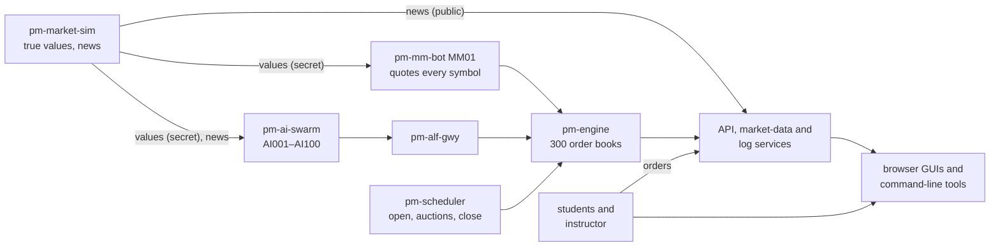

# A Market That Runs Itself

!!! note "Learning objectives"
    After reading this chapter you will be able to:

    - Say in a few sentences what the simulation is and what it is for
    - Name its parts and what each one does
    - Explain the one idea the whole simulation rests on: a price that is
      trying to find a value nobody can see

## An exchange with nobody at the desks

An exchange on its own is an empty room. Order books fill only when someone
sends orders, and a class of students can keep a few symbols busy for an hour
at most. The simulation fills the room: AI traders send orders into every one
of 300 order books, all day, every trading day, whether anyone is watching or
not. Students who log on find a market already moving — prices, spreads,
queues, news — and trade in it next to the bots.

The traders are not scripted. Each one follows a simple rule of its own —
buy what looks cheap, follow a trend, fade a move, react to a headline, or
just trade at random — and the prices you see are what those rules add up
to. Nobody decides that AAPL should trade at 182.40. It does because a value
investor thought it was cheap at 182.30 and a noise trader happened to sell.

## The idea underneath: a value nobody can see

Real shares have a value — what the company is actually worth — that nobody
knows exactly. Prices wander around it: traders who have a good idea of the
value buy when the price is below it and sell when it is above, and so pull
the price toward it, while everyone else pushes it about. When news arrives
the value jumps, and the price follows as fast as traders understand the
news. That is *price discovery*.

The simulation makes this concrete. A process called `pm-market-sim` keeps a
**true value** for every share: a number that moves the way company values
move, together with the market, with its sector, on its own, and in sudden
jumps when news comes out. The true values are secret. Students never see
them; only some of the AI traders, the market maker and the instructor do.
The price on the exchange is whatever the traders agree on, and the gap
between price and value is what makes the market interesting:

- a well-informed market keeps the gap small, a noisy one lets it grow;
- a headline moves the value at once and the price a little later;
- a rumour moves the price but not the value — until it is confirmed or
  retracted.

[The True Value](../part-2-how-it-works/030-the-true-value.md) explains the
model; [News and Rumours](../part-2-how-it-works/040-news-and-rumours.md) the
news.

## The parts

| Part | Process | What it does |
|---|---|---|
| The exchange | `pm-engine` and its gateways | Matches orders in 300 order books; publishes trades and prices |
| The clock | `pm-scheduler` | Opens and closes the market: pre-open at 09:00, opening auction, continuous trading 09:30–16:00, closing auction, closed at 16:05; weekends and Swedish holidays off |
| The market model | `pm-market-sim` | Keeps the hidden true values, moves them during trading, publishes news and rumours |
| The market maker | `pm-mm-bot` as `MM01` | Quotes a buy and a sell price in every symbol, around a price it moves part of the way toward the true value every second |
| The AI traders | `pm-ai-swarm` as `AI001`–`AI100` | A hundred traders of twelve kinds, each trading 30 of the 300 symbols |
| The windows | the GUIs and `pm-*` tools | Show the books, the trades, the news, the logs; let people trade |

Everything else — the audit trail, clearing, statistics, the API — is the
ordinary exchange, running exactly as it does in a classroom without any
bots. The AI traders are participants like any other: they log on, send
orders and receive fills through the same gateway a student's trading
program uses. Their orders are in the books you look at, their trades in
the tape.

## The twelve kinds of trader

Each AI trader follows a *preset*: a strategy (what to trade), an execution
style (how), a tempo (how often, how big) and risk limits. The hundred
traders are a mix:

| Preset | How many | What it does |
|---|---|---|
| `noise-retail` | 15 | Small random orders resting near the best prices — the background flow |
| `value-investor` | 22 | Buys below its view of the true value, sells above it |
| `trend-follower` | 10 | Buys what is rising, sells what is falling |
| `contrarian` | 10 | The opposite: fades moves, patiently |
| `institutional` | 8 | Big orders toward the value, sliced over minutes |
| `scalper` | 8 | Fast momentum trades with tight trailing stops |
| `news-trader` | 5 | Trades headlines within seconds |
| `iceberg-seller` | 4 | Large orders showing only a fifth of their size |
| `market-taker` | 4 | Impatient: takes liquidity with market orders |
| `block-taker` | 2 | Takes whole blocks with fill-or-kill orders |
| `auction-player` | 2 | Trades mostly in the opening and closing auctions |
| `patient-liquidity` | 10 | Small orders waiting deep in the book — the depth behind the best prices |

Only the value, institutional and news traders know anything about the true
value or the news. Everyone else trades on prices alone — and that is what
keeps the market from being perfectly efficient.
[How the AI Traders Decide](../../participant-guide/part-4-automated-trading/020-how-the-bots-decide.md)
has the details.

## What it is good for

- **A live market for a class.** Students log on as `TRADER01`–`TRADER10`
  and trade in books that already have depth, a spread and a tape.
- **Teaching price discovery.** Inject a headline in front of the class and
  watch the price find the new value; inject a rumour and watch it move a
  price that should not move.
- **Teaching microstructure.** Auctions, queues, icebergs, stops, market
  orders sweeping a book — all of them happen every day, unprompted.
- **A long-running test bed.** Leave it for a month and use the history:
  daily statistics, the audit trail, the traders' daily profit and loss.

## What it is not

The simulation is a teaching market, not a forecast of a real one. Its
values follow a textbook model, its traders a handful of simple rules, and
its hundred participants are far fewer than a real exchange's. The prices
look and behave like prices — they trend, revert, jump on news, and have the
fat-tailed returns of real prices — but no real share is behind them.

## See also

- [Ten-Minute Start](020-ten-minute-start.md) — get it running
- [The True Value](../part-2-how-it-works/030-the-true-value.md) — the model behind the prices
- [AI Traders](../../participant-guide/part-4-automated-trading/010-ai-traders.md) — the trader processes and presets
