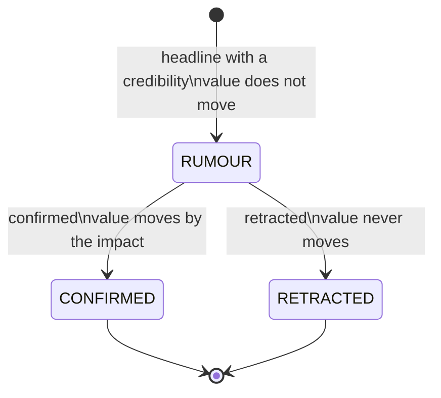

# News and Rumours

!!! note "Learning objectives"
    After reading this chapter you will be able to:

    - Read a headline the way the simulation means it: scope, kind, sentiment
      and the secret impact behind it
    - Follow a rumour from its first headline to its confirmation or retraction
    - Predict how the AI traders and the market maker react to news
    - Turn generated news up, down or off, and publish news of your own in
      front of a class

    **Prerequisites**: [The True Value](030-the-true-value.md).

## Why news

In the simulation, as on a real exchange, the true value of a share does two
things: it drifts a little all the time, and now and then it jumps because
something happened. The jumps are what news is for. A headline tells the
market that the value has moved — and roughly which way — before the price
has caught up. Who reads it first, who believes it and who ignores it is what
turns a headline into a price move you can watch.

## Anatomy of a headline

| Field | Public? | Meaning |
|---|---|---|
| **Scope** and targets | yes | One symbol, one sector, or the whole market |
| **Kind** | yes | `EARNINGS`, `GUIDANCE`, `MNA`, `REGULATORY`, `PRODUCT`, `LEGAL`, `MANAGEMENT`, `MACRO`, `OPERATIONS`, `RESEARCH`, `CONTRACT` or `ESG` |
| **Headline** | yes | The text, e.g. *"NVDA raises its outlook"* |
| **Sentiment** | yes | How good it sounds, from −1 (very bad) to +1 (very good) |
| **Status** | yes | `CONFIRMED` (it happened), `RUMOUR`, then `CONFIRMED` or `RETRACTED` |
| **Credibility** | yes, rumours only | How believable the rumour looks, 0 to 1 |
| **Impact** | **no** | The log move it causes in the true value: 0.05 is about +5.1 %, −0.10 about −9.5 % |

Students see everything but the impact: in terminal-gui's news view, the API
(`GET /api/v1/news`) and `pm-ticker`. The impact is the market model's
secret, exactly like the true value.

**How far a headline moves values.** A symbol headline moves that symbol by
its impact. A sector headline moves each symbol of the sector by
`beta_sector × impact`, a market headline every symbol by
`beta_market × impact` — so with the `s300-sim` betas a sector headline
moves its symbols by about 35–60 % of the impact, and a market headline every
symbol by 35–60 % of it.

## Generated news

Left alone, `pm-market-sim` writes news itself, at random moments during
continuous trading. The `s300-sim` example keeps the defaults:

```yaml
news:
  rate_symbol: 6.0         # symbol headlines per trading day, whole exchange
  rate_sector: 0.5         # sector headlines per trading day
  rate_market: 0.3         # market headlines per trading day
  rumour_share: 0.3        # share that starts as a rumour
  rumour_confirm: 0.6      # chance a rumour is confirmed rather than retracted
  rumour_delay_min: 0.02   # trading days before a rumour resolves (uniform)
  rumour_delay_max: 0.15
```

What that means on a 300-symbol exchange:

| | On average |
|---|---|
| Symbol headlines | 6 a day — one every hour or so; any one share gets news about once every 50 trading days |
| Sector headlines | one every two trading days |
| Market headlines | one every three or four trading days |
| Rumours | about 2 a day; they resolve 8 to 60 minutes of continuous trading later, 3 in 5 confirmed |

A "trading day" here is the 6.5 hours of continuous trading; the rates are
per trading day whatever speed the calendar runs at (see
[Accelerated Time](../part-3-run-it/120-accelerated-time.md)).

### What kind of news, how big

Each headline is drawn from a catalogue of *stories*, and each story has its
own size: the impact is normally distributed with the story's mean and
spread. There are two sorts.

**Everyday news** can go either way. Its headline follows the sign of the
impact: *"NVDA beats earnings expectations"* or *"NVDA misses earnings
estimates"*.

| Kind | Scopes | Share of symbol news | Impact mean | Impact spread (σ) | Typical move |
|---|---|---|---|---|---|
| `EARNINGS` | symbol | 24 % | 0 | 5 % | ±5 % |
| `GUIDANCE` | symbol | 12 % | 0 | 3 % | ±3 % |
| `PRODUCT` | symbol | 12 % | +0.5 % | 2 % | ±2 % |
| `REGULATORY` | symbol, sector | 6 % | −1 % | 4 % | ±4 %, a little more often bad |
| `LEGAL` | symbol | 6 % | −1 % | 3 % | ±3 %, a little more often bad |
| `MANAGEMENT` | symbol | 6 % | 0 | 2 % | ±2 % |
| `MNA` | symbol | 3 % | +6 % | 6 % | a takeover bid: mostly up, sometimes a lot |
| `MACRO` | sector, market | — | 0 | 1.5 % | ±1.5 % before the betas |

**Events** go one way only, and they are big: a fire is always bad news, a
breakthrough always good. Together they are about a third of symbol news,
so with the default rates a class sees two or three a day, which is far
more often than in real life, so that students get to watch what such a
shock does to a price.

| Kind | Examples | Typical move |
|---|---|---|
| `OPERATIONS` (15 %) | *"Fire ravages XOM's main refinery"*, flooding, a cyber-attack, a strike, a parts shortage; good: a site reopening early, a new oil find | −2.5 % to −5 %; +2 % to +5 % |
| `ESG` (7 %) | *"Environmental protests delay TSLA's new battery plant by 12 months"*, a fine for breaking environmental rules, an oil spill, a wildfire blamed on a utility's lines; good: a permit won after a long battle | −2 % to −8 %; +2.5 % |
| `CONTRACT` (5 %) | *"CAT signs a $5 bn long-term deal with a major new customer"*, losing the largest customer, a defence contract | +4.5 % to +5 %; −5 % |
| `RESEARCH` (4 %) | *"NVDA breakthrough lifts next-generation chip performance by 35 %"*, a late-stage drug trial that succeeds or fails, a flagship R&D project written off, a chip that slips a year | +5 % to +8 %; −5 % to −10 % |
| `PRODUCT` (2 % of the 14 %) | *"GM recalls 300,000 vehicles over a brake defect"*, a product recalled over a safety defect, deliveries halted | −6 % |

Some events only happen in their own industry: chip stories to
chipmakers, trials to drug makers, recalls of vehicles to carmakers,
groundings to airlines, defence contracts to aerospace. Other events need
a fitting sector: a bank has nothing to recall, and a utility has no
largest customer. A number in the headline grows with the impact: a chip
that is 40 % faster moves the value more than one that is 20 % faster.

Sector headlines are `REGULATORY` (42 %, including export curbs on chips
and drug-pricing reform), `MACRO` (40 %) or `OPERATIONS` (18 %: a
supply-chain disruption, a port strike, a hurricane that shuts refineries).
Market headlines are always `MACRO`.

### Sentiment: a hint, not the answer

The sentiment students see is the impact made public, but blurred: for
everyday news roughly impact ÷ (2 × the story's spread), plus a little noise
(σ 0.15), clipped to ±1. So an earnings beat of one spread (+5 %) reads
about +0.5, and a big miss of two spreads (−10 %) about −1. For an event it is
impact ÷ (|mean| + spread) plus the same noise, so a typical fire reads
about −0.7 and a bad one −1. An event's sentiment always has the right sign.
For everyday news the sign is almost always right. For both, the size is only
a guide. Two headlines with the same sentiment can move the value by
quite different amounts, which is why value traders, who see the value
itself, keep correcting what news traders start.

## Rumours



A rumour is a headline that may not be true. It carries a **credibility**
and moves nothing in the model. Later it is confirmed — a second headline,
and only then does the value move — or retracted, and the value never moves
at all. Prices often do move on a rumour, though: that is traders betting on
it, and when a retracted rumour's price move unwinds, someone has lost money.

Credibility is informative but not reliable. A generated rumour that will be
confirmed gets a credibility between 0.4 and 0.9; one that will be retracted
between 0.1 and 0.6. A credibility of 0.8 is almost surely true, one of 0.2
almost surely false, and anything in 0.4–0.6 is a coin toss.

## Who reacts, and how

| Who | Reacts to | How |
|---|---|---|
| `news-trader` (5 agents) | every headline touching its symbols | Hears it after a lag of its own (median 5 s), then trades in the headline's direction while its conviction — \|sentiment\|, times credibility for a rumour, halving every 2 minutes — stays above 0.15; pays up to `0.08 × conviction` beyond the price it first saw |
| `value-investor`, `institutional` (30 agents) | the true value, which news moves | Buy or sell toward the new value as soon as it moves. On a rumour, which does not move the value, they shift their own view by `0.05 × sentiment × credibility` |
| `MM01`, the market maker | the true value | Moves its own price 30 % of the way toward the value every second and re-quotes once that has moved 15 ticks — so a confirmed headline moves its quotes within seconds, and a rumour does not move them at all |
| Everyone else (65 agents) | prices only | Trend followers and scalpers chase the move once it shows; contrarians fade it |

Put together, a confirmed headline is priced in fast: in a test with an
anchored market maker and the same kinds of trader on 150 symbols, a +10 %
earnings surprise moved the price +6.5 % within 5 seconds and +10 % within 15 seconds.
Rumours leave much less trace than you might expect. The market maker sells
to every rumour buyer at its value-anchored price, so in the same test a
credible good rumour (sentiment 0.7, credibility 0.5) lifted the price under
3 %, and a sector rumour moved its sector by less than 1 %. To show students
how a rumour moves a market, run without the market maker — see
[Tuning the Traders](060-tuning-the-traders.md#the-market-maker).

## Steering the news

### Fewer, more, or none

Change the rates in `market_sim.yaml` (how to deploy your copy:
[Tuning the Traders](060-tuning-the-traders.md#where-the-settings-live)):

| You want | Set |
|---|---|
| A quiet market where you alone publish news | every `rate_*` to `0` |
| A news-heavy market, a headline every few minutes | `rate_symbol: 60` (and perhaps `rate_sector: 3`) |
| More rumours, harder to read | `rumour_share: 0.6`, `rumour_confirm: 0.5` |
| Rumours that linger for a lesson | `rumour_delay_min: 0.1`, `rumour_delay_max: 0.3` |
| No market-wide shocks | `rate_market: 0` |

Each rate is a Poisson rate: the gaps between headlines are random, so
`rate_symbol: 60` gives ten an hour *on average*, sometimes three in a
minute, sometimes none for twenty.

### Publishing news yourself

`pm-news` sends a headline to the running market model as an ADMIN
participant. In the container:

```bash
# From the host
docker exec edumatcher-sim pm-news --id OPS01 inject --symbol NVDA \
    --kind EARNINGS --sentiment 0.8 --impact 0.08 \
    --headline "NVDA smashes estimates on data-centre demand"

# From within the container
pm-news --id OPS01 inject --symbol NVDA \
    --kind EARNINGS --sentiment 0.8 --impact 0.08 \
    --headline "NVDA smashes estimates on data-centre demand"
```

The value of NVDA moves +8.3 % at once; the price follows within seconds.
A rumour you inject waits for you:

```bash
# From the host
docker exec edumatcher-sim pm-news --id OPS01 inject --sector ENERGY \
    --kind REGULATORY --sentiment -0.7 --impact -0.06 --rumour --credibility 0.6 N12
docker exec edumatcher-sim pm-news --id OPS01 confirm N12     # or: retract N12

# From within the container
pm-news --id OPS01 inject --sector ENERGY \
    --kind REGULATORY --sentiment -0.7 --impact -0.06 --rumour --credibility 0.6 N12
pm-news --id OPS01 confirm N12     # or: retract N12
```

`inject` prints the headline's id (`N12` here). A rumour you inject never
resolves on its own. Your headlines and generated ones mix freely; set the
rates to 0 if yours should be the only ones.

### Scenarios

For a lesson, script the news in a file and play it:

```bash
# From the host
docker exec edumatcher-sim pm-news --id OPS01 play \
    /opt/edumatcher/.venv/lib/python3.14/site-packages/docs/examples/news/earnings-surprise.yaml

# From within the container
pm-news --id OPS01 play \
    /opt/edumatcher/.venv/lib/python3.14/site-packages/docs/examples/news/earnings-surprise.yaml
```

Four scenarios ship with EduMatcher — `earnings-surprise`,
`rumour-confirmed`, `rumour-retracted` and `chip-race` (a chip breakthrough,
then a rumoured fire at a rival's fab) — and fit `s300-sim` as they fit
the `s150-*` examples. Their format, and how to write your own, is in
[The Market Model](../../operator-guide/part-4-run-a-market/090-market-model.md#scenarios);
the [AI Traders & News](../../training-guide/140-ai-traders.md) exercises
use them in class.

### Watching the news

| Where | What |
|---|---|
| terminal-gui, news view | Every headline as it is published, with status and sentiment |
| `docker exec edumatcher-sim pm-news list` | Headlines printed as they arrive, until Ctrl+C |
| `docker exec edumatcher-sim pm-news past --limit 20 --date 2026-10-14` | Recent headlines from that session date, newest first |
| `GET /api/v1/news` (any API key) | Today's headlines, and the sector of every symbol |

## Try it

1. Pick a quiet symbol in book-gui and note its price and the value
   (`pm-market-sim --status --id OPS01` lists it if it is far off; the
   admin API, `GET /api/v1/admin/sim` with the `OPS01` key, gives all of them).
2. Inject a confirmed headline with impact `0.05` and watch the price for a
   minute. Who traded first? (The tape and the order book show `AI` ids.)
3. Inject a rumour with sentiment `0.8`, credibility `0.9`, and no impact
   worth speaking of (`--impact 0.001`). Does the price move? Why not much?
4. Retract it. Then try again without the market maker
   ([Tuning the Traders](060-tuning-the-traders.md#the-market-maker) shows how
   to remove it).

## See also

- [The Market Model](../../operator-guide/part-4-run-a-market/090-market-model.md#news) — the reference for `pm-news` and scenarios
- [How the AI Traders Decide](../../participant-guide/part-4-automated-trading/020-how-the-bots-decide.md) — the `news` and `value` strategies in full
- [AI Traders & News](../../training-guide/140-ai-traders.md) — classroom exercises with news
