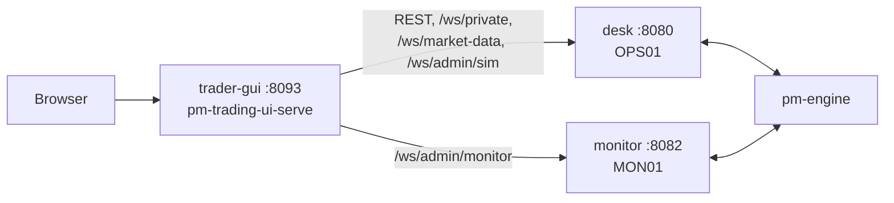

# The Simulation Container

!!! note "Learning objectives"
    After reading this chapter you will be able to:

    - Explain what is in the `edumatcher-ai-sim` image and how it differs
      from the plain `edumatcher` image
    - Read `compose.ai-sim.yaml` and change what it runs through its
      environment variables
    - Run the simulation on a server for a class, safely
    - Upgrade, reset, back up and build the image yourself

    **Prerequisites**: [Ten-Minute Start](../part-1-start-here/020-ten-minute-start.md).

## Two images, one exchange

| Image | What it is |
|---|---|
| `ghcr.io/johan162/edumatcher` | The exchange. Starts the `s10-basic` example with the `default` profile unless told otherwise |
| `ghcr.io/johan162/edumatcher-ai-sim` | The same image with different defaults: the `s300-sim` example, the `ai-sim` profile, Stockholm time, dead processes restarted |

Both are built from the same `Dockerfile` (`deployment/docker/`) — the
simulation is its last stage, a handful of environment variables on top of
the exchange — and published together with every release, for `amd64` and
`arm64`, tagged with the release version and `latest`. Nothing in the
simulation image is a fork: every program in it is the ordinary
`edumatcher` package.

```dockerfile
FROM runtime AS ai-sim

ENV EM_CONFIG=s300-sim \
    EM_PROFILE=ai-sim \
    EM_RESTART_DEAD=1 \
    EM_SPEED=1 \
    TZ=Europe/Stockholm
```

## What happens when it starts

The image's entry point (`entrypoint.sh`) does five things:

1. **Deploys the configuration** into `/data` — the `EM_CONFIG` example, or
   your own file if `EM_CONFIG_FILE` is set. On later starts it keeps what is
   deployed, unless `EM_CONFIG` names a different example than last time.
2. **Sets the clock**: with `EM_SPEED` other than 1, or `EM_START`, it
   passes them on to the scheduler (as `EDUMATCHER_SCHEDULER_SPEED` and
   `EDUMATCHER_SCHEDULER_START`).
3. **Starts the profile** with `pm-opctl-cli start ai-sim`. The profile's
   scheduler runs `pm-eod run --pending` half a minute after every close, so
   each simulated day is settled and written up on its own — see
   [End of day](#end-of-day) below.
4. **Watches it**: once a minute it restarts any process of the profile that
   has died (it only looks for a running process; it does not connect to the
   gateways' ports, so it never shows up as a client in their logs), and says so in the container log (`docker logs edumatcher-sim`):

    ```text
    ==> 2026-11-03 09:00:41 Restarting: mm-bot
    ==> 2026-11-03 09:00:41   started mm-bot (pid 812): pm-mm-bot --gateway-id MM01 ...
    ```

    The market maker usually appears here once, a minute after the first
    start: it gives up if it starts before the engine is ready.
5. **Stops cleanly** on `docker stop` (or `compose down`): it stops every
   process of the profile, which takes up to a minute.

The image's health check asks whether the engine accepts connections, so
`docker ps` shows `healthy` once the exchange is up — whether or not the
market is open.

## `compose.ai-sim.yaml`

The compose file runs six containers in one compose project,
`edumatcher-sim`:

| Container | Image | Host port | |
|---|---|---|---|
| `edumatcher-sim` | `edumatcher-ai-sim` | 5560, 5565, 5570, 5580, 5590, 5600, 8080, 8081, 8082 | the exchange and the simulation |
| `edumatcher-sim-terminal-gui` | `edumatcher-terminal-gui` | 8090 | market-data terminal |
| `edumatcher-sim-log-gui` | `edumatcher-log-gui` | 8091 | log viewer |
| `edumatcher-sim-trader-gui` | `edumatcher-trader-gui` | 8093 | trading screen |
| `edumatcher-sim-book-gui` | `edumatcher-book-gui` | 8094 | order-book viewer |
| `edumatcher-sim-dash-gui` | `edumatcher-dash-gui` | 8095 | operator dashboard |
| `edumatcher-sim-clearing-gui` | `edumatcher-clearing-gui` | 8096 | clearing client (read-only) |

The GUIs reach the exchange over the compose network, at the host name
`edumatcher`; the host ports are for you and your students' browsers and
programs. The GUIs that read market history use the example's read-only API
key, which the compose file already knows.

There are two copies of this file, and they describe the same six
containers:

| | |
|---|---|
| `deployment/curl/compose.ai-sim.yaml` | What `install.sh --sim` fetches into `~/.edumatcher-sim`. Build-free: every image comes from GHCR. Its data directory is `./data` |
| `deployment/docker/compose.ai-sim.yaml` | The repository's own, which can also *build* the image (`make build-sim`). Its data directory is `./data-sim` |

The rest of this chapter uses the installed one and `./edumatcher.sh`.

### Three API gateways

The plain exchange runs two instances of the REST/WebSocket API gateway,
`pm-api-gwy`. The simulation runs a third one:

| Instance | Port | Who connects | Keys it accepts |
|---|---|---|---|
| `desk` | 8080 | trader-gui (everything but the admin monitor socket), clearing-gui, students' own programs | `TRADER01`–`TRADER10`, `MM01`, `OPS01` |
| `dashboards` | 8081 | terminal-gui, book-gui, dash-gui | the read-only key only |
| `monitor` | 8082 | trader-gui's admin monitor socket, and nothing else | `OPS01`'s key, as the participant `MON01` |

#### Why a third one

The instructor's screens in trader-gui (Admin Dashboard, Monitor Log) are
fed by one WebSocket, `/api/v1/ws/admin/monitor`. It carries every order
event of every participant: all hundred AI traders, the market maker and the
desks. At 09:30, when continuous trading starts, the engine sends about a
thousand messages a second for a few minutes, and the admin feed turns them
into about five thousand events a second, each encoded and sent to the
browser.

Each `pm-api-gwy` is one Python process with one event loop, so it can use
only one CPU core, however many the machine has. With the admin feed on
`desk`, that core was full at the open: `desk` ran at 100–117 % CPU, its
event loop fell up to 1.4 s behind, and in 13 minutes it dropped between
100 000 and 200 000 admin events. The admin socket's queue is bounded on
purpose: the gateway drops events for a browser that cannot keep up rather
than stall everyone else. trader-gui notices the gap and reloads the working
orders, but the Monitor Log has holes in it. Worse, every student order sent
through trader-gui went through the same busy loop and waited behind the
admin feed.

Bigger queues and sending events in batches of up to 256 per frame made the
gateway cheaper per event, but did not fix the root cause: one core is not
enough for trading and the admin feed together. Pinning the process to more
cores does not help a single event loop either. A third gateway process does:
the admin feed gets a core of its own, and order entry on `desk` no longer
waits for it.

#### How it is wired

The browser only ever talks to trader-gui (port 8093). trader-gui's small
server, `pm-trading-ui-serve`, forwards `/api/*` to an API gateway, so the
page needs only one address. Two settings in the compose file decide where
things go:

```yaml
trader-gui:
  environment:
    API_PROXY_TARGET: "http://edumatcher:8080"          # everything under /api/
    API_ADMIN_MONITOR_TARGET: "http://edumatcher:8082"  # only /api/v1/ws/admin/monitor
```

Only that one WebSocket path goes to `monitor`. All REST calls, the private
order stream, the market-data socket and the `/api/v1/ws/admin/sim` socket
stay on `desk`. Without `API_ADMIN_MONITOR_TARGET` (as in the plain
`edumatcher` image) the admin socket goes to `API_PROXY_TARGET` like the rest.



**Keys.** The instructor logs in to trader-gui once, with the `OPS01` key,
and the browser sends that same key as the first message on every socket. So
`monitor` has to accept it too. But it cannot log in to the engine as `OPS01`:
`desk` already has, and the engine refuses one participant connected twice.
So `monitor` maps the key to a participant of its own, `MON01` (role ADMIN).
In `engine_config.yaml`:

```yaml
api_gateways:
  desk:
    port: 8080
    credentials:
    - api_key: key-ops01-3e34rs
      gateway_id: OPS01
    # ... the desks and MM01
  monitor:
    port: 8082
    credentials:
    - api_key: key-ops01-3e34rs     # the same key...
      gateway_id: MON01             # ...a different participant
```

That is why `MON01` appears as a second connected ADMIN in the instructor's
screens. It is not a person, and it needs no key of its own.

**What it sees.** Every API gateway reads the engine's whole message feed, so
`monitor` sees every participant's orders, not just `MON01`'s. When the
socket opens, it asks the engine for the list of participants and the halts,
so the instructor's first view is the same as it would be on `desk`.

**The process.** The `ai-sim` profile starts it as
`api-monitor-gwy (api-gwy)`, which runs `pm-api-gwy --verbose --instance monitor`
([A Complete Setup by Hand](100-a-complete-setup-by-hand.md#what-runs)). Like
every other process of the profile, it is restarted within a minute if it
dies, and `pm-opctl-cli list` checks that it answers on port 8082.

**The configuration.** `docs/examples/ref_data/mks300.sh` generates
`s300-sim`'s `engine_config.yaml` with
`--api-gateway-instance monitor:MON01:8082` and the participant
`MON01:ADMIN:LEAVE_ALL`. `pm-config-gen` gives `MON01` a key of its own, so
the script then replaces it with `OPS01`'s.

#### What to watch out for

- **Change both keys together.** When you give `OPS01` a new key in your own
  configuration, give the `MON01` entry under `monitor` the same key, or the
  Admin Dashboard and Monitor Log stay empty while everything else works.
- **Keep the `monitor` instance in your own configuration.** The `ai-sim`
  profile always starts `pm-api-gwy --instance monitor`, and trader-gui
  always sends the admin socket to port 8082. A configuration without the
  instance (one copied before this was added, or written from scratch) makes
  that process exit at every start with
  `api_gateways instance 'monitor' not found`, and the admin screens stay
  empty. Copy the `monitor` block and the `MON01` participant from the
  deployed `s300-sim` configuration.
- **It costs a core at the open.** Like every API gateway, `monitor` decodes
  the whole engine feed, so it uses CPU at the open even when no instructor
  is connected. On a two-core machine the three gateways and the engine
  share the cores during the busiest minutes.
- **No fallback.** If `monitor` is down, the admin screens are empty until it
  is restarted; `desk` does not take over the admin socket.
- **The bootstrap sequence numbers belong to one gateway.** The admin
  bootstrap (`GET /api/v1/bootstrap/admin`, answered by `desk`) returns
  `monitor_last_seq`, each participant's event counter. Each gateway process
  keeps its own counters, so these numbers do not match the events on the
  admin socket from `monitor`. trader-gui does not use them; a program of
  your own that follows the admin feed should take its sequence numbers from
  the socket alone.

### Settings

Everything is set with environment variables, in the `.env` file next to the
compose file (the installer writes one) or on the command line, as in
`EM_SPEED=24 docker compose -f compose.ai-sim.yaml up -d`:

| Variable | Default | Meaning |
|---|---|---|
| `EM_SPEED` | `1` | How many times faster than real time the trading calendar runs ([Accelerated Time](120-accelerated-time.md)) |
| `EM_START` | — | Where an accelerated calendar starts, local time, e.g. `2026-11-02T08:55` |
| `TZ` | `Europe/Stockholm` | The time zone of the trading hours |
| `EM_CONFIG_FILE` | — | Your own engine configuration, as a path inside the container (below) |
| `EM_VERSION` | `latest` | Which release of all six images to run, e.g. `0.51.0` |
| `GHCR_OWNER` | `johan162` | Whose published images to pull |
| `BIND_ADDR` | `127.0.0.1` | Which host interface the ports are published on |
| `TERMINAL_GUI_PORT`, `LOG_GUI_PORT`, `TRADER_GUI_PORT`, `BOOK_GUI_PORT`, `DASH_GUI_PORT`, `CLEARING_GUI_PORT` | 8090, 8091, 8093, 8094, 8095, 8096 | Host ports of the GUIs |
| `PM_READONLY_API_KEY` | the `s300-sim` key | The read-only key the GUIs use; change it only with your own configuration |
| `AISIM_IMAGE` | the GHCR image | A different backend image, e.g. one you built |

!!! tip "Pin a version for a course"
    `latest` moves with every release. For a course that runs for weeks,
    put `EM_VERSION=<version>` in `.env` so a restart never brings a
    different exchange. `./edumatcher.sh update 0.51.0` does it for you.

### Data

Everything the exchange writes is in the install's `data` directory, mounted
at `/data`: `~/.edumatcher-sim/data` for an installed simulation,
`./data-sim` next to the compose file in a checkout. It survives `stop`,
`start`, reboots and upgrades.

| To | Do |
|---|---|
| Start over, with a fresh market | `./edumatcher.sh stop`, delete `data`, `./edumatcher.sh start` |
| Back it up | Stop the stack, copy `data`, start it again |
| Look at a file | It is on your disk: `data/ai_swarm/`, `data/stats.db`, … |

A backup taken while the exchange runs can catch a database mid-write; stop
it first.

The first start also builds `data/companies.db`: made-up company profiles for
the 300 tickers (name, industry, CEO, founder story, financials, P/E, …). Look
them up with `./edumatcher.sh shell pm-compdb-cli show AAPL`, or list and
filter them with `pm-compdb-cli list`. It is built only when missing, so
companies you add survive restarts; delete it to get the bundled set back.
The reference manual's
[pm-compdb-cli](../../reference-manual/part-1-command-line/010-processes-environment-and-ports.md#pm-compdb-cli-company-database-cli)
section explains where the source files are and when the entrypoint builds the
database.

### End of day

After each close the scheduler starts [`pm-eod`](../../operator-guide/part-4-run-a-market/100-closing-the-day.md),
which turns the day's gains and losses into a **statement for every trader**
(AI001–AI100, MM01 and the desks), keeps a running **balance** for each, and
backs up the databases. Nothing needs configuring. The fictional currency
means the balances are simply a scoreboard: who has made money in the
simulated market so far.

| Where | What |
|---|---|
| `data/settlement/<date>/leaderboard.csv` | Everyone ranked by balance, best first |
| `data/settlement/<date>/statements/AI042.md` | One trader's statement (also `.json`, `.csv`) |
| `data/settlement/<date>/summary.md` | The day in one page, including the proof that the amounts sum to zero |
| `data/backup/<date>/` | Compressed copies of `clearing.db` and `eod.db`, kept 2 days. `stats.db` is left out: it is large and mostly disposable order events |

Ask for the current standings at any time, from inside the container:

```bash
./edumatcher.sh shell pm-eod balances
./edumatcher.sh shell pm-eod status
```

There is no `roster.yaml`, so statements carry the gateway names (`AI042`)
rather than people's names. To label the desks `TRADER01`–`TRADER10` for a
class, add a `ref_data/roster.yaml` in the data directory (see
[Closing the Day](../../operator-guide/part-4-run-a-market/100-closing-the-day.md#the-roster-file)).
A day settles only when the market has actually closed, so a weekend or a
holiday produces no statements.

### The commands you will use

From the install directory (`cd ~/.edumatcher-sim`):

| Task | Command |
|---|---|
| Start | `./edumatcher.sh start` |
| Stop | `./edumatcher.sh stop` |
| Process table, container status | `./edumatcher.sh status` |
| A shell in the exchange | `./edumatcher.sh shell` |
| One command in it | `./edumatcher.sh shell pm-market-sim --status --id OPS01` |
| The container log (starts, restarts) | `./edumatcher.sh logs edumatcher` |
| The web addresses | `./edumatcher.sh urls` |
| Which directory is behind each container path | `./edumatcher.sh mounts` |
| Accelerate the calendar | `./edumatcher.sh speed 24 2026-11-02T08:55`, then `restart` |
| Upgrade | `./edumatcher.sh update` (or `update 0.51.0`) |
| Remove it | `./edumatcher.sh uninstall` (`--data` to delete the data too) |

The script is a wrapper around `docker compose` and `docker exec`; anything it
does you can do by hand — `docker compose -f compose.ai-sim.yaml up -d`,
`docker exec edumatcher-sim pm-opctl-cli list --no-restart`,
`docker logs -f edumatcher-sim`.

From a clone of the repository, `deployment/docker/Makefile` wraps the same
things: `make up-sim`, `make down-sim`, `make sim-status` (process table and
disk), `make sim-shell`; `make up-sim SPEED=24 START=2026-11-02T08:55` for an
accelerated run.

## Changing what it runs

### Your own configuration

The container deploys a configuration of your own when `EM_CONFIG_FILE`
names one. Start from the deployed one:

```bash
mkdir -p my-sim
./edumatcher.sh shell cat /data/ref_data/engine_config.yaml > my-sim/engine_config.yaml
./edumatcher.sh shell cat /data/ref_data/market_sim.yaml    > my-sim/market_sim.yaml
# edit my-sim/market_sim.yaml (or engine_config.yaml), then:
./edumatcher.sh config ./my-sim/engine_config.yaml
./edumatcher.sh restart
```

`config` copies both files into the install's `./config`, which is mounted
read-only at `/config`, and sets `EM_CONFIG_FILE=/config/engine_config.yaml`
in `.env` so it stays set. If the configuration is refused, the container log
says why (`./edumatcher.sh logs edumatcher`) — check it first with
`./edumatcher.sh shell pm-cverifier /config/engine_config.yaml`.

A deployed configuration stays deployed: clearing `EM_CONFIG_FILE` alone does
not bring `s300-sim` back. Clear it, then redeploy the bundled one and
restart:

```bash
./edumatcher.sh shell pm-setup --config s300-sim --force
./edumatcher.sh restart
```

### Your own traders or process flags

The traders' mix and the processes' flags are in the process profile.
Write the built-in profiles out once and edit the copy:

```bash
./edumatcher.sh shell pm-opctl-cli init
```

`init` writes `data/emo-config.yaml`, which from then on replaces the
built-in profiles. To use your own `swarm.yaml`, put it in `./config/` and
change the `ai-sim` profile's `ai-swarm` command to
`--swarm /config/swarm.yaml`; restart the stack. Delete
`emo-config.yaml` to go back to the built-in profiles (and get the profiles
of a newer release after an upgrade).

[Tuning the Traders](../part-2-how-it-works/060-tuning-the-traders.md) says
what to change.

## Opening it to a classroom

By default every port is published on `127.0.0.1`: only the machine itself
can reach the exchange. To let students in from the local network, set
`BIND_ADDR=0.0.0.0` in `.env` and restart, and first:

- **Change the API keys.** The example's keys are printed in this book. Use
  your own configuration (above) with new `api_key` values for every
  participant, and give each student only their own.
- **Keep it on a network you trust.** Nothing here is encrypted: API keys
  and orders travel in clear text. Put a TLS reverse proxy in front of the
  web ports if the network is not yours.
- **Mind the order gateways.** The API (8080) checks a key; the order
  gateways (5560, 5565) identify a participant by its ID alone, so anyone who
  reaches them can log on as any participant — an AI trader included, which
  then loses its session. Publish them only on a network you trust, or take
  their lines out of the compose file's `ports` and let students trade
  through the API and trader-gui.

## Resources

Measured on a 2-vCPU Linux machine, at real speed during continuous trading
(see [Running It for Weeks](../part-4-watch-and-teach/150-running-it-for-weeks.md)
for the details and for disk):

| | |
|---|---|
| CPU, whole exchange | about half of one core while the market is open; almost nothing while it is closed |
| Memory | about 1 GB for the exchange container (the sum of the processes' resident memory), flat over the day |
| Busiest processes | `pm-engine` and the two API gateways together, a tenth of a core each; then `pm-stats`, `pm-audit`, the swarm worker, `pm-alf-gwy` and `pm-mm-bot`, about a twentieth each |

A laptop that runs a browser comfortably runs the simulation.

## Upgrading

```bash
./edumatcher.sh update          # the newest release
./edumatcher.sh update 0.51.0   # ...or an exact one
```

The data directory is kept, and with it the deployed configuration and the
market's history. The release notes say when a release changes the `s300-sim`
example; to take the new one, start over with a fresh data directory, or
redeploy with the new example while keeping your history:
`./edumatcher.sh shell pm-setup --config s300-sim --force`, then restart.

## Building the image yourself

From a clone of the repository:

```bash
cd deployment/docker
make build-sim          # builds edumatcher-ai-sim:local from this checkout
make up-sim LOCAL=1     # runs it with the GUI images from GHCR
```

`make build-sim` builds a wheel from the checkout (it needs `poetry`) and the
image's `ai-sim` stage. Without `make`:

```bash
docker build --target ai-sim -t edumatcher-ai-sim:local deployment/docker
AISIM_IMAGE=edumatcher-ai-sim:local docker compose -f deployment/docker/compose.ai-sim.yaml up -d
```

(Without a wheel in `deployment/docker/.wheel/`, the build installs the
latest `edumatcher` from PyPI.)
