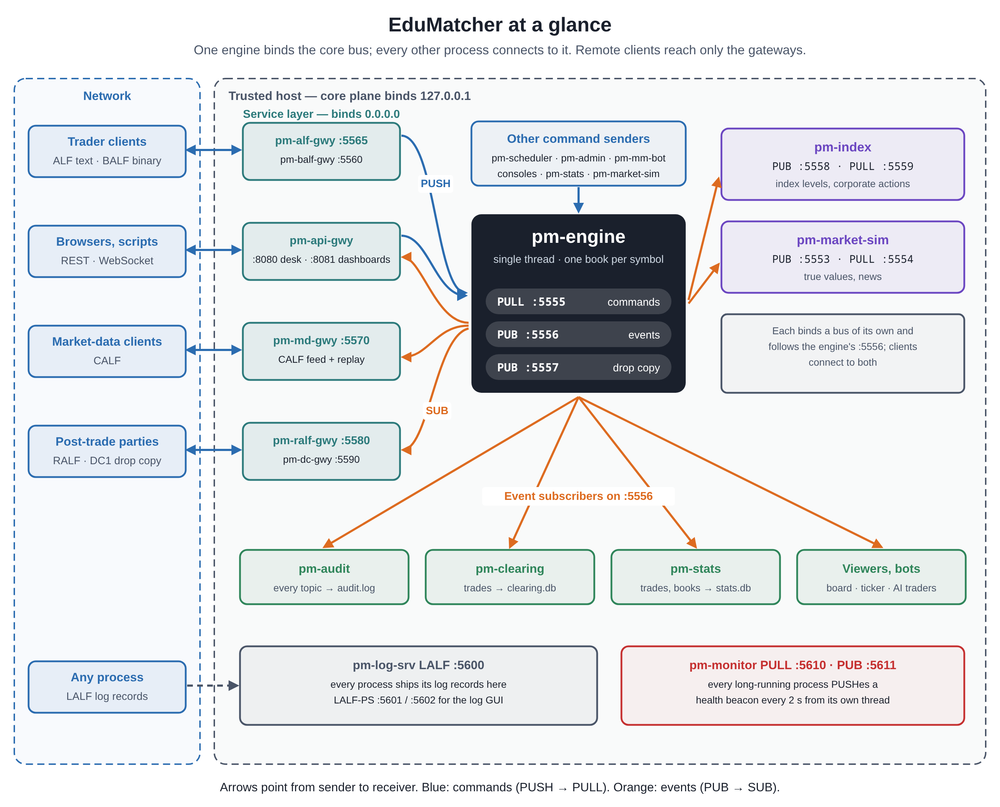
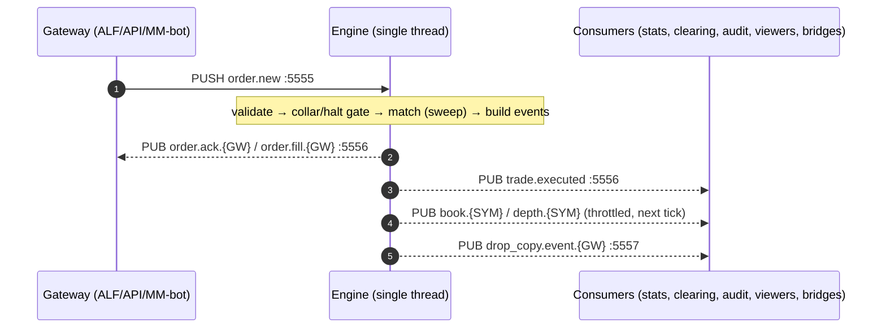
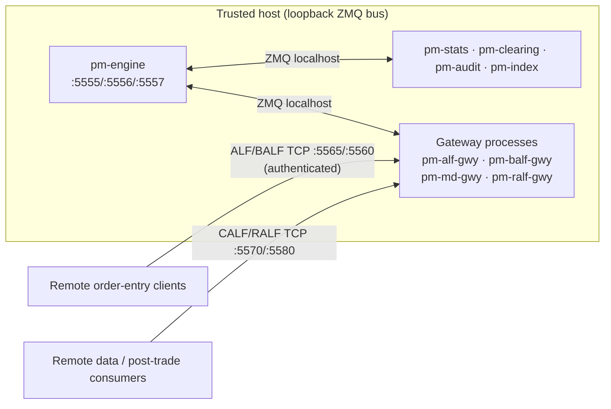
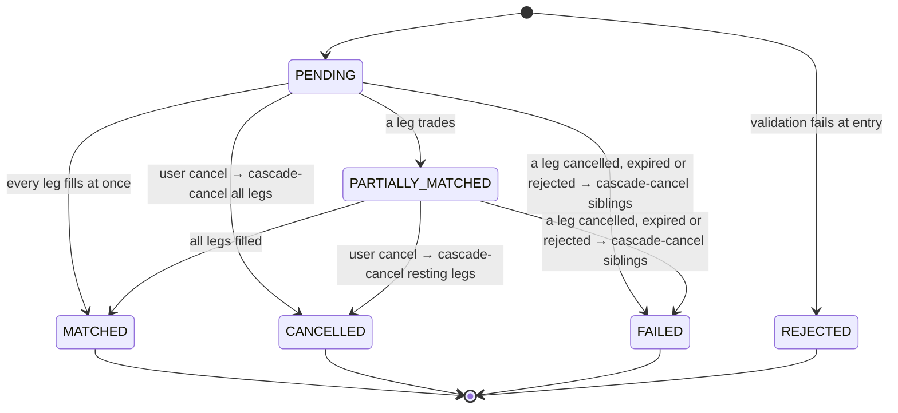
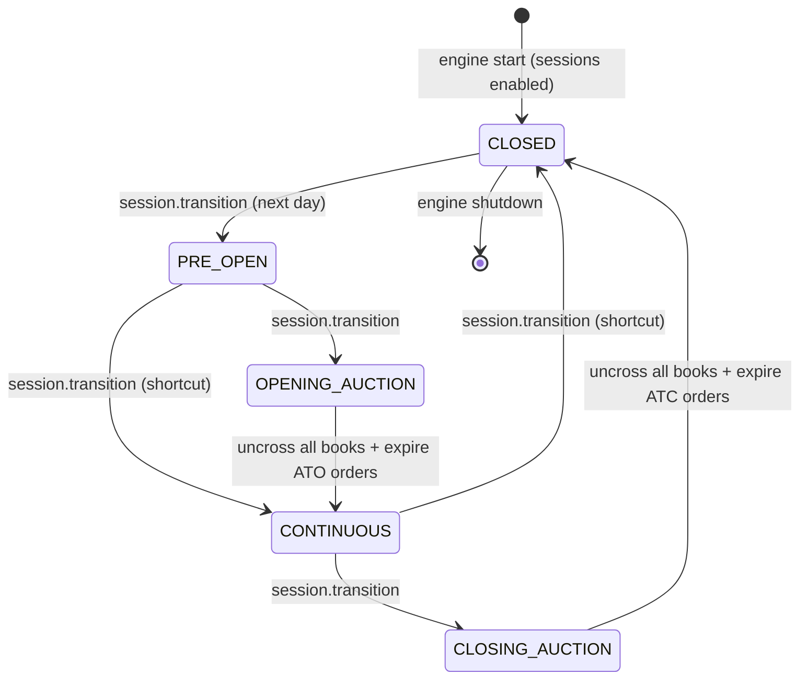
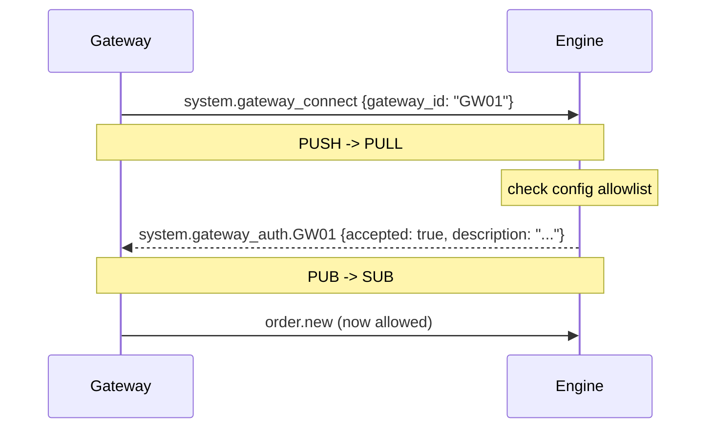
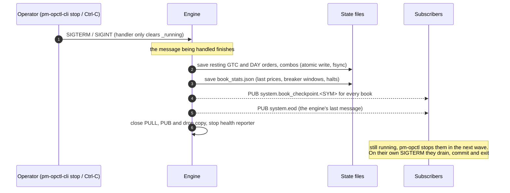
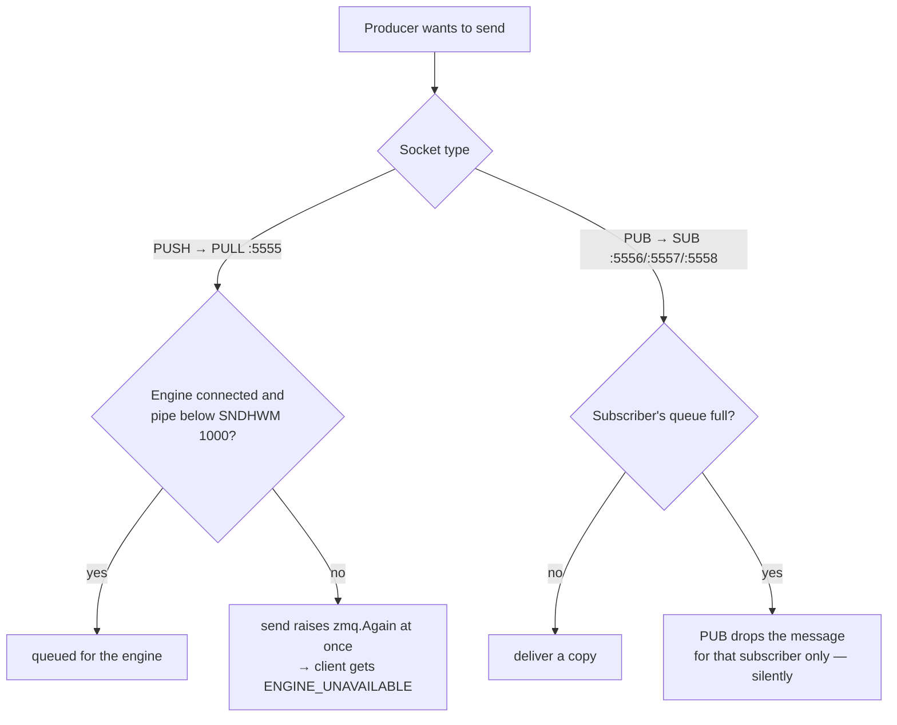

# Architecture

!!! note "Learning objectives"
    After reading this page you will understand:

    - Why a multi-process message-passing architecture was chosen over a monolith or
      a shared-memory design, and how this mirrors real trading systems
    - The fundamental messaging concepts: topics, publish/subscribe, point-to-point,
      broadcast, and subscription filters
    - How the ZeroMQ brokerless topology connects all processes in EduMatcher
    - The internal data structures of an order book — heaps, lazy deletion, price-level
      indexes — and how to read a visual order book depth diagram
    - The time complexity of every core operation: insert, match, cancel, stop trigger
    - The principal data flows, the single-host/remote deployment boundary, and the trust model
    - How state persists and is recovered across a restart, and what is *not* durable
    - The runtime failure modes — ZeroMQ back-pressure and silent PUB drop to slow consumers
    - Which configuration choices materially change throughput, latency, and memory

!!! info "This page vs. the Detailed Walkthrough"
    This page is the **architecture reference**: decisions, data flows, persistence,
    failure modes, and performance. For a first-principles, code-level tour that
    builds the same system up from a single limit order, read the
    [Detailed Walkthrough](020-guided-tour.md). Where the two overlap, this
    page is the concise reference and the Walkthrough is the narrative.


## Why This Architecture?

### Three ways to build a trading system

Before looking at what EduMatcher does, it helps to understand the alternatives
and why they fall short for this use case.

**Option 1 — Monolith**
: One process, one program.  The user types an order, matching runs, results print.
  Simple to build, simple to debug.  Falls apart as soon as two users need to trade
  simultaneously, or when you want to add an audit log without touching the matching code.

**Option 2 — Shared memory / threads**
: Multiple threads share an in-process order book protected by a lock.
  Common in C++ HFT cores.  Fast, but extremely hard to reason about:
  lock contention, priority inversion, and data races all wait to bite you.
  Also single-machine — you can't run the viewer on a separate screen
  without redesigning everything.

**Option 3 — Multi-process message passing**
: Each process owns its own state and communicates by sending messages.
  No shared memory, no locks.  Processes can run on different machines.
  Adding a new observer (an audit logger, a new data feed) means writing a
  new subscriber — the engine doesn't change.

EduMatcher uses Option 3.  It is also how most real exchange systems are
actually built: a matching engine core that publishes every event on an internal
bus, with a fleet of downstream consumers (clearing, risk, market data
distribution, surveillance) that subscribe to the topics they care about.

### Core messaging concepts

Before reading the topology diagram, it is worth having clear definitions:

**Topic**
: A string label attached to every message that identifies what kind of event it
  carries.  Examples: `trade.executed`, `order.fill.GW01`, `book.AAPL`.
  Think of it like the subject line of an email — the sender sets it, the
  receiver uses it to decide whether to read the body.

**Publish / Subscribe (PUB/SUB)**
: One sender, many potential receivers.  The sender *publishes* to a topic; every
  process that has *subscribed* to that topic receives a copy.  Processes that have
  not subscribed never see the message.  This is how the engine broadcasts book
  updates: one `book.AAPL` message is published; the viewer, the stats recorder,
  and the board all receive it independently.

**Subscription filter**
: A subscriber declares which topics it wants to receive.  In ZeroMQ, the filter is
  a simple prefix match: a subscription for `"order.fill.GW01"` receives only
  messages whose topic starts with that string.  A subscription for `"book."` receives
  book updates for all symbols.  An empty-string subscription receives everything.

**Broadcast**
: A message sent to all subscribers simultaneously with no specific address.
  The engine broadcasts `session.state` when the trading phase changes — every
  process (gateways, viewers, stats, board) reacts according to its own logic.

**Point-to-point (PUSH/PULL)**
: One sender, exactly one receiver.  EduMatcher uses PUSH/PULL for order
  submission: a gateway *pushes* an order message and the engine *pulls* it.
  No other process sees that message; no routing table is needed because the
  engine is the only process that ever binds the PULL socket.

**Message routing**
: In a broker-based system, the broker reads the topic and decides which queue
  to put the message in.  In EduMatcher, routing is done by the ZeroMQ
  layer using the subscription filter — no broker, no routing table, no extra
  process.

**Private reply over PUB/SUB**
: The subscription prefix enables a lightweight request/reply pattern without a
  dedicated REQ/REP socket.  When a gateway pushes a `system.symbols_request`
  command, the engine publishes the answer on `system.symbols.GW01` — a topic
  only that gateway's SUB filter will match; every other subscriber silently
  discards it at the ZMQ layer.  This pattern covers every personalised engine
  response: `order.ack.{GW}`, `system.symbols.{GW}`, `system.quote_bootstrap.{GW}`,
  and more.  It requires every connected process to register a unique gateway ID.


## Overview

EduMatcher uses a **broker-less ZeroMQ** topology.  
The matching engine is the only process that *binds* sockets — all other processes *connect* to it.  
No ZMQ broker daemon, no message queue server, no external dependencies beyond ZMQ itself.


## ZMQ Topology

{ width="100%" }

The design decisions behind this picture, every data flow through it, the
buffer sizes, the shutdown order and how failures are detected are the
subject of [The Message Architecture](015-message-architecture.md).


## Message Topics

Messages are multipart ZMQ. The first two frames are the message; the frame
behind them is the **envelope** — metadata about the message rather than
content of it, as `|`-separated ASCII fields.

| Frame | PUB (engine → subscribers) | PUSH (client → engine) |
|---|---|---|
| 0 | topic string (used for SUB filtering) | topic string |
| 1 | JSON payload | JSON payload |
| 2 | `seq`\|`eseq`\|`msg_id`\|`causation_id`\|`correlation_id` | `msg_id`\|`causation_id`\|`correlation_id` |

One frame rather than one per field, because ZeroMQ charges per frame.

**Why the envelope is not in the payload.** Keeping it in frames means the hot
publish path never decodes and re-encodes a message to stamp it, and the same
three fields do not have to be declared on each of the 136 message types in
`spec/messages/` — and re-declared on every type added later. `decode()` reads
only frames 0 and 1, so a consumer that does not care is unaffected.

**`seq` and `eseq` (PUB) — sequences.** ZeroMQ PUB/SUB drops silently once a
subscriber falls behind its high-water mark, and nothing in the delivered
message reveals it. A monotonic counter, counted *per topic* so that filtering
by topic prefix does not produce phantom gaps, lets any subscriber notice a
hole. Read it with `decode_sequence`. `eseq` counts every message the socket
published, so a subscriber that takes every topic (pm-audit) can prove the
whole stream complete; read it with `decode_publisher_sequence`.

**The causal envelope** — `msg_id`, `causation_id`, `correlation_id`; see
`models/envelope.py` and [Causal envelope](#causal-envelope) below. Read it
with `decode_envelope` (PUB) or `decode_push_envelope` (PUSH).

### Causal envelope

Every message carries a ULID `msg_id`. Every message the engine publishes
*while handling an inbound request* also carries that request's `msg_id` as its
`causation_id`, and a `correlation_id` naming the message the chain began with.

```
gateway PUSH  order.new                 msg=A  cause=—  chain=A
engine  PUB   order.ack.TRADER01        msg=B  cause=A  chain=A
engine  PUB   trade.executed            msg=C  cause=A  chain=A
engine  PUB   order.fill.TRADER01       msg=D  cause=A  chain=A
engine  PUB   order.fill.TRADER02       msg=E  cause=A  chain=A
```

"Which submission produced this trade?" is `cause`. "Everything that flowed
from that submission" is one lookup on `chain`. Neither has to be inferred from
timing or from shared order ids.

A message with **no** `causation_id` was not caused by anything on the bus — a
scheduler tick, a circuit-breaker trip, an end-of-day sweep. That is a positive
statement, not missing data.

Two wrappers in `messaging/bus.py` apply this, rather than each publish site
remembering to. Both are typed by the `PushSocket` protocol rather than by
`zmq.Socket`: a caller holds something that *sends frames and can be closed*,
not a raw socket, and saying so in the types is what keeps a wrapper
substitutable — by the other wrapper, or by a test double.

- `CausalPusher` — wraps every PUSH socket, stamping a **root** envelope on
  each client request. A submission is the start of a chain.
- `CausalPublisher` — wraps the engine's PUB socket. The receive loop calls
  `set_cause(envelope)` with the inbound request before dispatching and clears
  it in a `finally` afterwards, so attribution cannot leak onto the next
  message or onto maintenance work.

This is safe precisely because [the engine is single-threaded](#single-threaded-engine-as-a-correctness-guarantee):
exactly one inbound message is ever in flight, so there is never more than one
cause in scope. A multi-threaded publisher would need a context variable
instead.

`pm-audit` records the sequence and the envelope in each log line, between the
topic and the payload:

```
[2026-09-11T09:31:02.121+00:00] [order.ack.TRADER01] [seq=7 eseq=4711 msg=01J… cause=01J… chain=01J…] {"order_id": "..."}
```

The section is optional, so lines archived before it existed still parse.

### Every topic, by family

The tables below list every topic in `spec/messages/` (134 topics; the two
BALF-only frames have none). A topic with a `{parameter}` is private to the
gateway, subscription or recipient it names, or is per-symbol market data
(`{symbol}`); one without is a broadcast or a command. Commands from
gateways and ADMIN tools go to the owning process's PULL socket; everything
that process sends goes out on its PUB socket. The
[message reference](../../protocols-and-clients/part-5-message-reference/010-message-reference.md)
gives every field.

#### Orders

| Topic | Sent by | What it carries |
|---|---|---|
| `order.ack.{gateway_id}` | pm-engine | Acknowledge acceptance or rejection of a new order, addressed to the gateway that submitted it. |
| `order.fill.{gateway_id}` | pm-engine | Private fill notification for one order, addressed to the gateway that owns it. |
| `order.cancelled.{gateway_id}` | pm-engine | Confirm that a resting order has been cancelled. |
| `order.expired.{gateway_id}` | pm-engine | An order has expired because its time-in-force window ended. |
| `order.triggered.{gateway_id}` | pm-engine | The trade that reached its trigger, and what the order became. |
| `engine.trace.{symbol}` | pm-engine | What the book did that no trade or order message shows, for the audit trail (no gateway forwards it): an order resting or arming and the place in the queue it got, an iceberg refilling its slice at the back of its level, a trailing stop ratcheting its trigger. |
| `order.amended.{gateway_id}` | pm-engine | Confirm an accepted amendment and report the resulting order. |
| `order.new` | gateways | Submit a new order to the matching engine. |
| `order.cancel` | gateways | Request cancellation of one resting order by id. |
| `order.amend` | gateways | Request a price and/or quantity change to a resting order. |
| `order.combo_cancel` | gateways | Cancel a combo order and all of its resting child legs. |
| `order.combo` | gateways | Two or more orders on different instruments that the engine posts together and tracks as one aggregate. |
| `order.oco` | gateways | Two orders on the same instrument, of which a fill on either cancels the other. |
| `order.oco_cancel` | gateways | Cancel an OCO pair and both of its legs. |
| `order.orders_request` | ADMIN tools, pm-api-gwy, gateways | The resting (unfilled, non-cancelled) orders a gateway currently has on the books, across all symbols. |
| `order.orders.{gateway_id}` | pm-engine | The gateway's resting orders in display units, one OrderDisplay record each, connected or not; `status` says which. |
| `order.price_level_orders_request` | ADMIN tools | Every resting order for one symbol, across every gateway, optionally narrowed to a single price level. |
| `order.price_level_orders.{gateway_id}` | pm-engine | Per-order detail (not just the aggregate {price, qty, count} book.* already carries) for every resting order matching the request — every gateway, ordered by price then by arrival_seq within a price level so time priority is visible. |

#### Quotes

| Topic | Sent by | What it carries |
|---|---|---|
| `quote.new` | gateways | Submit or replace a two-sided quote on one instrument. |
| `quote.cancel` | ADMIN tools, pm-api-gwy, gateways | Pull the active quote on one symbol. |
| `quote.ack.{gateway_id}` | pm-engine | The quote was accepted or rejected. |
| `quote.status.{gateway_id}` | pm-engine | The quote left the book, and why. |
| `quote.cancel_ack.{gateway_id}` | pm-engine | The outcome of a quote.cancel. |

#### Combos and OCO pairs

| Topic | Sent by | What it carries |
|---|---|---|
| `combo.ack.{gateway_id}` | pm-engine | A combo submission was accepted or rejected. |
| `combo.status.{gateway_id}` | pm-engine | A combo moved to a new lifecycle state. |
| `oco.ack.{gateway_id}` | pm-engine | An OCO pair was accepted or rejected. |
| `oco.cancelled.{gateway_id}` | pm-engine | One leg of an OCO pair was cancelled because the other was actioned. |
| `oco.cancel_ack.{gateway_id}` | pm-engine | The outcome of an order.oco_cancel. |
| `combo.cancel_ack.{gateway_id}` | pm-engine | The outcome of an order.combo_cancel. |

#### Risk controls

| Topic | Sent by | What it carries |
|---|---|---|
| `risk.kill_switch` | ADMIN tools, pm-api-gwy, gateways | Cancel a gateway's open risk-bearing exposure. |
| `risk.kill_switch_ack.{gateway_id}` | pm-engine | What the kill switch cancelled. |
| `risk.kill_switch_gateway` | pm-api-gwy | Cancel every order and quote belonging to one named participant. |
| `risk.kill_switch_gateway_ack.{gateway_id}` | pm-engine | What the gateway-targeted kill switch cancelled. |
| `risk.kill_switch_global` | pm-api-gwy | Cancel every resting order and quote, for every gateway. |
| `risk.kill_switch_global_ack.{gateway_id}` | pm-engine | What the market-wide kill switch cancelled. |
| `risk.band.{symbol}` | pm-engine | Published once per collared symbol at startup (a reference reload leaves collars as they are). |
| `risk.symbol_halt` | ADMIN tools, pm-api-gwy | Halt trading on one instrument. |
| `risk.symbol_halt_ack.{gateway_id}` | pm-engine | The per-symbol halt's outcome. |
| `risk.symbol_resume` | ADMIN tools, pm-api-gwy | Resume trading on one halted instrument. |
| `risk.symbol_resume_ack.{gateway_id}` | pm-engine | The per-symbol resume's outcome. |
| `risk.cancel_symbol` | ADMIN tools, pm-api-gwy | Cancel every resting order for one instrument, across every gateway. |
| `risk.cancel_symbol_ack.{gateway_id}` | pm-engine | What the symbol-wide mass cancel removed. |
| `risk.force_uncross` | ADMIN tools | Force one symbol to uncross now, optionally asserting the print price, and clear any halt in the same step. |
| `risk.force_uncross_ack.{gateway_id}` | pm-engine | The outcome of a force-uncross. |
| `risk.circuit_breaker_halt_all` | ADMIN tools | Halt trading on every known symbol. |
| `risk.circuit_breaker_halt_all_ack.{gateway_id}` | pm-engine | How wide the market-wide halt reached. |
| `risk.circuit_breaker_resume_all` | ADMIN tools | Resume every symbol halted by the market-wide halt. |
| `risk.circuit_breaker_resume_all_ack.{gateway_id}` | pm-engine | How many symbols came back. |

#### Circuit breakers

| Topic | Sent by | What it carries |
|---|---|---|
| `circuit_breaker.halt.{symbol}` | pm-engine | One symbol has stopped trading. |
| `circuit_breaker.extend.{symbol}` | pm-engine | The call phase ended with the indicative price outside the corridor, so the symbol stays halted, the corridor widens by one rung and a fresh call phase begins. |
| `circuit_breaker.resume.{symbol}` | pm-engine | The symbol is trading again. |

#### Session

| Topic | Sent by | What it carries |
|---|---|---|
| `session.state` | pm-engine | Broadcast the engine's current session state to every subscriber. |
| `session.transition` | pm-scheduler | Request a state change. |
| `session.next` | pm-scheduler | Announce the next transition without performing one. |
| `session.transition_ack.{gateway_id}` | pm-engine | The outcome of a transition request. |

#### Auctions

| Topic | Sent by | What it carries |
|---|---|---|
| `auction.indicative.{symbol}` | pm-engine | Where one symbol would uncross if the call phase ended now. |
| `auction.result.{symbol}` | pm-engine | One symbol's uncross has completed. |

#### Books and depth

| Topic | Sent by | What it carries |
|---|---|---|
| `book.{symbol}` | pm-engine | Broadcast an aggregated view of one instrument's order book, on a timer. |
| `book.snapshot_request` | pm-stats, gateways, pm-index | Ask the engine to publish one symbol's book immediately. |
| `depth.{symbol}` | pm-engine | How much size sits nearby, which way it leans, and what it costs to move. |

#### Trades

| Topic | Sent by | What it carries |
|---|---|---|
| `trade.executed` | pm-engine | Public print of a completed match. |

#### System: sessions, queries, recovery, diagnostics

| Topic | Sent by | What it carries |
|---|---|---|
| `system.gateway_connect` | ADMIN tools, pm-api-gwy, gateways | Authenticate this participant. |
| `system.gateway_auth.{gateway_id}` | pm-engine | A participant's connection was accepted or rejected. |
| `system.gateway_reject` | pm-api-gwy, gateways | A gateway refused a participant's request itself, before the engine saw it (recorded for the audit trail). |
| `system.gateway_disconnect` | ADMIN tools, pm-api-gwy, gateways | The participant is leaving cleanly. |
| `system.gateway_heartbeat` | pm-api-gwy, gateways | This participant's process is still alive. |
| `system.gateway_bye.{gateway_id}` | pm-engine | A participant has disconnected. |
| `system.eod` | pm-engine | The closing book of every instrument. |
| `system.book_checkpoint.{symbol}` | pm-engine | Every resting order in priority order with its hidden quantity, every armed stop with its current trigger, the last prices. |
| `system.startup` | pm-engine | The first message of every engine start, before the restore: which engine, which configuration and which persisted state this run began from. |
| `system.startup_recovery` | pm-engine | Once per start, right after `_restore_gtc()` and before the config-seed step runs: how much of the previous session's resting state came back. |
| `system.recovery_item` | pm-engine | One restored, discarded or failed entity from `_restore_gtc()` (AR-0.5). |
| `system.quote_seed_skipped` | pm-engine | A configured seed quote the engine did not inject at startup because `seed_once` is set and the gateway already has an active quote in that symbol, restored from the persisted orders. |
| `system.diagnostic` | pm-engine | An internal failure or anomaly that the engine absorbed and kept running past, so trading was not interrupted but the event still happened and a post-mortem needs to see it. |
| `system.symbols_request` | ADMIN tools, pm-api-gwy, gateways, pm-stats | Which instruments are tradable, and on what terms for the asking gateway. |
| `system.symbols.{gateway_id}` | pm-engine | The tradable instruments, with the tick scale and this caller's market-making terms for each. |
| `system.reference_request` | pm-api-gwy | The compiled reference-data bundle. |
| `system.reference.{gateway_id}` | pm-engine | Every piece of static venue configuration in one round trip -- tick scales, risk levels, circuit-breaker ladders, index definitions and the calendar -- with a hash that changes when any of it does. |
| `system.reference_reload` | pm-api-gwy | Re-read static reference data from disk. |
| `system.reference_reload_ack.{gateway_id}` | pm-engine | The reload verdict, and the new configuration hash when it took. |
| `system.session_state_request` | ADMIN tools, pm-api-gwy, gateways, pm-scheduler | The current session state, without advancing it. |
| `system.session_status.{gateway_id}` | pm-engine | The current session state, on request. |
| `system.session_schedule_request` | ADMIN tools, pm-api-gwy | The configured session schedule. |
| `system.session_schedule.{gateway_id}` | pm-engine | The trading day's clock as configured. |
| `system.halt_status_request` | pm-api-gwy | Which instruments are halted now. |
| `system.halt_status.{gateway_id}` | pm-engine | Every currently-halted instrument, with the breaker state behind it where a breaker is what halted it. |
| `system.position_request` | gateways | The asking gateway's per-symbol positions. |
| `system.position_snapshot.{gateway_id}` | pm-engine | Per-symbol net position and average cost, for the asking gateway only. |
| `system.quote_bootstrap_request` | ADMIN tools, pm-api-gwy, gateways | The quotes the asking gateway already has resting. |
| `system.quote_bootstrap.{gateway_id}` | pm-engine | The active quotes it already holds. |
| `system.quote_legs_request` | pm-api-gwy, gateways | The per-leg detail behind this gateway's quotes, live and recently removed. |
| `system.quote_legs.{gateway_id}` | pm-engine | Live quote legs, recently-removed quotes, or both. |
| `system.risk_state_request` | pm-api-gwy | The live collar and circuit-breaker state of every symbol that has either configured, halted or not. |
| `system.risk_state.{gateway_id}` | pm-engine | Live risk state per symbol. |
| `system.gateways_request` | ADMIN tools, pm-api-gwy | Which participants exist, and who is on. |
| `system.gateways.{gateway_id}` | pm-engine | Every configured participant with its role and current connection status. |
| `system.volume_request` | ADMIN tools | How much has traded today. |
| `system.volume.{gateway_id}` | pm-engine | Traded quantity, notional and trade count, per instrument and exchange-wide. |

#### Admin monitor

| Topic | Sent by | What it carries |
|---|---|---|
| `admin.action.{gateway_id}` | pm-engine | One admin-gated command ran, who ran it, what it acted on, and whether it was accepted. |

#### Drop copy (PUB :5557)

| Topic | Sent by | What it carries |
|---|---|---|
| `drop_copy.event.{gateway_id}` | pm-engine | To a participant's clearing broker, prime broker or in-house risk system: one execution, as it happens. |
| `drop_copy.replay.{recipient_id}` | pm-engine | Buffered events re-published on request, so a participant that reconnects mid-session can close its sequence gap. |

#### Index bus (pm-index, PUB :5558 / PULL :5559)

| Topic | Sent by | What it carries |
|---|---|---|
| `index.update` | pm-index | The current level of one index, published on every constituent trade subject to a rate limit, and forced on a structural change or at end of day. |
| `index.history_request` | ADMIN tools, pm-api-gwy, gateways | Replay the structural audit log. |
| `index.history.{gateway_id}` | pm-index | The matching audit records. |
| `index.corp_action` | ADMIN tools | Apply a corporate action. |
| `index.constituent_change` | ADMIN tools | Add or delist a constituent. |
| `index.rebalance` | pm-api-gwy | Set shares outstanding for several constituents in one batch. |
| `index.corp_action_ack.{gateway_id}` | pm-index | The corporate action's outcome. |
| `index.constituent_change_ack.{gateway_id}` | pm-index | The constituent change's outcome. |
| `index.rebalance_ack.{gateway_id}` | pm-index | The batch's outcome. |
| `index.error.{gateway_id}` | pm-index | The request could not be routed to an index at all. |

#### Market-model bus (pm-market-sim, PUB :5553 / PULL :5554)

| Topic | Sent by | What it carries |
|---|---|---|
| `sim.value` | pm-market-sim | Every symbol's true value after one model step. |
| `sim.state` | pm-market-sim | Whether the model is stepping and how far it has got. |
| `sim.command` | ADMIN tools | One instructor command: status, or inject, confirm or retract news. |
| `sim.command_ack.{gateway_id}` | pm-market-sim | The outcome of one command. |

#### News (pm-market-sim, PUB :5553)

| Topic | Sent by | What it carries |
|---|---|---|
| `news.event` | pm-market-sim | One headline, or a change in what an earlier one is known to be (a rumour confirmed or retracted). |

#### Health bus (pm-monitor, PULL :5610 / PUB :5611)

| Topic | Sent by | What it carries |
|---|---|---|
| `health.beacon` | every long-running process | The process's own memory, CPU, threads and file descriptors, how long ago its main loop last completed an iteration, and its application counters and gauges. |
| `health.snapshot` | pm-monitor | Everything the dashboard shows live, already derived. |
| `health.event` | pm-monitor | An engine lifecycle event (connect, disconnect, diagnostic, session transition, halt) or one pm-monitor generated itself (a process changed health state, a threshold was breached or cleared). |

#### Log subscriptions (pm-log-srv, LALF-PS :5601 / :5602)

| Topic | Sent by | What it carries |
|---|---|---|
| `log.subscribe` | log clients | Open or replace a leased stream. |
| `log.renew` | log clients | Lease keepalive. |
| `log.unsubscribe` | log clients | Close a subscription immediately rather than letting it lapse. |
| `log.backfill_request` | log clients | Replay the last N minutes of history for one subscription. |
| `log.status_request` | log clients | Ask for subscription and server diagnostics. |
| `log.subscribe_ack.{sub_id}` | pm-log-srv | Confirm a subscription and echo the terms the server chose. |
| `log.renew_ack.{sub_id}` | pm-log-srv | Confirm a keepalive and say how long the lease now has. |
| `log.unsubscribe_ack.{sub_id}` | pm-log-srv | Confirm a close, or say there was nothing to close. |
| `log.status.{sub_id}` | pm-log-srv | Server and subscription diagnostics, on request. |
| `log.backfill.{sub_id}` | pm-log-srv | One chunk of replayed history for a subscription. |
| `log.event.{sub_id}` | pm-log-srv | A batch of live rows for a STREAM subscription. |
| `log.notify.{sub_id}` | pm-log-srv | How much happened, without the rows. |
| `log.lease_expired.{sub_id}` | pm-log-srv | The subscription was reaped for want of a renew. |
| `log.error.{sub_id}` | pm-log-srv | A control request was rejected, with a machine-readable code. |
| `log.server_state` | pm-log-srv | Periodic server heartbeat and configuration, broadcast to everyone rather than addressed - it is how a viewer finds the server at all. |


## Process Roles

| Process | ZMQ Sockets | Binds/Connects | Role |
|---------|------------|----------------|------|
| pm-engine | PULL :5555, PUB :5556, PUB :5557 | **Binds** all three | Matching, session state, combo/OCO/quote tracking, drop-copy |
| pm-alf-console (ALF) | PUSH→:5555, SUB→:5556, SUB→:5557, SUB→:5558, PUSH→:5559 | Connects | Interactive order entry; ALF line protocol; drop-copy and index display |
| pm-admin | PUSH→:5555, SUB→:5556, PUSH→:5559, PUSH→:5554 | Connects | Operator console: halts, kill switches, sessions, index and news commands |
| pm-alf-gwy (ALF) | PUSH→:5555, SUB→:5556, SUB→:5557; TCP :5565 | **Binds** TCP :5565; connects→:5555, :5556, :5557 | ALF text order entry for remote clients; authenticates sessions |
| pm-balf-gwy (BALF) | PUSH→:5555, SUB→:5556; TCP :5560 | **Binds** TCP :5560; connects→:5555, :5556 | BALF binary order entry for remote clients; authenticates sessions |
| pm-api-gwy | PUSH→:5555, SUB→:5556, SUB→:5558, PUSH→:5559 | Connects | REST and WebSocket order gateway for programmatic clients |
| pm-mm-bot | PUSH→:5555, SUB→:5556 | Connects | Automated market-maker; manages two-sided quotes |
| pm-scheduler | PUSH→:5555 | Connects | Drives session phase transitions on a time schedule |
| pm-viewer | SUB→:5556 | Connects | Real-time order book display for one symbol |
| pm-orders | SUB→:5556 | Connects | Order status monitor across all gateways |
| pm-audit | SUB→:5556, REP :5562 | **Binds** :5562 (health); connects→:5556 | Universal event log (subscribes to all topics) |
| pm-clearing | SUB→:5556, REP :5563 | **Binds** :5563 (health); connects→:5556 | P&L tracking and trade settlement |
| pm-stats | SUB→:5556, SUB→:5558, PUSH→:5555, REP :5561 | **Binds** :5561 (health); connects→:5555, :5556, :5558 | OHLCV statistics and SQLite persistence |
| pm-ticker | SUB→:5556, SUB→:5553 | Connects | Scrolling market data display, with the latest headline |
| pm-board | SUB→:5556 | Connects | Multi-symbol paged market display |
| pm-index | PULL :5559, PUB :5558, REP :5564, SUB→:5556 | **Binds** :5558, :5559 and :5564 (health); connects→:5556 | Index calculation, OHLC, corporate actions |
| pm-market-sim | PUB :5553, PULL :5554, PUSH→:5555, SUB→:5556 | **Binds** :5553 and :5554; connects→:5555, :5556 | Market model: true values and news |
| pm-ai-trader / pm-ai-swarm | SUB→:5556, SUB→:5553, PUSH→:5555; ALF TCP to pm-alf-gwy | Connects | AI traders; orders go through `pm-alf-gwy`, only read requests to :5555 |
| pm-md-gwy (CALF) | SUB→:5556, SUB→:5558, PUSH→:5555; TCP :5570 | **Binds** TCP :5570; connects→:5555, :5556, :5558 | Translates engine and index events to CALF TCP for external market-data subscribers, with replay |
| pm-ralf-gwy (RALF) | SUB→:5556; TCP :5580 | **Binds** TCP :5580; connects→:5556 | Translates trade events to RALF TCP for external post-trade / clearing parties, with replay |
| pm-dc-gwy (DC1) | SUB→:5557; TCP :5590 | **Binds** TCP :5590; connects→:5557 | Relays the drop-copy feed to external compliance consumers over DC1, with replay |
| pm-log-srv (LALF) | TCP :5600, PUB :5601, PULL :5602 | **Binds** all three | Central log: takes every process's log records, keeps `log.db`, serves the log GUI and `pm-log-cli` |
| pm-monitor | PULL :5610, PUB :5611, SUB→:5556 | **Binds** :5610 and :5611; connects→:5556 | Health collector: judges every process from its beacon, computes rates and thresholds, keeps `metrics.db`, publishes `health.snapshot`/`health.event` |

Every long-running process above (not the interactive viewers and consoles)
also has a `HealthReporter`: a background thread with a PUSH→:5610 socket
that sends a `health.beacon` to `pm-monitor` every two seconds — memory, CPU,
how long ago its main loop last completed an iteration, and its counters.
Sent from a thread rather than the loop, so a hung loop still reports (with a
growing loop age), and sent without blocking, so a missing `pm-monitor` costs
nothing. See [Health Monitoring](../../operator-guide/part-6-observe-and-recover/060-health-monitor.md).


## Data Flows

Four principal flows move through the system. All of them converge on the
single-writer engine and fan back out over PUB topics.

**1. Order entry (request/response).** A gateway PUSHes a command on `:5555`; the
engine processes it run-to-completion and publishes personalised results on the
gateway's private `order.*` / `quote.*` / `system.*` prefixes on `:5556`.



**2. Market data (broadcast, throttled).** After matching, `trade.executed` is
published immediately, but `book.{SYM}` / `depth.{SYM}` snapshots are coalesced and
emitted on the poll tick, at most once per `snapshot_interval_sec` per symbol (see
[Configuration choices that impact performance](#configuration-choices-that-impact-performance)).
Protocol bridges (`pm-md-gwy`/CALF) re-publish these to external TCP subscribers.

**3. Post-trade & drop-copy.** `trade.executed` on `:5556` feeds `pm-clearing`
(P&L), `pm-stats` (OHLCV), `pm-audit` (full log) and `pm-ralf-gwy`, which serves
RALF trade reports to external post-trade parties. The sequenced per-fill
drop-copy feed on `:5557` feeds `pm-dc-gwy` (DC1, for external compliance
consumers) and the consoles and ALF sessions that ask for it.

**4. Index sub-bus.** `pm-index` is a *second-tier publisher*: it subscribes to the
engine's `:5556`, recomputes index levels, and publishes `index.update` on its own
bus (`:5558`), accepting commands on `:5559`. `pm-market-sim` (`:5553`/`:5554`)
does the same for the market model, `pm-monitor` (`:5610`/`:5611`) for health
and `pm-log-srv` (`:5601`/`:5602`) for log subscriptions; the recorders and
`pm-index` also bind loopback REP sockets (`:5561`–`:5564`) that answer health
pings. Every other socket in the system connects.

All of these flows are described in prose, with the reasons behind them, in
[The Message Architecture](015-message-architecture.md#4-how-data-flows-through-the-exchange).

Where each of these ends up on disk is covered in
[Persistence & crash recovery](#persistence-crash-recovery); how they behave when a
consumer can't keep up is covered in
[Failure modes & fault tolerance](#failure-modes-fault-tolerance).


## Key Design Decisions

### The Engine as the Sole Binder

The engine is the only process that binds its sockets (:5555, :5556, :5557).
Every other process connects to the engine.  This has three practical consequences:

- **Start order does not matter to ZeroMQ, but sends fail until the engine is
  up.** A connect succeeds before the peer binds and completes when it does. A
  PUSH socket is made with `IMMEDIATE=1` and `SNDTIMEO=0`, so a command sent
  while no engine is connected is not queued: the send raises `zmq.Again` at
  once, and a gateway answers its client `ENGINE_UNAVAILABLE`. `pm-opctl-cli`
  starts the engine first so that nobody sees that.
- **Adding a new subscriber requires no engine change.** Any process can connect
  to :5556 and subscribe to the topics it needs.  The engine has no knowledge of
  who is listening.
- **Restart isolation.** Any subscriber can crash and restart without disturbing
  the engine or other subscribers.  It simply reconnects and resumes.

`pm-index` and `pm-market-sim` bind buses of their own (:5558/:5559 and
:5553/:5554) because they publish something the engine does not; `pm-monitor`
and `pm-log-srv` do the same for health and logs.

### Two Tiers of Gateways

EduMatcher has two distinct gateway roles:

**Order-entry gateways** connect directly to the engine over ZMQ PUSH/PULL,
log each participant on with `system.gateway_connect`, and receive personalised
events on their subscribed `order.*`, `quote.*` and `system.*` topics. The
network-facing ones — `pm-alf-gwy` (ALF), `pm-balf-gwy` (BALF) and `pm-api-gwy`
(REST/WebSocket) — authenticate remote clients against the `participants`
allowlist and its keys. `pm-alf-console`, `pm-admin` and `pm-mm-bot` run on the
exchange host and talk to the engine directly.

**Protocol bridges** (`pm-md-gwy`, `pm-ralf-gwy`, `pm-dc-gwy`) subscribe to an
engine PUB socket and translate engine events into an external TCP line
protocol for third-party consumers:

- `pm-md-gwy` (CALF) — real-time order book and trade data for market-data
  subscribers, with session management, subscription filtering, and gap-recovery
  replay
- `pm-ralf-gwy` (RALF) — post-trade execution events for external clearing,
  drop-copy, and audit parties over authenticated TCP sessions
- `pm-dc-gwy` (DC1) — the per-fill drop-copy feed from `:5557`, with replay

### Bus Segmentation by Function

Separating traffic onto distinct ports serves both operational and compliance needs:

| Port | Socket | Purpose |
|------|--------|---------|
| :5555 | PULL | Order commands — only the engine reads these |
| :5556 | PUB | Market events — all internal subscribers |
| :5557 | PUB | Drop-copy — sequenced fill feed for compliance consumers |
| :5558 | PUB | Index events — separate bus owned by `pm-index` |
| :5559 | PULL | Index commands — received only by `pm-index` |
| :5553 / :5554 | PUB / PULL | Market model — owned by `pm-market-sim` |
| :5610 / :5611 | PULL / PUB | Health beacons in, health snapshots out — owned by `pm-monitor` |
| :5600 · :5601 / :5602 | TCP · PUB / PULL | Log records in (LALF); log subscriptions out (LALF-PS) — owned by `pm-log-srv` |
| :5561–:5564 | REP | Loopback health pings for pm-stats, pm-audit, pm-clearing and pm-index |

The drop-copy feed on :5557 deliberately isolates the compliance feed from the full
market event stream.  Each fill event carries a monotonic sequence number and a
nanosecond timestamp so consumers can detect gaps.

### Single-Threaded Engine as a Correctness Guarantee

The engine's main loop processes one message at a time in a single thread.  There
are no locks, no shared mutable state, and no concurrent modifications.  Combo
status transitions, cascade-cancels, and session phase changes are all fully
serialised.  The price is that a long auction uncross blocks all other message
processing until it finishes — acceptable for an educational system, but a
production engine would decompose the critical path or use non-blocking event
dispatch.

### Deployment Topology & Trust Boundaries

EduMatcher is **partially multi-host by design**. The core is single-host; remote
reach is provided only through the external protocol gateways.

- **The engine is never partitioned.** There is exactly one authoritative matching
  engine. It cannot be sharded or run active/active — a second engine would be a
  second, divergent order book.
- **The internal ZMQ bus is loopback by default.** The engine binds
  `tcp://127.0.0.1` for `:5555/:5556/:5557` (and `pm-index` for `:5558/:5559`).
  These are **unauthenticated**: the PUSH socket accepts any `gateway_id` in the
  payload, and `ADMIN` is a payload-level role check, not transport authentication.
  The bus therefore MUST stay on a trusted host. The internal consumers (`pm-stats`,
  `pm-clearing`, `pm-audit`, viewers, `pm-index`, and the protocol-gateway
  processes) are expected to be **co-located** with the engine.
- **Remote participants connect at the gateways, not the bus.** The protocol
  gateways bind `0.0.0.0` and are the intended network edge:
  order entry over **ALF** (`pm-alf-gwy`, :5565) and **BALF** (`pm-balf-gwy`, :5560),
  which authenticate sessions against the `participants` allowlist; market data over
  **CALF** (`pm-md-gwy`, :5570) and post-trade over **RALF** (`pm-ralf-gwy`, :5580).
  A remote trading client or data consumer speaks TCP to one of these — it never
  touches the ZMQ bus.



Listeners fall into two planes with different defaults:

| | Core plane | Service layer |
|---|---|---|
| Processes | `pm-engine`, `pm-index` | the four protocol gateways, `pm-log-srv`, `pm-api-gwy` |
| Default bind host | `127.0.0.1` | `0.0.0.0` |
| Override | `EDUMATCHER_ENGINE_BIND_HOST`, `EDUMATCHER_INDEX_BIND_HOST` | `EDUMATCHER_GATEWAY_BIND_HOST`, then `bind_address:` / `host:` |

The core plane is an internal ZMQ bus between co-located processes, so it
defaults to loopback. Widening it *can* place ZMQ consumers on another machine —
but doing so exposes the **unauthenticated** bus over the network and SHOULD only be
done on a private, trusted segment. The supported remote path is the gateways,
which default to `0.0.0.0` because being reachable is their purpose; the ALF and
BALF order-entry gateways authenticate, the read-only feeds do not.


## Order Book Data Structures

### Visual: order depth at each price level

Before looking at the heap internals, here is what an order book actually looks like
from a market participant's perspective.  Each price level accumulates all the resting
orders placed at that price.  Time priority determines which order fills first within
a level.

```
        BID SIDE                            ASK SIDE
  (buyers waiting to buy)            (sellers waiting to sell)

  Price    Qty   Orders               Price    Qty   Orders
  ──────  ─────  ──────               ──────  ─────  ──────
  150.00   800     3    ◄── best bid  150.25   500     1    ◄── best ask
  149.75   650     2                  150.50   300     2
  149.50   200     1                  150.75   450     3
  149.25   500     2                  151.00   200     1
  149.00   300     1                  151.25   350     2

                    ▲                  ▲
                    └── SPREAD ────────┘
                       (150.25 - 150.00 = 0.25)
```

Reading this table:

- The **best bid** (150.00) and **best ask** (150.25) define the current spread.
- A MARKET BUY would consume the ask side top-down (best ask first): 500 @ 150.25,
  then 300 @ 150.50, etc., until its quantity is filled.
- A MARKET SELL would consume the bid side top-down: 800 @ 150.00, then 650 @ 149.75, etc.
- A LIMIT BUY at 150.10 would *not* cross the spread (best ask is 150.25 > 150.10),
  so it would rest on the bid side at a new level between 150.00 and 150.25.
- Within the 150.00 bid level, 3 separate orders are resting.  The order with the
  order the book admitted first fills first when a sell aggressor arrives.

The "Qty" column shows **total visible quantity** at that level.  Iceberg orders
only contribute their `visible_qty` (the current peak); the hidden reserve is
not shown.

### Internal representation

```
OrderBook (per symbol)
├── _bids        max-heap  [(-price, arrival_seq, order), ...]
├── _asks        min-heap  [( price, arrival_seq, order), ...]
├── _buy_stops   min-heap  [( stop_price, arrival_seq, order), ...]
├── _sell_stops  max-heap  [(-stop_price, arrival_seq, order), ...]
├── _order_index  dict[order_id → Order]   (all resting orders)
└── _entry_index  dict[order_id → HeapEntry] (bid/ask heap entries)
```

**Price-time priority**: within the same price level, the order the book admitted first (lowest `arrival_seq`) is filled first — never a client-supplied timestamp.
Lazy deletion is used — heap entries are marked invalid on cancel/fill and skipped on next access.


## Thread Model

Each process runs its main logic on **one thread**. Two kinds of helper thread
exist beside it:

- every long-running process has a `HealthReporter` thread that samples the
  process and PUSHes its health beacon, so a hung main loop still reports;
- the interactive consoles read the bus on a listener thread and send
  heartbeats from another, while the main thread runs the prompt; pm-audit
  receives on a thread of its own.

The engine itself runs a single-threaded event loop around `zmq.Poller` with a
200 ms timeout, so no engine state is ever touched by two threads and no lock
is needed. See [One turn of the run loop](015-message-architecture.md#6-making-zeromq-fast).


## Core Matching Algorithm — In Depth

This section describes the exact data structures, algorithms, and time complexities
used by the matching engine.


### Order Book Organization

Each symbol gets its own `OrderBook` instance.  Its **eight primary data structures** are shown below; the book also keeps a trailing-stop list, a per-gateway index (`_orders_by_gateway`) and a waiting room for triggered stops — see [The Order Book: Deep Dive](../part-2-inside-the-engine/010-order-book-deep-dive.md) for all of them:

```
OrderBook("AAPL")
│
├── _bids          max-heap  [HeapEntry(-price, arrival_seq, order), ...]
├── _asks          min-heap  [HeapEntry( price, arrival_seq, order), ...]
│
├── _buy_stops     min-heap  [(stop_price, arrival_seq, order), ...]
├── _sell_stops    max-heap  [(-stop_price, arrival_seq, order), ...]
│
├── _bid_qty       dict[int, int]      price_ticks → total visible resting qty
├── _ask_qty       dict[int, int]      price_ticks → total visible resting qty
│
├── _order_index   dict[order_id, Order]       all resting orders (fast cancel lookup)
└── _entry_index   dict[order_id, HeapEntry]   heap entry pointers (lazy delete)
```

**Why heaps?**  Python's `heapq` gives us O(log n) insertion and O(1) peek at best price.
Since we always match against the best available price, a heap is the natural choice.

**Bids use negated prices** so that `heapq` (a min-heap) pops the *highest* bid first:

```python
# Bid key:  (-price, arrival_seq)  →  highest price wins, ties broken by earliest arrival
# Ask key:  ( price, arrival_seq)  →  lowest  price wins, ties broken by earliest arrival
```

**Price-level quantity indexes** (`_bid_qty`, `_ask_qty`) are auxiliary `dict[price, int]`
maps that track the aggregate *visible* quantity at each price level.  They make
best bid/ask and depth statistics cheap (O(p), p = distinct price levels). They are
not used for the FOK pre-check: they leave out an iceberg's hidden reserve, so
`fillable_quantity` walks the live resting orders instead (O(n log n)).


### Heap Entry and Lazy Deletion

Each heap entry is a wrapper object:

```python
@dataclass
class HeapEntry:
    key:   tuple       # (-price, arrival_seq) for bids; (price, arrival_seq) for asks
    order: Order
    valid: bool = True # set False on cancel/fill → "tombstone"
```

When an order is cancelled or filled, we do **not** remove it from the heap immediately
(which would require O(n) search + O(log n) sift).  Instead we mark `entry.valid = False`
(O(1)).  Stale entries are garbage-collected lazily when they bubble to the top during
`_peek()`:

```
┌────────────────────────────────────────────────────────┐
│               _asks min-heap                           │
│                                                        │
│   top → [100.0, t=1, VALID]  ← best ask                │
│          [100.0, t=3, INVALID]  ← tombstone, skipped   │
│          [101.5, t=2, VALID]                           │
│          [102.0, t=4, VALID]                           │
└────────────────────────────────────────────────────────┘

_peek() pops invalid entries until a valid one is at the top.
Amortized O(1) access to the best price.
```


### Matching Algorithm: The Sweep

The core of the matching engine is the `_sweep()` function.  It is called by
MARKET, LIMIT, FOK, and ICEBERG order types.

#### Pseudocode

```
function SWEEP(aggressor, opposite_heap, price_limit):
    while aggressor.remaining_qty > 0:
        best ← PEEK(opposite_heap)        // O(1) amortized (lazy GC)
        if best is None:
            break                          // no more resting orders
        if price_limit exists:
            if BUY  and best.price > price_limit: break
            if SELL and best.price < price_limit: break

        // Self-match prevention (SMP)
        if aggressor.gateway_id == best.gateway_id and SMP enabled:
            handle SMP action (cancel aggressor / resting / both)
            continue or return

        fill_qty   ← min(aggressor.remaining_qty, best.remaining_qty)
        fill_price ← best.price             // passive price wins (maker gets their price)

        APPLY_FILL(aggressor, best, fill_qty, fill_price)
```

#### Visual Flow

```
                 Incoming BUY LIMIT @ 101.0, qty=25
                              │
                              ▼
          ┌─────── ASKS HEAP (min-heap) ──────────┐
          │                                       │
          │  [100.0, t=1, qty=10]  ← best ask     │ ← fills 10 @ 100.0
          │  [100.5, t=2, qty=8 ]  ← next best    │ ← fills 8  @ 100.5
          │  [101.0, t=3, qty=20]  ← crosses      │ ← fills 7  @ 101.0
          │  [102.0, t=4, qty=5 ]  ← above limit  │ ← STOP: price > 101.0
          │                                       │
          └───────────────────────────────────────┘
                              │
                              ▼
          Result: 3 trades (10+8+7 = 25 filled), aggressor FILLED
```

#### Order-Type Dispatch

```
incoming order
      │
      ├─ MARKET  ──→ SWEEP(no price_limit) → discard unfilled remainder
      │
      ├─ LIMIT   ──→ SWEEP(price=order.price) → REST unfilled portion on own side
      │
      ├─ FOK     ──→ PRE-CHECK fillable_quantity (walks resting orders:
      │                 hidden iceberg qty counts, SMP-skipped orders do not)
      │                 if insufficient → REJECT (or CANCEL on self-match)
      │                 else → SWEEP(price=order.price)
      │
      ├─ ICEBERG ──→ SWEEP visible slice → replenish peak from hidden qty → REST
      │
      └─ STOP / STOP_LIMIT / TRAILING_STOP
                 ──→ already breached by last_trade_price? → trigger now
                     else arm in a stop heap (trailing: a list)
                     → triggers later when last_trade_price crosses stop_price
```


### Apply Fill

When a match is found, `_apply_fill` performs these updates atomically:

```
function APPLY_FILL(aggressor, passive, fill_qty, fill_price):
    1. Create Trade object (symbol, buyer/seller, price, qty, timestamp)
    2. Update last_trade_price, last_buy/sell_price
    3. aggressor.remaining_qty -= fill_qty
       → status = FILLED if 0 else PARTIAL
    4. passive.remaining_qty   -= fill_qty
       → status = FILLED if 0 else PARTIAL
       → if FILLED: mark HeapEntry.valid = False (tombstone)
    5. Deduct fill_qty from price-level qty index (_bid_qty / _ask_qty)
    6. If passive is ICEBERG and displayed_qty exhausted:
       → replenish displayed_qty from hidden remainder
       → assign a fresh arrival_seq (loses time priority — back of queue)
       → re-insert into heap with fresh key
```


### Stop Order Trigger Mechanism

Stop orders live in **separate heaps**, sorted by trigger price:

```
_buy_stops:  min-heap by ( stop_price, arrival_seq) — triggers when price RISES to/above
_sell_stops: max-heap by (-stop_price, arrival_seq) — triggers when price FALLS to/below
```

After every trade, `_check_stops()` peeks at both heaps:

```
function CHECK_STOPS(last_trade_price):
    triggered = []

    // BUY stops: sorted cheapest first; fire all where last_price >= stop
    while _buy_stops not empty:
        if top.stop_price > last_trade_price: break
        pop entry
        convert STOP → MARKET (or STOP_LIMIT → LIMIT)
        triggered.append(order)

    // SELL stops: sorted most expensive first; fire all where last_price <= stop
    while _sell_stops not empty:
        if top.stop_price < last_trade_price: break
        pop entry
        convert STOP → MARKET (or STOP_LIMIT → LIMIT)
        triggered.append(order)

    // Re-process each triggered order through the book (run_stops): an explicit
    // FIFO work queue, not recursion, so a long cascade cannot hit the
    // recursion limit
    pending = triggered
    while pending:
        order = pending.pop(0)
        process(order, cascade=False)  → may trade → new triggers appended to pending
```


### Resting an Order

When a LIMIT order does not fully cross the spread, its remainder is placed on the book:

```
function REST(order):
    if BUY:
        order.arrival_seq = next_seq()          # the book's own counter
        key = (-order.price, order.arrival_seq)  # negated → max-heap behavior
        heappush(_bids, HeapEntry(key, order))
        _bid_qty[order.price] += order.remaining_qty
    else:
        order.arrival_seq = next_seq()
        key = (order.price, order.arrival_seq)
        heappush(_asks, HeapEntry(key, order))
        _ask_qty[order.price] += order.remaining_qty

    _order_index[order.id] = order
    _entry_index[order.id] = entry
```


### Cancellation

```
function CANCEL(order_id):
    order = _order_index[order_id]          // O(1) lookup
    entry = _entry_index[order_id]          // O(1) lookup
    entry.valid = False                     // tombstone — O(1)
    deduct remaining qty from _bid_qty or _ask_qty
    order.status = CANCELLED
    return order
```

No heap restructuring needed — lazy deletion handles cleanup on next `_peek()`.


### Time Complexity Summary

| Operation | Complexity | Notes |
|-----------|-----------|-------|
| Insert (rest on book) | O(log n) | `heapq.heappush` |
| Best-price access | O(1) amortized | `_peek()` with lazy GC of tombstones |
| Match one level | O(log n) | Pop from heap |
| Full sweep (k fills) | O(k log n) | k = number of resting orders matched |
| Cancel | O(1) | Tombstone + dict lookup |
| FOK pre-check | O(n log n) | sorted walk of the live resting orders (hidden iceberg quantity counts) |
| Stop trigger check | O(k log s) | k triggered stops out of s total |
| Snapshot (book image) | O(n) | Walk all valid entries |
| Order lookup by ID | O(1) | `_order_index` dict |

Where **n** = total resting orders on one side of one book.


### Combo Orders — Data Structures and Tracking

Combo orders are **parent containers** that decompose into normal child orders.
The engine uses two dictionaries to track the parent-child relationship:

```
Engine
├── _combos           dict[combo_internal_id → ComboOrder]
└── _order_to_combo   dict[child_order_id → combo_internal_id]
```

A `ComboOrder` holds per-leg state:

```
ComboOrder
├── id                 str (internal UUID)
├── combo_id           str (user label)
├── gateway_id         str
├── combo_type         AON
├── tif                DAY | GTC
├── legs               list[ComboLeg]        (2–10 entries)
├── status             PENDING | PARTIALLY_MATCHED | MATCHED | FAILED | CANCELLED | REJECTED
├── child_order_ids    list[str]             (parallel to legs by index)
├── leg_fill_qty       dict[leg_index → int] (filled qty per leg)
└── leg_statuses       dict[leg_index → str] (OrderStatus.value per leg)
```

#### Combo Lifecycle State Machine



#### Combo Entry Algorithm

```
function HANDLE_COMBO_ORDER(payload):
    combo = ComboOrder.from_dict(payload)

    // === Validation phase ===
    validate gateway auth                            O(1)
    validate 2 ≤ legs ≤ 10                          O(1)
    validate no duplicate symbols                    O(L) where L=leg count
    validate all symbols in allowlist                O(L)
    validate each leg (qty > 0, price if needed)    O(L)

    ACK combo to gateway

    // === Child order creation phase ===
    for i, leg in enumerate(combo.legs):             O(L)
        child = Order.create(from leg fields)
        child.combo_parent_id = combo.id
        child.leg_index = i

        combo.child_order_ids.append(child.id)       O(1)
        _order_to_combo[child.id] = combo.id         O(1)
        _order_symbol[child.id]   = leg.symbol       O(1)

        trades, events = book.process(child)         O(k log n) per leg

        // Publish fills/rejects for immediate matches
        for event in events:
            publish fill/reject messages

        combo.leg_statuses[i] = child.status.value
        combo.leg_fill_qty[i] = filled amount

    _combos[combo.id] = combo                        O(1)
    UPDATE_COMBO_STATUS(combo)                       O(L)
```

#### Combo Status Update (after any child event)

```
function CHECK_COMBO_AFTER_CHILD_EVENT(child_order):
    combo_id = _order_to_combo[child_order.id]       O(1)
    combo    = _combos[combo_id]                     O(1)

    idx = child_order.leg_index
    combo.leg_statuses[idx] = child_order.status
    combo.leg_fill_qty[idx] = filled amount

    if child_order.status in (CANCELLED, EXPIRED, REJECTED):
        CASCADE_CANCEL(combo, FAILED)                O(L)
        return

    UPDATE_COMBO_STATUS(combo)                       O(L)

function UPDATE_COMBO_STATUS(combo):
    if all leg_statuses == FILLED:                   O(L)
        combo.status = MATCHED
        publish combo.status MATCHED
    elif any leg has PARTIAL or FILLED fill:
        combo.status = PARTIALLY_MATCHED
        publish combo.status PARTIALLY_MATCHED
```

#### Cascade Cancel

```
function CASCADE_CANCEL(combo, terminal_status):
    combo.status = terminal_status

    for child_id in combo.child_order_ids:           O(L)
        symbol = _order_symbol[child_id]             O(1)
        book   = books[symbol]                       O(1)
        book.cancel_order(child_id)                  O(1) — tombstone
        publish order.cancelled
        remove from _order_symbol, _order_to_combo   O(1)

    publish combo.status
```

#### Combo Event Propagation Flow

```
  ┌─────────────────────────────────────────────────────────────────────┐
  │                       MATCHING ENGINE                               │
  │                                                                     │
  │   incoming order ──► OrderBook.process()                            │
  │         │                    │                                      │
  │         │              fills/trades                                 │
  │         │                    │                                      │
  │         ▼                    ▼                                      │
  │   publish fill       was this a combo child?                        │
  │   publish trade       │                                             │
  │                       ├── NO  → done                                │
  │                       └── YES → _check_combo_after_child_event()    │
  │                                      │                              │
  │                         ┌────────────┴────────────┐                 │
  │                         │                         │                 │
  │                    child FILLED?            child CANCELLED?        │
  │                         │                         │                 │
  │                         ▼                         ▼                 │
  │                  update leg_fill_qty       CASCADE_CANCEL           │
  │                  update leg_statuses         │                      │
  │                         │                    ├── cancel siblings    │
  │                         ▼                    └── publish FAILED     │
  │                  all legs FILLED?                                   │
  │                    │          │                                     │
  │                   YES         NO                                    │
  │                    │          │                                     │
  │                    ▼          ▼                                     │
  │              publish      publish                                   │
  │              MATCHED    PARTIALLY_MATCHED                           │
  │                                                                     │
  └─────────────────────────────────────────────────────────────────────┘
```

#### Combo Time Complexity Summary

| Operation | Complexity | Notes |
|-----------|-----------|-------|
| Validate combo | O(L) | L = leg count (2–10, bounded constant) |
| Create & post all children | O(L × k log n) | k matches per leg |
| Lookup child→combo parent | O(1) | `_order_to_combo` dict |
| Update combo status | O(L) | Iterate leg_statuses |
| Cascade-cancel | O(L) | One tombstone per child |
| Combo cancel by user | O(L) | Lookup by combo_id is O(C) worst-case* |

\* User-facing cancel searches `_combos` by `combo_id` string (not internal UUID).
With C active combos, worst-case is O(C).  In practice C is small and could be
indexed if needed.

Since L is bounded at 10, all combo-specific operations are effectively **O(1)** in
big-O terms relative to book size n.


### Session State Machine

The engine manages a session state that controls which order types are accepted and
whether matching occurs.  The scheduler process drives transitions by sending
`session.transition` messages.

#### States and Transitions



#### Phase Behavior

| Phase | Matching? | Accepts | Rejects |
|-------|-----------|---------|---------|
| PRE_OPEN | No | LIMIT, STOP, STOP_LIMIT, ICEBERG, TRAILING_STOP | MARKET, FOK, IOC, ATO, ATC |
| OPENING_AUCTION | No | Same as PRE_OPEN + ATO | MARKET, FOK, IOC, ATC |
| CONTINUOUS | Yes | All types | ATO, ATC |
| CLOSING_AUCTION | No | Same as PRE_OPEN + ATC | MARKET, FOK, IOC, ATO |
| CLOSED | — | Nothing | All |

During no-matching phases, accepted orders rest on the book but the sweep is never called.
Stop orders are stored but do not fire (no trades occur to trigger them).

#### Handling a Transition

```
function HANDLE_SESSION_TRANSITION(to_state):
    if transition not in VALID_TRANSITIONS[current_state]:
        log warning, ignore
        return

    prev_state = current_state
    current_state = to_state

    // If exiting an auction phase → uncross all books
    if prev_state in (OPENING_AUCTION, CLOSING_AUCTION):
        for each symbol book:
            UNCROSS(book)

    // Expire phase-specific orders
    if prev_state == OPENING_AUCTION:
        expire all ATO orders → publish order.expired
    if prev_state == CLOSING_AUCTION:
        expire all ATC orders → publish order.expired
    if current_state == CLOSED:
        expire all DAY orders → publish order.expired

    publish session.state { state, prev_state }
```


### Auction Uncross Algorithm — Equilibrium Price

When exiting an auction phase, accumulated orders execute at a **single equilibrium price**.
This is the price that maximizes total traded quantity.

#### Algorithm

```
function UNCROSS(book):
    // 1. Collect all candidate prices (every distinct bid and ask price)
    candidates = sorted(unique(bid_prices ∪ ask_prices))

    best_price    = None
    best_exec_qty = 0
    best_surplus  = ∞

    // 2. Evaluate each candidate
    for P in candidates:
        buy_qty  = Σ resting bid qty where bid_price ≥ P
        sell_qty = Σ resting ask qty where ask_price ≤ P
        exec_qty = min(buy_qty, sell_qty)
        surplus  = |buy_qty − sell_qty|

        // 3. Selection: maximize exec_qty, then minimize surplus, then lowest price
        if exec_qty > best_exec_qty:
            best_price, best_exec_qty, best_surplus = P, exec_qty, surplus
        elif exec_qty == best_exec_qty and surplus < best_surplus:
            best_price, best_exec_qty, best_surplus = P, exec_qty, surplus
        elif exec_qty == best_exec_qty and surplus == best_surplus and P < best_price:
            best_price = P

    if best_exec_qty == 0:
        publish auction.result { eq_price: null, eq_qty: 0 }
        return

    // 4. Execute: fill orders at equilibrium price using price-time priority
    remaining = best_exec_qty
    while remaining > 0:
        // match best bid against best ask, fill_price = best_price
        best_bid = PEEK(bids)
        best_ask = PEEK(asks)
        // an iceberg fills at most its shown slice per pass, then refills
        // at the back of its level, as in continuous matching
        fill_qty = min(shown(best_bid), shown(best_ask))
        APPLY_FILL(best_bid, best_ask, fill_qty, best_price)
        remaining -= fill_qty

    publish auction.result { eq_price, eq_qty, trades_count, imbalance_side, imbalance_qty }
```

**Key difference from continuous matching**: In continuous mode, each fill happens at the
**resting** order's price (price improvement for the aggressor).  In auction uncross, ALL
fills happen at the same computed equilibrium price — neither the bid's limit nor the ask's
limit is used directly.

**Self-match prevention.** The pseudo-code shows the plain curves. When a gateway
has a policy and both a bid and an ask in the crossing range, the executable
quantity at a price is that of the walk itself: a pair of one gateway is
cancelled by the bid's SMP policy (the ask's when the bid's is `NONE`) instead of
trading. After the fills, the same rule is applied once more to any bid and ask
still crossed (a pair lying beyond the equilibrium price that SMP kept apart), so
no auction ends with a crossed book.

#### Complexity

| Operation | Complexity | Notes |
|-----------|-----------|-------|
| Collect candidates | O(n) | Scan all resting orders |
| Evaluate all candidates | O(p log p) | cumulative curves over the sorted price levels; with SMP or OCO in play, candidate prices may also need a dry-run walk of the live orders |
| Execute fills | O(k log n) | k fills at equilibrium price |

Where p = distinct price levels, n = total resting orders, k = orders matched.


### Gateway Authentication

Before a gateway can submit orders, it must authenticate with the engine.
If the engine has a `participants` section in its config, only listed gateway IDs are accepted.



If `accepted: false`, the gateway prints the rejection reason and exits.
If no `participants` section exists in config, all gateway IDs are auto-accepted
(backward-compatible mode).

Orders from gateways that have not completed the auth handshake are rejected with
reason "Gateway not connected: {GW_ID}".


### Engine Event Loop

The engine processes messages sequentially in a single thread:

```
function RUN():
    run_seq = load_and_bump_run_seq()   // trade ids stay unique across restarts
    startup(run_seq)       // reload orders, combos, book stats; seed config
    install SIGINT/SIGTERM handlers that only clear _running

    while _running:
        poll PULL socket (200 ms timeout)

        if message available:
            frames = recv()                      // guarded: an undecodable
            topic, payload = decode(frames)      // message is counted, not fatal
            cause = decode_push_envelope(frames)
            recorded = echo_command(topic, frames)   // audit trail first
            set_cause(cause if recorded else None)
            try:
                dispatch(topic, payload)         // _handle_new_order, _handle_cancel,
                                                 // _handle_session_transition, ...
            finally:
                clear_cause()

        if idle or 10 ms since the last pass:
            run_maintenance()   // snapshots, breaker timers, 5 s checkpoint,
                                // auction indicatives, silent gateways, metrics
        gc_policy.tick(idle)

    _shutdown()   // save orders + combos + book stats, publish checkpoints
                  // and system.eod, close sockets
```

The real loop is `Engine.run`; [The Message Architecture](015-message-architecture.md#6-making-zeromq-fast)
draws one turn of it.

No locks, no shared memory, no race conditions.  The sequential dispatch guarantees
that combo status transitions and cascade-cancels are atomic from the system's
perspective.


## Persistence & Crash Recovery

The engine holds the authoritative order book **in memory**. Durability is provided
by two independent tiers: engine **state files**, checkpointed every 5 seconds
while the engine runs and again at shutdown, and reloaded at startup; and
subscriber **data stores**, written continuously during the session.

| File / store | Written by | Cadence | Survives restart? | Purpose |
|---|---|---|---|---|
| `gtc_orders.json` | engine | every 5 s · shutdown | reloaded at startup | resting GTC and DAY orders (queue priority preserved; a DAY order whose business day has passed is dropped at startup) |
| `gtc_combos.json` | engine | every 5 s · shutdown | reloaded at startup | live combo parents and their child links |
| `book_stats.json` | engine | every 5 s · shutdown | reloaded at startup | last buy/sell price per symbol; reseeds collar & circuit-breaker references at the next open; each breaker's reference window (`cb_window`), taken back by a same-day restart |
| `stats.db` (SQLite) | pm-stats | per trade · snapshot every 15 min · EOD · every index.update tick | accumulates | OHLCV, intraday snapshots, trade log, index level snapshots & daily OHLC |
| `clearing.db` (SQLite) | pm-clearing | per trade · connect/disconnect · EOD | accumulates | positions, VWAP, realised/unrealised P&L |
| `audit.log` | pm-audit | continuous (rotating) | accumulates | full chronological event trail |
| `indexes/<ID>_history.jsonl` | pm-index | on structural/corporate-action event only | accumulates | structural/audit trail (`INIT`, `CORP_ACTION`, `ADD_CONSTITUENT`, `DELIST`) — level/EOD history lives in `stats.db` instead |
| `indexes/<ID>_state.json` | pm-index | on EOD / corporate action | rewritten | divisor, last prices, and intraday OHLC checkpoint for restart |

(Full field-level detail is in the Operator's Guide's
[Persistence chapter](../../operator-guide/part-6-observe-and-recover/010-persistence.md#data-files-at-a-glance).)

**Shutdown is an ordered sequence**, not a hard stop — this is what makes GTC
recovery and clean consumer flush possible:



At startup the engine reloads `gtc_orders.json` / `gtc_combos.json`, restoring the orders
of each symbol **in their saved `arrival_seq` order** so queue priority is
unchanged, and reseeds
each symbol's collar and circuit-breaker reference from `book_stats.json` — on
the same business day the breaker takes back its whole reference window (the
trades its reference averages), so a restart halts where an uninterrupted
engine would. A market maker's seeded combo restored live is not seeded again.

**Idempotency and gap detection** guard the accumulating stores: trade events are
inserted with `INSERT OR IGNORE` on trade id, so a replayed or duplicated event is
harmless; the drop-copy feed carries a monotonic sequence number and CALF carries a
per-`(channel,symbol)` sequence so consumers can detect and replay gaps.

**What is *not* durable.** Messages in flight in ZeroMQ queues are lost on a
hard kill, and messages still queued for a stalled subscriber are lost even on a
clean stop (see [What ZeroMQ does with unsent messages at exit](015-message-architecture.md#what-zeromq-does-with-unsent-messages-at-exit)).
A `SIGKILL` skips the shutdown sequence, so the book comes back from the last
periodic checkpoint: up to 5 seconds of changes are lost. A process restart is
not a day boundary — DAY orders are saved and restored, and dropped only when
their business day has passed. Trade ids are `{run_seq:06d}-{n:09d}`: the run
sequence is persisted (`engine_run_seq.json` in the data directory) and bumped at every
start, so trade ids stay unique across restarts.


## Failure Modes & Fault Tolerance

The system's resilience is dominated by two facts: there is **one** engine (a single
point of failure by design), and the two ZeroMQ patterns on the bus behave very
differently when a queue is full. The full treatment — every buffer and its size,
the stop order, and how each failure is detected — is in
[The Message Architecture](015-message-architecture.md); this is the summary.

### Back-pressure: PUSH fails fast, PUB drops



- **Commands (PUSH/PULL, :5555):** every PUSH socket is made with
  `SNDTIMEO=0`, `IMMEDIATE=1` and `SNDHWM=1000` (`messaging/bus.py`). A send that
  cannot be queued fails at once and the gateway refuses the request with
  `ENGINE_UNAVAILABLE`. No gateway's event loop ever blocks on the engine.
- **Events (PUB/SUB):** the publisher never waits. A subscriber whose queue is
  full loses messages, and only that subscriber. ZeroMQ reports nothing; the
  per-topic `seq` and socket-wide `eseq` in each message's trailing frame are
  what reveal the hole.

The stateful consumers that must not lose messages raise their receive
high-water mark well above ZeroMQ's default of 1000: 200 000 for pm-audit, the
ALF and BALF gateways and the trader console, 100 000 for pm-clearing,
pm-stats and the market-data, RALF and drop-copy gateways. *Measured:* a
subscriber that did not read during a 100 000-message burst received 14 000
with the default and all 100 000 with 200 000. Each consumer counts the gaps it
sees (pm-stats writes them to `feed_gaps`; the gateways report `*.bus_gaps` in
their health beacons), and an operator can rebuild clearing from the audit trail.
Replay itself exists only at the external edges: CALF `replay_window_sec`, RALF
`replay_retention_sec`, and drop copy's 10 000-record buffer.

### Other failure modes

| Trigger | Effect | Mitigation / current behaviour |
|---------|--------|--------------------------------|
| Slow / stalled subscriber | PUB drops its messages past its HWM (silent) | deep `RCVHWM` on recorders and gateways; gaps counted from `seq`/`eseq`; external feeds replay |
| Engine crash (hard) | whole exchange down; in-flight messages lost; book changes since the last checkpoint lost (at most 5 s) | single-writer SPOF by design; no HA. The book is checkpointed every 5 s |
| Engine restart (clean) | resting GTC and DAY orders, combos, halts and breaker windows restored; a DAY order whose business day has passed is dropped; trade ids continue under a new run sequence; gateways close their sessions on `system.startup_recovery` so clients log on again | ordered shutdown + startup reload |
| Subscriber crash | isolated — engine and other consumers unaffected | reconnects and resumes; misses what was published meanwhile (pm-clearing warm-starts from `clearing.db` and can rebuild from the audit trail) |
| Gateway disconnect | per-gateway `disconnect_behaviour` (`CANCEL_QUOTES_ONLY` default / `CANCEL_ALL` / `LEAVE_ALL`) | configured per gateway; a silent gateway is disconnected after three missed heartbeats |
| Malformed message on :5555 | counted and discarded; `system.diagnostic` published | the receive is guarded; the loop continues |
| Handler raises | the requester gets an `INTERNAL_ERROR` reject where a reply is possible | the dispatch is guarded; the cause is cleared in a `finally` |
| Wall-clock regression | none — event timestamps stay strictly increasing; queue priority never depended on them | `now_ns()` monotonic guarantee; `arrival_seq` |
| Drop-copy port (:5557) in use | engine logs a warning and runs **without** the drop-copy feed | deliberate: a port conflict must not stop matching |
| Long auction uncross | blocks all message processing until it finishes | acceptable for teaching; single-thread trade-off |


## Performance Optimizations

A sequence of pure-Python changes (no C extensions, no Cython, no multiprocessing)
raised single-thread throughput by roughly **2.8×**. This section explains each
technique and *why* it works.

!!! warning "Throughput is strongly CPU-architecture dependent"
    The headline "after" figure of **~160,000 orders/second** is measured on
    **ARM (Apple Silicon)**. The identical code on a typical **Intel x86** desktop
    reaches roughly **~80,000 orders/second** — about half. The "before" baseline
    (~57,000/s) and the latency table below are ARM figures. Treat all absolute
    numbers as *illustrative of the relative gains*, not as a portable benchmark;
    see [Why ARM and Intel differ so much](#why-arm-and-intel-differ-so-much).

!!! info "These are the figures of the original optimisation pass"
    The numbers in this section were measured when these ten techniques were
    introduced, on an engine that did less per order than today's. Since then
    every order also carries a causal envelope and per-topic sequences, is
    echoed to the audit trail, and passes more risk gates, so absolute
    throughput is lower now: `make test-perf` measures about 42 000–45 000
    orders a second on the development machine, and the engine's share of one
    order is about 22 µs. The techniques and their relative effect are
    unchanged. Current measurements, and how to take them honestly, are in
    [Performance Engineering](../part-2-inside-the-engine/030-performance-engineering.md).


### How to read the numbers

Every number below was measured with the engine running in a single thread,
processing orders through the full hot path (deserialize → validate → match →
build messages → publish).  "µs" means microseconds (one millionth of a second).


###  `__slots__` on hot-path classes

**What it does:**  By default, Python objects store their attributes in a hidden
dictionary (`__dict__`).  When you add `__slots__ = ('x', 'y')` to a class,
Python stores attributes in a fixed-size C array instead.

**Why it's faster:**

- Attribute access goes from a hash-table lookup (~60–80 ns) to a direct offset
  lookup (~30 ns) — roughly 2× faster per access.
- Each instance uses ~40% less memory (no per-object dict allocation), which
  means less work for the garbage collector.

**Where we applied it:**

- `Order` (the most common object — one per incoming request)
- `Trade` (one per fill)
- `_HeapEntry` (internal wrapper — thousands live on the book at once)
- `OrderBook` (only a few instances, but accessed on every single order)

**Before/after for a dataclass:**

```python
# Before
@dataclass
class Order:
    id: str
    symbol: str
    ...

# After — just add slots=True
@dataclass(slots=True)
class Order:
    id: str
    symbol: str
    ...
```

For classes that aren't dataclasses (like `_HeapEntry`), you define it manually:

```python
class _HeapEntry:
    __slots__ = ('key', 'order', 'valid')

    def __init__(self, key, order, valid=True):
        self.key   = key
        self.order = order
        self.valid = valid
```

**Drawbacks:**  You can no longer add arbitrary attributes at runtime (e.g.
`order.debug_tag = "test"` will raise `AttributeError`).  Multiple inheritance
becomes tricky — all parent classes must also declare `__slots__` or you lose
the benefit.  Adding a new field requires updating the `__slots__` tuple, which
is easy to forget.


###  Fast enum lookup dictionaries

**What it does:**  Replaces `Side("BUY")` with a pre-built dictionary lookup
`_SIDE_MAP["BUY"]`.

**Why it's faster:**  Python's `Enum(value)` constructor iterates through *all*
members comparing each string (~600–800 ns).  A dictionary lookup is ~50 ns.
With 5 enums per order, this saves ~3 µs per deserialization call.

```python
# Build once at module load time
_SIDE_MAP = {v.value: v for v in Side}      # {"BUY": Side.BUY, "SELL": Side.SELL}
_TYPE_MAP = {v.value: v for v in OrderType}

# Then in from_dict():
side = _SIDE_MAP[d["side"]]   # ~50 ns instead of Side("BUY") at ~700 ns
```

**Drawbacks:**  If you add a new enum member, you must remember that the lookup
dict was built at import time — it won't automatically include the new member
unless you rebuild it.  Also, an invalid value like `_SIDE_MAP["INVALID"]` raises
a `KeyError` instead of the more descriptive `ValueError` that `Side("INVALID")`
would give, making debugging slightly harder.


###  Single timestamp call per order (cached nanosecond clock)

**What it does:**  Reads the clock once at the top of the hot path and passes the
result (`now`, an integer nanosecond value) down to every function that needs a
timestamp.

**Why it's faster:**  reading the clock is a system call — it crosses from Python
into the OS kernel and back (~300–500 ns). A single aggressive order that triggers
stops could read it 4–6 times. Caching it means we pay the cost exactly once.

The ordering-critical timestamp is `now_ns()` (`models/clock.py`) — a wrapper over
`time.time_ns()` that guarantees a **strictly increasing** integer nanosecond value
(it never returns a duplicate or a value that went backwards, even if the wall
clock does). `now_ns()` takes a lock to enforce that guarantee across threads. The
engine's hot path calls `now_ns()` itself rather than the raw `time.time_ns()` —
even though time priority is actually driven by engine arrival sequence, not by
this timestamp — because a wall-clock regression (an NTP step, for example) must
never make event timestamps go backwards. The lock's cost is small and is a
deliberate trade-off, not one the hot path bypasses.

```python
def _handle_new_order(self, payload):
    now = now_ns()                       # one clock read, int nanoseconds
    ...
    trades, events = book.process(order, now=now)  # passed through

# Inside the order book:
def _apply_fill(self, aggressor, passive, qty, price, trades, events, now):
    trade = Trade.create(..., now=now)   # reuses cached timestamp
```

**Drawbacks:**  All fills and stop triggers within the same order share the exact
same timestamp, even if matching takes a few microseconds — you lose sub-microsecond
sequencing *within* a single order (across orders, monotonicity still holds). It
also pollutes function signatures — every internal method carries an extra `now`
parameter, making the code slightly harder to read and test.


###  Monotonic integer trade IDs (replacing `uuid4()`)

**What it does:**  Generates trade ids from a counter instead of random UUIDs:
`{run_seq:06d}-{n:09d}`, for example `000042-000000017`, where `run_seq` is the
engine-run sequence and `n` counts trades within the run.

**Why it's faster:**  `uuid.uuid4()` reads from `/dev/urandom` (a kernel call) and
then formats 128 random bits into a hyphenated string — total cost ~1.5 µs.
`next(counter)` is a pure-Python operation costing ~30 ns.

```python
# models/trade.py (trimmed)
_trade_counter = itertools.count(1)

@classmethod
def create(cls, ...):
    trade_seq = next(_trade_counter)
    trade_id = f"{_run_seq:06d}-{trade_seq:09d}"
    ...
```

The run sequence is read from `engine_run_seq.json` and bumped by
`load_and_bump_run_seq()` at every engine start, before any trade can be made
(`Trade.create` raises if it has not been set). So ids stay unique across
restarts, and sort in the order the trades happened.

**Drawbacks:**  Sequential ids leak information — a participant can estimate the
market's trade count by comparing the ids of two of its own fills. And the
uniqueness now depends on the run-sequence file: restoring an old data
directory over a newer one would reuse run numbers.


###  `orjson` instead of stdlib `json`

**What it does:**  Replaces `json.dumps(payload).encode()` with `orjson.dumps(payload)`.

**Why it's faster:**  `orjson` is a C-extension JSON serializer that:

- Encodes directly to `bytes` (no intermediate `str` → `.encode()` step)
- Uses SIMD instructions for string escaping
- Is ~9× faster than stdlib json for typical 10-key dictionaries

| Serializer | Cost per call |
|------------|--------------|
| `json.dumps().encode()` | ~2,100 ns |
| `orjson.dumps()` | ~230 ns |

With 2–4 messages published per order, this alone saved ~4–7 µs on aggressive
orders.

```python
try:
    import orjson
    def _dumps(obj): return orjson.dumps(obj)
except ImportError:
    import json
    def _dumps(obj): return json.dumps(obj).encode()
```

The fallback ensures the code works in environments where `orjson` isn't
installed — it just runs slower.

**Drawbacks:**  Adds a third-party dependency (`orjson`) that must be installed
and kept updated.  `orjson` is stricter than stdlib `json` — it rejects `NaN`,
`Infinity`, and non-string dict keys that stdlib silently accepts.  If your
payloads ever contain these edge cases, you'll get a `TypeError` at runtime.
The library is also platform-specific (compiled C/Rust), so it may not be
available on all architectures (e.g. some Alpine Docker images).


###  Eliminate redundant serialization (`to_dict()` removal)

**What it does:**  Instead of calling `order.to_dict()` to build a full 25-key
dictionary and then passing it to a message function, we build only the keys the
message actually needs, directly from object attributes.

**Why it's faster:**  `to_dict()` unconditionally copies 25 fields and calls
`.value` on every enum — cost ~3–4 µs.  The ack message only needs 6 of those
fields.  Building a minimal dict inline costs ~250 ns.

```python
# Before — wasteful
self.pub_sock.send_multipart(
    make_fill_msg(evt.gateway_id, evt.id, ..., order=evt.to_dict())
)

# After — only the fields the consumer needs
self.pub_sock.send_multipart([
    fill_topic_bytes,
    _dumps({
        "order_id": evt.id,
        "fill_qty": evt.quantity - evt.remaining_qty,
        "status":   evt.status.value,
        ...
    }),
])
```

**Drawbacks:**  The message schema is now implicitly defined at each call site
instead of in one canonical `to_dict()` method.  If a downstream consumer adds a
field requirement, you need to find and update every inline dict that builds that
message type.  Forgetting one is a subtle bug.  It also makes writing integration
tests harder — you can't just mock `to_dict()` and check its output.


###  Inlined message construction

**What it does:**  Bypasses helper functions like `make_ack_msg()` and builds the
two-frame ZMQ message (`[topic_bytes, payload_bytes]`) directly at the call site.

**Why it's faster:**  Each helper function allocates a dict, conditionally merges
fields via `.update()`, then calls `encode()` which does *another* function call.
That's 3 function calls + 2 dict allocations.  Inlining collapses all of that
into a single dict literal + one `orjson.dumps()`:

| Approach | Cost |
|----------|------|
| `make_ack_msg(...)` | ~950 ns |
| Inlined with `_dumps()` | ~450 ns |

**Drawbacks:**  Code duplication — the message format is now repeated at each
call site instead of living in one helper.  If the message protocol changes
(e.g. adding a `"version"` field to all messages), you must update every inline
construction point.  The engine code also becomes longer and denser, making
code reviews harder.  For low-frequency messages (rejects, cancels), the savings
are negligible and the readability cost isn't justified.


###  Pre-cached topic bytes

**What it does:**  ZMQ topic strings like `"order.ack.GW01"` are the same for every
message sent to a given gateway.  We encode them once and store the `bytes` in a
dictionary, avoiding repeated `f"order.ack.{gw}".encode()` calls.

**Why it's faster:**  `f-string + .encode()` costs ~100 ns per call.  With 3–4
messages per order, that's ~300–400 ns wasted on creating the same bytes.  A dict
lookup is ~50 ns total.

```python
# Populate on first use
self._topic_cache[gw] = f"order.ack.{gw}".encode()

# Hot path
topic = self._topic_cache[gw]  # ~50 ns instead of ~100 ns
```

**Drawbacks:**  The cache grows unboundedly — if gateways connect and disconnect
frequently with unique IDs, the dict accumulates stale entries (a minor memory
leak).  In practice this is a non-issue since gateway IDs are static, but in a
general-purpose system you'd want eviction logic.  It also adds a layer of
indirection that can confuse readers unfamiliar with the pattern.


###  Local variable caching in tight loops

**What it does:**  Before entering the matching loop, we copy frequently-accessed
object attributes into local variables.

**Why it's faster:**  In CPython, local variable access (`LOAD_FAST` bytecode) is a
direct array-index operation (~30 ns).  Attribute access (`LOAD_ATTR`) involves a
descriptor lookup even with `__slots__` (~50–70 ns).  In a loop that runs 5–50
iterations, this adds up.

```python
def _sweep(self, aggressor, opposite_heap, ...):
    # Cache once before the loop
    _side       = aggressor.side         # LOAD_FAST inside loop
    _smp_action = aggressor.smp_action
    _peek       = self._peek             # avoid self.__dict__ lookup per iteration

    while aggressor.remaining_qty > 0 and opposite_heap:
        best = _peek(opposite_heap)      # local call, not self._peek(...)
        if _side == Side.BUY and best.price > price_limit:
            break
        ...
```

**Drawbacks:**  Makes the code less obvious — a reader seeing `_peek(heap)` has
to scroll up to understand it's actually `self._peek`.  If the cached attribute
is mutable and gets reassigned on `self` during the loop (unlikely here, but
possible in other contexts), the local copy becomes stale and introduces bugs.
Debugging is also harder because inspecting `self._peek` in a debugger won't
show the value actually used inside the loop.


###  `__new__` for fast deserialization

**What it does:**  Uses `object.__new__(cls)` + direct slot writes instead of
calling the dataclass-generated `__init__` with 26 keyword arguments.

**Why it's faster:**  CPython's function-call machinery needs to parse and bind
each keyword argument — with 26 kwargs this alone costs ~400 ns.  `__new__`
creates a bare instance in ~80 ns, and then each `o.field = value` is a simple
`STORE_ATTR` (~30 ns with slots).

```python
@classmethod
def from_dict(cls, d: dict) -> "Order":
    o = object.__new__(cls)
    o.id         = d["id"]
    o.symbol     = d["symbol"]
    o.side       = _SIDE_MAP[d["side"]]
    ...
    return o
```

**Drawbacks:**  Completely bypasses `__init__`, so any validation, default value
assignment, or `__post_init__` logic in the dataclass is skipped.  If you later
add a new field with a default value to the dataclass, `from_dict` won't
automatically pick it up — you'll get an `AttributeError` on first access.
This pattern also breaks the implicit contract that dataclass instances are
always fully initialized, which can confuse static analysis tools like mypy.


### Summary

| # | Technique | Savings per order | Applies to |
|---|-----------|-------------------|------------|
| 1 | `__slots__` | ~1.5–2 µs | All hot-path objects |
| 2 | Enum lookup dicts | ~3 µs | `Order.from_dict()` |
| 3 | Cached timestamp | ~1–2 µs | Fills + stop triggers |
| 4 | Monotonic trade IDs | ~1.5 µs | Every fill |
| 5 | `orjson` | ~4–7 µs | Every published message |
| 6 | No redundant `to_dict()` | ~3 µs | Ack + fill messages |
| 7 | Inlined messages | ~500 ns | Ack + fill + trade |
| 8 | Pre-cached topic bytes | ~300 ns | All messages |
| 9 | Local var caching | ~200–800 ns | Sweep loop |
| 10 | `__new__` deserialization | ~400 ns | `Order.from_dict()` |

**Result:**

| Metric | Before | After | Change |
|--------|--------|-------|--------|
| Throughput | 57,000 TPS | 160,000 TPS | **+180%** |
| Median latency | 23.5 µs | 8.5 µs | **−64%** |
| P90 latency | 25.7 µs | 10.0 µs | **−61%** |

All of these improvements are **pure Python** — no C extensions, no multi-threading,
no unsafe hacks.  The key insight is that in a tight loop, small costs (100 ns here,
200 ns there) compound rapidly.  At ~160,000 orders/second (ARM), each order has a
budget of only **6.25 µs** — every nanosecond matters. On Intel x86 the budget is
roughly double (~12.5 µs at ~80,000/s), because the per-order work is the same but
each interpreter step is slower (below).

### Why ARM and Intel differ so much

The **same code** runs ~2× faster on Apple Silicon (ARM) than on a typical Intel
x86 desktop. This is a property of the *workload* — a CPython bytecode interpreter
doing pointer-chasing and small-object allocation — meeting two very different
microarchitectures. The dominant hypotheses (in rough order of expected impact;
confirming the split requires profiling, e.g. `perf stat` on each host):

| Factor | Why it favours Apple Silicon |
|--------|------------------------------|
| **Interpreter dispatch** | CPython's eval loop is a giant computed-goto over bytecodes — a torrent of hard-to-predict indirect branches. Apple's very wide decode and large branch-prediction resources swallow this better than mainstream x86 desktop parts. |
| **Memory latency & cache** | Refcounting and dict/attribute lookups are latency-bound pointer chases. Apple Silicon's on-package unified memory and large L1/L2 (and huge SLC) cut the average miss cost that this workload pays constantly. |
| **Single-thread IPC / clocks** | The engine is single-threaded, so only 1-core performance matters. High-IPC M-series cores at competitive clocks beat many Intel desktop cores on this specific scalar, branchy, allocation-heavy code. |
| **Refcount write traffic** | Every `INCREF`/`DECREF` is a small write; Apple's store buffering and cache bandwidth absorb the churn with less stall. |
| **Native library codegen** | `orjson` (Rust) and the Python build itself may be compiled with better-tuned codegen / SIMD paths on `arm64` than the x86 wheels in use. |

Two caveats. First, "Intel" and "ARM" are not monolithic: a recent high-clock
Xeon/Core will close much of the gap versus an older desktop part, and the numbers
here compare the specific machines used. Second, the *relative* speedups of the ten
techniques above are stable across both architectures — only the absolute TPS moves.
If you publish throughput figures, always state the CPU.

## Configuration Choices That Impact Performance

Several config values are not just feature toggles — they directly set the system's
work rate, memory footprint, and back-pressure thresholds. The most important is the
market-data throttle.

| Setting | Where | Default | Performance effect |
|---------|-------|---------|--------------------|
| `snapshot_interval_sec` | engine config | `0.5` | **Dominant market-data lever.** Caps how often `book.{SYM}` / `depth.{SYM}` are published per symbol. Lower = fresher books but more messages, more serialisation, and more downstream CPU across every subscriber and bridge. The floor is the engine poll tick. |
| Engine poll timeout | `engine/main.py` const | `200 ms` | Upper bound on idle→snapshot latency and on how often circuit-breaker resume timers are checked. Also the effective minimum snapshot cadence. |
| `market_data_gateway.depth_levels` | CALF | `10` | Bytes per `DEPTH`/`SNAP` line. Combined with a `SYM=*` wildcard subscription, multiplies per-client bandwidth by the symbol count. |
| `*.max_client_queue` | all gateways | `10000` | Per-client outbound backlog before `SLOW_CLIENT`/drop; also the per-client memory ceiling. |
| `market_data_gateway.replay_window_sec` · `post_trade_gateway.replay_retention_sec` | CALF / RALF | `30` · `86400` | Replay reach vs replay-buffer memory. |
| `*.heartbeat_interval_sec` · `*.idle_timeout_sec` | all gateways | varies | Idle-traffic volume vs dead-peer detection latency. |
| `*.max_commands_per_second` · `*.max_messages_per_second` · `api rate_limit` | ALF / BALF / API | `100` · `100` · `10` | Ingress throttles that protect the single-threaded engine from a runaway client. |
| ZeroMQ high-water marks | `messaging/bus.py` and each consumer | PUSH `SNDHWM` 1000 (fail fast); recorder and gateway `RCVHWM` 100 000–200 000; PUB default 1000 per subscriber | Decide how large a burst a consumer survives before PUB drops for it. Constants in code, not configuration — see [Buffer sizes](015-message-architecture.md#8-buffer-sizes-and-why-they-are-what-they-are). |

Rule of thumb: to reduce load, **raise `snapshot_interval_sec`** first (it scales
across every consumer at once); to reduce latency for a specific external consumer,
tune that gateway's own knobs rather than the global throttle.

## Tick And Time Representation

- Internal prices are stored as integer ticks in core engine/model logic.
- Internal timestamps are stored as integer nanoseconds (`time_ns`).
- Conversion happens at boundaries only:
    - Inbound user/config prices (decimal) -> ticks.
    - Outbound UI/messages/reporting values -> decimal prices.
    - Outbound display timestamps use seconds derived from ns (`ns / 1e9`).
- Matching, queue priority, auction price selection, and stop logic all operate
    on integer values to avoid float drift.

**Monotonic ordering guarantee.** Ordering-critical timestamps come from
`now_ns()` (`models/clock.py`), which wraps `time.time_ns()` and enforces a
**strictly increasing** sequence: if the raw clock returns a value less than or
equal to the last one (a duplicate, or a backwards wall-clock step), `now_ns()`
returns `last + 1` instead. Queue priority does not depend on it — the book
breaks ties at one price with its own `arrival_seq` counter, so a client-supplied
or back-dated timestamp can never jump the queue — but every event timestamp
the engine publishes does, and those must never go backwards. The guarantee is
lock-protected for every caller, including the engine's single-threaded order
loop: the lock's cost is small and is a deliberate trade-off, not one the hot
path bypasses, because a wall-clock regression (an NTP step, for example) must
never make event timestamps go backwards — see [Performance Optimizations](#single-timestamp-call-per-order-cached-nanosecond-clock).
