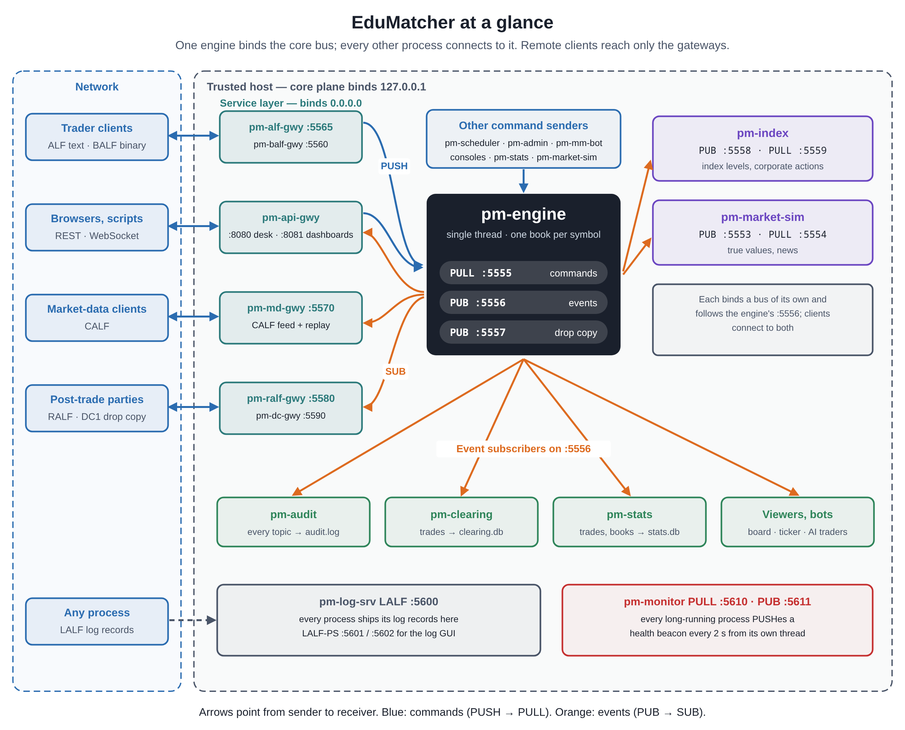
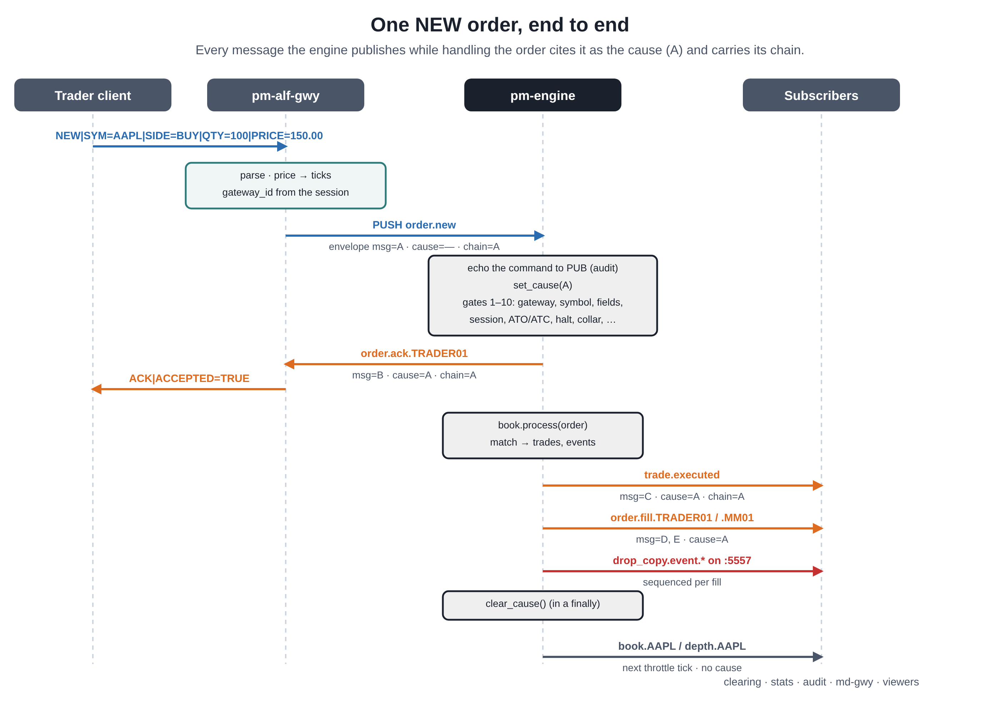
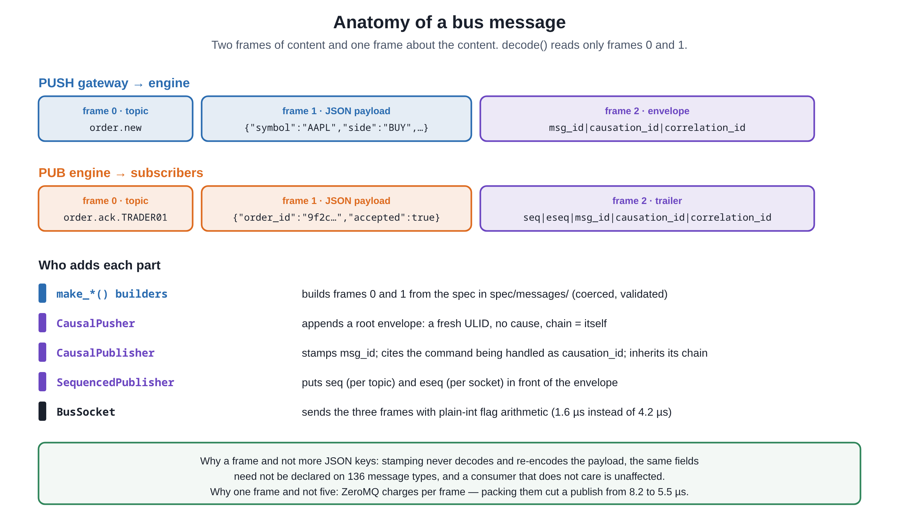
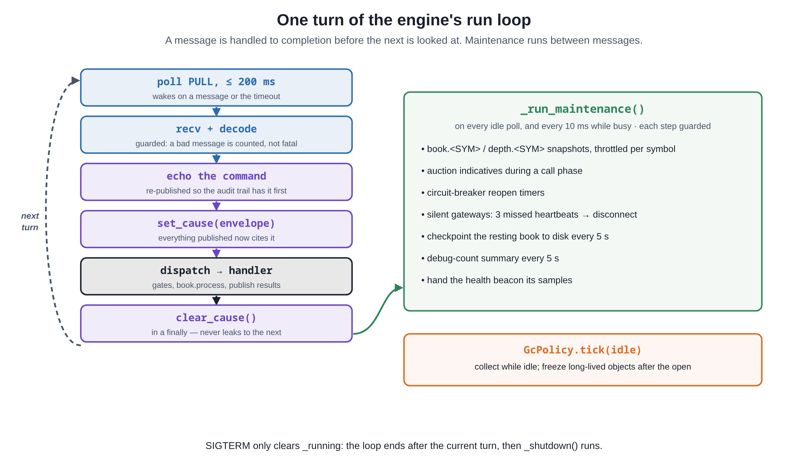
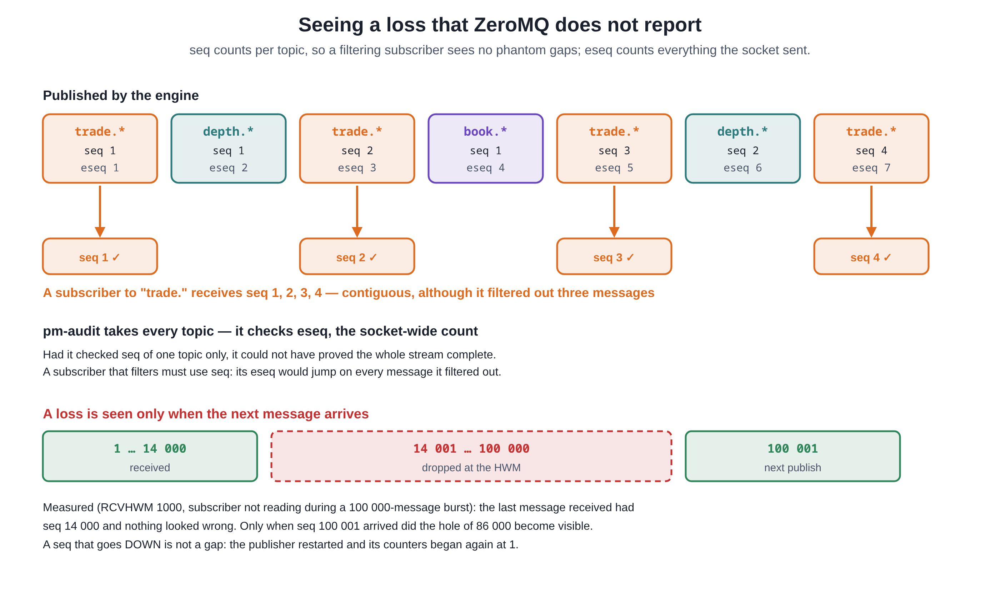
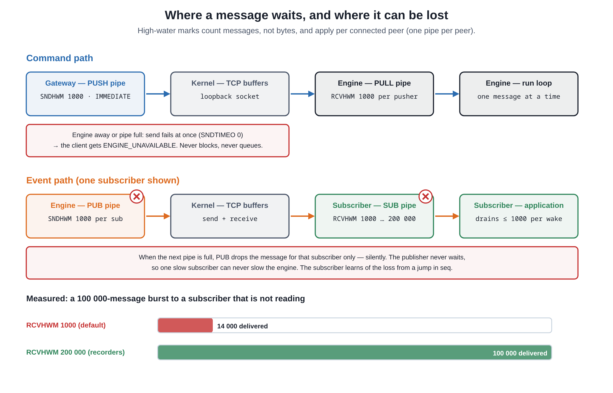
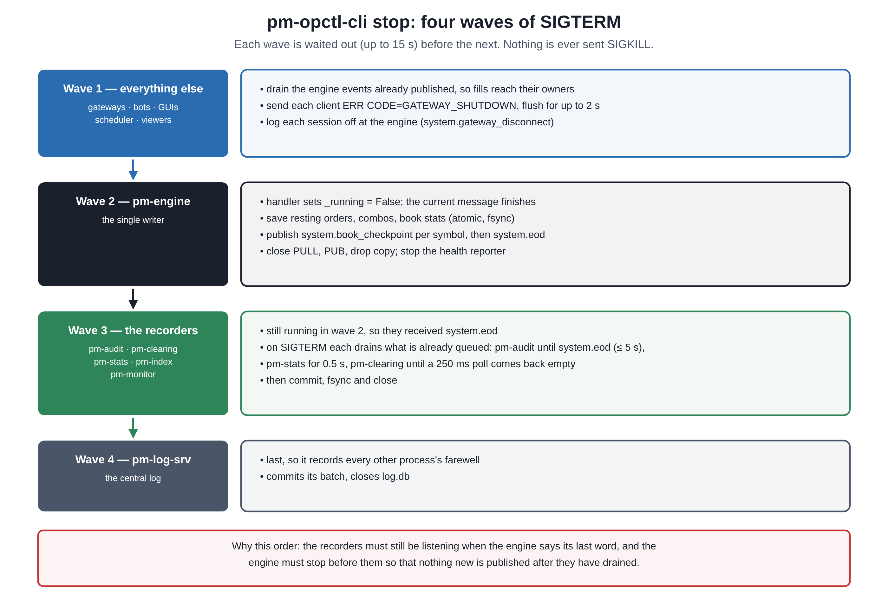

# The Message Architecture

!!! note "Learning objectives"
    After reading this chapter you will be able to:

    - **State the design decisions** behind EduMatcher's process and message
      architecture, why each was taken, what it costs, and what the
      alternative would have been
    - **Trace every data flow** in the exchange: commands, private replies,
      public market data, post-trade, the index and market-model buses,
      session control, health and logs
    - **Read a bus message** frame by frame and say who wrote each part, and
      why metadata rides in a frame of its own
    - **Explain how ZeroMQ is made fast here**, with the measured cost of each
      technique
    - **Explain every buffer**: where a message can wait, how large each queue
      is, why it has that size, and where a message can be lost
    - **Explain what happens on SIGTERM**: the order in which processes stop,
      what each one flushes, and the limits of that guarantee
    - **Explain how the system detects and survives** slow consumers, lost
      messages, crashes, restarts and bad input

!!! info "How this chapter relates to the others"
    [Architecture](010-architecture-overview.md) is the reference: topic
    tables, process roles, ports, persistence files. The
    [Guided Tour](020-guided-tour.md) builds the system up from one limit
    order. This chapter is the *why* of the messaging layer, and the one to
    read before you change a socket option, a topic, a message or a shutdown
    path. Numbers marked *measured* were taken on the development machine
    (CPython 3.14.10, pyzmq 27.3, libzmq 4.3.5, x86-64 Linux) with the
    scripts this chapter describes; absolute values depend on the host.

## 1. The ideas the design rests on

Eight ideas explain almost everything in the messaging layer. The rest of the
chapter is their consequences.

1. **One writer.** Exactly one process, `pm-engine`, changes the state of the
   market, and it does so on one thread, one message at a time. Everything
   else asks it to act (commands) or watches what it did (events).
2. **Processes talk only through messages.** No process reads another's memory
   or files while it runs. A new consumer is a new subscriber, and the engine
   does not change.
3. **The engine never waits for anyone.** Commands that cannot be delivered
   fail at the sender; events a slow consumer cannot take are dropped for that
   consumer only. One misbehaving process can never stall the market.
4. **Loss is detected, not prevented, on the internal bus.** Every published
   message carries sequence numbers, so a consumer can prove what it missed.
   Replay exists where an outside party needs it: at the external gateways.
5. **Every message says why it exists.** A causal envelope links each effect
   to the command that caused it, so "what did this order cause?" is a
   lookup, not a reconstruction.
6. **Messages are specified once.** YAML files under `spec/messages/` define
   every topic and field (136 messages in 17 families); Python bindings, C
   headers and the message reference are generated from them and checked in CI.
7. **Prices are integers inside.** The engine works in integer ticks and
   nanoseconds; display prices appear only at the edges, next to the tick
   scale needed to read them.
8. **Trust stops at the gateways.** The internal bus is unauthenticated and
   binds loopback; remote parties reach the exchange only through gateways
   that authenticate and validate.

## 2. The exchange at a glance

{ width="100%" }

There are five buses. Each is owned — bound — by exactly one process, and
every other process connects to it:

| Bus | Owner | Sockets | Carries |
|---|---|---|---|
| Engine bus | `pm-engine` | PULL :5555, PUB :5556 | commands in; every event out |
| Drop copy | `pm-engine` | PUB :5557 | one sequenced record per fill, for compliance consumers |
| Index bus | `pm-index` | PUB :5558, PULL :5559 | index levels; corporate-action and constituent commands |
| Market-model bus | `pm-market-sim` | PUB :5553, PULL :5554 | true values and news for the AI traders; `sim.command` |
| Health bus | `pm-monitor` | PULL :5610, PUB :5611 | a beacon from every long-running process; health snapshots and events |

Two more listeners complete the picture. `pm-log-srv` takes log records from
every process over the LALF protocol on :5600 and republishes them on
LALF-PS :5601/:5602. The recorders and `pm-index` each bind a REP socket on
loopback (:5561 stats, :5562 audit, :5563 clearing, :5564 index) that answers
one question: is your receive loop alive? Their `*-cli health` commands use it.

The service layer — `pm-alf-gwy` (5565), `pm-balf-gwy` (5560), `pm-api-gwy`
(8080 desk, 8081 dashboards), `pm-md-gwy` (5570), `pm-ralf-gwy` (5580),
`pm-dc-gwy` (5590) — speaks TCP protocols to the outside world and ZeroMQ to
the engine. A remote client never touches a ZeroMQ socket.

## 3. The design decisions

Each decision below gives the choice, the reason, what was rejected, and what
the choice costs. The costs are real; knowing them is what stops a later
change from undoing the decision by accident.

### 3.1 Separate processes on a message bus

**Choice.** Every function — matching, each gateway, clearing, statistics,
audit, index calculation, monitoring — is its own OS process.

**Why.** Isolation and extensibility. A crash in clearing cannot corrupt the
order book; a new consumer is a new process that subscribes. It also mirrors
how real venues are built: a matching core publishing to downstream systems.

**Rejected.** A monolith (simple, but every feature touches the matcher) and
threads around a shared, locked book (fast, but races and lock contention are
the hardest bugs there are, and the GIL removes most of the speed).

**Cost.** Every interaction is a serialised message, and the system has many
processes to start, stop and watch — which is what `pm-opctl-cli`, the health
bus and the central log server exist for.

### 3.2 ZeroMQ, and no broker

**Choice.** ZeroMQ sockets connect the processes directly. There is no
message broker.

**Why.** Microsecond latency, no extra process to operate or to fail, and
the patterns needed — PUSH/PULL pipelines and PUB/SUB fan-out with prefix
filtering — are built in. The same code works over loopback or a network by
changing an address.

**Rejected.** A broker (Kafka, RabbitMQ) would give durability and replay for
free, at the price of a second critical process, milliseconds of latency, and
an operational burden out of proportion to a teaching exchange.

**Cost.** No durability and no delivery guarantee on PUB/SUB. The system
compensates with sequence numbers (§7), recorders that persist what they
receive, and replay at the external edges.

### 3.3 The engine is the sole binder of its bus

**Choice.** `pm-engine` binds :5555/:5556/:5557; every other process connects.
`pm-index`, `pm-market-sim`, `pm-monitor` and `pm-log-srv` bind buses of their
own, because they publish or collect something the engine does not.

**Why.** One well-known address per bus, and processes may start and restart
in any order: a ZeroMQ connect succeeds before the peer binds and reconnects
automatically after the peer restarts.

**Cost.** The engine is a single point of failure by design. There is exactly
one book; a second engine would be a second, divergent market.

### 3.4 One thread, one message at a time

**Choice.** The engine handles each command to completion — validation,
acknowledgement, matching, every resulting publish — before it reads the next.

**Why.** Correctness without locks, and determinism: the order messages come
off the PULL socket *is* the arrival order, and the book stamps each resting
order with its own `arrival_seq`, so price-time priority cannot be forged by a
client timestamp. A combo cascade or an OCO cancel is atomic because nothing
else runs in between.

**Cost.** One core's worth of throughput, and anything slow between two
messages — a long auction uncross, a garbage collection — delays every
message queued behind it. The [Performance Engineering](../part-2-inside-the-engine/030-performance-engineering.md)
chapter is mostly about keeping that "between" short.

### 3.5 Commands by PUSH/PULL, events by PUB/SUB, no request/reply sockets

**Choice.** Every request to the engine, including read queries, is a PUSH.
Every answer is a PUB, on a topic that names the asking gateway
(`order.ack.TRADER01`, `system.symbols.TRADER01`). REP sockets exist only for
the liveness pings of §2.

**Why.** PUSH/PULL fair-queues many senders into one reader, which is exactly
"many gateways, one engine". Answering on PUB means the engine never holds a
per-client socket or waits for a reply to be read; ZeroMQ's subscription filter
does the routing. A REQ/REP socket would block the engine on a slow client and
enforce a strict request-reply lock-step that does not fit asynchronous fills.

**Cost.** A gateway must subscribe to its own reply topics before it sends,
and replies to different gateways share one socket — which is why the
subscription prefix must be unique per gateway id.

### 3.6 Topics are dotted names with the routing key last

**Choice.** A topic is `family.event`, optionally followed by one parameter:
`trade.executed`, `book.AAPL`, `order.fill.TRADER01`, `index.update`.

**Why.** ZeroMQ filters by byte prefix, so the most general part must come
first. `order.fill.` subscribes to every fill; `order.fill.TRADER01` to one
gateway's. The generated `PREFIX_*`, `topic_*()` and `match_*()` helpers build
and parse these strings, so no process types a topic literal
(`pm-msgen grep-literals` lists any that remain).

**Cost.** A prefix match cannot express "every symbol's `book` except one" or
"fills for two gateways" except by subscribing twice. A parameter must not
contain a dot.

### 3.7 Messages are specified, then generated

**Choice.** `spec/messages/*.yaml` is the single source of truth: topic,
fields, types, units, which fields are optional, validation rules, and the
external projections (CALF, RALF, BALF) of each event. `pm-msgen generate`
writes the Python bindings under `models/generated/`, the C headers for the
example clients, and the
[message reference](../../protocols-and-clients/part-5-message-reference/010-message-reference.md).
`pm-msgen check` fails CI when committed output and spec disagree.

**Why.** Producer, consumer and documentation can no longer drift apart, and
every message is validated at the boundary where it enters the system.
See [Message Generation](../part-4-developing/040-message-generation.md).

**Cost.** One more step after editing a message (`make msgen`). Each binding
has a validating builder for the edges and a byte-identical `_unchecked` twin
for the engine's measured hot paths, and a test pins that they agree.

### 3.8 JSON payloads inside, binary only at one edge

**Choice.** The internal bus carries JSON (encoded with `orjson`). The binary
BALF protocol exists only between clients and `pm-balf-gwy`.

**Why.** Every payload is readable in the audit log, in a debugger and with
`pm-audit-cli`. `orjson` encodes a small payload in a fraction of a
microsecond, so the readability costs little next to the rest of the path.

**Cost.** Field names are repeated in every message, and a consumer parses
text. Neither has shown up as a bottleneck in a profile.

### 3.9 Metadata in a trailing frame

**Choice.** Sequence numbers and the causal envelope ride in one ASCII frame
behind the payload, not in the JSON. See §5.

**Why.** Stamping a message never decodes and re-encodes it; the same fields
need not be declared on 136 message types; and `decode()` reads only the
first two frames, so no consumer had to change when the frame was added.

### 3.10 Detect loss on the internal bus; replay at the edges

**Choice.** The engine's PUB socket drops a message for a subscriber whose
queue is full, and the subscriber detects the hole from the sequence numbers.
There is no replay on the internal bus. The external feeds — CALF, RALF, DC1
drop copy, the WebSocket trade stream — keep replay buffers and support
`RESUME`.

**Why.** Blocking the publisher would let one stuck subscriber halt the
market (idea 3). Internal subscribers are co-located processes with deep
queues (§8), so drops are rare and signal a fault to fix. External parties
are on networks the exchange does not control, so they get the replay.

**Cost.** An internal consumer that misses messages cannot ask for them
again; it can report the gap (pm-stats writes `feed_gaps`, the gateways count
`*.bus_gaps`) and an operator can rebuild from the audit trail
(`pm-clearing-cli rebuild` replays it).

### 3.11 The command is recorded before it is handled

**Choice.** The engine re-publishes every command it receives (but not read
queries) onto its PUB socket *before* dispatching it, keeping the sender's
`msg_id`.

**Why.** The audit trail then holds the request before its own ACK, survives
a crash in the middle of handling it, and every effect's `causation_id` names
a message that is actually in the trail.

**Cost.** About 2 µs per command. A query (`*_request` topics, heartbeats) is
not echoed, so its reply starts a chain of its own rather than citing a
message nobody recorded.

### 3.12 Senders fail fast; publishers never wait

**Choice.** Every PUSH socket is made with `SNDTIMEO=0`, `IMMEDIATE=1` and
`SNDHWM=1000`. A send that cannot be queued at once raises `zmq.Again`, and
the gateway answers its client `ENGINE_UNAVAILABLE`. PUB sockets never block
by ZeroMQ's design.

**Why.** Every process with a PUSH socket is a single-threaded reactor. A
blocking send would freeze a gateway — every client session with it — while
the engine is restarting. A fast, explicit refusal is honest; a silent queue
that delivers stale orders minutes later is not.

**Cost.** During an engine restart, clients see refusals and must retry.

### 3.13 Market data is throttled; trades are not

**Choice.** `trade.executed`, fills and acknowledgements are published at
once. Full book images (`book.<SYM>`, `depth.<SYM>`) are published at most once
per `snapshot_interval_sec` (default 0.5 s) per symbol, on the maintenance
tick.

**Why.** A snapshot costs O(book) to build and is the largest message on the
bus; at a thousand trades a second nobody needs a thousand books. Throttling
turns a per-trade cost into a per-interval one and is the single largest
lever on bus volume.

### 3.14 Durability by checkpoint and recorders, not a write-ahead log

**Choice.** The engine checkpoints its resting book to JSON every 5 s and at
shutdown (atomic write, fsync before rename). Trades are made durable by the
recorders — clearing, stats, audit — which write them as they arrive.

**Why.** A write-ahead log would put a disk write on every command's path.
A five-second checkpoint bounds what a crash can lose while costing nothing
per order.

**Cost.** A `SIGKILL` or power loss loses up to five seconds of book changes
and whatever was in flight on the bus. See §10.

### 3.15 A separate socket for drop copy

**Choice.** Fill records for compliance consumers go out on their own PUB
socket (:5557) with a session-wide sequence and a 10 000-message in-memory
replay ring, relayed outward by `pm-dc-gwy`.

**Why.** A compliance consumer must see every fill and nothing else, and must
be able to prove completeness. A dedicated socket keeps the volume low and
the sequence meaningful. If :5557 is taken, the engine logs a warning and
runs without drop copy: a port conflict must not stop matching.

### 3.16 Two network planes

**Choice.** The core plane (`pm-engine`, `pm-index`) binds `127.0.0.1` by
default; the service layer binds `0.0.0.0`. See
[Deployment Topology & Trust Boundaries](010-architecture-overview.md#deployment-topology-trust-boundaries).

**Why.** The internal bus has no authentication; anything that can reach
:5555 can submit as any gateway. Keeping it on loopback means only processes
on the host can. Being reachable is the gateways' purpose, and they
authenticate.

### 3.17 Health and logs on buses of their own

**Choice.** Every long-running process runs a `HealthReporter` thread that
PUSHes a beacon to `pm-monitor` every 2 s, and ships its log records to
`pm-log-srv`.

**Why.** The beacon comes from a separate thread, so a hung main loop still
reports — with a growing "loop age" that says exactly that. Both use
non-blocking sends, so a missing monitor or log server costs nothing.
Operational traffic never shares a queue with market events.

## 4. How data flows through the exchange

{ width="100%" }

**Order entry.** A client sends an ALF line, a BALF frame or a REST request
to its gateway. The gateway authenticates the session, parses and validates
the request, converts prices to ticks, sets `gateway_id` from the *session*
(never from the request), and PUSHes `order.new` with a root envelope. The
engine echoes the command, runs its checks, publishes the ACK, matches, and
publishes the fills and trades — all inside one dispatch. The figure shows the
causal ids: everything published while handling the order cites it.

**Private replies.** ACKs, fills, cancels and query answers go out on the PUB
socket under topics ending in the gateway id. Each gateway subscribes to its
own ids' prefixes when a session logs on, so the reply reaches exactly one
process, which relays it to the right client connection.

**Public market data.** `trade.executed` goes out at once. Book images and
depth statistics follow on the next throttled maintenance tick;
`auction.indicative.<SYM>` is published during call phases; session changes
(`session.state`), halts and resumes (`circuit_breaker.*`) are broadcast when
they happen. `pm-md-gwy` turns these into the CALF feed for external clients
and keeps the replay window; the viewers, board and ticker read them directly.

**Post-trade.** Each trade reaches `pm-clearing` (positions and P&L into
`clearing.db`), `pm-stats` (OHLCV and the trade log into `stats.db`) and
`pm-audit` (everything, into the audit trail) from :5556. `pm-ralf-gwy`
serves trade reports to external post-trade parties from the same stream.
The drop-copy records on :5557 go to `pm-dc-gwy` and the consoles that
subscribe to them.

**The index bus.** `pm-index` follows trades and book snapshots on :5556,
recomputes each index, and publishes `index.update` on its own :5558. It
takes corporate actions and constituent changes as commands on :5559 and
answers on its PUB socket, exactly as the engine does on its bus.

**The market-model bus.** `pm-market-sim` follows the session on :5556 and
publishes each symbol's true value and the news on :5553, which the AI
traders, `pm-mm-bot --anchor-sim` and the ticker read. Operators command it on
:5554.

**Session control.** `pm-scheduler` decides *when* phases change, using
`locale.session_timezone`, and PUSHes `session.transition`; the engine decides
*what* a phase change does (uncross, expire ATO/ATC or DAY orders, broadcast
`session.state`). The engine itself never reads the clock to change phase.

**Health and logs.** Beacons go to `pm-monitor`, which judges each process,
keeps `metrics.db` and publishes `health.snapshot`/`health.event` for the
operator dashboard. Log records go to `pm-log-srv`.

**Out to the world.** The four external feeds — CALF market data, RALF
post-trade, DC1 drop copy and the WebSocket streams — are projections of bus
events. Their field lists are declared in the same message specs, so the
gateways do not invent wire formats of their own.

## 5. The design of a message

{ width="100%" }

**Frames 0 and 1 are the message.** Frame 0 is the topic, used by
subscription filters; frame 1 is the JSON payload. `encode()` writes exactly
these two, and `decode()` reads exactly these two.

**Frame 2 is about the message.** Its fields are ASCII, separated by `|`, an
empty field meaning absent:

- `msg_id` — a ULID: unique, and sortable by the time it was minted, so
  sorting by `msg_id` gives the order the engine acted in across all topics.
- `causation_id` — the `msg_id` of the command whose handling produced this
  message, or empty when nothing on the bus caused it (a timer, a
  circuit-breaker reopen, a startup recovery). Empty is a positive statement,
  not missing data.
- `correlation_id` — the chain: the root command's id, inherited unchanged by
  every descendant.
- On PUB only, in front of these: `seq`, counted per topic, and `eseq`,
  counted per socket (§7).

**Who writes it.** `CausalPusher` wraps every PUSH socket and stamps a root
envelope. `CausalPublisher` wraps the engine's PUB socket; the run loop calls
`set_cause()` with the inbound envelope before dispatching and `clear_cause()`
in a `finally` after, so attribution can never leak to the next message.
`SequencedPublisher` puts the two counters in front. Wrapping the socket,
rather than editing the hundred-odd publish sites, is the point: an envelope
attached only where someone remembered would be worse than none.

**Payload conventions.**

- Prices travel twice where it matters: as a display number (`price`) and as
  integer ticks (`price_ticks`) with the `tick_decimals` needed to read them.
  Consumers that compute use the ticks.
- Timestamps are integer nanoseconds (`ts_ns`).
- Identifiers are strings. A trade id is `{run_seq:06d}-{n:09d}`: the
  engine-run sequence is persisted and bumped at every start, so trade ids stay
  unique across restarts.
- Enumerations are their names (`"BUY"`, `"CANCEL_AGGRESSOR"`).
- A rejected request answers with a stable `code` from the reject-code
  catalogue and a human `reason`.

**Versioning.** Each family has a `version` in its spec, exported as
`FAMILY_VERSION`. A change that is not backward-compatible — a field
removed, renamed or retyped — bumps it. Every process on one bus must run the
same build: the trailing frame changed shape in the 2026-11 messaging review,
and there is no negotiation.

## 6. Making ZeroMQ fast

The engine publishes several messages per order, so the cost of one publish
is multiplied many times. These are the techniques in use, with what each one
buys.

| Technique | Where | Effect |
|---|---|---|
| One shared `Context` per process | `messaging/bus.py::get_context` | One I/O thread; no per-socket setup cost |
| `BusSocket.send_multipart` with plain-int flags | `messaging/bus.py` | *Measured:* a 3-frame send costs 1.6 µs instead of 4.2 µs. pyzmq's own loop ORs `zmq.SNDMORE`, an `IntFlag`, per frame, and on Python 3.14 that costs more than the send |
| One trailing frame, not five | `SequencedPublisher` | ZeroMQ charges per frame; packing cut a stamped publish from 8.2 to 5.5 µs (messaging review). *Measured now:* 4.0 µs, of which minting the ULID is 1.0 µs |
| Pre-encoded topics | `Engine._topic_cache`, generated `_TOPIC` constants | No f-string and `.encode()` per message |
| `orjson`, and builders that make the dict once | `models/message.py`, `make_*_unchecked` | Encoding is a fraction of a microsecond |
| Publisher-side filtering | libzmq (TCP) | A subscriber's prefixes are sent to the publisher, which never transmits a message nobody on that connection wants. A consumer of `trade.` costs nothing for the `book.` traffic it ignores |
| Throttled snapshots | `_flush_snapshots` | The largest messages are sent at most twice a second per symbol |
| Drain in batches | pm-stats, pm-index (`_DRAIN_PER_WAKE = 1000`), gateways | One poll wakes the loop, then up to 1000 queued messages are handled with `poll(0)` before other sockets get a turn |
| Edge-triggered fds in the asyncio gateways | `alf_gwy`, `balf_gwy` | The ZMQ notification fd joins epoll; the loop drains and re-checks `zmq.EVENTS` before waiting, so a capped drain never strands a message |
| Maintenance between messages, not per message | `Engine.run` | Snapshots, timers and checkpoints run on every idle poll and every 10 ms while busy |
| Sampled timing | `SAMPLE_EVERY = 16` | Latency is measured on 1 message in 16 |

{ width="100%" }

Two rules keep these techniques honest. A change to the hot path needs a
profile showing its target is at least 1 % of wall time. And where a shortcut
skips validation (the `_unchecked` builders), a test pins that it produces
the same bytes as the checked path.

To repeat the publish measurement, time `send_multipart` on a raw pyzmq PUB
socket, on a `BusSocket`, and on `make_publisher()`, in a loop of 200 000 with
the garbage collector disabled; take the best of five runs.

## 7. Seeing what was lost

{ width="100%" }

ZeroMQ PUB/SUB drops silently: nothing in a delivered message, and no error
anywhere, says that an earlier one was discarded. The sequence numbers are the
only evidence, and there are two because subscribers differ:

- **`seq` counts per topic.** A subscriber that filters (most of them) sees a
  contiguous sequence on each topic it takes, whatever it filters out. Read
  it with `decode_sequence(frames)`.
- **`eseq` counts everything the socket published.** A subscriber that takes
  every topic — pm-audit — can prove the whole stream complete. Read it with
  `decode_publisher_sequence(frames)`.

Three properties matter in practice:

1. **A loss is visible only when the next message on that topic arrives.**
   *Measured:* a subscriber with the default receive HWM, not reading during a
   100 000-message burst, received seq 1 to 14 000 and saw nothing wrong. The
   hole of 86 000 appeared when seq 100 001 arrived. A quiet topic can hide a
   loss for a long time, which is one reason pm-audit checks `eseq`: on a busy
   bus, the next message on *some* topic comes quickly.
2. **A sequence that goes down is a restart, not a gap.** Counters live in the
   publisher's memory and start at 1 again when it restarts. The engine also
   publishes `system.startup_recovery` at every start; the gateways treat it
   as "every engine-side session is gone" and close their client sessions so
   the clients log on again.
3. **Detection is per consumer.** Each process counts its own losses: pm-stats
   records them in `feed_gaps`, `pm-md-gwy` and the other gateways report
   `*.bus_gaps` counters in their health beacons, and pm-audit counts missed
   `eseq` values. A loss on the internal bus means a consumer fell behind its
   high-water mark — a capacity problem to fix, not a normal event.

## 8. Buffer sizes, and why they are what they are

{ width="100%" }

### How ZeroMQ buffers

A ZeroMQ socket keeps **one queue (a "pipe") per connected peer**, and its
high-water mark (HWM) limits each pipe **in messages, not bytes**. The default
is 1000 in each direction. Behind the pipes sit the kernel's TCP send and
receive buffers, a few megabytes on loopback. What happens at a full pipe
depends on the socket type:

- **PUSH** blocks the sender, or — with `SNDTIMEO=0` as here — fails at once.
- **PUB** drops the message for that one subscriber and carries on.
- **SUB** stops reading its connection; the publisher's pipe for it fills
  and the publisher drops.

So the queue that decides whether a subscriber loses messages is the sum of
its own receive pipe, the kernel buffers and the publisher's send pipe for
it. The measured 14 000 of §7 is roughly 1000 + 1000 plus what the kernel held.

### Every buffer in the system

| Socket | Option | Value | Why this value |
|---|---|---|---|
| Every PUSH to the engine (`make_pusher`) | `SNDHWM` / `SNDTIMEO` / `IMMEDIATE` | 1000 / 0 / 1 | Fail fast: never block a reactor; queue only to a connected engine, so nothing is held for a peer that is not there |
| `pm-scheduler` PUSH | `SNDTIMEO` / `LINGER` | 2000 ms / 1000 ms | A phase change is rare and important: wait up to 2 s for the engine rather than drop it, but never hang at exit |
| Engine PULL :5555 | `RCVHWM` | 1000 per sender (default) | Fair-queued per gateway; a burst from one gateway cannot crowd out another's queue |
| Engine PUB :5556 | `SNDHWM` | 1000 per subscriber (default) | The publisher never waits; the depth that protects a subscriber is its own `RCVHWM` |
| pm-audit, pm-alf-gwy, pm-balf-gwy, `pm-alf-console`, AI-trader worker SUB | `RCVHWM` | 200 000 | They must see every message they take (audit, everything; gateways, fills for their clients). Deep enough to ride out an open or a burst, bounded so a stuck process cannot grow without limit |
| pm-clearing, pm-stats, pm-md-gwy, pm-ralf-gwy, pm-dc-gwy SUB | `RCVHWM` | 100 000 | Same reason; they take fewer topics, so the same depth covers a longer burst |
| `pm-monitor`'s engine SUB | `RCVHWM` | 10 000 | It only counts and samples events; a lost one costs a figure, not a record |
| Health beacon PUSH (`HealthReporter`) | `SNDHWM` / `LINGER` | 10 / 0, last beacon 500 ms | A beacon is stale in seconds; never queue more than a few, never delay exit — except the final beacon, which says "stopping on purpose" |
| `pm-log-srv` PUB (LALF-PS) | `SNDHWM` | `max_pending_rows / backfill_chunk_rows`, capped by `log_server.pub_sndhwm` (10 000) | Sized so ZeroMQ holds about `max_pending_rows` rows per peer, whatever the chunk size |
| Engine drop-copy ring | in memory | 10 000 records | The replay reach for drop-copy gap recovery |
| Gateway client queues (TCP side) | `max_client_queue` | 10 000 lines | A client that stops reading is cut off with `SLOW_CLIENT` rather than allowed to hold memory |

**Why the HWM is set before `connect()`.** ZeroMQ applies an HWM only to
connections made after it is set, which is why `make_subscriber(…, rcvhwm=…)`
sets it first. Setting it afterwards silently changes nothing.

**What a deep queue costs.** Memory, only when used: a full queue of 200 000
messages of 500 bytes holds about 100 MB, and a queue that deep at 10 000
messages a second is 20 seconds behind. A deep queue buys time to catch up
from a burst; it does not fix a consumer that is too slow on average, which
is why `pm-monitor` watches each process's loop age and queue growth.

**What was deliberately not used.** `ZMQ_CONFLATE` (keep only the newest
message) would suit a viewer that only needs the latest book, but it cannot
be combined with multipart messages, and every message here has three frames.

## 9. Stopping cleanly: what happens on SIGTERM

{ width="100%" }

### Signal handlers only set a flag

Every long-running process installs SIGTERM and SIGINT handlers that do one
thing: clear a `_running` flag (or set a stop event). The work happens when
the main loop next checks the flag, never inside the handler. A handler that
closed sockets itself could interrupt the middle of a message — inside
`_handle_new_order`, say — and leave the process publishing on a closed socket.
The interactive consoles route SIGTERM and SIGHUP the same way, so closing the
terminal logs the participant off instead of leaving their orders resting
until the heartbeats run out.

### The engine's shutdown sequence

When the loop sees the flag, the message being handled finishes, and
`Engine._shutdown()` runs four guarded steps — a failure in one (a full disk,
say) does not skip the others:

1. Save every resting order (`TIF=GTC` *and* `TIF=DAY` — a restart is not a
   day boundary) to `gtc_orders.json`.
2. Save live combos to `gtc_combos.json`.
3. Save book statistics — last prices, circuit-breaker reference windows,
   operator halts — to `book_stats.json`.
4. Publish `system.book_checkpoint.<SYM>` for every book, then `system.eod`,
   the engine's last message.

Each file is written by `atomic_write_text`: write to a temporary file, fsync,
rename over the old one. A crash during the write leaves the previous
checkpoint intact. Then the PULL, PUB and drop-copy sockets close and the
health reporter sends its final beacon.

### The stop order

`pm-opctl-cli stop` signals in waves and waits for each wave to exit (up to
15 s) before signalling the next:

1. **Everything else** — gateways, bots, GUIs, scheduler, viewers. A gateway
   first delivers the engine events already published, so fills reach their
   owners; sends each client `ERR CODE=GATEWAY_SHUTDOWN` and flushes for up
   to 2 s; and logs each session off at the engine.
2. **pm-engine** — the sequence above.
3. **The recorders** — pm-audit, pm-clearing, pm-stats, pm-index, pm-monitor.
   They were still running during wave 2, so they received the end-of-day
   checkpoints and `system.eod`. On their own SIGTERM each drains what is
   already queued before committing and closing: pm-audit reads until it has
   recorded `system.eod` (at most 5 s), pm-stats for 0.5 s, pm-clearing until
   a 250 ms poll comes back empty. pm-audit fsyncs its file at least once a
   second while running and again at close.
4. **pm-log-srv** — last, so it records everyone else's farewell.

No process is ever sent SIGKILL. In a container, the entrypoint traps SIGTERM
and runs `pm-opctl-cli stop`; the compose files give it 30 s (60 s for the
AI-trader simulation) before the container runtime kills what is left, which
is ample for a normal stop but less than four slow waves could take.

### What ZeroMQ does with unsent messages at exit

ZeroMQ sends from a background I/O thread, so a `send` returns before the
bytes leave. Whether queued messages survive the process exiting depends on
where they are:

- **Bytes already in the kernel's TCP buffer survive.** The kernel keeps
  sending after the process is gone.
- **Messages still in a libzmq pipe do not.** `LINGER` would make ZeroMQ wait
  for them, but only when the context is terminated, and pyzmq does not
  terminate the shared context at exit. *Measured:* with a subscriber frozen
  during a 50 000-message burst, about 900 messages still in the publisher's
  pipe were lost when it exited, whatever `LINGER` was set to; a publisher
  that stayed alive delivered them.

For the engine this means: a subscriber that is keeping up — every recorder
in a normal stop, since wave 3 is still running — has an empty pipe and
receives `system.eod`. A subscriber that has stalled behind its HWM misses the
end of the stream, including `system.eod`, exactly as it would miss any other
message. That is detectable (its sequence jumps on the next run's messages,
and pm-audit reports the missing `eseq`), but it is not prevented. Terminating
the context with a bounded linger after the final publish would close that
window; see §11.

### What an abrupt stop loses

| Event | Lost | Kept |
|---|---|---|
| `SIGKILL`, OOM, power loss of the engine | Up to 5 s of book changes since the last checkpoint; messages in ZeroMQ queues | The last checkpoint; every trade the recorders had already written |
| A recorder killed | Messages in its receive queue; its uncommitted batch | Its database up to the last commit; the trades, which it can rebuild from the audit trail |
| A gateway killed | Lines queued to its clients | Nothing at the engine is lost; the engine notices the missing heartbeats and applies the session's disconnect behaviour |

## 10. Resilience: how failures are detected and survived

| Failure | How it is detected | What happens |
|---|---|---|
| A subscriber falls behind | A jump in `seq`/`eseq`; growing loop age and queue in its health beacon | Messages past its HWM are dropped for it alone; the engine and other subscribers are unaffected. The gap is counted and logged |
| The engine is down or restarting | A PUSH send raises `zmq.Again` | Gateways answer `ENGINE_UNAVAILABLE` at once; ZeroMQ reconnects when the engine is back |
| The engine restarted | `system.startup_recovery`; sequence numbers fall to 1 | Gateways drop their engine-side sessions so clients log on again; the book comes back from the checkpoint with its original priority (`arrival_seq` order); trade ids continue under a new run sequence |
| A recorder restarted | Its own startup | pm-clearing warm-starts its ledger from `clearing.db`; trade rows are inserted with `INSERT OR IGNORE` on the trade id, so a duplicate delivery is harmless |
| A client vanished | No heartbeat for three of its own intervals (60 s, or 5 s for interactive consoles) | The engine disconnects the session and applies its `disconnect_behaviour` (`CANCEL_QUOTES_ONLY` by default) |
| A malformed message on :5555 | `decode()` raises inside the guarded receive | The message is counted and discarded, a `system.diagnostic` is published, and the loop continues — one bad sender cannot end the session |
| A handler raises | The `try` around dispatch | Where the request names a gateway to answer, it gets a reject with `INTERNAL_ERROR`, so it is never left waiting; the cause is cleared in the `finally` |
| A maintenance step raises | Each step guarded separately | The others still run: a failed snapshot cannot skip the circuit-breaker reopen timers |
| A checkpoint fails | The `try` in `_flush_persistence` | The previous checkpoint stays on disk; the error is logged and counted; trading continues |
| The drop-copy port is taken | `zmq.ZMQError` at bind | A warning; the engine runs without drop copy |
| An external client misses data | Its own sequence (CALF per channel and symbol, RALF and DC1 per session) | It sends `RESUME` with its last sequence and the feed's epoch; the gateway replays from its buffer, or says the range is gone |
| A process hangs | The beacon thread keeps reporting a growing loop age | `pm-monitor` marks it degraded and says why |

The pattern across the table is the same: **fail at the edge of the fault**.
A slow consumer loses its own messages; a bad message loses itself; a failed
flush loses its own work. Nothing propagates back into the engine's loop.

## 11. Known limits

These are deliberate limits of a teaching exchange, recorded so that nobody
mistakes them for guarantees:

- **No replay on the internal bus.** A consumer that misses messages can
  detect and report the gap, and rebuild from the audit trail, but cannot ask
  the engine for them again.
- **Unsent ZeroMQ messages are lost at exit.** The engine closes its sockets
  but does not terminate the context with a linger, so anything still queued
  for a stalled subscriber dies with the process (§9). Closing the PUB socket
  with a bounded linger and terminating the context would let up to that
  linger's worth be delivered, at the cost of a slower stop.
- **One engine, no failover.** A standby engine would need replicated state
  and sequenced command logs; see
  [What Is Missing](020-guided-tour.md#16-what-is-missing-the-gap-to-production).
- **The internal bus is unauthenticated and unencrypted.** It is safe only on
  a trusted host. CurveZMQ or network ACLs would be needed before exposing it.
- **Five seconds of exposure.** A crash loses up to one checkpoint interval
  of book changes.
