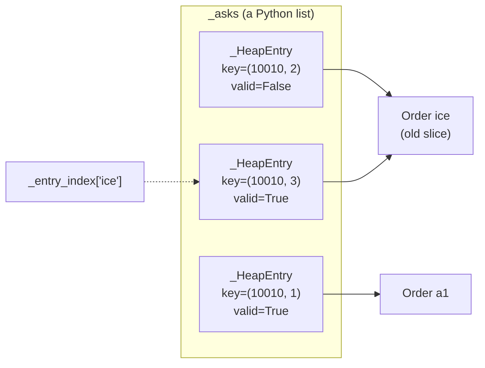
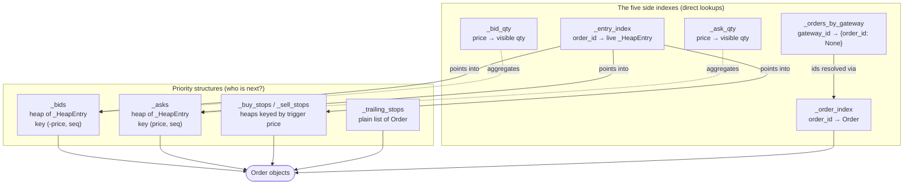
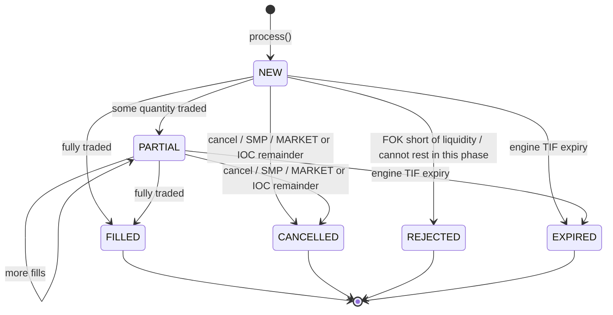
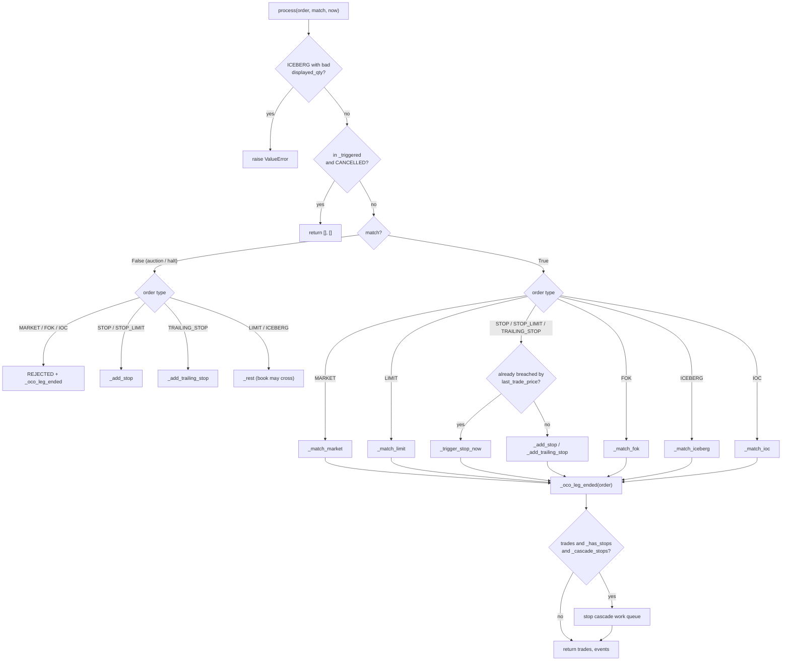
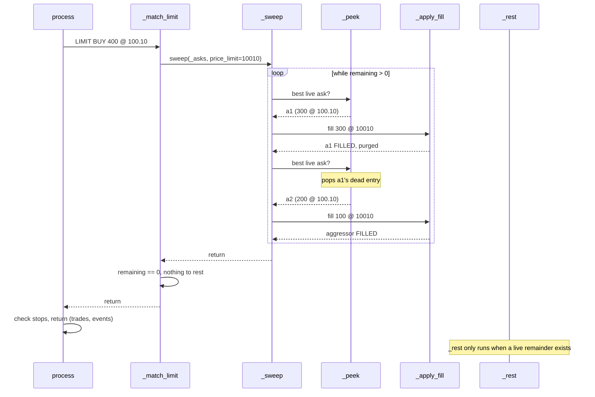
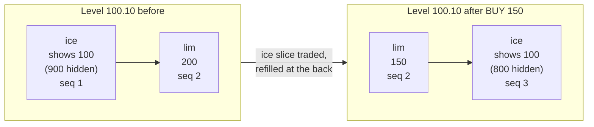
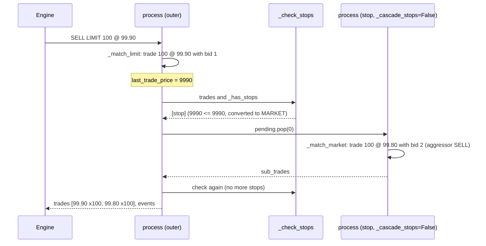

# The Order Book: Deep Dive

!!! note "Learning objectives"
    After working through this chapter you will be able to:

    - **Place `OrderBook` in the engine** — know exactly which engine function
      hands it an order, what it returns, and why it never touches the network
    - **Read the data structures** — the four heaps, the trailing-stop list and
      the **five side indexes**, and explain which question each one answers
    - **Explain price-time priority in code** — how the tuple key
      `(±price, arrival_seq)` turns Python's min-heap into a fair queue, and why
      `arrival_seq` (not a timestamp) decides who is first
    - **Explain lazy deletion** — why a cancel does not remove anything from a
      heap, who throws the garbage away (`_peek`, `_compact_heaps`), and why
      `len(heap)` is not the number of orders
    - **Trace one incoming order** through `process` → `_match_*` → `_sweep` →
      `_apply_fill` → `_rest` → stop cascade, and predict every trade and
      event it produces
    - **Handle the corner cases** — icebergs (slice cap and refill to the
      back), self-match prevention, stops and trailing stops, FOK pre-checks,
      OCO/quote callbacks, and the no-matching (auction) mode
    - **Keep the book consistent when you change it** — know the
      synchronisation rules, the invariants the test-suite checks, and which
      functions you must touch together
    - **Learn by debugging** — drive a book from a ten-line script or from a
      test, set the right breakpoints and watch one order flow through

!!! tip "How to read this chapter"
    Open `src/edumatcher/engine/order_book.py` side by side with this page.
    The module docstring at the top of that file is a compressed version of
    this chapter, and every section below quotes the real code. Function
    names are used instead of line numbers because line numbers change: use
    your editor's *Go to Symbol* (`Ctrl+Shift+O` / `Cmd+Shift+O` in VS Code)
    to jump to, for example, `_sweep`.

    All prices inside the book are **integer ticks** (for a symbol with two
    decimals, `10010` means `100.10`). Conversion to display money happens only
    at the edge (`from_ticks`), so dictionary keys and arithmetic are exact.


## Where the File Sits

The engine process (`engine/main.py`) owns the network side; `OrderBook` owns
the *rules of matching* and knows nothing about ZeroMQ. The module docstring
draws the pipeline like this:

```text
gateway --PUSH--> Engine.run()                   (receive + decode)
                  Engine._dispatch_pull_message  (route by topic)
                  Engine._handle_new_order       (validate, ACK, gate on session)
                  OrderBook.process(order)       <== YOU ARE HERE
                      |  returns (trades, events)
                  Engine._publish_dispatch       (order.fill / order.cancelled /
                                                  reject, then trade.executed)
                  --PUB--> gateways, market data, clearing, audit ...
```



```mermaid
flowchart LR
    GW[Gateway] -- "PUSH order.new" --> RUN["Engine.run()<br/>receive + decode"]
    RUN --> DISP["_dispatch_pull_message<br/>route by topic"]
    DISP --> HNO["_handle_new_order<br/>validate, risk gates, ACK"]
    HNO -- "book.process(order, match=do_match)" --> OB["OrderBook.process<br/>(this chapter)"]
    OB -- "(trades, events)" --> PD["_publish_dispatch<br/>fills, cancels, rejects, trades"]
    PD -- PUB --> OUT["gateways, market data,<br/>clearing, audit, stats"]
```

Three properties follow from this split, and they shape everything in the file:

1. **One book per symbol.** The engine keeps one `OrderBook` instance per
   symbol (`Engine._book(symbol)` creates it on first use). Books never
   interact with each other.
2. **Synchronous and single-threaded.** `process()` runs to completion before
   the engine looks at the next message. There are no locks because there is
   no concurrency inside the book.
3. **It never publishes.** The book *mutates* `Order` objects in place and
   *returns* what happened as two lists: `trades` (new `Trade` objects) and
   `events` (orders whose state changed). The engine turns those into bus
   messages. This is what makes the matching rules unit-testable without a
   network — most tests in `tests/` build an `OrderBook`, call `process()`
   and assert on the two lists.

By the time an order reaches `process()` the engine has already authenticated
the gateway, checked the symbol, validated quantity and price, applied the
price collar and the session/halt gates, and (usually) sent the positive ACK.
The book only decides *how the order trades*. Those engine-side checks are
covered in [Hot-Path Risk Checks](#hot-path-risk-checks-around-the-book) near
the end of this chapter.


## What Is an Order Book?

An exchange is a marketplace where buyers and sellers meet. The order book is
the exchange's record of every unmet offer — all the buyers who want to buy but
have not found a seller yet, and all the sellers who want to sell but have not
found a buyer.

```text
                  THE ORDER BOOK FOR AAPL
  ┌─────────────────────────────────────────────────────┐
  │  BUY SIDE (BIDS)            SELL SIDE (ASKS)        │
  │                                                     │
  │  $150.28 × 200 shares       $150.31 × 500 shares    │
  │  $150.27 × 100 shares       $150.33 × 200 shares    │
  │  $150.25 × 400 shares       $150.35 × 300 shares    │
  │           ↑                          ↑              │
  │      Best bid                   Best ask            │
  │      (highest buyer)            (lowest seller)     │
  │                                                     │
  │            SPREAD = $150.31 - $150.28 = $0.03       │
  └─────────────────────────────────────────────────────┘
```

When a new buy order arrives at $150.31 or higher, it *crosses the spread* and
trades with the best ask. When a new buy order arrives at $150.27 it cannot
trade (the cheapest seller wants $150.31), so it *rests* on the bid side and
waits.

Two words are used throughout the code:

| Term | Also called | Meaning |
|---|---|---|
| **Aggressor** | taker | The *incoming* order — the one being processed right now. |
| **Passive** | maker, resting order | An order already sitting on the book. |

!!! important "Trades happen at the passive order's price"
    A trade always prints at the **resting** order's price, never the
    aggressor's. A buy limit at 101 that meets a resting ask at 100 trades
    at 100 — the aggressor receives *price improvement*. In the code this is
    the single line `_apply_fill(aggressor, best, fill_qty, best_price, ...)`
    at the bottom of `_sweep`: `best_price` is the passive order's price.

The rest of this chapter is about how `OrderBook` stores the two sides so that
"who is the best counterparty right now?" is cheap to answer, and how it keeps
that storage consistent while orders arrive, trade, get amended and get
cancelled.


## Background: The Heap Data Structure

Matching only ever needs one question answered quickly: *which resting order
must be matched next?* A **binary heap** answers exactly that question.

A heap is a binary tree stored in a plain list, with one rule: every parent is
less than or equal to its children. Nothing else is ordered. The consequence
is that the smallest item is always at index `0`, while the rest of the list is
only *partially* sorted.

```text
  list:  [ 10, 20, 15, 40, 30, 50 ]          tree view:          10
  index:    0   1   2   3   4   5                               /    \
                                                              20      15
  children of i are at 2i+1 and 2i+2                         /  \    /
                                                            40  30  50
```

Python's `heapq` module implements the operations on an ordinary list:

| Operation | `heapq` call | Cost | Used by `OrderBook` for |
|---|---|---|---|
| Look at the best item | `heap[0]` | O(1) | `_peek`, `_check_stops` |
| Insert | `heapq.heappush(heap, x)` | O(log n) | `_rest`, `_add_stop`, `_reinsert_iceberg`, `amend_order` |
| Remove the best item | `heapq.heappop(heap)` | O(log n) | `_peek` (dead entries), `_check_stops` |
| Build from a list | `heapq.heapify(heap)` | O(n) | `_compact_heaps` |

Two limitations matter for the design:

1. **`heapq` is a *min*-heap.** The best ask (lowest price) comes out first
   naturally, but the best bid is the *highest* price. The trick is to store
   the price **negated**: the smallest `-price` is the largest price.
2. **A heap cannot cheaply remove an item from the middle.** Finding it is
   O(n) and repairing the tree is O(log n). Cancels hit the middle of the
   book all the time. The answer is *lazy deletion*, explained below.

!!! note "Why a heap and not one sorted list per price level?"
    A common textbook design is a sorted map of price levels, each holding a
    FIFO queue. That design makes "remove from the middle" cheap but needs a
    sorted container (Python has none built in) and more bookkeeping per
    level. EduMatcher chooses the heap because pushing and popping the best
    order are both O(log n) with the standard library alone, and matching
    only ever needs "the best one". The price of that choice is lazy
    deletion and the side indexes described below.


## The Priority Key: `(±price, arrival_seq)`

Every entry in a bid or ask heap carries a two-element tuple key. Python
compares tuples element by element, so the first element decides and the
second only breaks ties:

| Heap | Key | `heap[0]` is |
|---|---|---|
| `_asks` | `( price_ticks, arrival_seq)` | the lowest ask; among equal prices the earliest |
| `_bids` | `(-price_ticks, arrival_seq)` | the highest bid; among equal prices the earliest |

Together this is exactly **price-time priority**: better price first, then
first come first served. The keys are built in `_rest`:

```python
# OrderBook._rest
order.arrival_seq = self._next_seq()
if order.side == Side.BUY:
    key = (-price, order.arrival_seq)
    heap = self._bids
    self._bid_qty[price] = self._bid_qty.get(price, 0) + qty
else:
    key = (price, order.arrival_seq)
    heap = self._asks
    self._ask_qty[price] = self._ask_qty.get(price, 0) + qty
```

Real keys from a small book (three asks and one bid, produced by the script in
[Learning by Debugging](#learning-by-debugging)):

```text
_asks: [((10010, 1), a1), ((10010, 2), a2), ((10020, 3), a3)]
_bids: [((-10000, 4), b1)]
```

`a1` and `a2` share the price 100.10; `a1` wins the tie because it has the
smaller `arrival_seq`. The bid key is negative because bids are stored negated.

### `arrival_seq` is the clock, not `ts_ns`

`arrival_seq` comes from a per-book monotonic counter:

```python
def _next_seq(self) -> int:
    """Return the next monotonic arrival sequence number."""
    self._arrival_seq += 1
    return self._arrival_seq
```

!!! important "`arrival_seq` vs. the order's `ts_ns` — do not confuse them"
    An `Order` also carries `ts_ns`, a nanosecond timestamp that arrives with
    the order (see the [ALF protocol](../../protocols-and-clients/part-2-specifications/010-alf.md)
    and the [message reference](../../protocols-and-clients/part-5-message-reference/010-message-reference.md#ordernew)).
    It is tempting to think "time priority" means that timestamp. It does not.

    A participant's clock can be skewed, and a value can be crafted, so the
    book **never** uses a client-supplied time to decide queue position — a
    back-dated timestamp cannot jump the queue. (The source comments call
    this the client "`timestamp`"; the field on `Order` is `ts_ns`.)

    Queue position is decided by **`Order.arrival_seq`**, which the book
    itself assigns at the moment an order is placed on a heap. Because it is
    engine-assigned and strictly increasing, two orders can never share one
    and their order cannot be forged. This is **finding H1** in the source;
    see [Order Types — Priority Rules](../../participant-guide/part-2-orders/020-order-types.md#priority-rules)
    for the participant-facing statement of the same rule.

`_next_seq()` is called in exactly four places — and each one is a moment
where an order goes to the **back** of its queue:

| Caller | When |
|---|---|
| `_rest` | an order starts resting on the bid/ask heap |
| `_add_stop` | a STOP / STOP_LIMIT is armed (ties between equal trigger prices) |
| `_reinsert_iceberg` | an iceberg shows a fresh slice (it loses time priority) |
| `amend_order` | an amend that raises the quantity or changes the price |

`ts_ns`, on the other hand, is overwritten with the engine's batch clock when
an order is re-queued (amend with priority loss, iceberg refill) or converted
(a stop that triggers), so the published order reflects when that happened.
It never takes part in a heap comparison.


## `_HeapEntry`: Why the Heap Does Not Hold Orders

The heaps hold small wrapper objects, not `Order`s:

```python
class _HeapEntry:
    __slots__ = ("key", "order", "valid")

    def __init__(self, key: tuple[Any, ...], order: Order, valid: bool = True) -> None:
        self.key = key
        self.order = order
        self.valid = valid

    def __lt__(self, other: "_HeapEntry") -> bool:
        return self.key < other.key
```

The class docstring gives three reasons, and each one is load-bearing:

1. **Defined ordering.** `heapq` orders items with `<`. Defining `__lt__` as
   "compare the keys" guarantees two `Order` objects are never compared
   directly (a dataclass `Order` has no sensible ordering, and comparing two
   would raise `TypeError`).
2. **The key is frozen at push time.** A heap is only correct if an item's
   key never changes while it is inside. An order's price or `arrival_seq`
   *can* change (amend, iceberg refill), so a changed order is pushed again
   as a **new** entry and the old entry is retired. The `Order` object itself
   is shared by both entries; only the newest entry is live.
3. **`valid` is the lazy-deletion flag.** Setting `entry.valid = False` is how
   the book "removes" an order from the middle of a heap in O(1). The dead
   entry is thrown away later (see [Lazy Deletion](#lazy-deletion-and-compaction)).



The figure shows reason 2 in action: an iceberg (`ice`) that was refilled has
two entries in the heap. The old one has `valid=False`; `_entry_index` points
at the new one.

!!! note "`__slots__` on hot objects"
    Both `_HeapEntry` and `OrderBook` declare `__slots__`. By default every
    Python instance carries a per-instance `__dict__`; `__slots__` replaces it
    with fixed attribute slots, which makes the object smaller and attribute
    access faster, and turns a typo such as `entry.vaild = False` into an
    `AttributeError` instead of a silently created attribute. A busy book
    creates one `_HeapEntry` for every resting order, amend and iceberg
    refill, so the saving adds up. See `docs-design/perf-notes.md` for the
    measurements behind this and the other hot-path micro-optimisations
    (cached locals in `_sweep`, the shared `now` timestamp, the module-level
    `_DEAD_STATUSES` frozenset).


## The `OrderBook` Object at a Glance

`OrderBook.__slots__` lists every attribute the book owns. Grouped by purpose:

| Group | Attributes |
|---|---|
| Identity | `symbol` |
| The book itself (heaps) | `_bids`, `_asks` |
| Dormant stops | `_buy_stops`, `_sell_stops` (heaps), `_trailing_stops` (list), `_has_stops` (fast-path flag), `_triggered` (waiting room) |
| **The five side indexes** | `_order_index`, `_entry_index`, `_orders_by_gateway`, `_bid_qty`, `_ask_qty` |
| Market statistics | `last_trade_price`, `last_trade_qty`, `last_buy_price`, `last_sell_price`, `recent_trades`, `daily_qty`, `daily_value_ticks`, `daily_trades` |
| Engine callbacks | `on_quote_leg_fill`, `on_oco_leg_done` |
| Time priority | `_arrival_seq` |

The figure below shows how the heaps and the five side indexes all point at the
**same** `Order` objects. Nothing is copied: an `Order` lives once in memory and
every structure holds a reference to it.




## Why Five Side Indexes?

A heap answers exactly one question fast: *who is best?* Every other question
the engine asks of a book would need a full O(n) walk of the heap — and the
heap also contains garbage (see [Lazy Deletion](#lazy-deletion-and-compaction)),
so the walk would need to filter as well. Each side index exists to answer one
of those other questions in O(1) or O(levels) instead:

| Index | Type | Question it answers | Who asks | Without it |
|---|---|---|---|---|
| `_order_index` | `dict[str, Order]` | "Is order *id* resting here, and where is the object?" | `cancel_order`, `amend_order`, `get_order`, `resting_orders` (persistence, TIF expiry), `orders_for_gateway` | Scan two book heaps, two stop heaps and the trailing list on every cancel |
| `_entry_index` | `dict[str, _HeapEntry]` | "Which heap entry is this order's *live* one?" | `cancel_order`, `amend_order`, `_smp_cancel_resting`, `_reinsert_iceberg`, `_purge_from_indexes`; `len()` = live entries for `_compact_heaps` / `book_stats` | No O(1) way to flip `valid`; and after an amend or iceberg refill there are *several* entries for one order — only this index knows which one is current |
| `_orders_by_gateway` | `dict[str, dict[str, None]]` | "What does gateway *X* have resting in this book?" | gateway disconnect, kill switch, cancel-by-symbol, quote reissue, `resting_count_by_gateway` | Scan every resting order of every gateway in every book during an emergency mass-cancel |
| `_bid_qty` | `dict[int, int]` | "How much is *shown* at bid price *p*? What is the best bid?" | `best_bid_ticks`, `depth_snapshot`, `book_stats.bid_levels` | Walk every bid entry to aggregate levels |
| `_ask_qty` | `dict[int, int]` | Same for the ask side | `best_ask_ticks`, `depth_snapshot`, `book_stats.ask_levels` | Walk every ask entry |

The cost of having five extra structures is the **synchronisation rule**: every
code path that changes the book must update all of them consistently. The
module docstring calls this "the most common source of bugs when this file is
edited". The [Synchronisation Rules](#synchronisation-rules) section lists
exactly who updates what.

### `_order_index` — the id lookup

```python
# order_id → Order for every resting order (stops included): lets a
# cancel / amend find its order without scanning a heap.
self._order_index: dict[str, Order] = {}
```

It holds **every resting order**: plain and quote-leg LIMIT/ICEBERG orders,
armed STOP/STOP_LIMIT orders and trailing stops. It does *not* hold the
incoming aggressor while it is being matched (it is not resting yet), nor
terminal orders: a FILLED or CANCELLED order is purged immediately
(finding **H7**), so `len(self._order_index)` is the number of live resting
orders and `resting_orders()` stays O(resting) rather than O(everything ever
seen).

### `_entry_index` — the handle for lazy deletion

```python
# order_id → the order's CURRENT live _HeapEntry (plain/quote orders
# and stop/stop-limit orders; trailing stops have none).  Cancelling
# flips entry.valid to False: this is the handle for lazy deletion.
self._entry_index: dict[str, _HeapEntry] = {}
```

Because a heap cannot find an item, the book keeps the entry object itself.
Cancel is then `self._entry_index[order_id].valid = False` — O(1). Whenever an
order is re-pushed (amend with priority loss, iceberg refill) this index is
overwritten with the *new* entry, which is how the book tells the live entry
apart from retired ones. Trailing stops are absent because they live in a
plain list, not a heap.

### `_orders_by_gateway` — "everything gateway X has here"

```python
self._orders_by_gateway: dict[str, dict[str, None]] = {}
```

!!! note "Why `dict[str, None]` and not `set[str]`?"
    It is used as an **insertion-ordered set**. A `set` of strings iterates in
    hash order, and Python randomises string hashes per process. A mass-cancel
    that iterated a set would therefore publish its cancels in a different
    order on every run, making the exchange non-deterministic. A dict
    iterates in insertion order, so two runs over the same input publish
    identically (finding **X11**). The code adds with
    `setdefault(gw, {})[order.id] = None` and removes with `.pop(order.id, None)`.

`orders_for_gateway(gw)` resolves the ids through `_order_index`, and
`quote_orders_for_gateway(gw)` filters that result to `OrderOrigin.QUOTE`. The
engine calls them from `_handle_gateway_disconnect`, `_handle_kill_switch` and
the quote-reissue path. When a gateway's last order leaves the book,
`_discard_from_gateway_index` deletes the gateway key too, so
`resting_count_by_gateway()` reports only gateways that actually have orders.
For why this matters on a real venue, see the
[guided tour, §10](../part-1-architecture/020-guided-tour.md#10-market-maker-quotes-two-orders-one-obligation).

### `_bid_qty` / `_ask_qty` — display depth per price level

```python
# Price-level quantity index: price → total visible resting qty
# (an iceberg contributes only its displayed slice).  Display depth,
# not the matching source of truth: matching walks the heaps.
self._bid_qty: dict[int, int] = {}
self._ask_qty: dict[int, int] = {}
```

Three rules define these dictionaries:

1. **Visible quantity only.** A plain order contributes `remaining_qty`; an
   iceberg contributes only `displayed_qty` (its currently shown slice), never
   its hidden remainder. This is what market data is allowed to show.
2. **A level at zero is deleted.** `_deduct_qty_index` pops the key when the
   quantity reaches zero, so "key present" means "level exists". That is what
   `best_bid_ticks()` (`max` over the keys) and `bid_levels` rely on.
3. **Not used for matching.** `_sweep` walks the heaps. Because of rule 1 the
   index *under-counts* liquidity when icebergs rest, which is why the FOK
   pre-check (`_fok_available_qty`) and the combo pre-check
   (`fillable_quantity`) walk the heap entries instead.

Why two dicts instead of one keyed by `(side, price)`? The two sides are
queried separately (best bid vs best ask, bid depth vs ask depth), and during
an auction the book can legitimately be *crossed*, with a bid and an ask at
the same price.

The quantity updates all go through a handful of places: `_rest` and
`_reinsert_iceberg` add, `_deduct_qty_index` subtracts, and `amend_order`
does both:

```python
def _deduct_qty_index(self, order: Order, qty: int) -> None:
    if order.price_ticks is None or qty <= 0:
        return
    if order.side == Side.BUY:
        idx = self._bid_qty
    else:
        idx = self._ask_qty
    current = idx.get(order.price_ticks, 0)
    updated = current - qty
    if updated <= 0:
        idx.pop(order.price_ticks, None)
    else:
        idx[order.price_ticks] = updated
```

### Which order lives where

| Order state | Heap / list | `_order_index` | `_entry_index` | `_orders_by_gateway` | `_bid_qty`/`_ask_qty` |
|---|---|---|---|---|---|
| Incoming aggressor being matched | — | — | — | — | — |
| Resting LIMIT / quote leg | `_bids` / `_asks` | ✔ | ✔ | ✔ | `remaining_qty` |
| Resting ICEBERG | `_bids` / `_asks` | ✔ | ✔ | ✔ | `displayed_qty` |
| Armed STOP / STOP_LIMIT | `_buy_stops` / `_sell_stops` | ✔ | ✔ | ✔ | — |
| Armed TRAILING_STOP | `_trailing_stops` | ✔ | — | ✔ | — |
| Triggered stop waiting its turn | — (in `_triggered`) | — | — | — | — |
| FILLED / CANCELLED / REJECTED | maybe a dead entry | — | — | — | — |

A STOP_LIMIT carries a limit price, but while it is dormant it must **not**
contribute to the level index; `cancel_order` has an explicit guard for that,
otherwise cancelling a stop would subtract quantity from genuine orders that
happen to rest at the same price.


## The Rest of the State

### Stop structures

```python
self._buy_stops: list[_HeapEntry] = []   # key ( stop_price, arrival_seq)
self._sell_stops: list[_HeapEntry] = []  # key (-stop_price, arrival_seq)
self._trailing_stops: list[Order] = []
```

A BUY stop fires when the price **rises** to its trigger, so the one closest to
firing is the *lowest* trigger: a min-heap. A SELL stop fires when the price
**falls**, so the closest is the *highest* trigger: a max-heap via negation.
In both cases `heap[0]` is the next stop to fire, so a trade that triggers
nothing costs a single comparison. Trailing stops are a plain list because
every trade can move every trailing trigger, which would break a heap's
frozen keys.

Two more fields support the stop machinery:

- `_has_stops` — `True` while any stop structure is non-empty. `process()`
  tests it before calling the stop checks, so a book without stops pays
  nothing per trade. `_check_stops` / `_check_trailing_stops` reset it when
  all three structures are empty.
- `_triggered: dict[str, Order]` — the **waiting room** for stops that have
  fired but not yet been matched (see [Stop Orders](#stop-orders)). They are
  out of every index but must still be cancellable, so `cancel_order` looks
  here as well as in `_order_index`.

### Market statistics

```python
self.last_trade_price: Optional[int] = None
self.last_trade_qty: Optional[int] = None
self.last_buy_price: Optional[int] = None   # last trade where buyer was aggressor
self.last_sell_price: Optional[int] = None  # last trade where seller was aggressor
self.recent_trades: deque[Trade] = deque(maxlen=recent_trades_maxlen)  # default 20
self.daily_qty: int = 0
self.daily_value_ticks: int = 0
self.daily_trades: int = 0
```

All of them are written in exactly one place, `_apply_fill`. Their uses are
covered in [The Three Last Prices](#the-three-last-prices). `daily_value_ticks`
accumulates `price_ticks × qty` as an integer (finding **M11**); the
`daily_value` property converts it to money once, so no floating-point drift
accumulates over thousands of fills.

### Engine callbacks

```python
self.on_quote_leg_fill: Optional[Callable[[Order], None]] = None
self.on_oco_leg_done: Optional[Callable[[Order], None]] = None
```

The book cannot cancel a market maker's other quote leg or an OCO sibling by
itself — that bookkeeping lives in the engine. So `Engine._book()` wires two
callbacks when it creates a book:

```python
# Engine._book (engine/main.py)
book = OrderBook(symbol, recent_trades_maxlen=self.recent_trades_maxlen)
book.on_quote_leg_fill = self._on_quote_leg_filled   # X3
book.on_oco_leg_done = self._check_oco_after_event   # X15
```

They are called *during* the sweep, which is explained in
[`_apply_fill`](#where-every-trade-is-born-_apply_fill). In a plain unit test
they are `None` and simply skipped.


## Lazy Deletion and Compaction

Cancelling an order deep inside a heap would cost O(n). Instead the book
**does not remove it**: it sets `entry.valid = False` and leaves the dead entry
where it is. Whoever next looks at the top of the heap discards dead entries
until it finds a live one. That is `_peek`:

```python
def _peek(self, heap: list[_HeapEntry]) -> Optional[Order]:
    while heap:
        entry = heap[0]
        if not entry.valid:
            heapq.heappop(heap)
            continue
        o = entry.order
        if o.status in _DEAD_STATUSES:
            heapq.heappop(heap)
            entry.valid = False
            continue
        return o
    return None
```

There are two kinds of dead entry:

- `valid == False` — the order was cancelled, filled, amended or refilled. In
  the last two cases the *order* is still alive under a newer entry.
- a valid entry whose order is in a terminal status (`_DEAD_STATUSES` =
  FILLED, CANCELLED, REJECTED, EXPIRED). This is the safety net.

`_peek` returns the live order **without popping it**: the caller decides what
happens to it, and a fully filled order is retired by `_apply_fill`. Each dead
entry is popped at most once, so `_peek` is amortised O(log n).

### Garbage that never reaches the top

An order cancelled at a price far from the market may never reach `heap[0]`.
Without help, those entries — each keeping its `Order` alive — would
accumulate for the life of the process (an AI swarm cancels thousands of stale
orders a minute). `_compact_heaps` fixes that, and is called from
`_purge_from_indexes` every time an entry is retired:

```python
_COMPACT_FACTOR = 2
_COMPACT_SLACK = 64

def _compact_heaps(self) -> None:
    heaps = (self._bids, self._asks, self._buy_stops, self._sell_stops)
    if sum(map(len, heaps)) <= (
        _COMPACT_FACTOR * len(self._entry_index) + _COMPACT_SLACK
    ):
        return
    for heap in heaps:
        heap[:] = [
            e for e in heap if e.valid and e.order.status not in _DEAD_STATUSES
        ]
        heapq.heapify(heap)
```

Once the four heaps together hold more than *twice the live entries plus 64*,
all four are filtered and re-heapified in O(n). Because a rebuild only happens
after at least as many retirements as there are live entries, the cost is
amortised O(1) per removal. The slack of 64 keeps a nearly empty book from
rebuilding after every single cancel. `heap[:] = ...` replaces the list
*contents* in place, so every reference to the list stays valid.

!!! warning "`len(self._bids)` is NOT the number of resting bids"
    It includes dead entries. Use `len(book._entry_index)` (live entries in all
    four heaps), `len(book._order_index)` (all resting orders, including
    trailing stops) or `book.book_stats()`. `BookStats.heap_garbage_pct`
    reports the dead share, and the health beacon publishes it so an operator
    can see whether compaction keeps up. `tests/test_order_book_compaction.py`
    pins this behaviour.

### `_purge_from_indexes` — the single exit door

```python
def _purge_from_indexes(self, order: Order) -> None:
    entry = self._entry_index.pop(order.id, None)
    if entry is not None:
        entry.valid = False
        self._compact_heaps()
    self._order_index.pop(order.id, None)
    self._discard_from_gateway_index(order)
```

Every way a resting order can *end* — `cancel_order`, a full fill in
`_apply_fill` (aggressor or passive), and `_smp_cancel_resting` — funnels
through this function, so the three id-keyed indexes can never disagree about
a terminal order. It is idempotent and safe to call for a taker that never
rested (the pops find nothing). Note that it does **not** touch
`_bid_qty`/`_ask_qty`: the callers deduct the quantity first, because only
they know how much was visible.

### Seen in a real run

Starting from the small book shown earlier, `a3` (500 @ 100.20) is cancelled:

```text
before:  _asks: [((10010, 2), a2, valid=True), ((10020, 3), a3, valid=True)]
         _ask_qty: {10010: 100, 10020: 500}
cancel_order(a3.id)
after:   _asks: [((10010, 2), a2, valid=True), ((10020, 3), a3, valid=False)]
         _ask_qty: {10010: 100}
         a3 is gone from _order_index, _entry_index and _orders_by_gateway
```

The heap still has two entries; only one is live. The level 100.20 has
disappeared from `_ask_qty` because its quantity reached zero.


## Synchronisation Rules

This table is the contract every change to `order_book.py` must respect. Each
row is one code path; each column one structure. "—" means the path must
leave that structure alone.

| Code path | Heap / list | `_bid_qty`/`_ask_qty` | `_order_index` | `_entry_index` | `_orders_by_gateway` |
|---|---|---|---|---|---|
| `_rest` (LIMIT/ICEBERG starts resting) | push new entry | `+=` visible | add | add | add |
| `_add_stop` (STOP/STOP_LIMIT armed) | push on stop heap | — | add | add | add |
| `_add_trailing_stop` | append to list | — | add | — | add |
| `_apply_fill`, passive partly filled | — | `-=` fill | — | — | — |
| `_apply_fill`, passive or aggressor FILLED | entry invalidated | `-=` fill (passive) | purge | purge | purge |
| `_apply_fill`, iceberg slice used up | old entry invalid, new entry pushed (`_reinsert_iceberg`) | `-=` fill, `+=` new peak | — | replaced | — |
| `cancel_order` | entry invalidated | `-=` visible (not for stops) | purge | purge | purge |
| `_smp_cancel_resting` | entry invalidated | `-=` visible | purge | purge | purge |
| `amend_order`, priority kept | — (same entry) | `-=` old visible, `+=` new visible | — | — | — |
| `amend_order`, priority lost | old entry invalid, new entry pushed | `-=` old visible, `+=` new visible | — | replaced | — |
| `_check_stops` (stop fires) | popped from stop heap | — | pop | pop | discard |
| `_check_trailing_stops` (fires) | dropped from list | — | pop | — | discard |
| `_peek` | pops dead entries | — | — | — | — |
| `_compact_heaps` | rebuilt without dead entries | — | — | — | — |

!!! important "The invariants the tests enforce"
    `tests/engine_invariants.py` turns these rules into executable checks.
    `assert_book_invariants(book)` verifies:

    - **I1** — `_bid_qty`/`_ask_qty` equal the sum of live visible quantity
      per level, recomputed from the heaps;
    - **I2** — the book is not crossed in continuous trading;
    - **I3** — per-order quantity sanity (`remaining_qty` within
      `[0, quantity]`, an iceberg's `displayed_qty` within its remainder);
    - **I4** — every live heap entry is the very object `_entry_index` holds;
    - **I5** — hygiene, checked when called with `include_hygiene=True`: no
      terminal order lingers in an index (H7).

    `tests/test_book_invariants_random_ops.py` throws random sequences of
    orders, cancels and amends at a book and calls these checks after every
    step. If you change the book, run it.


## The Order Lifecycle



- **FILLED, CANCELLED, REJECTED and EXPIRED are terminal** (`_DEAD_STATUSES`).
  A terminal order is purged from every index (`_purge_from_indexes`) and its
  heap entry is invalidated.
- The book itself never sets EXPIRED. The engine's `_expire_tif` calls
  `book.cancel_order()` for every resting order of a given time-in-force (DAY
  orders at the close, ATO/ATC orders when their auction window ends) and then
  relabels the returned order as EXPIRED.
- A cancelled order **keeps its unfilled `remaining_qty`**. So
  `remaining_qty > 0` does not mean "should rest" — always test `status`
  (finding **C3**, see `_match_limit`).
- `cancel_reason` explains a cancel made by the book: `"SELF_MATCH_PREVENTED"`
  (SMP) or `"INSUFFICIENT_LIQUIDITY"` (MARKET/IOC remainder).


## The Entry Point: `process()`

`process(order, *, match=True, now=None, _cascade_stops=True)` is the only way
an order enters the book. The engine calls it from `_handle_new_order` as
`book.process(order, match=do_match, now=now)`, where `do_match` is false while
the session is in an auction/call phase or the symbol is halted.

The module docstring summarises the life of an incoming **LIMIT** order in
seven steps. Keep this list next to you while reading the rest of the chapter:

1. **`process`** picks the matcher for the order type (`_match_limit`).
2. **`_match_limit`** calls `_sweep` against the *opposite* side's heap.
3. **`_sweep`** loops: look at the best opposite order (`_peek`), stop if its
   price is worse than our limit, apply self-match prevention, then take
   `min(our remaining, their available)`.
4. **`_apply_fill`**, for each such step, builds a `Trade`, updates both
   orders' `remaining_qty` / `status`, updates the price-level index, and
   appends *both* orders to `events`.
5. Back in **`_match_limit`**, whatever is left over **rests** on our own
   side (`_rest`). That is the difference between LIMIT and IOC/MARKET,
   which discard the remainder.
6. Back in **`process`**, every trade moved `last_trade_price`, so resting
   stops may now trigger (`_check_stops`); each triggered stop is itself
   processed as a new order.
7. **Return `(trades, events)`** to the engine.



### Step by step through the code

**1. Iceberg sanity guard.** An iceberg whose `displayed_qty` is not in
`(0, remaining_qty]` raises `ValueError`. A too-large slice would over-fill the
order to a negative `remaining_qty`, after which every sweep pass fills zero
and `while aggressor.remaining_qty > 0 and opposite_heap` never ends — the
engine would hang. The ALF path already rejects such orders (engine check
**M7**); the guard protects the paths that do not pass M7, such as restoring
`gtc_orders.json` at startup or tests that build an `Order` by hand.

**2. The triggered-stop waiting room.**

```python
if (
    self._triggered
    and self._triggered.pop(order.id, None) is not None
    and order.status == OrderStatus.CANCELLED
):
    return trades, events
```

A stop that fired earlier in this cascade waits in `_triggered` until it is
processed. If its OCO sibling filled first and the engine cancelled it while it
waited (finding **X15**), it must do nothing at all. For every ordinary new
order the dict is empty and the whole test short-circuits on `self._triggered`.

**3. One clock read.** `now = now_ns()` is computed once (or passed in by the
engine) and threaded to every `Trade.create()` and stop conversion, so a whole
batch shares one timestamp.

**4. No-matching mode** (`match=False`). Used in call phases (opening/closing
auction, reopening) and while a symbol is halted. Orders are *collected*, not
traded:

```python
if not match:
    if order.order_type in (OrderType.MARKET, OrderType.FOK, OrderType.IOC):
        order.status = OrderStatus.REJECTED
        events.append(order)
        self._oco_leg_ended(order)
        return trades, events
    if order.order_type in (OrderType.STOP, OrderType.STOP_LIMIT):
        self._add_stop(order, events)
        return trades, events
    if order.order_type == OrderType.TRAILING_STOP:
        self._add_trailing_stop(order, events)
        return trades, events
    self._rest(order)
    return trades, events
```

Anything that must trade *now* has nowhere to wait and is rejected. A
TRAILING_STOP has no price and must go to the trailing list, never `_rest`
(finding **C6**: without that branch a trailing stop submitted during a halt
crashed the engine). LIMIT and ICEBERG rest without sweeping, so the book may
become **crossed** (best bid ≥ best ask); the auction resolves that later
(see [No-Matching Mode and Auctions](#no-matching-mode-and-auctions)).

**5. Continuous matching** dispatches on `order.order_type` to one matcher (next
section). Stops are special: if `last_trade_price` has *already* breached the
trigger, the stop fires on entry via `_trigger_stop_now` instead of sleeping
until some unrelated future trade (finding **M2**).

**6. OCO notification.** `self._oco_leg_ended(order)` tells the engine if the
order just died (an IOC remainder, an SMP or FOK refusal) and belongs to an OCO
group, so its sibling is pulled *before* the stop cascade can trade with it.

**7. The stop cascade**, driven by an explicit work queue:

```python
if trades and self._has_stops and _cascade_stops:
    pending = self._check_stops(now) + self._check_trailing_stops(now)
    while pending:
        t_order = pending.pop(0)
        sub_trades, sub_events = self.process(
            t_order, now=now, _cascade_stops=False
        )
        trades.extend(sub_trades)
        events.extend(sub_events)
        if sub_trades and self._has_stops:
            pending.extend(self._check_stops(now))
            pending.extend(self._check_trailing_stops(now))
```

The three guards are cheap early-outs: no trades means the price did not move;
`_has_stops` means there is anything to trigger at all; `_cascade_stops` is
`False` inside the nested call. That nested `self.process(...)` is **not**
recursion of the cascade: the inner call cannot start its own loop, and
whatever it triggers is appended to the same `pending` list. An earlier version
recursed, and a long enough stop chain exhausted Python's recursion limit
(finding **#23**). `pending` is FIFO (`pop(0)`): stops run in the order they
were released — buy stops first, then sell stops, then trailing stops, each
group by trigger price and then arrival.

### What comes back

- `trades` — new `Trade` objects in execution order, including those produced
  by triggered stops.
- `events` — `Order` objects whose state changed. The **same** `Order` can
  appear several times (once per fill it took part in), and because the list
  holds references, every occurrence shows the order's *final* state. The
  engine de-duplicates in `_publish_dispatch` with a `seen` set.

The `_match_*` helpers return nothing: they `append` to the two lists they are
given.


## The Matchers

The `_match_*` methods differ only in (a) the price limit they hand to `_sweep`
and (b) what they do with the part that did not trade. The source has this
table above `_match_market`:

| Type | Price limit | Unfilled remainder |
|---|---|---|
| MARKET | none | cancelled (`INSUFFICIENT_LIQUIDITY`) |
| LIMIT | order price | rests on the book |
| IOC | order price | cancelled (`INSUFFICIENT_LIQUIDITY`) |
| FOK | order price | never starts unless it can fill completely |
| ICEBERG | order price | rests, but only a small slice is displayed |

In each, `opposite` is the heap the order trades **against**: a buyer lifts
asks, a seller hits bids:

```python
opposite = self._asks if order.side == Side.BUY else self._bids
```

### LIMIT — `_match_limit`

```python
def _match_limit(self, order, trades, events, now) -> None:
    opposite = self._asks if order.side == Side.BUY else self._bids
    self._sweep(order, opposite, price_limit=order.price_ticks,
                trades=trades, events=events, now=now)
    if order.remaining_qty > 0 and order.status not in _DEAD_STATUSES:
        self._rest(order)
```

The `status not in _DEAD_STATUSES` test is essential: an SMP cancel inside the
sweep sets `status = CANCELLED` but leaves `remaining_qty > 0`. Resting it
would put a dead order back in every index and leak phantom quantity into the
level index (finding **C3**).

### MARKET — `_match_market`

Sweeps with `price_limit=None` (any price). A remainder is never rested: the
order becomes CANCELLED with `cancel_reason = "INSUFFICIENT_LIQUIDITY"` (unless
SMP already set a more specific reason) and is appended to `events`. Without
that append a totally unfilled MARKET order got a positive ACK and then silence
(finding **#5**).

### IOC — `_match_ioc`

Like LIMIT for the sweep, like MARKET for the remainder: partially filling is
fine, the rest is cancelled with `INSUFFICIENT_LIQUIDITY` and reported.

### FOK — `_match_fok`

Fill-or-kill is the only matcher that looks **before** it trades: a partial
fill cannot be undone, so the decision is made up front by
`_fok_available_qty`. It cannot use `_ask_qty`/`_bid_qty`, because those
under-count icebergs, so it walks the real resting orders in priority order:

```python
live = sorted(
    e
    for e in heap
    if e.valid
    and e.order.status not in _DEAD_STATUSES
    and e.order.price_ticks is not None
)
```

`sorted()` on a **copy** uses `_HeapEntry.__lt__`, giving true price-time
order without disturbing the real heap (a heap list is only partially ordered,
and popping would destroy the book). It is O(n log n), which is acceptable
because FOK orders are rare. While walking, it applies the same rules the sweep
will:

- **Hidden iceberg quantity counts**, but only *behind* everything else at that
  price level, because a refilled peak queues at the back (findings **#15**,
  **H8**).
- **Same-gateway orders do not count** when SMP is active; under
  `CANCEL_AGGRESSOR`/`CANCEL_BOTH` the walk *stops* at the first one, because
  the sweep would stop there too.
- **Only the first leg of an OCO pair counts** (X15): filling one leg pulls
  the other.

If the available quantity is short, the order never trades. SMP conflicts are
resolved first (CANCEL_RESTING/CANCEL_BOTH cancel the conflicting resting
orders), and then the FOK becomes either **CANCELLED** with
`SELF_MATCH_PREVENTED` (it would have self-matched) or **REJECTED** (a genuine
liquidity shortfall). A safety net after the sweep cancels any remainder,
which should never fire given an accurate pre-check.

`fillable_quantity(side, price_limit)` is a simpler public cousin (counts all
hidden quantity, no SMP); the engine's all-or-none combo pre-check uses it
(finding **M5**).

### ICEBERG — `_match_iceberg`

An **incoming** iceberg trades its *full* quantity like a LIMIT — hiding only
matters for what rests. Whatever remains rests with a full peak:

```python
if order.remaining_qty > 0 and order.status not in _DEAD_STATUSES:
    if order.visible_qty is not None:
        order.displayed_qty = min(order.visible_qty, order.remaining_qty)
    self._rest(order)
```

Iceberg vocabulary: `quantity` is the total size, `visible_qty` the fixed peak
size chosen by the client, and `displayed_qty` how much of the current peak is
still showing. See [Icebergs](#icebergs) for the resting behaviour.

### STOP, STOP_LIMIT, TRAILING_STOP

These do not match on arrival unless already breached (M2). Normally they are
armed in a stop structure; see [Stop Orders](#stop-orders).


## The Matching Loop: `_sweep()`

This is the innermost loop of the exchange. It walks the opposite side from the
best price to the worst (and, within a price, oldest first) and trades until
one of four things stops it:

- the aggressor is completely filled (`remaining_qty == 0`);
- the opposite side is empty;
- the best remaining price is worse than `price_limit` (`None` = no limit);
- self-match prevention killed the aggressor.

```python
_side = aggressor.side
_smp_action = aggressor.smp_action or SmpAction.NONE
_gw_id = aggressor.gateway_id
_peek = self._peek          # method lookup once
_apply_fill = self._apply_fill

while aggressor.remaining_qty > 0 and opposite_heap:
    # (1) best live counterparty (may be None: heap holds only dead entries)
    best = _peek(opposite_heap)
    if best is None:
        break
    best_price = best.price_ticks

    # (2) price check: heap is best-first, so first too-expensive => stop
    if price_limit is not None:
        if _side == Side.BUY and best_price > price_limit:
            break
        if _side == Side.SELL and best_price < price_limit:
            break

    # (3) self-match prevention (see the SMP section)
    if _smp_action != SmpAction.NONE and _gw_id == best.gateway_id:
        ...  # cancel aggressor / skip resting / both

    # (4) how much can trade with THIS order? passive iceberg: shown slice only
    _passive_avail = (
        best.displayed_qty
        if best.order_type == OrderType.ICEBERG and best.displayed_qty is not None
        else best.remaining_qty
    )
    fill_qty = min(aggressor.remaining_qty, _passive_avail)

    # (5) execute at the RESTING order's price
    _apply_fill(aggressor, best, fill_qty, best_price, trades, events, now)
```

Points worth noticing:

- **One trade per pass.** Each iteration trades the aggressor against exactly
  one resting order. A big aggressor produces a *sequence* of trades.
- **The loop never pops.** `_peek` returns the best live order; if
  `_apply_fill` fills it completely, `_purge_from_indexes` invalidates its
  entry and the next `_peek` throws it away and returns the next order.
- **Cached locals.** Attribute and method lookups are hoisted out of the loop
  (`_peek`, `_apply_fill`, `_side`) — a measurable gain in CPython; see
  `docs-design/perf-notes.md`.
- **The iceberg cap (finding #17).** Filling a passive iceberg's whole hidden
  `remaining_qty` in one go would jump the queue past same-price orders with
  better time priority. Capping at `displayed_qty` lets `_apply_fill` refill
  the slice at the back of the level, and the loop then naturally meets the
  other orders first.




## Where Every Trade Is Born: `_apply_fill`

Every trade in the exchange — continuous or auction — is created here. Both
`_sweep` and `auction.execute_uncross` call it. In order it:

1. creates the `Trade` (buyer and seller are worked out from the aggressor's
   side);
2. updates the book statistics (`last_trade_price`, which drives stops; daily
   volume; `recent_trades`);
3. reduces the aggressor's `remaining_qty`, sets PARTIAL/FILLED and appends it
   to `events`;
4. does the same for the passive order, including the iceberg refill and the
   level-index deduction;
5. fires the quote-leg / OCO callbacks.

```python
if aggressor.side == Side.BUY:
    buy_order, sell_order = aggressor, passive
else:
    buy_order, sell_order = passive, aggressor

aggressor_side = _AUCTION_AGGRESSOR if both_resting else aggressor.side.value
trade = Trade.create(symbol=self.symbol, buy_order_id=buy_order.id,
                     sell_order_id=sell_order.id, ..., price=fill_price,
                     quantity=fill_qty, aggressor_side=aggressor_side, now=now)
trades.append(trade)
self.last_trade_price = fill_price
...
```

### The aggressor side

```python
aggressor.remaining_qty -= fill_qty
if aggressor.order_type == OrderType.ICEBERG:
    aggressor.displayed_qty = max(0, (aggressor.displayed_qty or 0) - fill_qty)
    if both_resting:
        ...  # auction only: deduct from the level index, maybe refill
elif both_resting:
    self._deduct_qty_index(aggressor, fill_qty)
aggressor.status = (
    OrderStatus.FILLED if aggressor.remaining_qty == 0 else OrderStatus.PARTIAL
)
if aggressor.status == OrderStatus.FILLED:
    self._purge_from_indexes(aggressor)
events.append(aggressor)
```

In continuous matching the aggressor **never rested**, so it has nothing in the
level index to deduct. In an auction uncross (`both_resting=True`) both orders
are resting, and leaving out the aggressor's deduction left phantom bid
quantity behind (finding **#3**).

### The passive side

```python
passive.remaining_qty -= fill_qty
if passive.order_type == OrderType.ICEBERG:
    passive.displayed_qty = max(0, (passive.displayed_qty or 0) - fill_qty)
    if passive.remaining_qty > 0 and passive.displayed_qty == 0:
        new_peak = min(passive.visible_qty or 0, passive.remaining_qty)
        passive.displayed_qty = new_peak
        passive.ts_ns = now
        self._deduct_qty_index(passive, fill_qty)   # BEFORE the reinsert
        self._reinsert_iceberg(passive)
    else:
        self._deduct_qty_index(passive, fill_qty)
else:
    self._deduct_qty_index(passive, fill_qty)
passive.status = (
    OrderStatus.FILLED if passive.remaining_qty == 0 else OrderStatus.PARTIAL
)
if passive.status == OrderStatus.FILLED:
    self._purge_from_indexes(passive)
events.append(passive)
```

### The callbacks

```python
if not both_resting and self.on_quote_leg_fill is not None:
    if passive.quote_id is not None:
        self.on_quote_leg_fill(passive)
    if aggressor.quote_id is not None:
        self.on_quote_leg_fill(aggressor)
if not both_resting and self.on_oco_leg_done is not None:
    if passive.oco_group_id is not None and passive.status == OrderStatus.FILLED:
        self.on_oco_leg_done(passive)
    if aggressor.oco_group_id is not None and aggressor.status == OrderStatus.FILLED:
        self.on_oco_leg_done(aggressor)
```

A market maker's quote is a bid leg plus an ask leg; when one leg trades the
engine may need to pull the other. An OCO pair needs its sibling cancelled.
This must happen **between fills of one sweep**, not after `process()`
returns — otherwise the very next fill, or a stop the fill triggers, could
trade against a leg the engine is about to report as cancelled (findings
**X3**, **X15**). The callbacks run synchronously inside the sweep; the
engine's handler cancels the sibling through `book.cancel_order()`, which
invalidates its entry, and the next `_peek` skips it. They are skipped in an
auction (`both_resting`), whose follow-ups the engine runs after
`execute_uncross`.

### The Three Last Prices

| Field | Updated when | Used for |
|---|---|---|
| `last_trade_price` | every trade, continuous and auction | stop and trailing-stop triggers, depth window centre, price collars, `run_stops` after an uncross |
| `last_buy_price` | a trade whose **aggressor was the buyer** | market data ("last trade on the buy side"), persisted across restarts |
| `last_sell_price` | a trade whose **aggressor was the seller** | the same, for the sell side |

```python
if not both_resting:
    if aggressor.side == Side.BUY:
        self.last_buy_price = fill_price
    else:
        self.last_sell_price = fill_price
```

An aggressive **buy** (lifting the offer) updates `last_buy_price`; an
aggressive **sell** (hitting the bid) updates `last_sell_price`. Auction prints
have no aggressor (`aggressor_side == "AUCTION"`, finding **L9**), so they
update only `last_trade_price`. Consumers of `Trade.aggressor_side` must
therefore expect a third value besides `"BUY"` and `"SELL"`. After an engine
restart `restore_stats()` puts the two side-specific prices back.


## Worked Example: One LIMIT Order, Step by Step

This is real output from the script in [Learning by Debugging](#learning-by-debugging).
Prices are ticks with two decimals, and order ids are shortened.

**Starting book.** Three asks and one bid have been rested:

| Order | Side | Qty | Price | Gateway | `arrival_seq` |
|---|---|---|---|---|---|
| a1 | SELL | 300 | 100.10 | GW1 | 1 |
| a2 | SELL | 200 | 100.10 | GW2 | 2 |
| a3 | SELL | 500 | 100.20 | GW2 | 3 |
| b1 | BUY | 400 | 100.00 | GW3 | 4 |

```text
_asks heap       : [((10010, 1), a1), ((10010, 2), a2), ((10020, 3), a3)]
_bids heap       : [((-10000, 4), b1)]
_ask_qty         : {10010: 500, 10020: 500}
_bid_qty         : {10000: 400}
_orders_by_gw    : {GW1: [a1], GW2: [a2, a3], GW3: [b1]}
```

**Incoming:** BUY LIMIT 400 @ 100.10 from GW3.

```text
            ASKS                                   incoming
  100.20 | a3 500                                  BUY 400 @ 100.10
  100.10 | a1 300  a2 200    <── best ask           (crosses the spread)
  -------+------------------
  100.00 | b1 400            <── best bid
            BIDS
```

1. `process` → `_match_limit` → `_sweep(_asks, price_limit=10010)`.
2. Pass 1: `_peek` → **a1** (key `(10010, 1)` is the heap top). 100.10 ≤
   100.10, different gateway, `fill_qty = min(400, 300) = 300`. `_apply_fill`
   creates trade **300 @ 100.10**. The aggressor becomes PARTIAL (100 left); a1
   becomes FILLED and is purged (entry invalid, removed from all three
   id-keyed indexes). `_ask_qty[10010]` drops 500 → 200.
3. Pass 2: `_peek` pops a1's dead entry and returns **a2**. `fill_qty =
   min(100, 200) = 100`. Trade **100 @ 100.10**. The aggressor is FILLED and
   purged (a no-op, it never rested); a2 is PARTIAL with 100 left.
   `_ask_qty[10010]` drops 200 → 100.
4. The loop ends (`remaining_qty == 0`), and `_match_limit` has nothing to
   rest.
5. `process`: there are trades, but `_has_stops` is `False`, so no cascade.

```text
trades : [(10010, 300), (10010, 100)]
events : [(agg, FILLED, 0), (a1, FILLED, 0), (agg, FILLED, 0), (a2, PARTIAL, 100)]
_asks  : [((10010, 2), a2), ((10020, 3), a3)]
_ask_qty: {10010: 100, 10020: 500}
```

Notice that the aggressor appears **twice** in `events` and shows FILLED both
times, although it was PARTIAL after the first fill: the list holds
references to one mutable object. That is why the engine de-duplicates
before publishing, and why tests that want the intermediate states look at
the trades rather than the events.


## Resting an Order: `_rest()`

`_rest` is the **only** way a LIMIT or ICEBERG order becomes visible on the
book. Five structures are updated together; miss one and the book silently
corrupts:

```python
def _rest(self, order: Order) -> None:
    assert order.price_ticks is not None, "Resting order must have a price"
    price = order.price_ticks
    qty = (
        order.displayed_qty or 0
        if order.order_type == OrderType.ICEBERG
        else order.remaining_qty
    )
    order.arrival_seq = self._next_seq()                     # time priority (H1)
    if order.side == Side.BUY:
        key = (-price, order.arrival_seq)
        heap = self._bids
        self._bid_qty[price] = self._bid_qty.get(price, 0) + qty   # 1. level index
    else:
        key = (price, order.arrival_seq)
        heap = self._asks
        self._ask_qty[price] = self._ask_qty.get(price, 0) + qty
    entry = _HeapEntry(key=key, order=order)
    heapq.heappush(heap, entry)                               # 2. heap
    self._order_index[order.id] = order                       # 3. id → Order
    self._entry_index[order.id] = entry                       # 4. id → entry
    self._orders_by_gateway.setdefault(order.gateway_id, {})[order.id] = None  # 5.
```

`price = order.price_ticks` binds the narrowed `int` to a local (finding
**L7**): mypy forgets attribute narrowing after a method call, and the local
avoids `type: ignore` comments in the arithmetic.


## Cancelling: `cancel_order()`

```python
order = self._order_index.get(order_id) or self._triggered.get(order_id)
if order is None:
    return None
if order.status in (FILLED, CANCELLED, REJECTED, EXPIRED):
    return None
order.status = OrderStatus.CANCELLED
entry = self._entry_index.get(order_id)
if entry:
    entry.valid = False
    o = entry.order
    if o.order_type not in (OrderType.STOP, OrderType.STOP_LIMIT) and o.price_ticks is not None:
        qty = o.displayed_qty or 0 if o.order_type == OrderType.ICEBERG else o.remaining_qty
        self._deduct_qty_index(o, qty)
self._purge_from_indexes(order)
return order
```

This is lazy deletion in action. The function can cancel three kinds of order:

- a resting LIMIT/ICEBERG — entry invalidated, visible quantity deducted;
- an armed STOP/STOP_LIMIT — entry invalidated, **no** level deduction
  (dormant stops are not in the level index);
- a trailing stop or a triggered stop waiting in `_triggered` — no entry at
  all; the status change is enough. `_check_trailing_stops` drops cancelled
  trailing stops on its next scan, and `process()` returns immediately for a
  cancelled triggered stop.

It returns `None` for unknown or already-terminal orders, which the engine
turns into a cancel reject. Cost: O(1) dictionary work, plus the occasional
amortised `_compact_heaps`.


## Amending: `amend_order()`

`amend_order(order_id, new_price=None, new_qty=None, now=None)` returns
`(order, priority_reset, reason)`. Only resting LIMIT and ICEBERG orders can be
amended, and the new values are validated: quantity > 0, quantity greater
than what has already been filled, and price > 0.

The priority rule matches real exchanges:

| Change | Queue position |
|---|---|
| Quantity **decrease**, same price | **kept** — same heap entry, same key |
| Quantity increase | **lost** — new `arrival_seq`, back of the queue |
| Any price change | **lost** — new key at the new price |

The order of the bookkeeping matters: first deduct the **old** visible
quantity at the **old** price (`_deduct_qty_index` reads `order.price_ticks`),
then mutate the order, then add the **new** visible quantity at the **new**
price. Swapping these steps corrupts `_bid_qty`/`_ask_qty`.

```python
if priority_reset:
    order.ts_ns = now
    order.arrival_seq = self._next_seq()
    if entry:
        entry.valid = False                     # retire the old entry
    if order.side == Side.BUY:
        key = (-price, order.arrival_seq)
        heap = self._bids
        self._bid_qty[price] = self._bid_qty.get(price, 0) + new_visible
    else:
        ...
    new_entry = _HeapEntry(key=key, order=order)
    heapq.heappush(heap, new_entry)
    self._entry_index[order.id] = new_entry
else:
    # same entry, same key: keeping your place in the queue
    ...  # only the level index gets the new visible amount
```

A heap key cannot be edited in place, so "moving" an order is "retire the old
entry, push a new one". For an iceberg, a priority-losing amend refills the
displayed slice to a full peak; a priority-keeping amend may only *shrink* the
current slice — refilling it in place would jump the orders queued behind it.

Real output: two bids at 100.00, `x1` (seq 1) and `x2` (seq 2), then two amends
of `x1`:

```text
amend x1 qty 300 → 200  → priority_reset=False   _bids keys: (-10000,1)  (-10000,2)
amend x1 qty 200 → 400  → priority_reset=True    _bids keys: (-10000,1) valid=False
                                                             (-10000,2)
                                                             (-10000,3)  ← x1 now behind x2
```

!!! note "Amending into a crossing price"
    `amend_order` never matches. If an amend moves a bid up to or through the
    best ask, the engine (`Engine._handle_amend`) checks
    `book.best_ask_ticks()` / `book.best_bid_ticks()` and, if the order became
    marketable, cancels it and runs it through `process()` again as a fresh
    aggressive order. Otherwise the book would be left crossed (invariant I2;
    finding **H2**).


## Icebergs

An iceberg shows only a slice (`displayed_qty`, at most `visible_qty`) of its
total size. Three rules make it fair:

1. **A resting iceberg can be hit only for its displayed slice per pass** —
   the `_passive_avail` cap in `_sweep` (finding **#17**).
2. **When the slice is used up and hidden quantity remains, a new slice is
   shown at the back of its price level.** `_apply_fill` deducts the traded
   slice from the level index and `_reinsert_iceberg` retires the old entry,
   takes a fresh `arrival_seq`, pushes a new entry and adds the new peak to
   the level index.
3. **The level index only ever holds the displayed slice.**

```python
def _reinsert_iceberg(self, order: Order) -> None:
    price = order.price_ticks
    old_entry = self._entry_index.get(order.id)
    if old_entry:
        old_entry.valid = False
    order.arrival_seq = self._next_seq()             # back of the queue
    new_peak = order.displayed_qty or 0
    if order.side == Side.BUY:
        key = (-price, order.arrival_seq)
        heap = self._bids
        self._bid_qty[price] = self._bid_qty.get(price, 0) + new_peak
    else:
        key = (price, order.arrival_seq)
        heap = self._asks
        self._ask_qty[price] = self._ask_qty.get(price, 0) + new_peak
    entry = _HeapEntry(key=key, order=order)
    heapq.heappush(heap, entry)
    self._entry_index[order.id] = entry
```

### Worked example (real output)

An ICEBERG SELL of 1000 with a peak of 100 rests at 100.10 (GW1), then a plain
LIMIT SELL of 200 at the same price (GW2). A BUY of 150 arrives (GW3).

```text
before   _asks: [((10010,1), ice, valid), ((10010,2), lim, valid)]
         _ask_qty: {10010: 300}            ← 100 shown by ice + 200 lim

pass 1   _peek → ice; _passive_avail = displayed 100; fill 100 @ 100.10
         slice used up, 900 hidden left → new peak 100
         _deduct_qty_index(100): 300 → 200; _reinsert_iceberg: +100 → 300
         ice gets key (10010,3): now BEHIND lim
pass 2   _peek pops the dead (10010,1) entry → lim; fill 50 @ 100.10
         _ask_qty: 300 → 250

after    _asks: [((10010,2), lim 150, valid), ((10010,3), ice, valid)]
trades   [(ice, 10010, 100), (lim, 10010, 50)]
```



Had the sweep taken 150 from the iceberg in one go, the iceberg's hidden
quantity would have traded ahead of `lim`, which was visibly waiting at that
price before the hidden part existed for anyone. That was finding #17.


## Self-Match Prevention (SMP)

An order from gateway G may not trade with a resting order from the same G
(a *wash trade*). The policy travels on the order as `Order.smp_action`. If the
client did not specify one, the engine resolves it to the gateway's configured
default before the order reaches the book (`Engine._resolve_smp_action`), so
the book can treat it as a concrete value. (It still writes
`order.smp_action or SmpAction.NONE` defensively.)

| `SmpAction` | Effect when the sweep meets a same-gateway resting order |
|---|---|
| `NONE` | Explicitly allowed: the trade happens. |
| `CANCEL_AGGRESSOR` | The incoming order is CANCELLED (`SELF_MATCH_PREVENTED`); the resting order stays. The sweep returns. |
| `CANCEL_RESTING` | The resting order is cancelled (`_smp_cancel_resting`) and the sweep **continues** with the next order. |
| `CANCEL_BOTH` | Both are cancelled; the sweep returns. |

```python
if _smp_action != SmpAction.NONE and _gw_id == best.gateway_id:
    if _smp_action == SmpAction.CANCEL_AGGRESSOR:
        aggressor.status = OrderStatus.CANCELLED
        aggressor.cancel_reason = "SELF_MATCH_PREVENTED"
        events.append(aggressor)
        return
    elif _smp_action == SmpAction.CANCEL_RESTING:
        self._smp_cancel_resting(best, events)
        continue  # skip this resting order; try next
    elif _smp_action == SmpAction.CANCEL_BOTH:
        self._smp_cancel_resting(best, events)
        aggressor.status = OrderStatus.CANCELLED
        aggressor.cancel_reason = "SELF_MATCH_PREVENTED"
        events.append(aggressor)
        return
```

A cancelled aggressor keeps its `remaining_qty`; that is exactly why the
matchers test `status` before resting (C3). `_smp_cancel_resting` deducts the
resting order's visible quantity, purges it through `_purge_from_indexes` like
every other removal, appends it to `events` and reports a dead OCO leg. FOK
orders resolve SMP up front in their pre-check (see [FOK](#fok-_match_fok)).
`tests/test_engine_oco_smp.py` covers the interplay with OCO.


## Stop Orders

A stop is **not in the book**. It is in no price level, never matches and
appears in no depth until a trade price reaches its trigger. Then it becomes a
real order:

| Type | Fires when | Becomes |
|---|---|---|
| BUY STOP / STOP_LIMIT | `last_trade_price >= stop_price_ticks` | MARKET (`price_ticks=None`) / LIMIT at its limit price |
| SELL STOP / STOP_LIMIT | `last_trade_price <= stop_price_ticks` | MARKET / LIMIT |
| TRAILING_STOP | its moving trigger is reached | MARKET |

### Arming: `_add_stop`

```python
order.arrival_seq = self._next_seq()     # ties at the same trigger (H1 / M10)
if order.side == Side.BUY:
    key = (order.stop_price_ticks, order.arrival_seq)
    entry = _HeapEntry(key=key, order=order)
    heapq.heappush(self._buy_stops, entry)
else:
    key = (-order.stop_price_ticks, order.arrival_seq)
    entry = _HeapEntry(key=key, order=order)
    heapq.heappush(self._sell_stops, entry)
self._order_index[order.id] = order
self._entry_index[order.id] = entry
self._orders_by_gateway.setdefault(order.gateway_id, {})[order.id] = None
self._has_stops = True
events.append(order)   # a NEW state notification, not a second ACK
```

If the stop is already breached on arrival, `process()` calls
`_trigger_stop_now` instead, which converts it the same way and matches it
immediately (M2).

### Triggering: `_check_stops`

```python
while self._buy_stops:
    entry = self._buy_stops[0]
    if not entry.valid or entry.order.status in (CANCELLED, EXPIRED):
        heapq.heappop(self._buy_stops)      # lazy deletion
        continue
    stop_price, _ = entry.key
    if self.last_trade_price < stop_price:
        break                               # lowest buy stop not reached: none are
    heapq.heappop(self._buy_stops)
    stop_order = entry.order
    if stop_order.order_type == OrderType.STOP:
        stop_order.order_type = OrderType.MARKET
        stop_order.price_ticks = None
    else:
        stop_order.order_type = OrderType.LIMIT
    stop_order.ts_ns = now
    self._order_index.pop(stop_order.id, None)
    self._entry_index.pop(stop_order.id, None)
    self._discard_from_gateway_index(stop_order)
    triggered.append(stop_order)
# ... the same for _sell_stops, with the key negated back ...
for stop_order in triggered:
    self._triggered[stop_order.id] = stop_order
return triggered
```

Things to notice:

- **`heap[0]` decides.** If the closest stop has not been reached, none has,
  so a trade that triggers nothing costs one comparison per heap.
- **Triggering does not match.** It converts the order, takes it out of every
  index and returns it to `process()`, which matches it as a new order in the
  cascade loop. A STOP_LIMIT that does not fill completely re-enters the book
  through `_rest` like any LIMIT.
- **The waiting room.** Between being released and being processed, the order
  sits in `_triggered`. It is out of all indexes but `cancel_order` can still
  find it there — an OCO sibling's fill may cancel it before its turn (X15).

### Worked example: a stop cascade (real output)

Two bids rest (100 @ 99.90 and 100 @ 99.80, GW1), and a SELL STOP 100 with
trigger 99.90 is armed (GW2) — sell-stop key `(-9990, 3)`. Then a SELL LIMIT
100 @ 99.90 arrives (GW3):



```text
trades: [(seller=limit, 9990, 100, 'SELL'), (seller=stop, 9980, 100, 'SELL')]
stop now: MARKET FILLED
```

All trades from the cascade are returned in one `(trades, events)` pair, so
the engine publishes the original order's fills and the stop's fills together.


## Trailing Stops

A trailing stop's trigger follows the market at a fixed distance,
`trail_offset_ticks`, and only ever **tightens**:

| Side | Ratchet (after each trade at price *p*) | Fires when |
|---|---|---|
| SELL | `stop = max(stop, p - offset)` — moves **up** as the market rises | `p <= stop` |
| BUY | `stop = min(stop, p + offset)` — moves **down** as the market falls | `p >= stop` |

Example from the source (SELL, offset 5): the market trades at 100 and the stop
sits at 95. The market rises to 110, so the stop ratchets to 105. A fall back
to 108 changes nothing, because the stop never moves down. A fall to 105
triggers it as a MARKET sell.

Because every trade can move every trailing trigger, they live in a plain list
and `_check_trailing_stops` walks it all — O(t) per trade batch. It rebuilds
the list (`still_active`) as it goes, which also lazily drops CANCELLED,
EXPIRED and FILLED entries. A fired trailing stop becomes MARKET with
`trail_offset_ticks = None`, is popped from `_order_index` and the gateway
index, and goes to `_triggered` like any other stop.

The initial trigger is set by the engine, not the book: if the client sends
no `STOP=`, `_handle_new_order` derives it as `last_trade_price - offset`
(SELL) or `+ offset` (BUY), and rejects the order if there has been no trade
yet. `_add_trailing_stop` asserts that both values are present.


## OCO Orders and Quote Legs

Two engine-level concepts reach into the book only through the callbacks:

- **OCO (one-cancels-other).** Two orders share an `oco_group_id`; when one
  ends, the engine cancels the other. The book reports a dead leg through
  `on_oco_leg_done`, from `_apply_fill` (a leg FILLED), `_smp_cancel_resting`,
  and `_oco_leg_ended` (an aggressor that died in `process()`: an IOC
  remainder, an SMP or FOK refusal, a no-match reject, a triggered stop leg
  short of liquidity).
- **Quotes.** A market maker's two-sided quote is two ordinary resting orders
  with a `quote_id` and `origin = OrderOrigin.QUOTE`. `_apply_fill` calls
  `on_quote_leg_fill` for every fill of a quote leg so the engine can apply its
  refresh policy and pull the sibling leg straight away.

In both cases the engine's handler calls back into `book.cancel_order()`. That
is safe in the middle of a sweep: the cancel only flips `valid`, adjusts the
dicts and maybe compacts the heaps (compaction keeps the same list objects),
and the next `_peek` simply skips the dead entry. See the
[guided tour, §10](../part-1-architecture/020-guided-tour.md#10-market-maker-quotes-two-orders-one-obligation)
for the engine side.


## No-Matching Mode and Auctions

During an opening or closing auction, a reopening after a halt, or while a
symbol is halted, the engine calls `process(order, match=False)`. Orders queue
without trading, and the book may become crossed. When the call phase ends,
`engine/auction.py` takes over:

1. `compute_equilibrium(book)` finds the single price that maximises the
   executable volume, reading the heaps (live entries only).
2. `execute_uncross(book, ...)` walks both heaps with `book._peek` and trades
   best bid against best ask at that one price, calling
   `book._apply_fill(..., both_resting=True)`.
3. `Engine._run_uncross` publishes the results and then calls
   `book.run_stops(now)`: the same stop cascade `process()` runs after a
   continuous trade (released stops queue FIFO behind the ones already
   waiting), so stops fire in the same order after an auction print.

`both_resting=True` changes three things in `_apply_fill`: both orders'
visible quantity is deducted from the level index (both were resting), the
trade's `aggressor_side` is `"AUCTION"`, and the quote/OCO callbacks are
skipped (the engine runs those follow-ups after the uncross).


## Read-Only Views

| Method | Returns | Cost | Used by |
|---|---|---|---|
| `get_order(id)` | resting `Order` or `None` | O(1) | engine cancel/amend routing |
| `resting_orders()` | every NEW/PARTIAL order, stops included | O(resting) | persistence (`gtc_orders.json`), TIF expiry, mass actions |
| `orders_for_gateway(gw)` | that gateway's resting orders | O(k) | disconnect, kill switch, cancel-by-symbol |
| `quote_orders_for_gateway(gw)` | its QUOTE-origin legs | O(k) | quote reissue clean-up |
| `resting_count_by_gateway()` | `(gw, count)` pairs | O(gateways) | metrics |
| `best_bid_ticks()` / `best_ask_ticks()` | best price or `None` | O(levels) | crossing-amend check |
| `fillable_quantity(side, limit)` | executable qty incl. hidden | O(n) | combo AON pre-check (M5) |
| `book_stats()` | `BookStats` | O(levels + stops) | health beacon, metrics |
| `containers()` | every container | — | memory size estimate |
| `depth_snapshot(tol)` | depth, imbalance, microprice, cost to move | O(levels) | market data |
| `snapshot()` | full aggregated book + last 5 trades | O(heap entries) | market data / viewer |

`snapshot()` walks the bid and ask heaps, skips dead entries, aggregates live
orders by price level (an iceberg counts only its `displayed_qty`) and
converts prices to display money with `from_ticks`. It includes
`tick_decimals`, a monotonic `ts_ns`, the three last prices and only the
**last 5** of the (by default) 20 `recent_trades`. `depth_snapshot()` reads
only `_bid_qty`/`_ask_qty` within `tolerance_ticks` of `last_trade_price` and
returns an empty dict before the first trade.

Neither is called per trade. The engine marks a symbol *dirty* after a change,
and `Engine._flush_snapshots` publishes `snapshot()` and `depth_snapshot()` for
dirty symbols at most once per `snapshot_interval_sec`. This keeps the O(n)
snapshot cost out of the matching path.


## Hot-Path Risk Checks Around the Book

The `OrderBook` is not the first line of defence. `Engine._handle_new_order`
runs a sequence of checks *before* an order reaches `book.process()`, and
`_publish_trade` applies a risk check *after* every trade. The true hot path is:

1. **Ingress validation and risk gates** (`_handle_new_order`)
2. **Matching** (`book.process` → `_sweep`)
3. **Post-trade risk reaction** (`_publish_trade` → `_check_circuit_breaker`)

```mermaid
flowchart LR
    IN["order.new"] --> G1["gateway connected<br/>and authenticated"]
    G1 --> G2["symbol allowed"]
    G2 --> G3["session state /<br/>ATO-ATC window"]
    G3 --> G4["halt gate"]
    G4 --> G5["price collar"]
    G5 --> ACK["ACK (or deferred, X5)"]
    ACK --> PR["book.process(order,<br/>match=do_match)"]
    PR --> PD["_publish_dispatch"]
    PD --> CB["_publish_trade →<br/>_check_circuit_breaker"]
```



| Check | Where | Why it must run synchronously |
|---|---|---|
| Gateway allowed, connected and authenticated | `_handle_new_order` (fast path `_connected_fix_gateways`, fallback `_gateway_status`) | A disconnected or unauthorised participant must not inject live orders; rejecting early saves matching work. |
| Symbol allow-list | `_allowed_symbols` | Prevents trading in unconfigured instruments. |
| Session state | `accepts_orders(self._session_state)`; ATO only in `OPENING_AUCTION`, ATC only in `CLOSING_AUCTION` | A wrongly accepted order cannot be "un-traded". |
| Halt gate | `_halted_symbols` | During a halt MARKET/IOC/FOK are rejected; LIMIT/ICEBERG may rest with matching off. |
| Price collar | `validate_collar(...)` | Anti-fat-finger; a bad print cannot be undone after matching. |
| Matching mode | `do_match = is_matching_enabled(self._session_state)` | Selects continuous matching or queue-only mode in `process()`. |
| Circuit breaker | `_publish_trade` → `_check_circuit_breaker(symbol, price, ts_ns)` | Must see each trade price in order, so the halt lands at the intended threshold. |

**ACK timing.** Normally the engine publishes the positive ACK *before*
calling `process()`. The exception is an order the book may still reject —
any FOK, and MARKET/IOC/FOK while matching is off (`_book_may_reject`). Its ACK
is sent only after the book has decided, so a rejected order gets a single
`accepted=false` instead of `accepted=true` followed by a reject (finding
**X5**).

**Mass cancels.** `risk.kill_switch` (`_handle_kill_switch`) and gateway
disconnects (`_handle_gateway_disconnect`) must remove a participant's
exposure fast. Quotes are pulled through the engine's quote index
(`_quote_index.cancel_all_for_gateway`), and resting orders through
`book.orders_for_gateway(gateway_id)` followed by `book.cancel_order()` for
each. This is where `_orders_by_gateway` earns its place: the sweep is O(k)
per book in the gateway's *own* orders, not O(n) over every order of every
gateway. On a single-threaded engine, a full scan on every disconnect would
freeze trading for everyone else while it ran — turning an emergency brake
into an outage.

These checks cost CPU on every order, but there is no correct alternative:
deferring them until after matching would turn hard pre-trade guarantees into
best-effort clean-up after the damage is done.


## Learning by Debugging

Reading is good; watching one order move through the code is better. Because
`OrderBook` needs no network, you can drive it from a ten-line script and step
through every function in this chapter.

### 1. A book lab script

Save this as `book_lab.py` in the **repository root** (do not commit it) and
run it with `poetry run python book_lab.py`:

```python
"""book_lab.py -- drive one OrderBook by hand and look inside it."""

import logging

from edumatcher.engine.order_book import OrderBook
from edumatcher.models.order import Order, OrderType, Side, SmpAction
from edumatcher.models.trade import set_run_seq

logging.basicConfig(level=logging.DEBUG, format="%(name)s: %(message)s")
set_run_seq(0)  # Trade ids need a run sequence; the engine sets it at startup.
book = OrderBook("DEMO")


def order(side, qty, price=None, gw="GW1", otype=OrderType.LIMIT, **kw):
    return Order.create(
        symbol="DEMO", side=side, order_type=otype, quantity=qty,
        gateway_id=gw, price_ticks=price, smp_action=SmpAction.NONE,
        tick_decimals=2, **kw,
    )


def show(label):
    print(f"--- {label}")
    for name in ("_asks", "_bids"):
        heap = getattr(book, name)
        print(f"  {name:6}:", [(e.key, e.order.id[:4], e.valid) for e in heap])
    print("  _ask_qty:", book._ask_qty, " _bid_qty:", book._bid_qty)
    print("  by gw  :", {g: [i[:4] for i in ids]
                         for g, ids in book._orders_by_gateway.items()})


a1 = order(Side.SELL, 300, 10010, gw="GW1"); book.process(a1)
a2 = order(Side.SELL, 200, 10010, gw="GW2"); book.process(a2)
a3 = order(Side.SELL, 500, 10020, gw="GW2"); book.process(a3)
b1 = order(Side.BUY, 400, 10000, gw="GW3"); book.process(b1)
show("starting book")

buy = order(Side.BUY, 400, 10010, gw="GW3")
trades, events = book.process(buy)  # <-- set a breakpoint here, then Step Into
print("trades:", [(t.price, t.quantity, t.aggressor_side) for t in trades])
print("events:", [(o.id[:4], o.status.value, o.remaining_qty) for o in events])
show("after BUY 400 @ 100.10")

book.cancel_order(a3.id)
show("after cancel a3")
```

Two details make a standalone script work: `set_run_seq(0)` (without it
`Trade.create` raises "trade id requested before set_run_seq()"), and
`tick_decimals=2` (the symbol `DEMO` is not registered in any config). Order
ids are random, so yours will differ. The output (ids shortened, log lines
abbreviated):

```text
edumatcher.engine.order_book: LIMIT order resting after sweep ... side=SELL price=10010 remaining_qty=300
...
--- starting book
  _asks : [((10010, 1), 'e12b', True), ((10010, 2), '3ed6', True), ((10020, 3), 'eddb', True)]
  _bids : [((-10000, 4), '0661', True)]
  _ask_qty: {10010: 500, 10020: 500}  _bid_qty: {10000: 400}
  by gw  : {'GW1': ['e12b'], 'GW2': ['3ed6', 'eddb'], 'GW3': ['0661']}
edumatcher.engine.order_book: sweep fill ... passive_id=e12b... side=BUY price=10010 qty=300 aggressor_remaining_after=100
edumatcher.engine.order_book: sweep fill ... passive_id=3ed6... side=BUY price=10010 qty=100 aggressor_remaining_after=0
trades: [(10010, 300, 'BUY'), (10010, 100, 'BUY')]
events: [('b1cf', 'FILLED', 0), ('e12b', 'FILLED', 0), ('b1cf', 'FILLED', 0), ('3ed6', 'PARTIAL', 100)]
--- after BUY 400 @ 100.10
  _asks : [((10010, 2), '3ed6', True), ((10020, 3), 'eddb', True)]
  ...
--- after cancel a3
  _asks : [((10010, 2), '3ed6', True), ((10020, 3), 'eddb', False)]
  _ask_qty: {10010: 100}  _bid_qty: {10000: 400}
  by gw  : {'GW2': ['3ed6'], 'GW3': ['0661']}
```

Every worked example in this chapter came from a variation of this script.
Change the orders and predict the output *before* you run it.

### 2. Debugger configurations

The repository does not ship a `.vscode/launch.json`. Create one with these
three configurations (you need the Python and Python Debugger extensions):

```json
{
  "version": "0.2.0",
  "configurations": [
    {
      "name": "Book lab (current file)",
      "type": "debugpy",
      "request": "launch",
      "program": "${file}",
      "cwd": "${workspaceFolder}",
      "console": "integratedTerminal",
      "justMyCode": true
    },
    {
      "name": "One order-book test",
      "type": "debugpy",
      "request": "launch",
      "module": "pytest",
      "args": [
        "tests/test_order_flow.py::test_stop_order_triggers_into_market_after_trigger_trade",
        "--no-cov", "-q"
      ],
      "cwd": "${workspaceFolder}",
      "justMyCode": true
    },
    {
      "name": "pm-engine (DEBUG log to stdout)",
      "type": "debugpy",
      "request": "launch",
      "module": "edumatcher.engine.main",
      "args": ["-vv", "--log-target", "stdout"],
      "cwd": "${workspaceFolder}",
      "justMyCode": true
    }
  ]
}
```

- **Book lab** — open `book_lab.py`, set a breakpoint on the
  `book.process(buy)` line, press `F5`, then *Step Into* (`F11`). You land in
  `process()` and can follow the order all the way into `_sweep` and
  `_apply_fill`.
- **One test** — the test suite is the best collection of ready-made
  scenarios. `--no-cov` turns off coverage collection (part of the default
  `addopts`), which otherwise slows stepping. You can also use *Debug Test* in
  the VS Code Testing panel, or from a terminal:
  `poetry run pytest tests/test_order_flow.py -k stop --no-cov --pdb`
  (or put `breakpoint()` in a test).
- **The real engine** — start the engine under the debugger, start the other
  processes as usual, and send an order from `pm-alf-console`. Set a
  breakpoint in `Engine._handle_new_order` to see the risk gates, then step
  into `book.process`. The engine waits while you are stopped, so gateways may
  report missed heartbeats — that is expected when debugging a live system.

### 3. Where to put breakpoints

Set them by function name and follow the order as it moves down this table:

| Breakpoint | Hits when | Inspect |
|---|---|---|
| `process` — first line | every order, including triggered stops | `order.order_type`, `match`, `self._triggered` |
| `_match_limit` (or another `_match_*`) | the matcher is chosen | `opposite is self._asks` |
| `_sweep` — `best = _peek(opposite_heap)` | every pass of the loop | `aggressor.remaining_qty` |
| `_sweep` — `_apply_fill(...)` call | just before each trade | `best.id`, `best_price`, `fill_qty`, `_passive_avail` |
| `_apply_fill` — `trades.append(trade)` | each trade is created | `trade`, `buy_order`, `sell_order` |
| `_apply_fill` — passive iceberg refill branch | an iceberg slice is used up | `passive.displayed_qty`, `new_peak` |
| `_purge_from_indexes` | an order leaves the book | `order.status`, `order.id in self._order_index` |
| `_rest` | a remainder starts resting | `key`, `qty` |
| `_compact_heaps` — first `for heap in heaps` | a compaction actually runs | `len(self._entry_index)` |
| `process` — `t_order = pending.pop(0)` | a stop cascade step | `pending`, `t_order.order_type` |
| `_check_stops` — `triggered.append(stop_order)` | a stop fires | `stop_price`, `self.last_trade_price` |
| `cancel_order` / `amend_order` | a cancel / amend arrives | `entry.valid`, `priority_reset` |

**Conditional breakpoints** (right-click a breakpoint → *Edit Condition*) stop
only for the order you care about — for example `aggressor.id.startswith("b1cf")`
in `_sweep`, or `order.order_type.value == "STOP"` in `process`. A
**logpoint** prints without stopping, which is ideal inside the sweep loop:
`fill {fill_qty} @ {best_price} vs {best.id[:4]}`.

### 4. Watch expressions that do not change the book

```text
sorted((e.key, e.order.id[:4], e.valid) for e in self._asks)   # true priority order
self._ask_qty, self._bid_qty
{k[:4]: v.status.value for k, v in self._order_index.items()}
len(self._entry_index), len(self._bids) + len(self._asks)      # live vs. with garbage
[(t.price, t.quantity) for t in trades]
self.book_stats()
```

!!! warning "Some methods mutate the book — never call them from a watch"
    `self._peek(...)` pops dead entries, `self._check_stops(...)` and
    `self.run_stops(...)` release (and trade) stops, and `self._compact_heaps()`
    rebuilds heaps. Evaluating them in the debugger changes the state you are
    trying to observe. Read-only views (`snapshot()`, `depth_snapshot()`,
    `book_stats()`, `resting_orders()`, `get_order()`) are safe, and so is
    `sorted(...)` on a heap, which copies it.

From the debug console you can also check the whole book at any point:

```python
from tests.engine_invariants import assert_book_invariants
assert_book_invariants(book, include_hygiene=True)   # use `self` inside OrderBook methods
```

If that raises, the message says which invariant (I1–I5) broke. This is the
fastest way to find the exact step at which an edit to `order_book.py` breaks
the synchronisation rules.

### 5. Reading the debug log

With `-vv` (or `--log-level DEBUG`) the engine's `edumatcher.engine.order_book`
logger narrates matching without a debugger:

| Log message | Emitted by |
|---|---|
| `sweep fill ... aggressor_remaining_after=` | `_sweep`, before each trade |
| `LIMIT order resting after sweep` | `_match_limit` |
| `MARKET order discarded` / `IOC cancelled` | `_match_market` / `_match_ioc` |
| `FOK rejected ... required= available=` | `_match_fok` |
| `SMP cancel aggressor` / `SMP cancel both` / `SMP cancel resting` | `_sweep`, `_smp_cancel_resting` |
| `stop armed`, `stop check`, `stop triggered` | `_add_stop`, `_check_stops` |
| `trailing stop ratchet` / `trailing stop triggered` | `_check_trailing_stops` |
| `cancel order_id=...`, `amend order_id=... priority_reset=` | `cancel_order`, `amend_order` |

### 6. Experiments to try

1. **Price improvement.** Rest an ask at 100.00, send a BUY LIMIT at 101.00 and
   confirm the trade prints at 100.00.
2. **Iceberg fairness.** Rest an ICEBERG 1000/100 and a LIMIT 200 at the same
   price, send a BUY 150, and watch `_reinsert_iceberg` send the iceberg behind
   the LIMIT.
3. **SMP.** Give the aggressor the same `gw` as a resting order and try each
   `SmpAction`. Break in `_sweep` at the SMP branch.
4. **Stop cascade.** Rest bids at 99.90 and 99.80, arm a SELL STOP at 99.90,
   send a SELL 100 @ 99.90 and break at `t_order = pending.pop(0)`.
5. **Lazy deletion and compaction.** Rest 200 asks far from the market, cancel
   them one by one and watch `len(book._asks)` grow garbage until
   `_compact_heaps` rebuilds the heap.
6. **FOK and hidden quantity.** Rest an ICEBERG 1000/100 and send a FOK BUY 500.
   `_ask_qty` shows only 100, yet the FOK fills — step through
   `_fok_available_qty` to see why.

### 7. Gotchas while debugging

- `len(book._bids)` includes dead entries; use `len(book._entry_index)` or
  `book_stats()`.
- A heap list is not sorted beyond `heap[0]`; wrap it in `sorted(...)` to read
  it in priority order.
- The same `Order` appears several times in `events`, always in its final
  state.
- A CANCELLED order still has `remaining_qty > 0`; test `status`.
- A triggered stop has changed type (STOP → MARKET), lost its price, and is in
  no index — look in `book._triggered`.
- `ts_ns` changes on refill, amend and trigger; queue position is
  `arrival_seq`.


## Where to Look in the Code

All in `src/edumatcher/engine/order_book.py` unless stated otherwise:

| You want to understand… | Read |
|---|---|
| The whole design in two pages | the module docstring |
| Price-time priority | `_HeapEntry`, `_rest`, `_next_seq` |
| The matching loop | `_sweep` |
| How a trade is recorded | `_apply_fill` |
| What happens to the unfilled part | `_match_market`, `_match_limit`, `_match_ioc`, `_match_fok`, `_match_iceberg` |
| Lazy deletion | `_peek`, `cancel_order`, `_purge_from_indexes`, `_compact_heaps` |
| Index maintenance | `_deduct_qty_index`, `_discard_from_gateway_index`, the comments in `__init__` |
| Icebergs | `_sweep` (the #17 cap), `_apply_fill` (refill), `_reinsert_iceberg` |
| Amends and priority | `amend_order`; the crossing-amend re-match in `Engine._handle_amend` (`engine/main.py`) |
| Stops | `_add_stop`, `_stop_is_triggered`, `_trigger_stop_now`, `_check_stops`, the cascade loop in `process` |
| Trailing stops | `_add_trailing_stop`, `_check_trailing_stops`; initial trigger in `Engine._handle_new_order` |
| FOK | `_match_fok`, `_fok_available_qty` |
| Auctions | `engine/auction.py`: `compute_equilibrium`, `execute_uncross`; `Engine._run_uncross` |
| The engine side | `engine/main.py`: `_book`, `_handle_new_order`, `_publish_dispatch`, `_flush_snapshots` |
| What "correct" means | `tests/engine_invariants.py`, `tests/test_book_invariants_random_ops.py`, `tests/reference_matcher.py` (a deliberately naive matcher written from the documentation, used as an oracle) |
| Scenario tests | `tests/test_order_flow.py`, `tests/test_new_order_types.py`, `tests/test_amend.py`, `tests/test_engine_oco_smp.py`, `tests/test_order_book_compaction.py`, `tests/test_order_book_coverage.py` |
| Why the code is micro-optimised | `docs-design/perf-notes.md` |


## Data Structure Summary

| Structure | Type | Key | Value | Purpose |
|---|---|---|---|---|
| `_bids` | heap (list) | `(-price_ticks, arrival_seq)` | `_HeapEntry` | Best bid, price-time order |
| `_asks` | heap (list) | `(price_ticks, arrival_seq)` | `_HeapEntry` | Best ask, price-time order |
| `_buy_stops` | heap (list) | `(stop_price_ticks, arrival_seq)` | `_HeapEntry` | Next buy stop to fire |
| `_sell_stops` | heap (list) | `(-stop_price_ticks, arrival_seq)` | `_HeapEntry` | Next sell stop to fire |
| `_trailing_stops` | list | — | `Order` | Trailing stops, re-evaluated after trades |
| `_triggered` | dict | `order_id` | `Order` | Fired stops waiting in the cascade |
| `_order_index` | dict | `order_id` | `Order` | Every resting order, stops included |
| `_entry_index` | dict | `order_id` | `_HeapEntry` | The live entry, for O(1) lazy deletion |
| `_orders_by_gateway` | dict | `gateway_id` | `dict[order_id, None]` (ordered set) | One gateway's resting orders, deterministic order |
| `_bid_qty` | dict | `price_ticks` | `int` | Visible bid quantity per level |
| `_ask_qty` | dict | `price_ticks` | `int` | Visible ask quantity per level |
| `recent_trades` | deque | — | `Trade` | Last 20 trades (snapshot publishes 5) |


## Complexity Summary

| Operation | Complexity | Notes |
|---|---|---|
| Rest an order | O(log n) | `heappush` + three index inserts + one level update |
| Find the best order | O(1) amortised | `_peek` pops each dead entry once |
| One fill | O(1) amortised | `_apply_fill`; a full fill adds a purge |
| Cancel | O(1) amortised | dict work + `valid = False`; occasional O(n) `_compact_heaps`, amortised O(1) |
| Amend, priority kept | O(1) | level index only |
| Amend, priority lost | O(log n) | retire old entry + push new |
| Iceberg refill | O(log n) | `_reinsert_iceberg` push |
| FOK pre-check | O(n log n) | sorted copy of the opposite heap |
| Stop check, nothing fires | O(1) | compare against `heap[0]` |
| Stop check, k fire | O(k log s) | k pops from a stop heap of size s; each fired stop is then processed as an order |
| Trailing-stop check | O(t) | walks every trailing stop |
| Orders of one gateway | O(k) | `_orders_by_gateway` |
| Best bid / ask price | O(P) | `max`/`min` over the level index |
| `depth_snapshot()` | O(P) | level index only |
| `snapshot()` | O(n) | walks every heap entry, dead ones included |

n = heap entries on a side, P = distinct price levels (usually P ≪ n),
k = one gateway's resting orders or the number of fired stops,
s = armed stops, t = trailing stops.

[Glossary →](../../reference-manual/90-backmatter/010-glossary.md)
