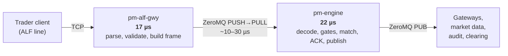
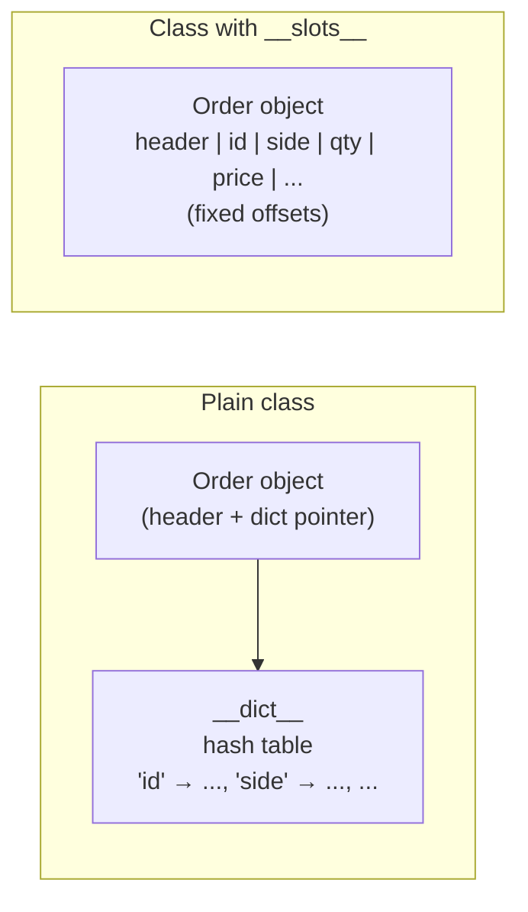
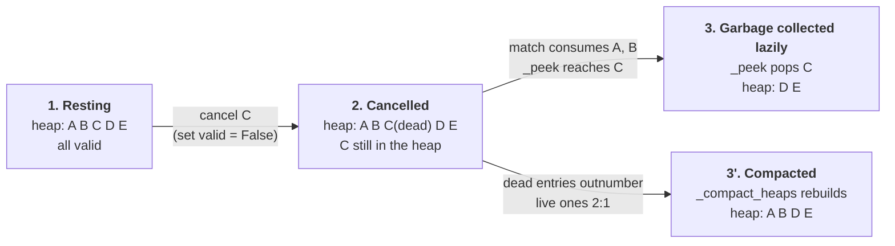
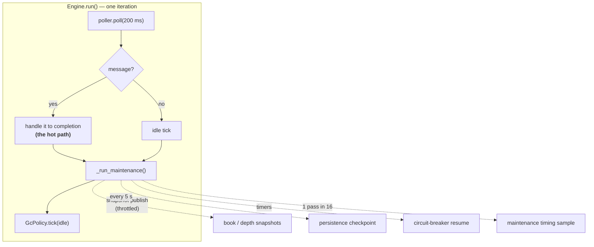
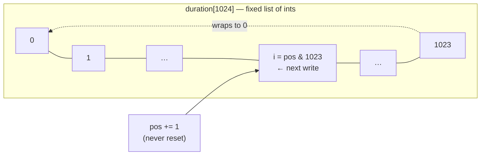
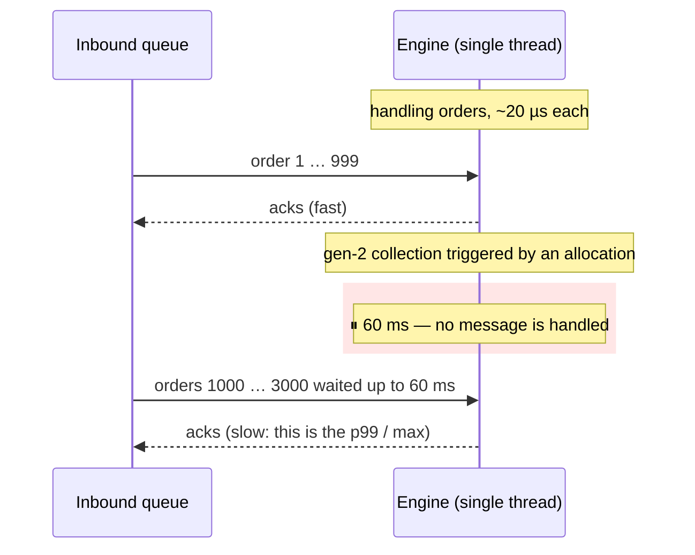
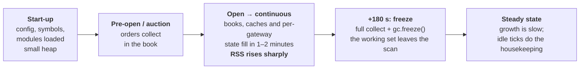
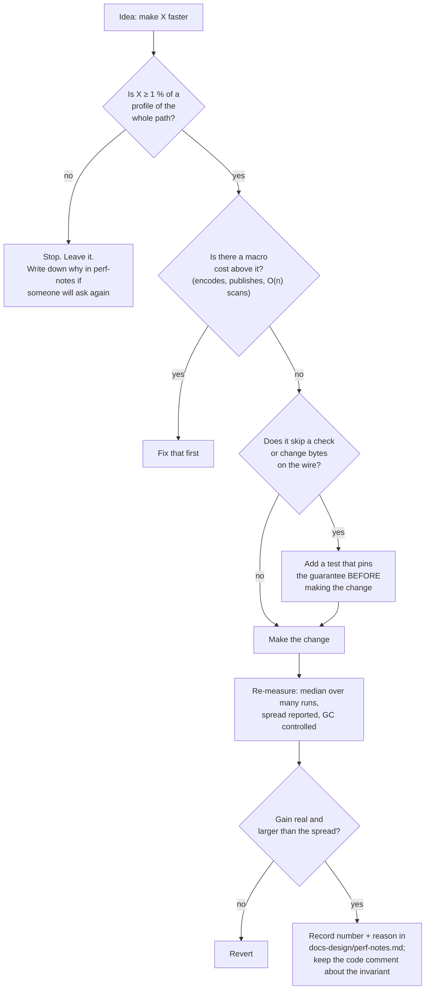

# Performance Engineering in a Python Matching Engine

!!! note "Learning objectives"
    After working through this chapter you will be able to:

    - **Say where the time goes** — read the engine's latency budget and the
      profile of one order, and explain why no single function dominates
    - **Choose the right data representation** — integer ticks, `__slots__`,
      frozen slotted messages — and know what each really buys on *your*
      interpreter (the numbers have changed since Python 3.10)
    - **Avoid construction and conversion costs** — enum lookup tables,
      `__new__` plus direct slot writes, unchecked message builders, cheap ids
    - **Explain the algorithmic choices** — heaps, lazy deletion with
      amortised compaction, the price-level index, and why each cancel is O(1)
    - **Explain the "do it later" techniques** — throttled snapshots,
      checkpoints, counters differenced by `pm-monitor`, and *sampled*
      instrumentation with preallocated ring buffers
    - **Explain the garbage-collection policy** — why a full collection costs
      tens of milliseconds, what `gc.freeze()` and idle-time collection do,
      and how `GcPolicy` arms the freeze after the open
    - **Answer the Java question** — why object pooling is not the Python
      answer, and what plays its role here
    - **Measure honestly** — avoid the bimodal-benchmark trap, and follow the
      rule that decides whether a micro-optimisation may enter the code

!!! tip "How to read this chapter"
    The chapter has a deliberate order: **principles, then measurements, then
    techniques from cheap to subtle, then GC, then how to measure**. Every
    technique names the file where you can read the real code. The
    nanosecond-level rationale for individual micro-optimisations is kept in
    `docs-design/perf-notes.md`; the order-entry latency study is
    `docs-design/EduMatcher-Perf-Analysis.md`. This chapter explains *why*
    those decisions were made and how they fit together.

    Timings quoted as "measured here" come from the benchmark script in
    [Reproducing the numbers](#reproducing-the-numbers) on CPython 3.14.10
    (x86-64 Linux). Absolute values depend on your machine; the *ratios* are
    what to take away. Timings quoted from the design notes are marked as such.


## 1. Why this chapter exists

EduMatcher is a teaching exchange written in Python. That is a deliberate
choice: a student can read the whole matching path in an afternoon. It also
means the engine competes with a language runtime that was never designed for
microsecond latency, so the code carries a set of techniques that look odd to
a reader who has not seen the measurements: classes with `__slots__`, enum
lookup tables built at import time, a hand-rolled `__new__` constructor, a
`SAMPLE_MASK` in the run loop, a garbage-collection policy class.

None of them is clever for its own sake. Each is the result of a measurement,
and each has a *cost* in readability that the measurement had to justify.
This chapter collects them in one place, explains the mechanism behind each,
and — just as important — says which common "optimisations" were tried and
rejected.

### 1.1 What "fast" means here

Three different quantities get called "performance", and they are improved by
different techniques:

| Quantity | Question it answers | Typical technique |
|---|---|---|
| **Throughput** | How many orders per second can the engine absorb? | Cheaper per-order work, fewer allocations |
| **Typical latency** (p50) | How long does an ordinary order take? | Same as throughput |
| **Tail latency** (p99, max) | How long does the *unlucky* order take? | Keep rare, slow events (GC, big flushes) off the message path |

The engine is single-threaded and handles one message at a time, to
completion. That has a consequence that drives the rest of this chapter:
**anything slow that happens between two messages delays the next message**.
A 60 ms garbage collection is invisible in throughput (it is rare) and
disastrous in tail latency (every order queued behind it waits 60 ms).

### 1.2 The five rules

These are the rules the project applies; the rest of the chapter is their
consequences.

1. **Measure first.** A change enters the hot path only if a profile shows its
   target is at least **1 % of wall time** (review finding P6). Without that
   gate a hot function accretes "improvements" that make it unreadable and
   change nothing.
2. **Macro before micro.** JSON per message, publication fan-out, and O(n)
   scans dominate. Saving 30 ns on an attribute access is irrelevant while a
   message is encoded three times.
3. **Do not trade correctness for speed silently.** Where a shortcut skips a
   safety check (the *unchecked* builders), a test pins the equivalence so the
   shortcut cannot rot.
4. **Keep rare slow work off the message path.** Garbage collection,
   persistence, snapshot publication and metrics aggregation all happen
   *between* messages or in another process.
5. **Comments say why; the notes say how much.** Invariants stay in the code;
   measured nanoseconds live in `docs-design/perf-notes.md`, so the code
   comment does not go stale when the number changes.


## 2. Where the time goes

Before optimising, look at the budget. The two legs of an order, measured on
the development machine (`docs-design/EduMatcher-Perf-Analysis.md` §6), are:



*Figure 1 — The in-process budget for one order is about 39 µs (it was 54 µs
before the gateway-leg work of §4). The engine leg is the smaller half.*

The first finding of that study is worth stating plainly: the benchmark that
the team had been using timed *only the engine leg*, while the untimed
gateway leg was the larger of the two. Optimisation effort had been going
into the part that was easiest to measure.

Inside the engine leg there is no single hotspot. A profile of 20 000 orders
(publisher draining, so garbage collection does not mask the distribution):

| Component | Share of time | Calls per order |
|---|---:|---:|
| `_handle_new_order` — its own bytecode | **28 %** | 1 |
| `dict.get` | 7.5 % | **28.8** |
| `Order.from_dict` | 7.2 % | 1 |
| `_apply_fill` | 3.4 % | 0.5 |
| `_update_position` | 3.2 % | 1 |
| `_publish_trade` | 2.9 % | 0.5 |
| `from_ticks` | 2.8 % | 2.5 |
| `orjson.dumps` | 2.2 % | 2.5 |
| `enum.__get__` (the `.value` descriptor) | 1.9 % | 3.5 |
| `logging.isEnabledFor` | 1.4 % | 5.5 |

The largest line is a function of several hundred lines executing a long checklist — gateway
status, symbol allowlist, validation, session, halt, collar, matching phase,
self-match prevention — most of which does not apply to most orders. That is
what "more logic on the hot path" looks like in a profile: **not one
expensive call, but a hundred cheap ones**. This is why the techniques below
are individually small, and why the project insists each one be measured.

!!! info "Profiling a handler yourself"
    The profile above was produced by driving `Engine._handle_new_order`
    directly in a loop under `cProfile`, with a mock publisher socket that
    discards frames. `make test-perf` runs the marked benchmarks
    (`pytest -m perf`). Keep a profile of the *whole* ingress-to-book path
    before trusting a number from only one half of it.


## 3. Data representation

### 3.1 Integer ticks, not floats

All prices inside the engine are **integer ticks** (a price of `100.10` with
two decimals is `10010`). Conversion to display money happens only at the
edge (`from_ticks`). The reasons are correctness first and speed second:

- Integers have no rounding error, so a price is an exact dictionary key. The
  price-level index `_bid_qty[price]` would be unreliable with floats.
- Integer comparison is the cheapest comparison Python has, and the heap
  compares keys on every push and pop.
- Small integers (−5 to 256) are cached by the interpreter; larger ones are
  cheap, immutable and — importantly for GC — **not tracked by the cyclic
  collector** (see §9.1).

```python
# order_book.py — a bid's heap key: the *negated* price makes Python's
# min-heap return the HIGHEST bid first; arrival_seq breaks ties (time priority).
key = (-order.price_ticks, order.arrival_seq)
```

### 3.2 `__slots__`: what it does, and what it buys

A normal Python object stores its attributes in a per-instance dictionary.
A class that declares `__slots__` stores them in a fixed array of
pointers at known offsets and has no `__dict__`:



*Figure 2 — Where the attributes live.*

The engine uses slots on every high-volume object:

| Class | File | Why it is hot |
|---|---|---|
| `Order` | `models/order.py` | One per live order; mutated on every fill |
| `Trade` | `models/trade.py` | One per print |
| `_HeapEntry` | `engine/order_book.py` | One per resting order *and* per stop; the most frequently allocated object in the engine |
| `OrderBook` | `engine/order_book.py` | Attribute access on every `self._bids`, `self._asks`, … |
| `_LatencyRing` | `engine/metrics.py` | Accessed on every sampled message |
| generated message records | `models/generated/*.py` | `@dataclass(frozen=True, slots=True)` |

The two spellings are equivalent:

```python
from dataclasses import dataclass

@dataclass(slots=True)           # dataclass generates __slots__ for you
class Trade:
    id: str
    price: int
    quantity: int

class _HeapEntry:                # hand-written class: declare them yourself
    __slots__ = ("key", "order", "valid")

    def __init__(self, key, order, valid=True):
        self.key = key
        self.order = order
        self.valid = valid
```

#### What the numbers say on Python 3.14

The original comments in `models/order.py` claim "~30 % faster attribute
access" and "~40 % lower per-instance memory". Those figures were true on
older interpreters. CPython 3.11–3.13 added *inline values* and attribute
inline caches, which removed most of the dictionary overhead of plain
classes. Re-measured here, on an 18-field dataclass:

| Measurement (3.14.10) | Plain class | `slots=True` |
|---|---:|---:|
| Memory per instance | 240 B | **184 B** (−23 %) |
| Reading one attribute | 11.2 ns | 10.8 ns (no difference) |
| Constructing an instance (defaults) | 456 ns | **184 ns** (2.5× faster) |

!!! warning "Be honest about what slots buys today"
    On a current interpreter the attribute-**read** speed-up is gone; what
    remains is **less memory per object** and **much cheaper construction**,
    and both matter for an engine that allocates an `Order` per message and
    holds tens of thousands of them. Slots also give a safety property: a
    typo such as `order.remaning_qty = 0` raises `AttributeError` instead of
    silently creating a new attribute. Keep the slots, but when you write
    about them, claim memory, construction cost and typo-safety — not
    attribute speed. If you re-measure and want to update the comment in
    `models/order.py`, do.

**Costs and traps of `__slots__`:**

- Instances cannot get new attributes and cannot be weak-referenced unless
  `"__weakref__"` is a slot.
- Inheritance: a subclass without its own `__slots__` quietly gets a
  `__dict__` again and loses the benefit.
- A class-level default (`x: int = 0`) conflicts with a hand-written slot of
  the same name; `@dataclass(slots=True)` handles this for you, which is the
  main reason to prefer it.
- `@dataclass(slots=True)` creates a *new* class object, so `super()` without
  arguments inside its methods misbehaves. The engine's slotted dataclasses
  do not use it.

### 3.3 Frozen messages

The generated message records (`models/generated/`) are
`@dataclass(frozen=True, slots=True)`. Frozen is not a performance feature —
it makes the records hashable and immutable, which the audit and replay code
relies on. It is included here because the combination shows the intended
default: **generated value objects are small, immutable and slotted**.


## 4. Cheaper construction and conversion

Constructing an object from a decoded JSON dictionary happens once per
inbound message, so its cost is paid at the full order rate.

### 4.1 Bypass the generated `__init__`

`Order.from_dict` writes the slots directly instead of calling the
dataclass-generated `__init__` with 19 keyword arguments:

```python
# models/order.py
@classmethod
def from_dict(cls, d: dict[str, Any]) -> "Order":
    # Bypass the dataclass __init__ (which parses 19 kwargs) and write slots
    # directly via __new__.
    o = object.__new__(cls)
    o.id = d["id"]
    o.symbol = d["symbol"]
    o.side = _SIDE_MAP[d["side"]]          # <- lookup table, see 4.2
    o.order_type = _TYPE_MAP[d["order_type"]]
    ...
    return o
```

Measured here, building a slotted 18-field object from a dictionary:

| Method | Time |
|---|---:|
| `S(**d)` — generated `__init__` with keyword arguments | 2 505 ns |
| `object.__new__` + 18 direct slot writes | **501 ns** (5× faster) |

The dominant cost of `S(**d)` is not the field stores but the argument
dispatch: unpacking a dictionary into 18 keyword arguments and matching each
against a parameter name. The price of the shortcut is that `from_dict` must
be kept in step with the field list by hand, so a round-trip test of
`to_dict` and `from_dict` is what keeps it honest.

### 4.2 Enum lookup tables

`Side("BUY")` looks like a dictionary lookup but is not: `Enum.__call__`
walks the machinery that resolves a value to a member. A prebuilt dictionary
is a plain hash lookup:

```python
# models/order.py — built once at import time
_SIDE_MAP: dict[str, Side] = {v.value: v for v in Side}
_TYPE_MAP: dict[str, OrderType] = {v.value: v for v in OrderType}
_TIF_MAP:  dict[str, TIF] = {v.value: v for v in TIF}
```

| Operation (measured here) | Time |
|---|---:|
| `OrderType("H")` | 203 ns |
| `_TYPE_MAP["H"]` | **22 ns** (9× faster) |
| `Side.BUY.value` | 107 ns |
| `Side.BUY` (the member itself) | **23 ns** |

The second pair explains a small change made in the fill loop: `evt.side.value`
became `evt.side`. The members of the engine's enums are `str` subclasses
(`class Side(str, Enum)`), and both `orjson` and the stdlib encoder serialise
a `str` subclass as its string value, so `.value` bought nothing but a
descriptor call. A profile of 30 000 orders showed 75 057 calls to
`enum.value` at those two sites; they now cost zero, with identical bytes on
the wire.

!!! warning "Do not extend this blindly"
    `Order.to_dict()` also contains `.value` calls, and the notes say not to
    touch them without profiling: `to_dict` is used far outside order entry
    (persistence, snapshots), and the proof of byte-identity was only done
    for the two fill-loop sites.

### 4.3 Unchecked builders, with a safety net

Messages are built by functions generated from the YAML specification (see
[Message Generation](../part-4-developing/040-message-generation.md)). Each
message has two builders:

- `make_order_new(...)` — **validating**: dict → dataclass → `validate()` →
  dict. About 7.3 µs.
- `make_order_new_unchecked(...)` — **no validation, no dataclass round
  trip**. About 2.4 µs.

Of the 5 µs difference, only 0.36 µs is `validate()` itself; the other 4.6 µs
is the dataclass round trip, which buys nothing when the payload arrives as a
dictionary and leaves as a dictionary. The unchecked builder is used where the
caller is the *authority* on the data: the engine for its own trades
(`make_trade_executed_unchecked`), and the ALF gateway for an order whose
fields its own parser has already bounded.

Skipping `validate()` is a real safety trade, so it is guarded:

```python
# tests/test_alf_gwy_wire_bounds.py (sketch)
def test_every_validate_rule_is_accounted_for():
    """Read the rules out of the *generated source*. A NEW spec rule fails the
    build until someone decides whether the gateway enforces it earlier."""
```

That test is the pattern to copy: **whenever a shortcut is justified by
"something else already guarantees this", a test must pin that guarantee**,
and must fail when the guarantee changes.

!!! example "A deliberate pessimisation"
    `_publish_trade` costs about **0.6 µs more** than the hand-written dict
    literal it replaced (1.5 µs against 0.96 µs). The field list now lives in
    `spec/messages/trade.yaml` instead of being retyped in three places, which
    is what stopped the C clients from silently missing a new field. Roughly
    0.39 µs of the extra cost is a *coercion* that guarantees
    `make_trade_executed_unchecked(price=100)` puts the same bytes on the wire
    as the validating builder; dropping it would let an `int` through where a
    `float` belongs, and `mypy` does not catch that because `int` is
    promotable to `float`. A perf test (`tests/test_msgen_trade_perf.py`,
    marker `perf`) guards against a regression to the 4× slower shape. The
    lesson: **a measured cost accepted on purpose is documented, with its
    reasoning and a guard test**, so nobody "optimises" it back.

### 4.4 Cheap ids

Order ids were `str(uuid.uuid4())` (1 218 ns here) and are now
`os.urandom(16).hex()` (**170 ns**, 7× faster). The entropy is identical —
128 bits from the OS random source — so the collision argument is unchanged,
which matters because several processes mint order ids with no
coordination. The extra time in `uuid4` is entirely `UUID` object
construction and dashed formatting; nothing in the system parses an order id
back. A per-gateway counter would be faster still but would need a durable
run sequence in every producer to survive a restart, and the saving does not
justify that machinery.


## 5. Serialisation and publication

Every order crosses the process boundary as JSON, and the engine publishes
two to four frames per order. Serialisation is the biggest *macro* cost, so
it is where the cheapest large win was.

### 5.1 `orjson`

```python
# models/message.py
try:
    import orjson as _json_mod
    def _dumps(obj): return _json_mod.dumps(obj)       # returns bytes directly
    def _loads(data): return _json_mod.loads(data)
except ImportError:
    import json as _json_fallback                      # minimal environments
    def _dumps(obj): return _json_fallback.dumps(obj).encode()
    def _loads(data): return _json_fallback.loads(data)
```

A 12-key order payload, measured here:

| | `json` (stdlib) | `orjson` |
|---|---:|---:|
| `dumps` → `bytes` | 3 036 ns | **277 ns** (11×) |
| `loads` | 3 297 ns | **989 ns** (3.3×) |

`orjson.dumps` returns `bytes`, which is what ZeroMQ wants, so the extra
`.encode()` step disappears as well. With two to four encodes per aggressive
order, this single swap saves several microseconds — more than every
micro-optimisation in §4 combined, which is the "macro before micro" rule in
numbers.

### 5.2 Pre-encoded and cached topics

ZeroMQ topics are `bytes`. Static topics are encoded once at import (the
generated binding for `trade.executed` does this), and per-gateway topics such
as `order.ack.TRADER01` are built once on first contact and cached:

```python
# engine/main.py — inside _handle_new_order
_tc = self._topic_cache
ack_topic = _tc.get(_gw)
if ack_topic is None:
    ack_topic = _tc[_gw] = topic_order_ack(_gw).encode()   # first order only
```

This replaces an f-string build plus an `encode()` on every message with one
dictionary lookup. The cache grows with the number of *gateways*, which is
small and bounded by configuration.

### 5.3 One timestamp per order

`now_ns()` guarantees strictly increasing nanosecond stamps and takes a lock
to do so, so calling it repeatedly costs real time (a clock read plus a
lock acquisition each). The engine computes **one** timestamp per incoming order and
threads it through `process()`, `Trade.create(now=…)`, iceberg re-queue and
stop conversion. An auction uncross does the same for the whole batch: all
fills of an uncross are logically simultaneous, so they share one stamp.
Since finding H1, *time priority* is decided by `arrival_seq`, never by a
timestamp, so sharing a stamp cannot change who is first.


## 6. Algorithms and indexes

### 6.1 Heaps and the price-level index

Each side of a book is a binary heap keyed by `(±price, arrival_seq)`, so the
best order is always `heap[0]` and push/pop cost O(log n). Alongside the
heaps, the book maintains small dictionaries so common questions never scan:

| Structure | Answers | Cost |
|---|---|---|
| `_bids` / `_asks` (heaps) | What is the best order? | O(1) peek, O(log n) push/pop |
| `_bid_qty` / `_ask_qty` | How much is displayed at price *p*? | O(1) |
| `_order_index` | Is order *id* resting? | O(1) |
| `_entry_index` | Which heap entry belongs to order *id*? | O(1) |
| `_orders_by_gateway` | All resting orders of one gateway (mass cancel, disconnect) | O(k) for k orders |
| `_buy_stops` / `_sell_stops` | Can any stop trigger? | O(1) when nothing fires: compare against `heap[0]` |

A trade that moves nothing is answered by looking at the top of the stop
heaps only. The price of the indexes is that **every mutation must update all
of them together**; the order-book chapter lists which functions must be
touched as a set.

### 6.2 Lazy deletion

A heap cannot cheaply remove an element from the middle. The book therefore
never removes; it *marks*:

```python
# order_book.py
class _HeapEntry:
    __slots__ = ("key", "order", "valid")      # `valid` is the lazy-delete flag

# cancel: O(1) — flip the flag, forget the order in the indexes
entry.valid = False
```



*Figure 3 — A cancelled order stays in the heap as a dead entry until
either `_peek` reaches it or `_compact_heaps` sweeps the heap.*

Dead entries are removed in two places:

- **`_peek`** pops dead entries as they reach the top. Each dead entry is
  popped at most once, so the cost is amortised O(log n).
- **`_compact_heaps`** handles the entries that never reach the top (a stale
  order deep in the book). When the total number of heap entries exceeds
  `2 × live + 64`, all heaps are filtered and re-heapified. The slack of 64
  stops a nearly empty book from rebuilding after every cancel.

```python
_COMPACT_FACTOR = 2
_COMPACT_SLACK = 64

def _compact_heaps(self) -> None:
    heaps = (self._bids, self._asks, self._buy_stops, self._sell_stops)
    if sum(map(len, heaps)) <= _COMPACT_FACTOR * len(self._entry_index) + _COMPACT_SLACK:
        return
    for heap in heaps:
        heap[:] = [e for e in heap if e.valid and e.order.status not in _DEAD_STATUSES]
        heapq.heapify(heap)
```

Rebuilding costs O(n) but happens only after Ω(n) removals, so the cost is
**amortised O(1) per cancel**. This matters in practice: an AI swarm cancels
thousands of stale orders a minute, and without compaction the heaps — each
entry keeping its `Order` alive and every snapshot walking them in full —
would grow for the life of the process. That was a real memory defect before
compaction existed.

How much does it matter? Measured here, cancelling 5 000 random orders out of
a 20 000-entry heap:

| Strategy | Time |
|---|---:|
| Lazy deletion (flip a flag) | **0.22 ms** |
| Eager removal (`list.remove` + `heapify` per cancel) | 17 800 ms |

The eager version is a strawman only in that nobody would write it twice; the
point is the scale. A cancel is a very frequent operation in a real market
(most orders are cancelled), so it must not depend on book depth.


## 7. Interpreter-level micro-optimisations

These are the ones the project applies *last*, and only inside functions the
profile has already named.

### 7.1 Bind hot attributes to locals

Inside the sweep loop the aggressor's `side`, `smp_action` and `gateway_id`
never change, so they are read once:

```python
def _sweep(self, order, ...):
    side = order.side                      # LOAD_FAST in the loop, not LOAD_ATTR
    smp_action = order.smp_action
    gateway_id = order.gateway_id
    while ...:
        ...
```

Measured here, reading one attribute a million times through a slotted
object costs 31.6 ms against 28.7 ms through a local: about **3 ns per read**.
That is why the rule in the notes is "over N price levels this saves 0.2–0.8
µs per aggressive order" — real, but only inside a loop, and only where a
profile asks for it.

### 7.2 Constants built once

```python
# engine/main.py
_ENDED_STATUSES = frozenset({OrderStatus.FILLED, OrderStatus.CANCELLED, OrderStatus.REJECTED})
```

A set literal inside a function is rebuilt on every call. A module-level
`frozenset` is built once and gives the same O(1) membership test.

### 7.3 Counters, not events

```python
# engine/main.py — the trade hot path
fills = self.metrics.fills
buy, sell = trade.buy_gateway_id, trade.sell_gateway_id
fills[buy]  = fills.get(buy, 0) + 1
fills[sell] = fills.get(sell, 0) + 1
```

The engine increments plain dictionary entries keyed by *raw* gateway id.
Mapping ids to display labels, summing, and computing rates happen later, when
the health beacon is built. This is the general shape of instrumentation here:
**the hot path increments a number; something else interprets it.**

### 7.4 What was tried and left alone

Equally instructive is the list of rejected ideas, each with its reason:

| Idea | Why it was not done |
|---|---|
| Compile out the `_dbg_count` guards (≈ 1.3 % of wall time) | A cached "debug on" flag goes stale when the log level changes at runtime; not worth a sub-300 ns win |
| Remove `.value` from `Order.to_dict()` | Used far outside order entry; only the two fill-loop sites were verified |
| A `__class__` type test instead of the coercion call in the generated builder | Measured **slower** |
| Coerce only numeric fields in the unchecked builder | Halves the overhead but weakens its byte-identity guarantee to typed call sites |
| Per-gateway counter for order ids | 208 ns does not justify a durable run sequence in five producers |
| Pooling `Order` objects | See §10 |

The 1 % rule exists to make this table longer, not shorter.


## 8. Work that does not belong on the message path

The cheapest operation is the one the order does not wait for. The run loop
therefore separates *handling a message* from *maintenance between
messages*:



*Figure 4 — Hot path (solid) versus the work done around it (dotted).*

### 8.1 Throttled and batched publication

Book snapshots are the clearest case. A market can trade thousands of times a
second; a dashboard cannot use more than a handful of snapshots. The engine
marks a symbol *dirty* when its book changes and publishes at most one
snapshot per `snapshot_interval_sec`:

```python
def _flush_snapshots(self) -> None:
    now = time.monotonic()
    sent: set[str] = set()
    for symbol in self._dirty_symbols:
        last = self._last_snapshot.get(symbol, 0.0)
        if now - last >= self.snapshot_interval_sec:
            ...publish snapshot + depth...
            self._last_snapshot[symbol] = now
            sent.add(symbol)
    self._dirty_symbols -= sent
```

The cost of a snapshot is proportional to book size, not to the number of
trades, so throttling converts a per-trade O(book) cost into a per-interval
one. The same idea applies to persistence: the resting book is checkpointed
every `_PERSIST_INTERVAL_SEC` (5 s), so an abrupt exit loses at most five
seconds of changes without every order paying for a disk write.

### 8.2 Sampled instrumentation and preallocated rings

Measuring the engine must not slow the engine. Reading the clock costs about
52 ns, and recording a duration touches several lists. Doing that for every
message would cost around 1 % of throughput, so the run loop times **one
message in sixteen**:

```python
# engine/metrics.py
SAMPLE_EVERY = 16                     # a power of two...
SAMPLE_MASK = SAMPLE_EVERY - 1        # ...so the test is a mask, not a modulo

# engine/main.py — the run loop
msg_count += 1
sampled = not msg_count & SAMPLE_MASK or metrics.sample_next
started_ns = clock_ns() if sampled else 0
self._dispatch_pull_message(topic, payload)       # handled either way
if sampled:
    metrics.record_dispatch(clock_ns() - started_ns, msg_count, ...)
```

The message *count* stays exact because the loop passes its own running local
counter; only the *timing* is sampled. Percentiles over one-in-sixteen
samples are statistically indistinguishable from percentiles over all of
them at any rate where percentiles mean anything.

The samples are stored in a ring buffer that is allocated once and never
resized — the closest Python gets to the Java habit of preallocating:

```python
# engine/metrics.py
LATENCY_RING = 1024                   # power of two, mask instead of modulo
_RING_MASK = LATENCY_RING - 1

class _LatencyRing:
    __slots__ = ("duration", "started", "gc", "pos")

    def __init__(self) -> None:
        self.duration = [0] * LATENCY_RING     # preallocated, fixed length
        self.started  = [0] * LATENCY_RING
        self.gc       = [0] * LATENCY_RING
        self.pos = 0

    def add(self, started_ns, duration_ns, gc_ns):
        i = self.pos & _RING_MASK              # wraps without a branch
        self.duration[i] = duration_ns         # overwrite in place:
        self.started[i] = started_ns           # no append, no growth,
        self.gc[i] = gc_ns                     # no allocation
        self.pos += 1
```



*Figure 5 — A mask-indexed ring: writes overwrite the oldest sample, memory is
constant, and the hot path allocates nothing.*

Two details follow the same philosophy. The ring holds **plain ints**, which
the cyclic collector does not track, so the ring adds nothing to GC work.
And `pos` is never reset, so "how many samples exist" is `min(pos, 1024)`
without a separate counter.

`pm-monitor` follows the same principle one level up: processes ship their
counters as **totals since start**, and the monitor turns them into
increments by differencing, so the engine never publishes an event per
trade (`monitor/rates.py`). Rolling windows there hold at most 60 buckets
whatever the beacon rate, so memory is fixed per figure.


## 9. Garbage collection

This is the technique that matters most for tail latency, and the one most
unlike anything in a language with a tracing collector.

### 9.1 What CPython's collector actually does

CPython manages memory with two mechanisms:

1. **Reference counting** frees an object the moment its last reference
   disappears. This is deterministic, immediate and handles almost every
   object in the engine.
2. **The cyclic garbage collector** exists only for objects that keep each
   other alive in a reference cycle (`a.peer = b; b.peer = a`). It runs
   periodically over *container objects* (those that can hold references:
   instances, lists, dicts, tuples of objects), organised into three
   *generations*. Young objects are scanned often, survivors are promoted, and
   generation 2 is scanned rarely — but when it is, **it scans every tracked
   object in the process**.

In this engine the second mechanism finds almost nothing. Measured on a run
with 20 000 resting orders, the collector freed about **1 000 objects per
120 000 messages**. Reference counting did the real work.

But the collector still has to *look*. A full collection must walk every live
tracked object, and the resting book is exactly that: tens of thousands of
`Order` and `_HeapEntry` objects. Measured in the engine (Python 3.14.8, 20 000
resting orders):

| Collection | Pause |
|---|---:|
| Generation 0 | ~0.25 ms |
| Generation 1 | 4–8 ms |
| Generation 2 (full) | **44–91 ms** |

A generation-2 pause scales with the number of live objects. In the isolated
benchmark of this chapter, a full collection over 50 000 small live objects
took 6.5 ms and over 200 000 took 24.6 ms; the engine's objects are larger
and more connected, hence the higher figures above.

Compare these with the cost of an order: about **130 µs** at p99. One full
collection is the same as several hundred orders. And because the engine
handles one message at a time, every message queued behind the pause waits
for it:



*Figure 6 — A pause is invisible in throughput and dominates the tail.*

This is the reason the dashboard's engine-latency row shows both
`handle_us_p99_ex_gc` (the p99 with collection time subtracted) and
`gc_pause_us_max`. The metrics are collected through `gc.callbacks`, which
the interpreter calls at the start and end of each collection.

### 9.2 The policy: keep the collector off the message path

Because the collector rarely frees anything here, the right strategy is not
to tune it but to **stop it from scanning the long-lived book during trading**.
`engine/gc_policy.py` does three things:

**1. Freeze the long-lived set.** `gc.freeze()` moves every object currently
tracked into a permanent generation that later collections never scan. Dead
objects are still freed immediately by reference counting; freezing only means
the *cyclic* collector no longer looks at them.

**2. Raise the automatic thresholds into a safety net.** CPython collects
generation 0 after roughly 2 000 net allocations of tracked objects (net =
allocations minus deallocations, which is why a steady-state engine seldom
triggers it). The policy raises the thresholds to `(50_000, 10, 10)`, so an
engine under load collects only if tracked-object growth is genuinely large.

**3. Do the routine collection when idle.** On idle ticks (the poll timed out
with nothing to handle) the engine runs a cheap generation-1 collection, and a
full collection at most every five minutes.

```python
# engine/gc_policy.py (abridged)
FREEZE_DELAY_SEC = 180.0               # after continuous trading starts
FREEZE_FORCE_AFTER_SEC = 60.0          # do not wait forever for an idle tick
SAFETY_THRESHOLDS = (50_000, 10, 10)   # default is (2000, 10, 10)
FULL_COLLECT_EVERY_SEC = 300.0

class GcPolicy:
    def start(self):      # at run start
        self._saved = gc.get_threshold()
        gc.set_threshold(*SAFETY_THRESHOLDS)

    def arm_freeze(self): # on entering CONTINUOUS
        self.freeze_at = self._clock() + FREEZE_DELAY_SEC

    def tick(self, idle: bool):
        now = self._clock()
        if self.freeze_at and now >= self.freeze_at:
            if idle or now >= self.freeze_at + FREEZE_FORCE_AFTER_SEC:
                gc.collect()           # one full collection, then...
                gc.freeze()            # ...take the survivors out of play
                self.freeze_at = 0.0
                self._last_full = now
                return
        if not idle:
            return                     # busy: never collect on our own
        if now - self._last_full >= FULL_COLLECT_EVERY_SEC:
            gc.collect(); self._last_full = now
        else:
            gc.collect(1)
```

The effect of freezing, measured here with 200 000 live objects: a full
collection that took **24.6 ms** takes **0.000 ms** after `gc.freeze()`,
because there is nothing left in the scanned generations.

### 9.3 Why the freeze waits for the open

Freezing at start-up would be useless: at that moment the book is empty, and
everything that will be large later is allocated *after* the freeze, in the
scanned generations. The memory profile of a trading day looks like this:



*Figure 7 — The freeze belongs after the ramp, not before it.*

The same ramp is why `pm-monitor` must not raise a *memory growth* warning at
the open (the RSS growth rule ignores growth that is concentrated in the last
15 minutes). Both pieces of code rest on one observation: **the engine's
memory does not grow steadily; it steps up once at the open and then stays
roughly flat.**

`arm_freeze()` is called when the engine enters `CONTINUOUS` (and at run start
if it starts there), so each trading day re-freezes the new survivors. If the
engine is so busy that no idle tick ever occurs, the freeze runs 60 seconds
after it was due, as a single full collection at a moment the policy
chose rather than the allocator.

### 9.4 What this costs

- **Cycles among frozen objects are never reclaimed.** A reference cycle that
  becomes unreachable *after* it was frozen stays in memory for the life of
  the process. The engine's long-lived objects are acyclic by design; if a
  leak appears that `gc.collect()` cannot find, look for new cycles in
  frozen data first.
- **`gc.freeze()` is process-global.** `GcPolicy.stop()` restores the original
  thresholds and calls `gc.unfreeze()`, so a test that runs the engine does
  not change the collector for the next test.
- **Idle collection can lag under sustained load.** If the engine is never
  idle, only the safety-net thresholds and the forced freeze apply. The
  trade-off is deliberate: the routine collections are the first thing to
  skip when messages are waiting.

!!! tip "Why not `gc.disable()`?"
    The first design called for automatic collection off entirely. The
    implementation keeps it on with high thresholds instead: the collector
    stays available as a bound on pathological growth (a cycle-producing bug
    would otherwise leak until the process dies), and no code path can forget
    to re-enable it.


## 10. "Can we pool objects, like in Java?"

In Java, allocation is cheap but collection pauses are not, so high-frequency
code preallocates objects and recycles them. The instinct is natural; in
CPython it mostly does not transfer.

| Java rationale | What CPython does instead |
|---|---|
| Avoid `new` cost | Small objects come from **pymalloc**, an arena allocator that already recycles freed blocks; there is usually no `malloc` call. Free lists exist for ints, floats, tuples and frames. A Python-level pool would sit on top of a pool |
| Avoid GC from short-lived garbage | Short-lived objects are freed by **reference counting** the instant they die; the cyclic collector never sees them |
| Reset cost is small | Resetting every field of a recycled `Order` is as much work as `__new__` plus slot writes (§4.1: ~500 ns), and the pooled object still carries GC tracking |
| Reuse is safe | A recycled `Order` that something still references silently shows another order's data — a correctness hazard that matters in a matching engine |

What plays the role of pooling here instead:

- **Preallocated, fixed-size structures** where it is safe and useful: the
  latency and GC rings (§8.2), `deque(maxlen=…)` for histories (the
  pm-monitor RSS history), so a hot structure never grows.
- **Fewer tracked objects**: slots (§3.2), plain ints in rings, tuples of
  ints for keys. What the collector does not track, it does not scan.
- **Keeping the collector away** from what is long-lived (§9).
- **A compiled core** — a C/Rust extension for the book — is the only route
  to Java-style control over allocation. It is a large architectural step and
  would cost the readability that is this project's purpose; nothing in the
  current measurements calls for it.


## 11. Measuring honestly

Every technique above depends on a trustworthy number. The project has been
bitten by untrustworthy ones.

### 11.1 The bimodal benchmark

The `make test-perf` throughput figure once ranged between **12 361 and 35 377
orders per second** across three consecutive runs on one machine, one commit
and one workload. Two things were responsible: the mock publisher socket
retained every published frame (a heap that grew for the whole run), and the
garbage collector scanned that heap. Disable *either* and the same workload
was stable at 42 000–45 000 TPS with a spread under 6 %.

The lesson: **a benchmark that measures its own heap measures the wrong
thing**. Before comparing two numbers, check the run-to-run spread; if the
spread is as big as the difference, you have measured nothing.

| Pitfall | Symptom | Remedy |
|---|---|---|
| Mock socket keeps every frame | Throughput varies several-fold between runs | Make the mock `send_multipart` discard |
| Collector runs mid-benchmark | Bimodal results | Disable GC in the benchmark, or report GC time separately |
| Timing only one leg | The slow leg is never improved | Time ingress to book, not one handler |
| Single run | Noise mistaken for signal | Medians over many iterations, spread reported |
| Cold caches | First runs slower | Warm up before timing |

### 11.2 Production measurements

The engine publishes its own latency in the health beacon:

| Metric | Meaning |
|---|---|
| `handle_us_p50` / `p99` | Order-entry handling time over a rolling 60 s window |
| `handle_us_p99_ex_gc` | The same with each sample's collection time subtracted |
| `gc_pause_us_max` | Longest single collection in the window |
| `gc_time_pct` | Share of wall time spent collecting |

The pair `p99` versus `p99_ex_gc` is the quickest way to see whether tail
latency is the engine's code or the collector: if they are close, GC is not
your problem; if `p99` is much larger, look at `gc_pause_us_max`.

Order entry is reported separately from other topics. Early dashboards mixed
them, and a 2 % share of expensive book-snapshot requests (about 2.2 ms each)
pulled the mixed p99 to 2.2 ms while the order p99 was ~130 µs.

### 11.3 The host matters too

A single-threaded asyncio process is only as fast as the core it gets. Running
a large `pytest -n` on the same host as a live simulation produced CPU
saturation and "sink full" drops in the gateways, and the cause was the test
run, not the swarm. Threads would not help (the GIL), and neither would more
workers. If you run tests next to a simulation, split the cores:
`--cpuset-cpus` for the container, `taskset -c <other cores> pytest -n <fewer>`
for the tests. See the operator guide's section on the health monitor for what
a saturated host looks like on the dashboard.

### Reproducing the numbers

The micro-benchmarks quoted in this chapter come from one script. It uses
only the standard library plus `orjson`; run it with `poetry run python`.

```python
import gc, heapq, json, os, time, timeit, tracemalloc, uuid
from dataclasses import dataclass
import orjson

FIELDS = [f"f{i}" for i in range(18)]
ns: dict = {}
exec("@dataclass\nclass P:\n" + "".join(f"    {f}: int = 0\n" for f in FIELDS),
     {"dataclass": dataclass}, ns)
exec("@dataclass(slots=True)\nclass S:\n" + "".join(f"    {f}: int = 0\n" for f in FIELDS),
     {"dataclass": dataclass}, ns)
P, S = ns["P"], ns["S"]

def bytes_per_instance(cls, n=100_000):
    gc.collect(); tracemalloc.start()
    objs = [cls() for _ in range(n)]
    current, _ = tracemalloc.get_traced_memory(); tracemalloc.stop()
    return current / n

def per_call_ns(stmt, number, **g):
    return timeit.timeit(stmt, globals=g, number=number) / number * 1e9

print("bytes/instance  plain", bytes_per_instance(P), " slots", bytes_per_instance(S))
print("construct ns    plain", per_call_ns("P()", 500_000, P=P),
      " slots", per_call_ns("S()", 500_000, S=S))
print("dumps ns        json ", per_call_ns("json.dumps(p).encode()", 500_000, json=json, p={"a": 1}),
      " orjson", per_call_ns("orjson.dumps(p)", 500_000, orjson=orjson, p={"a": 1}))

class O:                                    # a stand-in for a resting order
    __slots__ = ("id", "px", "meta")
    def __init__(self, i): self.id, self.px, self.meta = str(i), i, {"i": i}

book = [O(i) for i in range(200_000)]
gc.collect()
t0 = time.perf_counter(); gc.collect(); print("full collect ms", (time.perf_counter() - t0) * 1e3)
gc.freeze()
t0 = time.perf_counter(); gc.collect(); print("after freeze ms", (time.perf_counter() - t0) * 1e3)
gc.unfreeze()
```

The numbers in this chapter come from a longer version of this script (the
rest are the same pattern: `timeit` the statement, divide by the iteration
count).


## 12. A checklist before touching a hot path

Use this before adding code to `_handle_new_order`, `OrderBook._sweep`,
`_publish_*` or anything else per-message:



*Figure 8 — The decision procedure behind every item in this chapter.*

1. Is there a profile of the *whole* path that names this code?
2. Is the saving more than 1 % of that profile?
3. Is there a bigger cost (serialisation, fan-out, an O(n) scan) above it?
4. Does the change skip a check, or alter the bytes on the wire? If so, is
   there a test that fails when the guarantee behind it changes?
5. Does it add a tracked object per message? (The collector pays for it
   later, in the tail.)
6. Will it still be correct after the next change to the field list, the
   spec, or the book's indexes?
7. Is the measured gain recorded where the next reader will look?


## 13. Exercises

1. **Measure slots yourself.** Using the script in §11, add a class with 40
   fields and compare memory per instance for plain and slotted versions.
   Does the saving grow with field count?
2. **Find the break-even.** In `_compact_heaps`, change `_COMPACT_FACTOR` from
   2 to 1 and to 8. Drive a book with a cancel-heavy workload and record peak
   heap length and total time. Which value would you pick, and why is 2 a
   reasonable default?
3. **Observe a GC pause.** Register a function on `gc.callbacks`, build a
   book of 100 000 `Order`s, and print the duration of each collection. Then
   call `gc.freeze()` and repeat.
4. **Break the cycle assumption.** Create two `Order`s that reference each
   other, freeze, delete both, and call `gc.collect()`. Check the memory with
   `tracemalloc`. What does this tell you about cycles in frozen data?
5. **Find the next 1 %.** Profile `_handle_new_order` with `cProfile`
   (mock socket discarding frames). Pick the first entry above 1 % that is
   not already discussed here and propose a change. Apply the checklist of §12
   to your proposal before writing code.

## 14. Where to look next

| Topic | Location |
|---|---|
| Per-optimisation measurements and rejected ideas | `docs-design/perf-notes.md` |
| Order-entry latency study and the benchmark critique | `docs-design/EduMatcher-Perf-Analysis.md` |
| The GC policy and its tests | `src/edumatcher/engine/gc_policy.py`, `tests/test_engine_gc_policy.py` |
| Latency and GC metrics | `src/edumatcher/engine/metrics.py` |
| Lazy deletion and compaction | The Order Book: Deep Dive, "Lazy deletion" |
| Generated builders and the unchecked variant | Message Generation chapter |
| Counters differenced by the monitor | `src/edumatcher/monitor/rates.py` |
| Performance benchmarks | `make test-perf` (`pytest -m perf`) |
