# Inside the Container Deployment

!!! note "Learning objectives"
    After reading this chapter you will understand:

    - What each file in `deployment/docker/` and `deployment/curl/` is for, and
      how the two directories relate to each other
    - How the images are built, layer by layer, and how to rebuild any of them
      by hand without the helper scripts
    - How the compose files stack on top of each other, and what each one adds:
      containers, environment variables, volumes and ports
    - What actually happens when the backend container starts and stops
    - Which networks, pods and volumes your container engine creates, and what
      they are called
    - Every published port and why it exists, and every mount and why it is
      read-only or read-write
    - How the `make` targets and `edumatcher.sh` commands map onto plain
      `podman` / `docker` commands

    This chapter assumes you know roughly what an image and a container are,
    and nothing more. [Installation](010-installation.md) is the *how to
    install* chapter and the complete flag reference; this one is the *how it
    works* walkthrough behind it. The developer-level view, including the
    release workflow and network debugging, is in the Architecture and
    Developer Guide's
    [Container and Network Setup](../../architecture-and-development/part-4-developing/050-containers-and-networks.md).


## Five container terms, as they apply here

Container tools use a handful of words in very specific ways. Here is what
each one means in an EduMatcher deployment.

| Term | In general | In EduMatcher |
|---|---|---|
| **Image** | A read-only template: a file system plus a default command | Seven of them: `edumatcher` (the whole exchange), `edumatcher-ai-sim` (the same exchange preset to trade by itself) and one per web GUI |
| **Container** | A running instance of an image, with its own processes, network interface and writable layer | Up to seven run at once: the exchange container and six GUI containers |
| **Compose file** | A YAML file that describes several containers and how they connect, so you start them with one command instead of six | `compose.yaml` and its overlays. Several files can be combined, each adding to the last |
| **Bind mount** and **named volume** | Two ways to give a container storage that outlives it. A bind mount is a directory on your disk; a named volume is storage the container engine manages for you | Everything the exchange produces lives in a bind mount (`./data`), so you can see it. The GUIs keep small private state in named volumes |
| **Published port** | A port on your machine forwarded to a port in a container | How *you* — your browser, `curl`, a protocol client — reach the system. The containers do not use them to reach each other |

Two more appear further down: a **compose project** (the group of
containers one compose command manages, which also gets its own private
network) and a Podman **pod** (a named group of containers). Both are
explained where they come up in
[Projects, networks and pods](#projects-networks-and-pods).


## The two directories

The deployment lives in two directories. They describe **the same system**:
one builds it from source, the other runs the released images.

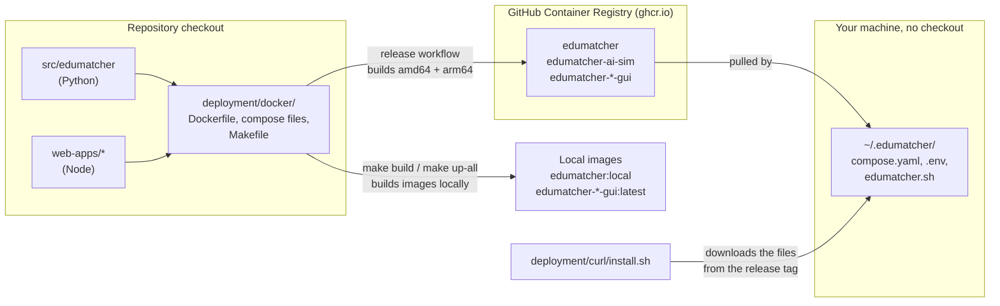

| | `deployment/docker/` | `deployment/curl/` |
|---|---|---|
| **For** | Changing EduMatcher and seeing the change run | Running a released version |
| **Images come from** | Built on your machine from the checkout | Pulled from `ghcr.io`, never built |
| **Needs** | Podman or Docker, plus Poetry and Node for the builds | Podman or Docker only |
| **Driven by** | `make` targets (`Makefile`) | `./edumatcher.sh` |
| **Lives in** | The repository | One directory, `~/.edumatcher` by default |

Because they describe one system, the compose files in `deployment/curl/` are
**twins** of those in `deployment/docker/`. They differ in only two ways:
they name images on GHCR instead of having `build:` sections, and they put all
six GUIs in one file.

### What is in each directory

`deployment/docker/`:

| File | Purpose |
|---|---|
| `Dockerfile` | Builds the backend image, in three stages: `builder`, `runtime` (the exchange) and `ai-sim` (the self-trading exchange) |
| `entrypoint.sh` | The script every backend container runs at start: deploys the configuration, starts the processes, waits, and shuts them down |
| `compose.yaml` | The base compose file: the exchange container alone, with its gateway ports |
| `compose.zmq.yaml` | Overlay: also publish the internal ZeroMQ bus |
| `compose.ssh.yaml` | Overlay: run an SSH server in the exchange container |
| `compose.guis.yaml` | Overlay: the five web GUIs that talk to the exchange |
| `compose.config-gui.yaml` | Overlay: the configuration builder, which talks to nothing |
| `compose.ai-sim.yaml` | A separate, self-contained stack: the AI-trader simulation and five GUIs |
| `Makefile` | Every build and run command, with the right files and variables filled in |
| `.env.example` | The default settings, copied to `.env` on first use |
| `.dockerignore` | Keeps everything except the wheel and the entrypoint out of the build |
| `.wheel/` | A drop box: a Python wheel placed here is what the image installs |
| `README.md` | A summary of this chapter, beside the files |

`deployment/curl/`:

| File | Purpose |
|---|---|
| `install.sh` | The one-line installer: resolves a release, downloads the files below, writes `.env` and starts everything |
| `edumatcher.sh` | The control script copied into the install directory: `start`, `stop`, `status`, `config`, `update` and the rest |
| `compose.yaml` | The exchange and all six GUIs, from GHCR images |
| `compose.zmq.yaml` | Overlay: publish the ZeroMQ bus (`EM_ZMQ=1` in `.env`) |
| `compose.ai-sim.yaml` | The AI-trader simulation, from GHCR images (`install.sh --sim`) |
| `.env.example` / `.env.sim.example` | The default settings for the exchange and for the simulation |
| `README.md` | Usage notes for a released install |


## The images

### Eight images, one backend Dockerfile

| Image | Built from | Listens on (in the container) | Contains |
|---|---|---|---|
| `edumatcher` | `deployment/docker/Dockerfile`, stage `runtime` | All exchange ports (see [Ports](#ports-and-why-each-one-exists)) | Python 3.13 and the `edumatcher` package with every `pm-*` command |
| `edumatcher-ai-sim` | same Dockerfile, stage `ai-sim` | same | The `runtime` image with different defaults: `s300-sim`, the `ai-sim` profile, Stockholm time |
| `edumatcher-terminal-gui` | `web-apps/terminal-gui/Dockerfile` | 8090 | TapeDeck: a React front end served by a small Node server (the *bridge*) |
| `edumatcher-log-gui` | `web-apps/log-gui/Dockerfile` | 8091 | The Log Operator Console, plus a Python copy of `edumatcher` for its diagnostics view |
| `edumatcher-config-gui` | `web-apps/config-gui/Dockerfile` | 8092 | The configuration builder |
| `edumatcher-trader-gui` | `web-apps/trader-gui/Dockerfile` | 8093 | The trading GUI |
| `edumatcher-book-gui` | `web-apps/book-gui/Dockerfile` | 8094 | The order book viewer |
| `edumatcher-dash-gui` | `web-apps/dash-gui/Dockerfile` | 8095 | The operator dashboard |

Locally built images are tagged `edumatcher:local` (from `IMAGE_NAME` and
`IMAGE_TAG` in `.env`) and `edumatcher-<app>:latest`. Released images are
`ghcr.io/johan162/<image>:<version>`, with `latest` following the newest
release. One version tag pins all seven images to the same release.

### Why the whole exchange is one container

It is tempting to expect one container per process: one for `pm-engine`, one
for each gateway, and so on. EduMatcher deliberately does not do that.

The exchange's processes talk to each other over a ZeroMQ message bus, and the
engine binds that bus to `127.0.0.1`, the loopback interface. Loopback is
private to one *network namespace*. Each container normally has its own, so
processes in different containers could not see the bus. Putting every
`pm-*` process in one container gives them one shared loopback, exactly as
they have when you run them by hand on one machine or in the
[VM runtime image](020-vm-runtime-image.md).

Inside that container, `pm-opctl-cli` is the process manager: it starts the
processes of a *profile*, watches them and stops them. The container engine
sees only one container; `pm-opctl-cli` manages what runs inside it.

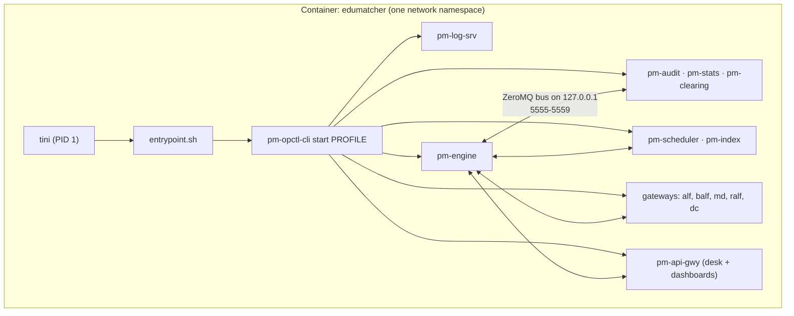

### The backend Dockerfile, stage by stage

A *multi-stage* Dockerfile builds in steps. Each `FROM` starts a fresh stage,
and a later stage copies only the results it needs out of an earlier one. Build
tools, pip caches and temporary files therefore never reach the image you run.

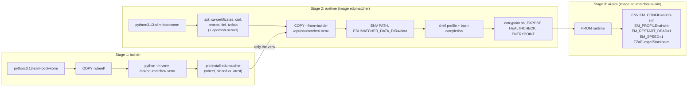

**Stage 1 — `builder`.** Creates a Python virtual environment and installs
EduMatcher into it. Where the package comes from is decided by what is in the
`.wheel/` drop box and by one build argument:

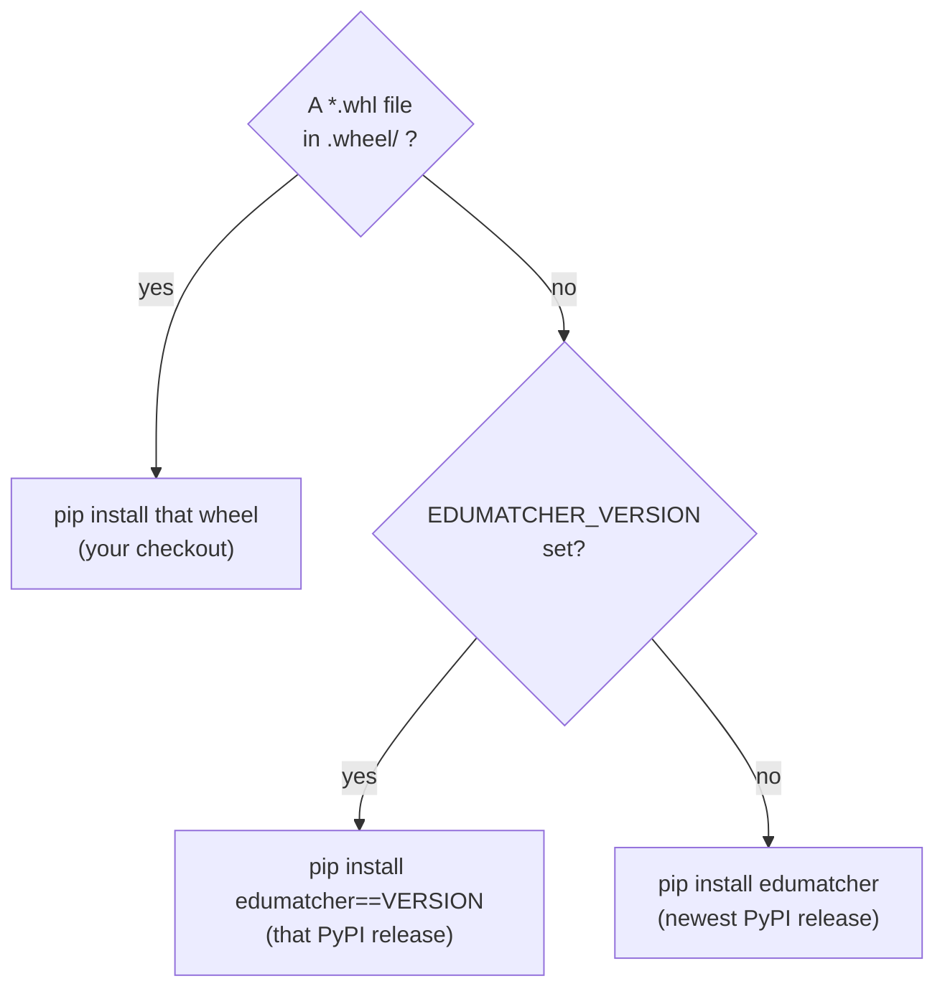

`make build` puts a freshly built wheel in `.wheel/` unless you pass `PYPI=1`
or `VERSION=`, in which case it empties the drop box first. That is what makes
"build from my checkout" the default. A build log line
`Installing local wheel: /tmp/wheel/edumatcher-...whl` confirms your code went
in.

**Stage 2 — `runtime`.** A clean copy of the same base image, plus five small
OS packages, each there for a reason:

| Package | Why it is needed |
|---|---|
| `tini` | Runs as PID 1. `pm-opctl-cli` starts processes detached; when one exits, someone has to reap it, and a shell script is not good at that |
| `procps` | `pgrep` and `ps`, which `pm-opctl-cli` and the `*-cli health` commands use to find processes |
| `tzdata` | The time zone database. The scheduler and market calendars need real zone rules |
| `ca-certificates`, `curl` | HTTPS from inside the container, for diagnostics |
| `openssh-server` | Only when `WITH_SSH=1` (the default), for `make up SSH=1` |

It then copies in the virtual environment from stage 1 and sets two
environment variables every process depends on: `PATH`, so `pm-engine` and the
rest are plain commands, and `EDUMATCHER_DATA_DIR=/data`, so every process
reads and writes the mounted data directory. The same two settings are also
written to `/etc/profile.d/` and `/root/.bashrc`. An SSH login does not inherit
the image's environment, so it needs them there.

The last lines of the stage set up how the container runs:

- **`EXPOSE`** lists the ports the processes use. It is documentation only:
  nothing becomes reachable because of it. The compose files decide what is
  published.
- **`HEALTHCHECK`** opens a TCP connection to the engine's order-intake socket
  on 5555 every 30 seconds, after a 60-second grace period. `podman ps` or
  `docker ps` then show the container as `healthy` or `unhealthy`. For a check
  of every process, use `make health` (`pm-opctl-cli health`).
- **`ENTRYPOINT`** runs `tini`, which runs `entrypoint.sh`. See
  [What happens when the exchange container starts](#what-happens-when-the-exchange-container-starts).

**Stage 3 — `ai-sim`.** Adds nothing but default settings on top of
`runtime`. The `edumatcher-ai-sim` image is the same software, preset to deploy
the `s300-sim` example, run the `ai-sim` profile on Stockholm trading hours,
and restart any process that dies. A plain `podman build` with no `--target`
builds this last stage. That is why every compose file that builds the
exchange names `target: runtime` explicitly.

### Build arguments of the backend image

Build arguments are values you can pass at build time with `--build-arg`. They
affect what goes into the image, not how it runs.

| Argument | Default | Effect |
|---|---|---|
| `PYTHON_VERSION` | `3.13` | Tag of the `python:*-slim-bookworm` base image, for both stages |
| `EDUMATCHER_VERSION` | *(empty)* | PyPI release to install when `.wheel/` holds no wheel. Empty means the newest |
| `PIP_INDEX_URL` | *(empty)* | A PyPI mirror, such as a corporate Artifactory, for builds behind a firewall |
| `WITH_SSH` | `1` | `0` leaves out `openssh-server` for a smaller image |

`compose.yaml` passes the last three from the variables of the same name in
your `.env` or shell.

### The web GUI images

All six GUI Dockerfiles follow one pattern, also in two stages:

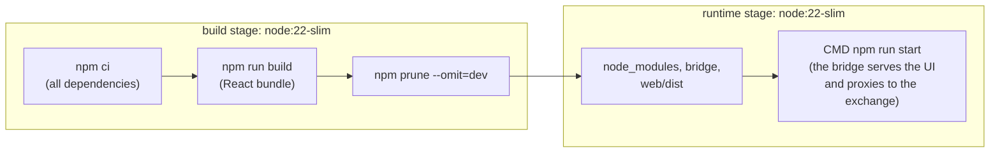

Each image runs one small Node server, the **bridge**. It serves the browser
application and relays its requests to the exchange, so the browser only ever
talks to one port. The bridges have no durable state of their own. The named
volumes mounted into them hold a failover log, used while `pm-log-srv` is
unreachable, and the log console's acknowledgements.

Their build arguments are mostly for corporate networks: `HTTP_PROXY`,
`HTTPS_PROXY`, `NO_PROXY`, `NPM_STRICT_SSL` (`false` when a proxy re-signs
TLS), `NPM_REGISTRY` (an npm mirror) and `WEB_PORT`.
[Image build arguments](010-installation.md#image-build-arguments) in the
installation chapter lists which of them the compose files actually pass on.

!!! note "The log console carries a copy of EduMatcher too"
    `edumatcher-log-gui` is the one GUI image with Python in it. Its
    diagnostics view runs `pm-log-cli` rather than reimplementing that tool in
    TypeScript. It picks its `edumatcher` package the same way the backend
    does, from a wheel in `web-apps/log-gui/.wheel/`, and `make build-guis`
    fills that drop box by the same rule as `make build`: a wheel built from
    your checkout, or a PyPI release with `PYPI=1` or `VERSION=x.y.z` (passed
    to the build as `EDUMATCHER_VERSION`).

### How released images are built

You never need to do this yourself, but it explains what you pull. Publishing a
GitHub release runs `.github/workflows/publish-images.yml`. It builds all
eight images (`edumatcher`, `edumatcher-ai-sim` and the six GUIs) natively on
an `amd64` and an `arm64` runner, and joins each pair into one multi-arch
manifest. Both backend images and the log console get the release's own wheel
in their `.wheel/` drop box, so their Python code is exactly the release. The
same tag is pushed for every image; that is why one `EM_VERSION` pins the
whole system.


## What happens when the exchange container starts

The container's command is `tini -- entrypoint.sh`. `entrypoint.sh` reads a
handful of environment variables (all set by the compose files from your
`.env`) and runs four steps.

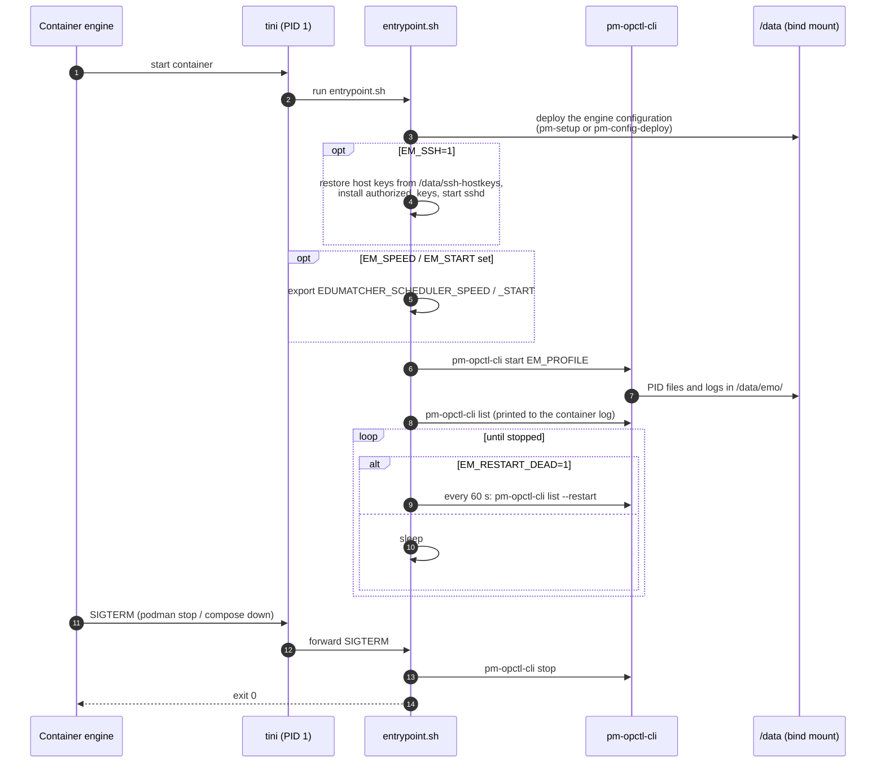

### Step 1: deploying the configuration

Which configuration is deployed depends on two variables and on a small stamp
file, `/data/.container-config`, which records the example name the data
directory was built from:

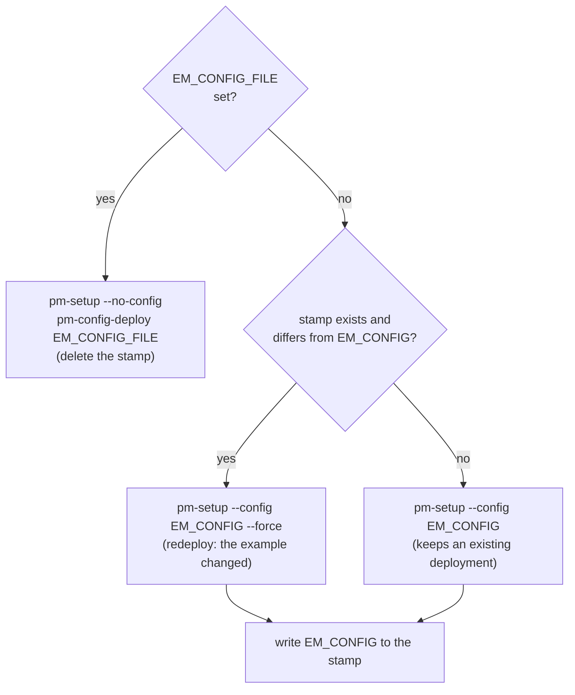

In practice:

- **A configuration file of your own** (`EM_CONFIG_FILE`) is deployed on
  *every* start. Editing the file and restarting is the whole edit-and-test
  loop.
- **A bundled example** (`EM_CONFIG`) is deployed once and then kept across
  restarts. That is what you want when you have edited
  `data/ref_data/engine_config.yaml` by hand. Naming a *different* example
  redeploys.

Either way the result is `/data/ref_data/engine_config.json`, the compiled
configuration every process reads.

### Step 4: stopping cleanly

`podman stop`, `docker stop` and `compose down` send the container `SIGTERM`,
then wait for a grace period before killing it. `tini` forwards the signal to
`entrypoint.sh`, whose handler runs `pm-opctl-cli stop`. That stops every
process of the profile in order, so each one can flush its files.
`stop_grace_period` in the compose files (30 seconds, 60 for the simulation)
gives that walk enough time before the engine resorts to `SIGKILL`.

!!! tip "The container log is the entrypoint's log"
    `make logs`, `podman logs edumatcher` or `./edumatcher.sh logs edumatcher`
    show the `==>` lines above: which configuration was deployed, which profile
    started, and the process table. Each process writes its own log to
    `data/emo/<name>.log`.


## The compose files, one by one

### How compose files combine

Compose reads one or more files, given with `-f`, and **merges** them in
order. A later file can add services, add entries to a service's environment,
ports or volumes, or override single values. The base file stays small; each
optional feature is a separate *overlay* you add only when you want it.

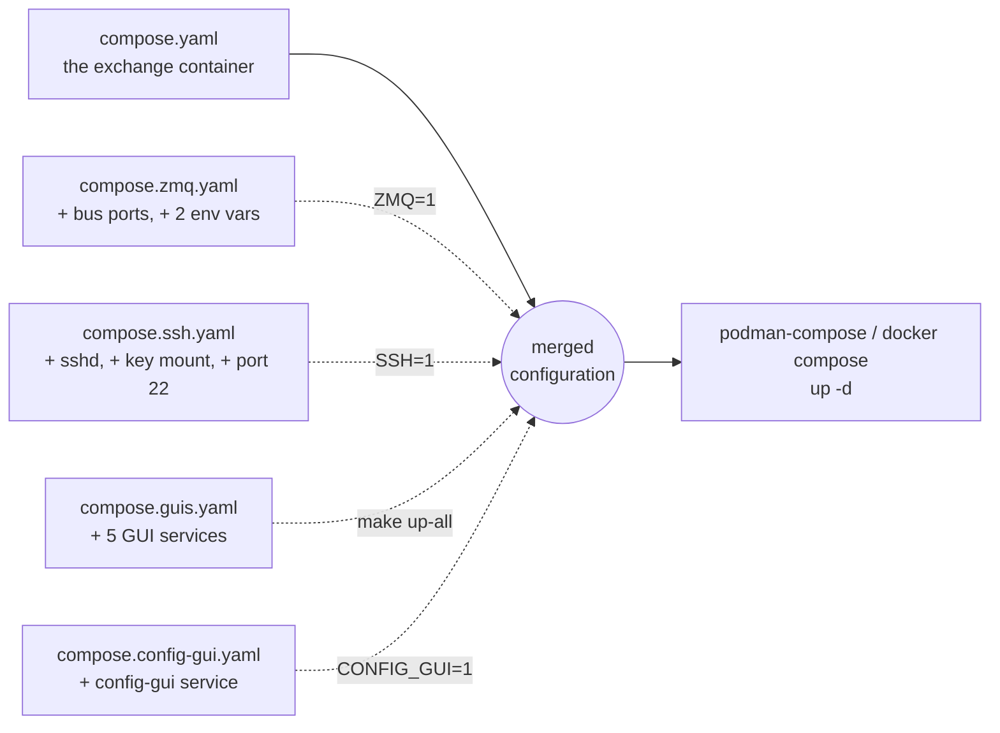

The `make` flags only choose which `-f` arguments are passed:

| Command | Files passed |
|---|---|
| `make up` | `compose.yaml` |
| `make up ZMQ=1 SSH=1` | `compose.yaml` `compose.zmq.yaml` `compose.ssh.yaml` |
| `make up-all` | `compose.yaml` `compose.guis.yaml` |
| `make up-all ZMQ=1 CONFIG_GUI=1` | `compose.yaml` `compose.zmq.yaml` `compose.guis.yaml` `compose.config-gui.yaml` |
| `make up-sim` | `compose.ai-sim.yaml` alone, as project `edumatcher-sim` |

To see the result of a merge without starting anything, ask compose to print
it:

```bash
cd deployment/docker
podman-compose -f compose.yaml -f compose.zmq.yaml config    # or: docker compose ... config
```

### `${VARIABLE:-default}`: where the values come from

The compose files contain almost no fixed settings. Nearly every value is a
reference such as `${BIND_ADDR:-127.0.0.1}`, meaning *the variable
`BIND_ADDR`, or `127.0.0.1` if it is unset*. Compose fills these in from your
shell environment first, then from the `.env` file beside the compose file.
When a value can be set in several places, the nearest one wins:

```text
make flag  →  shell environment  →  .env  →  ${VAR:-default} in the compose file  →  ENV in the image
```

So `make up CONFIG=s10-nominal` affects that one start only and does not edit
`.env`. The next plain `make up` goes back to what `.env` says.

!!! note "Two kinds of variable"
    Some variables are passed **into** a container as its environment (they
    appear under `environment:`), for example `EM_CONFIG`. Others are used
    only by compose itself to fill in the file and never reach a container,
    for example `BIND_ADDR`, the GUI host ports and `IMAGE_NAME`. The tables
    below say which is which.

### `compose.yaml` — the exchange

The base file defines one service, `edumatcher`, built from the Dockerfile's
`runtime` stage.

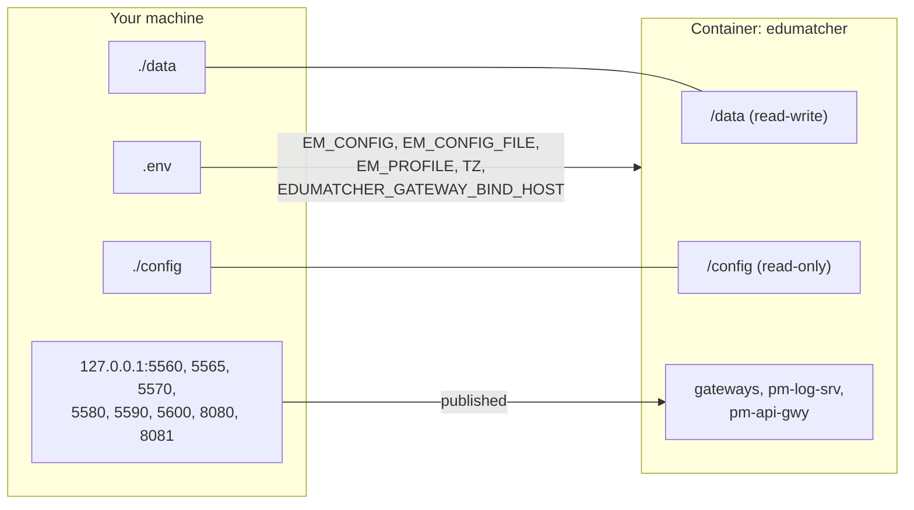

| Section | Setting | Why |
|---|---|---|
| `build` | `context: .`, `target: runtime`, three `args` | Build the exchange (not the AI-sim stage) from this directory |
| `image` | `${IMAGE_NAME:-edumatcher}:${IMAGE_TAG:-local}` | The name the built image is tagged with |
| `container_name` / `hostname` | `edumatcher` | A fixed name, so `podman exec edumatcher ...` works and the GUIs can find it |
| `restart` | `unless-stopped` | Restart after a crash, but not after you stopped it deliberately |
| `stop_grace_period` | `30s` | Time for `pm-opctl-cli stop` to stop every process cleanly |
| `environment` | see below | What `entrypoint.sh` and the processes read |
| `volumes` | `./data:/data`, `./config:/config:ro` | See [Volumes and mounts](#volumes-and-mounts) |
| `ports` | eight client-facing ports | See [Ports](#ports-and-why-each-one-exists) |

Environment passed into the container:

| Variable | Default | Read by | Effect |
|---|---|---|---|
| `EM_CONFIG` | `s10-basic` | `entrypoint.sh` | Bundled example configuration to deploy |
| `EM_CONFIG_FILE` | *(empty)* | `entrypoint.sh` | Path *inside the container* to a configuration of your own; wins over `EM_CONFIG` |
| `EM_PROFILE` | `default` | `entrypoint.sh` | Which `pm-opctl-cli` profile to start: `default`, `mini`, `micro`, `mm-demo`, `ai-swarm`, `ai-sim` |
| `EDUMATCHER_GATEWAY_BIND_HOST` | `0.0.0.0` | every gateway, `pm-log-srv`, `pm-api-gwy` | The interface the client-facing listeners bind inside the container. `0.0.0.0` is what lets the GUI containers reach them |
| `TZ` | `Europe/Stockholm` | everything | The container's time zone. Match it to your trading calendar |

`entrypoint.sh` also reads `EM_SSH`, `EM_SPEED`, `EM_START` and
`EM_RESTART_DEAD`, which the overlays and the AI-sim stack set.

### `compose.zmq.yaml` — the raw message bus

Adds seven ports and two environment variables to the `edumatcher` service, so
tools on your machine (`pm-calf-spy`, `pm-dc-spy`, `pm-index-cli`, your own
ZeroMQ clients) can attach to the bus directly.

| Adds | Value | Why |
|---|---|---|
| `EDUMATCHER_ENGINE_BIND_HOST` | `0.0.0.0` | The engine binds its bus to `127.0.0.1` by default; publishing the port alone would forward to nothing |
| `EDUMATCHER_INDEX_BIND_HOST` | `0.0.0.0` | Same for `pm-index` |
| ports | 5555–5559, 5601, 5602 | The engine's, the index's and the log server's ZeroMQ sockets |

!!! warning "The bus has no authentication"
    Anything that can reach 5555 can submit orders as if it were a gateway.
    Keep `BIND_ADDR=127.0.0.1` while this overlay is on.

### `compose.ssh.yaml` — SSH into the exchange

| Adds | Value | Why |
|---|---|---|
| `EM_SSH` | `1` | Tells `entrypoint.sh` to start `sshd` |
| volume | `./.ssh/authorized_keys:/run/host-authorized-keys:ro` | Your public keys, collected by `make keys` from `~/.ssh/*.pub` |
| port | `${SSH_PORT:-2222}` → 22 | `ssh -p 2222 root@localhost` |

The keys are mounted read-only and *copied* into place, because `sshd` refuses
key files it does not own with mode `0600`. The container's host keys are
generated once and kept in `data/ssh-hostkeys/`, so recreating the container
does not trigger a "host key changed" warning. No key material is ever built
into the image.

### `compose.guis.yaml` — the four connected web GUIs

Adds four services in the **same compose project** as the exchange. That is
the important part: being in one project puts them on one private network,
where the exchange answers to the hostname `edumatcher`.

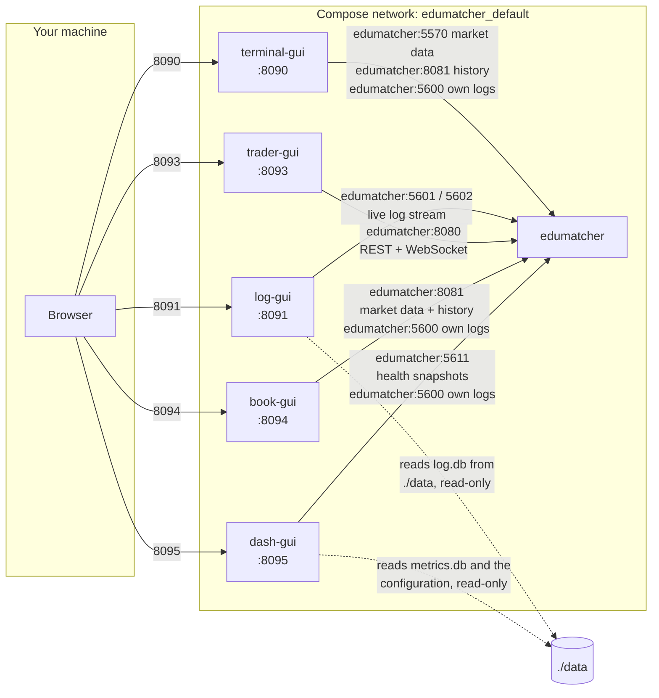

| Service | Talks to | Environment that wires it | Storage |
|---|---|---|---|
| `terminal-gui` | `pm-md-gwy` (CALF, 5570), `pm-api-gwy` dashboards (8081), `pm-log-srv` (5600) | `CALF_HOST`/`CALF_PORT`, `API_GATEWAY_URL`, `PM_TERMINAL_API_KEY`, `LOG_SRV_HOST`/`LOG_SRV_PORT`, `INDEX_IDS`, `MAX_WS_CLIENTS` | named volume `terminal-gui-logs` |
| `log-gui` | `pm-log-srv` LALF-PS (5601 PUB, 5602 PULL) | `LOG_SRV_HOST`, `LOG_SRV_PUB_PORT`, `LOG_SRV_PULL_PORT`, `LOG_DB_PATH`, `ACK_STORE_PATH` | `./data` read-only at `/backend-data`; named volume `log-gui-acks` |
| `trader-gui` | `pm-api-gwy` desk (8080) | `API_PROXY_TARGET` | none |
| `book-gui` | `pm-api-gwy` dashboards (8081), `pm-log-srv` (5600) | `API_GATEWAY_URL`, `PM_BOOK_API_KEY`, `LOG_SRV_HOST`/`LOG_SRV_PORT` | named volume `book-gui-logs` |
| `dash-gui` | `pm-monitor` (5611 PUB), `pm-log-srv` (5600) | `MONITOR_HOST`/`MONITOR_PUB_PORT`, `METRICS_DB_PATH`, `CONFIG_ARTIFACT_PATH`, `LOG_GUI_URL`/`BOOK_GUI_URL`, `LOG_SRV_HOST`/`LOG_SRV_PORT` | `./data` read-only at `/backend-data`; named volume `dash-gui-logs` |

Every GUI also gets `HOST=0.0.0.0` (listen on the container's interface),
`PORT` (its own port) and `CORS_ORIGIN`. `depends_on: edumatcher` only
controls start order. It does not wait for the exchange to be ready, which is
one reason `make up-all` starts in two phases (see below).

Note what is **not** involved: none of the GUI-to-exchange traffic uses a
published port. The exchange's published ports are there for you; the GUIs
reach it across the private network. The log console's live stream on
5601/5602 therefore works without `ZMQ=1`. `pm-log-srv` binds those sockets
on `0.0.0.0` inside the container, and the network carries the traffic. The
same holds for the dashboard and `pm-monitor`'s 5611, which
`EDUMATCHER_GATEWAY_BIND_HOST` opens inside the container.

### `compose.config-gui.yaml` — the configuration builder

One service, `config-gui`, on port 8092. It writes configuration files in the
browser and talks to nothing else, so it is kept out of `compose.guis.yaml`
and added only with `CONFIG_GUI=1`. Unlike the other GUIs it has no
`depends_on`.

### `compose.ai-sim.yaml` — the self-trading market

A different kind of file: **self-contained**, not an overlay. It sets its own
project name (`name: edumatcher-sim`) and pulls every image from GHCR by
default. It needs no `.env` and no build.

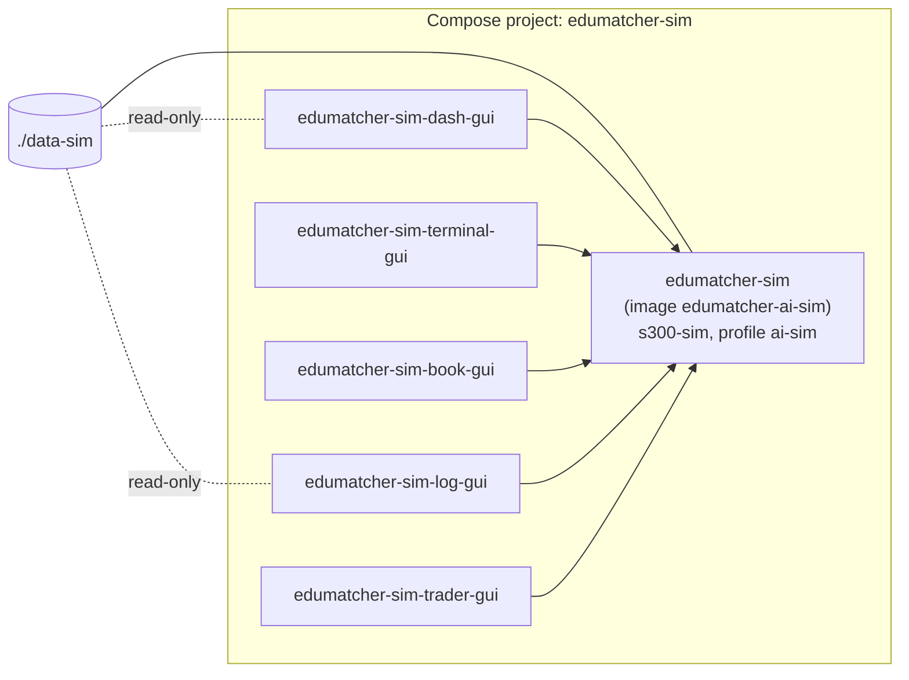

Its differences from the plain exchange:

| Setting | Value | Why |
|---|---|---|
| backend image | `${AISIM_IMAGE:-ghcr.io/.../edumatcher-ai-sim:${EM_VERSION:-latest}}` | `make up-sim LOCAL=1` swaps in a locally built `edumatcher-ai-sim:local` |
| `EM_SPEED` / `EM_START` | `1` / *(empty)* | Run the trading calendar faster than real time, from a chosen start |
| data | `./data-sim` | Its own data directory, so it never touches the exchange's `./data` |
| `stop_grace_period` | `60s` | 100 AI traders and the market model take longer to stop |
| read-only key | `PM_READONLY_API_KEY`, default `key-readonly-9vaho7` | Fixed, because the configuration is fixed: no two-phase start needed |
| GUIs | four (no config-gui) | Nothing to configure in a preset simulation |

It publishes **the same host ports** as the exchange stack, so only one of the
two can run at a time. Running the simulation is covered in the AI Traders
book's
[The Simulation Container](../../ai-traders/part-3-run-it/110-the-simulation-container.md).


## Projects, networks and pods

When you run `up`, the container engine creates more than containers. Knowing
the names helps when you list things with `podman ps`, `podman network ls` or
`podman volume ls`.

### The compose project and its names

Every compose run belongs to a **project**. The project name prefixes the
network and the named volumes it creates. It comes from, in order: `-p` on the
command line, `name:` in the compose file, `COMPOSE_PROJECT_NAME` in `.env`,
and finally the directory name.

| Stack | Project name | Why |
|---|---|---|
| `deployment/docker`, `make up` / `up-all` | `edumatcher` | `COMPOSE_PROJECT_NAME=edumatcher` in `.env`. Without a `.env` it would be `docker`, the directory name |
| curl install in `~/.edumatcher` | `edumatcher` | The directory name, with the leading dot dropped |
| either AI-sim stack | `edumatcher-sim` | `name:` in the file; the `Makefile` also passes `-p edumatcher-sim` |

What a project named `edumatcher` creates:

| Object | Name | Created by |
|---|---|---|
| Network | `edumatcher_default` | Compose, for every project |
| Containers | `edumatcher`, `edumatcher-terminal-gui`, `edumatcher-log-gui`, `edumatcher-trader-gui`, `edumatcher-book-gui`, `edumatcher-dash-gui`, `edumatcher-config-gui` | `container_name:` in the files |
| Named volumes | `edumatcher_log-gui-acks`, `edumatcher_terminal-gui-logs`, `edumatcher_book-gui-logs`, `edumatcher_dash-gui-logs` | `volumes:` at the bottom of the GUI files |
| Pod (Podman only) | `pod_edumatcher` | `podman-compose` |

!!! warning "One stack at a time"
    A source-built stack and a curl install have the **same project name, the
    same container names and the same host ports**. If one is running, the
    other would quietly attach to its containers. Both tools check for this
    and refuse to start: `make up-all` checks via `check-foreign`, and
    `./edumatcher.sh start` checks that the existing `edumatcher` container
    mounts *its own* `data` directory. Stop one before starting the other.
    `make mounts` and `./edumatcher.sh mounts` show which directory each
    running container really uses.

### The network

Compose gives each project one private network and attaches every service to
it, registering the **service name** as a hostname on that network. The
exchange's service is called `edumatcher`, so `edumatcher:8081` from inside
`terminal-gui` reaches the exchange's REST API.

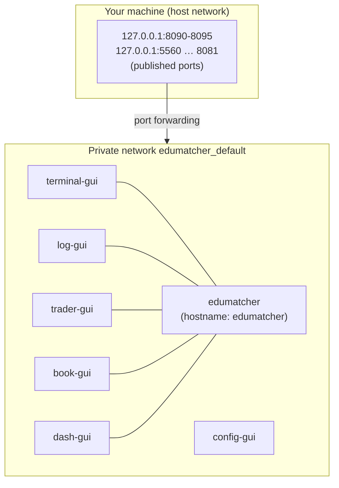

Each container has its own network namespace and its own `127.0.0.1`. A
process listening on `127.0.0.1` inside `edumatcher` is invisible to the GUI
containers. That is why the client-facing listeners bind `0.0.0.0`: *every
interface of this container*, which still means only this private network
plus whatever ports you publish.
[How the containers are wired](010-installation.md#how-the-containers-are-wired)
covers the three meanings of `127.0.0.1` / `0.0.0.0` in detail.

### Pods (Podman only)

A **pod** is Podman's way of grouping containers. Docker has no pods; with
Docker this section does not apply.

`podman-compose` puts all containers of a project into one pod named
`pod_<project>`. EduMatcher's stacks get `pod_edumatcher` or
`pod_edumatcher-sim`. It creates that pod with `--infra=false --share=`, which
means the containers in it **share no namespaces**: each keeps its own network
stack, and they talk over the compose network exactly as described above. The
pod is a label that lets you manage the group as a whole:

```bash
podman pod ls                        # pod_edumatcher, with its container count
podman pod ps                        # (same, older syntax)
podman ps --pod                      # containers with their pod
podman pod stop pod_edumatcher       # stop the whole group
podman pod logs pod_edumatcher       # every container's output
```

You never need to create the pod yourself: `up` creates it, `down` removes it.
Use `make down-all` or `./edumatcher.sh stop` rather than removing the pod by
hand, so compose also cleans up the network.

!!! note "`podman compose` versus `podman-compose`"
    `podman compose` (with a space) is a thin wrapper that runs whichever
    compose program it finds first, which may be Docker's `docker-compose`.
    The `Makefile` and `edumatcher.sh` prefer the standalone `podman-compose`
    when it is installed. `make info` shows which one was picked.


## Volumes and mounts

Every piece of storage a container uses, and why it is set up the way it is:

| Container | Container path | Host side | Type | Mode | Why |
|---|---|---|---|---|---|
| `edumatcher` | `/data` | `./data` (curl: `~/.edumatcher/data`) | bind mount | read-write | The exchange's whole state: configuration, databases, audit log, process logs. On your disk so it survives every rebuild and you can read it directly |
| `edumatcher` | `/config` | `./config` | bind mount | **read-only** | A configuration file of your own, deployed from here at every start. Read-only because the exchange has no business changing your source file |
| `edumatcher` | `/run/host-authorized-keys` | `./.ssh/authorized_keys` | bind mount, `SSH=1` only | **read-only** | Your public keys; copied into place by the entrypoint |
| `log-gui` | `/backend-data` | `./data` | bind mount | **read-only** | The console reads `log.db` directly for history, and must never write the log server's database |
| `log-gui` | `/app/ack-data` | `<project>_log-gui-acks` | named volume | read-write | Which log entries an operator has acknowledged |
| `terminal-gui` | `/app/logs` | `<project>_terminal-gui-logs` | named volume | read-write | Failover log, written while `pm-log-srv` is unreachable |
| `book-gui` | `/app/logs` | `<project>_book-gui-logs` | named volume | read-write | Same, for the order book viewer |
| `dash-gui` | `/backend-data` | `./data` | bind mount | **read-only** | The dashboard reads `metrics.db` (history) and `ref_data/engine_config.json` (the threshold bands), and must never write either |
| `dash-gui` | `/app/logs` | `<project>_dash-gui-logs` | named volume | read-write | Failover log, for the operator dashboard |
| AI-sim `edumatcher-sim` | `/data` | `./data-sim` (curl `--sim`: `~/.edumatcher-sim/data`) | bind mount | read-write | The simulation's own state, separate from the exchange's |

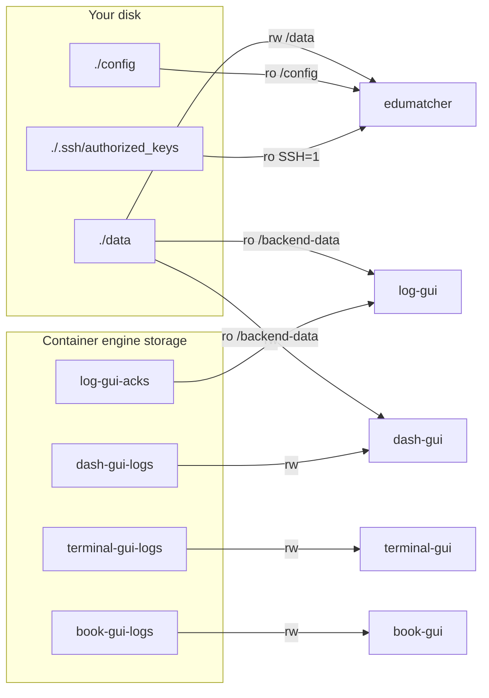

The split is deliberate. **Exchange data is in a bind mount** because it is
yours: you back it up, inspect it with `sqlite3`, delete it to start over. The
GUI volumes hold **disposable private state** that nothing else needs, so they
live where the container engine keeps such things. They are removed by
`./edumatcher.sh uninstall` or `compose down --volumes`; `./data` is not.

!!! note "The `:z` on every bind mount"
    Every compose file adds `:z` to its bind mounts (`./data:/data:z`,
    `./data:/backend-data:ro,z`). On SELinux systems such as Fedora and RHEL,
    `:z` asks the container engine to relabel the directory so containers may
    use it; without it the exchange cannot write `./data` at all. Elsewhere it
    has no effect. Keep it in a compose file of your own.

What lives in `./data` is listed in
[Directories and paths](010-installation.md#directories-and-paths).


## Ports and why each one exists

A port appears in up to three places. The **container port** is where the
process listens. The **published port** is the matching port on your machine,
created by `ports:` in a compose file. `BIND_ADDR` decides which of your
machine's interfaces it opens on. Unpublished ports are reachable only inside
the container, or across the compose network if the process binds `0.0.0.0`.

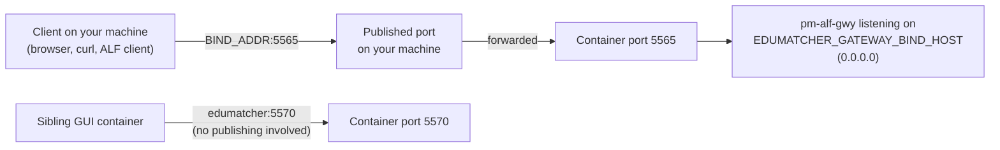

### The exchange container

| Port | Process | Kind | Published | Why it exists |
|---:|---|---|---|---|
| 5560 | `pm-balf-gwy` | TCP | always | Binary ALF order entry for trading clients |
| 5565 | `pm-alf-gwy` | TCP | always | Text ALF order entry for trading clients and the protocol examples |
| 5570 | `pm-md-gwy` | TCP | always | Market data (CALF). Also what `terminal-gui` reads its live feed from |
| 5580 | `pm-ralf-gwy` | TCP | always | Post-trade feed (RALF) for clearing and drop-copy clients |
| 5590 | `pm-dc-gwy` | TCP | always | Drop copy (DCLF) |
| 5600 | `pm-log-srv` | TCP | always | Log ingest (LALF). Clients outside the container, including the GUI bridges, send their logs here |
| 8080 | `pm-api-gwy` | HTTP | always | REST and WebSocket API, `desk` instance: trading credentials. Swagger UI at `/docs`. `trader-gui` uses it |
| 8081 | `pm-api-gwy` | HTTP | always | REST and WebSocket API, `dashboards` instance: the read-only key. `terminal-gui` and `book-gui` use it |
| 5555 | `pm-engine` | ZeroMQ PULL | `ZMQ=1` | Order intake: every gateway sends orders to the engine here |
| 5556 | `pm-engine` | ZeroMQ PUB | `ZMQ=1` | Event and order-book feed |
| 5557 | `pm-engine` | ZeroMQ PUB | `ZMQ=1` | Drop-copy feed |
| 5558 | `pm-index` | ZeroMQ PUB | `ZMQ=1` | Index values |
| 5559 | `pm-index` | ZeroMQ PULL | `ZMQ=1` | Index commands |
| 5601 | `pm-log-srv` | ZeroMQ PUB | `ZMQ=1` | Live log broadcast (LALF-PS). `log-gui` reads it across the network either way |
| 5602 | `pm-log-srv` | ZeroMQ PULL | `ZMQ=1` | Log console control channel |
| 5611 | `pm-monitor` | ZeroMQ PUB | `ZMQ=1` | Health snapshots and events. `dash-gui` reads it across the network either way; published for `pm-monitor-cli` or a dashboard run from source |
| 5610 | `pm-monitor` | ZeroMQ PULL | never | Health beacons from every process inside the container. Never published: anything that reached it could report fake health |
| 22 | `sshd` | TCP | `SSH=1`, as `SSH_PORT` (2222) | Shell access with your SSH keys |
| 5561–5564 | `pm-stats`, `pm-audit`, `pm-clearing`, `pm-index` | ZeroMQ REP | never | Health pings answered by each process, used by `pm-*-cli health` and `pm-opctl-cli list` inside the container |
| 5553, 5554 | `pm-market-sim` | ZeroMQ | never | The market model's true values and instructor commands: kept away from students on purpose |

The client-facing ports are published because something outside the container
has to reach them. The bus and health ports are not, because only the
exchange's own processes use them, over the container's loopback interface.
`ZMQ=1` is the deliberate exception, for when you want to attach your own
tools to the bus.

### The GUI containers

| Host port (variable) | Container port | Service | Why |
|---|---|---|---|
| `TERMINAL_GUI_PORT` (8090) | 8090 | `terminal-gui` | TapeDeck in your browser |
| `LOG_GUI_PORT` (8091) | 8091 | `log-gui` | Log Operator Console |
| `CONFIG_GUI_PORT` (8092) | 8092 | `config-gui` | Configuration builder |
| `TRADER_GUI_PORT` (8093) | 8093 | `trader-gui` | Trading GUI |
| `BOOK_GUI_PORT` (8094) | 8094 | `book-gui` | Order book viewer |
| `DASH_GUI_PORT` (8095) | 8095 | `dash-gui` | Operator dashboard |

Only the host side of a GUI port is configurable. If 8090 is already taken on
your machine, set `TERMINAL_GUI_PORT=9090` in `.env` and restart; the container
still listens on 8090.

`make ports` (or `podman port edumatcher`) lists what is actually published
on a running container.

!!! warning "`BIND_ADDR` is the only setting that decides who can connect"
    With the default `127.0.0.1`, every published port is reachable from your
    machine only. `BIND_ADDR=0.0.0.0` opens all of them to your network,
    which is right for a classroom and wrong anywhere you do not trust: the
    order-entry gateways have no password.


## Every variable, in one place

### `deployment/docker/.env`

| Variable | Default | Used by | Goes into a container? |
|---|---|---|---|
| `COMPOSE_PROJECT_NAME` | `edumatcher` | compose | no: names the project, network, pod and volumes |
| `EDUMATCHER_VERSION` | *(empty)* | backend build | build argument: PyPI release when no wheel is present |
| `WITH_SSH` | `1` | backend build | build argument: include `openssh-server` |
| `PIP_INDEX_URL` | *(not in `.env`)* | backend build | build argument: PyPI mirror |
| `EM_CONFIG` | `s10-basic` | `entrypoint.sh` | yes |
| `EM_CONFIG_FILE` | *(empty)* | `entrypoint.sh` | yes; set by `make up-all CONFIG=<file>` |
| `EM_PROFILE` | `default` | `entrypoint.sh` | yes |
| `TZ` | `Europe/Stockholm` | all processes | yes |
| `BIND_ADDR` | `127.0.0.1` | compose `ports:` | no: the host interface ports open on |
| `EDUMATCHER_GATEWAY_BIND_HOST` | `0.0.0.0` | gateways, `pm-log-srv`, `pm-api-gwy`, `pm-monitor` | yes |
| `SSH_PORT` | `2222` | `compose.ssh.yaml`, `make ssh` | no |
| `TERMINAL_GUI_PORT` … `DASH_GUI_PORT` | `8090` … `8095` | GUI `ports:` | no |
| `LOG_GUI_URL` / `BOOK_GUI_URL` | `http://localhost:<port>` | `dash-gui` | yes: the drawers' links to log-gui and book-gui |
| `IMAGE_NAME` / `IMAGE_TAG` | `edumatcher` / `local` | compose `image:` | no |
| `CONTAINER_NAME` | `edumatcher` | compose, `Makefile` | no |

Read from your shell when set, with no `.env` entry: `CORS_ORIGIN`,
`MAX_WS_CLIENTS`, `CALF_CLIENT_ID`, `INDEX_IDS` and `LOG_SRV_ENABLED` for the
GUIs.

`API_GATEWAY_URL`, `PM_TERMINAL_API_KEY` and `PM_BOOK_API_KEY` are also
variables of `compose.guis.yaml`, but **leave them unset**: `make up-all`
resolves them from the deployed configuration at every start (see
[the two-phase start](#make-up-all-step-by-step)).

### `~/.edumatcher/.env` (curl install)

The same idea, with three differences. `EM_VERSION` and `GHCR_OWNER` choose
which released images to pull. `EM_ZMQ=1` adds the ZeroMQ overlay (there is no
`make` to pass `ZMQ=1`). There are no build variables. The defaults also differ
in one place: `EM_PROFILE=mm-demo` (the full stack plus a slow market-maker
bot, so a fresh install has prices to look at). The full table is
in
[Configuring it: the `.env` file](010-installation.md#configuring-it-the-env-file).

### `~/.edumatcher-sim/.env` (curl `--sim` install)

`EM_STACK=sim` (which tells `edumatcher.sh` to drive `compose.ai-sim.yaml`),
`EM_VERSION`, `GHCR_OWNER`, `EM_SPEED`, `EM_START`, `EM_CONFIG_FILE`, `TZ`,
`BIND_ADDR`, `EDUMATCHER_GATEWAY_BIND_HOST`, `PM_READONLY_API_KEY` and the four
GUI ports.

### Variables only `entrypoint.sh` reads

| Variable | Set by | Effect |
|---|---|---|
| `EM_SSH` | `compose.ssh.yaml` | `1` starts `sshd` |
| `EM_SPEED` | AI-sim image and compose file | Not `1`: export `EDUMATCHER_SCHEDULER_SPEED` so the calendar runs faster |
| `EM_START` | AI-sim compose file | Export `EDUMATCHER_SCHEDULER_START`: where an accelerated calendar begins |
| `EM_RESTART_DEAD` | AI-sim image | `1`: every minute, restart any process of the profile that has died |
| `EDUMATCHER_DATA_DIR` | the image (`/data`) | Where everything is read and written; do not change it in a container |


## Using the helper scripts

### The `Makefile` in `deployment/docker`

The `Makefile` first detects your tools. It uses Podman if it is installed,
otherwise Docker (`CONTAINER_ENGINE=docker` forces Docker). It then uses
`podman-compose`, `podman compose`, `docker compose` or `docker-compose`,
whichever exists. Every target then runs ordinary compose commands with the
right files.

| Group | Target | What it does |
|---|---|---|
| Setup | `make init` | Create `.env` from `.env.example`; also happens automatically on first `build`/`up` |
| | `make info` | Show the detected engine, compose tool and image name |
| Build | `make build` | Build a wheel from your checkout with Poetry, place it in `.wheel/`, build the exchange image |
| | `make build PYPI=1` / `VERSION=x.y.z` | Build the exchange image from a PyPI release instead |
| | `make build-guis [GUI=<name>]` | Rebuild all six GUI images, or one. `log-gui` gets a wheel from your checkout (or PyPI with `PYPI=1` / `VERSION=`) |
| | `make build-sim` | Build `edumatcher-ai-sim:local` from your checkout |
| Run | `make up [ZMQ=1] [SSH=1] [CONFIG=…] [PROFILE=…]` | Start the exchange alone |
| | `make up-all [BUILD=1] [CONFIG_GUI=1] …` | Start the exchange and the GUIs in two phases |
| | `make down` / `make down-all` | Stop and remove the containers (data is kept) |
| | `make restart` | Restart the exchange container |
| | `make up-sim [LOCAL=1] [SPEED=N] [START=…]` / `make down-sim` | Start or stop the AI-trader simulation |
| Inspect | `make status` / `make health` | `pm-opctl-cli list` / `pm-opctl-cli health` inside the container |
| | `make logs` / `make proc-logs P=engine` | Follow the container log / one process log in `data/emo/` |
| | `make ports` / `make mounts` | Published ports / which directory backs each container path |
| | `make sim-status` | The simulation's process table, data size and free disk |
| Access | `make shell` / `make sim-shell` | A root shell in the exchange / simulation container |
| | `make ssh` | Log in over SSH (after `make up SSH=1`) |
| | `make keys` | Collect `~/.ssh/*.pub` into `.ssh/authorized_keys` |
| Configure | `make config-deploy` | Recompile `data/ref_data/engine_config.yaml`; then `make restart` |
| | `make config-show` | Show the deployed configuration |
| Develop | `make dev-env GUI=<name>` | Print the environment for running one GUI from source against this container |
| Publish | `make ghcr-push [TAG=…]` | Build every image from your checkout and push it to GHCR (single architecture; prefer the workflow) |
| Clean up | `make clean` / `make clean-data` / `make clean-all` | Remove container and image / delete `./data` (asks first) / both |

#### `make up-all` step by step

`up-all` cannot start everything in one go. `terminal-gui` and `book-gui` need
the read-only API key, and that key is only known once the exchange has
deployed its configuration: every bundled example has a different one. So it
runs in two phases:

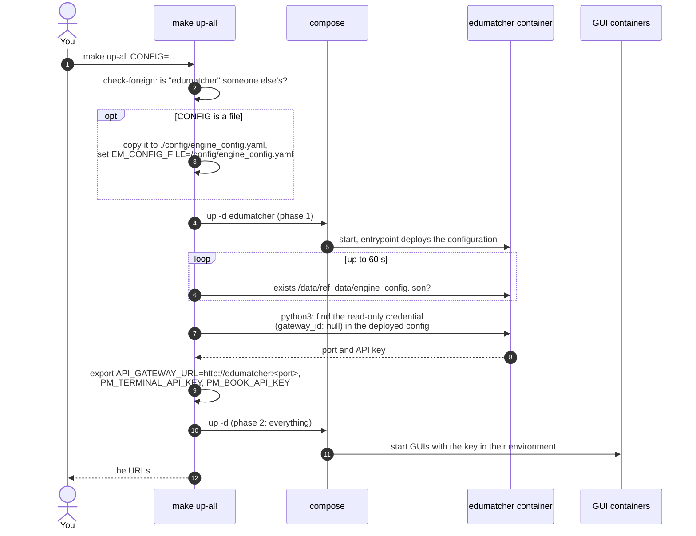

`./edumatcher.sh start` does exactly the same for a curl install. The
AI-sim stack skips it, because its configuration and key are fixed.

### `install.sh` (curl)

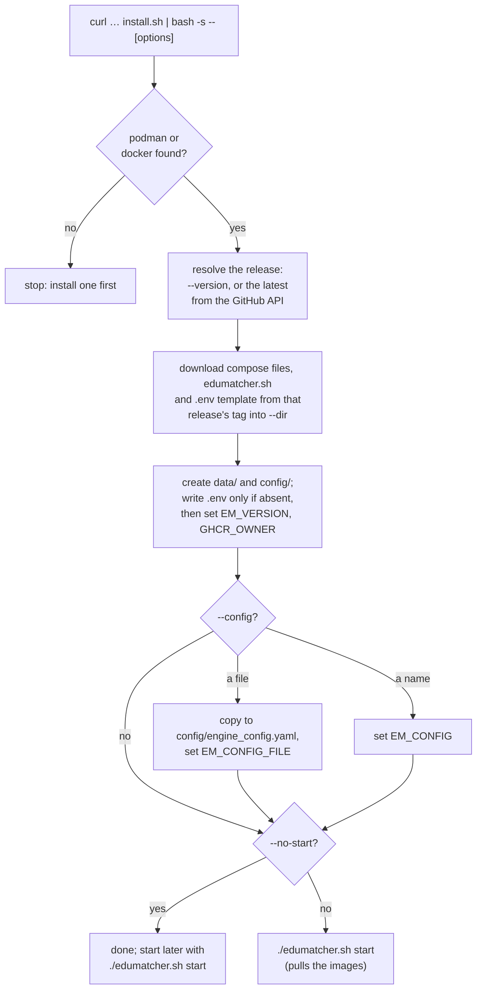

Re-running the installer into an existing directory is safe: it keeps your
`.env` and `data/`, and refreshes the compose files and script from the
release. That is how you pick up a GUI added by a newer release, which
`./edumatcher.sh update` alone would not (it pulls new images for the files
you already have). `--sim` installs the simulation into `~/.edumatcher-sim`
instead.

### `edumatcher.sh` (curl)

The control script reads `.env` to decide what it drives. `EM_STACK=sim`
selects `compose.ai-sim.yaml`; otherwise it uses `compose.yaml`, plus
`compose.zmq.yaml` when `EM_ZMQ=1`.

| Command | Equivalent | Notes |
|---|---|---|
| `./edumatcher.sh start` | `make up-all` | Two-phase for the exchange, one phase for the simulation; refuses if another install owns the containers |
| `./edumatcher.sh stop` | `make down-all` | Data kept |
| `./edumatcher.sh restart` | stop + start | How `.env` edits take effect |
| `./edumatcher.sh status` | `compose ps` + `make status` | |
| `./edumatcher.sh logs [service]` | `compose logs -f` | |
| `./edumatcher.sh shell [cmd…]` | `make shell` | With a command, runs just that command |
| `./edumatcher.sh config <name or file>` | `CONFIG=` | Edits `.env` (and copies a file, plus a neighbouring `market_sim.yaml`); apply with `restart` |
| `./edumatcher.sh speed N [start]` | `make up-sim SPEED=N START=…` | Simulation only |
| `./edumatcher.sh update [version]` | — | Set `EM_VERSION`, pull, restart |
| `./edumatcher.sh urls` / `mounts` | — / `make mounts` | |
| `./edumatcher.sh uninstall [--data]` | `compose down --volumes` | `--data` also deletes `data/` and `config/` |


## Doing it by hand

Everything the scripts do can be done with plain commands, which is useful
when a script is not available, or to understand what it does. The examples
use `podman` and `podman-compose`; replace them with `docker` and
`docker compose` if you use Docker. Run them from `deployment/docker`.

### Rebuilding the exchange image

```bash
cd deployment/docker

# 1. Build a wheel from the checkout and put it in the drop box
(cd ../.. && poetry build --format wheel)
rm -f .wheel/*.whl
cp "$(ls -t ../../dist/*.whl | head -1)" .wheel/

# 2. Build the runtime stage, tagged the way compose.yaml expects
podman build --target runtime -t edumatcher:local .

# Variants:
podman build --target runtime -t edumatcher:local \
    --build-arg WITH_SSH=0 .                        # no sshd
rm -f .wheel/*.whl && podman build --target runtime -t edumatcher:local \
    --build-arg EDUMATCHER_VERSION=0.50.5 .         # a PyPI release
podman build --target runtime -t edumatcher:local \
    --build-arg PIP_INDEX_URL=https://pypi.example.corp/simple .   # a mirror

# 3. The self-trading variant: same steps, other target
podman build --target ai-sim -t edumatcher-ai-sim:local .
```

!!! warning "Always give `--target`"
    Without it, the build produces the *last* stage, `ai-sim`, tagged with
    whatever name you gave it. An `edumatcher:local` that quietly starts the
    300-symbol simulation is a confusing thing to debug.

Add `--no-cache` to rebuild every layer, for example after a base image
security update. Otherwise unchanged layers are reused and a rebuild after a
code change only redoes the `pip install` and what follows.

### Rebuilding a GUI image

Each GUI builds from its own directory:

```bash
cd web-apps/terminal-gui
podman build -t edumatcher-terminal-gui:latest .

# behind a corporate proxy
podman build -t edumatcher-terminal-gui:latest \
    --build-arg HTTP_PROXY=http://proxy.example:8080 \
    --build-arg HTTPS_PROXY=http://proxy.example:8080 \
    --build-arg NPM_STRICT_SSL=false .
```

The names compose expects are `edumatcher-terminal-gui`,
`edumatcher-log-gui`, `edumatcher-config-gui`, `edumatcher-trader-gui`,
`edumatcher-book-gui` and `edumatcher-dash-gui`, each with the tag `latest`. From
`deployment/docker`, `podman-compose -f compose.yaml -f compose.guis.yaml -f
compose.config-gui.yaml build terminal-gui` does the same. This is what
`make build-guis GUI=terminal-gui` runs.

The log console needs one extra step by hand, because it bundles the Python
package. Put a wheel in its drop box first, exactly as for the exchange image:

```bash
(cd ../.. && poetry build --format wheel)          # from deployment/docker
rm -f ../../web-apps/log-gui/.wheel/*.whl
cp "$(ls -t ../../dist/*.whl | head -1)" ../../web-apps/log-gui/.wheel/
cd ../../web-apps/log-gui && podman build -t edumatcher-log-gui:latest .
```

With an empty drop box it installs a PyPI release instead: the newest, or the
one named with `--build-arg EDUMATCHER_VERSION=x.y.z`.

A rebuilt image is not used until its container is recreated. Running `up -d`
again does that for every container whose image changed.

### Starting with compose directly

```bash
cd deployment/docker
cp -n .env.example .env
mkdir -p data config

# The exchange alone (make up), optionally with overlays (ZMQ=1 SSH=1)
podman-compose -f compose.yaml up -d
podman-compose -f compose.yaml -f compose.zmq.yaml up -d

# One start with another example (make up CONFIG=s10-nominal)
EM_CONFIG=s10-nominal podman-compose -f compose.yaml up -d
```

The whole system needs the two phases by hand:

```bash
# Phase 1: the exchange
podman-compose -f compose.yaml -f compose.guis.yaml up -d edumatcher

# Wait for it to deploy its configuration, then read the read-only key
until podman exec edumatcher test -f /data/ref_data/engine_config.json; do sleep 1; done
podman exec edumatcher python3 -c '
import json
cfg = json.load(open("/data/ref_data/engine_config.json"))
for gw in cfg.get("api_gateways", {}).values():
    for c in gw.get("credentials") or []:
        if c.get("gateway_id") is None:
            print(gw.get("port", 8080), c["api_key"]); raise SystemExit
'
# prints e.g.:  8081 key-readonly-xxxxxx

# Phase 2: everything, with the key
export API_GATEWAY_URL=http://edumatcher:8081
export PM_TERMINAL_API_KEY=key-readonly-xxxxxx
export PM_BOOK_API_KEY=$PM_TERMINAL_API_KEY
podman-compose -f compose.yaml -f compose.guis.yaml up -d
```

And to stop, with the same files you started with:

```bash
podman-compose -f compose.yaml -f compose.guis.yaml down
```

### The released stack by hand

A curl install is just its directory. The same commands work there with no
build step, since every image comes from GHCR:

```bash
cd ~/.edumatcher
podman-compose -f compose.yaml pull          # fetch the images for EM_VERSION
podman-compose -f compose.yaml up -d edumatcher
# … read the key as above, export the three variables …
podman-compose -f compose.yaml up -d
```

### Make target to raw command

| `make` | Raw command (from `deployment/docker`) |
|---|---|
| `make build` | `poetry build` → copy wheel to `.wheel/` → `podman-compose -f compose.yaml build` |
| `make up ZMQ=1` | `podman-compose -f compose.yaml -f compose.zmq.yaml up -d` |
| `make down` | `podman-compose -f compose.yaml down` |
| `make shell` | `podman exec -it edumatcher bash` |
| `make status` | `podman exec -it edumatcher pm-opctl-cli list --no-restart` |
| `make health` | `podman exec edumatcher pm-opctl-cli health` |
| `make logs` | `podman logs -f edumatcher` |
| `make ports` | `podman port edumatcher` |
| `make config-deploy` | `podman exec edumatcher pm-config-deploy /data/ref_data/engine_config.yaml` |
| `make up-sim` | `podman-compose -p edumatcher-sim -f compose.ai-sim.yaml up -d` |


## Common situations

| You want to | Do this |
|---|---|
| See your code change running | `make build && make up-all`. Check the build log says `Installing local wheel` |
| See a GUI change running | `make up-all BUILD=1 GUI=<name>` |
| Change which example runs | `make up-all CONFIG=s10-nominal`, or `./edumatcher.sh config s10-nominal && ./edumatcher.sh restart` |
| Run your own configuration | `make up-all CONFIG=./mine.yaml`, or `./edumatcher.sh config ./mine.yaml && ./edumatcher.sh restart` |
| Edit the deployed configuration in place | Edit `data/ref_data/engine_config.yaml`, then `make config-deploy && make restart` |
| Let students on your network connect | `BIND_ADDR=0.0.0.0` in `.env`, then restart. Mind the warning above |
| Attach a ZeroMQ tool from your machine | `make up ZMQ=1` / `EM_ZMQ=1` in `.env` |
| Start over with an empty exchange | `make down-all && make clean-data && make up-all` |
| Find out whose data a container is using | `make mounts` / `./edumatcher.sh mounts` |
| Keep the stack running after a reboot (Podman) | Containers with `restart: unless-stopped` are restarted at boot only if `podman-restart.service` is enabled: `systemctl --user enable podman-restart.service` |

For problems, the troubleshooting sections of `deployment/docker/README.md`
and of the Architecture and Developer Guide's
[Container and Network Setup](../../architecture-and-development/part-4-developing/050-containers-and-networks.md)
go deeper, including how to test a connection from inside a GUI container.
