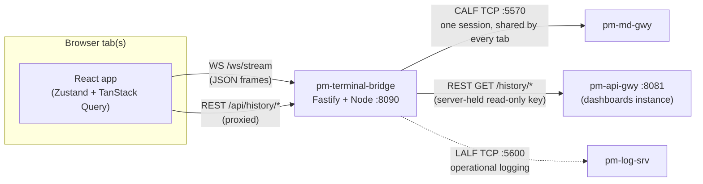

# Deploying TapeDeck (`pm-terminal`)

!!! note "Learning objectives"
    After reading this page you will understand:

    - Which services TapeDeck needs and how it connects to them
    - How to start it with the whole stack, on its own in a container, on a
      separate display server, or as a development server
    - Where its read-only API key comes from
    - Which environment variables configure it

**TapeDeck**, the Trader Information Terminal, is a read-only market display
for a classroom wallboard or an observer workstation. What it shows and how to
read it is described in the Participant Guide chapter
[Trader Information Terminal — "TapeDeck"](../../participant-guide/part-6-front-ends/010-trading-info-terminal.md);
this chapter covers running and configuring it. Its source code lives in
`web-apps/terminal-gui/`; it is served on port **8090**.

## What starts when you run it

Running TapeDeck starts one server process, `pm-terminal-bridge`, and serves
the web page from that same process in the container setup. The bridge opens
one live CALF connection to [`pm-md-gwy`](../../operator-guide/part-5-gateways/030-calf-gateway.md), shares that
single feed across every open browser tab, and opens history requests to
[`pm-api-gwy`](../../operator-guide/part-5-gateways/050-api-gateway.md) when charts or previous-close data are
needed. Optional operational logs go to
[the centralized log server](../../operator-guide/part-6-observe-and-recover/040-log-server.md) when it is available.

Most users do not need the following diagram to operate the terminal, but it
is useful when deciding which host names and ports to put in the container
environment.



## Prerequisites

| Requirement | Notes |
|---|---|
| **`pm-md-gwy`** ([CALF gateway](../../operator-guide/part-5-gateways/030-calf-gateway.md)) | Required for live prices, trades, session state, auctions, halts, indexes, and depth. The terminal can start without it, but it will show `RECONNECTING`/`OFFLINE` until the feed is reachable. |
| **`pm-api-gwy`** ([API Gateway](../../operator-guide/part-5-gateways/050-api-gateway.md)) with a read-only API key | Required for charts, previous-close data, index history, and Overview/Movers `Open`/`Volume` columns. Live prices still tick without it. |
| **`pm-log-srv`** ([Centralized Log Server](../../operator-guide/part-6-observe-and-recover/040-log-server.md)) — optional | Used only for operational logs. If it is unavailable, the terminal still starts and writes to stdout or the local failover log directory. |
| **Podman ≥ 4** or **Docker ≥ 24** with a Compose plugin | Needed for the recommended container run path. |
| **Node.js ≥ 20** and **npm ≥ 10** | Needed only for local development without a container. |

## Running the application

TapeDeck needs three things from the exchange, and how you supply them is the
only real difference between the ways of running it:

| It needs | For | Without it |
|---|---|---|
| `pm-md-gwy` on 5570 | The live CALF feed — prices, depth, trades | The page loads but shows `RECONNECTING` |
| `pm-api-gwy` on 8081, plus a read-only API key | Charts, previous close, historical index data | Live prices tick; history panels stay empty |
| `pm-log-srv` on 5600 *(optional)* | Sending the bridge's own logs to the central log server | The bridge writes a fallback log to `./logs` |

### The whole stack (recommended)

This is the path that requires nothing of you: it starts the exchange and
TapeDeck together, resolves the read-only API key out of the deployed
configuration, and points the terminal at the backend by service name.

**A released install:**

```bash
cd ~/.edumatcher
./edumatcher.sh start
```

**From a source checkout:**

```bash
cd deployment/docker
make up-all
```

Then open **<http://localhost:8090>**. The log console comes up on
[8091](../../operator-guide/part-6-observe-and-recover/050-log-console.md), the trading GUI on [8093](../../participant-guide/part-6-front-ends/020-trading-platform-gui.md),
the [order book viewer](../../participant-guide/part-6-front-ends/030-order-book-gui.md) on 8094, the
[operator dashboard](../../operator-guide/part-6-observe-and-recover/070-operator-dashboard.md) on 8095 and the
[Clearing GUI](../../participant-guide/part-6-front-ends/040-clearing-gui.md) on 8096 at the same time.

There are no addresses to configure because every container shares one
Compose network, on which the exchange answers to the hostname `edumatcher`.
The API key is the one part that cannot be a fixed default — it is generated
per engine configuration — so `up-all` reads it from the deployed
configuration and injects it. See
[Where the read-only API key comes from](#where-the-read-only-api-key-comes-from)
and [Installation](../../operator-guide/part-1-install-and-deploy/010-installation.md).

### This app alone, in a container

Use this when the exchange is running somewhere else — another machine, a VM,
or as processes on your host. From `web-apps/terminal-gui/`:

```bash
export EDUMATCHER_DATA_DIR=~/.local/share/edumatcher
make up
```

Then open **<http://localhost:8090>**. `make logs` follows the bridge log,
`make down` stops it.

**How `make up` finds the API key.** An explicit `PM_TERMINAL_API_KEY` always
wins:

```bash
make up PM_TERMINAL_API_KEY=key-readonly-...
```

Otherwise `make up` reads it from the deployed configuration
`$EDUMATCHER_DATA_DIR/ref_data/engine_config.json`, picking the first
credential with `gateway_id: null` (the `dashboards` instance is preferred when
several carry one). It prints which instance and port the key came from, and
warns when `API_GATEWAY_URL` points at a different port. When there is no key to
be found it warns and starts anyway — the live feed needs no key, only the
history panels do. Pass the key explicitly when the exchange runs on another
machine or in a VM, since the look-up reads this host's data directory.

Now the addresses matter, because the container is no longer beside the
exchange. The compose file defaults to `host.docker.internal`, which resolves
on Docker Desktop but not on Podman or Linux Docker:

```bash
export CALF_HOST=host.containers.internal
export API_GATEWAY_URL=http://host.containers.internal:8081
export LOG_SRV_HOST=host.containers.internal
make up
```

!!! warning "The history key is valid on 8081, not 8080"
    `API_GATEWAY_URL` must point at the `dashboards` instance. The read-only
    credential (`gateway_id: null`) is issued there; `desk` on 8080 will reject
    it, and the symptom is a live book with empty charts. The compose file
    already defaults to `:8081` — keep the port when you change the host.

If port 8090 is taken, move the *host* side of it. Pick something outside
8090–8096, which the other applications use:

```bash
TERMINAL_GUI_PORT=8100 make up
```

The container serves the built React frontend, the WebSocket endpoint, and the
small read-only history proxy from the same port. There is no database volume:
the only bind mount is `./logs:/app/logs`, used when the optional log server is
not reachable after startup.

#### Alternative: direct Compose commands

```bash
PM_TERMINAL_API_KEY='...' docker compose up --build -d
docker compose logs -f terminal-gui
docker compose down
```

With Podman, use `podman-compose` for the same commands.

### Running on a separate display server

TapeDeck does not have to run on the same machine as the matching engine,
`pm-md-gwy`, or `pm-api-gwy`. A common deployment is:

- **Exchange server**: runs the engine, `pm-md-gwy`, `pm-api-gwy`, and
  optionally `pm-log-srv`.
- **Display server**: runs only the TapeDeck container and serves the browser
  UI to viewers.

No protocol change is needed on the exchange side. The terminal bridge is just
another external CALF client plus a read-only history client. The practical
requirements are:

| Exchange-side item | What to check |
|---|---|
| `pm-md-gwy` | It normally binds to `0.0.0.0:5570`, so no application change is needed unless your config deliberately set `market_data_gateway.bind_address` to `127.0.0.1`. The display server must be able to open TCP `5570` on the exchange host. |
| `pm-api-gwy` | It binds `0.0.0.0` by default, so no application change is needed unless your configuration deliberately narrows `api_gateways.<name>.host`. The display server must reach the instance that issues the **read-only** credential — the `dashboards` instance, HTTP `8081` in the bundled configurations, not `desk` on 8080. |
| API key | Create or reuse a read-only `pm-api-gwy` key with `gateway_id: null`; TapeDeck only needs history reads and never sends the key to browsers. |
| `pm-log-srv` | Optional. If you want centralized terminal logs, make TCP `5600` reachable and set `LOG_SRV_HOST` on the display server. If not, set `LOG_SRV_ENABLED=false` or let the container write its fallback log to `./logs`. |
| Firewall / routing | Open only the ports the display server actually needs: TCP `5570` for CALF, TCP `8081` for history, and optionally TCP `5600` for logs. Browsers only need access to the display server's `8090` port, not to the exchange gateways. |

On the display server, use the prepared image rather than building from source.
The exact image name depends on how the release was delivered:

```bash
# Option A: the released image
podman pull ghcr.io/johan162/edumatcher-terminal-gui:<VERSION>

# Option B: an image tarball made with `make cdist` in web-apps/terminal-gui
podman load --input edumatcher-terminal-gui-<VERSION>.tar.xz
```

Then run the container, pointing it at the exchange server's network name or IP
address:

```bash
mkdir -p logs

podman run -d --name terminal-gui \
  --restart unless-stopped \
  -p 8090:8090 \
  -v "$PWD/logs:/app/logs" \
  -e CALF_HOST=exchange.example.org \
  -e CALF_PORT=5570 \
  -e API_GATEWAY_URL=http://exchange.example.org:8081 \
  -e PM_TERMINAL_API_KEY='...' \
  -e INDEX_IDS=MAIN \
  -e LOG_SRV_ENABLED=false \
  ghcr.io/johan162/edumatcher-terminal-gui:<VERSION>
```

Use the image name you pulled or loaded — a loaded tarball is named
`edumatcher-terminal-gui:<VERSION>` — and `docker` instead of `podman` if that
is your container runtime. If
centralized logging is available, replace `LOG_SRV_ENABLED=false` with:

```bash
-e LOG_SRV_ENABLED=true \
-e LOG_SRV_HOST=exchange.example.org \
-e LOG_SRV_PORT=5600
```

After startup, open **http://display-server.example.org:8090** from a browser.
If the page loads but shows `RECONNECTING`, the display server can serve the
UI but cannot reach `pm-md-gwy`. If live prices tick but charts or previous
close values are missing, check `API_GATEWAY_URL` and `PM_TERMINAL_API_KEY`.

### Local development

From the `web-apps/terminal-gui/` directory:

```bash
make install    # npm workspace install; once, and after a dependency change
make dev        # Vite dev server on :8190, bridge on :5190
```

Open **<http://localhost:8190>**. You do not talk to the bridge directly:
`vite.config.ts` proxies `/api` and `/ws` from the dev server to the bridge on
`127.0.0.1:5190`, so the browser sees a single origin.

The bridge's own connect targets all default to `127.0.0.1`, which is exactly
where the container stack publishes its ports — so `make up-all` in
`deployment/docker` plus `make dev` here works with no configuration beyond the
API key. `make dev-env GUI=terminal-gui` in `deployment/docker` prints the two
values that cannot be defaulted:

```bash
eval "$(make -s -C ../../deployment/docker dev-env GUI=terminal-gui)"
make dev
```

!!! warning "Keep `dev-env` out of the shell you start containers from"
    `eval "$(make dev-env …)"` exports `API_GATEWAY_URL=http://127.0.0.1:8081`
    and `PM_TERMINAL_API_KEY` into your shell, and they stay there. That is right
    for `make dev`, whose bridge runs on your own machine. It is wrong for a
    **container** started later from the same shell: Compose hands the
    exported `API_GATEWAY_URL` to the container, where `127.0.0.1` is the
    container itself. The app's own `make up` in `web-apps/terminal-gui` — or
    `make up` in `web-apps/` without `VM_BACKEND_IP` — then starts a bridge
    that cannot reach `pm-api-gwy`: live prices still tick, but the charts, previous close and Open/Volume columns stay empty, and the bridge log shows the history requests to `127.0.0.1:8081` failing. The exported key also takes
    precedence over `make up`'s own look-up, and is stale once the exchange
    runs another configuration.

    `make up-all` and `./edumatcher.sh start` are not affected: whenever they
    find the read-only credential they set both values themselves.

    Either load the variables for the development server only, in a subshell:

    ```bash
    (eval "$(make -s -C ../../deployment/docker dev-env GUI=terminal-gui)"; make dev)
    ```

    or clear them before starting a container from that shell:

    ```bash
    unset API_GATEWAY_URL PM_TERMINAL_API_KEY
    ```

If `pm-md-gwy` is not running the page still loads, with the connection
indicator showing `RECONNECTING`/`OFFLINE` until the feed appears.
`make dev-bridge` runs only the bridge, `make dev-web` only the web server, and
`make test` the Vitest suite. The full inner-loop workflow is
[The Development Loop](../../architecture-and-development/part-4-developing/020-development-workflow.md).

### Where the read-only API key comes from

You never type the API key in the normal start paths, yet TapeDeck can read
history. The key has always been there: it is part of the exchange's own
configuration, and every start path looks it up and hands it to the bridge.

**1. It is generated with the configuration.** `pm-config-gen`'s
`--api-gateway-readonly-key` option adds one extra credential to the
`dashboards` API gateway instance (port 8081), with `gateway_id: null` and a
randomly generated key. Every bundled example configuration was generated with
that option (see its `mkrefdata.sh`), so each carries one — and each a
different one. In `docs/examples/ref_data/s1-basic-setup/engine_config.yaml`:

```yaml
api_gateways:
  dashboards:
    port: 8081
    credentials:
    - api_key: key-readonly-fq9m76
      gateway_id: null
      description: Generated read-only market-data key
```

When a configuration is deployed, the key travels with it into
`<data dir>/ref_data/engine_config.json`, the file every exchange process
reads.

**2. The start path looks it up.** The bridge takes the key from the
environment variable `PM_TERMINAL_API_KEY`, and each way of starting TapeDeck
fills that variable from the deployed configuration:

| Start path | How it finds the key |
|---|---|
| `make up-all` / `./edumatcher.sh start` | Starts the exchange first and waits for its configuration to be deployed, then reads `/data/ref_data/engine_config.json` inside the exchange container. It exports the key as `PM_TERMINAL_API_KEY` and sets `API_GATEWAY_URL=http://edumatcher:<that instance's port>`, and only then starts the web applications — which is why the whole-stack start runs in two phases |
| `make up` in `web-apps/terminal-gui` | Reads `$EDUMATCHER_DATA_DIR/ref_data/engine_config.json` on this host. A `PM_TERMINAL_API_KEY` you set yourself always wins |
| `make dev-env GUI=terminal-gui` | Reads the key from the running exchange container and prints it as an `export` line for `make dev` |

All three pick the first enabled gateway instance, in name order, that carries a
credential with `gateway_id: null` — so `dashboards` is preferred over `desk`
when both have one — and take that instance's port along with the key.

**Why this is acceptable.** A read-only key is not a secret that grants
anything worth protecting: it reads only public data — reference data, the
market-data stream and history — and can neither place nor see orders. It still
never reaches the browser; only the bridge holds it.

**A configuration without one.** A configuration you built yourself may have no
`gateway_id: null` credential. TapeDeck then still starts, with a warning: live
prices work, because they come from `pm-md-gwy` and need no key, but the charts,
previous close and Open/Volume columns stay empty. To fix it, add a credential
with `gateway_id: null` to the `dashboards` instance — in the
[Configuration GUI](../../operator-guide/part-2-configure/030-config-gui.md)'s gateway settings, by hand in
`engine_config.yaml`, or by regenerating with `--api-gateway-readonly-key` —
and redeploy.

!!! note "Switching configuration changes the key"
    Because every configuration has its own key, a key copied from one
    configuration is rejected (HTTP 401) by an exchange running another. The
    automatic look-up avoids this; a key you exported yourself, or one left
    in your shell by `make dev-env`, does not.

## Configuration reference

The container is configured with environment variables. Most installations only
need to set `PM_TERMINAL_API_KEY` and, when the upstream services are not on the
default host names, `CALF_HOST`, `API_GATEWAY_URL`, and `LOG_SRV_HOST`.

| Variable | Container default | Purpose |
|---|---|---|
| `TERMINAL_GUI_PORT` | `8090` | Host port exposed by `docker-compose.yml`; use this when `8090` is already in use. |
| `HOST` / `PORT` | `0.0.0.0` / `8090` | Bridge bind address inside the container. |
| `CORS_ORIGIN` | `*` | CORS allow-list |
| `STATIC_DIR` | `/app/apps/web/dist` | Serve a built frontend from here (single-container mode); unset in development |
| `MAX_WS_CLIENTS` | `200` | Browser-tab cap |
| `WS_HEARTBEAT_INTERVAL_SEC` | `5` | How often every tab receives the bridge's status heartbeat |
| `WS_PING_INTERVAL_SEC` / `WS_PING_MAX_MISSED` | `10` / `2` | Ping to each tab, and missed replies before a dead tab is dropped |
| `WS_MAX_BUFFERED_BYTES` | `5000000` | A tab whose outgoing buffer exceeds this (a stalled browser) is disconnected |
| `CALF_HOST` / `CALF_PORT` | `host.docker.internal` / `5570` | `pm-md-gwy`; use `host.containers.internal` for Podman if needed. |
| `CALF_CLIENT_ID` | `pm-terminal-bridge` | CALF `HELLO.CLIENT` |
| `CALF_PING_INTERVAL_SEC` | `60` | Keepalive; belt-and-braces now that the gateway's idle timer honours outbound traffic too |
| `INDEX_IDS` | — | Comma-separated index ids to subscribe to (CALF has no "list the indexes" request) |
| `API_GATEWAY_URL` | `http://host.docker.internal:8081` | `pm-api-gwy`, **the `dashboards` instance** — the read-only key is not valid on `desk` (8080). Use `host.containers.internal` for Podman. In the whole-stack path this is `http://edumatcher:8081`, set for you. |
| `PM_TERMINAL_API_KEY` | — | Read-only (`gateway_id: null`) key, history reads only — never sent to the browser |
| `LOG_SRV_ENABLED` | `true` | `false` skips even the startup probe |
| `LOG_SRV_HOST` / `LOG_SRV_PORT` | `host.docker.internal` / `5600` | `pm-log-srv`; use `host.containers.internal` for Podman if needed. |
| `LOG_SRV_CLIENT_ID` | `pm-terminal-bridge` | Name the bridge registers with at the log server |
| `LOG_SRV_INSTANCE` | — | Optional suffix that tells several terminals' logs apart |
| `LOG_CONNECT_TIMEOUT_SEC` | `0.5` | Startup probe and each reconnect attempt |
| `LOG_FAILOVER_TIMEOUT_SEC` | `30` | Grace window before the one-way switch to a local log file |
| `LOG_QUEUE_MAXSIZE` | `2000` | Bounded backlog while reconnecting |
| `LOG_FAILOVER_DIR` | `/app/logs` | Where the post-failover log file goes; bind-mounted to `./logs` by Compose. |


## Troubleshooting

| Symptom | Likely cause | What to check |
|---|---|---|
| Every screen shows the red "Disconnected from pm-terminal-bridge" banner | The browser's own WebSocket to the bridge is down | Confirm the bridge process is running and reachable at `HOST:PORT`; check the browser console for the WS connection error |
| Connection indicator shows `RECONNECTING` and never returns to `LIVE` | The bridge cannot reach `pm-md-gwy` | Confirm `CALF_HOST`/`CALF_PORT` point at a running gateway, and that nothing (e.g. a firewall) blocks that TCP connection from the bridge's host |
| Charts and Open/Volume columns are empty or show an "unavailable" banner, but live prices still tick | The bridge cannot reach `pm-api-gwy`, or `PM_TERMINAL_API_KEY` is missing/invalid | Check the bridge's startup log for a `PM_TERMINAL_API_KEY is unset` warning; confirm `API_GATEWAY_URL` is correct and the key is a valid read-only history key |
| A container started with `make up` shows live prices but no history, and its log shows requests to `127.0.0.1:8081` failing | `API_GATEWAY_URL=http://127.0.0.1:8081` was left in the shell by `eval "$(make dev-env …)"` | `unset API_GATEWAY_URL PM_TERMINAL_API_KEY` and run `make up` again — see [Local development](../../operator-guide/part-1-install-and-deploy/040-deploying-tapedeck.md#local-development) |
| Index tab shows "This exchange has no index configured" | Expected, not an error, when no index is configured for this exchange | Set `INDEX_IDS` if an index should be shown |
| A tape gap marker appears | The bridge's CALF connection dropped for long enough that the gateway's replay window rolled past the missed trades | Expected behavior under a real disconnect — see [Trade Tape](../../participant-guide/part-6-front-ends/010-trading-info-terminal.md#trade-tape-time-sales); not itself a bug to fix |
| Prices render to the wrong number of decimal places | The connected `pm-md-gwy` predates the `REF=` per-symbol precision field | Upgrade the gateway; TapeDeck falls back to two decimal places when `REF=` is absent, which is a compatibility fallback, not a defect in TapeDeck |


## See also

- [Trader Information Terminal — "TapeDeck"](../../participant-guide/part-6-front-ends/010-trading-info-terminal.md) — the screens and how to read them
- [Market Data Feed (CALF)](../part-5-gateways/030-calf-gateway.md) — the feed the bridge reads
- [API Gateway](../part-5-gateways/050-api-gateway.md) — the history endpoints and the read-only key
- [Installation](010-installation.md) — the container stack and `.env`
