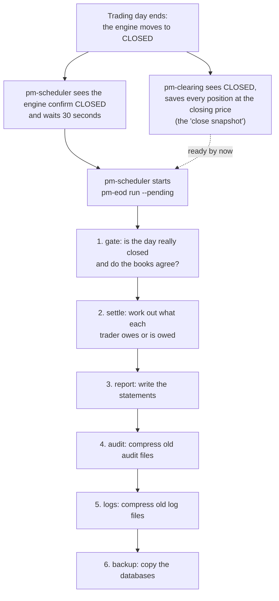

# Closing the Day: Settlement, Statements and Housekeeping

<a id="pm-eod-closing-the-day"></a>
<a id="pm-eod-end-of-day-settlement"></a>

!!! note "Learning objectives"
    After reading this page you will understand:

    - What *settlement* is, in plain words, and why an exchange does it at the end of every trading day
    - The money words used here — position, closing price, profit and loss, balance — each explained from scratch with numbers
    - What `pm-eod` does after the market closes, step by step, and what it deliberately does *not* do
    - How to set it up: the roster file, the scheduler hook, and running it without a scheduler
    - How to read the statements and files it writes, and how to send them to your traders
    - What the daily housekeeping (audit archive, log compression, backups) does, and how to restore a backup
    - How to fix a day that went wrong, and what every warning and error message means

    **You do not need any finance background.** Every financial word is
    explained the first time it appears, and again in the
    [mini-glossary](#the-ideas-from-scratch) below. If you can follow a
    shopping receipt, you can follow this page.

    **Prerequisites**: you can start the exchange and run a trading day
    ([Running the Exchange](../part-3-run/010-running-the-exchange.md)), and
    you have read how sessions work
    ([Sessions and Scheduling](030-sessions-and-scheduling.md)). The
    clearing process `pm-clearing` must be running during the day — it is part
    of the `default` profile.

## The big picture

At the end of a trading day two jobs are waiting for the operator.

1. **Money.** During the day traders bought and sold shares. Some made a
   profit, some made a loss. Somebody has to add it all up, work out *who
   should pay how much and who should receive how much*, and tell everyone.
   That job is called **settlement**.
2. **Housekeeping.** The exchange has produced a lot of files — an audit
   trail, logs, databases. Old files should be compressed to save disk space,
   and important databases should be copied somewhere safe in case a disk
   fails. That is routine maintenance.

`pm-eod` ("end of day") does both, automatically, right after the market
closes. It is a **one-shot command**: it starts, does its work in a few
seconds, prints what it did and exits. It is not a long-running process.

!!! warning "The money is fictional"
    Everything in this chapter uses EduMatcher's **fictional currency**. No
    real money moves anywhere. `pm-eod` produces *numbers and files*:
    "Alice owes the exchange 30.00". What those numbers mean in your class —
    points, pretend dollars, a prize for the top of the leaderboard — is up to
    you. If you ever do attach real value to them, that is entirely outside
    EduMatcher; read [What `pm-eod` does not do](#what-pm-eod-does-not-do).

### What happens, in order



| Step | Plain-words purpose | Can it fail the day? |
|---|---|---|
| **gate** | Check it is safe to settle: the day is closed, the closing prices were saved, and the books add up | **Yes** — nothing is written if it fails |
| **settle** | Calculate each trader's amount for the day and add it to the running balance | **Yes** — nothing is written if it fails |
| **report** | Write one statement per trader and one summary for the instructor | **Yes** — but the settlement is kept and the report is retried next time |
| **audit** | Safety net: compress any older audit-trail days that were missed | No — a warning only |
| **logs** | Compress and tidy log files that nobody is writing to any more | No — a warning only |
| **backup** | Make a verified, compressed copy of the important databases | No — a warning only |

The rule behind the last three rows: *housekeeping trouble must never stop
traders from getting their statements.* If the backup disk is full, you get a
warning, and the statements are still written.

### What `pm-eod` does not do

- It **does not send email.** It writes files, including a ready-made table
  of names, email addresses and amounts, and *you* send them (see
  [Sending the statements](#sending-the-statements)).
- It **does not move money**, real or pretend. It records numbers.
- It **does not stop anyone trading.** A trader whose balance is deeply
  negative can keep trading tomorrow. The balance is information, shown on the
  statement and the leaderboard.
- It **does not charge fees.** Settlement is purely the profit or loss from
  trading.
- It **does not touch the engine's own end-of-day files.** The engine keeps its
  own archive in `<data>/eod/`. `pm-eod` writes to a different place,
  `<data>/settlement/`, on purpose. (See
  [Persistence](../part-6-observe-and-recover/010-persistence.md#at-the-close-every-trading-day).)

## The ideas, from scratch

This section builds the vocabulary one word at a time. Each idea uses the same
tiny example, and the next section runs it through several days. Skip it only
if you already know what *mark-to-market* means.

### Shares, symbols and trades

A **share** is a small slice of ownership in a company. Each company on the
exchange has a short code, its **symbol** — in our examples `AAPL`.

A **trade** happens when one person agrees to buy and another agrees to sell,
at the same **price**, for some **quantity** (how many shares).

> **Example.** Alice buys 100 `AAPL` from Bob at a price of **10.00** each.
> Alice is the **buyer**, Bob is the **seller**. The trade is worth
> 100 × 10.00 = **1000.00** in total (the **notional value**).

In EduMatcher every trader connects through a **gateway**, and the gateway has
an identifier like `GW_ALICE`. The exchange never needs to know the trader's
real name — the system sees gateway identifiers. The
[roster file](#the-roster-file) is how *you* connect the two.

### Positions: long and short

Your **position** in a symbol is how many shares you currently hold.

- If you own shares, you are **long**. After her purchase Alice is long 100.
- You can also sell shares you do not own (in the real world by borrowing them
  and promising to buy them back later; in EduMatcher the trader's position
  simply goes negative). Then you are **short**. After the sale Bob is short
  100, shown as **−100**.
- If you hold nothing you are **flat** (position 0).

Someone who is long makes money when the price **goes up**. Someone who is
short makes money when the price **goes down** (they sold high and hope to buy
back low). That is the single most important fact for the rest of this page.

### Average cost

If you buy in several steps at different prices, your **average cost** is the
average price you paid, weighted by quantity. Buy 100 at 10.00 and then 50 at
10.20, and your average cost is
(100 × 10.00 + 50 × 10.20) ÷ 150 = **10.0667**. The accounting term is
**VWAP** (volume-weighted average price). Average cost is what your profit is
measured against. For the full mechanics, including what happens when you flip
from long to short, see
[Positions and P&L](../../participant-guide/part-5-positions-and-results/010-positions-and-pnl.md).

### The closing price and "marking to market"

What is your 100 shares worth *right now*? You cannot know until you sell them,
but you can estimate with the latest price the market agreed on. At the end of
the day that is the **closing price**: in EduMatcher, the price of the **last
trade of the day** in that symbol.

Valuing what you hold at the latest market price, rather than at what you paid,
is called **marking to market**, and the price used is the **mark** (or *mark
price*). It is the same idea as checking your car's current resale value rather
than what you paid for it.

### Unrealized and realized profit and loss

**P&L** means *profit and loss*: the money made or lost.

- **Unrealized P&L** is the profit or loss *on paper*, on a position you still
  hold. Alice paid 10.00 and the closing price is 10.50, so her 100 shares have
  gained 100 × (10.50 − 10.00) = **+50.00** on paper. She has not sold, so it
  is not locked in; tomorrow the price may fall and the gain shrinks or turns
  into a loss.
- **Realized P&L** is profit or loss that is *locked in* because you closed
  (sold, for a long position) part of the position. If Alice later sells her 100
  at 10.30, she realizes 100 × (10.30 − 10.00) = **+30.00**, and that is final.

For a short position the sign flips. Bob is short 100 from 10.00 and the price
rose to 10.50, so he has lost: −100 × (10.50 − 10.00) = **−50.00** on paper.

### Equity

Add the two together and you get one number for "how well am I doing in total
on this symbol": **realized + unrealized P&L**. This page calls it **equity**
(EduMatcher's tables call the parts `realized_pnl` and `unrealized_pnl`).
Equity does not care *how* you gained — banked profit and paper profit count
the same — which is exactly why it is the right number to settle.

### Settlement

**Settlement** is the act of turning "who gained and who lost" into "who pays
and who receives". Real exchanges do this every day for fast-moving
products, because letting a large loss pile up unpaid for weeks is dangerous.
EduMatcher does the same:

> **Each day, each trader settles the *change* in their equity since the
> previous close.**

On day 1 the "previous close" is nothing (everyone starts at zero). On day 2 it
is the end of day 1, and so on. Settling *changes* means a gain is paid exactly
once. If Alice's equity was +50.00 yesterday and +20.00 today, today's
settlement is **−30.00**: she gave back 30.00 of her paper gain.

!!! info "Why settle paper profits at all?"
    It might feel strange to pay out money for a gain that has not been locked in.
    The reason is fairness and simplicity: every day each trader's account is
    brought up to date with the market, so nobody can hide a growing loss in an
    open position. Futures exchanges in the real world work this way (it is called
    *daily mark-to-market settlement*). And because each day settles only the
    *change*, it all adds up: once a trader closes everything, their total
    balance equals their locked-in profit, as the worked example below shows.

### The central pool (who pays whom)

A natural question: "if Alice gains 50.00, who pays her?" The honest answer is
that Alice did not trade with a single, fixed opponent all day — she may have
traded with many people, and the exchange matches anonymously. So EduMatcher
does not try to invent a "Bob pays Alice" payment. Instead everyone settles
with **the exchange itself**, which acts as a **central counterparty** — the
single middleman that every trader deals with. In this chapter we call that the
**central pool**:

- A trader with a gain is **owed** that amount by the pool: *"the exchange owes
  you 50.00"*.
- A trader with a loss **owes the pool** that amount: *"you owe the exchange
  50.00"*.

Adding **netting** to this: each trader gets one single net amount per day for
all their trades together (not one payment per trade).

Because every trade has exactly one buyer and one seller, every unit of money one
trader gains is a unit another loses. The sum of everyone's amounts is therefore
**exactly zero**. Systems with this property are called **zero-sum**. Zero-sum
is the safety check at the heart of `pm-eod`: if the amounts do not add up to
zero, something is wrong with the data and `pm-eod` refuses to write anything.

### Balance and opening balance

A trader's **balance** is the running total of all their daily amounts. It
starts at the trader's **opening balance** — zero unless you give them a
starting amount in the roster — and each settled day adds that day's amount
(positive or negative). A negative balance means "this trader is net down
overall". It is only information; it does not block trading.

### Currency, minor units and rounding

Money amounts are shown with **two decimals** (`12.34`). Inside the program they
are stored as whole numbers of the smallest unit — the **minor unit**, the
cent or penny: 12.34 is stored as `1234`. Whole numbers cannot drift the way
decimals can ("0.1 + 0.2 = 0.30000000000000004" is a classic computer trap).

Real P&L has more precision than two decimals, so each amount must be
**rounded**. Rounding each trader independently could leave the total off by a
cent. Example: three traders have exact amounts of +0.333, +0.333 and −0.666.
Rounded one by one: +0.33, +0.33, −0.67 → total −0.01, not zero. `pm-eod`
instead rounds so that the rounded amounts *still add up* (the *largest
remainder method*: round everyone down, then hand the leftover cents to the
amounts that were rounded down the most). Here the result is +0.33, +0.33,
−0.66 → total 0.00. If a tiny leftover truly cannot be placed (because of
floating-point noise of a fraction of a cent), it is booked to a special
account called `EXCHANGE` as a *rounding* line, so that the books always sum to
exactly zero.

### The trading date

Each trading day belongs to a **trading date** — the calendar date *in the
exchange's own timezone* (`locale.session_timezone` in the
[configuration](../part-2-configure/005-the-configuration-file.md); default
`Europe/Stockholm`). It is not the date on the server's clock and not the UTC
date. Why it matters: a market that runs into the late evening can straddle
midnight in UTC. All the exchange's daily figures — statistics, clearing,
settlement — use this one definition so they always agree.

### Other words used on this page

| Word | Meaning |
|---|---|
| **Ledger** | A permanent, append-only record of money movements, like a bank statement. Here: the `eod.db` database. |
| **Snapshot** | A frozen copy of something at one moment. The *close snapshot* is every trader's position saved at the closing price. |
| **Statement** | A page sent to one trader summarising their day, like a bank statement. |
| **Roster** | The list that connects gateway identifiers to people (name, email). |
| **Leaderboard** | Traders ranked by balance, best first. |
| **Gate** | A checkpoint that must pass before work continues. |
| **Idempotent** | Safe to repeat: running it twice gives the same result as running it once. `pm-eod` is idempotent. |
| **Audit trail** | The exchange's complete, timestamped record of every message ([Audit Trail](../part-6-observe-and-recover/020-audit-trail.md)). |
| **Retention** | How long old files are kept before they are deleted. |
| **Compression** | Storing a file in less space (here with the `zstd` format; typically 10× smaller for these files). |
| **Backup** | A second copy kept in case the original is lost or damaged. |
| **Integrity check** | The database's own self-test that none of its pages are corrupt. |
| **Exit code** | The number a command returns to the shell: 0 means "all well". |

## A complete worked example

Three traders: Alice (`GW_ALICE`), Bob (`GW_BOB`) and Carol (`GW_CAROL`).
Alice starts with an **opening balance of 100.00**; the others start at 0.
The symbol is `AAPL`.

### Day 1 — Monday 2026-11-02

Alice buys 100 `AAPL` from Bob at **10.00**. The last trade of the day sets the
closing price at **10.50**.

| Trader | Position at close | Average cost | Unrealized P&L at 10.50 | Equity today | Equity yesterday | **Settlement** |
|---|---:|---:|---:|---:|---:|---:|
| Alice | +100 | 10.00 | 100 × (10.50 − 10.00) = +50.00 | +50.00 | 0 | **+50.00** (exchange owes her) |
| Bob | −100 | 10.00 | −100 × (10.50 − 10.00) = −50.00 | −50.00 | 0 | **−50.00** (he owes the exchange) |
| Carol | 0 | – | – | 0 | 0 | **0.00** |

Zero-sum check: +50.00 − 50.00 + 0.00 = **0.00**. ✔

Running balances: Alice 100.00 + 50.00 = **150.00**, Bob **−50.00**, Carol **0.00**.

### Day 2 — Tuesday 2026-11-03

The price falls. Carol buys 50 `AAPL` from Bob at **10.20**, which is also the
last trade, so the closing price is **10.20**.

| Trader | Position at close | Average cost | Unrealized P&L at 10.20 | Equity today | Equity yesterday | **Settlement** |
|---|---:|---:|---:|---:|---:|---:|
| Alice | +100 | 10.00 | 100 × (10.20 − 10.00) = +20.00 | +20.00 | +50.00 | **−30.00** |
| Bob | −150 | 10.0667 | −150 × (10.20 − 10.0667) = −20.00 | −20.00 | −50.00 | **+30.00** |
| Carol | +50 | 10.20 | 50 × (10.20 − 10.20) = 0.00 | 0.00 | 0 | **0.00** |

Zero-sum check: −30.00 + 30.00 + 0.00 = **0.00**. ✔

Notice Bob: his position got *bigger* (he sold 50 more), but the price fell in
his favour, so his paper loss shrank from 50.00 to 20.00 and the exchange pays
him 30.00 for the improvement. Settlement is about the *change in value*, not
about trading activity — Carol traded but her settlement is zero, because she
bought at the closing price itself.

Running balances: Alice 150.00 − 30.00 = **120.00**, Bob −50.00 + 30.00 =
**−20.00**, Carol **0.00**. These are exactly the numbers `pm-eod balances`
printed when this example was run (see below).

### Day 3 — Wednesday 2026-11-04 (Alice cashes in)

Alice sells all 100 `AAPL` at **10.30**. She is flat now, so she has no
unrealized P&L left; the profit is **realized**: 100 × (10.30 − 10.00) = +30.00.
Her equity is +30.00 (it was +20.00 yesterday), so today's settlement is
**+10.00** and her balance becomes 120.00 + 10.00 = **130.00**.

Look at the arithmetic over her three days: +50.00, −30.00, +10.00 = **+30.00**,
which is exactly her locked-in profit. *This is the reassuring property of
settling changes:* once you are flat, the sum of everything settled equals
the profit you actually made. (Her 130.00 balance is that 30.00 plus the 100.00
she started with.)

### The same example, run for real

This is the actual output of `pm-eod` for days 1 and 2 above (with a roster
giving Alice an opening balance of 100.00):

```text
2026-11-02:
  [ok] gate: closed, snapshot present, reconciled
  [ok] settle: settled
  [ok] report: wrote /srv/exchange/data/settlement/2026-11-02
  [ok] audit: nothing pending
  [ok] logs: no log directory
  [ok] backup: backed up clearing.db, eod.db (132.0 KB -> 3.5 KB); not present: stats.db
2026-11-03:
  [ok] gate: closed, snapshot present, reconciled
  [ok] settle: settled
  [ok] report: wrote /srv/exchange/data/settlement/2026-11-03
  [ok] audit: nothing pending
  [ok] logs: no log directory
  [ok] backup: backed up clearing.db, eod.db (132.0 KB -> 3.9 KB); not present: stats.db
```

```text
account  | balance
---------+--------
GW_ALICE | 120.00
GW_BOB   | -20.00
GW_CAROL | 0.00
```

The "not present: stats.db" part is normal in this demonstration, which ran
without `pm-stats`; on a real exchange `stats.db` is backed up too.

## Setting it up

### What must be running

| Requirement | Why |
|---|---|
| `pm-clearing` running all day | It writes the close snapshot `pm-eod` settles from. It is part of the `default` profile of `pm-opctl-cli`. |
| Sessions enabled (`sessions_enabled: true`) and `pm-scheduler --daily` | The scheduler drives the market to `CLOSED`, which is what triggers `pm-eod`. Without it see [Running without the scheduler](#running-without-the-scheduler). |
| `pm-eod` installed | It is installed with the other `pm-*` commands. If you run from a source checkout and updated it, run `poetry install` once so the new command exists. |

!!! warning "Not in the `mini` profile"
    The `mini` profile has no `pm-clearing`, so there is nothing to settle and
    its scheduler is deliberately started *without* the hook.

### The roster file

The roster tells `pm-eod` who is behind each gateway. It is **optional**: with
no roster every statement is addressed to the bare gateway identifier. But a
roster makes the statements readable and gives you the email addresses for
sending them.

Create `ref_data/roster.yaml` inside your data directory (next to
`engine_config.yaml`):

```yaml
traders:
  - gateway: GW_ALICE
    name: Alice Andersson
    email: alice@example.org
    opening_balance: 100.00
  - gateway: GW_BOB
    name: Bob Berg
    email: bob@example.org
  - gateway: GW_CAROL
    name: Carol Carlsson
    email: carol@example.org
```

| Field | Required | Meaning |
|---|---|---|
| `gateway` | **Yes** | The gateway identifier exactly as the trader logs in with it. Letters are upper-cased automatically (`gw_alice` becomes `GW_ALICE`). Must be unique. May not be `EXCHANGE`, which is reserved. |
| `name` | No | Printed on the statement. Defaults to the gateway identifier. |
| `email` | No | Printed on the statement and written to `instructions.csv`. **Never used to send anything.** |
| `opening_balance` | No (default 0) | The trader's starting balance in the fictional currency, a plain number with **at most two decimals**. Negative numbers are allowed. |

What happens in the corner cases:

- **A trader in the roster who never traded** still gets a statement every day
  (amount 0.00, balance = opening balance), so everybody enrolled receives
  something every day.
- **A gateway that traded but is not in the roster** still gets a statement,
  addressed to the gateway identifier and marked *"This gateway is not in the
  roster."* The run and the summary also list a warning
  (`gateway GW_X is not in the roster`), so you notice and add them.
- **A mistake in the file** stops the *report* step with a message that names the
  line, for example `roster.yaml: line 7: opening_balance has more than 2 decimals`.
  The settlement itself is kept; fix the file and run
  `pm-eod run --date <date> --only report`.

!!! warning "Opening balances are applied when displaying, not when settling"
    The ledger stores only each day's *amounts*. Opening balances come from the
    roster every time a balance is shown. If you change an `opening_balance`
    later, every balance shown from then on changes — but statements already
    written keep the old numbers until you regenerate them with
    `pm-eod run --date <date> --only report`.

### Starting the hook

The simplest way is to let the scheduler start `pm-eod` for you after each
close:

```bash
# checkdocs: ignore  (the quoted command has its own flags)
pm-scheduler --daily --on-close "pm-eod run --pending"
```

This is already in the `default` profile of `pm-opctl-cli`, so
`pm-opctl-cli start` does it for you. What happens at each close:

1. The scheduler moves the engine to `CLOSED` and waits for the engine to
   confirm.
2. **It waits 30 seconds**, then starts the command. The pause gives
   `pm-clearing` time to save the close snapshot. Change it with
   `--on-close-delay SECONDS`.
3. The command runs in the background. The scheduler does **not** wait for it
   and goes on with its timetable.
4. Its output appears in the scheduler's log, and the exit code is logged
   (`--on-close command exited 1` is a warning that something failed).

Also:

- The command runs **once more when the scheduler starts**. That is how a day
  that closed while the scheduler was down gets settled.
- Only **one** `pm-eod` runs at a time. A trigger that finds one still running
  is skipped (with a warning); that is safe because `--pending` always picks up
  every date that is waiting.
- In `--now` test mode the hook is ignored.
- `--on-close` takes any command, so you may add your own mailing script, for
  example `--on-close "sh /srv/exchange/close.sh"` where the script runs
  `pm-eod run --pending` and then sends the mail.

### Running without the scheduler

If `sessions_enabled` is `false` (an always-open market) nothing ever "closes",
so no event can trigger `pm-eod`, and you decide when a "day" is over:

1. **Stop the engine gracefully** at the end of your session (`Ctrl-C` or
   `SIGTERM`, not `kill -9`). On a graceful shutdown the engine publishes its
   end-of-day message; `pm-clearing` then marks every position at the last
   price and saves the close snapshot.
2. Settle that date yourself, telling `pm-eod` to skip the "has the day
   closed?" test with `--force`:

```bash
pm-eod run --date 2026-11-02 --force
```

`--force` skips *only* the closed-day test. The other checks (a close snapshot
exists; the books reconcile) still apply. The snapshot comes from `pm-clearing`
only on the end-of-day message or on `CLOSED`, so a market that is simply
left running has nothing to settle from.

A crontab line that settles yesterday every morning at 06:00, for an exchange
you shut down every evening, looks like this:

```text
0 6 * * *  pm-eod run --date "$(date -d yesterday +\%F)" --force
```

!!! note "Only the first snapshot of a date is kept on shutdown"
    If the date already has a snapshot from a real `CLOSED` transition, the
    shutdown does not overwrite it; the snapshot from the market close is the
    one that is settled.

### Where everything lives

Everything is under the **data directory** (`EDUMATCHER_DATA_DIR`, see
[Installation](../part-1-install-and-deploy/010-installation.md)). Pass
`--datapath DIR` to `pm-eod` to use another one.

| Path (under the data directory) | What it is | Who writes it |
|---|---|---|
| `clearing.db` | Trades, positions and the close snapshots (the input) | `pm-clearing` |
| `stats.db` | Market statistics — only used to fill the "Market" table of the summary | `pm-stats` |
| `ref_data/roster.yaml` | Who is behind which gateway | **You** |
| `eod.db` | The settlement **ledger**: each day's amounts and the log of runs | `pm-eod` |
| `settlement/<date>/` | The day's statements and summary | `pm-eod` |
| `backup/<date>/` | Compressed copies of the databases | `pm-eod` |
| `audit/`, `audit.log` | The audit trail (day parts and `.zst` archives) | `pm-audit` |
| `logs/` | Fallback log files (written when the log server is unreachable) | every `pm-*` process |
| `eod/<date>/` | **The engine's own** end-of-day files — not touched by `pm-eod` | `pm-engine` |
| `.pm-eod.lock` | Stops two `pm-eod` runs overlapping | `pm-eod` |

## A normal day

Nothing for you to do. For example, with the market closing at 17:30:

| Time | What happens |
|---|---|
| 17:30:00 | The engine closes. `pm-clearing` saves the close snapshot. |
| 17:30:30 | The scheduler starts `pm-eod run --pending`. |
| 17:30:31 | `pm-eod` settles, writes the statements, does the housekeeping. |
| a few seconds later | It exits. `settlement/<date>/` is ready. |

To check on it:

```bash
pm-eod status
```

```text
trade_date | status | started_at                       | finished_at                      | steps
-----------+--------+----------------------------------+----------------------------------+-------------------------------------------------------
2026-11-03 | ok     | 2026-11-01T18:41:06.688468+00:00 | 2026-11-01T18:41:06.696180+00:00 | gate:ok settle:ok report:ok audit:ok logs:ok backup:ok
2026-11-02 | ok     | 2026-11-01T18:41:06.669631+00:00 | 2026-11-01T18:41:06.683017+00:00 | gate:ok settle:ok report:ok audit:ok logs:ok backup:ok
```

The `status` column is one of:

| `status` | Meaning |
|---|---|
| `ok` | Settled **and** reported. (Housekeeping warnings do not change this; they are listed in `steps`.) |
| `report-failed` | Settled, but the statements could not be written. The money is safe in the ledger; the next `pm-eod run --pending` writes the report. |
| `failed` | The gate or the settlement failed. Nothing was recorded for the day. |

`pm-eod status` also prints `pending: <dates>` (on the error stream) when there
are closed days that have not been done yet.

For monitoring, `pm-eod status -q` prints nothing and returns **exit code 0**
when no closed day is waiting to be done, and **1** otherwise. A closed day whose
run failed still counts as waiting, so the check stays red until it is fixed. (A
failed run for a date that never closed, such as a mistyped date, does not.) Use
it from a health check or a cron alert.

### The balances

```bash
pm-eod balances
```

```text
account  | balance
---------+--------
GW_ALICE | 120.00
GW_BOB   | -20.00
GW_CAROL | 0.00
```

Useful variations (note that `--format` is a global option and goes *before* the
word `balances`):

```bash
pm-eod --format json balances --gateway gw_alice   # one trader, as JSON
pm-eod balances --date 2026-11-02                  # as they stood after that day
pm-eod balances --check                            # verify the books
```

`--check` re-adds every settled day and reports any day that does not sum to
zero. Healthy output is `OK - every settled date sums to zero`.

### Exit codes of `pm-eod run`

| Code | Meaning | What to do |
|---|---|---|
| **0** | Clean — everything succeeded | Nothing |
| **1** | The day failed (gate, settle or report) | Read the `[FAIL]` line; see [Troubleshooting](#troubleshooting) |
| **2** | Settled and reported, but a housekeeping step warned | Read the `[warn]` line; the statements are fine |

## The files `pm-eod` writes

For each settled date a folder `settlement/<date>/` is created:

```text
settlement/2026-11-03/
├── instructions.csv        who pays / receives what (for mail-merge)
├── leaderboard.csv         traders ranked by balance
├── summary.md              the instructor's one-page summary
├── summary.json            the same, machine-readable
└── statements/
    ├── GW_ALICE.md  GW_ALICE.json  GW_ALICE.csv
    ├── GW_BOB.md    GW_BOB.json    GW_BOB.csv
    └── GW_CAROL.md  GW_CAROL.json  GW_CAROL.csv
```

The folder is built in a hidden work directory and renamed into place when
complete. You never see a half-written day, and re-running a date replaces it
cleanly.

### The statement (`statements/<gateway>.md`)

This is what a trader reads. Here is Bob's statement for day 2 of the example
(see also [Your End-of-Day Statement](../../participant-guide/part-5-positions-and-results/020-your-end-of-day-statement.md),
which explains it line by line to the trader):

```text
# Statement for 2026-11-03

Bob Berg (GW_BOB) <bob@example.org>

**The exchange owes you 30.00.**

- Today's result: 30.00
- Balance after today: -20.00

## Result by symbol

| Symbol | Result |
|---|---:|
| AAPL | 30.00 |

## Open positions at the close

| Symbol | Quantity | Closing price |
|---|---:|---:|
| AAPL | -150 | 10.20 |

## Trades

| Time (UTC) | Symbol | Side | Quantity | Price |
|---|---|---|---:|---:|
| 10:30:01 | AAPL | SELL | 50 | 10.20 |
```

The headline sentence is always one of three:

| Sentence | When |
|---|---|
| *The exchange owes you X.* | Today's amount is positive |
| *You owe the exchange X.* | Today's amount is negative |
| *Nothing to pay or receive today.* | The amount is zero |

Two details worth knowing: **trade times are in UTC**, not the exchange's
timezone, and the **trade list comes from `trade_events`**, which `pm-clearing`
prunes after 90 days by default. Settling a very old date later still gives the
correct amounts (those come from the close snapshots, which are never pruned)
but the trade list may be empty.

### The same statement as JSON and CSV

`statements/GW_BOB.json` carries the same information for programs. Amounts
appear twice: as whole minor units (`amount_minor`: `3000`) for exact
arithmetic, and as text (`amount`: `"30.00"`) for display.

| JSON field | Meaning |
|---|---|
| `trade_date`, `gateway`, `name`, `email` | Who and which day |
| `listed` | `true` if the gateway is in the roster |
| `amount_minor` / `amount` | Today's settlement (positive = exchange owes the trader) |
| `balance_minor` / `balance` | Running balance after today, including the opening balance |
| `symbol_pnl` | Today's amount broken down by symbol |
| `positions` | Open positions at the close: `symbol`, `net_qty`, `mark` (closing price) |
| `trades` | Today's trades: `time_utc`, `symbol`, `side` (`BUY`, `SELL`, or `SELF`), `quantity`, `price` |

`statements/GW_BOB.csv` has one row per symbol, handy for a spreadsheet:

```text
symbol,day_pnl,net_qty,mark
AAPL,30.00,-150,10.20
```

### `instructions.csv` — the payment instructions

One line per trader. This is the file to use for sending the statements or for
a classroom "who pays whom" board:

```text
gateway,name,email,amount,direction,balance
GW_ALICE,Alice Andersson,alice@example.org,-30.00,pay,120.00
GW_BOB,Bob Berg,bob@example.org,30.00,receive,-20.00
GW_CAROL,Carol Carlsson,carol@example.org,0.00,none,0.00
```

| Column | Meaning |
|---|---|
| `amount` | Today's settlement. Positive = the exchange owes the trader. |
| `direction` | `receive` (amount > 0), `pay` (amount < 0) or `none` (0) |
| `balance` | Running balance after today |

The `direction` column is from the *trader's* point of view: `pay` means *this
trader pays the exchange*.

### `leaderboard.csv`

Traders ranked by running balance, highest first. Traders with an equal balance
share a rank (and the next rank is skipped, as in sports tables):

```text
rank,gateway,name,balance
1,GW_ALICE,Alice Andersson,120.00
2,GW_CAROL,Carol Carlsson,0.00
3,GW_BOB,Bob Berg,-20.00
```

!!! note "The leaderboard includes opening balances"
    If you gave some traders a head start with `opening_balance`, the ranking
    includes it. For a fair competition give everyone the same opening balance
    (or none).

### `summary.md` / `summary.json` — for the instructor

```text
# Exchange summary for 2026-11-03

- Accounts settled: 3
- Sum of all accounts: 0.00
- Rounding booked to the exchange: 0.00

## Biggest winners

- GW_BOB: 30.00

## Biggest losers

- GW_ALICE: -30.00

## Market

Market statistics unavailable.
```

- **Sum of all accounts** is the zero-sum proof. It should always read `0.00`.
- **Rounding booked to the exchange** is normally `0.00`; a non-zero value of a
  cent or two is the harmless rounding leftover described
  [above](#currency-minor-units-and-rounding).
- **Market** lists volume, number of trades and the closing price per symbol,
  taken from `stats.db`. If `pm-stats` is not running (as in this demo) the
  summary says *"Market statistics unavailable."*
- **Warnings** (for example unlisted gateways) are listed at the end.

### Sending the statements

`pm-eod` stops at files, on purpose: sending mail needs credentials and a
decision about wording that belong to you. `instructions.csv` is the
ready-made input. A minimal script that prints one draft message per trader
(replace the `print` with `smtplib` or your mail tool when you are ready):

```python
import csv
import sys
from pathlib import Path

day = sys.argv[1]  # for example 2026-11-03
base = Path("settlement") / day
with (base / "instructions.csv").open() as fh:
    for row in csv.DictReader(fh):
        if not row["email"]:
            continue
        statement = (base / "statements" / f"{row['gateway']}.md").read_text()
        print(f"To: {row['email']}")
        print(f"Subject: Exchange statement {day}")
        print()
        print(statement)
        print("-" * 40)
```

Or simply hand each trader their own `statements/<gateway>.md` file, or post
`leaderboard.csv` on the classroom screen.

## The housekeeping steps in detail

After the money work, `pm-eod` tidies up. All three steps are **safe to
repeat** and report problems as warnings.

### `audit` — the audit-trail safety net

`pm-audit` already compresses each audit-trail day into
`audit/audit-<date>.log.zst` shortly after midnight. The `audit` step is a
**safety net**: it compresses any earlier day that was missed (for instance
because `pm-audit` was stopped over midnight). It never touches today's data.

The message `nothing pending` is the normal outcome. Note that the day that has
*just* closed cannot be archived yet — a day is only archivable once it is over
— so it is `pm-audit` that archives it after midnight.

### `logs` — compressing and tidying the fallback logs

When a process cannot reach the log server for 30 seconds it falls back to
writing its own file `logs/<name>.log` (see
[Log Server](../part-6-observe-and-recover/040-log-server.md)). These files only
exist after an outage, but they can grow. The step:

1. Looks at each `logs/*.log` that has **not been written to for at least one
   hour** and is not empty.
2. Writes its content, compressed, to `<name>.<YYYYMMDD>.log.zst` (a counter is
   added if that name exists).
3. Checks the compressed copy by decompressing it again.
4. **Empties the original file in place — it does not delete it.** A running
   process keeps its log file open; deleting it would silently lose everything
   it writes afterwards. If the file changed while being compressed, the step
   leaves it alone, throws the copy away and warns
   (`1 changed while compressing`); the next run tries again.
5. Deletes compressed logs older than `--log-keep-days` (default **14**).

### `backup` — verified copies of the databases

For `clearing.db`, `stats.db` and `eod.db` — the files you cannot recreate —
the step:

1. Asks SQLite for a **consistent online copy** (SQLite's backup mechanism).
   This is safe while the exchange is running; you do not have to stop
   anything.
2. Runs the database's **integrity check** on the copy.
3. Compresses it to `backup/<date>/<name>.db.zst` and **decompresses it again
   to compare** — only a copy proven identical replaces anything.
4. Deletes backup folders older than `--backup-keep-days` (default **7**).

To leave a database out — for example a very large `stats.db` that you can do
without — use `--backup-skip`, which may be repeated:
`pm-eod run --pending --backup-skip stats.db`. The step's message then ends with
`skipped by request: stats.db`, so a missing backup is never a surprise. Keep
`clearing.db` and `eod.db`: they hold the trades and the money record.

If the backup fails, the *previous* backup of that date is left untouched. A
database that does not exist is simply listed (`not present: stats.db`).

Compression typically makes these databases many times smaller (the small
demonstration above went from 132 KB to 3.5 KB; a real one shrinks less, because
real data is less repetitive).

#### Restoring a backup

You need the `zstd` command (or Python 3.14, which has `compression.zstd`
built in). **Stop the processes that use the database first**, then:

```bash
# 1. Decompress the backup to a new file
zstd -d backup/2026-11-03/clearing.db.zst -o /tmp/clearing-restored.db

# 2. Look at it before trusting it
sqlite3 /tmp/clearing-restored.db "PRAGMA integrity_check; SELECT COUNT(*) FROM trade_events;"

# 3. Move the broken files aside and put the restored one in place
mv clearing.db clearing.db.broken
rm -f clearing.db-wal clearing.db-shm
cp /tmp/clearing-restored.db clearing.db
```

Without the `zstd` tool, Python can do step 1:

```python
from compression import zstd
from pathlib import Path

src = Path("backup/2026-11-03/clearing.db.zst")
Path("/tmp/clearing-restored.db").write_bytes(zstd.decompress(src.read_bytes()))
```

Delete the old `-wal` and `-shm` files (step 3). They belong to the broken
database and SQLite would otherwise try to apply them to the restored one.

### Disk space

The housekeeping *saves* space overall, but keep an eye on three things:
`settlement/` (small — a few kilobytes per trader per day), `backup/` (daily
compressed copies, kept 7 days by default), and the audit archives
(`pm-audit --keep-days`, default: keep everything). Change the retention with
`pm-eod run --log-keep-days N --backup-keep-days N` and leave a large database out
of the backup with `--backup-skip`; in the scheduler hook
write it into the command: `--on-close "pm-eod run --pending --backup-keep-days 14"`.

## Correcting mistakes and special situations

### Run a day again

`pm-eod run --date 2026-11-03` is always safe. A day that is already settled
says `already settled` and is not counted twice; the report and housekeeping run
again (replacing the folder). To run only one step of a settled day:

```bash
pm-eod run --date 2026-11-03 --only report     # rewrite the statements
pm-eod run --date 2026-11-03 --only backup     # take the backup again
```

`--only` accepts `report`, `audit`, `logs` or `backup`. A step run with `--only`
is not recorded in `pm-eod status`, so it can never mark a good day as bad.

### Look before you leap: `--dry-run`

```bash
pm-eod run --date 2026-11-03 --dry-run
```

runs the checks and prints the amounts that *would* be settled, writing nothing
at all:

```text
2026-11-03:
  [ok] gate: closed, snapshot present, reconciled
  [ok] settle: would settle: GW_ALICE -30.00, GW_BOB +30.00, GW_CAROL +0.00
```

### The scheduler was down, or the machine was off

Nothing special: the next `pm-eod run --pending` (the scheduler runs it when it
starts) settles every closed day that is still waiting, **oldest first**. If one
of them fails, it stops there and says `stopping: later dates wait for <date>`,
because a later day must never be settled before an earlier one.

### The engine was restarted during the day

Restarting the engine announces `CLOSED` for a moment before the scheduler
moves it back to the right phase, so `pm-clearing` saves a *provisional* close
snapshot. `pm-eod` ignores a day until its **latest** session phase is
`CLOSED`, so a day that is still trading is never settled early. The real close
overwrites the provisional snapshot.

### A trader joins or leaves mid-way

Add them to `roster.yaml`. If they trade, they are in the clearing data and
settle normally even before you add them (they just appear without a name until
you do). To fix up earlier statements run `--only report` for those dates.

### Recomputing a day (`--redo`)

If something upstream was wrong and you want to recompute, use `--redo`:

```bash
pm-eod run --date 2026-11-03 --redo
```

!!! danger "`--redo` drops later days too"
    Balances are a running total, so correcting one day changes everything
    after it. `--redo` therefore **deletes the settlement of that date *and every
    later date*** from the ledger, recomputes the first one, and leaves the later
    ones to the next `pm-eod run --pending`. Statement folders of the dropped
    dates stay on disk until they are overwritten. Run `--dry-run` first and make
    sure you have a backup (the `backup` step makes one every day).

### After `pm-opctl-cli clear`

`pm-opctl-cli clear --state` wipes `clearing.db` — but it deliberately **keeps**
`eod.db`, `settlement/` and `backup/`, because the balances should survive a
reset of the working data. Only `clear --all` removes them. One consequence: if
you reset and then trade again on the *same calendar date*, that date is
already settled in the ledger and `pm-eod` will refuse to settle it again.
Use `pm-eod run --date <date> --redo` to replace it.

### Rehearsing with a fast clock

You can rehearse with `pm-scheduler --daily --speed 600`, which runs the
timetable ten simulated minutes per second. The trading date comes from the
*real* clock, though, so several fast simulated days all land on **today's**
date and share one close snapshot. You will get one settlement per real calendar
date, not one per simulated day. That is fine for checking the whole pipeline
works end to end; use `--redo` to run it again on the same date.

### Weekends and holidays

On a day with no schedule the market never opens, so there is no `CLOSED` event,
no snapshot and nothing to settle. A Friday-to-Monday gap is simply one longer
interval: Monday settles the change in equity since *Friday's* close.

## Troubleshooting

Every message below is printed on a `[FAIL]` or `[warn]` line.

### Gate failures (exit code 1)

| Message | What it means | What to do |
|---|---|---|
| `<path>/clearing.db not found` | There is no clearing database in the data directory `pm-eod` is looking at | Check `--datapath` / `EDUMATCHER_DATA_DIR`; check that `pm-clearing` ran |
| `no session phase recorded for <date>` | `pm-clearing` saw no session change on that date | Was `pm-clearing` running and the scheduler enabled? For a no-scheduler setup add `--force` |
| `<date> has not closed yet` | The day's latest phase is not `CLOSED` (trading is still going on, or the close was never announced) | Wait for the close, or use `--force` if you have no scheduler |
| `no close snapshot for <date>` | The closing positions were never saved — `pm-clearing` was down at the close, or the date is from before this feature existed | Dates before the feature cannot be settled; for other dates restart `pm-clearing` and re-run the session close, or use `pm-clearing-cli snapshots --date <date>` to see what exists |
| `clearing does not reconcile for <date> (N discrepancies; see pm-clearing-cli reconcile)` | The raw trade records and the daily totals disagree. Settling on inconsistent books would spread the error | Run `pm-clearing-cli reconcile --from <date> --to <date>` to see exactly which trader and symbol; fix the cause (a crash mid-write is the usual one) before settling |

### Settlement failures (exit code 1)

| Message | What it means | What to do |
|---|---|---|
| `the day does not sum to zero: exact total X over N position(s)` | The amounts do not cancel out by more than rounding noise could explain — a real accounting inconsistency | Do **not** override. Check `pm-clearing-cli positions` and `reconcile`; the close snapshot may have been taken while a trade was in flight. Fix, then run with `--redo` |
| `a gateway may not be called EXCHANGE` | A trader used the reserved name | Rename the gateway in the configuration |
| `<date> is settled, which is later than <date>` | A later date was settled before this earlier one (for example you ran Friday and then Thursday by hand) | Run `pm-eod run --date <the earlier date> --redo`: it drops the later settlements and redoes them in order with the next `--pending` |

### Report failures (exit code 1, settlement kept)

| Message | What it means | What to do |
|---|---|---|
| `<date> is not settled` | You ran `--only report` for a date that has no settlement | Run the date without `--only` first |
| `roster.yaml: line N: …` | The roster file has an error on that line | Fix it; run `--only report` |
| An `OSError` (disk full, permission denied) | The folder could not be written | Free space or fix permissions; the next run retries |

### Other

| Message | Meaning |
|---|---|
| `pm-eod: another pm-eod run is active` | The lock file is held. Wait, or check for a stuck process (`ps aux \| grep pm-eod`). |
| `--on-close command is still running; trigger skipped` (scheduler log) | A previous run has not finished; harmless — the next run catches up. |
| `could not start --on-close command` (scheduler log) | The command was not found. Is `pm-eod` on the scheduler's `PATH`? |

### Housekeeping warnings (exit code 2)

| Message | Meaning |
|---|---|
| `another archive run holds the lock` | A `pm-audit-cli archive` is running. Harmless; the next run retries. |
| `archive failed: …` | The audit archive could not be made (often not enough free disk). The day's files are untouched. |
| `N changed while compressing` | A log was written while it was being compressed; it was left alone and will be retried. |
| `failed: clearing.db: …` | That database could not be backed up (full disk, damaged database). The previous backup is kept. A damaged database is serious: investigate now. |

## Questions beginners ask

**Is any of this real money?**
No. The currency is fictional and `pm-eod` only writes numbers and files.

**If I buy a share and the price goes up, do I get paid even though I haven't sold?**
In this system, yes — in the form of a positive settlement for that day. That is
the *mark-to-market* idea. If the price falls back the next day, the next
settlement is negative and takes it back. Over the whole life of a position the
sum of the daily amounts equals the real profit or loss.

**Why is my statement amount for today different from my P&L on the clearing tool?**
Clearing shows your **total** P&L (everything since the beginning). The
statement shows today's **change**. Today's amount = total equity now minus total
equity at the previous close.

**Why does a trader who did nothing sometimes get a non-zero amount?**
Because they *hold* a position and the market moved. Settlement follows
price moves on what you hold, not just your own trading activity.

**Why do the amounts add to exactly zero?**
Every trade has a buyer and a seller. One's gain is the other's loss.

**What if two traders disagree with the numbers?**
Everything is reproducible. `pm-clearing-cli snapshots --date <date>` shows
the closing positions used, `pm-clearing-cli trades` shows the trades, and
`pm-eod run --date <date> --dry-run` recomputes without writing.

**Can a trader go below zero?**
Yes. A negative balance is allowed and has no effect on trading.

**Why didn't `pm-eod` run today?**
Check `pm-eod status` (and `pending:`), the scheduler log for
`--on-close`, and that the market actually closed (holidays have no close).

**Where do I see the current day, before the close?**
`pm-clearing-cli pnl` and `pm-clearing-cli gateways` show live totals. Settlement
only happens after the close.

## Checklist for your first real day

1. `pm-clearing` is running (check with `pm-clearing-cli health`).
2. `sessions_enabled: true` and `pm-scheduler --daily` is running with `--on-close`.
3. You wrote `ref_data/roster.yaml` and every trader is in it.
4. You rehearsed once (see [Rehearsing with a fast clock](#rehearsing-with-a-fast-clock))
   and read the statement a trader would receive.
5. You know where `settlement/<date>/instructions.csv` appears and how you will
   send it.
6. You decided how long to keep backups and logs.
7. The next morning: `pm-eod status` shows `ok`, and `pm-eod balances --check`
   prints `OK`.

## Command summary

| Command | What it does |
|---|---|
| `pm-eod run --date D` | Settle, report and tidy up one trading date |
| `pm-eod run --pending` | Do every closed date that is waiting, oldest first |
| `pm-eod run --date D --dry-run` | Check and show the amounts, write nothing |
| `pm-eod run --date D --only STEP` | Re-run `report`, `audit`, `logs` or `backup` for a settled date |
| `pm-eod run --date D --force` | Skip the "has the day closed?" test (no scheduler) |
| `pm-eod run --date D --redo` | Recompute D and drop every later settlement |
| `pm-eod run … --backup-skip NAME` | Leave `clearing.db`, `stats.db` or `eod.db` out of the backup |
| `pm-eod status [-q]` | Recent runs; `-q` is a health check (0 = no closed day waiting) |
| `pm-eod balances [--date D] [--gateway G] [--check]` | Running balances, or verify the books |

The complete option reference is in the
[Reference Manual](../../reference-manual/part-1-command-line/010-processes-environment-and-ports.md#pm-eod-end-of-day-settlement)
and `pm-help pm-eod`. The words used here are collected in the
[Glossary](../../reference-manual/90-backmatter/010-glossary.md).

## See also

- [Sessions and Scheduling](030-sessions-and-scheduling.md) — what drives the
  market to `CLOSED`, and the `--on-close` option
- [Statistics and Reporting](060-statistics-and-reporting.md) — the other daily
  figures
- [Positions and P&L](../../participant-guide/part-5-positions-and-results/010-positions-and-pnl.md)
  — how positions, average cost and profit are calculated
- [Persistence](../part-6-observe-and-recover/010-persistence.md) — every file
  the exchange writes
- [Audit Trail](../part-6-observe-and-recover/020-audit-trail.md) — the day-by-day
  archive the `audit` step safeguards
- [Health Monitor](../part-6-observe-and-recover/060-health-monitor.md) — watching
  the exchange's processes
