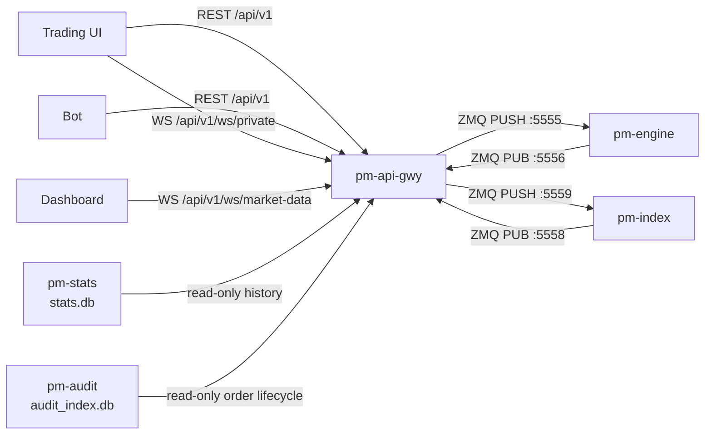

# API Gateway (REST/WebSocket)

<a id="pm-api-gwy-restwebsocket-api-gateway"></a>

!!! note "Learning objectives"
    After reading this page you will understand:

    - What `pm-api-gwy` does in the EduMatcher process model
    - How to configure API keys in the central `engine_config.yaml`
    - How to call the REST API and inspect Swagger documentation
    - How private and public WebSocket streams work
    - Where to find reusable Python and C REST examples


## What this process is

`pm-api-gwy` exposes EduMatcher order entry, order management, reference
data, history, and market data over REST/JSON and WebSocket. It is intended for
third-party software: browser UIs, dashboards, simple bots, and teaching
examples.

It is not a second matching engine. The process translates HTTP and WebSocket
requests into the same engine ZMQ/JSON messages used by the interactive
`pm-alf-console` process.




## Configuration

API gateway configuration lives in the central `engine_config.yaml`, matching
the existing CALF and RALF gateway pattern.

Use the top-level key `api_gateways` (underscore). The dashed form
`api-gateways` is not valid.

```yaml
api_gateways:
  desk:
    enabled: true
    host: 0.0.0.0
    port: 8080
    swagger_enabled: true
    log_level: info
    stats_db: data/stats.db
    # pm-audit's index, read-only, for GET /admin/orders/{order_id}/audit.
    # Optional: without it that one endpoint returns 503 and nothing else
    # is affected.
    audit_db: data/audit_index.db
    # pm-clearing's ledger, read-only, for the session/MTD/YTD realized P&L
    # on GET /positions. Optional: without it those three fields report null
    # and the rest of the position row is unaffected.
    clearing_db: data/clearing.db
    # Seconds a terminal order stays in the in-memory cache. 0 disables
    # eviction (unbounded growth).
    order_retention_sec: 3600
    # Seconds the market-data stream cache retains the per-symbol trades tail
    # for WS snapshot/resume. Latest book/depth/auction snapshots are kept
    # regardless of age; 0 disables the trade buffer but still serves snapshots.
    market_data_cache_sec: 60

    credentials:
      - api_key: key-trader-demo
        gateway_id: TRADER01
        description: Demo trading client
      - api_key: key-dashboard-demo
        gateway_id: null
        description: Read-only dashboard client

    rate_limit:
      writes_per_second: 10
      burst: 20

    timeouts:
      engine_auth_sec: 3.0
      engine_reply_sec: 3.0
      wait_ack_sec: 3.0
```

| Field | Meaning |
|---|---|
| `api_gateways.<NAME>` | Named API gateway process configuration selected with `--instance NAME` when needed |
| `host` / `port` | HTTP server bind address and port |
| `swagger_enabled` | Enables `/docs` and `/openapi.json` when true |
| `credentials[].api_key` | Bearer token clients use for REST and WebSocket auth |
| `credentials[].gateway_id` | Engine gateway identity; `null` means read-only market-data access; non-null values must be unique across `api_gateways` entries |
| `stats_db` | `pm-stats`' SQLite file, read-only, for `/history/*` |
| `audit_db` | `pm-audit`'s index, read-only, for `/admin/orders/{order_id}/audit`. Optional |
| `clearing_db` | `pm-clearing`'s ledger, read-only, for the session/MTD/YTD realized P&L on `/positions`. Optional: without it those three fields report `null` |
| `order_retention_sec` | Seconds a terminal order stays cached (default `3600`; `0` disables eviction) |
| `market_data_cache_sec` | Seconds the market-data cache retains the per-symbol `trades` tail for WS snapshot/resume (default `60`; latest book/depth/auction snapshots are kept regardless of age; `0` disables the trade buffer) |
| `rate_limit` | Per-key write limiting for POST/PATCH/DELETE endpoints |
| `timeouts` | Engine auth, request/reply, and synchronous ACK wait timeouts |

`host` defaults to `0.0.0.0`, matching the external TCP gateways: the API
gateway is intended to be reachable by browser clients, API clients, and
read-only dashboards on other machines. Set it to `127.0.0.1` only for a
loopback-only lab or when a reverse proxy on the same host is the only caller.

The engine's `participants` allowlist remains authoritative. If a credential
maps to `TRADER01` but `TRADER01` is not allowed by the engine config, the
engine rejects the API gateway handshake and every request using that
credential fails with `403` and error code `ENGINE_AUTH`.

Use multiple named entries when you want logical process separation, such as one
gateway for a human trading desk and another for automated clients. Each
non-null `gateway_id` is owned by one API gateway process so process-local
session and event state remain unambiguous. Read-only `gateway_id: null`
credentials can appear in more than one entry.


## Start the process

Installed mode:

```bash
pm-engine --verbose
pm-stats
pm-api-gwy --instance desk
```

Developer mode:

```bash
poetry run pm-engine --verbose
poetry run pm-stats
poetry run pm-api-gwy --instance desk
```

Useful options:

| Option               |                                  Default | Description                                      |
|----------------------|-----------------------------------------:|--------------------------------------------------|
| `--host ADDR`        |                             config value | Override HTTP bind address                       |
| `--port PORT`        |                             config value | Override HTTP listen port                        |
| `--instance NAME`    | auto-selected only when one entry exists | Select a named `api_gateways` entry              |
| `--engine-host HOST` |                             config value | Override engine host for ZMQ ports `5555`/`5556` |
| `--stats-db PATH`    |                             config value | SQLite database for `/history/*`                 |
| `--log-level LEVEL`  |                             `WARNING`    | `CRITICAL`, `ERROR`, `WARNING`, `INFO`, or `DEBUG` (uppercase; this is the CLI process's own log level, separate from the `log_level` config value that sets uvicorn's own logger) |
| `-v` / `--verbose`   |                             off          | Increase verbosity (`-v` → `INFO`, `-vv` → `DEBUG`) |
| `-q` / `--quiet`     |                             off          | Reduce output to warnings/errors |
| `--log-target`       |                             auto         | Where this process's own operational log records go: `server` (default, auto-detected `pm-log-srv`), `stdout`, or `file` |
| `--log-file PATH`    |                             —            | Operational log file path — required when `--log-target file` |
| `--log-failover-timeout SECONDS` | `30`             | Grace window before falling back to a local log file once `pm-log-srv` becomes unreachable |

Uvicorn writes access and application logs to stdout/stderr. Redirect them with
your shell or service manager:

```bash
poetry run pm-api-gwy --instance desk --log-level debug \
  > api-gateway.log 2>&1
```


## Swagger interface

When `swagger_enabled: true`, open:

```text
http://127.0.0.1:8080/docs
```

Swagger shows all REST endpoints, request schemas, response schemas, and enum
values. Use the **Authorize** button with:

```text
Bearer key-trader-demo
```


## Authentication principles

REST clients send an HTTP bearer token:

```http
Authorization: Bearer key-trader-demo
```

WebSocket clients send the API key as their first JSON message:

```json
{ "api_key": "key-trader-demo" }
```

### Auth and roles

The gateway checks auth in two steps:

1. The presented API key must exist in
   `api_gateways.<NAME>.credentials[].api_key`.
2. For trading/admin actions, the key must map to a non-null `gateway_id` and
   that gateway must be accepted by the engine allowlist and role model.

Access classes used across this guide:

- `Authenticated key` (or `Authentication key`): any configured API key.
- `Trading key`: an authenticated key with a non-null `gateway_id`.
- `Admin key`: a trading key whose mapped gateway role resolves to `ADMIN`.

What each class can do:

- Authenticated key: reference data and public history/market-data endpoints.
- Trading key: everything above plus private order/position/trading endpoints.
- Admin key: everything above plus `/api/v1/admin/*`.

Read-only credentials (`gateway_id: null`) can use public and reference
surfaces but cannot submit, cancel, or inspect private orders.

### Key types and provisioning

Keys are configured centrally in `engine_config.yaml` under
`api_gateways.<NAME>.credentials`.

```yaml
api_gateways:
  desk:
    credentials:
      - api_key: key-trader-demo
        gateway_id: TRADER01
        description: Trading client
      - api_key: key-dashboard-demo
        gateway_id: null
        description: Read-only dashboard
      - api_key: key-admin-demo
        gateway_id: ADMIN01
        description: Admin operator client
```

Provisioning rules:

- `gateway_id: null` creates a read-only authenticated key.
- `gateway_id: <GW_ID>` creates a trading-capable key bound to that gateway.
- ADMIN access is not set on the API key itself; it comes from the mapped
  gateway role in `participants`.
- Non-null `gateway_id` values must be unique across `api_gateways` entries.

How to get a key in practice:

- Keys are issued out-of-band by the venue/operator team.
- There is no self-service endpoint to create or rotate keys in `pm-api-gwy`.
- After key changes in config, restart/redeploy the API gateway instance.

Usage examples:

Trading REST call:

```http
Authorization: Bearer key-trader-demo
POST /api/v1/orders
```

Read-only REST call:

```http
Authorization: Bearer key-dashboard-demo
GET /api/v1/reference
```

Admin REST call:

```http
Authorization: Bearer key-admin-demo
POST /api/v1/admin/session/transition
```

Read-only WebSocket auth:

```json
{ "api_key": "key-dashboard-demo" }
```

For strict endpoint-by-endpoint access rules, see
[REST and WebSocket API Reference](../../protocols-and-clients/part-2-specifications/060-rest-and-websocket.md).

| Error code | Status | Cause |
|---|---|---|
| `AUTH` | `401` | Missing/malformed `Authorization` header, or an unrecognized API key. The reply carries `WWW-Authenticate: Bearer` |
| `ENGINE_AUTH` | `403` | The credential's `gateway_id` isn't allowed by the engine's `participants` list |
| `READ_ONLY` | `403` | A `gateway_id: null` credential called a trading-only endpoint |
| `ROLE_DENIED` | `403` | Credential's gateway lacks the `ADMIN` role on an `/admin/*` call (or `MARKET_MAKER` on `/bootstrap/mm`) |
| `RATE_LIMIT` | `429` | Per-key write rate limit exceeded |
| `VALIDATION` | `400` | Malformed request body, query parameter or history filter (date, cursor, `event_type`); `field` names it. Includes a price that is not on the instrument's tick grid, which carries `reject_code: TICK_VIOLATION` — see [Tick precision](#tick-precision) |
| `SYMBOLS_NOT_READY` | `503` | An order-entry request arrived before the engine's symbol metadata reached this gateway. Carries `reject_code: SYMBOL_NOT_READY`; retry shortly — see [Tick precision](#tick-precision) |
| `STATS_DB` | `503` | `pm-stats`' SQLite file doesn't exist yet |
| `AUDIT_INDEX_UNAVAILABLE` | `503` | No `pm-audit` index — only affects `GET /admin/orders/{order_id}/audit` |
| `NOT_FOUND` | `404` | No such path |
| `UNKNOWN_ORDER` | `404` | Order id unknown to this gateway (`GET /orders/{id}`), or no audited events for it (`GET /admin/orders/{id}`) |
| `METHOD_NOT_ALLOWED` | `405` | The path exists, but not for this method |
| `TRANSITION_REJECTED` | `409` | The engine will not perform the requested session transition |
| `RELOAD_REJECTED` | `409` | `POST /admin/reference/reload` was rejected — usually because the file's symbol/index set changed |
| `HALT_REJECTED` / `RESUME_REJECTED` | `409` | The engine refused a circuit-breaker trigger or resume (unknown symbol, not halted, ...); `message` is the engine's reason |
| `KILL_SWITCH_REJECTED` | `409` | The engine refused a symbol, gateway or global kill switch; `message` is the engine's reason |
| `REBALANCE_REJECTED` | `409` | `POST /admin/indexes/{id}/rebalance` was rejected by `pm-index`; `message` is its reason |
| `INTERNAL_ERROR` | `500` | A gateway bug; the message carries no internals (the gateway logs the traceback) |
| `ENGINE_TIMEOUT` | `503` | No engine reply within the configured timeout |
| `INDEX_TIMEOUT` | `503` | No `pm-index` reply within the configured timeout |
| `INDEX_ERROR` | `502` | `pm-index` rejected the request |

Every error, including an unknown path or a gateway bug, uses one envelope:
the transport-level `error.code`/`error.message` pair plus the canonical
`error.reject_code` (shared with ALF; `UNKNOWN` where no engine reject
applies). The full table is in the
[API reference](../../protocols-and-clients/part-2-specifications/060-rest-and-websocket.md#common-error-codes).
Validation failures echo
`client_tag` or `request_tag` when the rejected request supplied one, so clients
can correlate synchronous 4xx responses the same way they correlate asynchronous
order events.


## REST endpoints

The per-endpoint contract (every path, argument, reply and error code) is the
normative [REST API Reference](../../protocols-and-clients/part-2-specifications/060-rest-and-websocket.md),
and the machine-readable one is `GET /openapi.json` (Swagger at `/docs`), also
committed as `spec/rest/openapi.json`. This chapter covers what an operator
needs to run the gateway and help its users: what each group of endpoints
depends on, what is cached and for how long, and the behaviours that surprise
people.

| Group | Paths | Depends on |
|---|---|---|
| Order entry | `/orders`, `/oco`, `/combos`, `/quotes`, `/mass-cancel` | the engine |
| Account and live state | `/orders` (read), `/positions`, `/quotes` (read), `/symbols`, `/session`, `/halts`, `/status` | the engine, round trip per call |
| Reference data | `/reference/*` | the engine (compiled config) |
| History | `/history/*` | `pm-stats`' `stats.db`; `/history/index-events` asks `pm-index` |
| Bootstrap | `/bootstrap/trader`, `/mm`, `/admin` | the engine, several queries in parallel |
| Admin | `/admin/*` | the engine; rebalance asks `pm-index`; the audit view reads `audit_index.db` |
| Health | `/healthz` | nothing; not in Swagger |

### Order entry in practice

- **Per-type fields.** Which of `price`, `stop_price`, `visible_qty` and
  `trail_offset` each `order_type` needs is one rule shared by REST, ALF, BALF
  and the engine: a missing field is `MISSING_FIELD`, one the type does not use
  is `UNSUPPORTED_FIELD`, never silently dropped.
- **Waiting for the verdict.** Writes answer `202` at once; `?wait=ack` holds
  the reply until the engine's verdict (`200`) or `timeouts.wait_ack_sec`. A
  late verdict is still `202`, with the id and `ack_timeout: true`: the order
  was sent, so users must follow it, never resubmit it. Any `4xx`/`5xx` on a
  write means nothing reached the engine.
- **Safe retries.** An `Idempotency-Key` header makes a retry after a dropped
  connection safe: a repeat is answered with the first reply
  (`Idempotent-Replayed: true`) instead of a second order. Keys live in the
  gateway process for `order_retention_sec` and are lost on restart.
  `client_tag` is not an idempotency key.

```bash
curl -s -X POST "$GW/api/v1/orders?wait=ack" \
  -H "Authorization: Bearer $KEY" -H "Content-Type: application/json" \
  -H "Idempotency-Key: 6f1c2a9e-1f4b-4c43-9a51-3b8f0e2d7c11" \
  -d '{"symbol":"AAPL","side":"BUY","order_type":"LIMIT","quantity":100,"price":187.25}'
```

See [Write outcomes and safe retries](../../protocols-and-clients/part-2-specifications/060-rest-and-websocket.md#write-outcomes-and-safe-retries).

#### Tick precision

`price`, `stop_price` and `trail_offset` must be exact multiples of the
instrument's tick size (`tick_decimals` in `GET /reference/symbols`). A price
that is not is refused with `400`, `reject_code: TICK_VIOLATION`, not rounded:
rounding would rest an order at a price the client never sent. The check
tolerates ordinary floating-point error (`100.00 - 3 * 0.01` is accepted as
`99.97`).

!!! note "`503 SYMBOLS_NOT_READY` right after startup"
    The gateway learns each instrument's tick precision from the engine when it
    authenticates. An order submitted before that arrives is answered `503`
    with `reject_code: SYMBOL_NOT_READY` rather than converted against a
    default precision that may be wrong for the symbol. It is transient: retry.
    Only order-entry routes (and an admin reopen at a price) are affected.

### Reference data

`/reference/*` serves the engine's **compiled, static** reference data: tick
sizes, resolved risk-band collars, circuit-breaker ladders, the session
schedule and index definitions, so a client never parses `engine_config.yaml`.
It is distinct from `GET /symbols`, `/session` and `/halts`, which report
*live* state. Every call round-trips to the engine (no gateway cache), so a
reload shows at once. Any key may call it, read-only included.

#### `config_version`

A 16-character hex prefix of a SHA-256 hash over the compiled bundle, computed
when the engine loads or reloads its config. It changes if and only if the
reference data changes, so a client can cache the bundle and poll
`GET /reference/config-version` to know when to refetch. Treat it as opaque.

#### Reloading reference data

`POST /api/v1/admin/reference/reload` (ADMIN) re-reads the `engine_config.yaml`
the engine started from and applies changes to tick sizes, collars, breaker
ladders, the schedule and index descriptions. It is deliberately **narrower**
than a restart:

- It never creates or removes an order book, re-seeds market-maker quotes, or
  touches session or halt state.
- A changed **symbol set or index-id set** is refused (`409 RELOAD_REJECTED`)
  and nothing is applied: adding or removing an instrument needs a restart.
- An engine started from a compiled config artifact refuses it: there is no
  file to re-read.

It is meant for tuning a band or threshold between classroom drills, not for
live production changes.

### History endpoints

Every `/history/*` endpoint except `/history/index-events` reads `pm-stats`'
SQLite database (`--stats-db PATH`, default `data/stats.db`). Until `pm-stats`
has created it, they answer `503 STATS_DB`: a normal state for a fresh venue,
not a fault. `/history/orders` and `/history/fills` need a trading key and
return only the caller's own records; the rest are public market data, open to
read-only keys.

`/history/index-events` is the exception: `pm-index`'s structural log (index
creation, corporate actions, constituent changes) lives only in `pm-index`'s
own file, so the gateway asks `pm-index` live. It answers `503 INDEX_TIMEOUT`
when `pm-index` is not running, whatever the state of `stats.db`.

Lists are paginated with an opaque cursor; see the spec's
[pagination contract](../../protocols-and-clients/part-2-specifications/060-rest-and-websocket.md#pagination-contract).

## Bootstrap endpoints

`/bootstrap/trader`, `/bootstrap/mm` and `/bootstrap/admin` collapse the 6–13
calls a client needs at login into one, running the engine queries in parallel.
A sub-query that times out is reported in `incomplete` with its field `null`,
and the rest of the payload is still delivered; only the required parts
(`reference`, `orders`, `positions`; `reference` for admin) fail the whole call
with `503 ENGINE_TIMEOUT`, because a client cannot start without them.
Positions are always the engine's: a fallback to the gateway's own fill cache
would show flat positions after a gateway restart.

## Admin endpoints

Every `/admin/*` route needs a key whose gateway holds the **ADMIN** role.

!!! note "Role source"
    The API credential store does not carry role. The gateway resolves and
    caches the ADMIN role from the engine's gateway list reply, so the first
    admin call performs one extra engine round-trip.

The admin surface covers the venue (`/admin/market/halt`, `/resume`,
`/kill-switch`, `/volume`, `/session/transition`, `/reference/reload`), single
symbols (`/admin/symbols/{symbol}/halt`, `/resume`, `/reopen`,
`/cancel-orders`, `/orders`), single participants (`/admin/gateways`,
`/admin/gateways/{gateway_id}/disconnect`, `/kill-switch[?symbol=]`,
`/orders`, `/positions`, `/quotes/{symbol}`), live risk (`/admin/risk/state`),
order audit (`/admin/orders/{order_id}/audit`) and index rebalancing. Each is
specified in the REST API Reference; the points below are what operators ask
about.

- **Three kill-switch scopes.** `POST /mass-cancel` is self-service (the
  caller's own gateway). `/admin/gateways/{gateway_id}/kill-switch` cancels one
  participant's exposure (optionally one symbol) without disconnecting it,
  whether or not it is connected, and the audit names the ADMIN.
  `/admin/market/kill-switch` cancels every resting order and quote. A halt is
  different: it stops *trading* and leaves resting orders in place.
- **Reopening.** `/admin/symbols/{symbol}/reopen` uncrosses and clears a halt
  in one step, at the natural equilibrium or an operator price; run it with
  `dry_run` first to see the indicative print.
- **Live risk state.** `/admin/risk/state` shows where each symbol's collar
  and circuit breaker actually stand (reference, trigger, corridor) — unlike
  `/reference/risk` (the static definitions) and `/halts` (only what is halted).

### Index administration (`pm-index` bridge)

`POST /admin/indexes/{index_id}/rebalance` is the one admin route that talks to
`pm-index` instead of the engine. It applies a batch of shares-outstanding
updates, validated as a whole before any is applied, and republishes the level
once. A refusal is `409 REBALANCE_REJECTED` with the reason. Splits, dividends,
constituent additions and delistings are not exposed over REST: use
[`pm-index-admin-cli`](../part-4-run-a-market/080-index-administration.md).
Adding a symbol to the engine mid-session is not possible at all; the engine
loads its symbol universe at startup.

### `admin.action` monitor events

Every admin-gated engine command (halts and resumes, the kill switches, a
reopen) also publishes one `admin.action` event on
[`/api/v1/ws/admin/monitor`](#websocket-endpoints): one uniform record of who
ran what and what it did, so a monitor need not know each command's own ack.
It never reaches a trading gateway's private stream or market data. Its
fields are in the
[message reference](../../protocols-and-clients/part-5-message-reference/010-message-reference.md#adminactiongateway_id).
An index rebalance does not emit one: it is not an engine command.

## Cross-gateway admin views

Two views answer "what is happening across all participants", from different
sources:

- `GET /admin/orders` is the gateway's own **read model**: every order whose
  events this gateway has seen since it started, filterable, no engine round
  trip. It is current state bounded by
  [order cache retention](#order-cache-retention), so it misses orders that
  rested before the gateway started. `GET /admin/gateways/{gateway_id}/orders`
  asks the engine and is authoritative for one participant.
- `GET /admin/orders/{order_id}/audit` is one order's complete lifecycle, read
  from `pm-audit`'s index.

!!! warning "The audit view reads `pm-audit`'s database"
    It opens **`audit_index.db` read-only** (`api_gateways[].audit_db`): the
    only store the gateway reads but does not own. The dependency is optional:
    without `pm-audit` or its index, that one route answers
    `503 AUDIT_INDEX_UNAVAILABLE` and every other route is unaffected. See
    [Audit Trail](../part-6-observe-and-recover/020-audit-trail.md) for building
    the index.

### Order cache retention

The in-memory order cache backs `GET /orders/{order_id}`, the private
`orders.snapshot` frame and `GET /admin/orders`. Terminal orders (`FILLED`,
`CANCELLED`, `EXPIRED`, `REJECTED`) are evicted after **`order_retention_sec`**
(default `3600`). Resting orders are never evicted, and positions are never
affected. `order_retention_sec: 0` disables eviction, and the cache then grows
for the lifetime of the process. The same horizon bounds how long
`Idempotency-Key` replies are kept.

## WebSocket endpoints

Every socket lives under `/api/v1/ws/`, so a reverse proxy can route upgrades by
that one prefix. The contract (frames, close codes, sequencing, flow control,
the full event catalogue, recovery) is the normative
[WebSocket API Reference](../../protocols-and-clients/part-2-specifications/070-websocket.md).

| Path | Purpose | First message |
|---|---|---|
| `/api/v1/ws/private` | Private order, quote and risk events for one gateway | `{ "api_key": "key-trader-demo" }` |
| `/api/v1/ws/market-data` | Public book, trades, depth, auctions, session, halts and news | `{ "api_key": "key-dashboard-demo" }` |
| `/api/v1/ws/admin/monitor` | ADMIN-only feed of every engine event across all gateways | `{ "api_key": "key-admin-demo" }` |
| `/api/v1/ws/admin/sim` | ADMIN-only `pm-market-sim` true values and heartbeat | `{ "api_key": "key-admin-demo" }` |

What operators need to know:

- **Slow clients lose events, they do not slow the venue.** Each socket has a
  bounded queue; when it is full, events for that socket are dropped and the
  socket stays open. `GET /healthz` reports `dropped_events` per stream
  (`private`, `market_data`, `admin`), and the gateway logs a warning on the
  first drop per stream and every hundredth after. A client detects its own
  loss from a `seq` gap and recovers: the private stream by reconnecting (a
  fresh `orders.snapshot`), market data by a `snapshot` or a trades `resume`.
- **Trades are replayable for `market_data_cache_sec`** (60 s by default).
  Older gaps fall back to `/history/trades`.
- **The admin monitor has no replay.** On reconnect its `monitor.snapshot` is
  current state; history is the audit trail. Its halts and gateway roster come
  from the engine, not from this gateway, so participants connected over ALF,
  BALF or another API gateway are included; if either query times out, the
  snapshot says so in `incomplete` rather than refusing to open.
- **Sequence numbers restart with the gateway.** A client must treat a lower
  `seq` after a reconnect as a restart, not a gap.


## Examples

Runnable Python and C clients live under `docs/examples/REST/`: an order's
whole lifecycle with safe retries, history paging, the private stream with gap
recovery, market-data subscribe and resume, and an admin halt-and-reopen. They
run against a real exchange in `make test-e2e`, so they stay working. See
[Protocol Support Library Examples](../../protocols-and-clients/part-4-writing-clients/030-example-libraries.md#rest-api-support-library-and-examples).


## Implementation notes and design deviations

The original API gateway design described a separate `api_gateway_config.yaml`.
EduMatcher now keeps API gateway settings in the central `engine_config.yaml`
under `api_gateways:` so the API gateway follows the same configuration pattern
as the other gateway processes and supports multiple named API gateway process
configs.

The runtime rejects duplicate non-null `gateway_id` assignments across named
API gateway entries. This is deliberate: sharing one engine gateway identity
between two API gateway processes would split private session/event state across
process memory. Use separate ALF gateway IDs for separately managed write paths,
or use `gateway_id: null` for read-only dashboard credentials.

Swagger exposure is configurable with `swagger_enabled`. Plain bearer keys in
YAML are used for teaching and local labs; production deployments should put the
gateway behind TLS and manage secrets with the surrounding platform.

`?wait=ack` waits for the engine event matching both the topic and the specific
`order_id`. Concurrent requests sharing one `gateway_id` each resolve
independently.

`engine_auth_sec`, `engine_reply_sec`, and `wait_ack_sec` are all applied from
configuration.

The implementation keeps engine payloads close to the existing EduMatcher event
model. Outbound WebSocket events are wrapped in a consistent envelope, but they
do not attempt broad tick-to-display price rewriting beyond the payloads already
published by the engine.

Cancel-replace is implemented as cancel, wait for the cancel's outcome, then
submit the replacement. The replacement body uses the same shape as
`POST /orders`, including `symbol`, which must be the original's. The gateway
tags its cancel, so a refused cancel (typically: the original filled before the
cancel reached it) is reported as `409 REPLACE_REJECTED` rather than waited out.

`Idempotency-Key` replies are held in the gateway process (one per gateway id),
for `order_retention_sec` (one hour when eviction is disabled). A duplicate that
arrives while the first request is still waiting shares its outcome, and the
first request completes even if its client disconnects, so its reply is there
for the retry.

Startup creates the engine client and listener, but does not fail the process
only because `stats.db` is absent. History endpoints depend on `pm-stats` having
created and populated the configured database.


## Operational checklist

1. Confirm `api_gateways.<NAME>.credentials` maps to gateways allowed under `participants`
2. Confirm each non-null `gateway_id` appears in only one API gateway entry
3. Start `pm-engine`, `pm-stats`, then `pm-api-gwy --instance NAME`
4. Open `/docs` if Swagger is enabled
5. Test `GET /api/v1/healthz` (no auth required) — returns `200 {"ok": true}` when the engine listener is running, `503 {"ok": false}` otherwise
6. Test `GET /api/v1/status` with a bearer token
7. Connect `/api/v1/ws/private` before submitting orders if you want async outcomes
8. Use `/history/*` only when `pm-stats` is running and writing `stats.db`


## Minimal MARKET order CLI

The script below lives at `docs/examples/REST/python/submit_market_order.py`
and reuses the same `ApiGatewayClient` library used by `demo_info.py`.

Run it from the examples directory:

```bash
cd docs/examples/REST/python
python3 submit_market_order.py --side BUY  --symbol AAPL --qty 100
python3 submit_market_order.py --side SELL --symbol MSFT --qty 50 --wait-ack
```

Override gateway URL and key with environment variables:

```bash
EDUMATCHER_API_URL=http://127.0.0.1:8080 \
EDUMATCHER_API_KEY=key-trader-demo \
python3 submit_market_order.py --side BUY --symbol AAPL --qty 100
```

| Option       | Required | Default                                          | Description                                    |
|--------------|----------|--------------------------------------------------|------------------------------------------------|
| `--side`     | yes      | —                                                | `BUY` or `SELL`                                |
| `--symbol`   | yes      | —                                                | Instrument symbol                              |
| `--qty`      | yes      | —                                                | Order quantity                                 |
| `--wait-ack` | no       | off                                              | Block until the matching engine ACKs the order |
| `--url`      | no       | `$EDUMATCHER_API_URL` or `http://127.0.0.1:8080` | Gateway base URL                               |
| `--key`      | no       | `$EDUMATCHER_API_KEY` or `key-trader-demo`       | Bearer API key                                 |

Example output without `--wait-ack`:

```text
order_id  : ORD-3a7f1e2c
status    : PENDING
```

Example output with `--wait-ack`:

```text
order_id  : ORD-3a7f1e2c
status    : ACKED
accepted  : True
engine ack:
{
  "order_id": "ORD-3a7f1e2c",
  "accepted": true,
  "reason": null
}
```

MARKET orders must not include `price` or `stop_price`. The gateway validates
this and returns `400 VALIDATION` if either field is present.


## Troubleshooting

### Check whether the port is in use

Before starting `pm-api-gwy`, or when a client cannot connect, verify that
something is listening on the configured port (default `8080`).

**macOS:**

```bash
# lsof — shows the process name and PID holding the port
sudo lsof -iTCP:8080 -sTCP:LISTEN

# BSD netstat (ships with macOS)
netstat -an | grep LISTEN | grep 8080
```

**Linux:**

```bash
# ss — preferred on modern Linux
ss -tlnp 'sport = :8080'

# lsof
sudo lsof -iTCP:8080 -sTCP:LISTEN

# netstat (older distributions)
netstat -tlnp | grep 8080
```

Replace `8080` with the `port` value from your `api_gateways.<name>` config block.
If no output appears, the gateway is not running.

### Test HTTP connectivity from the command line

The health endpoint requires no authentication and is the fastest connectivity check:

```bash
curl -s http://127.0.0.1:8080/api/v1/healthz
# Expected: {"ok": true, "enabled": true, "active_gateways": ["TRADER01"],
#            "dropped_events": {}}
#
# A non-zero "dropped_events" entry means a WebSocket client read too slowly
# and lost events. The gateway is still healthy — shedding for a slow consumer
# is intended — but that client's data has holes. See "Detecting dropped
# events" above.
```

`ok` reflects whether the gateway is `enabled` in config **and** whether its
own engine-event listener thread is alive — it does **not** confirm that
`pm-engine` is actually up. The listener starts at process boot regardless of
whether a peer is listening on the other end of the ZMQ socket, so `/healthz`
can report `{"ok": true}` even before `pm-engine` has ever been started; it
only flips to `false` if the gateway itself is disabled or its listener
thread has crashed.

Test an authenticated endpoint:

```bash
curl -s -H "Authorization: Bearer key-trader-demo" \
     http://127.0.0.1:8080/api/v1/status
```

Test WebSocket connectivity:

```bash
# websocat (brew install websocat / apt install websocat)
websocat ws://127.0.0.1:8080/api/v1/ws/market-data

# curl — look for HTTP 101 Switching Protocols in the response headers
curl -v --no-buffer \
     -H "Connection: Upgrade" -H "Upgrade: websocket" \
     -H "Sec-WebSocket-Version: 13" \
     -H "Sec-WebSocket-Key: dGhlc2FtcGxla2V5" \
     http://127.0.0.1:8080/api/v1/ws/market-data
```

### Common problems

| Symptom | Likely cause | Fix |
|---|---|---|
| `Connection refused` | Gateway not started or wrong port | Confirm `pm-api-gwy` is running; check `port` in `api_gateways` config |
| `503 {"ok": false}` from `/healthz` | Gateway `enabled: false` in config, or its engine-listener thread crashed | Check `enabled` in the config block and the gateway's own logs — restarting `pm-engine` alone will not fix an already-`false` result, since `/healthz` doesn't actually probe engine liveness |
| `401 Unauthorized` | Missing, malformed or unknown key in the `Authorization` header (`AUTH`) — or, as `403 ENGINE_AUTH`, the engine rejected the gateway's own handshake for that `gateway_id` | Use `Authorization: Bearer <key>` with a key listed in `credentials`; if you get `403 ENGINE_AUTH` instead, check that the `gateway_id` is allowed by the engine's `participants` list |
| `403 Forbidden` | Credential has no `gateway_id` (`READ_ONLY`); or lacks the ADMIN role on an `/admin/*` call (`ROLE_DENIED`) | Use a credential with a non-null `gateway_id` for order-entry endpoints, or one whose engine gateway has `role: ADMIN` for admin endpoints |
| `429 Too Many Requests` (`RATE_LIMIT`) | Per-key write rate limit (`rate_limit.writes_per_second`/`burst`) exceeded | Slow down write requests for that API key |
| `404` on all endpoints | Wrong base path or wrong `--instance` flag | Check `pm-api-gwy --instance NAME` matches the config block name |
| Swagger UI not loading | `swagger_enabled: false` | Set `swagger_enabled: true` in the config block and restart |
| History endpoints return empty results | `pm-stats` not running or wrong `stats_db` path | Start `pm-stats`; verify the `stats_db` path in config points to the correct file |
| `GET /admin/orders/{order_id}/audit` returns `503 AUDIT_INDEX_UNAVAILABLE` | `pm-audit` not deployed, or its index not built | Start `pm-audit` and run `pm-audit-cli index`; check `audit_db`. Every other endpoint is unaffected |
| An order vanished from `GET /admin/orders` | It reached a terminal status more than `order_retention_sec` ago | Expected — that view is current state. Use `GET /admin/orders/{order_id}/audit` for its history |
| `GET /admin/orders` grows without bound | `order_retention_sec: 0` disables eviction | Set a positive value |
| WebSocket disconnects immediately | Engine not running or client rate limit hit | Start engine; check gateway logs for disconnect reason |
