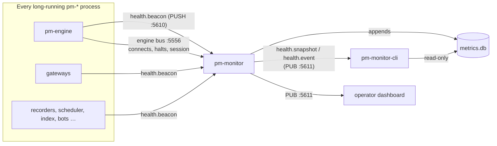

# Health Monitoring (`pm-monitor`)

<a id="pm-monitor-health-collector"></a>
<a id="pm-monitor-cli-health-query-cli"></a>

!!! note "Learning objectives"
    After reading this page you will understand:

    - What a health beacon is and which processes send one
    - How `pm-monitor` judges each process — HEALTHY, DEGRADED, HUNG,
      SILENT, DEAD, MISSING, STOPPED — and the exchange as a whole
    - How to start `pm-monitor`, configure it, and where `metrics.db` lives
    - What the thresholds watch and how breaches and events are reported
    - Every `pm-monitor-cli` command, its options and exit codes
    - How to troubleshoot the common situations


## Overview

`pm-opctl-cli list` answers "is the process there?": a PID and a TCP or
health-ping probe. It cannot tell a process whose main loop is stuck from one
that is working, it knows nothing about processes on other hosts, and it has
no history. `pm-monitor` answers "is the exchange working?".

Every long-running `pm-*` process sends a small **health beacon** every two
seconds: its memory, CPU, threads, how long ago its main loop last completed
an iteration, and its own counters (orders in, messages out, clients
connected, …). `pm-monitor` collects them, judges every process, turns the
counters into rates, watches thresholds, keeps history, and publishes a live
snapshot once a second.

| Component | Role | Type |
|---|---|---|
| **Health beacon** | Sent by a background thread in every long-running process to `pm-monitor` (ZeroMQ PUSH to port `5610`) | Built into each process |
| **`pm-monitor`** | Collector — judges health, computes rates, evaluates thresholds, stores history, publishes `health.snapshot` and `health.event` on port `5611` | Long-running process |
| **`metrics.db`** | History: samples, 1-minute roll-ups, daily totals, events | SQLite file in the data directory |
| **`pm-monitor-cli`** | Query tool — health, exchange status, event log | One-shot CLI |
| **[Operator Dashboard](070-operator-dashboard.md)** | The browser view of the same snapshot and history (`pm-dash`) | Web app |



The beacon is sent from a background thread, not the main loop — that is the
point. When a main loop hangs, the thread keeps reporting with a growing
*loop age*, so `pm-monitor` can tell a hung loop (beacons arrive, loop stuck)
from a stuck interpreter (no beacons, process alive) from a dead process (no
beacons, no process). A beacon sent from the main loop would simply stop, and
silence cannot make that distinction.

A process never waits for `pm-monitor`: beacons are sent without blocking,
at most ten queue up, and when `pm-monitor` is down they are dropped and
counted. Starting the exchange without `pm-monitor` costs nothing.

### Which processes beacon

`pm-engine`, `pm-alf-gwy`, `pm-balf-gwy`, `pm-md-gwy`, `pm-ralf-gwy`,
`pm-dc-gwy`, `pm-api-gwy` (one per `--instance`), `pm-log-srv`, `pm-stats`,
`pm-audit`, `pm-clearing`, `pm-scheduler`, `pm-index`, `pm-market-sim`,
`pm-monitor` itself, and the participant bots `pm-mm-bot` and `pm-ai-swarm`
(shown in their own group; they never affect the exchange status).
Short-lived tools — the CLIs, consoles, viewers — do not.

## Starting `pm-monitor`

Every built-in `pm-opctl-cli` profile except `micro` starts `pm-monitor`,
right after `pm-log-srv` (so it can log) and before `pm-engine` (so the
engine's first beacons are received). Its profile entry checks it with
`pm-monitor-cli health -q`, so `pm-opctl-cli list` shows `healthcheck
passed` only when its collector loop is actually publishing.

To start it by hand:

```
pm-monitor [--log-level LEVEL] [-v|-vv] [-q]
           [--log-target server|stdout|file] [--log-file PATH]
           [--log-failover-timeout SEC] [--version]
```

There are no other flags: everything comes from the `monitor` section of the
deployed configuration ([Configuration](#configuration)). It binds
`127.0.0.1:5610` (beacons in) and `127.0.0.1:5611` (snapshots and events
out) by default, subscribes to the engine bus, and opens
`<data dir>/metrics.db`.

At start-up it logs, at INFO, the session timezone it judges "today" by —
the engine's `locale.session_timezone`, exactly as `pm-stats` does, so
"orders today" here and the statistics' daily rollup always agree.

It exits with code 1 when it cannot bind its ports or open `metrics.db`:

- **Another `pm-monitor` already writes this `metrics.db`** — one
  `pm-monitor` per data directory; two would each add their own counts to the
  same daily totals.
- **`metrics.db` was recorded with another session timezone** — its daily
  totals would mean two different things. Put
  `locale.session_timezone` back, or move `metrics.db` aside to start a new
  history.

With `monitor.enabled: false` it prints that monitoring is disabled and then
**idles** until stopped (exit 0), binding nothing and writing nothing. It does
not exit at once on purpose: the profiles run it, and the container restarts
dead profile processes every minute.

On SIGTERM it keeps collecting for 1.5 seconds, because `pm-opctl-cli stop`
and `docker stop` signal every process at once and their final beacons arrive
just after its own signal; it then records the last picture (every process
STOPPED) in `metrics.db` and exits.

### In the container

The image `EXPOSE`s 5610 and 5611, but no compose file publishes them: every
process that beacons runs inside the container, and the operator dashboard
reaches 5611 over the compose network. `EDUMATCHER_GATEWAY_BIND_HOST=0.0.0.0`
(set by the compose file) makes `pm-monitor` bind all interfaces inside the
container. Run `pm-monitor-cli` inside the container (`make shell`).

## How health is judged

Every second `pm-monitor` judges each process. The first matching rule wins:

| State | Means | Rule |
|---|---|---|
| **STOPPED** | Stopped cleanly | Its last beacon was the final one a process sends when it shuts down |
| **MISSING** | Expected but never seen | The active `pm-opctl-cli` profile runs it, and it has not sent a beacon since `pm-monitor` started (judged once `pm-monitor` has run for one silence period, 6 s by default) |
| **DEAD** | Gone | No beacon for `silent_after_beacons` × its beacon interval (6 s by default), and its process no longer exists. For a process on another host, which cannot be checked, after twice that |
| **SILENT** | Stuck, still there | No beacon for that long, but the process still exists: the whole interpreter is stuck, or beacons cannot reach `pm-monitor` |
| **HUNG** | Main loop stuck | Beacons arrive, but the main loop has not completed an iteration for more than `hung_after_sec` (5 s). While a process is still starting up (its loop has not run once yet) it gets 120 s instead. Time the whole process stood still — reported SILENT, after a `kill -STOP` or a suspended host — does not count |
| **DEGRADED** | Working, but something is off | A threshold on this process is in breach, or its loop ran more than 1 s late since the previous beacon |
| **HEALTHY** | — | None of the above |

A process that restarted (a new incarnation of the same name, instance and
host) shows a *restarted* badge for ten minutes. A process killed or stopped
by hand that the profile does not expect is forgotten after an hour without
a beacon.

**Exchange status** — the one-line answer:

| Status | When |
|---|---|
| **DOWN** | No `pm-engine` is running: it is DEAD, SILENT, HUNG, MISSING or STOPPED, or `pm-monitor` has never heard of one |
| **IMPAIRED** | Another expected exchange process is DEAD, SILENT, HUNG or MISSING — or STOPPED while the active profile expects it |
| **DEGRADED** | An exchange process is DEGRADED, or a threshold that belongs to no process (host CPU, memory or disk, the reject ratio, a book) is in breach |
| **OPERATIONAL** | Otherwise |

The participant bots never affect the exchange status. Without an active
profile (processes started by hand) every beaconing exchange process counts,
and nothing is MISSING.

## Thresholds and events

| Rule | Subject | Warn | Critical |
|---|---|---|---|
| `host_cpu_pct` | `host` | > 80 % | > 95 % |
| `host_mem_pct` (total − available) | `host` | > 80 % | > 92 % |
| `disk_free_pct` (data directory) | `host` | < 15 % | < 5 % |
| `engine_handle_p99_us` | the engine | > 2 000 µs | > 10 000 µs |
| `reject_pct_5m` — rejected over all inbound requests (orders, cancels, amends, quotes), judged from 20 requests in 5 min | `exchange` | > 10 % | > 30 % |
| `rss_growth_pct_1h` — judged once a process has been watched for 10 min | a process | > 50 % | > 100 % |
| `heap_garbage_pct` — judged from 100 heap entries | a symbol | > 50 % | > 80 % |
| `loop_age_ms` (fixed) | a process | > 1 000 ms | (HUNG) |
| `slow_client_disconnects`, `api_dropped_events`, `stats_feed_gaps` (fixed) | a process | any increase in 5 min | — |

The configurable rules take their levels from `monitor.thresholds`. A breach
is reported at once; it clears (or eases from critical to warning) only after
three consecutive seconds at the lower level, so a value hovering around a
threshold produces one breach and one clear, not a flood. Each breach and
each clear is one `THRESHOLD` event and one log line through the log server
(`threshold host_cpu_pct WARN 81 > 80 on host` at WARNING, critical at ERROR,
a clear at INFO), so the log console's alerting already covers notification.

**Events** — the event log `pm-monitor-cli events` shows:

| Kind | From | Subject · detail |
|---|---|---|
| `PROCESS_STATUS` | a state change | process key · `HEALTHY -> HUNG` (a process first seen HEALTHY is not news) |
| `THRESHOLD` | a breach or clear | the subject · `host_cpu_pct WARN 81 > 80` |
| `CONNECT` / `AUTH_REJECT` | engine bus | gateway id · description or reason |
| `DISCONNECT` | engine bus | gateway id · reason (`heartbeat_timeout` is a WARN) |
| `DIAGNOSTIC` | engine bus | component · `detail (xN): error` |
| `SESSION` | engine bus | `session` · `CLOSED -> PRE_OPEN` |
| `HALT` / `RESUME` | engine bus | symbol · level and source, or reason |

## Rates and "today"

Processes report counters as totals since they started; `pm-monitor` turns
them into increments, so a process restart neither loses nor double-counts
(a value that drops means a restart). For orders and trades it shows:

- **today** — the sum since local midnight in the session timezone;
- **per minute now** — the last 60 seconds;
- **average per minute** — the last 60 minutes;
- **average per hour** — today divided by the hours since the session opened
  today (else since midnight);
- **average per day** — the mean daily total over the last 7 trading days
  with data.

When `pm-monitor` restarts it resumes from `metrics.db`: today's totals come
back, and the first beacon of a process that kept running counts exactly what
happened while `pm-monitor` was down. Only the very first start of a new
`metrics.db` begins the day at zero for processes that started earlier.

## `metrics.db`

`<data dir>/metrics.db` (SQLite, WAL mode) holds:

| Table | Content | Kept |
|---|---|---|
| `series` | One row per (source, metric, label); the sample tables refer to it | — |
| `samples_raw` | The latest value of every series, every 10 s | `retention.raw_hours` (6 h) |
| `samples_1m` | Per series and minute: min, average, max, last, samples, and for counters the increment | `retention.minute_days` (7 days) |
| `daily_totals` | Per trading date and series, the day's increments | For good |
| `counter_last` | The last value of every counter, for an exact restart | `minute_days` |
| `events` | Every event; its `seq` is the event's sequence number | `minute_days` |
| `metrics_meta` | The session timezone the file was recorded under | — |

The views `v_samples_raw` and `v_samples_1m` show the samples with their
source, metric name and label spelled out, for SQL by hand:

```sql
SELECT ts, value FROM v_samples_raw
WHERE source LIKE 'pm-engine@%' AND name = 'proc.rss_bytes'
ORDER BY ts DESC LIMIT 10;
```

Sources are process keys (`pm-api-gwy/desk@host`) or `host`. Besides each
process's own metrics, `pm-monitor` stores every process's vitals as
`proc.rss_bytes`, `proc.cpu_pct`, `proc.threads`, `proc.fds`,
`proc.loop_age_ms` and `proc.loop_lag_ms`, and the host as `host.*` and
`files.size_bytes` (labelled `metrics.db`, `log.db`, `stats.db`, `audit`,
`clearing.db`, `gtc`).

Retention runs hourly and returns freed pages, so the file stops growing once
it holds its window: about 480 MB for an exchange like the `s30-complex`
example (30 symbols), about 650 MB with 30 participants. `pm-opctl-cli clear
--all` deletes it (it is history, like `log.db`), together with its
`metrics.db-wal` and `-shm`; `clear --state` keeps it.

## Configuration

The optional top-level `monitor` block of `engine_config.yaml`; an absent
block means all defaults, with monitoring on. Every process reads it — the
beaconing processes for where and how often to send, `pm-monitor` for
everything.

```yaml
monitor:
  enabled: true
  bind_address: 127.0.0.1
  host: 127.0.0.1
  pull_port: 5610
  pub_port: 5611
  beacon_interval_sec: 2
  hung_after_sec: 5
  silent_after_beacons: 3
  book_metrics_interval_sec: 10
  retention:
    raw_hours: 6
    minute_days: 7
  thresholds:
    host_cpu_pct: {warn: 80, crit: 95}
    disk_free_pct: {warn: 15, crit: 5}
```

| Field | Default | Description |
|---|---|---|
| `enabled` | `true` | When `false` no process sends beacons and `pm-monitor` idles |
| `bind_address` | `127.0.0.1` | Interface `pm-monitor` binds; `EDUMATCHER_GATEWAY_BIND_HOST` overrides it |
| `host` | `127.0.0.1` | Where every process sends its beacons, and where `pm-monitor-cli` and the dashboard connect. Must reach `bind_address` (`M031`) |
| `pull_port` | `5610` | Beacons in |
| `pub_port` | `5611` | Snapshots and events out |
| `beacon_interval_sec` | `2` | How often each process reports |
| `hung_after_sec` | `5` | Loop age above which a process is HUNG; must exceed the beacon interval (`M030`) |
| `silent_after_beacons` | `3` | Missed beacons before SILENT or DEAD |
| `book_metrics_interval_sec` | `10` | How often the engine recomputes its per-book figures |
| `retention.raw_hours` | `6` | Raw sample history |
| `retention.minute_days` | `7` | 1-minute buckets, events and counter state |
| `thresholds.<rule>` | see [Thresholds](#thresholds-and-events) | `{warn, crit}`; warn below crit, except `disk_free_pct` (`M029`). Omit a rule to keep its default |

`pm-config-gen --monitor` writes the whole block, and the `--monitor-*`
options set its fields (see "Monitor options" in
[Generate Configs with `pm-config-gen`](../part-2-configure/010-the-configuration-workflow.md#generate-configs-with-pm-config-gen)).
`pm-cverifier` checks the block's shape (`S124`–`S131`), its cross-field
rules (`M029`–`M031`) and its ports against every other listener (`M018`); see
[Config Verifier](../part-2-configure/020-config-verifier.md). Changing
`locale.session_timezone` on an exchange with history makes `pm-monitor`
refuse to start (see above).

## `pm-monitor-cli`

A read-only query tool: it never writes `metrics.db` and holds no read open,
so it never disturbs `pm-monitor`.

```
pm-monitor-cli [--host HOST] [--port PORT] [--db PATH]
               [--format table|json] [--timeout SEC] COMMAND [options]
```

| Option | Default | Description |
|---|---|---|
| `--host` | `monitor.host` | Where `pm-monitor` publishes |
| `--port` | `monitor.pub_port` (`5611`) | Its snapshot/event port |
| `--db` | `<data dir>/metrics.db` | For `events` and `health --extended` |
| `--format` | `table` | `json` for scripts |
| `--timeout` | `3` | Seconds to wait for a snapshot |

### `health`

```
pm-monitor-cli health [-q] [--extended] [-v]
```

Healthy when a snapshot arrives within `--timeout`. Snapshots come from
`pm-monitor`'s main loop, so this proves the loop runs — the same guarantee
the recorders' health pings give, without a port of its own.

- `-q` prints nothing; exit 0 when healthy, 255 otherwise (what
  `pm-opctl-cli` uses).
- `--extended` also checks `metrics.db`: integrity (`PRAGMA quick_check`),
  that it is a `pm-monitor` database, that its pinned session timezone
  matches the deployed one (`pm-monitor` would refuse to start otherwise), and
  that the file and its directory are writable.
- `-v` adds the `pm-monitor` PIDs and endpoint, and with `--extended` the
  database size, the size of its WAL file, and row counts. A WAL that keeps
  growing means a reader is holding a read open and stopping checkpoints.

```
$ pm-monitor-cli health --extended -v
pm-monitor snapshot: OK - snapshot seq 1520 at 2026-10-19T14:33:22.114Z, 16 processes, exchange OPERATIONAL
metrics.db:          OK - integrity, schema, timezone and write access ok
pm-monitor processes (pgrep): 258541
endpoint: tcp://127.0.0.1:5611
database: /home/me/.local/share/edumatcher/metrics.db
  size: 41.2MB (+ WAL 3.9MB)
  ...
health: OK
```

### `status`

```
pm-monitor-cli status
```

One snapshot: the exchange status and session, today's orders and trades,
the reject ratio and engine latency, every process (state, PID, uptime, RSS,
CPU, loop lag, seconds since its last beacon), and active breaches.
`--format json` prints the snapshot exactly as `pm-monitor` published it.

The exit code is the exchange status, for scripts:

| Exit | Meaning |
|---|---|
| `0` | OPERATIONAL |
| `1` | DEGRADED |
| `2` | Usage error (as every `pm-*` CLI) |
| `3` | IMPAIRED |
| `4` | DOWN |
| `5` | `pm-monitor` unreachable |

### `events`

```
pm-monitor-cli events [--since ISO_TS] [--kind KIND] [--subject TEXT]
                      [--limit N] [--follow [--count N]]
```

The newest `--limit` (50) matching events from `metrics.db`, oldest first.
`--kind` is one of the kinds above; `--subject` matches part of the subject.
`--follow` then prints live events as they happen until Ctrl-C (`--count N`:
stop after N). No event is lost or repeated between the history and the live
feed: a gap in the sequence numbers is filled from `metrics.db`.

### Cookbook

```bash
# Is the exchange OK? (exit code for a script or a cron job)
pm-monitor-cli status > /dev/null || echo "exchange not OPERATIONAL ($?)"

# What happened to the engine today?
pm-monitor-cli events --subject pm-engine --since 2026-10-19T00:00:00Z

# Watch disconnects live
pm-monitor-cli events --kind DISCONNECT --follow

# Every process state as JSON
pm-monitor-cli --format json status | jq '.processes[] | {key, state}'
```

## Troubleshooting

| Symptom | Likely cause | What to do |
|---|---|---|
| `health` fails: no snapshot | `pm-monitor` not running, another `--host`/`--port`, or monitoring disabled | `pm-opctl-cli list`; `pm-monitor-cli health -v`; check `monitor.enabled` |
| A process MISSING | The profile runs it but it never sent a beacon: it failed to start, or it sends to the wrong place | Its log in `<data dir>/emo/<name>.log`; check `monitor.host`/`pull_port` |
| Every process MISSING or SILENT, `pm-monitor` itself fine | Beacons cannot reach `pm-monitor`: `host` does not reach `bind_address` | `pm-cverifier` reports `M031`; align `host` and `bind_address` |
| A process SILENT | Its process exists but sends nothing: the whole interpreter is stuck | A Python stack dump (for example `py-spy dump --pid PID`, if installed) shows where; then restart it |
| A process HUNG | Its main loop is stuck while its beacon thread runs | Its log around the time; restart it |
| A process DEGRADED | A threshold on it, or its loop ran late | `status` lists the breach; `events --subject <key>` |
| `pm-monitor` exits: another `pm-monitor` writes `metrics.db` | Two started on one data directory | Stop the other one |
| `pm-monitor` exits: recorded with another timezone | `locale.session_timezone` changed | Restore it, or move `metrics.db` aside |
| Today's counts start from zero after a `pm-monitor` restart | First start with this `metrics.db` (or it was cleared) | Expected once; later restarts resume exactly |

## See also

- [Operator Dashboard (`pm-dash`)](070-operator-dashboard.md) — the same
  snapshot and history in a browser
- [Running the Exchange](../part-3-run/010-running-the-exchange.md) — `pm-opctl-cli` profiles
- [Centralized Log Server](040-log-server.md) — where `pm-monitor`'s
  breach and state-change lines go
- [Config Verifier](../part-2-configure/020-config-verifier.md) — `S124`–`S131`, `M029`–`M031`
- [Message Reference](../../protocols-and-clients/part-5-message-reference/010-message-reference.md) — `health.beacon`, `health.snapshot`, `health.event`
- [SQLite Schemas](../../architecture-and-development/part-1-architecture/040-sqlite-schemas.md) — `metrics.db` in full
