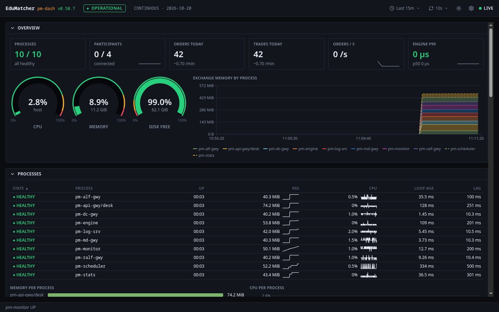
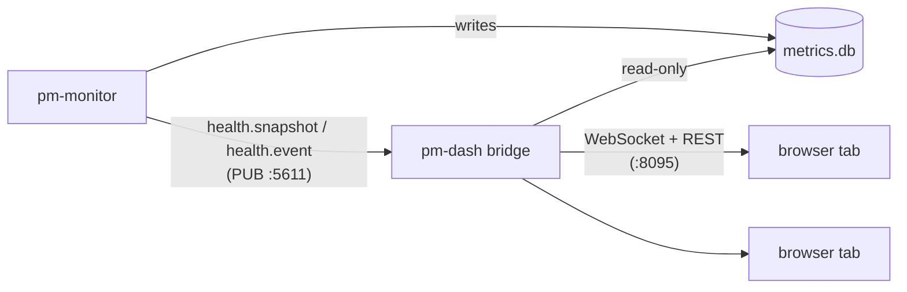
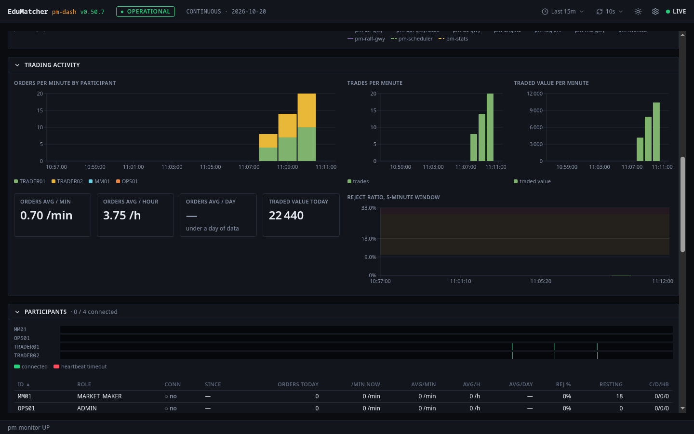
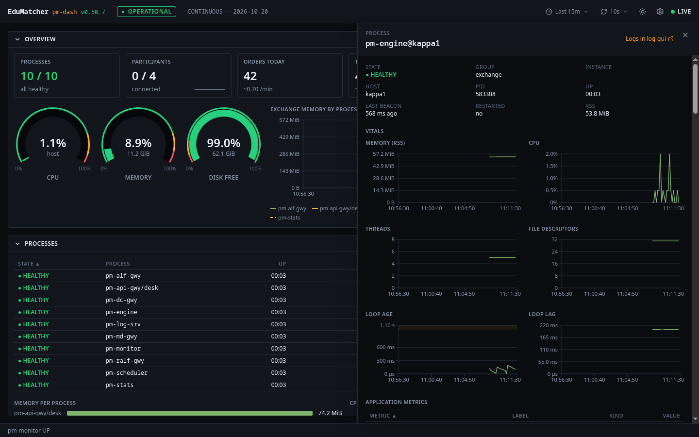

# Operator Dashboard (`pm-dash`)

!!! note "Learning objectives"
    After reading this page you will understand:

    - What the Operator Dashboard is for, and how it relates to `pm-monitor`
    - How to start it with the rest of the exchange, on its own, or for development
    - What each of the eight rows shows, and how to read its colours
    - How the time picker, the refresh setting and the session clock work
    - How to open a process, participant or order book in detail, and share that view
    - How to configure it, and what to do when it shows nothing

## Overview

The **Operator Dashboard** (`pm-dash`) is a browser view of the whole
exchange, in the style of a Grafana dashboard: every process's health,
trading activity, participants, order books, gateways and events, live and
over time. It answers the question an operator asks first, from across the
room:

> **Is the exchange OK — and if not, where?**

It shows what [`pm-monitor`](060-health-monitor.md) knows. `pm-monitor`
judges every process and the exchange, watches the thresholds and keeps the
history in `metrics.db`; the dashboard draws its live snapshot (once a
second) and that history. It judges nothing itself, so it never disagrees
with `pm-monitor-cli status`.



*The overview row says whether the exchange is OK at a glance: processes up,
participants connected, today's orders and trades, the order rate and engine
latency, the host's CPU, memory and disk, and the exchange's memory over the
picked time range.*

| Component | Role | Type |
|---|---|---|
| **`pm-monitor`** | Judges health, computes rates, evaluates thresholds, publishes `health.snapshot` and `health.event` on port `5611`, writes `metrics.db` | Long-running process |
| **`pm-dash` bridge** | One subscription to `pm-monitor`, read-only `metrics.db` access, the WebSocket to every open tab, the history API | Long-running process |
| **`pm-dash` web** | The dashboard in the browser | Browser application |



The dashboard is **strictly read-only**. It never writes `metrics.db`, sends
nothing to `pm-monitor` or any other process, and can be stopped at any time
without affecting the exchange. Everything it shows is also available from
[`pm-monitor-cli`](060-health-monitor.md#pm-monitor-cli).

## Running the dashboard

The dashboard needs `pm-monitor`, which every built-in `pm-opctl-cli`
profile except `micro` starts (see
[Starting `pm-monitor`](060-health-monitor.md#starting-pm-monitor)).

### Option 1 — The whole stack (recommended)

The dashboard starts with the exchange and the other web GUIs, and opens on
<http://localhost:8095>:

- **A released install** (no checkout, no toolchain): the one-command
  install in [Installation](../part-1-install-and-deploy/010-installation.md)
  starts it; `./edumatcher.sh urls` lists it as "Operator Dashboard".
- **From a source checkout**: `make up-all` in `deployment/docker/` (see
  [Container Deployment Walkthrough](../part-1-install-and-deploy/030-container-deployment-walkthrough.md)).

In both, the dashboard reaches `pm-monitor` over the container network and
reads `metrics.db` and the deployed configuration from the exchange's data
directory, mounted read-only. There is nothing to configure.

### Option 2 — This app alone, in a container

When the exchange runs on this machine outside a container:

```bash
cd web-apps/dash-gui
export EDUMATCHER_DATA_DIR=~/.local/share/edumatcher   # where metrics.db lives
make up          # builds the image and starts it on http://localhost:8095
make logs        # follow the bridge's output
make down
```

The data directory is mounted read-only. `pm-monitor` binds `127.0.0.1` by
default, which a container cannot reach; start the exchange with
`EDUMATCHER_GATEWAY_BIND_HOST=0.0.0.0` (or set `monitor.bind_address`), and
set `MONITOR_HOST` if `pm-monitor` runs on another machine.

### Option 3 — Local development

```bash
cd web-apps/dash-gui
make install
make dev         # bridge on 127.0.0.1:5195, Vite on http://localhost:8195
```

Against the containerised exchange, publish `pm-monitor`'s port and take the
bridge's environment from the stack:

```bash
cd deployment/docker
make up-all ZMQ=1                        # also publishes 5611 on the host
eval "$(make -s dev-env GUI=dash-gui)"
cd ../../web-apps/dash-gui && make dev
```

## Reading the dashboard

### The top bar

From left to right: the version, the **exchange status** (OPERATIONAL,
DEGRADED, IMPAIRED or DOWN — `pm-monitor`'s verdict, see
[How health is judged](060-health-monitor.md#how-health-is-judged)), the
**session indicator**, then the **time range**, the **refresh**
setting, the theme, the settings, and the connection: **LIVE** while the
browser is connected to the bridge.

The session indicator is the one every EduMatcher GUI shows, as in the
Trading GUI: the session phase as a coloured badge, the next phase and the
time left to it (`Continuous → Closing Auction in 03:08`), and the clock in
the exchange session timezone. Hover it for the trading date. The bridge
reads the phase from `pm-md-gwy` (CALF, `CALF_HOST`/`CALF_PORT`), not from
`pm-monitor`; the badge reads `Unknown` until `pm-md-gwy` has reported it,
and whenever it cannot be reached.

When the figures stop being live, a red banner says why and since when —
"pm-monitor down — data frozen at 11:42:05", or the bridge is unreachable
and the browser is reconnecting — and the panels dim. The last figures stay
on screen; they are not cleared. The footer always shows whether the bridge
receives `pm-monitor`'s snapshots.

### Time

- **The time range** (`Last 5m` to `Last 7d`) sets the window of every chart.
  It is in the address bar as `?from=now-1h`, so a link opens on the same
  window.
- **Live figures** — every tile, gauge and table — arrive once a second,
  whatever the time range says.
- **Refresh** (off, 10 s — the default — 30 s, 1 min, 5 min) is how often the
  charts ask for their history again. 10 s is the finest history there is.
- **Every time shown is on the exchange's session clock**
  (`locale.session_timezone`), not your browser's: an operator in another
  timezone sees the same times as the trading date and the logs.

Hovering a chart draws the same vertical line on every chart, so you can
line up a CPU spike with a burst of orders. Process state changes, threshold
breaches, session changes, halts and resumes are thin coloured markers on
every chart; hover one for what happened.

### Colours

Every colour is **`pm-monitor`'s verdict**: a tile, gauge or table cell turns
amber (WARN) or red (CRIT) when `pm-monitor` reports that rule in breach, and
the processes tile follows the exchange status. The coloured bands drawn on
gauges and charts are the rules themselves, as configured in
`monitor.thresholds`; hover a tile or gauge for its definition.

The two can differ for a moment, on purpose: `pm-monitor` raises a breach at
once but clears it only after three readings below the threshold, and judges
some rules only above a minimum (the reject ratio from 20 requests, heap
garbage from a minimum book size). A value inside a band with no colour is a
value `pm-monitor` does not consider a breach — yet. See
[Thresholds and events](060-health-monitor.md#thresholds-and-events).

Every state is also shown in words and a glyph (● HEALTHY, ◐ DEGRADED,
◆ HUNG, ✕ DEAD …), never by colour alone.

### Rates and their windows

An order or trade rate is always one of four, and each tile or column says
which: *now* (the last 60 seconds), *avg / min* (the last 60 minutes),
*avg / hour* (today's total over the hours the session has been open) and
*avg / day* (the last 7 trading days). They answer different questions, so
"0.70 /min" beside "3.78 /h" is not a contradiction: the last hour was
quieter than the day.

### The nine rows

Each row folds away with its title; the browser remembers which are folded.

| Row | What it shows |
|---|---|
| **Overview** | Processes up (and which are not), participants connected, orders and trades today, orders per second and engine p99 latency (order entry) with their last minute; the host's CPU, memory and free disk; the exchange's memory by process over the range |
| **Session schedule** | The same timetable as TapeDeck's Session view: this week's hours with bank holidays, today's phases with the current one lit and the exchange's time on the day, and the next bank holiday that closes the exchange or shortens its hours. Read from `pm-api-gwy` with the read-only key (`PM_DASH_API_KEY`); without one the row says the timetable is unavailable |
| **Engine latency** | How long the matching engine takes per message over the last minute: order p50 and p99 with the number of samples behind them, the p99 with garbage-collection time taken out, the p99 of every other message, the longest GC pause and the share of time in GC. Below, the order latency and the longest GC pause over the range. See [Reading engine latency](#reading-engine-latency) |
| **Processes** | Every process: state, uptime, memory and CPU with their recent trend, loop age and lag. Participant bots are listed after the exchange's own and never affect its status. Memory per process, and CPU per process over the range |
| **Trading activity** | Orders per minute by participant (the top eight and "other"), trades and traded value per minute, the order averages, the reject ratio as `pm-monitor` judges it, and today's rejects by reason — what the engine said no to (`ORDER_NOT_FOUND`, `MARKET_CLOSED`, `MM_MAX_SPREAD` …) |
| **Participants** | A lane per participant: when it was connected, with heartbeat timeouts marked. Then the table: role, connection, orders today and their rates, reject %, resting orders, connects / disconnects / heartbeat timeouts today. "avg/day" shows "—" until there is a full day of history |
| **Order books** | The number of books and their estimated memory; per symbol: resting and stop orders, price levels, memory, heap garbage, trades today, and whether it is halted |
| **Gateways & infrastructure** | Clients per gateway against its limit, API WebSocket sessions and dropped events, slow-client disconnects, log server intake, feed gaps, the data files' sizes, and the engine's internal diagnostics |
| **Event log** | Every health event, newest first, filterable by kind: connects and disconnects, state changes, threshold breaches, session changes, halts |

### Reading engine latency

The engine times **1 message in 16** and reports percentiles over the
**last minute**, at most 1024 timed messages. Three things keep the figures
honest:

- **Order entry is timed apart from everything else.** New orders, cancels,
  amends, quotes, combos and OCOs are *order latency*. Heartbeats, connects,
  queries and admin commands are *other messages*: a book snapshot of a deep
  book can take milliseconds, and mixed in it would make the order p99 look
  like matching is slow.
- **The p99 shows how many samples it stands on.** Below 100 samples a p99 is
  simply the slowest of them; the row header then says so. At a few orders a
  minute this is normal.
- **Garbage collection is timed separately.** Every collection is timed, not
  only the sampled messages, so *Longest GC pause* never misses a stall.
  *p99 without GC* is the order p99 with the collection time inside each
  message taken out: when it sits far below the order p99, the slow messages
  were slow because Python was collecting garbage, not because of matching.

The maximum is the slowest *timed* message, so it can miss outliers that
were not sampled; the longest GC pause and the process's loop lag cover the
worst stalls.



*Per-minute bars count a minute once it is over, so the current minute
appears at the next refresh after it closes.*

### Drawers: one process, participant or book

Click a row in the processes, participants or order books table (or select
it and press Enter) to open its **drawer** on the right:

- **A process**: its state and figures, its memory, CPU, threads, file
  descriptors, loop age and loop lag over the range, every application
  metric it reports (for the engine, those not per participant or symbol —
  those are in the participant and book drawers), its events, and **Logs in
  log-gui** — its log records in the [Log Operator Console](050-log-console.md).
- **A participant**: its connection and figures, its orders, rejects and
  fills per minute, its resting orders, and its connects and disconnects.
- **An order book**: its figures, trades and traded value per minute,
  resting orders, memory and heap garbage, its halts and resumes, and
  **Book in book-gui** — the book in the
  [Order Book Viewer](../../participant-guide/part-6-front-ends/030-order-book-gui.md).

Escape or the close button closes it; the dashboard stays live behind it.

Each drawer has its own address — `/process/<key>`, `/participant/<id>`,
`/book/<symbol>`, with the time range — so in an incident you can paste
the link to exactly what you are looking at, for example
`http://localhost:8095/process/pm-engine%40edumatcher?from=now-6h`.



### Settings

The gear icon holds the theme (dark or light), the font size (for a wall
display across the room), and whether a stat tile shows its level by
colouring the value or its whole background. All three are remembered per
browser.

## Configuration reference

The bridge is configured from its environment. In both container stacks
these are already set; you need them only for Option 2 or 3.

| Variable | Default | Meaning |
|---|---|---|
| `HOST` / `PORT` | `127.0.0.1` / `5195` | Bridge bind address (the container uses `0.0.0.0:8095`) |
| `MONITOR_HOST` | `127.0.0.1` | Where `pm-monitor`'s PUB socket is reachable (`monitor.host`) |
| `MONITOR_PUB_PORT` | `5611` | `monitor.pub_port` |
| `MONITOR_DOWN_AFTER_SEC` | `3` | No snapshot for this long and `pm-monitor` is shown down |
| `CALF_HOST` / `CALF_PORT` | `127.0.0.1` / `5570` | `pm-md-gwy`, for the session phase in the top bar |
| `API_GATEWAY_URL` | `http://127.0.0.1:8081` | `pm-api-gwy`'s dashboards instance, for the Session schedule row |
| `PM_DASH_API_KEY` | unset | The read-only API key (the credential with `gateway_id: null`); the stacks resolve it at start |
| `METRICS_DB_PATH` | `<data dir>/metrics.db` | `pm-monitor`'s history, opened read-only |
| `CONFIG_ARTIFACT_PATH` | `<data dir>/ref_data/engine_config.json` | The deployed configuration, for the threshold bands |
| `LOG_GUI_URL` / `BOOK_GUI_URL` | unset (`http://localhost:8091` / `:8094` in the stacks) | log-gui's and book-gui's addresses as your browser reaches them; set, the drawers link there |
| `CORS_ORIGIN` | `*` | Restrict when exposed beyond localhost |
| `MAX_WS_CLIENTS` | `200` | Browser tabs beyond this are refused |
| `LOG_SRV_HOST` / `LOG_SRV_PORT` | `127.0.0.1` / `5600` | The bridge's own logging to `pm-log-srv` (optional) |

In the container stacks, `DASH_GUI_PORT` in `.env` moves the dashboard off
8095, and `LOG_GUI_URL` / `BOOK_GUI_URL` there change the drawers' links —
needed when you open the GUIs from another machine.

## Security notes

- The dashboard has **no login**. It shows no credentials and changes
  nothing, but it does show the exchange's participants and activity.
- The stacks publish it on `127.0.0.1` only. Setting `BIND_ADDR=0.0.0.0`
  opens it — with every other GUI — to your network; do that only on a
  network you control, and set `CORS_ORIGIN` to the dashboard's own address.
- The bridge holds the read-only API key for the Session schedule row; it
  never sends it to the browser.
- `pm-monitor`'s ports are not published by the stacks; the dashboard
  reaches it over the container network. `ZMQ=1` (or `EM_ZMQ=1`) publishes
  the snapshot feed (5611) for tools on the host, never the beacon intake
  (5610), which would let anything report fake health.

## Troubleshooting

| Symptom | Likely cause | What to do |
|---|---|---|
| Banner "pm-monitor down" and nothing ever shown | `pm-monitor` not running, or not reachable at `MONITOR_HOST:MONITOR_PUB_PORT` | `pm-opctl-cli list`; `pm-monitor-cli status`; outside a container, open it with `EDUMATCHER_GATEWAY_BIND_HOST=0.0.0.0` |
| Banner "pm-monitor down" after it worked | `pm-monitor` stopped or hung | `pm-opctl-cli list`; restart it. The dashboard recovers by itself |
| Live figures, but every chart says "No data in this range" | The bridge cannot read `metrics.db`, or the exchange has only just started (the first history row is written after 10 s) | `curl localhost:8095/api/bridge/status` shows `metricsDb`; check `METRICS_DB_PATH` and the mount |
| Per-minute bars stay empty | The minute is not over yet, or refresh is off | Wait for the minute to close, or set refresh to 10 s |
| Session schedule row says "Timetable unavailable" | No read-only key, or `pm-api-gwy` not reachable at `API_GATEWAY_URL` | `curl localhost:8095/api/reference/schedule` shows the gateway's answer; set `PM_DASH_API_KEY` (the stacks do it for you) |
| Bands differ from `monitor.thresholds` | The bridge does not see the deployed configuration | Check `CONFIG_ARTIFACT_PATH`; `curl localhost:8095/api/thresholds` says `"source": "artifact"` when it does |
| Changed `monitor.thresholds`, colours did not follow | `pm-monitor` reads its thresholds at start | Restart `pm-monitor`. The bands show the new values within one refresh interval |
| No "Logs in log-gui" / "Book in book-gui" link | `LOG_GUI_URL` / `BOOK_GUI_URL` unset or not `http(s)://…` | Set them as your browser reaches those GUIs |
| A pasted link shows "No process … in the latest snapshot" | That process, participant or book is not in this exchange (another host name, a stopped bot) | Open the dashboard and pick it from its table |
| `pm-monitor` DEGRADED, a `metrics_store_errors` breach | `pm-monitor` cannot write its history (read-only or full data directory) | See [Health Monitoring](060-health-monitor.md#troubleshooting); the live figures are unaffected |
| Container cannot read `metrics.db` on Linux | An SELinux-enforcing host and a mount without `:z` | The supplied compose files carry `:ro,z`; keep it in your own |

## Where to go next

- [Health Monitoring (`pm-monitor`)](060-health-monitor.md) — the health
  states, thresholds, rates and `metrics.db` the dashboard draws
- [Log Operator Console (`pm-log-ui`)](050-log-console.md) — what a process logged
- [Order Book Viewer (`pm-book`)](../../participant-guide/part-6-front-ends/030-order-book-gui.md) — one book in full depth
- [Running the Exchange](../part-3-run/010-running-the-exchange.md) — `pm-opctl-cli` profiles
