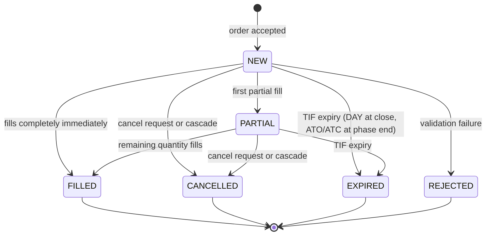

# Order Types

!!! note "Learning objectives"
    After reading this page you will understand:

    - What each of the eight order types does and when to use it
    - The difference between aggressive (market/IOC/FOK) and passive (limit/iceberg) orders
    - How stop-family orders trigger and what happens after trigger
    - How time-in-force controls order lifetime across session phases
    - How combo and OCO orders manage multi-leg strategy risk

    **Prerequisite**: [The Order Book](../part-1-trading-basics/020-the-order-book.md) — you should understand
    price-time priority before diving into order type mechanics.

!!! tip "Key point: priority is not keyed on the order's timestamp"
    Queue priority ("time priority" in price-time priority) is determined by
    the engine-assigned **`arrival_seq`**, not by the client-supplied
    `timestamp` field sent with the order. See [Priority Rules](#priority-rules)
    in the Order Amendment section below for the full explanation.

EduMatcher supports **eight order types** plus two multi-leg constructs (COMBO and
OCO), from the simplest market order to a COMBO that trades a strategy across
several symbols all-or-none and an OCO that links two exits on one symbol.


## Contents

| Order type                      | Category    | Key characteristic                                    |
|---------------------------------|-------------|-------------------------------------------------------|
| [MARKET](#market)               | Aggressive  | Immediate execution at best price; no price guarantee |
| [LIMIT](#limit)                 | Passive     | Rests on book at specified price or better            |
| [STOP](#stop-stop-market)       | Conditional | Dormant until trigger; then becomes MARKET            |
| [STOP_LIMIT](#stop_limit)       | Conditional | Dormant until trigger; then becomes LIMIT             |
| [FOK](#fok-fill-or-kill)        | Aggressive  | All-or-nothing; fill completely or cancel             |
| [IOC](#ioc-immediate-or-cancel) | Aggressive  | Fill what you can immediately; cancel rest            |
| [ICEBERG](#iceberg)             | Passive     | Large order with hidden reserve; visible peak only    |
| [TRAILING_STOP](#trailing_stop) | Conditional | Dynamic stop that follows price by fixed offset       |
| [COMBO](#combo)                 | Multi-leg   | Multiple linked orders across symbols                 |
| [OCO](#oco-one-cancels-other)   | Multi-leg   | Two orders where fill/cancel of one cancels the other |

### Choosing an order type

Pick the type from what you are trying to achieve, then check the trade-off
you are accepting. Each type has its own section below with worked examples
and a *How traders use it* subsection.

| I want to…                                                   | Use                                   | What I give up                                         |
|--------------------------------------------------------------|---------------------------------------|--------------------------------------------------------|
| Get in or out *now*, whatever the price                      | [MARKET](#market)                     | Price certainty (slippage)                             |
| Get in or out now, but never worse than a price              | [IOC](#ioc-immediate-or-cancel)       | Guaranteed completion — the rest is cancelled          |
| Trade a whole size or nothing                                | [FOK](#fok-fill-or-kill)              | Partial fills                                          |
| Name my price and wait                                       | [LIMIT](#limit)                       | Execution certainty and queue position                 |
| Work a large size without showing it                         | [ICEBERG](#iceberg)                   | Speed; the replenished peak joins the back of the queue |
| Exit automatically if the market falls (or rises) to a level | [STOP](#stop-stop-market)             | Price certainty after the trigger                      |
| Same, but with a worst acceptable price                      | [STOP_LIMIT](#stop_limit)             | Execution certainty after the trigger                  |
| Protect a profit that keeps growing                          | [TRAILING_STOP](#trailing_stop)       | A reversal of `TRAIL` size is needed before it acts    |
| Trade a relationship between instruments                     | [COMBO](#combo)                       | Each leg must be priced; fills only complete together  |
| Have exactly one of two exits happen                         | [OCO](#oco-one-cancels-other)         | Both legs share one symbol and one quantity            |

### Fields each type takes

The same field rule is applied by every entry point (`pm-alf-console`,
`pm-alf-gwy`, BALF, REST) and again by the engine, so a mistake gets the
same reject code however it arrives. A required field that is absent is
rejected with `MISSING_FIELD`; a field the type does not use is *rejected*
with `UNSUPPORTED_FIELD`, never silently dropped.

| Type            | Required              | Optional | Notes                                                      |
|-----------------|-----------------------|----------|------------------------------------------------------------|
| `MARKET`        | —                     | —        | Any `PRICE=` / `STOP=` is refused                          |
| `LIMIT`         | `PRICE`               | —        |                                                            |
| `STOP`          | `STOP`                | —        | `PRICE=` is refused — use `STOP_LIMIT` for a limit         |
| `STOP_LIMIT`    | `STOP`, `PRICE`       | —        |                                                            |
| `FOK`           | `PRICE`               | —        |                                                            |
| `IOC`           | `PRICE`               | —        | A priceless IOC is not supported; use `MARKET`             |
| `ICEBERG`       | `PRICE`, `VISIBLE`    | —        | `VISIBLE` must be smaller than `QTY`                       |
| `TRAILING_STOP` | `TRAIL`               | `STOP`   | Without `STOP=` the engine starts it from the last trade   |

`TIF=` (default `DAY`) is accepted on every type; see
[Time-in-Force](#time-in-force-tif). `SMP=` and `TAG=` are likewise common to
all single orders.

### Behaviour by session phase

| Type                                  | Continuous trading        | Auction / pre-open (no matching)                             | Symbol halted                                         |
|---------------------------------------|---------------------------|--------------------------------------------------------------|-------------------------------------------------------|
| `MARKET`, `IOC`, `FOK`                | Match on arrival          | **Rejected** `SESSION_NOT_PERMITTED` — they cannot rest      | **Rejected** `INSTRUMENT_HALTED` / `CIRCUIT_BREAKER_ACTIVE` |
| `LIMIT`, `ICEBERG`                    | Match, then rest          | Rest and are collected for the uncross (an iceberg's hidden quantity takes part, ranked behind its visible slice) | Rest without matching |
| `STOP`, `STOP_LIMIT`, `TRAILING_STOP` | Armed, or fired at once if already breached | Stored; evaluated after the uncross print | Stored |

Everything is rejected with `MARKET_CLOSED` when the session is `CLOSED`.

### Single-order lifecycle

Every order follows this state model from submission to final disposition:




## MARKET

[Back to Contents](#contents)

Executes immediately at the best available price.

### Background

Market orders are the oldest order instruction in listed markets. Before
electronic books, brokers executed "at market" instructions on exchange
floors by taking the best immediately available quote.

In modern matching engines, MARKET remains the purest urgency-driven order:
it prioritizes immediacy over price certainty.

### Motivation

Use MARKET when:

- Execution speed is more important than exact price.
- You are entering/exiting quickly in a liquid symbol.
- You are reducing directional risk and need certainty of fill.

### How it behaves

- Sweeps the opposite side of the book (consumes resting orders from best
  price outward) as far as needed
- Partial fills are accepted — the unfilled remainder is **discarded** (not rested)
- Takes no `PRICE=`; supplying one is rejected (`UNSUPPORTED_FIELD`)
- Trades at each *resting* order's price, so a sweep produces one fill per
  price level touched and an average price worse than the best quote

The discarded remainder is not silently dropped. The order is *accepted*, and
what could not be filled arrives as a cancellation carrying
`CANCEL_REASON=INSUFFICIENT_LIQUIDITY` (`cancel_reason` on REST). A `MARKET`
order into an empty book is therefore an accepted order that immediately
cancels in full — **not** a rejection, and worth distinguishing when you write
a client:

!!! note "Not shown in `pm-alf-console`"
    `pm-alf-console`'s terminal display prints `CANCELLED <order-id>` without
    the reason, even though the underlying message carries it. To see
    `CANCEL_REASON` for yourself, connect over the real ALF TCP gateway
    (`pm-alf-gwy`) with a raw client, or use the REST API's `cancel_reason`
    field — see [ALF TCP Gateway — Unsolicited cancels](../../operator-guide/part-5-gateways/010-alf-gateway.md#unsolicited-cancels).

| Situation | What you receive |
|---|---|
| Book runs out during continuous trading | `ACK ACCEPTED=TRUE`, any `FILL`s, then `CANCELLED` with `INSUFFICIENT_LIQUIDITY` |
| Symbol halted, or the session is not matching | `ACK ACCEPTED=FALSE` with `INSTRUMENT_HALTED`, `CIRCUIT_BREAKER_ACTIVE` or `SESSION_NOT_PERMITTED` — rejected before the book is touched |

`IOC` behaves identically for its own remainder. `FOK` differs: it is
all-or-nothing, so an unfillable `FOK` is *rejected* with
`INSUFFICIENT_LIQUIDITY` rather than accepted and cancelled.

### Gateway Syntax

```
NEW|SYM=AAPL|SIDE=BUY|TYPE=MARKET|QTY=100
```

### Example — a market buy walks the book

Asks: `50 @ 150.10`, `30 @ 150.20`, `100 @ 150.50`. You send the order above.

| Fill | Price  | Qty |
|------|--------|-----|
| 1    | 150.10 | 50  |
| 2    | 150.20 | 30  |
| 3    | 150.50 | 20  |

Average price = (50·150.10 + 30·150.20 + 20·150.50) / 100 = **150.21**, i.e.
11 cents (the **slippage**) worse than the 150.10 you saw when you clicked.
Had the book held only 80 shares, you would receive three fills for 80 and a
`CANCELLED` for the other 20.

**Educational note**: Market orders **guarantee execution but not price**. In a
thin book (few resting orders, so liquidity is low), a large market order can
move the price significantly — this is called **slippage** (the difference
between expected execution price and actual average fill price).

### How traders use it

- **Emergency exits and hedges.** When the position is the problem (a news
  shock, a margin call, a hedge that must be on *before* the next print), the
  cost of waiting exceeds the cost of slippage.
- **Small size in a deep book.** If your quantity is well inside the top
  level, a market order costs one half-spread and nothing else.
- **Don't** send large market orders into a thin book or just after an
  announcement, when the spread is widest. Prefer an [IOC](#ioc-immediate-or-cancel)
  with a limit a few ticks through the touch — a *protected market order* that
  takes what is there but refuses a runaway price.
- Market orders never rest, so they are the one type you cannot send during an
  auction call phase; use a marketable `LIMIT` there.


## LIMIT

[Back to Contents](#contents)

Executes at the specified price or better; any unfilled portion **rests on the
book** (remains posted as a passive order, waiting for a future counterparty
to trade against it).

### Background

LIMIT orders are the foundation of central limit order books (CLOBs). They
define displayed liquidity and form the visible bid/ask ladder used by all
other participants to price risk and route flow.

### Motivation

Use LIMIT when:

- Price control is more important than immediate execution.
- You want to provide liquidity and potentially earn spread capture.
- You are comfortable waiting in queue under price-time priority.

### How it behaves

- Buy LIMIT: fills at `price` or lower
- Sell LIMIT: fills at `price` or higher
- Becomes a resting order if not immediately matchable
- A *marketable* limit (one that crosses the book) trades first, at the
  resting orders' prices, then rests whatever is left at its own limit
- Subject to the symbol's price collar and tick size: a price too far from
  the reference, or off the tick grid, is rejected (`COLLAR_BREACH`,
  `TICK_VIOLATION`)
- Can be [amended](#order-amendment-amend) in place (the only type besides ICEBERG)

### Gateway Syntax

```
NEW|SYM=AAPL|SIDE=BUY|TYPE=LIMIT|QTY=100|PRICE=150.50
NEW|SYM=AAPL|SIDE=BUY|TYPE=LIMIT|QTY=100|PRICE=150.50|TIF=GTC
```

### Examples

**Passive.** Best bid 150.40, best ask 150.60. `BUY LIMIT 100 @ 150.50` does
not cross, so it rests *inside* the spread as the new best bid. Everyone now
sees 150.50 as the price to hit.

**Marketable.** Asks are `40 @ 150.60` and `100 @ 150.70`. `BUY LIMIT 100 @ 150.65`
buys 40 @ 150.60 (price improvement over your limit), cannot touch 150.70, and
rests the remaining 60 as a bid at 150.65.

**Educational note**: Limit orders **guarantee price but not execution**. In a
thin book (few resting orders, so liquidity is low), a large limit order may
not fill immediately or at all, especially if the limit price is far from the
current market price.

### How traders use it

- **Providing liquidity / capturing the spread.** Resting a bid and an offer
  around the mid earns the spread when both fill; this is what market makers
  do (see [Market Making](../part-3-market-making/020-market-making.md)).
- **Queue position matters.** At one price, earlier `arrival_seq` fills
  first. Joining the best bid early beats improving the price by one tick
  late — but reducing quantity keeps your place, while a price change or a
  quantity increase sends you to the back (see [Amendment](#order-amendment-amend)).
- **Price discipline.** A buy limit under the market is a patient entry; a
  sell limit above the market is a take-profit target. With `TIF=GTC` it
  works across days until you cancel it.
- **Improving vs joining.** Stepping one tick ahead of the best bid buys
  priority at the cost of a tick; sitting at the touch costs nothing but time.


## STOP (Stop-Market)

[Back to Contents](#contents)

A dormant order that **activates** when the market touches the stop price, then executes as a MARKET order.

### Background

STOP orders became common as risk-management tools for both discretionary
traders and portfolio overlays. They were designed to automate exits without
requiring constant manual monitoring.

### Motivation

Use STOP when:

- You need a hard, automated risk cutoff (stop-loss).
- You want to enter on momentum confirmation (breakout stop-entry).
- Guaranteed execution after trigger matters more than trigger-to-fill price precision.

- `STOP` price is the trigger, not the execution price
- Buy STOP: triggers when last trade price ≥ stop price (used to enter long on breakout)
- Sell STOP: triggers when last trade price $\leq$ stop price (used to limit downside loss)

### Gateway Syntax

```
NEW|SYM=AAPL|SIDE=SELL|TYPE=STOP|QTY=100|STOP=148.00
```

Takes `STOP=` only; `PRICE=` is rejected. While dormant the order is in no
price level and appears in no depth, and it can be cancelled but not amended.
Full trigger rules are in [Stop Trigger Logic](#stop-trigger-logic).

**Educational note**: Once triggered, a STOP becomes a MARKET order — execution price
is not guaranteed, especially in fast markets.

### Example — protective sell stop

You bought 100 AAPL at 150.00 and will accept a 2-dollar loss. Last trade is
150.30.

```
NEW|SYM=AAPL|SIDE=SELL|TYPE=STOP|QTY=100|STOP=148.00|TIF=GTC
```

Nothing happens while trades print above 148.00. When a trade prints at
148.00 or lower, the order becomes `MARKET SELL 100` and hits the best bids.
If bids are `60 @ 147.90` and `200 @ 147.50`, you sell 60 @ 147.90 and 40 @
147.50 — an average of 147.74, below the 148.00 you chose.

If you place a sell stop at or above the last trade price (say `STOP=151.00`
with the last trade at 150.30) it is **already breached and fires
immediately** — a stop is not a resting limit order at that price.

### How traders use it

- **Stop-loss.** The standard use: cap the loss on a long (sell stop below
  the market) or a short (buy stop above it) without watching the screen.
- **Breakout entry.** A buy stop above resistance enters only if the market
  proves it can trade there; see [Why does a BUY STOP trigger at a price
  *higher* than the stop?](#stop-trigger-logic).
- **Know the failure mode.** A stop is a *trigger*, not a price. In a gap or
  a thin book it fills far through the stop level, and a cluster of stops at
  one level can push the price into the next cluster (a
  [cascade](#trigger-cascades)). Where that risk is unacceptable, use
  [STOP_LIMIT](#stop_limit); where the level should follow a rising market,
  use [TRAILING_STOP](#trailing_stop).


## STOP_LIMIT

[Back to Contents](#contents)

Like STOP, but once triggered converts to a **LIMIT order** at a specified limit price.

### Background

STOP_LIMIT was introduced to address a classic STOP weakness: in fast or thin
markets, trigger-to-fill slippage can be large. By adding a limit cap, traders
can constrain worst-case execution price after trigger.

### Motivation

Use STOP_LIMIT when:

- You need trigger automation but still require explicit price protection.
- You can tolerate non-fill risk after trigger.
- You want to avoid executing through temporary price spikes/gaps.

- Provides price protection after trigger, but may not fill if the market moves past the limit
- Requires both `STOP=` (trigger) and `PRICE=` (limit after trigger)


### Gateway Syntax

```
NEW|SYM=AAPL|SIDE=SELL|TYPE=STOP_LIMIT|QTY=100|STOP=148.00|PRICE=147.50
```

**Educational note**: The gap between stop price and limit price is the "insurance premium"
against market impact. If the market falls through 147.50 before the order fills, it remains
unexecuted as a resting limit.

### Example — gap through the limit

Last trade 150.00. You hold 100 AAPL and place the sell above, `STOP=148.00`,
`PRICE=147.50`. Overnight news moves the market and the next trade prints at
146.00 against bids that are all at 146.00 or lower.

- Triggered: 146.00 ≤ 148.00, so the order becomes `LIMIT SELL 100 @ 147.50`.
- No bid is at 147.50 or higher, so nothing fills. The order **rests as the
  best offer at 147.50**, above the market, while the price keeps falling.

A plain STOP would have sold at about 146.00 and left you flat; the
STOP_LIMIT protected the price and left you still long, in a falling market.
If the market later rallies back to 147.50 the resting limit fills there.

### How traders use it

- **Controlled exits in thin or gapping markets.** When a few ticks of
  slippage would defeat the point of the exit, the limit caps it.
- **Sizing the gap.** A tight gap (`STOP=148.00`, `PRICE=147.95`) is nearly a
  stop-market that may miss; a wide gap behaves like a STOP in orderly
  markets and only bites in a gap. Choose it from how far the instrument
  typically moves between prints.
- **Entries.** A buy stop-limit above resistance enters on the breakout but
  refuses to chase a spike beyond the limit.
- **Remember the leftover.** After the trigger it is an ordinary resting
  limit that must be watched, amended or cancelled. It stays at the back of
  the queue at that price (it receives a new queue position when it rests).


## FOK (Fill-or-Kill)

[Back to Contents](#contents)

Must be **entirely filled immediately** or the whole order is cancelled.

### Background

FOK comes from block-trading workflows where partial execution can break a
strategy's economics. It is common in institutional routing logic and
cross-venue execution algos that need all-or-nothing completion.

### Motivation

Use FOK when:

- Partial fills are unacceptable.
- You need immediate certainty of complete size.
- The order is one leg of a tightly coupled strategy and partial execution introduces exposure.

- Checks total available quantity at the given price before executing
- The pre-check includes hidden iceberg reserve quantity (not just the
  displayed peak) and **excludes** same-gateway resting liquidity that
  self-match prevention would skip — so a FOK can reject even when the
  book's *displayed* total looks sufficient, if most of it belongs to your
  own gateway
- If `available_qty < order_qty` → rejected entirely (no partial fills ever)
- If sufficient → executes in full immediately


### Gateway Syntax

```
NEW|SYM=AAPL|SIDE=BUY|TYPE=FOK|QTY=100|PRICE=150.00
```

**Educational note**: FOK is used when partial fills are unacceptable — e.g. algorithmic
strategies needing an exact block to execute a multi-leg trade atomically.

How a failed FOK is reported depends on why it failed:

| Cause                                                        | Result                                                      |
|--------------------------------------------------------------|-------------------------------------------------------------|
| Not enough quantity at or better than `PRICE`                | One `ACK ACCEPTED=FALSE`, `INSUFFICIENT_LIQUIDITY`; nothing traded |
| The shortfall is only because your own orders are in the way, and `SMP=CANCEL_AGGRESSOR` or `CANCEL_BOTH` | Accepted, then `CANCELLED` with `SELF_MATCH_PREVENTED` |
| Auction call phase                                           | Rejected `SESSION_NOT_PERMITTED`                            |

With `SMP=CANCEL_RESTING` or `CANCEL_BOTH` the same-gateway resting orders in
the FOK's path are cancelled even when the FOK itself is then rejected for
lack of liquidity — a FOK is not a free way to test a book you share with
yourself.

### Examples

Asks: `60 @ 150.00`, `50 @ 150.10`, `100 @ 150.30`.

- `BUY FOK 100 @ 150.10` — only 110 are available at or below 150.10, so the
  order fills as 60 @ 150.00 + 40 @ 150.10, in one go. **FILLED.**
- `BUY FOK 200 @ 150.10` — only 110 available. **Rejected**, no trade; the
  book is untouched.
- `BUY FOK 100 @ 150.00` — only 60 available at that price. **Rejected**,
  although more is offered one tick higher; widen `PRICE=` to include it.

### How traders use it

- **Atomic block trades.** If 10,000 shares are needed for a hedge to work,
  eight thousand is not "most of the trade", it is a position you didn't
  want.
- **Strict liquidity test.** A FOK either gets the whole size at your price
  or tells you immediately, with no market footprint, that it isn't there —
  unlike an IOC, which takes whatever it can and signals your interest.
- **A leg that must not be partial.** When one leg's fill triggers another
  trade, partial execution leaves unhedged exposure.
- **Price it deliberately.** A FOK limited to the best ask only succeeds if
  the top level alone covers you. Setting `PRICE=` a few ticks through the
  touch lets it consume depth while still capping the price you will pay.


## ICEBERG

[Back to Contents](#contents)

A large LIMIT order that hides most of its size, showing only a `visible_qty` "peak"
at any one time.

### Background

ICEBERG orders were designed for institutional execution where displaying full
size can move the market against the trader. The displayed "tip" reveals only
a small slice while preserving the same total parent quantity.

### Motivation

Use ICEBERG when:

- You need to execute large notional size with reduced information leakage.
- You want to rest passively without broadcasting your full intent.
- You accept slower completion in exchange for lower signaling risk.

- Only `VISIBLE=` quantity is published to the order book
- Once the visible peak is fully consumed, a **new peak** is replenished from the hidden quantity
- Each new peak gets a **new `arrival_seq`** → goes to the back of the queue at
  that price level (because the book uses price-time priority: among orders at
  the same price, the order with the lowest `arrival_seq` — i.e. the one the
  engine admitted first — gets filled first; a fresh `arrival_seq` means this
  peak waits behind all other orders already resting at that price)
- The total hidden size is **never visible** to other market participants
- An **incoming** iceberg that crosses the book trades its **full** quantity
  immediately, like a LIMIT — one execution per resting counterparty, not
  one per peak. Only the remainder that rests is hidden: it rests with a full
  peak of `min(VISIBLE, remaining)`

!!! info "Priority is keyed on `arrival_seq`, not the order's `timestamp`"
    `arrival_seq` is a monotonic counter the **engine** assigns when it
    admits an order into the book — it is not the client-supplied
    `timestamp` field on the order. See [Priority Rules](#priority-rules)
    below and [Order Amendment — AMEND](../../protocols-and-clients/part-2-specifications/010-alf.md#priority-rules)
    for the full explanation of why this distinction matters.


### Gateway Syntax

```
NEW|SYM=AAPL|SIDE=BUY|TYPE=ICEBERG|QTY=1000|PRICE=150.00|VISIBLE=100
```

**Educational note**: This is how large institutional orders are worked into the market
without telegraphing their full size. Watch the book viewer as the iceberg refills — the
qty at that price level resets to 100 after each 100-lot fill. The order ID stays the
same, but its `arrival_seq` is refreshed (new `arrival_seq` = new queue position — the
order's original client `timestamp` does not change).

`VISIBLE` must be smaller than `QTY` (an iceberg showing everything is just a
LIMIT) and both `PRICE=` and `VISIBLE=` are required.

### Example — working 1,000 shares with a 100-share peak

Bids: `300 @ 150.00` (other traders, ahead of you in the queue).

```
NEW|SYM=AAPL|SIDE=BUY|TYPE=ICEBERG|QTY=1000|PRICE=150.00|VISIBLE=100
```

1. **Rests with a 100 peak.** The book shows `400 @ 150.00` (300 + your 100).
   The other 900 are known only to the engine.
2. **Sellers arrive.** A `SELL 350 @ 150.00` fills the 300 ahead of you, then
   your 50 of the peak. Your peak now has 50 left showing.
3. **Peak exhausted.** Meanwhile another trader has bid 70 @ 150.00. A
   `SELL 50` takes your last 50. The peak is replenished to 100 shown, **at
   the back of the queue** — behind that 70 — and the book now shows
   `170 @ 150.00`, with 900 of your 1,000 still to trade.
4. Repeat until all 1,000 have traded. `FILL` messages report each execution
   against the same order ID.

If the same order had instead arrived while 150 shares were offered at
150.00, it would first trade those 150 in full — as any limit order does —
and rest only the remaining 850, behind a fresh 100 peak.

An iceberg can be [amended](#order-amendment-amend). A price change or a
quantity increase refills the peak and loses priority; a quantity decrease
keeps priority and can only shrink the current peak.

### How traders use it

- **Reducing information leakage.** A visible 1,000-share bid invites others
  to trade ahead of you or to lean on the price. A 100-share peak looks like
  ordinary flow.
- **Choosing the peak.** Too small and your queue position resets constantly
  (each refill goes to the back) and a pattern of identical 100-lot refills
  reveals the iceberg; too large and you lose the point. Peaks comparable to
  the typical visible size at the level blend in best.
- **Cost of hiding.** You trade slower than a displayed order of the same size
  would: the hidden part has lowest priority at the price, and other
  participants' displayed orders get filled first.
- **In auctions** the hidden quantity counts toward the uncross, so an
  iceberg is not penalised in size terms for being in an opening or closing
  call.


## COMBO

[Back to Contents](#contents)

A **multi-leg order** that bundles two or more child orders across different
symbols into a single atomic instruction. The child orders are linked: they
are submitted, tracked, and cancelled as a group.

### Background

COMBO orders are the exchange-native answer to legging risk in spread,
pairs, and relative-value strategies. Instead of managing legs manually,
the matching system keeps lifecycle and cancellation coupling explicit.

### Motivation

Use COMBO when:

- Strategy PnL depends on a relationship between instruments, not one symbol.
- You want coordinated child lifecycle and automatic cascade-cancel.
- You need operational safety against partial strategy completion.

- Each leg is posted to its own symbol's book as an ordinary order — a
  `LIMIT` unless `LEG<i>.TYPE=` says otherwise (see below)
- 2 to 10 legs, each on a **different** symbol
- All legs are tracked together under a parent combo ID
- If any leg is cancelled or expires, all remaining legs are automatically
  **cascade-cancelled** (unfilled quantities only — fills already executed
  are not reversed)
- The combo is considered MATCHED only when **all** legs are fully filled


**Educational note**: COMBO is not a synthetic construct built on top of regular orders — it is a first-class order type with native engine support for multi-leg lifecycle management and cascade cancellation.

### Gateway Syntax

```
NEW|TYPE=COMBO|COMBO_ID=PAIR-001|COMBO_TYPE=AON|TIF=GTC|LEG_COUNT=2|LEG0.SYM=MSFT|LEG0.SIDE=BUY|LEG0.QTY=100|LEG0.PRICE=415.00|LEG1.SYM=AAPL|LEG1.SIDE=SELL|LEG1.QTY=100|LEG1.PRICE=210.00
```

| Field            | Meaning                                                          |
|------------------|------------------------------------------------------------------|
| `TYPE=COMBO`     | Identifies this as a multi-leg order                             |
| `COMBO_ID`       | Your human-readable tracking label                               |
| `COMBO_TYPE=AON` | All-or-none: combo succeeds only when every leg fills completely |
| `LEG_COUNT`      | Number of legs (2–10)                                            |
| `LEG<i>.SYM`     | Symbol for leg *i*                                               |
| `LEG<i>.SIDE`    | BUY or SELL for leg *i*                                          |
| `LEG<i>.QTY`     | Quantity for leg *i*                                             |
| `LEG<i>.TYPE`    | Optional; defaults to `LIMIT`. One of `LIMIT`, `MARKET`, `STOP`, `STOP_LIMIT`, `FOK`, `IOC` |
| `LEG<i>.PRICE`   | Limit price for leg *i* (required for `LIMIT`, `FOK`, `IOC`, `STOP_LIMIT`) |
| `LEG<i>.STOP`    | Trigger price for a `STOP` / `STOP_LIMIT` leg                    |

`ICEBERG` and `TRAILING_STOP` cannot be combo legs (a leg has no `VISIBLE` or
`TRAIL`); the combo is rejected with `INVALID_VALUE`. A combo's legs are
collared like ordinary orders, and the whole combo is rejected if two legs
share a symbol.

**All-or-none in practice.** Before posting any leg the engine checks that
*every* leg could fill in full. If one is short and nothing would trade right
now, all the legs rest as pending interest; if one is short but another leg
could already trade, the combo is rejected (`INSUFFICIENT_LIQUIDITY`) with
nothing posted, so you are never left holding half the structure.

**Educational note**: The `COMBO_TYPE` field is reserved for future expansion. Currently only `AON` (All-Or-Nothing) is supported, meaning the combo is successful only if every leg fills in full. In the future, we may add `ANY` (combo succeeds if at least one leg fills) or `MIN` (combo succeeds if a minimum number of legs fill).

### Combo lifecycle

```
                              REJECTED
                                 ▲
                            (validation)
PENDING ──────► PARTIALLY_MATCHED ──────► MATCHED
   │                  │
   │                  ▼
   └──────────────► FAILED  (cascade-cancel: a child order cancelled or expired)

PENDING or PARTIALLY_MATCHED ──► CANCELLED  (explicit CANCEL|COMBO_ID=)
```

### Cancelling a combo

```
CANCEL|COMBO_ID=PAIR-001
```

Cancels all unfilled legs. Fills already executed are irrevocable.

**Educational note**: Combos enable relative-value strategies (pairs trades,
hedged entries, statistical arbitrage) where the profit depends on the
*relationship* between instruments, not on any single instrument's direction.
Without combos, submitting legs separately exposes you to **leg risk** — one
side fills while the other does not, leaving you with unintended directional
exposure. See the [Combo Orders](030-combo-and-oco-orders.md) page for full details, examples,
and the implied orders mechanism.

### Example — a pairs trade

You think MSFT is rich relative to AAPL. You want to sell 100 MSFT at 415.00
and buy 200 AAPL at 210.00, and you want both or neither:

```
NEW|TYPE=COMBO|COMBO_ID=RV-1|COMBO_TYPE=AON|TIF=DAY|LEG_COUNT=2|LEG0.SYM=MSFT|LEG0.SIDE=SELL|LEG0.QTY=100|LEG0.PRICE=415.00|LEG1.SYM=AAPL|LEG1.SIDE=BUY|LEG1.QTY=200|LEG1.PRICE=210.00
```

Submitted separately, a MSFT fill with no AAPL fill leaves you short one
stock, outright, which is the risk you wanted to avoid. As a combo, the engine
first checks that both legs could fill in full; if they can, both trade at
once. If not, both legs rest. Either way, if one leg is cancelled or expires
the other is cascade-cancelled, and the combo is `MATCHED` only when both
have filled.

### How traders use it

- **Pairs / relative value.** Profit comes from the spread between two names
  converging, not from either name's direction.
- **Hedged entries.** Buy the stock and sell the index or a related future in
  the same instruction, so you are never naked.
- **Calendar spreads.** Buy one expiry and sell another at a target
  difference.
- **Baskets.** Up to ten legs build a small basket in one order.
- **Know the limits.** When the legs cannot all fill at once they rest as
  separate orders in their own books, and one can trade before the other
  (status `PARTIALLY_MATCHED`). Price each leg so that the relationship is
  still worth having if only that leg fills for a while, and cancel the
  combo (`CANCEL|COMBO_ID=`) to withdraw the unfilled legs.


## Time-in-Force (TIF)

[Back to Contents](#contents)

**TIF** (Time-in-Force) is not an order type; it is a set of instructions that specify how long an order remains active before it is executed or expires.

Time-in-force controls how long an order remains active before the engine
automatically expires or cancels it.

### Background

TIF instructions standardize order lifetime semantics across venues. They let
participants express not only *how* to trade (order type) but *for how long*
that instruction is valid under changing session states.

### Motivation

Use TIF to align execution intent with horizon:

- `DAY` for session-local participation.
- `GTC` for persistence across restarts/sessions.
- `ATO`/`ATC` for auction-specific participation windows.
- `FOK` order type when immediacy and completeness must be coupled (note: `FOK` is an order type, not a `TIF=` value).

| Value | Meaning |
|-------|----------|
| `DAY` (default) | Valid for the current trading session only. **Not** discarded at engine shutdown — it is persisted (alongside GTC orders) and restored on the next startup, dropped there only if the business day has since moved on. True expiry happens when the session transitions to `CLOSED`. |
| `GTC` | Good-Till-Cancelled. Persisted to `data/gtc_orders.json` at shutdown and reloaded next session. Survives across trading days. |
| `ATO` | At-The-Open. Only accepted during the `OPENING_AUCTION` phase. Automatically expired when the opening auction ends (transition to CONTINUOUS). |
| `ATC` | At-The-Close. Only accepted during the `CLOSING_AUCTION` phase. Automatically expired when the closing auction ends (transition to CLOSED). |

!!! note "FOK is an order type, not a TIF"
    `TIF=FOK` is **not valid** and will be rejected by the gateway. FOK semantics
    (fill entirely or cancel) are specified via `TYPE=FOK`, not `TIF=FOK`.

```
NEW|SYM=AAPL|SIDE=BUY|TYPE=LIMIT|QTY=100|PRICE=150.00|TIF=GTC
```

The `ATO` / `ATC` window checks apply whenever trading sessions are
configured; an order carrying one outside its window is rejected with
`SESSION_NOT_PERMITTED`. They are meant for `LIMIT` (and `ICEBERG`) orders: a
`MARKET`, `IOC` or `FOK` cannot rest in an auction at all.

### Examples

```
# Participate in the opening price, then disappear
NEW|SYM=AAPL|SIDE=BUY|TYPE=LIMIT|QTY=500|PRICE=151.00|TIF=ATO
# Day-only resting bid
NEW|SYM=AAPL|SIDE=BUY|TYPE=LIMIT|QTY=100|PRICE=149.50
# Standing protective stop that survives the close
NEW|SYM=AAPL|SIDE=SELL|TYPE=STOP|QTY=100|STOP=145.00|TIF=GTC
```

The first order is collected in the opening auction. If it fills at the
uncross price, fine; any unfilled quantity is `EXPIRED` the moment the auction
ends and never reaches continuous trading.

### How traders use it

- **`DAY` for tactical orders.** Anything whose reason lapses at the close —
  a bid placed on today's news, a quote-chasing order — should expire with
  the session so it cannot trade tomorrow on stale information.
- **`GTC` for standing instructions.** Take-profit targets, protective stops
  and trailing stops should outlive the session; they are saved at shutdown and
  restored on the next start. You must cancel them yourself, and review them
  after corporate events or gaps.
- **`ATO` to trade the open.** A limit order priced generously for its side
  (a high bid, a low offer) ranks first when the uncross allocates volume and
  trades at the single equilibrium price — never worse than your limit, and
  often better. If the auction is imbalanced on your side, you may still be
  filled only in part.
- **`ATC` to hit the benchmark.** Funds and index trackers are measured
  against the closing price; sending to the closing auction gets that price
  with no market-impact race against the close.


## Stop Trigger Logic

[Back to Contents](#contents)

Stop-family orders (`STOP`, `STOP_LIMIT`, and `TRAILING_STOP`) are
**event-driven**: they do not trigger from top-of-book quotes, midpoint,
or best bid/ask changes. They trigger from the symbol's **last executed
trade price**.

### Why last trade price?

Using last trade price aligns trigger events with actual executions, which
reduces false triggers that can occur from ephemeral quote flickers. It also
makes replay and audit deterministic: every trigger can be traced to a trade
event in the execution stream.

### Trigger Conditions

Stops are evaluated after every trade event:

| Order Side | Trigger Condition                |
|------------|----------------------------------|
| BUY STOP   | `last_trade_price >= stop_price` |
| SELL STOP  | `last_trade_price <= stop_price` |

### Exact evaluation rules

The rules below pin down the cases the overview leaves open. They hold for
`STOP`, `STOP_LIMIT` and `TRAILING_STOP` alike.

- **On entry.** A stop whose condition is *already* met by the last trade
  price when it arrives triggers immediately instead of waiting for the next
  trade. (While the market is not matching — pre-open, an auction call, a
  halt — the entry check is skipped and the stop is simply stored; it is
  evaluated after the next trade, normally the uncross print.)
- **Once per incoming order.** Stops are evaluated after the incoming order
  has finished matching, against the price of its **last** execution — not
  after each individual print of a multi-level sweep. This matters for a
  trailing stop: it ratchets once, to the sweep's final price.
- **Several at once.** When one evaluation triggers several stops they
  execute one after another: triggered BUY stops first (lowest stop price
  first, then in arrival order), then SELL stops (highest stop price first,
  then in arrival order), then trailing stops in arrival order. Stops
  triggered by *those* executions queue behind them and run in turn. The
  same holds for the stops an auction's uncross print triggers.

**Why does a BUY STOP trigger at a price *higher* than the stop?**

It seems backwards — normally you want to buy *low*. The key is that a BUY
STOP is not a value-buying tool; it is a *momentum confirmation* tool. The
stop price acts as a breakout threshold: the trader is saying "I don't want
to buy unless the market proves it can trade at or above this level."

Common use cases:

- **Breakout entry**: A stock has been consolidating below $150 (resistance).
  A trader places a BUY STOP at $150.01. If the price breaks through and
  prints at or above that level, it signals that sellers are exhausted and
  momentum is upward — the trader enters only after that confirmation.
- **Short-squeeze protection**: A trader is short and places a BUY STOP above
  the current price as an automated exit. If the market rises against their
  position past the stop, the buy triggers to close (cover) the short before
  losses grow larger.
- **Trend-following systems**: Algorithms that "buy strength" deliberately
  wait for a new high to be set before entering, treating the breakout level
  as the entry signal rather than a price they'd prefer to avoid.

The counterpart, SELL STOP (`last_trade_price <= stop_price`), is the more
intuitive stop-loss: trigger a sell when the market falls to or through a
floor price. BUY STOP is simply the mirror image applied to the upside.

### Lifecycle After Trigger

1. The stop leaves its dormant container (`_buy_stops`, `_sell_stops`, or
   `_trailing_stops`).
2. The engine converts it:
   - `STOP` -> `MARKET`
   - `STOP_LIMIT` -> `LIMIT` (retains the original `PRICE=`)
   - `TRAILING_STOP` -> `MARKET` (using current ratcheted `stop_price` for trigger only)
3. The converted order is re-processed through normal matching logic.
4. It is treated as new from that moment: a `STOP_LIMIT` whose limit rests
   gets a fresh `arrival_seq` (queue position) when it does — it does not
   inherit any priority from when it was placed. A dormant stop has none,
   since it is not on the visible book.

This means a triggered stop behaves exactly like a newly submitted active
order of its converted type.

### Session-Phase Interaction

- In non-matching phases, stops can be accepted and stored.
- Trigger checks are tied to trade events, so without trades there are no
  triggers.
- On phase transitions that produce uncross trades, stop evaluations run after
  those trade events and can create cascades.

### Trigger Cascades

A single aggressive trade can trigger multiple dormant stops:

1. Trade updates `last_trade_price`.
2. One or more stops become trigger-eligible.
3. Converted orders are injected and may execute immediately.
4. Those executions update `last_trade_price` again.
5. Additional stops may now trigger.

This cascade is expected behavior in volatile moves and is why stop-heavy
books can accelerate directional momentum.


### Worked Scenarios

#### Scenario A — SELL STOP trigger and slippage

Gateway message:

```
NEW|SYM=AAPL|SIDE=SELL|TYPE=STOP|QTY=100|STOP=148.00
```

- Dormant order: `SELL STOP qty=100 stop=148`
- Last trade before event: `149.50`
- Next execution prints at `147.20`.

Trigger check: `147.20 <= 148` -> true, so order converts to MARKET SELL.
Fill can occur below 148 depending on available bids (slippage).

#### Scenario B — STOP_LIMIT trigger without fill

Gateway message:

```
NEW|SYM=AAPL|SIDE=SELL|TYPE=STOP_LIMIT|QTY=100|STOP=148.00|PRICE=147.50
```

- Dormant order: `SELL STOP_LIMIT qty=100 stop=148 limit=147.50`
- Trade prints at `147.80` (triggered)
- Best bid drops to `146.90` before order can match.

Order converts to LIMIT SELL at 147.50 and rests unfilled until a buyer
meets that price.

#### Scenario C — Multiple stops fire on one print

Gateway messages (three separate dormant orders):

```
NEW|SYM=AAPL|SIDE=SELL|TYPE=STOP|QTY=100|STOP=149.00
NEW|SYM=AAPL|SIDE=SELL|TYPE=STOP|QTY=100|STOP=148.00
NEW|SYM=AAPL|SIDE=SELL|TYPE=STOP|QTY=100|STOP=147.00
```

Dormant sell stops: 149, 148, 147.

If a trade prints at 147.00, all three satisfy `last_trade_price <= stop_price`.
All convert in sequence and are processed as active orders.

### Practical Notes

- Trigger is binary; `stop_price` is not an execution guarantee.
- STOP prioritizes fill certainty over price certainty.
- STOP_LIMIT prioritizes price control over fill certainty.
- TRAILING_STOP adds adaptive trigger movement but still converts to MARKET on trigger.


## IOC (Immediate-Or-Cancel)

[Back to Contents](#contents)

### Background

Immediate-Or-Cancel (IOC) is a time-in-force discipline that has been a
fixture of electronic trading since the early days of ECNs (Electronic
Communication Networks) in the 1990s. It was developed to give traders a
way to "take what is available right now" without inadvertently posting
a resting order that could fill much later at a stale price.

The Chicago Mercantile Exchange (CME), NYSE, and most modern exchanges
support IOC natively. It is especially important for algorithmic and
high-frequency traders who cannot afford the risk of an old order sitting
on the book after a quote has moved.

### Motivation

Use IOC when:

- You need to sweep available liquidity at or better than your limit price,
  but you are not willing to wait for the market to come to you.
- You want to avoid being "on the hook" for shares if the price moves
  away between submission and fill.
- You are executing a leg of a larger strategy and a partial fill is
  acceptable, but a resting order is not.

**IOC vs LIMIT**: A `LIMIT` order rests on the book if it does not fill
immediately. An `IOC` order never rests — the unfilled portion is
cancelled before control returns to the caller.

**IOC vs FOK**: `FOK` (Fill-Or-Kill) requires the *entire* quantity to fill
immediately or it is rejected. `IOC` accepts partial fills, cancelling only
what could not be filled.

### How It Works

1. The engine receives the `IOC` order.
2. If the session is in a non-matching phase (auction), the order is
   **rejected** immediately — IOC cannot rest on the book.
3. During continuous trading, the engine sweeps the opposite side of the
   book, filling against resting orders at progressively worse prices up to
   the IOC limit price.
4. After the sweep completes (or if no liquidity was available), any
   remaining quantity is **cancelled** and a `CANCELLED` event is published.
5. The IOC order is never added to the resting order book.

**Educational note**: IOC is a pure liquidity-taking instruction. It is designed to consume whatever is available at or better than the limit price, but it does not wait for liquidity to appear. If the book is empty or all orders are above (for BUY) or below (for SELL) the limit, the IOC will simply cancel itself without any fills.

### Examples

#### Example 1 — Full fill

Gateway message:

```
NEW|SYM=AAPL|SIDE=BUY|TYPE=IOC|QTY=10|PRICE=100.00
```

Book state (asks):

```
Ask  100.00  qty=10
Ask  101.00  qty=10
```

Result:
- Trade: 10 × 100.00
- IOC order: FILLED
- No resting order added to the book

#### Example 2 — Partial fill, remainder cancelled

Gateway message:

```
NEW|SYM=AAPL|SIDE=BUY|TYPE=IOC|QTY=10|PRICE=100.00
```

Book state (asks):

```
Ask  100.00  qty=5   ← only 5 available at limit price
Ask  101.00  qty=10  ← above IOC limit, not swept
```

Result:
- Trade: 5 × 100.00
- IOC order: remaining 5 units **CANCELLED**
- 5 asks at 101.00 remain on the book

#### Example 3 — No fill, entire order cancelled

Gateway message:

```
NEW|SYM=AAPL|SIDE=BUY|TYPE=IOC|QTY=10|PRICE=100.00
```

Book state (asks): empty (or all asks above limit)

Result:
- No trade
- IOC order: all 10 units **CANCELLED** immediately

#### Example 4 — Multi-level sweep

Gateway message:

```
NEW|SYM=AAPL|SIDE=BUY|TYPE=IOC|QTY=9|PRICE=101.00
```

Book state (asks):

```
Ask   99.00  qty=3
Ask  100.00  qty=3
Ask  101.00  qty=3
Ask  102.00  qty=3
```

Result:
- Trade: 3 × 99.00, 3 × 100.00, 3 × 101.00
- IOC order: FILLED
- 3 asks at 102.00 remain untouched

### Gateway Syntax

```
NEW|SYM=AAPL|SIDE=BUY|TYPE=IOC|QTY=100|PRICE=150.00
```

An IOC never rests, so `TIF=DAY` and `TIF=GTC` make no difference to it — it
is always immediate-or-cancel by definition. `TIF=ATO` / `TIF=ATC` are *not*
ignored, though: the session-window check still applies, and an IOC that
carries one is rejected with `SESSION_NOT_PERMITTED` (in continuous trading
because the window is closed, in the auction itself because IOC cannot rest).
Leave `TIF=` off.

### Edge Cases and Gotchas

| Scenario | Behaviour |
|----------|-----------|
| Submitted during opening/closing auction | **REJECTED** `SESSION_NOT_PERMITTED` — IOC cannot rest |
| Symbol halted | **REJECTED** `INSTRUMENT_HALTED` or `CIRCUIT_BREAKER_ACTIVE` |
| Self-match (same gateway on both sides) | SMP rule applies to the IOC fill attempt |
| Price limit not specified | **REJECTED** `MISSING_FIELD` — IOC requires a `PRICE=` |
| Unfilled remainder | `CANCELLED` with `CANCEL_REASON=INSUFFICIENT_LIQUIDITY` (the order itself was accepted) |

### How traders use it

- **Protected market order.** `BUY IOC 500 @ best_ask + 3 ticks` takes
  everything up to three ticks through the touch and refuses worse prices —
  a market order with a seat belt.
- **Taking a visible quote without leaving a footprint.** If a displayed
  offer is attractive but may be gone in a millisecond, an IOC at that price
  takes what is still there and leaves nothing for others to see or trade
  against.
- **Sweeping to a price cap.** To buy "up to 99.00" across several levels,
  one IOC at 99.00 is cleaner than repeated limit orders.
- **Slicing algorithms.** Execution algos fire an IOC per slice and size the
  next one from the fill; any residue is reported at once instead of lingering
  as stale interest.
- **Retry loop.** After a partial fill you decide what to do with the
  remainder — re-price an IOC, rest a LIMIT, or stop — rather than hoping a
  resting order catches up.
- **IOC vs FOK.** Choose IOC when a partial fill is useful and FOK when it is
  not.


## TRAILING_STOP

[Back to Contents](#contents)

### Background

A trailing stop is a stop order whose trigger price automatically moves
in the trader's favour as the market moves favourably — but *never*
moves against the trader. It was popularised by retail brokerages in
the 1990s and 2000s as a way to "let profits run while cutting losses".

Modern exchange systems (CME, NASDAQ, CBOE) all support native trailing
stops. They are especially useful for momentum strategies and position
management when a trader wants to stay long/short for as long as the
trend continues, but exit automatically once a reversal of a given
magnitude occurs.

### Motivation

Use a trailing stop when:

- You want to protect a profit without capping the upside. A regular stop
  is static — once set at, say, $98, it stays at $98 even if the stock
  rallies to $130. A trailing stop at $2 behind would move up to $128
  automatically.
- You are managing a position and cannot monitor it continuously.
- You want a systematic, emotion-free exit strategy.

**Trailing stop vs regular STOP**: A regular stop has a fixed trigger
price. A trailing stop has a *dynamic* trigger price that ratchets in one
direction (up for SELL, down for BUY) with the market.

### Gateway Syntax

```
NEW|SYM=AAPL|SIDE=SELL|TYPE=TRAILING_STOP|QTY=100|TRAIL=2.00|STOP=98.00
```


### How It Works

The trailing stop maintains two values:

- **`trail_offset`** (`TRAIL=`): a fixed price distance from the market.
- **`stop_price`**: the current trigger level, updated after each trade.

#### SELL trailing stop (protecting a long position)

- Goal: trigger only if the price *falls* by `trail_offset` from its peak.
- After each trade at price *P*:
  - New candidate stop: $P - \text{trail\_offset}$
  - **stop\_price is updated only if the candidate is higher** (ratchet upward)
  - Trigger condition: $P \leq \text{stop\_price}$

#### BUY trailing stop (protecting a short position)

- Goal: trigger only if the price *rises* by `trail_offset` from its trough.
- After each trade at price *P*:
  - New candidate stop: $P + \text{trail\_offset}$
  - **stop\_price is updated only if the candidate is lower** (ratchet downward)
  - Trigger condition: $P \geq \text{stop\_price}$

#### On trigger

The trailing stop is removed from the pending list and converted to a
**MARKET** order, which is then processed immediately in the same trade cycle.

#### Initial stop price

If `STOP=` is supplied, that is the initial `stop_price`. If omitted, the
engine computes the initial stop from `last_trade_price ± trail_offset`.
If there is no last trade and no explicit `STOP=`, the order is **rejected**.

### Examples

#### Example 1 — SELL trailing stop: price rallies then drops

Gateway message:

```
NEW|SYM=AAPL|SIDE=SELL|TYPE=TRAILING_STOP|QTY=100|TRAIL=2.00|STOP=98.00
```

Setup: last trade price = 100. SELL trailing stop: `trail=2`, `stop=98`.

```
Trade at 105  →  stop ratchets up  →  stop = max(98, 105−2) = 103
Trade at 110  →  stop ratchets up  →  stop = max(103, 110−2) = 108
Trade at 102  →  102 $\leq$ 108?  YES  →  TRIGGERED → MARKET SELL
```


The trailing stop locked in a floor of 108 as the stock rallied to 110.
When the stock dropped back to 102, the stop fired.

#### Example 2 — SELL trailing stop: stop never moves down

Gateway message:

```
NEW|SYM=AAPL|SIDE=SELL|TYPE=TRAILING_STOP|QTY=100|TRAIL=2.00|STOP=98.00
```

```
stop = 98, trail = 2, last_trade = 100

Trade at 106  →  stop = max(98, 104) = 104
Trade at 95   →  95 $\leq$ 104?  YES  →  TRIGGERED
```

Note that the trade at 95 did *not* move the stop down to 93: the candidate
(95 − 2 = 93) is lower than the current stop, so the ratchet leaves it at
104, and 95 ≤ 104 triggers. The market gapped from 106 to 95 without
printing near 104, so the resulting MARKET SELL goes out well below the stop
level — **slippage on the stop trigger**.

#### Example 3 — BUY trailing stop: price falls then rises

Gateway message:

```
NEW|SYM=AAPL|SIDE=BUY|TYPE=TRAILING_STOP|QTY=100|TRAIL=3.00|STOP=53.00
```

Setup: last trade = 50. BUY trailing stop: `trail=3`, `stop=53`.

```
Trade at 45   →  stop ratchets down  →  stop = min(53, 45+3) = 48
Trade at 40   →  stop ratchets down  →  stop = min(48, 40+3) = 43
Trade at 44   →  44 ≥ 43?  YES  →  TRIGGERED → MARKET BUY
```

The stop followed the price down from 53 to 43. When the price started
recovering and crossed 43, the buy was triggered.

#### Example 4 — Cancelling a trailing stop before trigger

```
CANCEL|ID=<order_id>|RTAG=trail-cxl-001
```

A trailing stop can be cancelled at any time before trigger using its
`order_id`. The engine marks the order CANCELLED, publishes an
`order.cancelled` event, and drops it from the pending trailing-stop
list the next time the list is evaluated (lazy deletion). A trailing stop
cannot be amended.

#### Example 5 — Trailing stop that starts from the last trade

```
NEW|SYM=AAPL|SIDE=SELL|TYPE=TRAILING_STOP|QTY=100|TRAIL=2.00
```

Last trade is 150.00 and no `STOP=` is given, so the engine sets the initial
stop at 150.00 − 2.00 = **148.00**. Prints at 151, 153 and 152 move the stop
to 149, 151 and leave it at 151; a print at 151 (or below) then fires a
MARKET SELL. A trailing stop with no explicit `STOP=` and no prior trade in
the symbol is rejected (`MISSING_FIELD`).

If you supply a `STOP=` that is already breached by the last trade (for a
SELL, `STOP=` at or above it), the order fires on entry rather than waiting.

### Gateway Syntax

```
# With explicit initial stop
NEW|SYM=AAPL|SIDE=SELL|TYPE=TRAILING_STOP|QTY=100|TRAIL=2.00|STOP=148.00

# Without explicit stop — engine computes from last trade price
NEW|SYM=AAPL|SIDE=SELL|TYPE=TRAILING_STOP|QTY=100|TRAIL=2.00
```

### Edge Cases and Gotchas

| Scenario | Behaviour |
|----------|-----------|
| No `TRAIL=` supplied | **REJECTED** |
| No `STOP=` and no prior trade | **REJECTED** (engine cannot compute initial stop) |
| Submitted during auction phase | **Accepted** — rests until the auction uncroses, then evaluated on next trade |
| Large `trail_offset` relative to price | Stop may never trigger if the market doesn't move that far |
| Triggered during uncross | The resulting MARKET order participates in the uncross matching round |
| Multiple trailing stops on the same symbol | All are evaluated after every trade in O(t) time (t = number of trailing stops) |
| Several prints in one sweep | Evaluated once per incoming order, against the sweep's **last** price: the stop ratchets once, to that price |
| Amend | **Rejected** — cancel and re-enter instead |

### How traders use it

- **Riding a trend.** Hold a long while the move continues and exit
  automatically once it reverses by `TRAIL`. There is no profit target; the
  trade ends only on a pullback.
- **Calibrating `TRAIL`.** Too tight (a few ticks) and ordinary noise stops
  you out of a healthy trend; too wide and you give back much of the gain
  before it fires. A common rule of thumb is a multiple of the instrument's
  typical short-term range, so a volatile name gets a wider trail than a
  quiet one.
- **Buy-side mirror.** A BUY trailing stop above the market covers a short
  and follows the price *down*, locking in the profit of a falling market.
- **Combined with a target.** Paired with a take-profit LIMIT in an
  [OCO](#oco-one-cancels-other) it gives a bracket whose stop side
  tightens as the trade works: whichever of target or reversal comes first
  ends the position and cancels the other.
- **Limits of the tool.** It reacts only to *trades*, converts to MARKET (so
  gaps still slip), and, being a stop, is dormant during auctions.


## Order Amendment (AMEND)

[Back to Contents](#contents)

### Background

Order amendment (also called **modify** or **cancel/replace** in FIX protocol
terminology) allows a trader to change the price or quantity of a resting
order without explicitly cancelling and re-submitting it. This is a
fundamental operation on every real exchange — CME, NYSE, Eurex, LSE, and
NASDAQ all support in-place amendment.

In FIX Protocol, this is `MsgType=G` (Order Cancel/Replace Request). The key
semantic distinction from a plain cancel+new is that an amendment **preserves
the order ID** and, under certain conditions, **preserves time priority**.

### Priority Rules

EduMatcher implements the same priority rules used by most lit exchanges:

| Amendment Type                           | Priority                                                              |
|------------------------------------------|-------------------------------------------------------------------------|
| Quantity decrease only (price unchanged) | **Preserved** — order keeps its original `arrival_seq`                  |
| Price change (any direction)             | **Lost** — order is assigned a new `arrival_seq` and moves to the back of the queue at the new price |
| Quantity increase (price unchanged)      | **Lost** — order is assigned a new `arrival_seq` and moves to the back of the queue |
| Price change + quantity change           | **Lost**                                                              |

**Rationale**: A quantity decrease cannot disadvantage other participants at
the same price level (there is less competition for incoming aggressor flow).
Any other change either alters the priority ranking (price change) or grants
the order more opportunity to fill without having competed for that position
(quantity increase).

!!! important "Priority is keyed on `arrival_seq`, not on the order's `timestamp`"
    It is tempting to think of price-time priority as being governed by the
    order's timestamp — and colloquially that is a fine mental model. But the
    field that actually determines queue position is the engine-assigned
    **`arrival_seq`**, a monotonic counter incremented every time the engine
    admits an order (or a re-priced/re-queued order) into the book.

    The order's `timestamp` field, by contrast, is **client-supplied** at
    submission time (see [ALF Protocol](../../protocols-and-clients/part-2-specifications/010-alf.md) and the
    [message reference](../../protocols-and-clients/part-5-message-reference/010-message-reference.md#ordernew)) — it records when
    the client says it built the order, and a back-dated or clock-skewed
    value **cannot** be used to jump the queue. Only the engine's own
    `arrival_seq`, assigned the moment the order (or amendment) is accepted,
    decides fill order among orders resting at the same price.

    In outbound order snapshots (`order.orders.{GW_ID}`) and in the `AMENDED`
    event, watch `arrival_seq` — not `timestamp` — to see whether an order
    kept or lost its place in the queue.

### AMEND vs. Cancel+New

| Aspect                   | AMEND                                                       | Cancel + New                                              |
|--------------------------|-------------------------------------------------------------|-----------------------------------------------------------|
| Order ID                 | Preserved                                                   | New ID assigned                                           |
| Message count            | 1 inbound + 1 response                                      | 2 inbound + 2 responses                                   |
| Priority on qty decrease | Preserved                                                   | **Lost** (new order gets current timestamp)               |
| Atomicity                | Guaranteed — no gap where the order is absent from the book | Non-atomic — brief window with no resting order           |
| Fill risk during gap     | None                                                        | Another order could fill the opposite side during the gap |
| Filled quantity tracking | Continuous — partial fills before amendment are preserved   | Resets to zero on the new order                           |
| Gateway state            | Single cache entry updated                                  | Old entry cancelled + new entry created                   |

**When to use Cancel+New instead**: If you need to change the order's side,
symbol, order type, or TIF, you must cancel and resubmit — amendment only
modifies price and/or quantity of an existing resting order.

### Supported Order Types

Only **LIMIT** and **ICEBERG** orders can be amended. Other order types either
cannot rest on the book (MARKET, IOC, FOK) or have trigger semantics that
make in-place amendment ambiguous (STOP, STOP_LIMIT, TRAILING_STOP).

### Gateway Syntax

```
# Change price only (priority lost)
AMEND|ID=<order-id>|PRICE=151.00|RTAG=amd-price-001

# Decrease quantity only (priority preserved)
AMEND|ID=<order-id>|QTY=50|RTAG=amd-down-001

# Change both price and quantity (priority lost)
AMEND|ID=<order-id>|PRICE=151.00|QTY=200|RTAG=amd-both-001
```

### Examples

```bash
# 1. Place a resting buy limit
NEW|SYM=AAPL|SIDE=BUY|TYPE=LIMIT|QTY=100|PRICE=150.00
# → ACK: order_id = abc123...

# 2. Market moves — improve price (priority lost, back of queue at 151)
AMEND|ID=abc123...|PRICE=151.00|RTAG=amd-price-002
# → AMENDED: price=151.0 qty=100 remaining=100 (priority reset)

# 3. Reduce size to manage risk (priority preserved at 151)
AMEND|ID=abc123...|QTY=80|RTAG=amd-down-002
# → AMENDED: price=151.0 qty=80 remaining=80

# 4. After a partial fill of 30, reduce remaining exposure
#    (original qty was 80, filled 30, so remaining = 50)
AMEND|ID=abc123...|QTY=60|RTAG=amd-partial-001
# → AMENDED: price=151.0 qty=60 remaining=30
#    Note: new_qty (60) - filled (30) = 30 remaining
```

### Amendment Events

| Topic                               | Fired When                                                                         |
|-------------------------------------|------------------------------------------------------------------------------------|
| `order.amended.{GW}`                | Amendment accepted; contains new `price`, `qty`, `remaining_qty`, `priority_reset` |
| `order.ack.{GW}` (`accepted=false`) | Amendment rejected; contains stable `reject_code` plus human-readable `reason`     |

`priority_reset=true` means the engine assigned the order a new `arrival_seq`
(the order fell to the back of the queue at its price level). It says nothing
about the order's `timestamp` field, which is client-supplied and unrelated to
queue position — see [Priority Rules](#priority-rules).

### A price amend can trigger an immediate fill

If a price amend makes the order **marketable** — the new price crosses the
current best opposite price — the engine does not simply leave it resting at
the new price. It pulls the resting copy, re-processes it through the normal
matching path as if it were a fresh aggressive order, and publishes any
resulting `order.fill.{GW}`/`trade.executed` events before the order (or its
remainder) rests again. From the caller's point of view this looks like an
`order.amended.{GW}` event followed immediately by one or more
`order.fill.{GW}` events for the same order ID.

```
# Resting buy at 149.00; best ask is currently 150.00 (no cross)
AMEND|ID=<order-id>|PRICE=150.50|RTAG=amd-cross-001
# → AMENDED: price=150.5 ...   (priority reset)
# → FILL: ...                    (the amend crossed the book and filled immediately)
```

Quantity-only amends never trigger this path — only a price change (with or
without an accompanying quantity change) can make an order marketable. If the
symbol is halted or the session phase is non-continuous, the amend still
applies to the resting order but cannot cross, even if the new price would
otherwise be marketable.

### Edge Cases and Gotchas

| Scenario                          | Behaviour                                                                              |
|-----------------------------------|----------------------------------------------------------------------------------------|
| Order not found (wrong ID)        | **REJECTED** — "Order not found"                                                       |
| Order owned by another gateway    | **REJECTED** — "Cannot amend an order owned by another gateway"                        |
| Order already filled              | **REJECTED** — "Cannot amend FILLED order"                                             |
| Order already cancelled           | **REJECTED** — "Cannot amend CANCELLED order"                                          |
| MARKET / STOP / FOK order         | **REJECTED** — e.g. `"Cannot amend STOP orders"` (message names the actual order type) |
| Session state is `CLOSED`         | **REJECTED** — "Market is closed"                                                      |
| New price violates the symbol's collar | **REJECTED** — same collar-rejection reason a `NEW` order at that price would get |
| `QTY=` is not a valid integer     | **REJECTED** — "Amend quantity must be an integer"                                     |
| New QTY $\leq$ already filled qty | **REJECTED** — "New quantity must exceed already-filled quantity"                      |
| New QTY = 0 or negative           | **REJECTED** — "Quantity must be positive"                                             |
| New PRICE $\leq$ 0                | **REJECTED** — "Price must be positive"                                                |
| Neither PRICE nor QTY supplied    | **REJECTED** — "Amend requires at least PRICE or QTY"                                  |
| Iceberg order amended             | Supported — a price change or qty increase refills the peak to `visible_qty` (priority lost); a qty decrease never enlarges the current peak, only shrinks it to the new remaining |
| Combo child order amended         | Allowed — the child is a normal resting order                                          |
| OCO leg amended                   | Allowed — does not affect the OCO linkage                                              |
| Amend during auction phase        | Allowed (any non-`CLOSED` state accepts amends) — see note above about crossing amends  |

!!! warning "QTY means *total* quantity"
    `QTY=` in an `AMEND` command sets the **new total order size**, not the
    additional quantity you want.  For example, if 40 of 100 shares have already
    filled and you want 80 total, send `QTY=80` (not `QTY=40`).


## OCO (One-Cancels-Other)

[Back to Contents](#contents)

### Background

One-Cancels-Other (OCO) is a paired order construct in which two orders
are linked such that when one reaches a terminal state (filled, cancelled,
or rejected), the other is automatically cancelled. OCO is a core primitive
in institutional trading and has been standardised by the FIX Protocol
(`ContingencyType` 1385 = One Cancels the Other) and supported by virtually every major exchange and brokerage
since the early 2000s.

The classic use case is a **bracket order**: a trader enters a long position
and simultaneously places a take-profit limit above the entry price and a
stop-loss below. Once one of them fills, the other is automatically cancelled,
preventing the trader from accidentally doubling their position.

### Motivation

Use OCO when:

- You want to protect a position with *either* a profit target *or* a
  stop-loss — whichever happens first — without needing to manually cancel
  the other leg.
- You want to implement a "bracket" strategy: entry fills, then
  simultaneously a take-profit limit and a stop-loss stop are live.
- You need the guarantee that you cannot be filled on *both* legs.

**OCO vs two independent orders**: Without OCO, if your take-profit fills
first and you forget to cancel the stop, the stop might trigger later and
re-open an unintended position. OCO prevents this by coupling the two orders
at the engine level.

**OCO vs COMBO**: A COMBO (All-Or-Nothing) executes multiple legs
simultaneously on a single triggering event. An OCO has two legs that
compete — only one can survive.

**Educational note**: OCO is a powerful risk management tool that automates the lifecycle coupling of two related orders. It is essential for any strategy that relies on mutually exclusive outcomes, such as profit-taking vs stop-loss scenarios.

### How traders use it

- **Exit bracket (take-profit / stop-loss).** The classic: one LIMIT to
  bank the gain, one STOP (or STOP_LIMIT) to cap the loss. See Example 1.
- **Breakout straddle.** A buy stop above a range and a sell stop below it
  enters whichever way the market leaves the range, and only one side.
  See Example 5.
- **Two-sided entry.** A buy limit below the market and a sell limit above
  it work as "buy the dip *or* sell the rip" — one position at most, never
  both.
- **Exit with a ratchet.** A LIMIT target plus a TRAILING_STOP lets a winner
  run while keeping a ceiling and a floor. See Example 6.
- **Choose the stop type for the market.** A STOP leg guarantees the exit but
  may slip; a STOP_LIMIT leg bounds the price but, if the market gaps past its
  limit, rests unfilled as a limit order. A triggered stop that is merely
  *resting* has not ended, so its sibling is **not** cancelled: your
  take-profit LIMIT can still be live next to it. Decide which failure is worse
  for the position, and cancel the pair yourself if that happens.
- **Partial fills.** A partially filled leg does *not* cancel its sibling;
  only a leg reaching a terminal state does. After a partial fill you can be
  working the remaining quantity on one leg and the full quantity on the other;
  cancel the pair (`CANCEL|OCO_ID=`) if you do not want that.


### How It Works

1. The gateway sends an OCO request with two **leg definitions** (side,
   type, price/stop) plus a shared quantity and `oco_id`.
2. The engine validates both legs (gateway auth, symbol config, price
   fields), then creates two independent `Order` objects, each tagged
   with `oco_group_id`.
3. Both orders are posted to the relevant order book and given `NEW` status.
4. The engine publishes an `oco.ack.{GW}` message containing both
   `order_id_1` and `order_id_2`.
5. When either order transitions to a terminal state (FILLED, CANCELLED,
   REJECTED), the engine calls `_check_oco_after_event()`:
   - Looks up the sibling order ID.
   - Sends a cancel request to the book for the sibling.
   - Publishes `oco.cancelled.{GW}` with `cancelled_order_id` (the sibling)
     and `reason` explaining why.
   - Removes the OCO group from the engine's tracking dict.
6. The OCO group can also be cancelled explicitly via `CANCEL|OCO_ID=<id>`,
   which cancels both legs immediately.

### Examples

#### Example 1 — Classic take-profit + stop-loss bracket (SELL side)

You are long 100 AAPL at $150. You want to:
- Sell at $160 (take profit) if the stock rallies, **or**
- Sell at $140 (stop-loss) if the stock drops.

```
NEW|TYPE=OCO|OCO_ID=BRACKET1|SYM=AAPL|QTY=100|TIF=GTC|
    LEG1_SIDE=SELL|LEG1_TYPE=LIMIT|LEG1_PRICE=160|
    LEG2_SIDE=SELL|LEG2_TYPE=STOP|LEG2_STOP=140
```

**Scenario A**: Stock rallies to $162. A buyer crosses the LIMIT leg at $160.

```
Order book receives BUY at 162
LIMIT SELL at 160 → FILLED
Engine: OCO group BRACKET1 — sibling stop cancelled
oco.cancelled.TRADER01 published (cancelled_order_id = stop order)
```

**Scenario B**: Stock drops to $138. A seller triggers the STOP.

```
Trade at 138 → STOP SELL trigger → converts to MARKET SELL → FILLED
Engine: OCO group BRACKET1 — sibling limit cancelled
oco.cancelled.TRADER01 published (cancelled_order_id = limit order)
```

#### Example 2 — Two limit orders (buy-side bracket)

You are short 100 AAPL at $150. Cover at $140 (profit) or at $160 (stop).

```
NEW|TYPE=OCO|OCO_ID=SHORT_BRACKET|SYM=AAPL|QTY=100|TIF=GTC|
    LEG1_SIDE=BUY|LEG1_TYPE=LIMIT|LEG1_PRICE=140|
    LEG2_SIDE=BUY|LEG2_TYPE=LIMIT|LEG2_PRICE=160
```

Whichever price is touched first fills; the other is auto-cancelled.

#### Example 3 — Explicit cancellation of the entire OCO pair

Before either leg fills:

```
CANCEL|OCO_ID=BRACKET1
```

Both legs are cancelled atomically. The engine publishes `order.cancelled`
for each leg and removes the OCO group.

#### Example 4 — A malformed OCO is refused whole

A leg with a missing or unsupported field never reaches the book. Here leg 1
is a `LIMIT` with no price:

```
NEW|TYPE=OCO|OCO_ID=BAD1|SYM=AAPL|QTY=50|TIF=GTC|LEG1_SIDE=SELL|LEG1_TYPE=LIMIT|LEG2_SIDE=SELL|LEG2_TYPE=STOP|LEG2_STOP=145
```

The gateway answers with a `MISSING_FIELD` error (and a malformed number such
as `LEG1_PRICE=INVALID` is refused the same way, as `INVALID_VALUE`). Neither
leg is created. If the pair reaches the engine and fails there, you receive
`oco.ack` with `accepted=false` and a `reason`, again with neither leg posted.

#### Example 5 — Breakout bracket (range trading)

The stock is coiled between 148 and 152 and you have no view on direction,
only that it will leave the range. You want to be in on whichever side it
breaks, but not both:

```
NEW|TYPE=OCO|OCO_ID=BREAKOUT|SYM=AAPL|QTY=100|TIF=DAY|LEG1_SIDE=BUY|LEG1_TYPE=STOP|LEG1_STOP=152.00|LEG2_SIDE=SELL|LEG2_TYPE=STOP|LEG2_STOP=148.00
```

If a trade prints at 152.00 or higher the buy stop fires, you are long, and
the sell stop is cancelled. If the stock instead breaks down through 148.00
the sell stop fires and the buy is cancelled. A stop that is *already*
breached when the pair is placed fires on entry and cancels its sibling at
once — place the legs on the correct side of the last trade price.

#### Example 6 — Trailing protection with a profit target

You are long 100 AAPL. Take profit at 160, otherwise let a trailing stop
follow the price up:

```
NEW|TYPE=OCO|OCO_ID=RIDE|SYM=AAPL|QTY=100|TIF=GTC|LEG1_SIDE=SELL|LEG1_TYPE=LIMIT|LEG1_PRICE=160.00|LEG2_SIDE=SELL|LEG2_TYPE=TRAILING_STOP|LEG2_TRAIL=2.00
```

The limit takes the profit at 160 and cancels the trailing stop. If the stock
reverses first, the trailing stop sells and the limit is cancelled.

### Gateway Syntax

```
# Full OCO request syntax
NEW|TYPE=OCO|OCO_ID=<label>|SYM=<symbol>|QTY=<qty>|TIF=<tif>
   |LEG1_SIDE=<BUY|SELL>|LEG1_TYPE=<order_type>|LEG1_PRICE=<price>
   |LEG2_SIDE=<BUY|SELL>|LEG2_TYPE=<order_type>|LEG2_STOP=<stop_price>

# LIMIT + STOP (take-profit + stop-loss)
NEW|TYPE=OCO|OCO_ID=TPS|SYM=AAPL|QTY=50|TIF=GTC|LEG1_SIDE=SELL|LEG1_TYPE=LIMIT|LEG1_PRICE=155|LEG2_SIDE=SELL|LEG2_TYPE=STOP|LEG2_STOP=145

# Two LIMITs (buy bracket)
NEW|TYPE=OCO|OCO_ID=BB|SYM=AAPL|QTY=50|TIF=GTC|LEG1_SIDE=BUY|LEG1_TYPE=LIMIT|LEG1_PRICE=140|LEG2_SIDE=BUY|LEG2_TYPE=LIMIT|LEG2_PRICE=160

# LIMIT + TRAILING_STOP (take-profit with adaptive stop)
NEW|TYPE=OCO|OCO_ID=TS_BRACKET|SYM=AAPL|QTY=50|TIF=GTC|LEG1_SIDE=SELL|LEG1_TYPE=LIMIT|LEG1_PRICE=160|LEG2_SIDE=SELL|LEG2_TYPE=TRAILING_STOP|LEG2_TRAIL=2.00|LEG2_STOP=145

# Cancel the entire OCO pair
CANCEL|OCO_ID=TPS
```

!!! note "TRAILING_STOP legs"
    `TRAILING_STOP` is a valid OCO leg type. Use `LEG<n>_TRAIL=` for the trail
    offset and optionally `LEG<n>_STOP=` for the initial stop price (computed
    from `last_trade_price ± trail_offset` if omitted). `LEG<n>_TRAIL=` is
    required for any `TRAILING_STOP` leg or the OCO will be rejected.

### OCO Events

| Topic                             | Fired When                                                |
|-----------------------------------|-----------------------------------------------------------|
| `oco.ack.{GW}`                    | OCO pair accepted; contains `order_id_1`, `order_id_2`    |
| `oco.ack.{GW}` (`accepted=false`) | OCO pair rejected; contains `reason`                      |
| `oco.cancelled.{GW}`              | Sibling auto-cancelled after the other leg settled        |
| `order.fill.{GW}`                 | Each leg is an independent order; fill events are per-leg |
| `order.cancelled.{GW}`            | Published for each leg on explicit CANCEL\|OCO_ID=        |

### Edge Cases and Gotchas

!!! note "OCO_ID must be unique among your live pairs"
    Submitting an `OCO_ID` that one of your own pairs still holds is refused
    (`oco.ack` with `accepted=false`, `OCO id … is already in use`). The label
    is free again once that pair has ended. Ids are scoped per gateway, so two
    gateways may use the same label.

**Which leg types are allowed.** Each leg is `LIMIT`, `STOP`, `STOP_LIMIT`,
`TRAILING_STOP`, `MARKET`, `IOC` or `FOK` and takes the same fields as the
single order (`LEG<n>_PRICE`, `LEG<n>_STOP`, `LEG<n>_TRAIL`). `ICEBERG` is not
allowed (an OCO leg has no `VISIBLE`). Both legs are on the same symbol and
share the quantity and `TIF`. An OCO takes no `SMP=`; both legs use the
gateway's configured default. Only a resting or dormant leg can usefully wait
for its sibling — a `MARKET`, `IOC` or `FOK` leg trades or dies on entry and so
ends the pair at once.

| Scenario                                         | Behaviour                                                                              |
|--------------------------------------------------|----------------------------------------------------------------------------------------|
| OCO_ID already in use                            | **REJECTED** with `oco.ack accepted=false` — neither leg is created                     |
| Unknown symbol or gateway                        | **REJECTED** with `oco.ack accepted=false`                                             |
| LIMIT leg missing `LEG1_PRICE=` or `LEG2_PRICE=` | **REJECTED**                                                                           |
| STOP leg missing `LEG1_STOP=` or `LEG2_STOP=`    | **REJECTED**                                                                           |
| Partial fill of one leg                          | Does NOT cancel the sibling — only a terminal state (FILLED, CANCELLED, REJECTED) does |
| Both legs fill simultaneously                    | First fill to be processed cancels the second; race resolved by event order            |
| A leg ends while an order is matching            | Filled, cancelled by self-match prevention, an IOC leg's unfilled rest, or a stop leg short of liquidity: the sibling is pulled at once, before any stop that order triggers can trade with it — even a stop leg already triggered and waiting its turn. So `oco.cancelled` can arrive *before* the leg's own `order.fill` or `order.cancelled` |
| A `FOK` meets both legs of a pair                | Only the first leg it meets counts as available: once that leg fills, the other is gone |
| Leg 1 fills, is cancelled or rejected on entry   | Leg 2 is acknowledged, then cancelled with `oco.cancelled`; it never reaches the book  |
| Symbol halted                                    | Legs rest without matching, as ordinary limit orders do. A `MARKET`, `IOC` or `FOK` leg cannot rest and is rejected with `INSTRUMENT_HALTED` (or `CIRCUIT_BREAKER_ACTIVE`); outside continuous trading, with `SESSION_NOT_PERMITTED` |
| GTC OCO across sessions                          | Both legs persist with their TIF; if GTC they survive session reset                    |

## See also

**In this book:**

- [Combos](030-combo-and-oco-orders.md) — multi-symbol multi-leg strategies with cascade cancellation
- [ALF Console](010-the-trader-console.md) — the full command syntax for submitting these order types

**Operator's Guide:**

- Auctions & Scheduling — which order types are accepted in each session phase
- Persistence — how GTC orders survive engine restarts
- Risk Controls — how collars and halts affect order admission

**Protocols and Clients:**

- ALF Protocol Reference — formal grammar for all order fields
