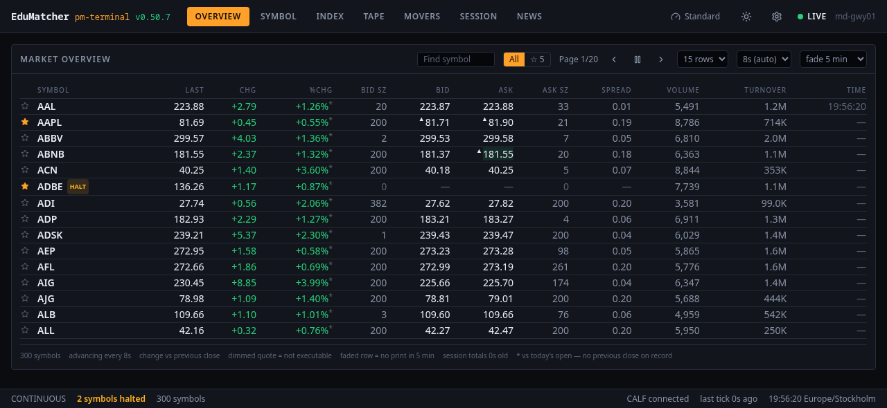
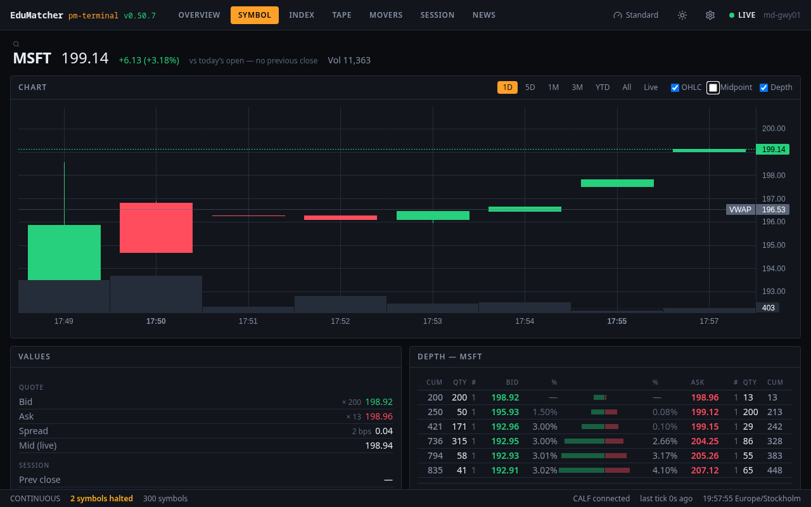
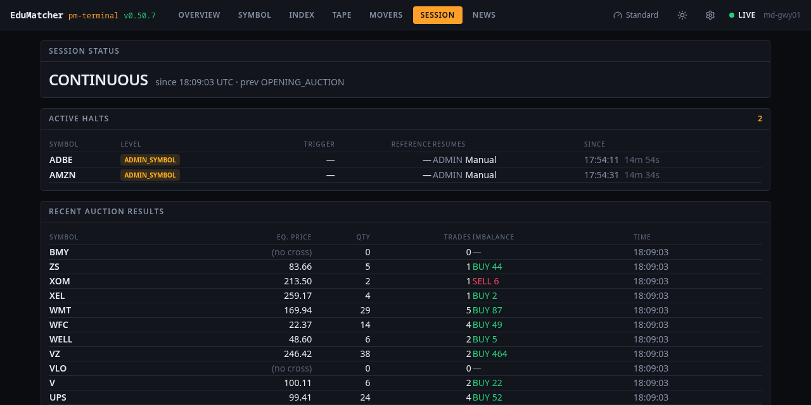

# Trader Information Terminal — "TapeDeck" (`pm-terminal`)

!!! note "Learning objectives"
    After reading this page you will understand:

    - What the Trader Information Terminal is for, and when to use it instead
      of a trading or administration tool
    - How to open it, and what it needs from the exchange
    - What each of the seven screens is meant to help a viewer understand
    - How to recognise normal disconnected, missing-history, and no-index
      states without mistaking them for broken screens

## Overview

**TapeDeck** is the friendly nickname this guide uses for the Trader
Information Terminal, whose system name is `pm-terminal` and whose source code
lives in `web-apps/terminal-gui/`. It is a read-only market display for the EduMatcher
exchange: a browser window for watching live prices, trades, auctions, halts,
indexes, and depth-of-book information.

It is deliberately *not* a trading application. There is no order entry, no
login screen, and no write path from the browser back into the exchange. Use it
for a classroom wallboard, a demo display, an observer workstation, or a quick
operator check that the market-data feed is alive. Use the trading client for
placing orders, and the administration tools for changing exchange state.

The terminal shows live data from the [CALF market-data feed](../../operator-guide/part-5-gateways/030-calf-gateway.md)
and reads historical bars and index history through the [API Gateway](../../operator-guide/part-5-gateways/050-api-gateway.md).
The browser never sees an API key; the small bridge process running beside the
web UI holds the upstream connections.

## Opening it

TapeDeck runs on port **8090**: open <http://localhost:8090> on the machine
running the exchange, or the address your instructor gives you. There is no
login. It starts with the rest of the exchange in the container setup
(`./edumatcher.sh start`, or `make up-all` from a source checkout).

The page needs the market-data gateway (`pm-md-gwy`) for live prices, and the
API gateway (`pm-api-gwy`) for charts, previous close and index history; with
only the first, live prices tick and the history panels stay empty.

How to install, start and configure TapeDeck — on its own, on a separate
display server, or for development — is in the Operator's Guide chapter
[Deploying TapeDeck](../../operator-guide/part-1-install-and-deploy/040-deploying-tapedeck.md).

## A tour of the interface

*Page 1 of 20 on a 300-symbol exchange, advancing every 8 seconds. AAPL and ADBE
are starred into the watchlist (the toggle counts five pinned symbols), ADBE
carries a `HALT` badge, and the status strip reports `2 symbols halted` and
the age of the last tick beside the CALF state. Every `%CHG` has its `*`: this
exchange has no previous close on record yet, so change is measured from
today's open.*

### Top bar

A single row (not a collapsible sidebar — seven destinations is small enough
for one row, and a data-dense terminal wants its horizontal space for
numbers, not navigation chrome) holding:

- **`EduMatcher pm-terminal v<version>`** — the app name and the release it
  was built from.
- The seven view tabs: **Overview**, **Symbol**, **Index**, **Tape**,
  **Movers**, **Session**, **News**.
- A **density** control (gauge icon) that cycles **Lobby → Standard →
  Dense**. This is a display preference, not a mode — every route and every
  data point stays reachable at every setting; only defaults change (larger
  type and a longer page delay under Lobby, tighter rows and shorter delay
  under Dense). It persists to the browser's `localStorage`, so a different
  browser or profile always starts on **Standard**.
- A **theme** toggle (dark by default — the working default for a trading
  screen — with a full light palette for bright rooms and projectors).
- A **settings** cog holding **Font size** — XS, S, M, L, XL or XXL, XS by
  default — which scales the whole page, for a projector or a screen read
  from across a room. It is independent of density, persists to the
  browser's `localStorage`, and (as the popover says) works in Chrome and
  Safari only.
- A **connection indicator**: `LIVE` (green), `RECONNECTING` (amber), or
  `OFFLINE` (red), reflecting the bridge's own CALF session state, plus the
  gateway id it is talking to.

### Status strip (footer)

A single-line summary meant to be readable from across a room. It opens with
the session indicator every EduMatcher GUI shows, exactly as the Trading GUI
does in its top bar: the session phase as a coloured badge, the next phase and
the time left to it when the feed has named one (`Continuous → Closing
Auction in 03:08`), and the clock in the exchange session timezone. The badge
reads `Unknown` until the feed has reported the phase, and whenever the CALF
connection is not live. Then the number of currently-halted symbols, the
total symbol count, the CALF connection state and **the age of the last
market-data tick**.

!!! note "Connection state and data age are two different readings, on purpose"
    "CALF connected" only says the pipe is open — it says nothing about
    whether anything is actually coming down it, and a feed that has gone
    silent behind a healthy socket is exactly the failure a reader most needs
    to catch. The status strip shows both: connection state, and separately,
    how long it has been since the last tick arrived. A silently frozen
    exchange still reads "CALF connected" but its tick age keeps climbing.

## Screen tour

### Market Overview

The default landing view: every tradable symbol, paginated, meant to run
unattended on a classroom or lobby display just as well as be actively
browsed.

Key behaviors:

- **Auto-paging.** Rows are split into pages sized to fit the viewport
  (`⚙` control offers 3s/5s/8s/15s/30s dwell times, or a density-based
  default), so the grid never needs to scroll — useful for an unattended
  display with no mouse. Hovering the grid, sorting a column, or typing in
  the symbol search **suspends** auto-advance (a reader who is actively
  interacting with the board should not have it slide out from under them);
  the manual `‹`/`›`/pause controls keep working regardless.
- **Every row stays live on every page.** Paging is purely a rendering
  concern — the bridge already holds one wildcard subscription covering
  every symbol, so there is no per-page subscribe/unsubscribe to do, and
  numbers on a page you are not currently viewing never go stale.
- **Sortable columns** and a **type-ahead symbol search** — both narrow/order
  what is shown without touching the underlying subscription.
- **Watchlist.** Click the `☆` next to any symbol to pin it; the
  `All`/`☆ Watchlist` toggle switches the grid between paging through every
  symbol and paging through only pinned ones. This is client-only,
  `localStorage`-persisted state — there is no server-side watchlist and
  nothing to log into.
- **A row fades after a configurable silence threshold** (`fade …` control —
  choices from 1 minute to 1 hour, or off). The right value is a property of
  the exchange, not of the terminal: a busy, liquid book and a thin classroom
  exchange want very different thresholds, so it is exposed rather than
  hardcoded.
- **During a call auction phase**, the quote columns (`Bid`/`Ask`) are
  replaced by auction-indicative columns (indicative uncross price/quantity,
  imbalance) for symbols currently in an opening or closing auction — a call
  phase is a different kind of market, not a display preference, so the grid
  follows it automatically rather than offering a toggle.
- **Not-executable banners.** When the whole board is outside continuous
  trading (closed, or in a call auction), a banner says so explicitly rather
  than merely dimming the numbers — the prices and volumes shown remain an
  accurate record, they are just not currently tradable. A separate banner
  appears if the previous-close lookup failed (percentage change is then
  measured from today's open instead, and marked with a small `*`) or if the
  history service itself is unreachable (Open/Volume/Turnover columns go
  blank; live prices are unaffected).

### Symbol Detail

The deep-dive view for one instrument: a candlestick + midpoint chart, a
values table, and an optional depth ladder. Large-screen only, by design —
there is no responsive mobile layout.

*One-minute OHLC candles with their volume, the VWAP line and the last price
(Midpoint is toggled off). Below, the Values panel and, beside it, the
Depth-of-Book ladder: the best prices meet in the middle, the `#` column
counts the orders at each level, and the percentage beside each price is its
distance from the touch, which shows at a glance that the levels around
192.9 and 204–207 are about 3% away.*

- **Header.** Symbol, session badge, last price, change and %change (always
  quoted against the *previous close*, footnoted when no previous close is
  on record and the figure falls back to today's open instead), and today's
  volume.
- **Chart.** Time-window presets (`1D`/`5D`/`1M`/`3M`/`YTD`/`All`/`Live`),
  free-form drag-zoom, and two independently toggleable series: OHLC
  candlesticks (built from historical bars, with the live-forming bar updated
  in place from CALF `TRADE` prints) and a spliced midpoint line — a coarser,
  15-minute-resolution historical segment giving way to a tick-by-tick live
  segment from CALF `TOP`, drawn in a slightly muted style where it is the
  coarser data. A reference line for the previous close is always drawn, and
  a VWAP line appears on the `1D`/`Live` presets only (VWAP is a same-session
  benchmark; drawing it across a multi-day preset would be quoting today's
  average against days it has nothing to do with).
- **Auction and halt context.** An auction uncross fills a dismissible
  banner (equilibrium price or "no cross," matched quantity, and any residual
  imbalance) that distinguishes an opening/closing auction, a
  circuit-breaker **reopening** auction, and a startup/recovery uncross by
  name, rather than calling all three "auction uncrossed." A halted symbol
  expands to show the circuit-breaker detail — trigger level, trigger and
  reference price, and a **corridor bar** showing the price band the symbol
  may reopen inside, with the last indicative price marked against it. This
  is the visual explanation of *why* a halt is still running: if the marker
  sits outside the band, the call phase was extended rather than printing.
- **Values panel and Depth ladder.** The Values panel is always shown; the
  `☐ Depth` toggle fills the panel beside it with the
  [Depth-of-Book ladder](#depth-of-book), which otherwise only says to turn
  the toggle on. It is off by default on purpose: unlike `OHLC`/`Midpoint`,
  which reuse subscriptions the bridge already holds for every symbol,
  turning Depth on causes the bridge to open a brand-new per-symbol CALF
  subscription — so it is opt-in per viewer, a heavier,
  deliberately-requested data stream.

### Depth-of-Book

A Level 2 ladder (aggregated quantity per price level — never per-order
identity, which CALF does not carry at any version) for whichever symbol
currently has the Depth toggle on in Symbol Detail. It is not its own
navigation tab.

Columns run outward from the touch in both directions —
`Cum | Qty | # | Bid ‖ Ask | # | Qty | Cum` — so the two best prices meet in
the middle and the cumulative totals sit at the outer edges, where the eye
ends up after scanning inward. Two things worth calling out:

- **The `#` column** is the count of individual resting orders aggregated
  into that price level — genuinely useful context a bare quantity doesn't
  convey (1,400 shares from one order reads very differently than the same
  1,400 split across four), and it costs nothing extra since `COUNT` is
  already on the CALF wire.
- **Rows are evenly spaced regardless of price gaps**, with the actual
  distance from the touch shown as a percentage figure beside each row
  instead. Spacing rows by price would collapse to unreadable slivers the
  moment one level sat far out; the trade-off is that a lone level far from
  a tight cluster would otherwise look like just the next rung down, which
  is exactly what the percentage-distance figure (and a subtle highlight
  when a level is unusually far out) corrects for.

A **Bid depth / Ask depth / Imbalance** summary line below the ladder states
the book's lean as a percentage (e.g. "62% bid") rather than a bid:ask ratio,
since a ratio's useful range is lopsided (0.2 and 5.0 are the same imbalance
mirrored) while a percentage reads the same distance from 50% either way.

### Index View

Headline level and a historical chart for a configured exchange index (see
[Market Index](../../operator-guide/part-4-run-a-market/070-market-index.md)).

The headline level, change, and session badge always come from the **live**
CALF `INDEX` stream, never from a historical REST row for the current date —
`/history/index-daily`'s `close_level` is only guaranteed final once the
session for that date has actually closed, so quoting it live for *today*
would risk showing a figure that is still moving. Open/High/Low are safe to
read from the REST row even intraday, since those are running-so-far values
that only get more accurate as the day progresses. Switching indexes (when
more than one is configured) costs nothing upstream — the bridge holds a
standing subscription for every configured index regardless of which one a
given tab is currently viewing. If the exchange has no index configured at
all, the tab still exists and shows an explicit empty state rather than
being hidden, so the tab row never shifts between differently-configured
classroom exchanges.

### Trade Tape / Time & Sales

Every print on the exchange, newest first, filterable by symbol.

The symbol filter narrows what is *displayed*; the bridge's underlying
`SYM=*` wildcard subscription means every symbol's prints are already
arriving regardless of the filter, so switching it is instant and free.
`Pause` freezes the visible rows without losing anything — the tape keeps
recording underneath, and `Resume` shows the current state rather than a
gap where the pause was.

!!! note "Gap markers are a real, shipped feature, not a hypothetical"
    If the bridge's CALF connection drops and cannot fully repair a symbol's
    trade sequence on reconnect (the replay window has already rolled past
    the missed messages), the tape shows an explicit marker row — *"gap in
    the tape — some prints for `SYMBOL` were missed"* — in place among the
    prints it falls between, rather than silently omitting the missing
    prints or, worse, saying nothing at all. A record with an unmarked hole
    in it is worse than one that admits the hole, because a viewer has no
    way to tell it apart from a genuinely quiet stretch. This is the direct
    result of a real CALF protocol fix made while building TapeDeck.

### Movers

A different ranking over the same data the Overview grid already computes —
no new subscriptions.

Three tabs: **Gainers** and **Losers** rank by percentage change from the
previous close (falling back to today's open, and labelled as such, when no
previous close is available); **Active** ranks by session turnover (value
traded) instead — a common third view on real market boards, and cheap here
since Overview already computes turnover per symbol. Each row's bar is
scaled relative to the largest value currently shown on that tab.

### Session & Halt Status Board

Three panels in one view: the exchange-wide session phase, every symbol
currently halted with its full circuit-breaker detail, and the auctions that
have uncrossed since the tab was opened.

*Two operator halts (ADBE, AMZN): level `ADMIN_SYMBOL`, no trigger or
reference price, resuming only when the operator clears them. Below, the
opening auction's results, newest first: the equilibrium price, the matched
quantity, the number of trades and the residual imbalance per symbol, and
`(no cross)` where nothing could match.*

- **Session status** names the current phase and places it in the
  exchange's timetable, all in the exchange's time zone:
    - *This week*: each day's hours from pre-open to the close, with closed
      days dashed and bank holidays named.
    - *Timetable*: the day's phases in order (Closed, Pre-Open, Opening
      Auction, Continuous, Closing Auction, Closed), each arrow labelled
      with the time of that transition. The current phase is filled in the
      top bar's colour and marked NOW. When today does not trade, the next
      trading day is shown instead.
    - A bar of the whole day from 00 to 24, with a marker at the exchange's
      current time. The marker is hidden while the session is off its
      timetable, for example after an operator moved it by hand, or when
      `pm-scheduler` runs a compressed simulation clock.
    - *Next bank holiday*: the next holiday that falls on a normal trading
      day, and whether the exchange closes or runs holiday hours.
- **Active halts** shows, per halted symbol: circuit-breaker level, trigger
  and reference price (blank for an operator-initiated halt, which carries
  neither), how and when it resumes (a converted wall-clock time for a timed
  halt, or `Manual` for one that only ends on an explicit operator action),
  and how long it has been halted.
- **Recent auction results** is a session-scoped, client-side ring buffer of
  every auction uncross seen since the tab opened — not a durable audit
  trail (that is `pm-index`'s own structural log, surfaced separately via the
  Index View's "Recent changes" strip). An omitted equilibrium price is
  labelled `(no cross)` rather than shown as a blank, since "no crossable
  interest at all" is a meaningfully different outcome from a price, just an
  unusual one.
- Opening this view is itself one of the two triggers for the bridge to hold
  a per-symbol `CB` subscription (the other is opening that symbol's own
  Symbol Detail view) — closing the tab releases every subscription it was
  the sole reason for.

### News

The headlines `pm-market-sim` publishes (see
[The market model](../../operator-guide/part-4-run-a-market/090-market-model.md)),
newest first, with the same badges as the trading GUI's
[News](020-trading-platform-gui.md#news) screen: `RUMOUR` with its
credibility, and `CONFIRMED`/`RETRACTED` when a rumour resolves. A retracted
rumour and its retraction are struck through. The time has the date in
front when it is not today.

The view shows everything `pm-market-sim` has recorded, kept for
`news.retention_days` (90 days unless your operator changed it). Restarting
the terminal or the exchange loses none of it. Above the table:

| Control | What it does |
|---|---|
| Symbol or sector | A symbol also shows its sector's news, a sector its symbols' news; market-wide news always shows |
| Time window | Last hour, Last 24 h (the default), Last 7 days, Last 30 days, or All. The window rolls with the clock |
| Status | Any status, Rumours, Confirmed or Retracted |
| Sentiment | Any sentiment, Positive or Negative |
| Page n/m, the arrows and "rows" | 15 headlines a page by default (5, 15, 25 or 50, remembered), with the number that match beside it |

The window, status, sentiment and page size you pick are remembered in this browser.
Page 1 follows the news as it arrives. When you go to a later page, the view
holds the window where it was, so new headlines don't push the rows you are
reading down a page. A chip such as **4 new** counts what arrived since then,
and clicking it goes back to page 1.

CALF carries no news, so this view reads it through the bridge's
`/api/news` proxy to `pm-api-gwy`'s `GET /api/v1/news` — the same read-only
key as the charts — every 20 seconds while it is open. Without `pm-api-gwy`
it says the news is unavailable; if `pm-market-sim` has never run, the list
is empty.

## Troubleshooting

| Symptom | Meaning | What to do |
|---|---|---|
| Every screen shows the red "Disconnected from pm-terminal-bridge" banner | The page has lost its connection to TapeDeck's server | Reload the page; if it persists, tell your operator |
| The connection indicator shows `RECONNECTING` and never returns to `LIVE` | TapeDeck cannot reach the market-data feed | Tell your operator: `pm-md-gwy` may be down |
| Charts and Open/Volume columns are empty or show an "unavailable" banner, but live prices still tick | The history service cannot be read | Live prices are fine; tell your operator if you need the history |
| The Index tab shows "This exchange has no index configured" | No index is configured for this exchange | Nothing to fix |
| A tape gap marker appears | The live feed dropped for long enough that some prints could not be replayed | Expected after a real disconnect; the marker shows where prints are missing |
| Prices show the wrong number of decimal places | The market-data gateway is older than TapeDeck | Tell your operator |

Problems with starting or configuring TapeDeck are covered in
[Deploying TapeDeck → Troubleshooting](../../operator-guide/part-1-install-and-deploy/040-deploying-tapedeck.md#troubleshooting).

## Related documentation

- [CALF Gateway — Market Data](../../operator-guide/part-5-gateways/030-calf-gateway.md) — the protocol
  TapeDeck's bridge speaks upstream
- [API Gateway](../../operator-guide/part-5-gateways/050-api-gateway.md) — the REST history endpoints the bridge
  proxies
- [Centralized Log Server](../../operator-guide/part-6-observe-and-recover/040-log-server.md) — the bridge's optional
  operational-logging destination
- [Configuration GUI (`config-gui`)](../../operator-guide/part-2-configure/030-config-gui.md) — the sibling
  application TapeDeck shares its monorepo shape and deployment conventions
  with
- `docs-design/EduMatcher-Terminal-GUI.md` — the full design document (repository checkout only)
- `web-apps/terminal-gui/README.md` — the implementation's own record of every
  deviation from that design document (repository checkout only)
