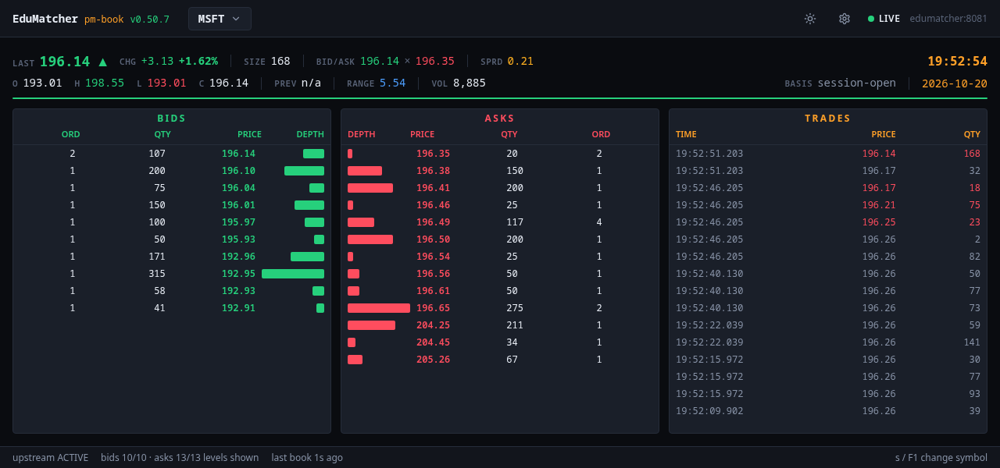
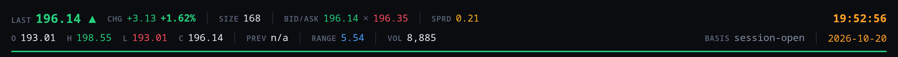

# Order Book Viewer (`pm-book`)

!!! note "Learning objectives"
    After reading this page you will understand:

    - What the order book viewer shows, and how it relates to `pm-viewer`
    - How to open it, and what it needs from the exchange
    - What every field of the statistics header, the two ladders and the trade
      tape means
    - How to read the connection states and the footer without mistaking a
      quiet market for a broken one

## Overview

`pm-book` is the web companion to the [`pm-viewer`](../../reference-manual/part-1-command-line/010-processes-environment-and-ports.md#pm-viewer-order-book-viewer)
terminal application: one symbol's full order book — every price level on both
sides — the session statistics above it and a trade tape beside it, in a
browser. Its source code lives in `web-apps/book-gui/`.

Like [TapeDeck](010-trading-info-terminal.md) it is read-only. There is no order
entry, no login screen and no write path from the browser into the exchange.
Use it on a classroom projector while students trade against a book, beside
the [Trading GUI](020-trading-platform-gui.md) to watch the effect of your own orders, or
on any machine where `pm-viewer` would need a terminal and direct access to the
engine's message bus.

Everything `pm-viewer` shows is here, field for field: last price and change,
bid, ask and spread, open/high/low/close, previous close, range, volume, and the
basis the change is measured against. What the browser adds is symbol switching
by URL, a dark and a light theme, font scaling, and a layout that fills
whatever screen it is shown on.

## Opening it

The order book viewer runs on port **8094**: open <http://localhost:8094>, or
the address your instructor gives you. There is no login. It opens on the
first listed symbol; press `s` to pick another. It starts with the rest of the
exchange in the container setup (`./edumatcher.sh start`, or `make up-all`
from a source checkout).

It reads everything — the book, the trades and the history behind the
statistics — through the API gateway (`pm-api-gwy`), and the session phase
from the market-data gateway (`pm-md-gwy`). Without `pm-stats` the statistics
cover only the trades seen since the book was opened, and the header says so.

How to install, start and configure it is in the Operator's Guide chapter
[Deploying the Order Book Viewer](../../operator-guide/part-1-install-and-deploy/060-deploying-the-order-book-viewer.md).

## A tour of the interface

*The top bar, the statistics header, the BIDS and ASKS ladders with depth
bars scaled to the largest level on screen, the trade tape coloured by tick,
and the footer: `upstream ACTIVE`, how many levels of each side are shown, and
the age of the last book update.*

The page has four parts, top to bottom: the top bar, the statistics header, the
three panels **BIDS**, **ASKS** and **TRADES**, and the footer.

### Top bar

- **`EduMatcher pm-book v<version>`** on the left, as in every EduMatcher web
  application.
- **The symbol picker** — the current symbol with a drop-down arrow. Click it,
  or press **`s`** or **`F1`** anywhere on the page.
- **The session indicator** — the exchange session phase as a coloured badge,
  the next phase and the time left to it (`Continuous → Closing Auction in
  03:08`), and the clock in the exchange session timezone, exactly as the
  Trading GUI shows it. The countdown appears only while a transition is
  scheduled; the badge reads `Unknown` until `pm-md-gwy` has reported the
  phase, and whenever it cannot be reached.
- **Theme** (sun/moon): switches between the dark and the light palette.
- **Settings** (cog): font size, maximum levels and zebra rows — see
  [Settings](#settings).
- **Connection indicator**: `LIVE`, `RECONNECTING` or `OFFLINE`, followed by the
  `host:port` of the `pm-api-gwy` instance the bridge reads — see
  [Connection states](#connection-states).

### Choosing a symbol

The picker works as `pm-viewer`'s does. Typing narrows the list **by prefix**
(`A` offers the symbols that start with A, not every symbol containing one),
**↑**/**↓** move the selection, **Enter** switches and **Esc** closes. A click
works too.

Every book has its own URL: `/book/<SYMBOL>`, for example
`http://localhost:8094/book/AAPL`. Bookmark it, or open several tabs on different
symbols — each tab watches one symbol. The bare address `/` opens the book you
viewed last in this browser, or the first listed symbol. A URL naming a symbol
that is not listed shows `<SYMBOL> is not a listed symbol` instead of an empty
book.

### The statistics header

*MSFT up 1.62%. This exchange has no previous close on record yet, so `Prev`
is `n/a` and change is measured from the session open (`Basis session-open`).
The green line under the header: the close is above that reference.*

Two rows, the same fields as `pm-viewer`'s header. The **reference** price that
change and colour are measured against is the previous close when one is known,
otherwise the session open.

| Field | Meaning |
|---|---|
| **Last** | Price of the last trade, with ▲ / ▼ / ▬ against the reference, green when up and red when down |
| **Chg** | Last minus the reference, and the same as a percentage |
| **Size** | Quantity of the last trade |
| **Bid/Ask** | Best bid (green) × best ask (red) |
| **Sprd** | Ask minus bid |
| *clock* | Current time in the exchange session timezone (hover for the zone name) |
| **O / H / L / C** | The session's open, high, low and latest close, from every trade of the day |
| **Prev** | The previous trading day's close, `n/a` when there is none |
| **Range** | High minus low |
| **Vol** | Total quantity traded this session |
| **Basis** | What the change is measured against: `prev-close`, `session-open`, or `live since HH:MM` |
| *date* | Today's date in the exchange session timezone |

A thin line under the header shows the session's direction: green when the
close is above the reference, red when below, grey when level.

!!! note "What `live since HH:MM` means"
    When the bridge cannot read the session's history — `pm-stats` is not
    running, or its database does not exist yet — it still shows the book and
    records every trade it sees from then on. The statistics are then correct
    only for that period, and the Basis field says so in amber, with the time
    the recording started. This is the web equivalent of running `pm-viewer`
    without a stats database. Times are then in UTC, because the session
    timezone also comes from `pm-stats`.

All times, the clock and the date use the exchange session timezone recorded by
`pm-stats`, not the timezone of the browser — so a viewer in another country
reads the same times as the exchange.

### BIDS and ASKS

The two ladders mirror each other about the centre, as in `pm-viewer`, with the
best price at the top of each:

| BIDS columns | | ASKS columns |
|---|---|---|
| **Ord** — number of resting orders at the level | | **Depth** — bar, growing outward to the right |
| **Qty** — total quantity at the level | | **Price** |
| **Price** | | **Qty** |
| **Depth** — bar, growing outward to the left | | **Ord** |

The depth bars are scaled to the largest quantity among the levels **on
screen**, so the largest visible level fills its bar. Prices use each symbol's
own number of decimals from the reference data.

The ladders show the levels the gateway publishes (aggregated per price — never
individual orders).

### TRADES

The trade tape, newest first: **Time** (session timezone, to the millisecond),
**Price** and **Qty**. Each print is coloured by its tick — green when its price
is above the print before it, red when below, grey when equal.

When you open a book the tape already holds the session's earlier trades, read
from history. The bridge keeps the newest `TAPE_MAX` (500) prints per symbol;
the statistics count every trade of the session regardless.

### How many levels are shown

The three panels share one row count. By default (**Max levels: Fit**) it is
whatever fits the window, like `pm-viewer` in a terminal — make the window taller
to see deeper into the book. The Settings popover can cap it at 10, 20 or 50
levels, like `pm-viewer --depth`.

The panels never reflow into a single column: in a narrow window the page
scrolls sideways instead.

### Footer

- **`upstream ACTIVE`** — the state of the bridge's connection to `pm-api-gwy`;
  shown in amber whenever it is anything else.
- **`bids 12/12 · asks 9/15 levels shown`** — how many of each side's levels are
  on screen, out of how many there are. A truncated ladder is never silent:
  `9/15` means six more ask levels exist below the fold.
- **`last book 2s ago`** — the age of the most recent book update. It keeps
  counting in a quiet market; that is normal, and the book shown is still
  current. `no book yet` means the symbol has not had a book since it was
  opened.
- **`s / F1 change symbol`** — the keyboard hint.

### Settings

The cog in the top bar opens the settings. All of them are stored per browser.

| Setting | Choices | Default | Notes |
|---|---|---|---|
| **Font size** | XS, S, M, L, XL, XXL | XS | Scales the whole page. Works in Chrome and Safari only |
| **Max levels** | Fit, 10, 20, 50 | Fit | `pm-viewer`'s `--depth` |
| **Zebra rows** | on / off | off | `pm-viewer`'s `--zebra-lines` |
| **Theme** (top-bar button) | dark / light | dark | Light is meant for bright rooms and projectors |

## Connection states

Two connections are involved, and the viewer reports both:

| Indicator | Meaning | What you see |
|---|---|---|
| **`LIVE`** (green) | The browser is connected to the bridge, and the bridge to `pm-api-gwy` | The live book |
| **`RECONNECTING`** (amber) | The browser is connected to the bridge, but the bridge's upstream connection is down or not yet authenticated | The last values received, with `upstream RECONNECTING` or `upstream DOWN` in the footer |
| **`OFFLINE`** (red) | The browser has lost its connection to the bridge | A *Disconnected from pm-book-bridge* banner; values are **hidden** rather than shown stale. The page reconnects by itself |

The bridge reconnects upstream by itself, backing off from half a second to 15
seconds between attempts. When a working connection drops, the footer shows
`upstream RECONNECTING` for the first 30 seconds (`UPSTREAM_DOWN_AFTER_SEC`) and
`upstream DOWN` after that. Before the first successful connection, and at once
when `pm-api-gwy` rejects the key, it shows `upstream DOWN`.

**No trade is lost across a short outage.** On reconnect the bridge asks
`pm-api-gwy` to resume each symbol's trades from the last one it saw. If the
gap is longer than the gateway retains (`market_data_cache_sec`, 60 seconds by
default — see [API Gateway](../../operator-guide/part-5-gateways/050-api-gateway.md)), the bridge rebuilds that
symbol's statistics and tape from history instead, and logs that it did.

## Troubleshooting

| Symptom | Meaning | What to do |
|---|---|---|
| The top bar stays `RECONNECTING` | The viewer cannot read from the API gateway | Tell your operator |
| The session badge in the top bar stays `Unknown` | The viewer cannot reach the market-data gateway | Normal for a second or two at exchange start; otherwise tell your operator |
| Red *Disconnected from pm-book-bridge* banner | The page has lost its connection to the viewer's server | Reload the page; if it persists, tell your operator |
| Basis says `live since HH:MM`; times are in UTC | The session's history cannot be read, so the statistics cover only what the viewer has seen since then | Tell your operator that `pm-stats` is not running |
| *Waiting for the symbol list…* never goes away | The viewer cannot read the symbol list | As for `RECONNECTING` |
| `<SYMBOL> is not a listed symbol` | The URL names a symbol the exchange does not list | Press `s` and choose one |
| A ladder ends before the book does | More levels exist than fit the window, or **Max levels** caps them | Read the footer (`asks 9/15`); make the window taller or set Max levels to Fit |

Problems with starting or configuring the viewer are covered in
[Deploying the Order Book Viewer → Troubleshooting](../../operator-guide/part-1-install-and-deploy/060-deploying-the-order-book-viewer.md#troubleshooting).

## Related documentation

- [`pm-viewer` — Order Book Viewer](../../reference-manual/part-1-command-line/010-processes-environment-and-ports.md#pm-viewer-order-book-viewer) — the terminal application this one mirrors
- [API Gateway](../../operator-guide/part-5-gateways/050-api-gateway.md) — the market-data WebSocket and history endpoints the bridge reads
- [Statistics and Reporting](../../operator-guide/part-4-run-a-market/060-statistics-and-reporting.md) — `pm-stats`, which records the history
- [Installation](../../operator-guide/part-1-install-and-deploy/010-installation.md) — the container stack, `.env` and the read-only API key
- [Trader Information Terminal](010-trading-info-terminal.md) — the sibling read-only display, with which it shares its structure and deployment conventions
- [Centralized Log Server](../../operator-guide/part-6-observe-and-recover/040-log-server.md) — the bridge's optional logging destination
- `docs-design/EduMatcher-Book-GUI.md` — the design document (repository checkout only)
- `web-apps/book-gui/README.md` — the implementation's own reference (repository checkout only)
