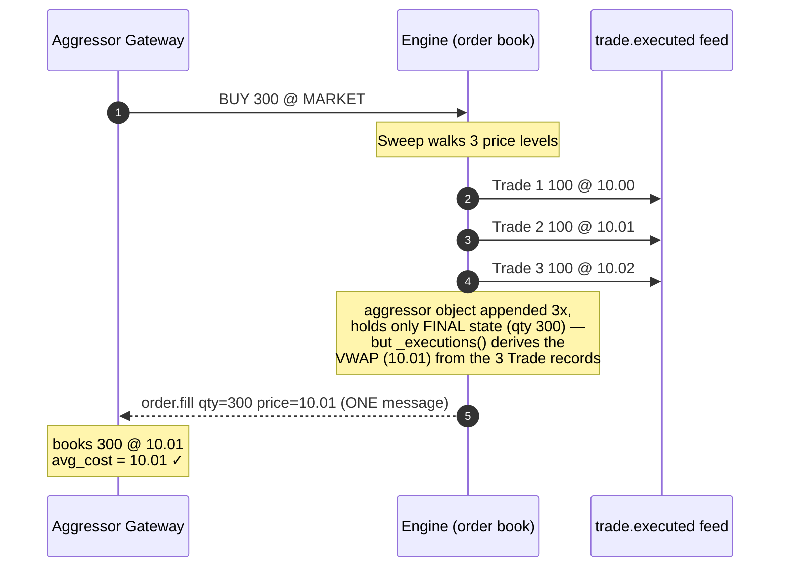

# Known Limitations & Bugs

!!! note "Learning objectives"
    After reading this page you will understand:

    - What the exchange **deliberately does not do** today: the boundaries of
      the model, collected in one table with a pointer to the chapter that
      explains each

    - A real historical bug in how the engine reported fills for orders that
      sweep **multiple price levels** in a single execution
    - Why the bug affected only the **average cost** (and therefore unrealized
      P&L) of the aggressing order, never the **quantity** of any position
    - A worked numeric example that makes the size of the (former) error
      concrete, and what the engine reports today for the same scenario
    - How the fix actually works, as a short case study in fixing a reporting
      bug on a hot code path without changing the number of messages a
      gateway receives

    **Prerequisite**: Read [Positions and P&L](../../participant-guide/part-5-positions-and-results/010-positions-and-pnl.md) first — this page
    builds directly on the VWAP average-cost formula described there.

## Current limitations and design boundaries

EduMatcher is a teaching exchange. Some things a production venue does are
left out on purpose, and a few are simply not built yet. This table collects
them in one place so a student, or an operator planning an exercise, does not
have to find them by running into them. Each row names the chapter that
explains the detail.

| Area | Boundary | What to do instead / why |
|---|---|---|
| **Combo orders** | A combo is a parent with independent child orders on separate books, so it has **leg risk**: if one leg fills and the other never does, the combo ends `FAILED`, the other leg is cancelled, and the fill that happened stays a real, committed trade. There is no atomic combo book | An `AON` combo only guards the *entry*: if every leg could fill completely right now the legs are matched, otherwise none is matched on entry and all rest as interest. It is not an atomic guarantee for later fills, so size legs with the risk in mind. See [Guided Tour](../../architecture-and-development/part-1-architecture/020-guided-tour.md) |
| **Implied / synthetic orders** | No spread book and no implied quotes. Combo handling is parent/child tracking over the outright books | See [Implied Orders](../../participant-guide/part-2-orders/040-implied-orders.md), which describes the mechanism as a concept only |
| **Amending** | Only resting `LIMIT` and `ICEBERG` orders can be amended. A stop, trailing stop or any other type answers `Cannot amend <TYPE> orders` | Cancel and re-enter. An amend that raises the quantity or changes the price loses time priority by design. See [The Order Book: Deep Dive](../../architecture-and-development/part-2-inside-the-engine/010-order-book-deep-dive.md#amending-amend_order) |
| **Stops before the first trade** | A stop is compared with `last_trade_price` only. In a session with no trade yet every stop is armed, however near its trigger is to the market | See the deep dive, *Stop Orders* |
| **Instruments** | One order book per symbol, priced on an integer tick grid of 0–8 decimals. No contract multipliers (a design proposal only), no per-price tick table | Model a different size with `outstanding_shares` and `tick_decimals` |
| **Positions and P&L** | P&L is gross (no fees or commissions), tracked per gateway ID with no netting across gateways of one participant, and marked intraday. Settlement dates (T+1/T+2) are not tracked | See [Positions and P&L](../../participant-guide/part-5-positions-and-results/010-positions-and-pnl.md) |
| **Engine concurrency** | The engine is one single-threaded event loop and the single writer for a data directory: no hot standby and no failover. One data directory is one exchange | A deliberate choice: it removes locks and makes matching deterministic. Restarting restores resting orders and combos from the persisted state. See [Persistence](../../operator-guide/part-6-observe-and-recover/010-persistence.md) |
| **Lossy event bus** | The `PUB`/`SUB` feeds drop messages for a subscriber that falls behind its high-water mark, silently. The engine's inbound `PULL` queue can also fill | Every published message carries a per-topic sequence number in its envelope, so a consumer can detect a gap; the drop-copy feed adds a `from_seq` replay. See [Architecture Overview](../../architecture-and-development/part-1-architecture/010-architecture-overview.md) and [Order Flow End to End](../../architecture-and-development/part-2-inside-the-engine/020-order-flow-end-to-end.md) |
| **Drop-copy replay** | The replay buffer holds the last `drop_copy_buffer_size` events (default `10000`). A consumer that was away longer receives only the subset still buffered | Fill the gap from the audit log. See [Drop Copy](../../protocols-and-clients/part-3-session-behaviour/060-drop-copy.md) |
| **Security** | The internal bus has no authentication or encryption and binds to `127.0.0.1` by default. The `pm-index` command socket accepts any non-empty `gateway_id` and uses it only to route acks. BALF has no protocol-level encryption | Keep the bus on a private interface; put external gateways behind TLS or a tunnel. See [Environment variables](../part-1-command-line/010-processes-environment-and-ports.md#network-variables) |
| **BALF 1.0.0** | No OCO, no multi-leg combos, no market-data broadcast, no sequence recovery (reconnect on a gap), symbols of at most 8 ASCII characters | Use ALF for OCO and combos, `pm-md-gwy` for market data. See [BALF Gateway](../../operator-guide/part-5-gateways/020-balf-gateway.md) |
| **Indices** | At most 5 indices, cap-weighted | See the `indices` block in [Configuration Schema](../part-3-configuration/010-schema-and-process-blocks.md) |
| **Market-maker bot** | The `passive` strategy does not skew for inventory, and cannot be combined with `inventory_skew`. Its notion of "covered" is judged from aggregated price levels | See [The Market-Maker Bot](../../participant-guide/part-3-market-making/030-the-market-maker-bot.md) |

The rest of this chapter is a worked case study of one limitation that *was*
fixed.

---

## What this page covers

EduMatcher is a teaching exchange, and part of teaching is being honest about
the places where the implementation used to take a shortcut — and what it
took to fix it properly. This chapter is a case study of one such bug: when a
single aggressive order traded against several resting orders at *different*
prices in one shot (a "sweep"), the engine used to collapse those fills into
**one** fill notification that carried the **last** trade price rather than
the true volume-weighted average.

The bug was subtle: nobody lost or gained shares, the public trade record was
always correct, and a single-price fill was always reported perfectly. The
error only ever showed up in the **average cost** that a trader's gateway
derived from the fill notification, and only for an order that walked through
more than one price level.

!!! success "Status: fixed"
    This was a genuine bug in early versions of EduMatcher. It was fixed in
    the matching engine (internally tagged **H6**, alongside the related
    duplicate-fill guard **H5**) before release 0.16.1. This page keeps the
    worked example and the diagrams as a case study — the mechanics below are
    exactly what shipped.

---

## Background: how a fill used to be reported

When an order arrives, the engine's `_handle_new_order` handler hands it to
the order book's `process()` method. Matching happens inside `_apply_fill`,
which is called **once per resting order that the aggressor trades against**.
Each call:

1. Creates a `Trade` record at that resting order's price.
2. Decrements the aggressor's `remaining_qty`.
3. Appends the **aggressor `Order` object** to the `events` list.

The crucial detail is in step 3: the engine appends the **same Python object**
each time. After the sweep finishes, that one object only holds its **final**
state — the total quantity filled and a `remaining_qty` of zero. The
per-level breakdown (how much filled at each price) is not visible on the
aggressor object afterwards; it only ever existed in the separate list of
`Trade` records.

After matching, the publish loop walks `events` and emits an `order.fill`
message for each fill. Because the aggressor object was appended N times (once
per price level it consumed), a guard (a `seen` set in `_publish_dispatch`,
tagged H5) ensures the engine still sends **exactly one** `order.fill` message
for the aggressor instead of N duplicates — that part of the design was correct
from the start and is unchanged today. What *that* single message reported was the bug:

```python
# The bug: every fill message used the price of the LAST trade in the
# sweep, no matter how many price levels the order actually walked through.
fill_price = from_ticks(book.last_trade_price, order.symbol)
```

`book.last_trade_price` is the price of the **last** fill in the sweep — the
deepest, least favourable level the order reached. That single price was then
reported for the **entire** filled quantity, at every site in the engine that
published a fill (the main order path, seeded quotes, combo legs, OCO legs,
and auction fills all shared the same mistake).

!!! note "The resting (passive) side was always correct"
    Every resting order the aggressor hits is a **distinct** object and is
    filled exactly once at its own price, so each passive participant has
    always received a correct per-price `order.fill`. The inaccuracy was
    limited to the **one** aggregated message sent to the **aggressing**
    order's gateway.

---

## How the gateway turns a fill into a position

A trading gateway tracks positions with VWAP average-cost accounting (see
[Positions and P&L](../../participant-guide/part-5-positions-and-results/010-positions-and-pnl.md)). On every `order.fill` it calls
`_update_position(symbol, side, fill_qty, fill_price)`, which folds the fill
into the running average:

$$
\text{avg\_cost}_\text{new} = \frac{\text{avg\_cost}_\text{old} \times \lvert q_\text{old} \rvert + \text{fill\_price} \times \text{fill\_qty}}{\lvert q_\text{new} \rvert}
$$

The gateway trusts `fill_price` as the price for the whole `fill_qty`. Before
the fix, when the engine sent one aggregated fill at the last sweep price, the
gateway booked the **entire** quantity at that single, least-favourable price
— overstating cost basis for a buy sweep and understating proceeds for a sell
sweep.

---

## Worked example

Suppose the ask side of the book holds three resting sell orders:

| Resting order | Price   | Quantity |
|---------------|---------|----------|
| A             | \$10.00 | 100      |
| B             | \$10.01 | 100      |
| C             | \$10.02 | 100      |

A trader sends an aggressive **BUY 300 (MARKET)** order. It sweeps all three
levels and three trades print:

| Trade | Price   | Quantity |
|-------|---------|----------|
| 1     | \$10.00 | 100      |
| 2     | \$10.01 | 100      |
| 3     | \$10.02 | 100      |

The **true** volume-weighted average price the buyer paid is:

$$
\text{VWAP} = \frac{100 \times 10.00 + 100 \times 10.01 + 100 \times 10.02}{300}
       = \frac{3003}{300} = \mathbf{10.01}
$$

**Before the fix**, the engine emitted a single aggregated fill using the last
trade's price:

```text
order.fill  →  fill_qty = 300   fill_price = 10.02 ✗   remaining_qty = 0
```

giving a reported average cost of \$10.02 — a \$0.01/share, \$3.00 total,
overstatement of the true \$10.01 cost basis.

**Today**, the engine still sends exactly **one** `order.fill` message for the
sweep (the message count did not change — see [How it was
fixed](#how-it-was-fixed) below), but the price on that message is the
order's own VWAP across every level it touched:

```text
order.fill  →  fill_qty = 300   fill_price = 10.01 ✓   remaining_qty = 0
```

which folds into the gateway's running average as exactly \$10.01 — matching
the true cost basis.

The three sellers (A, B, C) each receive, as they always did, a correct fill
at their own price, and the `trade.executed` market-data / drop-copy feed
carries all three trades at the right prices.

### Direction of the (former) error

The last level reached in a sweep is always the **worst** price for the
aggressor, so the old bug had a predictable sign:

| Aggressor side | Last level is… | Effect on the aggressor's books (before the fix)       |
|----------------|----------------|----------------------------------------------------------|
| **BUY**        | Highest price  | Cost basis **overstated** → unrealized P&L understated |
| **SELL**       | Lowest price   | Proceeds **understated** → unrealized P&L understated  |

In both directions the old, buggy report was **pessimistic**: it made a sweep
look like a slightly worse trade than it actually was. The magnitude equalled
the spread between the sweep's average price and its last price, multiplied
by the swept quantity.

!!! note "Position quantity was never wrong"
    The dedup guard (the `seen` set in `_publish_dispatch`, H5) always
    guaranteed the quantity was counted **once**, so the net position size was always exact, even
    before the price fix. Only the **price** attached to that quantity was
    ever approximate.

---

## Visualising the fix

The diagram below contrasts the **three real trades** generated inside the
book with the **single fill** delivered to the aggressor's gateway, as it
works today.



The same idea as plain ASCII:

```text
   Book side (asks)                Trades printed            Fill sent to buyer
   ----------------                --------------            ------------------
   100 @ 10.00  ◄── swept ──►  Trade 1: 100 @ 10.00
   100 @ 10.01  ◄── swept ──►  Trade 2: 100 @ 10.01   ===►  order.fill
   100 @ 10.02  ◄── swept ──►  Trade 3: 100 @ 10.02            qty   = 300
                                                               price = 10.01  ✓
                               true VWAP = 10.01               (per-order VWAP)

   Correct quantity (300) ✓     Correct trade prints ✓     Correct average price ✓
```

Before the fix, the last line of the gateway note read `price = 10.02 ✗ (last
level only)` — the trade prints and the per-level book walk were identical;
only the number handed to the gateway was wrong.

---

## How it was fixed

The aggregation lives in the engine's hottest code path: `_publish_dispatch`,
which every path that matches (new orders, quotes, combo children, OCO legs,
amends, auctions) calls with the result of one `process()`. A fix that is
correct but still cheap on that path mattered. The engine does
**not** split the aggregated message into one-per-level (which would double
or triple outbound message volume for every sweep); instead it keeps sending
exactly one `order.fill` per order per `process()` call, and computes that
message's price from the `Trade` records the book already produced:

```python
@staticmethod
def _executions(trades: list[Trade]) -> dict[str, _Execution]:
    """Each order's execution in THIS dispatch, from *trades*, in one pass."""
    out: dict[str, _Execution] = {}
    for t in trades:
        agg = t.aggressor_side
        for oid, side in ((t.buy_order_id, "BUY"), (t.sell_order_id, "SELL")):
            ex = out.get(oid)
            if ex is None:
                ex = out[oid] = _Execution("TAKER" if side == agg else "MAKER")
            ex.qty += t.quantity
            ex.notional += t.price * t.quantity   # integer ticks
            ex.trade_ids.append(t.id)
    return out
```

The fill then reports `notional / (qty * 10 ** tick_decimals)`: the notional is
summed in integer ticks and divided once, so the VWAP is correctly rounded. An
order gets an `order.fill` only if it has an entry here, so there is no
fallback price to reach for.

This is cheaper than it looks: `trades` for a single dispatch is small (one
entry per price level swept, rarely more than a handful), so building the
per-order map costs one pass over data the book already produced —
no additional allocation on the matching path itself, and **no change** to
how many messages a gateway receives per order. The dedup guard (H5) that
ensures exactly one `order.fill` per order is unchanged; only the *price* it
carries is now correct.

Two properties of the message are worth stating precisely, because the
aggregation could otherwise be misread:

- `fill_qty` is the quantity matched **in this dispatch**, not a running total.
  A resting order that is hit again later gets a second `order.fill` carrying
  only the new quantity; its running total is `quantity - remaining_qty`, and
  the engine keeps the running notional on the order itself.
- The fill carries the `trade_ids`, in match order, of the trades it
  aggregates, so a consumer can join a private fill to the public tape and
  recompute the VWAP itself.

Because no test asserted the specific (wrong) last-trade-price value, fixing
this required no changes to the existing test suite — only new tests asserting
that a multi-level sweep's fill price equals the true VWAP.

---
