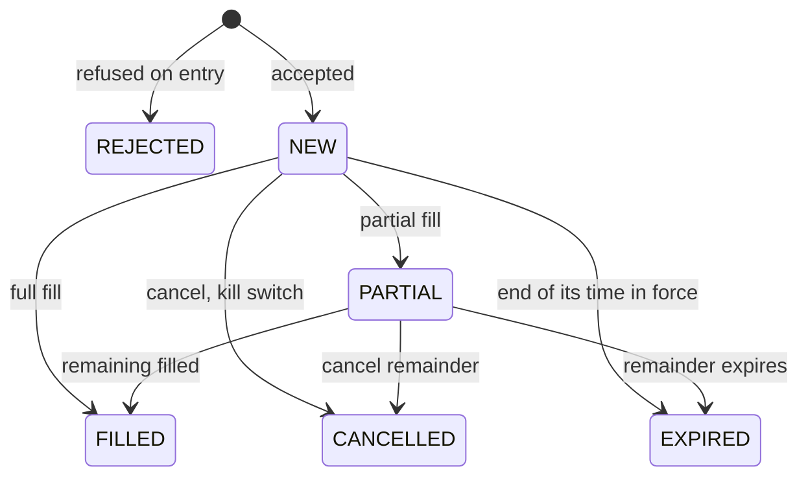

# Cancelling & Managing Orders

## Objective

Master the `STATUS`, `ORDERS`, and `CANCEL` commands for understanding gateway
state, inspecting resting orders, and managing the order lifecycle.

 


!!! abstract "Background reading"
    - [ALF Console](../participant-guide/part-2-orders/010-the-trader-console.md)
    - [The Admin Console and Exchange Commands](../operator-guide/part-3-run/020-admin-console-and-commands.md)

## Prerequisites

- Chapters 01–07 completed.
- At least one connected trader gateway with resting orders to manage.

 

## Exercise 1: Cancel a Resting Order

Place an order and then cancel it:

```
[TRADER01]> NEW|SYM=TSLA|SIDE=BUY|TYPE=LIMIT|QTY=100|PRICE=248.00|TIF=DAY|TAG=CXL-ORDER-001
```

Note the `order_id`, then:

```
[TRADER01]> CANCEL|ID=<order_id>|RTAG=CXL-REST-001
```

Expected: `CANCELLED <order_id> rtag=CXL-REST-001`.

`RTAG` identifies this cancel request. The engine echoes it on the `CANCELLED`
response or rejected ACK, which makes retries and concurrent cancel tests easier
to audit.
The original order `TAG` is echoed separately, so a client can tell which order
was acted on and which cancel request completed.

:material-checkbox-blank-outline: **Checkpoint:** order cancelled; `ORDERS` no longer lists it as resting.

 

## Exercise 2: Cancel a Partially Filled Order

You need an order that fills only in part, so control what is on offer. From the
operator console clear AAPL (stop any `pm-mm-bot` quoting it), and have
`TRADER02` offer 300 shares:

```
[GW_ADMIN|ADMIN]> CANCEL_SYM|SYM=AAPL
[TRADER02]> NEW|SYM=AAPL|SIDE=SELL|TYPE=LIMIT|QTY=300|PRICE=150.10|TIF=DAY
```

1. Place a large limit buy at the same price. It takes the 300 and the other
   700 rest:
   ```
   [TRADER01]> NEW|SYM=AAPL|SIDE=BUY|TYPE=LIMIT|QTY=1000|PRICE=150.10|TIF=DAY
   ```
   Expected: `FILL … qty=300 @150.1  remaining=700  [PARTIAL]`.

2. Cancel the remainder:
   ```
   [TRADER01]> CANCEL|ID=<order_id>|RTAG=CXL-PARTIAL-001
   ```

Expected: `CANCELLED <order_id> rtag=CXL-PARTIAL-001`. The unfilled 700 are gone; the
300 that filled stay executed. `ORDERS` shows the order as `CANCELLED` with
`Qty` 1000 and `Rem` 700 — the quantity that was still open when it was
cancelled, not the filled part.

:material-checkbox-blank-outline: **Checkpoint:** cancel succeeds; filled qty preserved.

 

## Exercise 3: Compare STATUS and ORDERS

Place a fresh resting order so the gateway has something to inspect:

```
[TRADER01]> NEW|SYM=MSFT|SIDE=BUY|TYPE=LIMIT|QTY=25|PRICE=419.00|TIF=DAY
```

First run `STATUS`:

```
[TRADER01]> STATUS
```

`STATUS` gives a quick gateway summary: gateway ID, whether it is authenticated,
known symbols, cached order counts by lifecycle state (for example
`CANCELLED=3, NEW=1`), cached and active quote legs, and position symbols.
It is useful for a fast health check, but it is not the detailed order table.

Now inspect the actual orders:

```
[TRADER01]> ORDERS
```

`ORDERS` is the gateway command for detailed order inspection. It displays order
ID, symbol, side, type, TIF, price, quantity, remaining quantity, and status for
orders belonging to your gateway.

Use `STATUS` when you need a quick health pulse. Use `ORDERS` when you are
debugging one specific order lifecycle.

:material-checkbox-blank-outline: **Checkpoint:** `STATUS` shows summary counts; `ORDERS` shows the full order row and ID.

 

## Exercise 4: Inspect Resting Order Details

```
[TRADER01]> ORDERS
```

Find your order in the table. The response includes:

- `symbol`, `side`, `type`, `price`, `qty`
- remaining quantity
- `status` (NEW, PARTIAL, FILLED, CANCELLED, REJECTED, EXPIRED)
- `tif`, last update time

:material-checkbox-blank-outline: **Checkpoint:** `ORDERS` returns full details for each resting order.

 

## Exercise 5: Cancel a Non-Existent Order

```
[TRADER01]> CANCEL|ID=DOES_NOT_EXIST|RTAG=CXL-MISSING-001
```

Expected: rejection, shown in the console as
`REJECTED  DOES_NOT_EXIST code=ORDER_NOT_FOUND rtag=CXL-MISSING-001  Order not found`
(`REJECT_CODE` is the field's name on the wire).

:material-checkbox-blank-outline: **Checkpoint:** error message returned cleanly.

 

## Exercise 6: Cancel Another Gateway's Order

Try cancelling an order belonging to TRADER02:

```
[TRADER01]> CANCEL|ID=<trader02_order_id>|RTAG=CXL-NOTOWNER-001
```

Expected: rejection — you can only cancel your own orders:
`code=NOT_OWNER  Cannot cancel an order owned by another gateway`.

:material-checkbox-blank-outline: **Checkpoint:** cross-gateway cancel rejected.

 

## Exercise 7: Admin Kill Switch

From the admin gateway, cancel all orders for a specific gateway:

```
[GW_ADMIN|ADMIN]> KILL|GW=TRADER01
```

The console reports `KILL OK  TRADER01  orders=<n>  quotes=<n>` — the number of
orders and of market-maker quote legs cancelled — and each cancelled order
appears on `TRADER01`'s console as `CANCELLED <order_id> reason=KILL_SWITCH`.

Or cancel all orders for a specific symbol across all gateways:

```
[GW_ADMIN|ADMIN]> CANCEL_SYM|SYM=TSLA
```

which answers `CANCEL_SYM OK  TSLA  orders=<n>  quotes=<n>`. Both commands
also clear market-maker quotes, which is why they are the quickest way to empty
a book before an experiment.

:material-checkbox-blank-outline: **Checkpoint:** admin commands successfully cancel orders.

 

## Exercise 8: Inspect SYMBOLS Metadata from Gateway

Request the symbol catalog:

```
[TRADER01]> SYMBOLS
```

The table shows each symbol's tick size and its market-maker obligation
settings (enforced or not, maximum spread in ticks, minimum quoted quantity) —
the parts of the configuration a trader needs while trading.

:material-checkbox-blank-outline: **Checkpoint:** you can explain how `SYMBOLS` complements config-file inspection during operations.

 

## Order Lifecycle Summary



`EXPIRED` is the engine ending an order because its time in force ran out —
a `DAY` order at the close, an `ATO`/`ATC` order after its auction — as
opposed to `CANCELLED`, which is someone's decision.

 

## Reflection

Why does the operator's `KILL|GW=<gateway_id>` cancel every order for an entire gateway
rather than requiring one CANCEL per order? In what operational scenario
(think: a runaway bot or a disconnected trader) does that bulk-kill behavior
matter most?

## Further Reading

- [ALF Console (pm-alf-console)](../participant-guide/part-2-orders/010-the-trader-console.md)
- [Message Types (system.symbols)](../protocols-and-clients/part-5-message-reference/010-message-reference.md)
- [ALF Protocol — Cancellation Semantics](../protocols-and-clients/part-2-specifications/010-alf.md)

 

**Next:** [09 — Market Making](090-market-making.md)
