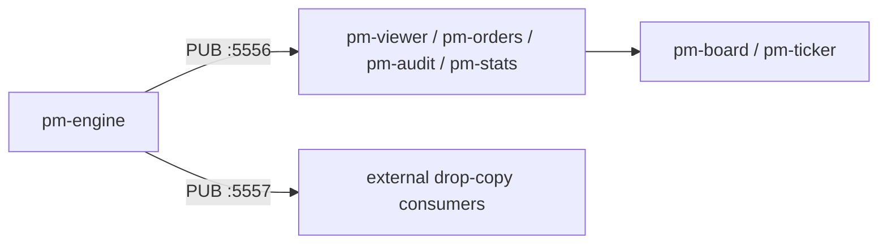

# Market Data & Drop Copy

## Objective

Observe real-time market data with the current EduMatcher tools and understand
where the engine's drop-copy feed fits into the architecture.

 


!!! abstract "Background reading"
    - [Drop Copy](../protocols-and-clients/part-3-session-behaviour/060-drop-copy.md)
    - [DC Gateway](../operator-guide/part-5-gateways/060-drop-copy-gateway.md)
    - [DC Spy CLI](../protocols-and-clients/part-4-writing-clients/040-the-spy-tools.md)

## Prerequisites

- Chapters 01–12 completed.
- Engine and at least one trader gateway active so events are visible, and
  the AAPL market maker of chapter 12 still quoting, so the market orders
  below have something to trade with.

 

## Background

EduMatcher publishes two event streams from `pm-engine`:

- **PUB :5556** — primary market data: books, trades, session state, order events.
- **PUB :5557** — drop-copy feed: per-participant fill events for risk,
  compliance, and back-office consumers.

There is no separate `pm-drop-copy` process. The engine binds the drop-copy feed
itself when it starts.

 

This chapter looks at the two streams from the outside. The viewers that
turn the public stream into screens (`pm-viewer`, `pm-orders`, `pm-board`,
`pm-ticker`) get a chapter of their own,
[18 — Exchange Observer Processes](180-exchange-observer-processes.md).

## Exercise 1: Watch the Public Stream with pm-audit

Start the audit logger in terminal mode:

```bash
pm-audit --terminal
```

Execute a trade:

```
[TRADER01]> NEW|SYM=AAPL|SIDE=BUY|TYPE=MARKET|QTY=100
```

Watch `pm-audit` print the resulting events, one line each:
`[order.fill.TRADER01]`, `[order.fill.MM_AAPL_01]`, `[trade.executed]`,
then `[book.AAPL]` and `[depth.AAPL]` as the book changes, plus the market
maker's quote traffic. Note that both traders' fills are on this public
stream — every subscriber can see them. That is what the drop-copy feed
below is *not*.

`pm-audit` also writes every line to its audit trail (`/data/audit.log` in
the container), which chapter 18 returns to. Stop it with `Ctrl-C` when you
have seen enough. This is the easiest way to observe the event stream
without writing a custom ZMQ subscriber.

:material-checkbox-blank-outline: **Checkpoint:** audit output shows the trade/order lifecycle events.

 

## Exercise 2: Watch the Drop-Copy Feed with `pm-dc-spy`

`pm-audit` reads the *public* feed on port 5556 and does not show the
drop-copy feed. The engine binds that one on port 5557 when it starts
(`pm-engine --verbose` logs `Drop copy PUB bound on port 5557`). EduMatcher ships two tools for
that, and it is worth knowing both:

| Tool | What it is | Use it for |
|---|---|---|
| `pm-dc-spy` | A CLI that subscribes to the engine's drop-copy PUB socket (5557) | Looking at the feed yourself, right now |
| `pm-dc-gwy` | A **gateway process** serving the DC1 protocol over TCP 5590 | Letting an *external* system consume drop copy, the way a real back office would |

Start the spy:

```bash
pm-dc-spy --format human
```

Then submit a trade from a trader console and watch the fill events appear,
one per side of the trade:

```
18:34:55.156  FILL     TRADER01   AAPL       #2      100@149.51       TAKER order_id=… trade_ids=['000012-000000002']
18:34:55.157  FILL     MM_AAPL_01 AAPL       #2      100@149.51       MAKER order_id=… trade_ids=['000012-000000002']
```

`#2` is that gateway's own drop-copy sequence number; `TAKER`/`MAKER` says
which side took liquidity.

:material-checkbox-blank-outline: **Checkpoint:** `pm-dc-spy` prints a fill
event for a trade you caused, and you can say why an external consumer would
use `pm-dc-gwy` on 5590 instead of subscribing to 5557 directly.

 

## Exercise 3: Subscribe to the Raw Socket

Understanding what the tools do for you is worth one level down. Connect a
minimal ZMQ subscriber to the same socket `pm-dc-spy` reads:

The snippet needs the `zmq` Python package (`pyzmq`). The container shell's
`python` has it; in a Poetry checkout use `poetry run python`, and with
`pipx` use `pipx runpip edumatcher`'s interpreter or `pip install pyzmq` in a
virtual environment. Stop `pm-dc-spy` first (`Ctrl-C`) or run this in another
terminal.

```bash
python - <<'PY'
import json
import zmq

ctx = zmq.Context()
sock = ctx.socket(zmq.SUB)
sock.connect("tcp://127.0.0.1:5557")
sock.subscribe(b"drop_copy.event.")

print("listening on drop_copy.event.*")
for _ in range(10):
    topic, payload = sock.recv_multipart()
    msg = json.loads(payload)
    print(topic.decode(), "seq=", msg.get("seq"), "gateway=", msg.get("gateway_id"),
            "event_type=", msg.get("event_type"), "trade_ids=", msg.get("trade_ids"))
PY
```

While this is running, execute a trade from `TRADER01` in another terminal:

```
[TRADER01]> NEW|SYM=AAPL|SIDE=BUY|TYPE=MARKET|QTY=100
```

You should see one `drop_copy.event.<gateway_id>` message per participant on
each side of the trade, stamped with a `seq` that counts that gateway's own events (each gateway has its own counter starting at 1, so the two sides of one trade carry numbers from different streams).
Each message also carries `trade_ids`, the durable public trade ID that lets a
risk or clearing consumer correlate its private execution with `trade.executed`.

:material-checkbox-blank-outline: **Checkpoint:** you received at least one drop-copy message directly from port 5557, distinct from anything `pm-audit` printed on port 5556.

 

## Exercise 4: Compare Public Events and Drop-Copy Purpose

Put the two side by side:

| Consumer | Source | Purpose |
|----------|--------|---------|
| `pm-audit --terminal` | PUB :5556 | Full event stream for inspection/logging |
| `pm-viewer`, `pm-orders`, `pm-board` (chapter 18) | PUB :5556 | Screens built from the public stream |
| `pm-dc-spy`, your raw subscriber | PUB :5557 | Per-participant fill feed for risk/compliance |
| `pm-dc-gwy` | TCP :5590 | The same feed for an external back office |

:material-checkbox-blank-outline: **Checkpoint:** explain why drop-copy is separate from the public market-data stream.

 

## Key Architecture



 

## Reflection

Why does the engine publish drop-copy events on a **separate** socket
(`:5557`) rather than mixing them into the same `:5556` PUB feed that
viewers, orders, audit, and stats all subscribe to? What operational problem
would arise for a compliance drop-copy consumer if it shared a socket with
high-volume book/viewer traffic?

## Further Reading

- [Messages](../protocols-and-clients/part-5-message-reference/010-message-reference.md)
- [Drop Copy](../protocols-and-clients/part-3-session-behaviour/060-drop-copy.md)
- [Drop-Copy Gateway (`pm-dc-gwy`)](../operator-guide/part-5-gateways/060-drop-copy-gateway.md)
- [Drop-Copy Spy CLI (`pm-dc-spy`)](../protocols-and-clients/part-4-writing-clients/040-the-spy-tools.md)
- [Processes, Environment and Ports](../reference-manual/part-1-command-line/010-processes-environment-and-ports.md)
- [CALF Protocol Reference](../protocols-and-clients/part-2-specifications/030-calf.md)
- [Market Data Feed](../protocols-and-clients/part-3-session-behaviour/030-calf-market-data-feed.md)

**Next:** [14 — AI Traders & News](140-ai-traders.md)

For a fuller hands-on tour of every viewer and observer process, see
[18 — Exchange Observer Processes](180-exchange-observer-processes.md).
