## How a Financial Exchange Works

**A Conceptual Introductions**

> *No code. No fear. Just the concepts you need to understand a financial exchange.*

---

## Part I: Foundation: Markets, History, and Participants

*Context, vocabulary, and the people that define exchange markets, the foundation you need before the mechanics make sense.*

---

!!! note "Historic Notes"

    In 1609, a Dutch merchant named Isaac Le Maire organised a consortium of traders to sell shares in the Dutch East India Company (VOC) that they did not yet own. The plan was to drive down the price and buy the shares back cheaply before delivery, the first recorded large-scale short selling operation in financial history. The scheme was brazen enough that the Dutch authorities issued an edict banning the practice the following year, in 1610. The ban failed. Le Maire was undaunted: he had grasped something fundamental about financial markets that would take regulators centuries to fully accept. Markets are not just places where things are bought and sold. They are environments in which participants constantly probe the rules, exploit information asymmetries, and invent instruments to express views that the market has never had to handle before. The job of exchange infrastructure, the order books, the matching engines, the risk controls, and the audit trails, is to provide a fair, stable, and trustworthy arena for all of this to happen, without breaking when the participants are clever, aggressive, or occasionally reckless.

    Every section of this Part can be traced, directly or indirectly, back to what was happening in Amsterdam in 1602, when the VOC issued what are widely regarded as the world's first publicly traded shares. The primary market, the secondary market, the concept of equity, the vocabulary of long and short, the role of brokers, the need for a central marketplace, it was all there, in embryonic form, four centuries ago. 
    
    Part I builds that foundation.

---


**Part Summary:**

Build the conceptual base: why exchanges exist, how capital formation connects to secondary trading, how market language evolved, and who the key participants are in modern venues.

**Learning Objectives:**

- Explain the economic purpose of exchanges in the broader capital-raising cycle.
- Distinguish primary vs secondary markets and debt vs equity at a practical level.
- Use core market vocabulary confidently in historical and modern context.
- Identify major participant types and their incentives in real-world exchange ecosystems.

**Content:**

- Before the Exchange: How Companies Raise Capital
- What Is a Financial Exchange, and Why Does It Exist?
- The Language of the Market: A Short History
- The Participants
- A Brief Tour of Real-World Exchanges
- Listing and Delisting Mechanics


## Before the Exchange: How Companies Raise Capital


To understand why a financial exchange exists, you first need to understand why anyone bothers issuing shares in the first place. This chapter is a short detour into basic corporate finance: the world your exchange is built to serve.

### The Problem of Growth

Imagine a small software company. It has a product, a team, and paying customers, but it wants to grow: hire more engineers, open offices in new countries, and invest in research that will take three years to generate revenue. All of that costs money, far more money than the company currently earns in a month or a quarter.

Where does that money come from? There are three broad categories of answer, and real companies use all three at different stages of their lives.

### Option 1: Retained Earnings (Self-Funding)

The simplest source of capital is the company's own profits. If the company earns more than it spends, it can save that surplus and invest it in growth. This is called **retained earnings**, profits "retained" in the business rather than distributed to owners.

Self-funding is attractive because it involves no outside parties and no obligations. The problem is that it is slow. If the opportunity is time-sensitive, a competitor is building the same product, or a market window is closing, waiting years to accumulate enough internal cash may mean losing the race. Most high-growth opportunities require more capital, faster, than retained earnings can provide.

### Option 2: Debt, Loans and Bonds

The second option is to borrow money. Borrowed money must be repaid, with interest [3]. The cost of borrowing (the interest rate) depends on how creditworthy the borrower is: established, profitable companies with predictable revenues can borrow cheaply; young, risky startups may not be able to borrow at all, or only at very high interest rates.

**Bank loans** are the most familiar form of debt. A company borrows a sum from a bank and repays it over time. This works well for small amounts and short timeframes, but a single bank may not be willing, or able, to provide hundreds of millions of dollars to a single borrower.

**Bonds** solve the scale problem by spreading the borrowing across many lenders. A bond is a standardised piece of debt. A company issues a bond with a **face value** (say, $1,000), a **coupon rate** (say, 5% per year), and a **maturity date** (say, 10 years from now). The investor who buys the bond lends the company $1,000 today. In return, the company promises to pay $50 per year (5% of $1,000) as regular interest payments (these periodic payments are called **coupons**, named after the physical coupon slips investors used to cut off and redeem before the digital age), and to repay the full $1,000 when the bond matures in 10 years.

A large company might issue hundreds of thousands of these bonds at once, raising hundreds of millions of dollars from many different investors. Those investors may want their money back before the bond matures, so they need a way to sell the bond on to someone else. That is why bonds, just like shares, trade on exchanges and other electronic markets.

**The key characteristic of debt:** the company has an unconditional obligation to make the promised payments. If it cannot, it is in default, which can lead to bankruptcy proceedings. Bondholders are **creditors**: they have a legal claim against the company's assets. In a bankruptcy, creditors get paid before the company's owners.

### Option 3: Equity, Selling Ownership

The third option is fundamentally different in character: instead of borrowing money and promising to repay it, the company sells a piece of itself.

**Equity** is ownership. When a company issues **shares** (also called **stock** in American English, or **equities** in market terminology), it is dividing ownership of the business into small, standardised units and selling those units to investors [3]. Each unit, each share, represents a proportional claim on the company's assets, earnings, and future.

Here is the important distinction from debt: **there is no promise of repayment**. If you buy a share in a company, the company does not promise to give your money back. It does not promise to pay you any specific amount at any specific time. What you receive instead is ownership.

**What does ownership actually mean?**

- **Residual claim on profits:** If the company earns a profit and its board of directors decides to distribute some of that profit to owners, shareholders receive their proportional share as a **dividend**. Dividends are not guaranteed, the board may decide to reinvest profits in the business instead. But shareholders are entitled to whatever is left over after all expenses and debts are paid. This "residual" or "leftover" claim is the defining characteristic of equity.

- **Capital appreciation:** If the company grows and becomes more valuable, each share becomes worth more. A shareholder who paid $10 for a share and sells it when the company is worth twice as much can sell at roughly $20, realising a **capital gain**. The theoretical upside of an equity position is unlimited, a share can appreciate many times over (Apple shares, adjusted for the company's five stock splits since its 1980 IPO at $22, have multiplied in value more than a thousand times). Compare this to a bond, where the return is capped at the promised coupon rate.

- **Voting rights:** Shares typically carry the right to vote on major corporate decisions, electing the board of directors, approving mergers and acquisitions, and other significant matters. Owning 51% of the shares means controlling a majority of votes, which is why "controlling stake" is a meaningful concept.

- **Limited liability:** If the company goes bankrupt, shareholders can lose the money they invested, but nothing more. They are not personally liable for the company's debts. This protection ("limited liability") is a fundamental feature of the modern corporation and one reason equity investment became widespread.

- **Market capitalisation (market cap):** The total market value of all a company's outstanding shares, calculated as share price multiplied by the total number of shares in existence. If Apple has approximately 15.4 billion shares outstanding and each trades at $190 (roughly its position in 2023), Apple's market cap is 15.4 billion × $190 ≈ $2.9 trillion. Market cap is the most widely used shorthand for a company's size. When rankings refer to "the world's largest exchange by listed market cap," they are summing the market caps of every company listed there.

**What does ownership mean for the company?**

Issuing equity capital has an important advantage over debt: the company is not obligated to make regular payments, and there is no maturity date on which it must repay anything. This flexibility is why many high-growth companies prefer equity, they can invest in long-term projects without the burden of fixed interest payments.

The trade-off is **dilution**: selling shares means selling a portion of the company. The founders and early investors own a smaller fraction of the whole. If a founder owned 100% of a company worth $1 million and raises $250,000 by selling a 20% stake to new investors, the company is now worth $1.25 million ($1 million of existing business value plus the $250,000 cash just raised). The founder owns 80% of $1.25 million, still $1 million in absolute terms, but a smaller fraction of the whole. The investors own 20% of $1.25 million = $250,000, exactly what they paid. Managed carefully, dilution is acceptable; managed carelessly, founders can lose control of their own companies.

**Common stock and preferred stock**

In practice, not all shares are equal. Most individual investors (often called **retail investors**) hold **common stock** (called **ordinary shares** in UK and European markets), which carries voting rights and a residual claim on profits. **Preferred stock** (or **preference shares**) is a different class: typically no voting rights, but a higher-priority claim on dividends and assets in a liquidation. Preferred holders are paid before common stockholders, though still after bondholders. Venture capital investors almost always receive preferred stock in early-stage companies, giving them downside protection that common stockholders lack [3].

When a company IPOs, most preferred shares convert to common shares. For exchange system developers, the class distinction matters because instruments are classified, regulated, and referenced differently. When you see "AAPL" on an exchange, it refers specifically to Apple's common stock. Preferred shares, when a company lists them, trade under a separate ticker, typically the common ticker plus a series suffix (a hypothetical company "XYZ" might list its Series A preferred as "XYZ-PRA" or "XYZ.PR.A", depending on the data vendor's convention).

### The Difference Between Debt and Equity

A useful mental model: when a company issues bonds, it is renting capital, borrowing it with the obligation to return it. When a company issues equity, it is selling a permanent stake, the investor becomes a partial owner, sharing in the future of the business.

The consequence:

| | **Debt (Bonds, Loans)** | **Equity (Shares)** |
|---|---|---|
| Relationship to company | Lender / Creditor | Owner |
| Return | Fixed interest (coupon) | Variable (dividends + capital gains) |
| Repayment obligation | Yes, principal returned at maturity | No |
| Payment priority in bankruptcy | Paid first | Paid last (residual) |
| Risk to investor | Lower (predictable return) | Higher (no guaranteed return) |
| Dilutes ownership? | No | Yes |
| Upside potential | Capped (only the promised coupons) | No ceiling (a successful company's shares can rise many times over) |

A sophisticated investor builds a **portfolio** that mixes both: bonds for predictable income and capital preservation, equities for growth potential. The entire investment industry, pension funds, mutual funds, hedge funds, is built around managing this balance.

### Going Public: The Initial Public Offering (IPO)

Early in a company's life, its shares are held by a small, private group: the founders, early employees (who often receive shares as part of their compensation), and **venture capital (VC) investors** who provided early funding in exchange for equity stakes. These shares are not available to the general public; the company is **private**.

At some point, usually when the company has proven its business model and needs a large infusion of capital for the next phase of growth, the company may choose to **go public**: to offer its shares for sale to anyone who wants to buy them. This event is called the **Initial Public Offering (IPO)**.

In an IPO:

1. The company works with **investment banks** to **underwrite** the offering. Underwriting means the banks agree to buy all the shares at a guaranteed price and immediately sell them on. This guarantee means the company receives its cash even if investor demand is weaker than expected. In practice, the banks first conduct a **roadshow**, a series of presentations to large **institutional investors** (pension funds, insurance companies, fund managers), to gauge demand and set the final price. They rarely actually get stuck holding the shares.
2. New shares are created and sold, with the proceeds going directly to the company. Often some existing shares are sold alongside them by early investors who are "cashing out" part of their stakes; that money goes to those investors, not to the company.
3. The company's shares are listed on a stock exchange, NYSE, NASDAQ, LSE, or another regulated market.
4. From that moment, anyone can buy or sell the shares through the exchange.

Some of the largest IPOs in history by proceeds raised illustrate the scale: Saudi Aramco raised $25.6 billion in its December 2019 IPO on the Saudi Exchange (Tadawul), later increased to about $29.4 billion when the underwriters exercised their over-allotment option (the right to sell extra shares when demand is strong, covered in *Listing and Delisting Mechanics*); Alibaba raised $21.8 billion on NYSE in 2014, about $25 billion including the over-allotment; Arm Holdings raised $4.9 billion on NASDAQ in September 2023. Each of these companies brought enormous new pools of capital onto public markets. 

All of them were dwarfed in June 2026, when SpaceX listed on NASDAQ (ticker: SPCX) in the largest IPO by proceeds in history. Priced on 11 June at $135 per share, raising about $75 billion before the over-allotment, the offering implied a valuation of approximately $1.77 trillion; on its first trading day, 12 June, the stock closed at about $161, up roughly 19%, putting the company's market cap at about $2.1 trillion [Initial public offering of SpaceX, Wikipedia; CoinDesk, 11 June 2026]. Note that the price of a single share says nothing about how large or how good the company is. It is simply the total valuation divided by the number of shares, and the company and its underwriters can choose the share count almost freely. A $135 share in a $1.77 trillion company is perfectly normal. (*The Language of the Market* explains the old "blue chip" rule of thumb, which used $200 a share as the mark of a premium stock in the 1920s. That was a figure of its era, never a rule, and it tells you nothing about a company listing a century later.)

### The Primary Market vs. the Secondary Market

This distinction is critical, and it is where the exchange fits in.

The **primary market** [3] is where new securities are created and sold for the first time. In an IPO, the company sells newly issued shares directly to investors, and the company receives the money. A bond issuance is also a primary market transaction, new bonds are created and the company receives the loan proceeds.

The **secondary market** [3] is where investors buy and sell securities that already exist, trading with each other rather than with the company. When you buy shares of Apple on NASDAQ today, Apple does not receive your money. The person selling you those shares receives it. Apple issued those shares long ago; they have been trading between investors ever since.

**The stock exchange is the best-known venue of the secondary market.** It is the most visible and most tightly regulated one, but not the only one. Securities also change hands **over the counter (OTC)**, meaning directly between two parties (usually through a dealer) rather than on an exchange, in private transactions, and on alternative trading systems, which the next chapter introduces. In this book, when we say "the exchange," we mean a regulated, central marketplace where the waiting orders are visible to everyone (a **lit** venue). That is where the ideas this book builds up, order books, matching engines and price-time priority, apply most directly.

This insight is important: the exchange does not help companies raise money directly. It helps investors trade securities they already own. But without the secondary market, the primary market would barely function. Here is why:

Who would invest in a company's IPO if they knew they could never sell their shares? Who would buy a 10-year bond if they had to hold it for exactly 10 years with no way out? The existence of a liquid secondary market, a place where you can sell whenever you want at a fair price, is what makes investors willing to commit capital to companies in the first place. The exchange provides the exit. And the availability of an exit enables entry.

**The primary market and secondary market form a virtuous cycle:**

- Companies raise money in the primary market because investors are willing to commit capital.
- Investors commit capital because the secondary market lets them exit when they choose.
- The secondary market functions well because many investors participate.
- Many investors participate because companies with real value list their shares there.

The stock exchange, the subject of this entire document, is the infrastructure that makes this cycle turn.

```{.mermaid width=350}
flowchart TD
    CO["🏢 Company"]
    PM["Primary Market\nIPO / follow-on offering\nCompany receives cash"]
    EX["Stock Exchange\nSecondary Market"]
    INV["Investors\nBuyers and Sellers"]

    CO -- "Issues new shares" --> PM
    PM -- "Shares delivered to first investors" --> INV
    INV -- "Buy and sell shares\namong themselves" --> EX
    EX -- "Price discovery\nand liquidity" --> INV
    EX -. "No cash flows back\nto the company" .-> CO
```

### A Word on Other Instruments

The same framework applies to other instruments:

- **Bonds** trade on bond markets (some on exchanges, most over the counter) after issuance. Investors can sell their bonds before maturity, receiving the current market price rather than waiting for repayment.

- **Futures and options** are not claims on existing assets at all; they are contracts about future transactions [12] [13]. A **future** is a binding agreement to buy or sell something (a barrel of oil, a stock index, a government bond) at a fixed price on a set date later on. An **option** gives its buyer the *right*, but not the obligation, to buy or sell at a fixed price before a set date. Both are called **derivatives**, because their value is derived from the price of something else, their **underlying**. Their markets have their own logic, but the exchange's role (central matching, price discovery, fairness) is the same.

- **Exchange-Traded Funds (ETFs)** are baskets of shares (or bonds, or commodities) that themselves trade as a single share. iShares, Vanguard, and SPDR products are examples. ETFs trade on exchanges exactly like individual stocks.

- **Market indices** are calculated measures of the aggregate performance of a defined basket of securities. The **S&P 500** tracks 500 large US companies (in practice slightly more than 500 share classes, because a few companies have two listed classes) and is the most closely followed equity index in the world, first published in its current form by Standard & Poor's in 1957. The **Dow Jones Industrial Average (DJIA)**, dating to 1896, tracks 30 large US companies. The **NASDAQ Composite** tracks almost all common stocks listed on NASDAQ. Indices themselves are not directly tradeable, but **index futures** (on CME), **index options** (on Cboe), and **index ETFs** allow investors to trade the performance of a whole index with a single instrument. When a US portfolio manager says "the market is up 0.8% today," they almost always mean the S&P 500. When exchange system developers build risk calculations or position monitors, index levels are frequently the benchmark against which positions are marked.

With this foundation in place, understanding what a share is, why companies issue them, and what role the exchange plays, we can now look at the mechanics of how an exchange actually operates.


## What Is a Financial Exchange, and Why Does It Exist?


### The Core Problem

Imagine you own 1,000 shares of a technology company (you understand now what that means: you own a tiny fraction of that company, acquired when you bought the shares from a previous owner on the secondary market) and you want to sell them. Somewhere out there, someone wants to buy exactly 1,000 shares of that same company at roughly the price you have in mind. The problem is finding each other.

Before modern exchanges existed, this "finding" problem was enormous. Stock trading happened in coffee houses, in the street (London's brokers congregated in the narrow lane called Exchange Alley and its coffee houses), or through networks of personal contacts. One of the first places on record was Jonathan's Coffee House, the forerunner of the London Stock Exchange, opened around 1680 by Jonathan Miles; Jonathan's became the primary gathering place for stock brokers [10]. The brokers had not come entirely voluntarily: in the 17th century they were not allowed in the Royal Exchange, reportedly because of their rude manners, so they took their business, and their noise, to the coffee houses nearby. In 1698 a broker at Jonathan's named John Castaing began publishing a regular list of prices, *The Course of the Exchange*: arguably the first market-data feed, with a latency of several days.

Even so, prices were inconsistent: you might sell at one price while, moments later, someone else sold the same shares at a very different price. There was no guarantee you were getting a fair deal, and there was no way to know what "fair" even meant.

> **Auctions by the Candle**
>
> Garraway's Coffee House was opened by Thomas Garway and famed for being one of the first places in England to sell tea (from 1657). It was rebuilt after the Great Fire of London in 1666. While Jonathan's focused heavily on shares, Garraway's specialised in commodities and was a favourite venue for auctions, including the Hudson's Bay Company's first fur sale in 1671.
>
> Garraway's was legendary for its unique bidding system: an auctioneer would light an inch of tallow candle, and the last bid placed before the flame flickered out won the goods. [Candle Auction](https://en.wikipedia.org/wiki/Candle_auction)

The golden era of the informal Exchange Alley coffeehouses came to a catastrophic halt on March 25, 1748, when a massive fire broke out in Cornhill, destroying Jonathan's, Garraway's, and nearly 100 surrounding buildings. Though both shops were eventually rebuilt, the financial markets were rapidly moving toward formal, dedicated corporate buildings, leaving the casual coffeehouse model behind. 

A financial exchange solves this problem by acting as a **centralised marketplace**, a single place where all buyers and sellers come together, where prices are visible to everyone, and where agreed rules govern who trades with whom at what price. The NYSE traces its origins to an agreement signed in 1792 under a buttonwood tree on Wall Street [10]; NASDAQ launched in 1971 as the world's first electronic stock market [10]. Both exist to solve the same fundamental problem: matching buyers with sellers fairly and efficiently.

Exchanges are the most visible places where buyers and sellers are matched, but not the only ones. **Over-the-counter (OTC) markets** (where participants negotiate directly with each other, usually through a dealer), **Alternative Trading Systems (ATSs)** (privately run electronic marketplaces that are regulated more lightly than exchanges; the **dark pools** you will meet later are ATSs that do not show their waiting orders to anyone), **Electronic Communication Networks (ECNs)** (an early kind of ATS that matched orders automatically and showed them publicly), and **internalisers** (brokers who match client orders internally against their own inventory) all match trades too. The concepts in this book apply most directly to regulated exchanges, but the same vocabulary (order book, spread, price-time priority, all explained in Part II) is used across all these venues.

### The Three Promises of an Exchange

Every exchange makes three implicit promises to its participants:

**1. Price discovery.** At any moment, the current price of an asset reflects the combined opinion of everyone currently willing to trade it. You can look at the market and see its best present estimate of what the asset is worth, not a guarantee of value, but an honest, public consensus.

**2. Liquidity.** You can convert your asset into cash (or vice versa) quickly, without having to wait indefinitely for a counterparty to appear. The exchange provides the infrastructure that makes counterparties findable.

**3. Fairness and transparency.** The rules for who trades first and at what price are known in advance, applied consistently, and visible to all participants equally. There is no backroom dealing.

### How Exchanges Are Regulated

Exchanges do not operate by custom alone. They are licensed and supervised by government regulators whose rules directly shape how exchange systems are designed and built.

In the United States, equity exchanges are overseen by the **Securities and Exchange Commission (SEC)**, established by the Securities Exchange Act of 1934 in the aftermath of the 1929 crash and subsequent Great Depression. The crash and its causes deserve a sentence of context here, because they explain why the SEC's mandate is what it is.

Between early 1928 and September 1929, the US stock market nearly doubled (the Dow peaked at 381.17 on 3 September 1929). Investors were buying heavily on **margin**, borrowing money to buy more stock than they could afford outright. When prices fall, the lender issues a **margin call**: put up more cash now, or the shares will be sold to repay the loan. When prices began to fall in October 1929, margin calls forced widespread selling. Selling drove prices lower, which triggered more margin calls, which drove more selling, the same feedback loop that automated portfolio insurance would recreate in 1987. The Dow Jones Industrial Average fell 89% from its 1929 peak to its trough of 41.22 in July 1932, and did not regain its 1929 peak until November 1954, a quarter of a century later. Thousands of banks failed. Millions lost their savings. The subsequent investigation found rampant stock manipulation, insider trading, misleading corporate disclosures, and conflicts of interest at every level of the market. The Securities Act of 1933 and the Securities Exchange Act of 1934 were Congress's direct response: transparency requirements, registration of securities, prohibition of fraud, and the creation of the SEC to enforce the rules. The exchange system you are building operates under the regulatory framework those 1930s laws set in motion.

Several regulations appear throughout this document and in most exchange codebases. It is worth naming them here:

- **Regulation NMS (National Market System, adopted 2005, phased in through 2007):** Its Order Protection Rule prohibits trading venues from executing an order at a price worse than the best displayed, immediately accessible quote on any other registered venue (a **trade-through**). This rule shaped the modern US landscape of well over a dozen registered equity exchanges competing for order flow, and it is the reason **smart order routing** exists: orders must reach wherever the best protected price is, not just the closest or the cheapest venue.

- **Regulation SHO (adopted 2004, in force from January 2005):** Governs **short sales** (selling shares you do not own but have borrowed, hoping to buy them back more cheaply later), including the **locate** requirement (broker-dealers must verify shares can be borrowed before accepting a short sale order) and delivery obligations.

- **Market Access Rule (Rule 15c3-5, adopted November 2010):** Requires broker-dealers providing market access to have pre-trade risk controls: maximum order sizes, credit limits, and the ability to cut off trading. It was proposed in January 2010, over concerns about "unfiltered" sponsored access in which clients' orders reached exchanges without passing through any broker checks; the May 2010 Flash Crash then added considerable urgency.

In Europe, the equivalent framework is **MiFID II (the second Markets in Financial Instruments Directive, together with its companion regulation MiFIR, applying from January 2018)**, which mandates **best execution** (brokers must get the best overall result for their clients, not just any result), controls on algorithmic trading (including a tested **kill switch**, a way to cancel all of a firm's orders at once), trade reporting, and reporting by **systematic internalisers** (banks and brokers that regularly trade against their own clients' orders). Any exchange system intended to operate in EU markets must comply.

Understanding which regulator and which rules apply is not just a legal matter. It is an engineering specification: audit trail formats, kill switch accessibility, pre-trade check requirements, and market data publication rules are all regulatory mandates, not optional features.

!!! note "The South Sea Bubble and the Bubble Act (1720)"

    In 1720, shares of Britain's South Sea Company rose from roughly £128 in January to nearly £1,000 by the summer, propelled by a scheme to convert government debt into company equity, before collapsing back below £200 by year-end. Parliament's response, the Bubble Act of 1720, prohibited joint-stock companies from operating without a royal charter, and modern scholarship has established the uncomfortable detail that the Act was passed in June 1720, *before* the crash, with the South Sea Company's own support: its purpose was less to protect investors than to suppress rival companies competing for the same speculative capital. The Act stayed on the books for over a century (repealed 1825) and shaped, many argue held back, the formation of English companies. It is the earliest large-scale demonstration of two themes that recur throughout this book: securities regulation is often written in the shadow of a specific crisis, and the entities lobbying for a rule are not always the ones the rule appears to protect. The subsequent parliamentary inquiry of 1721, which uncovered bribery of ministers with company stock, also produced one of history's first insider-dealing scandals on the record. <br> &nbsp; <br>

    **References:** Ron Harris, "The Bubble Act: Its Passage and Its Effects on Business Organization," *Journal of Economic History* 54(3), 1994, https://www.jstor.org/stable/2123870

 

### Instruments: What Is Being Traded?

An exchange does not trade "things" in a physical sense. It trades **instruments**, standardised financial contracts representing ownership or obligation. The most common are:

- **Equities (stocks):** A share represents a small piece of ownership in a company. When you buy one share of Apple (ticker symbol: AAPL), you own a tiny fraction of Apple Inc. NYSE and NASDAQ are primarily equity exchanges.

- **Futures contracts:** An agreement to buy or sell something (oil, gold, a stock index) at a specified price on a specified future date. CME Group is one of the world's largest futures exchanges.

- **Options:** The right (but not the obligation) to buy or sell an instrument at a specific price before a specific date. Cboe is a major options exchange.

- **Foreign exchange (FX) pairs:** The price of one currency expressed in another, such as EUR/USD (how many US dollars one euro buys). FX trades largely on electronic networks rather than centralised exchanges, though the principles are similar.

An equity exchange handles each **symbol** (like AAPL, MSFT, or TSLA) as a separate tradeable instrument, each with its own independent **order book**: the list of buy and sell orders waiting to trade, which Part II explores in detail.


## The Language of the Market: A Short History


Before you read about participants, orders, and matching engines, it is worth pausing on something that will serve you well throughout your career working on exchange systems: **much of the language you will encounter in a codebase has historical roots that no longer match the physical reality**. Terms that sound arbitrary or old-fashioned are fossil words, the language of a world of wooden desks, brass bells, and paper ledgers that gradually evolved into the nanosecond world of today. Understanding where the words came from will make them stick, and will save you from wondering why a system full of cutting-edge software keeps referring to things like "the book," "the tape," and "the floor."

### The Physical Book

Before electronic trading systems, every major exchange operated a physical trading floor, and on that floor, for every stock, there was a person responsible for maintaining order: in NYSE's terminology, this was called the **specialist**. The specialist's job was to act as a **market maker** for their assigned stocks (a firm that always stands ready both to buy and to sell, which the next chapter describes in more detail), and to maintain, literally on paper, a record of every outstanding buy and sell order that had been submitted but not yet filled.

This record was kept in a physical **ledger book**. The book was divided into two columns: one for buy orders (bids) listing each buyer's offered price and quantity, and one for sell orders (asks) listing each seller's demanded price and quantity. The specialist would review the book, try to match buyers with sellers, and maintain an orderly market by quoting prices to floor brokers who came to trade.

When a broker wanted to buy shares and asked "what's the market in IBM?", the specialist would look at their book and say, for example, "fifty-five for five hundred, five hundred at fifty-five and a quarter", meaning the best available buyer was offering $55 for 500 shares, and the best available seller was asking $55.25 for 500 shares. The specialist was reading, live, from their paper book.

The physical book is gone. Every exchange in the world now maintains its order book in computer memory, with data structures designed for nanosecond access. But the **name** has survived completely intact. When developers and traders today say "the book," "working an order into the book," "resting in the book," or "taking from the book," they are using the exact same language that floor traders used when pointing at a physical ledger. The order book is one of the purest examples of terminology that crossed from physical to digital without losing a syllable.

### Open Outcry and the Pit

On exchange floors like CME Group's in Chicago, trading in futures contracts was conducted through **open outcry**, a method where traders stood in a sunken circular area called a **pit** and literally shouted their bids and asks at each other, using a combination of voice and hand signals to communicate price, quantity, and direction. The noise was enormous. The system worked because the pit was small enough that everyone could hear and see everyone else.

The CME Group operated open outcry pits for decades. Some products, particularly certain agricultural and options contracts, continued in open outcry long after equity markets went fully electronic, largely because the pit handled complex, illiquid products where human negotiation had genuine advantages. (Equities never went *entirely* electronic either: the NYSE still runs a trading floor, though today it is a hybrid where people and machines work side by side.) CME closed most of its futures pits in July 2015 [9]. The remaining pits were shut in March 2020 as a COVID-19 precaution, and in May 2021 CME announced that most of them would never reopen; only the Eurodollar options pit was kept [CME Group press release, 4 May 2021]. The physical pit is where terms like "floor broker" (a broker who executes trades on the physical floor), "floor trader" (a trader who trades for their own account from the floor), and "pit committee" originated.

The terms survive in documentation, regulations, and informal industry speech even though the pits themselves are mostly silent now.

### The Ticker Tape

Before electronic screens, prices of completed trades were published via the **stock ticker**, a telegraph-based machine, invented by Edward Calahan in 1867 [15] and later improved by Thomas Edison, that printed a continuous stream of abbreviated stock symbols and trade prices on a narrow paper tape. The tape moved fast (hence "ticker", the machine made a ticking sound) and the strip of paper would pile up on the floor of brokerages around the country as trades printed in real time.

Reading the tape was a skill. A **tape reader** was someone who could watch the continuous stream of prices and volumes and infer what institutional buyers and sellers were doing, one of the earliest forms of technical analysis. An even earlier form of market observation appears in Joseph de la Vega's *Confusión de Confusiones* (1688) [4], the oldest known book about stock trading, written in Amsterdam about the VOC share market, which describes participants reading order flow and inferring intent from patterns of buying and selling.

The first telephones appeared on the NYSE floor in 1878, two years after Alexander Graham Bell's patent. The ticker itself kept getting faster, yet it still ran hours behind during the heavy selling of October 1929, and again, as the note below describes, in 1962. By the 1960s, electronic displays began replacing paper. Today, the "ticker" refers to the digital price feeds streaming across screens in every trading firm, brokerage, and financial news channel, and the **ticker symbol** (AAPL, MSFT, GOOG) is the abbreviated code printed on the old paper tape.

When you see terms like "tick" (the minimum price movement), "tick data" (a record of every trade), or "ticker plant" (the server infrastructure that publishes market data), you are using the language of a machine that ran on telegraph cables and printed on paper strips.

!!! note "The Kennedy Slide, the Lagging Tape, and the Study That Created NASDAQ (1962–71)"

    On 28 May 1962 the Dow fell 5.7% in a single session, then the second-largest one-day point decline on record, in what became known as the "Kennedy Slide." Operationally, the day's defining failure was informational: trading volume so overwhelmed the ticker that the tape ran far behind actual trading, meaning investors nationwide were making decisions on prices that no longer existed. The SEC's *Special Study of Securities Markets* (1963), a multi-volume examination already underway when the break occurred, documented the episode and, more consequentially, dissected the over-the-counter market's opaque, telephone-based quotation system, recommending that OTC quotations be automated. The NASD's answer to that recommendation went live on 8 February 1971 as NASDAQ, initially not a matching engine at all, but an automated *quotation display* system, exactly what the Special Study had prescribed. The lineage is worth stating plainly: the world's first electronic stock market exists because a regulator's post-crash study concluded that stale, inaccessible price information was itself a market-structure defect. Every market-data latency requirement in Part IV is a descendant of that conclusion.

    **References:** Kennedy Slide of 1962, Wikipedia, https://en.wikipedia.org/wiki/Kennedy_Slide_of_1962 


### Black Monday and the Origin of Circuit Breakers

On 19 October 1987, the Dow Jones Industrial Average fell **22.6%** in a single day (the broader S&P 500 fell 20.5%), the largest single-day percentage drop in the Dow's history. This event, known as **Black Monday**, remains the most severe one-day market crash on record. How today's circuit breakers work is explained in the *Risk Controls, Protecting the Market* chapter of Part III.

The crash was not driven by a single piece of bad news. It was amplified by automated **portfolio insurance** programmes, algorithmic selling strategies designed to protect institutional portfolios by automatically selling futures contracts as prices fell. As these programmes sold, prices fell further, triggering more programme selling, which pushed prices further down, a feedback loop that human traders could not interrupt. The lack of any coordinated mechanism to pause trading made the spiral self-reinforcing.

The Presidential Task Force on Market Mechanisms (the "Brady Commission"), reporting to President Reagan in January 1988, concluded that the absence of circuit breakers and coordinated pause mechanisms across markets had allowed the panic to become catastrophic. Its central recommendation was explicit: create automatic trading halts that could interrupt the feedback loop and give participants time to assess [Brady Commission Report, January 1988].

NYSE introduced the first market-wide circuit breakers in 1988 directly in response. The thresholds have been revised several times since (the current levels, 7%, 13% and 20% falls in the S&P 500, date from 2013), and they were put to a hard test in March 2020, when Level 1 was triggered four times in two weeks during the COVID-19 crash. The mechanism itself traces directly to that January 1988 report.

This history matters for exchange system developers because circuit breakers are not bureaucratic decorations. They are the engineering response to a proven systemic failure mode: automated systems amplifying each other into a catastrophic spiral. Every halt threshold, every resumption auction, every "do not accept orders during HALTED state" condition in a matching engine exists because of what happened on 19 October 1987.

### Settling Up: Settlement Periods and Why They Exist

**Settlement** is the moment a trade becomes final: the buyer receives the shares and the seller receives the money. It does not happen at the instant of the trade. The delay is written **T+N**: the trade date (T) plus N business days. Curiously, in the 1920s NYSE trades settled the very next day; as volumes outgrew the paper-based back offices the window was stretched, and from the 1960s until 1995 the US standard was **T+5**.

The historical reason settlement took multiple days has nothing to do with technology and everything to do with physical logistics. In the era of paper stock certificates, when you sold your shares, you had to physically deliver a paper certificate to the buyer, and they had to physically deliver cash or a cheque to you. Messengers on bicycles carried these documents between brokerage firms on Wall Street. Giving everyone five business days provided time for paperwork to move across Manhattan, be checked, and be processed.

As the industry moved to dematerialisation (electronic records replacing paper certificates) and electronic funds transfer, settlement windows shrank: T+5 became T+3 in 1995, T+2 in 2017, and T+1 on 28 May 2024 in the US [8], a return, after a century, to the next-day settlement of the 1920s. The "T+N" notation remains standard even as the N shrinks. Some markets are exploring same-day (T+0) settlement, though this requires that cash and securities be available at the exact moment of trading, a more demanding operational requirement.

!!! note "The Paperwork Crisis (1967–70): When the Back Office Closed the Market"

    In the late 1960s, American stock trading boomed. Average daily volume on the NYSE roughly doubled between 1965 and 1968, and on 1 April 1968 the exchange finally broke the single-day volume record set on 29 October 1929. The trading floor coped. The back offices did not. Every trade still meant a paper certificate travelling by messenger to be checked, re-registered and delivered, and by one industry estimate a single certificate could pass through as many as a hundred pairs of hands. Undelivered trades ("fails") piled up, certificates were lost, and dividends went to the wrong owners. The exchanges first shortened trading hours, and then, for months in the second half of 1968, the NYSE simply closed every Wednesday so that clerks could catch up. When volumes fell again in the 1969–70 bear market, brokers that had overspent on staff and computers could no longer cover their costs: by the end of 1970 roughly one in six US brokerage firms had failed, merged or been absorbed. Congress created the Securities Investor Protection Corporation (SIPC) in 1970 to protect customers of failed brokers, and the industry built the Depository Trust Company (1973), which immobilised certificates in a central vault and moved ownership by book entry instead. That is the root of the dematerialised settlement described above. The lesson for system builders is blunt: a market is only as fast as its slowest stage. A matching engine that can take more trades than settlement can process does not create capacity; it creates a backlog. <br>&nbsp;<br>

    **References:** Wyatt Wells, "Certificates and Computers: The Remaking of Wall Street, 1967 to 1971," *Business History Review* 74(2), 2000; Bank for International Settlements, "The US paper crunch, 1967–1970," *BIS Quarterly Review*, December 2007, https://www.bis.org/publ/qtrpdf/r_qt0712z.htm

### The Bid, the Ask, and the Spread

The two most fundamental prices in any market are the **bid** and the **ask** (also called the **offer** in some contexts). These are ancient words in the context of markets.

**Bid** comes from Old English *beodan*, meaning to announce, command, or offer. To bid for something is to announce the price you are willing to pay. A bidder at an auction makes a bid; a trader in a market makes a bid. The word has been used in commercial contexts for over a thousand years.

**Ask** (or offer) is the counterpart: the price at which someone is willing to sell. Asking a price for goods is as old as commerce.

The **spread** is the difference between the best bid and the best ask at any moment: if the best bid is $150.30 and the best ask is $150.35, the spread is $0.05. The spread is both a measure of market quality (tight spreads mean the market is liquid and efficient; wide spreads mean it is illiquid or uncertain) and the primary source of income for market makers, who earn the spread by continuously standing ready to buy at the bid and sell at the ask.

The phrase **"crossing the spread"** means submitting an order aggressive enough to trade immediately against an order that is already waiting in the book (a **resting order**). An investor who submits a buy order at $150.35 (the ask) rather than waiting at $150.30 (the bid) is crossing the spread and paying for the privilege of immediate execution. This small payment, a few cents, or a fraction of a cent in liquid markets, is the cost of immediacy, and it is the foundation of the market maker's business model.

### Blue Chips, Bulls, and Bears

Not all inherited terminology has to do with physical infrastructure. Some comes from adjacent worlds:

**Blue chip** stocks are large, well-established, financially sound companies, the most prestigious tier of the equity market. The term comes from poker: in casino chips, blue has traditionally been the highest denomination. The first recorded use in finance was by Oliver Gingold at Dow Jones in 1923, who described stocks trading at $200 or more per share as "blue chip stocks." [14]

**Bull market** (rising prices) and **bear market** (falling prices) are usually explained by how each animal attacks: a bull thrusts its horns upward, a bear swipes its paws downward. That makes a handy memory aid, but the documented history is more interesting. The market sense of "bear" is recorded in London from 1709, as a shortening of "bearskin jobber", after the proverb about selling the bear's skin before you have caught the bear. A bear, in other words, was originally a short seller: someone who sold stock for future delivery that he did not yet have, hoping the price would fall before he had to deliver. "Bull" appears as its partner from around 1720 [Online Etymology Dictionary, "bear"]. Today, by widely used convention rather than by any formal rule, a market that has fallen 20% or more from a recent peak is called a bear market, and a sustained rise of 20% or more from a trough a bull market.

**Going long** and **going short** describe the two directions a position can face, and the practice is far older than the words. **Long** means you own (or have agreed to buy) the asset: you gain if its price rises and lose if it falls. **Short** means you have sold something you do not own (or agreed to deliver something you do not yet have): you gain if the price falls, because you can buy it back more cheaply before you must deliver, and you lose if it rises.

The *words* are younger than you might expect. The sense of "short" as "having an insufficient quantity" is recorded in English from the 1690s, and the market phrase "to sell short", meaning to sell what the seller does not at the time possess, is attested by 1852 [Online Etymology Dictionary, "short"]; nineteenth-century American usage popularised the pair. The short seller is literally *short of* the goods, in the same word family as "shortage" or "falling short". "Long" came along as its natural opposite: well supplied, holding more than enough. (You will find more romantic origin stories online, about grain warehouses and the longevity of stored goods. They are pleasant, but no dictionary supports them.)

What *is* old is the practice. Forward contracts, promises to deliver goods at a future date for a price agreed today, were common in the grain and commodity trades of the 17th and 18th centuries, and a merchant who had promised more than their warehouse held was short in every sense that matters: they would need to buy before the delivery date, and they would profit only if prices had fallen in the meantime.

The Dutch East India Company (VOC), founded in 1602, whose shares traded in Amsterdam from that same year, pioneered many instruments still in use today: transferable shares, dividend payments, and a secondary market in those shares [5] [11]. It also became the arena for what is likely the first recorded large-scale short selling operation in financial history: in 1609, a merchant named Isaac Le Maire, himself a major VOC shareholder, organised a group of traders to sell VOC shares they did not own, betting the price would fall so they could buy them back cheaply before delivery [5]. The scheme was disruptive enough that the Dutch authorities banned the practice in 1610, the earliest known attempt to regulate it [5]. The ban did not stick; short selling has been controversial, periodically banned, and always present in markets ever since.

In the code, all of this collapses into a sign. A long position is a positive quantity, a short position a negative one, and a developer reading `position += signed_qty` in a clearing module is applying exactly the bookkeeping a 17th-century merchant would have recognised, even if the technology would be unrecognisable to them.


!!! note "Historic Notes"

    No episode in financial history is retold more often, or more loosely, than the Dutch tulip mania of 1636–37. The legend: a whole nation ruined, fortunes traded for single bulbs, the economy wrecked, and so on largely dissolves under archival scrutiny. Contract prices for rare bulbs did rise spectacularly through late 1636 and collapse in February 1637, but the trade was concentrated among a modest circle of merchants and craftsmen dealing in *forward contracts* on bulbs still in the ground, an early lesson that a derivative on an unharvestable underlying is a bet on a price, not a purchase of a thing. Archival work has found no wave of bankruptcies and no measurable damage to the Dutch economy; the most extreme prices in the popular telling trace to moralising pamphlets written *after* the crash, not to transaction records. The episode earns its place in this book twice over: as a genuinely early forward market discovering the hard way that contract enforceability matters (many February 1637 contracts were simply never honoured, and courts largely declined to enforce them), and as a standing reminder to check the primary record before repeating a market legend. <br>&nbsp;<br>

    **References:** 
    Peter M. Garber, *Famous First Bubbles: The Fundamentals of Early Manias* (MIT Press, 2000), <br>&nbsp;<br>
    Anne Goldgar, *Tulipmania: Money, Honor, and Knowledge in the Dutch Golden Age* (University of Chicago Press, 2007).


### The Operational Mechanics of Short Selling, Borrow and Locate

The historical explanation above describes the *economics* of short selling. The modern operational reality involves several additional steps that are invisible in the exchange's order book but fundamental to how clearing and settlement actually work.

**You must borrow before you short.** Before a participant can sell shares they do not own, they must make sure those shares can be borrowed from someone who does own them. The first step is called the **locate**: identifying a source of borrowable shares. In the US, Regulation SHO (in force since January 2005) requires broker-dealers to have reasonable grounds to believe the shares can be borrowed, so that they can be delivered on the settlement date, before accepting a short sale order. Selling short without a locate is called **naked short selling** and is prohibited for almost everyone (market makers have a narrow exception).

**Where the borrow comes from.** Shares available to borrow come primarily from long investors who hold shares in custody through a broker or a **prime broker** (a bank that provides lending, financing and safekeeping services to hedge funds and other professional traders). These holders consent (usually automatically through their account agreements) to their shares being lent out in exchange for a **lending fee**. The **custodian** (the bank or broker that holds the shares for safekeeping) or prime broker acts as go-between: they find willing lenders and lend the shares to the short seller. The short seller pays a daily lending fee (the **borrow rate**) while the position is open.

**Borrow rates and hard-to-borrow stocks.** Most large-cap, liquid stocks are "easy to borrow", borrow rates are near zero because many shares are available. Smaller, heavily-shorted, or thinly-traded stocks can be "hard to borrow", rates of 5%, 20%, or even higher per annum, applied daily. For a stock with a 50% annualised borrow rate, a short position held for one week costs roughly 1% just in borrowing costs, before considering any price movement. The difficulty of finding borrows can itself become a market signal: rising borrow rates indicate increasing short interest and limited available supply.

**Short recall risk.** The lender can recall their shares at any time (with short notice). If the lender sells their shares or instructs their custodian to recall the loan, the short seller must return the shares immediately, either by buying in the open market (a **buy-in**) or finding a new lender. In volatile markets, recalls at inopportune moments can force short sellers to cover at bad prices.

**Settlement obligation.** At settlement (T+1 in the US), the short seller must deliver the shares. They do not own them, they borrowed them. Their position at the clearing house shows a negative (short) holding. The **central counterparty (CCP)**, the clearing house that steps in between every buyer and seller (Part III explains it fully), makes sure delivery happens; if the short seller fails to deliver, the failed-settlement process applies.

**Why this matters for exchange developers.** The exchange's matching engine processes short sales exactly like any other sell order, the distinction between a short sale and a long sale is invisible at the order book level. The matching engine does not know or care whether the seller owns the shares. The borrow and locate process happens entirely outside the exchange, in the prime brokerage and custody infrastructure. However, short sales must be flagged: in the US, a short sale order must be marked "short" in the order message (usually a **FIX** message, the standard protocol most trading firms use to talk to exchanges), and the flag is kept in the exchange's audit trail. Some checks at the **gateway**, the exchange's front door for incoming orders, confirm that the flag is present.


### The Language Lives in the Code

These historical terms are not just in trading rooms and textbooks. They are in the source code. A developer reading an exchange codebase for the first time will find the following. A few of them (lots, ticks, sweeps and time-in-force codes) are explained properly in Part II; for now it is enough to see where the names came from.

- `bid_price`, `ask_price`, `spread`: the physical ledger's two columns, reduced to struct fields
- `lot_size`, `tick_size`: the standard trading quantity and the smallest allowed price step, conventions that grew up on the trading floors so that everyone was quoting the same units
- `aggressor_side`: which party crossed the spread; matters for fee calculation and regulatory reporting
- `book.add_order()`, `book.cancel_order()`, `book.sweep()`: the specialist's actions (a sweep is an order trading through several price levels of the book in one go), now function calls
- `GTC`, `DAY`, `IOC`: time-in-force codes whose full names (Good-Till-Cancelled, Day, Immediate-or-Cancel) are rarely spoken, used daily in hundreds of millions of orders
- `tape_price`, `last_trade_price`: what the ticker printed, now a field in a trade record
- `long_position`, `short_position`: owning versus owing, abstracted to the sign of an integer

Every time you read a function name or a variable name in exchange software that sounds like it belongs in a different century, it does. The codebase is the physical exchange, translated.

### Wall Street

**Wall Street** is named after an actual wall, a wooden palisade built in 1653 by Dutch colonists along the northern edge of their settlement (then called New Amsterdam, now Lower Manhattan) to protect against English and Native American attacks. The wall is long gone; the street that replaced it became the financial centre of America, and now "Wall Street" is a metonym for the entire US financial industry, regardless of where the actual firms are physically located.

### Why This Matters for You

When you encounter a term in the codebase that seems oddly concrete for a piece of software, "the book," "the tape," "the spread," "the floor," "tick by tick", the reason it sounds physical is that it *was* physical. These words have been used continuously, with the same meanings, through every technological revolution the industry has undergone, because the underlying concepts remained constant even as the implementation changed completely.

This is also why you will find financial terminology resistant to renaming even when better alternatives exist. Saying "priority queue" instead of "the book" would be technically precise but professionally unintelligible. Finance is a conservative industry with deep institutional memory, and the vocabulary is part of that memory. Learning the words, and where they came from, is learning the culture.


## The Participants


Before diving into mechanics, it helps to know who is actually in the room.

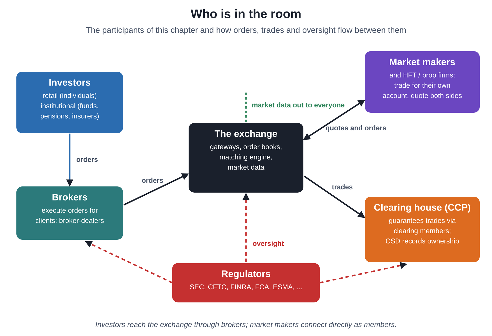

### Traders and Investors

The broadest category of participant is anyone who buys or sells for themselves, whether they are profit-seeking or managing risk.

**Retail investors** are individuals trading their own money, typically through brokerage apps (Robinhood, Fidelity, Schwab, eToro). Retail orders tend to be small (a few hundred shares at most), arrive randomly throughout the day, and, critically, are considered **uninformed flow** by market makers, meaning they are statistically unlikely to be based on superior information about the company's near-term prospects. Retail flow is therefore profitable to serve. A market maker who trades with a retail investor keeps the spread and rarely suffers **adverse selection**: the risk of trading with someone who knows more than you do, and finding out a moment later that the price has moved against you.

**Institutional investors** are organisations managing money on behalf of others: pension funds, mutual funds, **hedge funds** (lightly regulated investment funds for wealthy and professional investors, free to use almost any strategy), insurance companies, sovereign wealth funds, endowments. They trade in sizes that can move markets, a pension fund rebalancing its portfolio may need to buy or sell millions of shares over days or weeks without moving the price against itself. Their orders typically go through execution desks that slice each large order into many small pieces over hours or days (the classic example is a **VWAP algorithm**, which aims to match the day's volume-weighted average price), hide some of it in dark pools, and use **smart order routing** (software that sends each piece to whichever venue offers the best price) to keep their **market impact**, the price move their own trading causes, as small as possible. The largest institutional investors (BlackRock manages over $10 trillion in assets) have more market influence than many sovereign nations.

The distinction between retail and institutional matters for exchange designers because the two populations have different latency tolerances, different order sizes, different information sets, and different legal frameworks governing their trading. **Payment for Order Flow (PFOF)**, where a market maker pays a retail broker to send it the broker's customer orders, exists because retail flow is genuinely more profitable to serve than institutional flow, and it shapes where retail brokers send their orders.

In exchange terminology, when a participant submits an aggressive order that immediately executes against a resting order in the book, they are called a **taker**, they are "taking" liquidity that was already available. The participant whose resting order was filled is the **maker** (they "made" liquidity available).

### High-Frequency Trading (HFT) and Proprietary Trading Firms

A distinct and important participant type that does not fit neatly into the retail/institutional or maker/taker classification is the **high-frequency trading (HFT) firm** and broader class of **proprietary trading firms** (often called "prop shops").

These firms trade entirely for their own account, with their own capital, using automated strategies. They do not manage client money and do not act as brokers. Well-known firms include Citadel Securities, Virtu Financial, Jane Street, Jump Trading, and IMC. Some (like Citadel Securities and Virtu) are primarily market makers; others run **arbitrage** strategies, which profit from small price differences between related instruments or between venues, and their statistical cousins, which bet that such differences will shrink back to normal.

HFT firms are estimated to account for approximately 50% of equity trading volume on US exchanges, and a significant portion of derivatives volume. They make markets extremely tight (narrow spreads) in liquid products because competition between HFT market makers is intense. They also create controversy: critics argue that **latency arbitrage** (profiting from seeing a price change a few microseconds before everyone else) gives them an unfair structural advantage over slower participants; defenders argue that their market making activity lowers costs for everyone.

For exchange developers, HFT firms are the most technically demanding participants. Their latency requirements drive the design of **co-location** services (renting space for their servers inside the exchange's own data centre), the nanosecond timestamping standards, and the deterministic processing guarantees that define high-performance matching engine architecture. When an exchange system must process millions of messages per second with microsecond response times, it is largely because HFT participants require it.

### Market Makers

This is a concept worth understanding deeply, because it is central to how exchanges actually work in practice, and because the exchange system you are building contains a significant amount of code dedicated specifically to managing market makers.

A **market maker** is a professional participant who continuously quotes both a buy price and a sell price for an instrument. They are simultaneously willing to buy from anyone who wants to sell, and to sell to anyone who wants to buy. In exchange for taking on this obligation, they earn the **spread**, the small gap between the price they will buy at and the price they will sell at. Market makers are the reason you can usually buy or sell a stock immediately without waiting for a human counterparty to appear. Their standing orders are already in the book, waiting.

NYSE has what it calls **Designated Market Makers (DMMs)**, specific firms assigned to each stock with obligations to maintain fair and orderly markets. Nasdaq calls them **Market Makers**. Eurex, the European derivatives exchange, runs a formal **Market Making Programme** with contractual quoting obligations. When a market maker's resting order is filled by someone else's incoming order, the market maker is the maker of that trade and the other side is the taker, as described above. Exchanges frequently give makers a fee rebate and charge takers a fee, to incentivise the provision of liquidity.

> **Key idea:** Market makers earn the spread by continuously providing two-sided quotes, a standing bid and ask, making it possible for others to trade immediately at any time. They are not passive: their position changes with every fill, and they must manage inventory and information risk in real time. The *Market Makers* chapter of Part II examines the full operational detail: formal obligations, what happens when a quote is hit, protection mechanisms, and the software implications of supporting them.

### Brokers

**Broker** itself is an old word. It traces back to Middle English *brocour* and Anglo-Norman *abrocour*, meaning a middleman or small trader. A popular, though not certain, explanation links it to the wine trade: a person who "broaches" (opens) a cask and sells the wine retail, an intermediary between producer and consumer. By the late medieval period it had generalised to any trade intermediary, and it has carried that meaning into finance.

A broker does not trade for their own account. They act as an intermediary: they receive orders from clients and submit them to the exchange on the client's behalf. A firm that trades for its own account is acting as a **dealer**. Most real firms do both, and US regulation calls them **broker-dealers**, a word you will meet constantly. Retail brokerages (Fidelity, Schwab, eToro) aggregate small orders from millions of individuals. Institutional brokers (Goldman Sachs, Morgan Stanley, JPMorgan) execute large **block orders** (single orders of tens of thousands of shares or more) for institutional clients with minimum market impact.

**Prime brokers** are a specific tier of broker providing a package of services to sophisticated clients, primarily hedge funds: securities lending (enabling short selling), **leveraged** financing (lending money so the fund can hold more than its own capital would buy), consolidated clearing and custody across multiple brokers, and sometimes execution services. Without a prime broker relationship, a hedge fund could not efficiently short sell or use leverage. The major prime brokers are divisions of the large investment banks.

### The Exchange Itself

The exchange is not a passive infrastructure provider. It is a regulated entity that enforces rules, monitors for manipulation, reports trades to regulators, and ensures the market functions fairly. In many jurisdictions, exchanges are themselves public companies listed on exchanges (NYSE's parent company, ICE, is listed on NYSE; NASDAQ lists on Nasdaq).

A significant historical shift: exchanges used to be **member-owned mutuals**, non-profit organisations run for the benefit of their broker-dealer members. Over the past 30 years, most major exchanges have **demutualised**, converting to for-profit public companies. NYSE demutualised and became a public company in 2006; the London Stock Exchange demutualised in 2000 and listed its own shares in 2001. This shift changed the incentive structure of exchanges: they now compete for order flow and listing fees, and their technology investment decisions are driven partly by shareholder returns.


### Behind the Scenes: Clearing Houses and Depositories

Three more players never touch the order book but appear in every trade. A **clearing house**, or **central counterparty (CCP)**, steps in after the trade: it becomes the buyer to every seller and the seller to every buyer, so that nobody is exposed if the original counterparty goes bust. Only **clearing members**, typically large banks and brokers, deal with the CCP directly; everyone else clears through one of them. A **custodian** keeps securities safe on behalf of their owners, and a **central securities depository (CSD)** keeps the official electronic record of who owns which shares. Part III follows a trade through all of them.

### Regulators

Regulators are not participants in the traditional sense, they do not submit orders, but they are the most consequential stakeholders in exchange system design. Every audit trail format, kill switch requirement, pre-trade check, and trade report exists to satisfy a regulatory obligation.

In the US, the **SEC** oversees equity exchanges and broker-dealers. The **CFTC** oversees futures and derivatives exchanges. **FINRA** (Financial Industry Regulatory Authority) is a self-regulatory organisation that oversees broker-dealers. Exchanges themselves are also self-regulatory organisations (SROs): they have obligations to monitor their own markets and report suspicious activity.

Internationally: the **FCA** (Financial Conduct Authority) in the UK, **ESMA** (European Securities and Markets Authority) and national regulators under MiFID II in the EU, the **FSA** (Financial Services Agency) in Japan, the **SFC** (Securities and Futures Commission) in Hong Kong, and **ASIC** (Australian Securities and Investments Commission) in Australia.

For exchange developers, the practical implication is that regulatory requirements are non-negotiable features. A matching engine that produces a legally insufficient audit trail is not a working matching engine, regardless of its throughput. Understanding which regulator and which ruleset governs a given exchange is part of the technical specification.

> **Note, quotes vs orders:** Throughout this document, the terms "order" and "quote" are sometimes used to describe resting instructions in the book. Operationally they are different: a **quote** is a two-sided bid/ask pair submitted by a market maker (a single instruction that creates two linked sides), while an **order** is a one-sided instruction submitted by any participant. A quote may internally generate one or two order records with linked identifiers; quote IDs and order IDs may differ. The *Market Makers* chapter of Part II covers this distinction in detail.


## A Brief Tour of Real-World Exchanges


To ground these concepts in reality, here is a brief overview of the exchanges most relevant to exchange system developers.

!!! info "Names before explanations"

    A tour like this one has to mention a few mechanisms before Part II explains them. For now, read them as names: **price-time priority** (the best price trades first; at equal prices, the earliest order trades first), **pro-rata allocation** (at the same price, larger orders get a larger share of each trade), **opening and closing auctions** (short periods in which orders are collected and then all matched at one single price), and **market maker protection** (an automatic brake that pulls a market maker's quotes after a burst of trades). Each has its own chapter later in the book.

### NYSE (New York Stock Exchange)

Founded in 1792, NYSE is the world's largest equity exchange by market capitalisation of listed companies. Its founding is traced to the **Buttonwood Agreement** of 17 May 1792, when 24 stockbrokers signed a document, traditionally said to have been under a buttonwood (sycamore) tree on Wall Street, agreeing to give each other preference in their dealings and never to charge less than a fixed minimum commission [10]. This agreement established the principle of a closed, rule-governed professional market, the model that all regulated exchanges follow today.

NYSE is a **hybrid market**: it combines electronic order matching with **Designated Market Makers (DMMs)** who have responsibilities to maintain fair and orderly markets and can intervene manually in certain situations. NYSE matches with price-time priority and runs opening and closing auctions. Its closing auction is among the most important pricing events in global finance, determining the official closing prices that benchmark trillions of dollars of fund performance.

Despite being the iconic "stock exchange," NYSE handles only a fraction of total US equity volume. Due to fragmentation under Reg NMS, all of the NYSE group's exchanges together typically account for only around a fifth of US equity volume, and the flagship NYSE market alone for considerably less; the rest goes to Nasdaq, Cboe, other exchanges, and the dozens of off-exchange venues (dark pools and broker internalisers) that in recent years have executed close to half of all US equity volume. This is not a sign of weakness, it reflects the fragmented, competitive nature of modern US equity markets.

!!! note "The Panic of 1792 and the Buttonwood Agreement"

    The Buttonwood Agreement of 17 May 1792 did not appear out of calm deliberation. Weeks earlier, New York had suffered the young republic's first financial panic: William Duer, a former Treasury official, had borrowed heavily to corner Bank of New York shares and government debt, and his failure in March 1792 set off a cascade of defaults. Alexander Hamilton's Treasury responded with open-market purchases of government securities and by encouraging banks to keep lending against good collateral, actions economic historians have described as a remarkably modern lender-of-last-resort operation, some eight decades before Walter Bagehot set out the doctrine in *Lombard Street* (1873). The 24 brokers who signed the Buttonwood Agreement that May were, in part, organising to restore confidence after the chaos: giving each other preference, at a fixed minimum commission of one-quarter percent, under known rules. The agreement is a single sentence long, and it is the founding text of American self-regulated exchange trading, written as a direct response to the market's first blow-up.

    **References:** The Buttonwood Agreement, https://en.wikipedia.org/wiki/Buttonwood_Agreement 


### NASDAQ
NASDAQ launched in 1971 as the world's first electronic stock market, initially an automated quotation system for over-the-counter stocks rather than an exchange; it became a registered national securities exchange in 2006. It is home to many of the world's largest technology companies (Apple, Microsoft, Amazon, Alphabet). NASDAQ is a pure electronic market: no trading floor and no DMMs in the NYSE sense. It pioneered the technology approach to exchange operation and drove down transaction costs dramatically.

### CME Group (Chicago Mercantile Exchange)
CME Group is the world's largest futures exchange group by most measures, operating CME, CBOT (Chicago Board of Trade), NYMEX, and COMEX. (By total number of derivatives contracts traded, India's National Stock Exchange has ranked first in recent years, driven by enormous volumes of very small index options.) Futures contracts on everything from interest rates to agricultural commodities to weather indices trade here. CME uses the Globex electronic trading platform, which processes millions of orders per day. CME uses both price-time priority and pro-rata allocation depending on the product.

### Eurex
Part of Deutsche Börse Group, Eurex is Europe's largest derivatives exchange, headquartered in Frankfurt. Eurex is known for its sophisticated market making programmes, and its Market Maker Protection (MMP) functionality is a widely studied example of the protection mechanisms described in Part II. Deutsche Börse's T7 trading system is also used by several other exchanges.

### LSE (London Stock Exchange)
The LSE is one of Europe's oldest exchanges, dating to the 17th century coffee houses. It trades equities, bonds, and ETFs. The LSE uses the SETS (Stock Exchange Electronic Trading System) for liquid equities and runs opening and closing auctions. The LSE's Millennium Exchange technology platform has also been licensed to a number of other exchanges.

!!! note "Historic Note: The Big Bang, 27 October 1986"

    The modern LSE is largely the product of a single day of deregulation known as the **Big Bang**. Until 1986, the LSE operated under a cartel-like structure inherited almost unchanged from its coffee-house origins: brokerage commissions were fixed by rule rather than set by competition, and firms were legally separated into **brokers** (who dealt with clients) and **jobbers** (who traded as principals on the floor), with outside and foreign ownership of member firms tightly restricted. On 27 October 1986, all of this changed at once: fixed commissions were abolished, the broker/jobber distinction was scrapped, non-member and foreign ownership was permitted, and face-to-face trading on the exchange floor was replaced almost overnight by the screen-based **SEAQ** electronic quotation system. The changes were bundled together deliberately, as a negotiated settlement of a long-running restrictive-practices case brought by the UK government against the exchange, and the government wanted them delivered as a single event rather than a gradual transition. The effect was to compress a decade of gradual American-style deregulation into one day, and it is the direct reason the LSE moved from a floor-based, fixed-commission market to the electronic, competitive one described in this document. <br> &nbsp; <br>

    Big Bang has an almost exact American predecessor: on **1 May 1975** ("**May Day**"), the SEC abolished fixed brokerage commissions on the NYSE, ending nearly two centuries of fixed-rate trading that dated back to the original 1792 Buttonwood Agreement described earlier in this chapter. Commission rates had been fixed by NYSE rule for so long that the change was existential for many old-line brokerages; it also created the discount-brokerage industry (Charles Schwab's firm began offering discounted commissions that same year) and set in motion the competitive, cost-conscious order-routing dynamics, including, decades later, payment for order flow, that the *Smart Order Routing* chapter of Part IV describes in detail. May Day and Big Bang are worth holding in mind together: eleven years apart, one American and one British, both replacing a fixed-price professional cartel with open price competition, and both direct ancestors of the fee-driven, technology-mediated market structure this book describes throughout. <br>&nbsp;<br>
    
    **Reference:** Big Bang 20 years on, CENTRE FOR POLICY STUDIES,  https://web.archive.org/web/20211015091533/https://www.cps.org.uk/files/reports/original/111028101637-20061019EconomyBigBang20YearsOn.pdf


### Euronext

Euronext is continental Europe's largest exchange group, operating markets in Amsterdam, Brussels, Paris, Lisbon, Dublin, Oslo, Milan and, since November 2025, Athens. Originally formed in 2000 by the merger of the Paris, Amsterdam, and Brussels exchanges, it expanded significantly through subsequent acquisitions, including the Milan Stock Exchange (Borsa Italiana) in 2021 and the Athens Stock Exchange (now Euronext Athens) in 2025. Euronext uses the **Optiq** trading platform and operates under MiFID II. Its Amsterdam exchange is historically notable as the successor to what is widely regarded as the world's first stock exchange, where VOC shares traded from 1602.

### Nasdaq Stockholm (Stockholmsbörsen, STO)

Nasdaq Stockholm is Sweden's primary regulated securities exchange and one of the core venues in the Nordic region. The original Stockholm Stock Exchange dates to 1863, and the modern market became part of the Nasdaq group through Nasdaq's acquisition of OMX in 2008. Today, Nasdaq Stockholm operates as part of the wider Nasdaq Nordic market structure alongside Copenhagen, Helsinki, and Icelandic venues.

For exchange developers, Nasdaq Stockholm is a useful real-world reference because it combines deep local equity liquidity with a highly standardised pan-Nordic technology model. The market is fully electronic, supports auction phases (including opening and closing auctions), and runs under the same MiFID II transparency and best-execution regime as other EU venues.

The venue's best-known benchmark is the **OMXS30** index, which tracks the 30 most traded shares on Nasdaq Stockholm. The exchange is the home listing venue for many major Swedish and Nordic companies, including names such as Ericsson, Volvo, Atlas Copco, and Investor AB, making it central to Nordic equity price discovery.

From an infrastructure perspective, Nasdaq Stockholm aligns with broader Nasdaq market technology standards (including INET-based matching architecture for cash equities) and interoperates with regional post-trade infrastructure such as Euroclear Sweden for securities settlement. In practical terms, this makes it a strong example of how a national exchange can preserve local market identity while operating inside a larger cross-border technology and regulatory framework.

### IEX (Investors Exchange)

IEX launched as a dark pool in 2013 and became a registered national securities exchange in 2016. It is the exchange that popularised the **speed bump**: a deliberate 350-microsecond delay applied to incoming orders, designed to level the playing field between HFT latency arbitrage strategies and slower institutional investors. IEX was the subject of Michael Lewis's 2014 book *Flash Boys*, which brought widespread public attention to HFT and exchange structure debates.

The speed bump attracted significant institutional support from large asset managers who believed it reduced predatory latency arbitrage. However, IEX has consistently captured a relatively small share of US equity volume (typically 2–3%), suggesting that the speed bump's appeal did not translate into dominant market share. Whether this reflects genuine limitations of the model or simply the difficulty of displacing entrenched incumbent exchanges remains debated in market structure circles. IEX remains disproportionately influential in regulatory discussions given its size, having prompted rule-making discussions at the SEC around speed bumps and exchange access fees.

### Cboe (Chicago Board Options Exchange)
Cboe Global Markets is the largest US options exchange group, operating several options exchanges (Cboe Options, C2 and others) as well as the BZX, BYX, EDGX and EDGA equity exchanges. Cboe invented the listed options market in 1973. It calculates the VIX (Volatility Index, the "fear gauge" of the market) from options prices.

### JPX (Japan Exchange Group)
JPX was formed in 2013 by merging the Tokyo Stock Exchange (TSE) and Osaka Securities Exchange. It is consistently one of the world's largest exchanges by market capitalisation of listed companies, usually ranked just behind NYSE and NASDAQ and close to Shanghai. The exact order shifts from year to year, so check a dated source such as the World Federation of Exchanges statistics before quoting a ranking. JPX operates on an all-electronic platform called arrowhead. Japanese markets have their own session structure, tick size rules, and circuit breaker conventions; the daily price limit system (a stock may not trade more than a set amount away from the previous day's close for the rest of the day) differs from the US **Limit Up-Limit Down (LULD)** approach of short pauses, which Part III explains.

### HKEX (Hong Kong Exchanges and Clearing)
HKEX is the primary exchange for Hong Kong-listed equities and also provides the main electronic gateway for mainland China stocks through the Shanghai-Hong Kong Stock Connect and Shenzhen-Hong Kong Stock Connect programmes. Stock Connect allows international investors to trade China A-shares (mainland China stocks) and allows mainland investors to trade Hong Kong-listed stocks through a northbound/southbound quota system, a unique regulatory and technical arrangement in which orders are routed across the border to the other market's matching engine, subject to real-time quota control.

### SGX (Singapore Exchange)

SGX is Southeast Asia's largest exchange, trading equities, derivatives, and fixed income. It is notable as a hub for Asian futures contracts, Nikkei 225 futures, FTSE China A50 index futures, and iron ore contracts all trade on SGX. SGX acquired Scientific Beta (factor indices) and has invested heavily in data analytics services alongside its exchange operations.

### ASX (Australian Securities Exchange)

ASX serves the Australian equity and derivatives markets. It became notable in the technology community for its attempt to replace its CHESS (Clearing House Electronic Subregister System) settlement platform with a blockchain-based system, a project that was cancelled in November 2022 after years of development, with ASX writing off roughly A$250 million. The cancellation is a cautionary tale for exchange technologists about the risks of replacing proven settlement infrastructure with unproven technology.


## Listing and Delisting Mechanics

The *Before the Exchange* chapter described the IPO from the company's side: underwriters, roadshows, pricing. This chapter first looks more closely at how an IPO actually gets its price, then closes the loop from the exchange's side. Going public is not just a financial event, it is an application to a specific exchange, governed by that exchange's own rulebook, and staying listed is an ongoing obligation, not a one-time achievement.

### Why Exchanges Compete for Listings

A listing is valuable to an exchange for reasons beyond the one-off listing fee. A listed company generates ongoing order flow (every share ever traded on that exchange contributes to trading revenue), market data revenue (see *Market Data Economics* in Part IV), and prestige that attracts further listings. This is why exchanges actively court companies before an IPO, and why the choice between, say, NYSE and NASDAQ for a marquee technology company is itself a competitive sales process, not a formality.

### How an IPO Gets Its Price

Every IPO has to answer one question before a single share can trade: *what is this company worth, and therefore what should one share cost?* Ask five people how that number is found and you will get five answers. An investment banker will describe a disciplined process of financial models, peer comparisons and investor meetings. A venture capitalist will talk about the "story" and the size of the opportunity. A finance professor will talk about discounted cash flows. A cynical trader will say the price is whatever the banks think they can sell the shares for on the day. All of them are partly right. IPO pricing is a structured process wrapped around an irreducible core of judgement, market mood and, at times, something close to black magic.

The valuation scholar Aswath Damodaran draws a distinction that helps make sense of this. **Valuing** a company means estimating what its business is worth from its fundamentals, because in the end "it's cash in, cash out. You can't get away from that." **Pricing** a company means looking at "what other people are paying" for similar assets and "trusting the crowd on average to get it right" [Damodaran, interviewed by The Acquirer's Multiple, 2024]. An IPO is fundamentally a *pricing* exercise dressed in the language of *valuation*: the models set a plausible range, but the final number is the price at which enough real investors, on a particular week, are willing to buy.

#### Why getting the number "right" matters so much

The price has to thread a needle:

- **Too high, and the deal fails.** Investors refuse to buy, the offering has to be cut or pulled, or the shares sink below the offer price soon after trading starts (Wall Street calls this "breaking issue"). The damage is lasting: early buyers lose money, the company's reputation suffers, and raising more capital later becomes harder. Facebook raised its price range from $28–$35 to $34–$38, priced at the top, $38, raised $16.08 billion at a valuation of $104.2 billion in May 2012 [Forbes, 17 May 2012], and then fell below $38 on its second trading day. It spent more than a year below its offer price.
- **Too low, and the company "leaves money on the table".** If the shares are priced at $20 and trade at $40 on day one, the company sold part of itself for half of what the market was demonstrably willing to pay. The difference went to the lucky first buyers, not to the company. Snowflake raised its range from $75–$85 to $100–$110, then priced its September 2020 IPO at $120, above even the raised range, and sold 28 million shares for $3.36 billion [CNBC, 15 September 2020]. The stock then more than doubled on its first day, closing at about $254. On those 28 million shares, the gap between the offer price and the first close was roughly 28 million × $134 ≈ **$3.75 billion**: more than the company itself raised.

Most IPOs are deliberately priced a little low. Across US IPOs from 1980 to 2025 the average first-day return was about **19%**, and at the height of the dot-com bubble in 1999–2000 it averaged about **65%**; in total, some $250 billion has been "left on the table" over that period [Jay Ritter, *IPO Statistics*, University of Florida] (see [Initial Public Offerings: Updated Statistics](https://site.warrington.ufl.edu/ritter/files/IPO-Statistics.pdf) ). A modest first-day rise is seen as healthy: it rewards the investors who committed early, creates good publicity, and makes the next offering easier. A huge first-day jump, on the other hand, usually means the price was wrong.

#### The paperwork: the S-1 in the US, the prospectus in the EU

**The S-1.** In the United States, a company offering shares to the public must register them with the SEC under the Securities Act of 1933. For a US company the registration statement is **Form S-1**; a foreign company typically files the equivalent **Form F-1**. The S-1 contains the **prospectus**, the document every investor is given, plus additional information for the SEC. It is long, often several hundred pages, and describes the business, its risks (the "risk factors" section alone can run to dozens of pages), audited financial statements, management and pay, who owns what before and after the offering, and the terms of the deal.

The process runs roughly as follows. Most companies first submit a draft **confidentially**, so that the SEC's staff can comment before anything becomes public; the SEC's staff review the filing and send comment letters, and the company answers and amends until the comments are resolved. The public filing then goes out, followed by a *preliminary* prospectus that includes the proposed price range, traditionally nicknamed the **red herring** after the red warning text on its cover saying that the document is not yet final. Once the SEC declares the registration statement **effective**, the shares can be sold, and the final price appears in the final prospectus.

Two parts of the S-1 deserve special attention, because they shape how the market will see the company:

- **Classification.** The cover of Form S-1 asks for the company's **Primary Standard Industrial Classification (SIC) code**. It sounds bureaucratic, but classification decides which SEC review office examines the filing, which peer companies analysts will compare it with, and, eventually, in which sector index providers place it. It is therefore also part of the *story*. When SpaceX filed for its 2026 IPO, it was widely reported to have chosen SIC code 7370, computer programming and data processing, rather than an aerospace code, placing itself alongside software and AI companies rather than rocket makers. Separately, the US JOBS Act of 2012 created the **emerging growth company** category for smaller issuers (defined by annual revenue below roughly $1.2 billion), which may file with reduced disclosure. How a company is classified affects both its obligations and its valuation.
- **Use of proceeds.** SEC rules (Item 504 of Regulation S-K) require the prospectus to state what the company intends to do with the money it raises. The answer matters to investors in two ways. First, an IPO can sell **primary** shares, newly issued by the company, whose proceeds go to the company, and **secondary** shares, sold by existing shareholders such as founders and venture capital funds, whose proceeds go to *them*. A deal that is mostly secondary is an exit for insiders, not fresh capital for the business, and investors read it accordingly. Second, a specific plan ("build three factories", "repay this loan") is easier to judge than the vague and very common "general corporate purposes".

**The EU prospectus.** In the European Union the equivalent document is the **prospectus** required by the Prospectus Regulation (Regulation (EU) 2017/1129). It is approved by the *national competent authority* of the company's home member state (BaFin in Germany, the AFM in the Netherlands, Finansinspektionen in Sweden, and so on), and once approved it can be **passported**: used to offer the shares across the whole EU without a second approval. Its content is standardised by EU rules and covers the same ground as an S-1, including a required section on the **reasons for the offer and the use of proceeds**. The regime has just been revised by the EU Listing Act (Regulation (EU) 2024/2809), whose amendments to the Prospectus Regulation apply in stages, the last of them from 5 June 2026, with the aim of making prospectuses shorter, more standardised and cheaper to produce. The United Kingdom, outside the EU since 2020, runs its own separate prospectus regime.

#### The valuation toolbox

Bankers and investors use two families of tools, and every serious IPO uses both.

**Comparable companies ("comps").** Find listed companies that look similar, see what the market pays for them relative to some measure of their business, and apply the same multiple. Common multiples are **price-to-earnings (P/E)** (share price divided by profit per share), **EV/EBITDA** (enterprise value, meaning the value of the whole business including its debt, divided by earnings before interest, tax, depreciation and amortisation) and, for companies without profits, **EV/Sales**. If similar companies trade at 20 times earnings and our company earns $100 million, a comps-based value is about $2 billion. This is *pricing* in Damodaran's sense: it inherits whatever optimism or pessimism is already in the comparable stocks.

**Discounted cash flow (DCF).** This is *valuing* in the intrinsic sense. A company is worth the cash it will generate for its owners in the future, adjusted for the fact that money later is worth less than money now. Two ideas carry the whole method:

- **Discounting.** $100 received a year from now is worth less than $100 today, because today's $100 could be invested in the meantime and because the future is uncertain. With a **discount rate** of 9%, $100 in one year is worth 100 / 1.09 ≈ $91.74 today, and $100 in five years is worth 100 / 1.09⁵ ≈ $64.99. The discount rate reflects the return investors demand for the risk they take; riskier businesses get higher rates.
- **Terminal value.** Nobody can forecast cash flows forever, so analysts forecast a few years in detail and then assume steady growth from then on. A cash flow *C* growing at rate *g* forever, discounted at rate *r*, is worth *C* / (*r* − *g*) (the "Gordon growth" formula).

A worked example. A company's free cash flow (the cash left after running and investing in the business) is $100 million this year. Analysts expect it to grow 10% a year for five years, then 3% a year forever, and they use a 9% discount rate:

| Year | Free cash flow ($m) | Discount factor 1 / 1.09^t | Present value ($m) |
|---|---|---|---|
| 1 | 110.0 | 0.917 | 100.9 |
| 2 | 121.0 | 0.842 | 101.8 |
| 3 | 133.1 | 0.772 | 102.8 |
| 4 | 146.4 | 0.708 | 103.7 |
| 5 | 161.1 | 0.650 | 104.7 |
| | | **Sum of years 1–5** | **513.9** |

The terminal value at the end of year 5 is 161.1 × 1.03 / (0.09 − 0.03) ≈ $2,765 million, worth 2,765 / 1.09⁵ ≈ $1,797 million today. The business is therefore worth about 513.9 + 1,797 ≈ **$2.31 billion**.

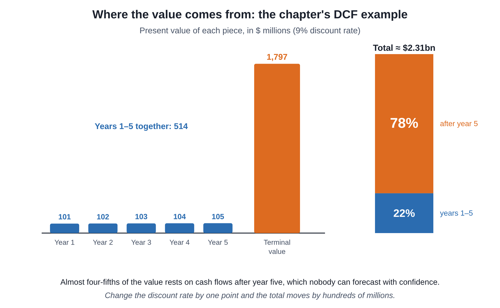

Two lessons hide in that arithmetic, and both matter enormously for IPOs:

1. **Most of the value is in the distant future.** About 78% of the $2.31 billion comes from the terminal value, from cash flows *after* year five, which nobody can forecast with any confidence.
2. **Small changes in assumptions cause big changes in value.** Use an 8% discount rate instead of 9% and the value rises to about $2.79 billion (+21%); use 10% and it falls to about $1.97 billion (−15%). A one-point disagreement about risk moves the answer by hundreds of millions of dollars.

**From company value to share price.** Suppose the valuation work (DCF, comps, and conversations with investors) lands at an equity value of about $2.3 billion (for simplicity, the company has no debt, so the value of the business and the value of its shares are the same) for a company with 100 million shares outstanding before the IPO: about $23 per share. The underwriters will typically propose a range somewhat below that, say $19–$21, building in the deliberate **IPO discount** that rewards early buyers for taking a chance on an untested stock. If the company then sells 20 million *new* shares at $20, it raises $400 million, and afterwards there are 120 million shares outstanding.

#### When the toolbox breaks: valuing hype

The DCF method works best for businesses with positive, reasonably predictable cash flows. It struggles badly with the companies that attract the most excitement: young businesses that burn cash today and promise enormous cash flows later. For them, the near-term cash flows are *negative*, so essentially all of the value sits in a terminal value many years out, built on assumptions about growth, margins and competition that are close to guesses. Change the guesses slightly and the value can move by a factor of two or three.

Analysts therefore often run the method backwards. A **reverse DCF** asks: *what would have to be true for today's price to make sense?* Take SpaceX, which priced its June 2026 IPO at $135 per share, a valuation of about $1.77 trillion, against 2025 revenue of $18.7 billion and an operating loss of $2.6 billion [Fortune, 20 May 2026]. That is roughly 95 times last year's revenue. A deliberately simple reverse DCF: an investor who wants a 10% annual return needs the company to be worth about $1.77 trillion × 1.1¹⁰ ≈ $4.6 trillion in ten years. At a mature price-to-earnings ratio of 25, that requires annual profits of about $184 billion; at a healthy 20% profit margin, that requires annual revenue of about $920 billion. Growing from $18.7 billion to $920 billion in ten years means growing about **48% a year, every year, for a decade**. Perhaps that will happen; the point is that the price is a statement of belief about the far future, not a conclusion derived from present-day numbers. Independent valuations of the same company at the time ranged from well under a trillion dollars to around $1.3 trillion, which shows how much room the method leaves.

**The TAM argument.** When the cash flows cannot carry the valuation, the story often shifts to the size of the opportunity. The **total addressable market (TAM)** is the total revenue available if a company captured *all* of the demand for what it sells. (Analysts often narrow it further to the *serviceable* market the company can realistically reach, and to the share it can realistically obtain.) A huge TAM makes a high valuation look modest: capture "just" a few percent of a multi-trillion-dollar market and today's price seems cheap. Recent prospectuses have made remarkable TAM claims:

- **Uber (2019)** described a total addressable market of about **$12 trillion** across personal mobility, food delivery and freight [Forbes, 22 April 2019].
- **WeWork (2019)** claimed a **$3.0 trillion** market opportunity in 280 target cities, noting that it had realised "approximately 0.2%" of it [WeWork S-1, August 2019], while its 2018 revenue was about $1.8 billion against a net loss of about $1.9 billion.
- **SpaceX (2026)** claimed a TAM of **$28.5 trillion**, of which $26.5 trillion, about 93%, was attributed to artificial intelligence rather than to rockets or satellite internet [Fortune, 20 May 2026].

TAM is a useful sanity check on whether a business *could* become large. It is a poor guide to whether it *will*, because it says nothing about competitors, pricing power, costs or execution. Several spectacular failures had impressive TAMs. WeWork was valued at **$47 billion** in a private funding round in January 2019; it filed its S-1 on 14 August 2019; within weeks the valuation being discussed fell to about $10 billion; the IPO was withdrawn on 30 September 2019; the company later listed through a SPAC merger in October 2021 at about $9 billion and filed for bankruptcy on 6 November 2023 [Forbes, 7 November 2023].

History offers plenty of company for WeWork. **Pets.com** went public in February 2000 at $11 per share, raising $82.5 million, and announced its liquidation on 7 November 2000 with its shares at $0.19, having become famous mainly for its sock-puppet mascot. **Rivian** raised its range from $57–$62 to $72–$74 and then priced its November 2021 IPO at $78, valuing the electric-truck maker at about $66.5 billion, although its prospectus showed that it expected quarterly revenue of between zero and $1 million and it had not yet delivered vehicles to customers [CNBC, 9 November 2021]. On its first trading day its market value passed Ford's; a few years later its shares traded at a small fraction of the IPO price. The pattern is the same each time: the valuation rested on a story about the future, and the future turned out different.

None of this means hyped valuations are always wrong. Amazon went public in May 1997 at $18 per share as an unprofitable online bookseller, and Google's 2004 IPO valued it at about $23 billion; both look like bargains in hindsight. The honest conclusion is that for high-growth companies, the IPO price is a bet, and the process described next is how the market places it.

#### Book-building: discovering the price

A conventional US IPO establishes its price through **book-building**, a process run by the lead underwriters (the "bookrunners"):

1. **Setting a range.** Using the valuation work above and early informal conversations with investors ("testing the waters"), the company and its underwriters publish a **price range** in the preliminary prospectus, for example $19–$21 per share.
2. **The roadshow.** Management and bankers spend one to two weeks presenting to institutional investors (mutual funds, pension funds, hedge funds), historically in person across several cities, today largely by video.
3. **Building the book.** Investors submit **indications of interest**: how many shares they would buy, and often at what maximum price. These are not binding orders. The bookrunners record them in "the book" and watch how much demand there is at each price and from which kinds of investors. A book "covered ten times" has indications for ten times the shares on offer.
4. **Revising the range.** If demand is strong, the range is raised (Facebook, Snowflake and Rivian all raised theirs); if it is weak, the range is lowered or the deal is made smaller. CoreWeave, an AI cloud company, marketed its shares at **$47–$55** in March 2025 but priced at **$40**, below the range, and cut the deal to 37.5 million shares, raising $1.5 billion [CoreWeave press release, 27 March 2025; Reuters]. Within days of its debut the stock had risen well above the offer price, a reminder that a weak book says as much about the market's mood that week as about the company.
5. **Pricing.** The final price is set on the evening before trading begins, after the SEC declares the registration effective. The underwriters then **allocate** shares. Allocation is discretionary, not pro-rata: underwriters favour investors they expect to hold for the long term over those they expect to "flip" the shares on day one.
6. **The first trade.** The next morning, the stock opens on the exchange through a special opening auction (on NASDAQ the **IPO Cross**), using exactly the equilibrium-price mechanics described in the *Opening and Closing Auction* chapter of Part II. The IPO price is what the company received; the opening auction price is the market's first verdict.
7. **The greenshoe.** Underwriters usually have an **over-allotment option**, known as the **greenshoe** after the 1960s Green Shoe Manufacturing Company deal that first used it, to sell up to 15% more shares than planned. They can use it to support the price if it falls in early trading ("stabilisation") or simply sell the extra shares if demand is strong.

For this work the underwriters earn a fee, the **gross spread**, deducted from the proceeds. On moderate-sized US IPOs it has remained at about **7%** for decades [Ritter, *IPO Statistics*]; mega-deals negotiate far less (SpaceX's banks reportedly took under 1%).

#### Book-building is a custom, not a law

Nothing in US or EU law requires a company to use book-building. The securities laws regulate *disclosure* (what the prospectus must say and when shares may be sold), not the *method* by which the price is found. Book-building dominates because underwriters prefer it and issuers value the guarantee and the investor relationships that come with it. The alternatives are real:

- **Auctions.** Google's August 2004 IPO used a modified **Dutch auction**, open to large and small investors alike, in which bidders named a price and quantity and a single clearing price was set from the bids. It did not go smoothly: the range was cut from $108–$135 to $85–$95 and the shares were priced at $85, raising $1.67 billion [The Register, 19 August 2004]. Few large companies have copied the approach since.
- **Direct listings and SPAC mergers**, described in *Alternatives to the Traditional IPO* below, reach the market with no book-building at all.

#### Who gets the shares: institutions and retail

In a typical US IPO, most shares go to **institutional investors**. There is no legal minimum for retail investors; retail access usually comes through brokers that receive a small allocation from the underwriters, and IPO shares have traditionally been "reserved for wealthier brokerage clients and institutional investors" [CNBC, 2 July 2021]. That has been changing. Robinhood reserved **20% to 35%** of the shares in its own 2021 IPO for its customers [CNBC, 2 July 2021], and SpaceX's 2026 offering was reported to have used an institutional-to-retail ratio of 70:30.

Other markets write the split into the rules. Many European IPOs combine an *institutional offering* with a separate *public offering* to retail investors in the home country. Hong Kong specifies it precisely: under rules in force since 4 August 2025, at least 40% of the shares must go to the book-built institutional tranche, and the public subscription tranche either starts at a minimum of 5% and is "clawed back" up to 35% if retail demand is very heavy, or is fixed at between 10% and 60% [Bird & Bird, 2025].

#### The lock-up

Before the IPO, founders, employees and venture capital funds own all of the company. If they could all sell on the first day, the flood of shares would swamp the market and the price would collapse. The **lock-up agreement** prevents this: insiders promise the underwriters not to sell for a fixed period, most commonly **180 days** [Investor.gov, *Lockup Agreements*]. Lock-ups are *contracts*, not law; securities law only requires that their terms be disclosed in the prospectus. The underwriters can release insiders early, and modern lock-ups are often staggered, releasing some shares early if the stock performs well. SpaceX's insiders reportedly agreed to a 366-day lock-up, other pre-IPO investors to 180 days.

The day a lock-up expires is a known date, and it is marked on every trader's calendar: a large block of shares suddenly becomes sellable, and prices often weaken around it.

#### Joining the index

A newly listed stock is not automatically part of the market indexes, and that matters a great deal. As the *Indexes* chapter of Part II explains, index funds *must* buy every stock in their index, in proportion to its weight. Inclusion in a major index therefore triggers large, price-insensitive buying.

Index providers traditionally made newcomers wait. The S&P 500 requires an IPO to have traded for at least **12 months** and to have positive earnings in its most recent quarter and over its most recent four quarters combined [S&P Dow Jones Indices, *U.S. Indices Methodology*]. In 2026 the arrival of several enormous IPOs put this under pressure. S&P Dow Jones Indices consulted on shortening the wait to six months and on exceptions for "mega-cap" companies, and on 4 June 2026 decided *not* to change the S&P 500's rules, stating that exceptions "should not be granted solely based on market capitalization" [S&P DJI, 4 June 2026]. Nasdaq went the other way: in spring 2026 it adopted a "fast entry" rule allowing a very large new listing to join the Nasdaq-100 after just **15 trading days**, with five trading days' notice. SpaceX joined the Nasdaq-100 under this rule, while its losses kept it out of the S&P 500. Critics pointed out the uncomfortable side effect: investors who bought at the IPO could sell to index funds that were obliged to buy only a few weeks later.

#### A gallery of outcomes

| Company | IPO | Price and valuation | What happened |
|---|---|---|---|
| Amazon | May 1997 | $18 per share | An unprofitable online bookseller at IPO; became one of the most valuable companies in the world |
| Pets.com | Feb 2000 | $11 per share, raised $82.5m | Liquidated nine months later, shares at $0.19 |
| Google | Aug 2004 | $85 (Dutch auction, range cut from $108–$135), about $23bn | Priced below its hoped-for range; a long-term success |
| Facebook | May 2012 | $38 (range raised), $104.2bn | Broke issue within days; later far exceeded its IPO price |
| WeWork | 2019 (withdrawn) | $47bn private valuation, then talk of about $10bn | IPO pulled; SPAC listing 2021; bankrupt 2023 |
| Snowflake | Sep 2020 | $120 (above its raised range), $33.3bn | Doubled on day one, leaving roughly $3.75bn "on the table" |
| Rivian | Nov 2021 | $78 (range raised), $66.5bn, with almost no revenue | Worth more than Ford on day one; later fell far below its IPO price |
| CoreWeave | Mar 2025 | $40, below its $47–$55 range, deal cut | Weak book, then a strong rally within days |
| SpaceX | Jun 2026 | $135, about $1.77tn, largest IPO ever | Rose about 19% on day one; valuation rests on a $28.5 trillion TAM story |

#### What this means for exchange developers

The valuation debate happens before the exchange is involved, but IPO day itself lands squarely on exchange systems. A new symbol must be created in the reference data (see *Reference Data* in Part IV), with no trading history, so there is no previous close to anchor **price collars** (limits on how far a trade may stray from a reference price) or circuit breakers: the IPO price and the opening auction take that role. The opening auction may be delayed repeatedly while the **indicative price** (the price the auction would set if it ended right now) settles and the lead underwriter confirms it is ready to open, so the auction logic must support extended, supervised call periods. Market-data volumes on a hot IPO's first morning can be extreme. And 180 days later, the lock-up expiry produces a predictable, scheduled surge in selling that risk and capacity planning should expect.

> **Key idea:** An IPO price is found, not calculated. Valuation models such as comparable multiples and discounted cash flow set a plausible range, but for young, high-growth companies nearly all of the value lies in distant, uncertain cash flows, and stories about total addressable markets fill the gap. Book-building, a customary rather than legally required process, then discovers what real investors will pay. Allocation rules decide who gets the shares, lock-ups keep insiders from selling too early, and index rules decide when forced buying arrives. Price it too high and the deal fails; price it too low and the company gives away capital it could have raised.

### Initial Listing Standards

Every exchange publishes **initial listing standards**, minimum quantitative and qualitative thresholds a company must meet before its shares can begin trading. These typically combine several dimensions, and both NYSE and NASDAQ offer multiple listing tiers with different thresholds (NASDAQ's Global Select, Global Market, and Capital Market tiers, for example, from most to least stringent):

- **Minimum share price:** commonly a bid price of at least $4.00 at initial listing.
- **Market value of publicly held shares (public float):** a minimum aggregate dollar value of shares actually available for public trading, excluding insider- and affiliate-held blocks, illustratively in the tens of millions of dollars for the least stringent tiers and considerably higher for the most prestigious ones.
- **Minimum number of round-lot shareholders** (holders of at least one standard trading unit, usually 100 shares): a floor on how widely the shares are already held, intended to ensure a genuine public market exists from day one rather than a handful of large holders.
- **Corporate governance requirements:** an independent board majority, an independent audit committee, and public financial disclosure obligations under the exchange's rules and the applicable securities laws.

(Exact numeric thresholds are revised periodically by each exchange and its regulator; treat the figures above as illustrative of the *kind* of requirement, not as current values to hardcode into any reference-data system.)

Meeting every quantitative threshold is necessary but, on some exchanges, not sufficient: as the *Indexes* chapter of Part II describes for the S&P 500's selection committee, initial listing approval can involve qualitative judgement about the business and its readiness for public markets, not a purely mechanical checklist.

### Continued Listing: An Ongoing Obligation

Initial listing standards get most of the public attention, but **continued listing standards** matter more to exchange system developers, because they generate ongoing, automated compliance monitoring rather than a one-time gate. A company that met every threshold at its IPO can fall out of compliance years later if its stock price declines, its market cap shrinks, or its public float narrows.

The most common continued-listing trigger is the **minimum bid price rule**: if a stock's closing price stays below $1.00 for 30 consecutive trading days, the exchange issues a formal deficiency notice. The company then has a **cure period**, commonly 180 days, to regain compliance (ten consecutive trading days at $1.00 or above), and in some cases a further 180-day extension if it meets other listing criteria. This is the direct, practical reason struggling companies execute a **reverse stock split** (see the *Corporate Actions* chapter of Part IV): consolidating, say, ten existing shares into one instantly multiplies the nominal share price by ten, curing a bid-price deficiency without changing the company's actual market value by a cent. A reverse split undertaken for this reason is a compliance action, not a statement about the business, and exchange systems must handle it exactly like any other corporate action (adjusting resting orders, historical price series, and reference data) regardless of the reason behind it.

Failure to cure within the allowed window leads to **involuntary delisting**: the exchange begins the formal process of removing the security, the company can appeal to a listing qualifications panel, and if the delisting proceeds, the shares typically continue trading, if at all, on the over-the-counter (OTC) markets described in *What Is a Financial Exchange*, with materially less liquidity, visibility, and investor protection than an exchange listing provided.

### Voluntary Delisting

Not all delistings are compliance failures. A company can voluntarily delist because it has been **acquired** (its shares convert to cash or acquirer stock, as described in the *Corporate Actions* chapter of Part IV), because it has been **taken private** (a controlling investor or management buyout removes public shares from circulation entirely), or, more rarely, because it decides the costs of public-company reporting and exchange fees no longer justify the benefits of a listing. All of these still require an orderly unwind of open orders and positions in the symbol, exactly as described in the *Corporate Actions* chapter, whether the delisting is voluntary or forced.

### Alternatives to the Traditional IPO

The underwritten IPO described in *Before the Exchange*, where banks buy the offering and guarantee the company its proceeds, is not the only path onto an exchange.

**Direct listings.** In a **direct listing**, a company's existing shares begin trading directly on the exchange, in the classic form with no new shares issued, no underwriter guarantee, and no fixed offer price set in advance by a roadshow. Instead, the opening trade is established through the exchange's **opening auction** mechanism (see the *Opening and Closing Auction* chapter of Part II) exactly like any other trading day's open, just with unusually intense interest and no underwriter smoothing the process. Spotify's April 2018 listing on NYSE and Slack's June 2019 listing on NYSE were the pioneering examples that established direct listings as a credible alternative for companies that do not need to raise new capital and want to avoid underwriting fees and the traditional IPO discount. Because there is no underwriter-set price to anchor expectations, the exchange's auction-price-discovery mechanism carries unusually high scrutiny on a direct listing's first trade. (Since 2020 the SEC has also approved NYSE and Nasdaq rules for *primary* direct listings, in which the company sells new shares in that opening auction.)

**SPAC mergers.** A **Special Purpose Acquisition Company (SPAC)** is a shell company with no operating business that itself completes a conventional IPO, raising cash that is held in trust, with the explicit purpose of later merging with a private operating company to take it public. When the merger (a "**de-SPAC**" transaction) completes, the private company's shareholders receive shares in the (now renamed) public shell, and the target company is effectively listed without ever running its own IPO process. SPACs existed for decades as a niche structure but became a major share of total US listing activity in 2020–2021, before a wave of poor post-merger performance and increased SEC disclosure requirements sharply reduced the volume of new SPAC formations from 2022 onward. For exchange and reference-data systems, a de-SPAC transaction looks much like the symbol changes and delistings described in *Corporate Actions*, the shell's ticker and name are typically replaced by the operating company's (the surviving legal entity, and with it the company's **CIK**, the Central Index Key that identifies it in the SEC's filing system, is often the shell itself), but compressed into a single scheduled event that must be coordinated precisely across trading, clearing, and market data simultaneously.

> **Key idea:** An IPO is a financial event; a listing is a continuing regulatory relationship with a specific exchange, governed by initial standards to get in and continued standards to stay in. Reverse splits, delistings, direct listings, and SPAC mergers are all variations on the same underlying reference-data and corporate-action machinery described in Part IV, the trigger differs, but the exchange-side mechanics of updating symbols, adjusting orders, and coordinating the change across every downstream system are the same.

## Part II: Orders, Matching, and the Trading Day

*How orders work, how the matching engine processes them, and how a complete trading day unfolds from open to close.*

---

!!! note "Historic Notes"

    In the summer of 1929, **Jesse Livermore**, then the most famous speculator in America began quietly selling short. He had been watching the tape for weeks, reading the continuous stream of prices and volumes that printed on the stock ticker, and he had seen something that troubled him: large blocks of stock were appearing at the top of rallies, absorbed by relentless selling pressure that the public could not see. The great bull market felt unstoppable, but the tape told a different story. Livermore increased his short positions through September and October. When the crash came in late October 1929, he is widely reported to have made about $100 million, in 1929 dollars, in a matter of weeks [Richard Smitten, *Jesse Livermore: World's Greatest Stock Trader*, 2001]. His methods had already been immortalised, thinly disguised as the fictional "Larry Livingston", in Edwin Lefèvre's *Reminiscences of a Stock Operator* (1923), still one of the most widely read books about trading.
    
    Livermore did not know about matching engines, FIX protocols, or price-time priority. But he understood, intuitively and empirically, exactly what this entire Part formalises: that every trade is the intersection of a buyer's intent and a seller's intent, encoded in an order; that the order book is a record of unresolved intentions; that the sequence and size of fills reveals information about who is doing what; and that the rules governing when and how orders match determine the character of the market.

    Part II is the technical formalisation of what Livermore read in the tape.

---

**Part Summary:**

Move from concepts to mechanics: how participant intent is encoded in order types, how matching logic enforces fairness, and how the trading session progresses from open through close.

**Learning Objectives:**

- Read an order ticket and understand each field's execution implications.
- Compare major order types and time-in-force instructions by risk and behavior.
- Trace how price-time priority and order book state changes produce trades.
- Describe the end-to-end lifecycle of a trade across a full trading day.
- Compute, execute, and test implied (synthetic) orders across related futures books, and explain why implication depth must be limited.

**Content:**

- The Order: The Fundamental Unit
- Order Types, The Vocabulary of Intent
- Time-In-Force, How Long Should the Order Live?
- The Order Book, The Exchange's Memory
- Price-Time Priority, The Fairness Rule
- Tick Sizes and Fractional Ticks
- The Matching Engine, The Heart of the Exchange
- The Life of a Trade
- Market Makers, The Providers of Liquidity
- The Opening and Closing Auction
- Trading Sessions, The Day in the Life of a Market
- Putting It All Together
- Implied Orders and Synthetic Liquidity
- Multi-Layer Implied Orders and the Combinatorial Wall
- Indexes, The Market's Single Number
- Benchmark Integrity: LIBOR, the FX Fix, and the Anatomy of a Riggable Number


## The Order: The Fundamental Unit

Everything in an exchange system revolves around the **order**. An order is an instruction from a participant to the exchange: "I want to buy (or sell) a certain quantity of a certain instrument, subject to certain conditions."

Every order carries several key pieces of information:

| Field | What it specifies | Notes |
|---|---|---|
| **Symbol** | Which instrument | "AAPL" = Apple; "ES" = E-mini S&P 500 futures. Each symbol has its own independent order book. |
| **Side** | BUY or SELL | Defines everything about how the order interacts with the book. |
| **Quantity** | How many units to trade | Typically a positive integer. The **lot** is the smallest unit an order can be submitted in; for US equities the matching engine will accept an order for as little as one share. Asian markets often require order sizes to be a whole multiple of a larger minimum lot, 100 or 1,000 shares. This minimum tradeable unit is a separate concept from the **round lot** used to define an odd lot, covered just below. |
| **Price** | Limit price (for limit orders) | Maximum a buyer will pay, or minimum a seller will accept. Market orders, which accept whatever price is available, carry no price. The next chapter covers both. |
| **Time-In-Force** | How long the order remains valid | So important it gets its own chapter, two chapters on. |
| **Arrival timestamp** | When the exchange received the order | Recorded to nanosecond precision. Not just metadata, it is the tiebreaker in price-time priority. |
| **Identity** | Which gateway (participant) submitted it | Used for self-match prevention, kill switches, and regulatory reporting. |

### Round Lots and Odd Lots

Most reference to "the lot" assumes a **round lot**, the standard trading unit for a symbol (100 shares for most US equities, though this varies by price tier and market). An order for fewer shares than one round lot is an **odd lot**, for example, an order for 37 shares of a stock whose round lot is 100. An order that is larger than a round lot but not a whole multiple of it, say 150 shares, is a **mixed lot**: it consists of one round lot plus an odd-lot remainder of 50 shares, and the two parts can be treated differently in quote and reporting rules.

Odd lots trade normally, the matching engine has no difficulty filling them, but they have a surprising history in US market data: for decades, odd-lot executions were left off the **consolidated tape** (the single public feed that combines trades and quotes from every US exchange) and from the **NBBO**, the National Best Bid and Offer: the highest bid and the lowest offer across all US exchanges at any moment. The *Smart Order Routing* chapter of Part IV explains both in detail. Odd-lot quotes were likewise ignored when the NBBO was computed. The reasoning at the time was that odd lots were assumed to come from small retail investors and were not representative of the "real" market price. This had a real consequence: a stock could have an odd-lot bid or offer that was better than the displayed round-lot NBBO, and that better price would simply not appear in public quote feeds. As retail trading in high-priced stocks grew (a single share of some stocks costs more than many investors want to commit per trade), odd lots became a much larger share of total volume, and regulators revisited this exclusion in stages. Odd-lot *trades* joined the consolidated tape in December 2013. Under rules the SEC adopted in 2020 and accelerated in 2024, the round lot itself now depends on price: since November 2025 it is 100 shares for stocks up to $250, 40 shares up to $1,000, 10 shares up to $10,000, and a single share above that. And since late April 2026 the consolidated feeds also carry each exchange's best odd-lot bid and offer when it is priced at or better than the NBBO, together with a new "best odd-lot order" (BOLO) across all exchanges; deeper odd-lot data has been deferred to 2028. For exchange developers, the practical lesson is that "the best displayed price" and "the best price actually available" have not always been the same thing, and reference data (round lot size per symbol) drives which orders count as odd lots and are handled differently by downstream reporting and NBBO logic.

## Order Types, The Vocabulary of Intent

The type of an order describes the conditions under which it should execute. Understanding order types is fundamental to understanding exchange system code, because the matching engine has different logic for each type.

### Limit Orders

A **limit order** says: "I am willing to trade at this price or better, but no worse."

- A buy limit order at $150.30 says: "Fill me at $150.30 or cheaper, but never at $150.31 or higher."
- A sell limit order at $150.35 says: "Fill me at $150.35 or higher, but never at $150.34 or lower."

The word "limit" refers to the price limit the participant is imposing. If an incoming limit order cannot immediately find a counterparty at an acceptable price, it **rests** in the order book, waiting. Resting orders are also called **passive orders**, they are not actively seeking to trade; they are waiting to be found.

Limit orders are by far the most common order type in most markets.

#### You Trade at the Resting Order's Price

An important and often surprising behaviour: **a limit order that trades immediately does so at the price of the order already waiting in the book, not at its own limit price**.

Example: the best ask is $150.30 (someone is selling at $150.30). You submit a buy limit order at $150.40. Your order says "I am willing to pay up to $150.40", but since the best available seller is only asking $150.30, you trade at $150.30, $0.10 per share better than your limit. Your limit of $150.40 was the *worst* price you were willing to accept, not the target.

This applies in both directions:

- A buy limit at $150.40 crossing a $150.30 ask → fills at **$150.30** (better for the buyer)
- A sell limit at $150.25 crossing a $150.30 bid → fills at **$150.30** (better for the seller)

The limit price is a *floor* for sellers and a *ceiling* for buyers. The actual execution price is set by the resting order, and it will always be at least as good as the limit.

#### Price Improvement

Traders sometimes loosely call that $0.10 "improvement over the limit", but in the industry the term **price improvement** means something narrower: a fill at a better price than the best price publicly quoted at that moment. If the best displayed ask across the market is $150.30 and your buy order fills at $150.28, you received $0.02 of price improvement. This happens when your order meets hidden liquidity inside the spread, for example a midpoint order (described later in this chapter), or a market maker who chooses to fill you at a better price than its public quote.

Price improvement matters for execution quality analysis. In the US, SEC Rule 605 requires market centres (and, under amendments adopted in 2024 and in force since August 2026, larger broker-dealers too) to publish monthly statistics on execution quality, including how often orders received price improvement versus the quoted price. Large retail brokers like Fidelity and Charles Schwab report that a significant percentage of their retail orders receive price improvement, particularly small orders routed to market makers who can beat the NBBO (the best bid and offer across all exchanges).

### Market Orders

A **market order** says: "Fill me immediately at whatever the current market price is." There is no price constraint. The exchange executes it against the best available resting orders immediately.

Market orders maximise the probability of immediate execution, but execution is still subject to available liquidity, the current exchange state, risk controls, and regulatory protections. A market order submitted during a trading halt, against an empty book, or at a price outside a circuit-breaker band will not fill. In normal continuous trading conditions, market orders can be treated as effectively execution-guaranteed, but not price-guaranteed. Market orders are used when certainty of execution matters more than certainty of price.

**The slippage danger in thin markets.** If you submit a market buy for 10,000 shares but only 100 shares are available at the best ask, your order sweeps through every available seller in order of price until 10,000 shares are filled. Each level you sweep through costs you more. In an extreme case, you may end up paying dramatically more than intended, this is called **market impact** or **slippage**.

The most consequential real-world example occurred on 6 May 2010, the **Flash Crash**. In the 13 minutes between 2:32 and 2:45:28pm Eastern time, the E-mini S&P 500 futures contract (then, as now, one of the most liquid futures products in the world) fell 5.1%, as selling swept through a book from which many buyers had temporarily withdrawn. The joint SEC/CFTC investigation found that a single mutual fund had started an algorithm to sell 75,000 E-mini contracts (about $4.1 billion) at a rate of 9% of the previous minute's volume, "without regard to price or time"; as the price fell, other algorithms also sold, creating a feedback loop. The fall stopped at 2:45:28pm, when CME's *stop logic* functionality paused E-mini trading for just five seconds, and by 3:08pm prices were back close to their pre-drop level [SEC/CFTC, *Findings Regarding the Market Events of May 6, 2010*]. Some individual equities briefly traded at $0.01 or $100,000 during the chaos, because market orders crossed nearly empty books [SEC/CFTC Flash Crash Report, September 2010]. The circuit breaker mechanisms introduced after 2010 were specifically designed to prevent a recurrence.

Because they have no price to wait at, market orders cannot rest in the book. On most equity venues, any part that cannot immediately fill (for example, because there are no sellers at all) is cancelled. Some futures venues instead protect the market order with a price limit: CME Globex, for example, converts market orders into limit orders at a "protection" price a set distance from the best price, and any unfilled remainder rests at that limit.

### Stop Orders

A **stop order** sits dormant until the market price reaches a specified trigger level (the **stop price**). When triggered, it converts to another order type and enters the book.

- A **stop-loss order** is a sell stop: "If the price falls to $145, automatically sell for me." Used by investors to automatically exit a losing position and limit further losses.
- A **buy stop** triggers when the price rises to the stop price. Used to enter a position on upward momentum: "If the stock breaks above $155, buy it, that confirms the uptrend."

Stop orders do not sit in the regular bid/ask book, they are held in a separate dormant queue and injected into the book only when triggered. It is worth noting that stop orders are not universally supported natively at the exchange level: some exchanges handle stops internally as described here; others leave stop order logic to brokers or client-side systems, sending only the resulting limit or market order to the exchange once the trigger is reached. The exchange system you are building handles stops natively, this is a deliberate design choice.

### Stop-Limit Orders

A **stop-limit order** is a stop order that, when triggered, converts to a **limit order** rather than a market order. This gives the trader price protection but introduces the risk of non-execution.

Example: A sell stop-limit with a stop price of $145 and a limit price of $144. When the market falls to $145, the order converts to a sell limit at $144. It will only execute at $144 or better. If the market drops sharply past $144 (a "gap"), the order sits unfilled. Compare with a plain stop order, which converts to market and fills at whatever price is available, guaranteed execution, but potentially at $140 instead of $144.

Neither is universally better; the choice depends on whether the trader prioritises execution certainty (stop-market) or price certainty (stop-limit).

### Trailing Stop Orders

A **trailing stop** is a stop order with a twist: the stop price automatically adjusts as the market moves in a favourable direction, but freezes when it moves against the position.

Example: You bought shares at $150. You set a sell trailing stop with an offset (also called the **trail distance**) of $5.00. The stop starts at $145. If the price rises to $160, the stop rises to $155. If the price then rises to $170, the stop rises to $165. But if the price then falls back to $167, the stop freezes at $165, it cannot move down, and will trigger a sale if the price continues falling and reaches $165.

The mechanism that advances the stop in the favourable direction is called the **ratchet**, like a mechanical ratchet that only moves in one direction. The trail offset is stored as a fixed distance, and the ratchet advances by subtracting this offset from each new high-water-mark price.

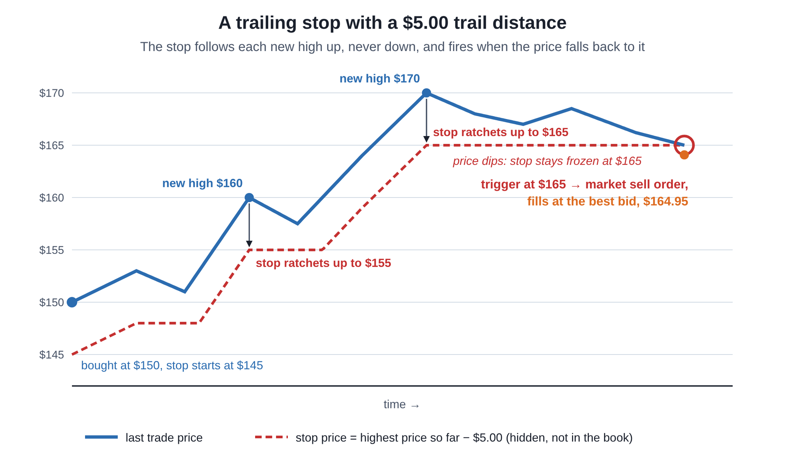

### How a Trailing Stop Actually Executes

This is a point of frequent confusion, so it deserves careful explanation.

**The trailing stop is not a resting sell order in the book.** Before it fires, it is completely invisible to the market, held in a separate dormant queue inside the matching engine, with no presence in the bid or ask side of the order book. It does not compete with other sell orders. It does not queue behind them. It simply waits, monitoring the last trade price as each fill occurs.

The question "how can a trailing stop ever execute if there is always a better sell order in the book?" contains a false premise: the trailing stop is not *in* the book. Other sellers at higher prices are irrelevant to it.

**What happens when the stop triggers.** When the last traded price falls to or below the stop price, the trailing stop converts into a **market sell order** and is injected into the book. A market sell order goes directly to the *buy side*, it matches against the best available bid. Other sell orders are completely irrelevant at this point. The market sell does not queue behind limit sells; it sweeps across to the buyers.

To make this concrete with the example above: the stop price has ratcheted up to $165. The price starts falling. At $165.50, nothing. At $165.01, nothing. At $165.00, the stop triggers. A market sell order is born and immediately matches against whatever buyer is sitting at the top of the bid queue. If the best bid is $164.95, the fill occurs at $164.95. The trailing stop has executed.

**The common mental model that causes confusion.** People sometimes imagine the trailing stop as a limit sell order sitting in the book at $165, waiting in the queue behind other sellers who are already there. Under that mental model, yes, it seems like it could never execute, because better-priced sellers would always be ahead of it. But that mental model is wrong. A trailing stop is a trigger and a market order, not a limit order competing for queue position.

**The trade-off.** Because the trailing stop fires as a market order, execution is guaranteed (assuming buyers exist) but price is not. In a fast-moving market the price may have dropped well below the stop price by the time the market order fills. This is the same gap risk that applies to all stop orders: the stop triggers at $165 but if the market is falling quickly and the best bid is $162, that is where the fill occurs.

Trailing stop logic is not universally implemented at the exchange level. On some venues it is handled client-side (the trading algorithm tracks the high-water mark and adjusts the stop price manually), on others broker-side, and on others natively within the matching engine. Wherever it is implemented, the ratchet behaviour and the dormant-then-market-order execution model are the same.

### Iceberg Orders

An **iceberg order** (also called a **reserve order**) is a large order that conceals most of its size. (A **hidden order**, which many venues also offer, goes one step further and shows nothing at all.) It shows only a small visible portion, the **peak** or **tip**, to other participants. When the visible portion is consumed by fills, the order automatically replenishes from its hidden reserve, showing a new peak.

Why would someone want this? If you need to buy 100,000 shares, showing the full size in the book signals your intention to the entire market. Other participants may raise their ask prices, or **front-run** you (buy ahead of you in order to sell to you at a higher price), before you can fill it. By showing only 1,000 shares at a time, you hide your true intent and reduce your **market impact**.

The trade-off is **queue priority**: each replenishment gets a fresh timestamp and goes to the back of the queue at that price level, rather than retaining the position of the original order. The exchange's other participants can see that an iceberg is present (the order keeps replenishing at the same price), but not how large the hidden reserve is.

Iceberg orders are widely used by institutional investors and market makers on exchanges like the LSE, Euronext, and Deutsche Börse.

### Hidden Liquidity, Priority Rules, and Midpoint Orders

Different exchanges treat hidden liquidity differently, and the rules matter for developers building order management systems.

**Displayed vs hidden priority:** On some exchanges, fully displayed (non-iceberg) orders at a given price level have strict priority over hidden or iceberg orders at the same price, even if the iceberg arrived earlier. The reasoning: participants who take the risk of displaying their intentions publicly should be rewarded with better queue position. On other exchanges, FIFO applies equally to hidden and displayed orders, first in, first out regardless of visibility. Knowing which rule applies on a given venue determines how institutional participants choose between iceberg and fully disclosed orders.

**Reserve refresh priority:** When an iceberg replenishes, a new peak appears from the hidden reserve, most exchanges treat the replenishment as a new order submission for queue purposes: it goes to the back of the queue at that price. This "back-of-queue on refresh" rule means icebergs that replenish many times lose priority relative to new participants arriving at the same price. Some venues implement partial priority preservation, but "back of queue on refresh" is the most common.

**Midpoint peg orders:** A **midpoint peg order** is an order whose price continuously tracks the current mid price (the average of the best bid and best ask). It never displays at a price, it sits invisibly, adjusting to the mid in real time. It executes only when a counterparty arrives whose order is also willing to trade at the midpoint. Midpoint peg orders are common in dark pools and supported by some lit venues, most notably IEX.

**Why would any counterparty accept this when there are better-priced limit orders in the book?**

This is the question that stops most people when they first encounter midpoint pegs, and the answer dismantles the confusion immediately: *the midpoint is a better price than the quoted ask for a buyer, and a better price than the quoted bid for a seller*. Both parties benefit compared to a standard trade at the quoted prices. There is no sacrifice involved.

Consider the numbers:

| | Price |
|---|---|
| Best bid (highest buyer) | $150.30 |
| Best ask (lowest seller) | $150.35 |
| **Mid price** | **$150.325** |

A standard market buy fills at the **ask**: $150.35. A midpoint peg buy fills at the **mid**: $150.325. The midpoint peg buyer pays $0.025 *less* per share than if they had bought at the quoted ask.

A standard market sell fills at the **bid**: $150.30. A midpoint peg sell fills at the **mid**: $150.325. The midpoint peg seller receives $0.025 *more* per share than if they had sold at the quoted bid.

Neither party is giving anything up. Both are doing better than the quoted market price by half the spread, they are sharing the spread between them rather than each paying it in full to the market maker. This is not a compromise; it is a joint saving.

**A worked example.**

An institutional investor wants to buy 200,000 shares of AAPL. The book shows:
- Best bid: $150.30 / 10,000 shares
- Best ask: $150.35 / 10,000 shares
- Mid: $150.325

*Option A, aggressive market order:* Fill the entire 200,000 shares by sweeping the ask side. The first 10,000 fill at $150.35, then the next level, and so on. The average fill price will be well above $150.35 due to market impact. Transaction cost: spread paid on every share, plus significant slippage.

*Option B, midpoint peg in a dark pool:* The buyer submits a midpoint peg buy for 200,000 shares in a dark pool. The order sits invisible, pegged at $150.325. Separately, a pension fund that wants to sell 200,000 shares submits a midpoint peg sell in the same dark pool.

The dark pool matches them: 200,000 shares trade at $150.325.

- Buyer paid $150.325 instead of $150.35, saving $0.025 × 200,000 = **$5,000**.
- Seller received $150.325 instead of $150.30, gaining $0.025 × 200,000 = **$5,000**.
- The spread of $0.05 was split equally. Total joint saving: $10,000 compared to trading at the quoted prices.

Neither party showed their intention in the lit book, avoiding the price impact of a visible 200,000-share order. Both traded at a price inside the spread. This is the proposition that makes midpoint pegs attractive.

**Who uses midpoint pegs?**

Midpoint pegs are primarily used by institutional investors, mutual funds, pension funds, hedge funds, who have large orders, are price-sensitive, and are not urgently time-pressured. They have enough time to wait for a natural counterparty at the midpoint. High-frequency traders and market makers are less likely to *rest* midpoint pegs: their business depends on controlling exactly when and at what price they trade, and a passive order with an uncertain fill time and a moving price gives them neither.

**The trade-offs.**

The critical limitation is that **there is no guarantee of execution**. A midpoint peg buy will only fill if a seller willing to trade at the midpoint appears. In a liquid market this may happen quickly. In a thin or one-sided market the order may wait indefinitely. If the market moves strongly against you while you wait, the price rises while you hold a midpoint peg buy, the opportunity to buy at the original mid price may have passed by the time a counterparty appears. The participant must accept that improved price comes at the cost of execution certainty.

The mid price itself also moves continuously. An institution submitting a midpoint peg at $150.325 may find the mid has moved to $150.50 by the time it fills, if the market has drifted. The pegged price tracks the mid; the participant does not control the final execution price precisely, only that it will be the mid whenever the fill occurs.

**Midpoint pegs in dark pools vs lit venues.**

In a dark pool, the entire book is hidden, so a midpoint peg buyer and a midpoint peg seller can find each other without either revealing their interest to the lit market. The dark pool operator runs a separate matching process against the midpoint.

On IEX (a lit exchange), midpoint pegs work slightly differently. The midpoint peg sits passively at the mid. An *aggressive* order, a sell order willing to accept a price at or below the mid, arrives from a participant routing to IEX. That aggressive sell is priced at or below $150.325 and matches the resting midpoint peg buy at the mid. The aggressive seller "crosses to mid" by accepting the mid price instead of demanding the full ask. They receive $150.325, still better than the bid ($150.30), and the midpoint peg buyer gets their fill at $150.325 instead of paying the ask ($150.35). IEX's speed bump (350 microseconds) is relevant here. Every incoming order is delayed by 350 microseconds, but IEX's own view of the market, and therefore the price of its resting pegs, is not. When prices elsewhere move, IEX can re-price its midpoint pegs before a fast trader who saw the same move can arrive and pick them off at the old, stale midpoint.

**The developer perspective.**

The matching engine must handle midpoint pegs as a separate priority queue that sits parallel to the regular price-time priority book. The mid price must be recalculated on every book update (every time the best bid or best ask changes). The midpoint peg queue must be checked against incoming orders and against each other. The fill price for a midpoint peg match is not a stored order price, it is computed dynamically at match time as (best_bid + best_ask) / 2, requiring care with rounding to the nearest valid tick. Because the sum of two tick-aligned prices is not always an even number of ticks, this rounding step has a specific, easy-to-get-wrong correct answer, worked through in full in the *Tick Sizes and Fractional Ticks* chapter later in this Part.

### Post-Only Orders

A **post-only order** is a limit order with one extra condition: it must *rest* in the book. If, on arrival, it would trade immediately against a resting order on the other side, the exchange rejects it (or, on some venues, reprices it one tick away so that it rests instead). Market makers use post-only orders all the time, because a resting order earns the maker rebate while an order that trades on arrival pays the taker fee. A post-only order guarantees which of the two the participant will be.

### OCO Orders (One-Cancels-Other)

An **OCO order** is a pair of orders linked together by a rule: if either order fills (or is cancelled), the other is automatically cancelled.

Classic use case: You own shares bought at $200. You want to take profit if the price rises to $215, but also automatically cut your losses if it falls to $185. You submit:
- Order A: Sell limit at $215 (take-profit)
- Order B: Sell stop at $185 (stop-loss)
- Linkage: these are an OCO pair

Only one of A or B will ever execute. Whichever triggers first cancels the other. A pair like this is often called a **bracket**: the position is "bracketed" between a profit target above and a loss limit below.

OCO orders are a standard feature of most professional trading platforms. Relatively few exchanges support them natively in the matching engine; more often the linkage is maintained by the broker or the trading front end, which cancels the surviving order itself when the other one fills. (That design has a race: for a brief moment both orders are live, and in a fast market both can fill. Native exchange support closes that gap.)

### Combo Orders

A **combo order** (also called a **spread order** or **strategy order**) is a single instruction to simultaneously execute orders in multiple instruments. Each component is called a **leg**. [12]

Example: A **pairs trade**, buy 100 shares of AAPL and sell 50 shares of MSFT simultaneously, treating the combined position as a single trade. The trader believes AAPL will outperform MSFT relative to each other, and wants to be exposed only to the relative difference between them, not to overall market direction.

Combo orders are critical in derivatives markets. On CME, a futures trader might simultaneously buy a March contract and sell a June contract on the same underlying, a **calendar spread**. Eurex offers a rich set of combination strategies for options. (A **call** is an option to buy, a **put** is an option to sell, and the **strike** is the fixed price written into the option.) Popular combinations include straddles (buy a call and buy a put at the same strike), strangles (buy a call and buy a put at different strikes), and butterflies (buy one option at a low strike, sell two at a middle strike and buy one at a high strike).

The execution challenge is **leg risk**: if one leg fills and the other does not, the trader is left with an unintended one-sided position. Production exchange systems handle this with sophisticated combo matching engines; simpler systems accept the leg risk explicitly.


## Time-In-Force, How Long Should the Order Live?


Every order must specify how long it should remain active if not immediately filled. This is called **Time-In-Force (TIF)** and is a standard attribute on every order in every major exchange system.

### DAY
The order is valid only for the current trading session. At the end of the session, any unfilled part automatically **expires** (status EXPIRED, not CANCELLED: no one withdrew it, its validity ran out). This is the default and most common TIF.

### GTC, Good-Till-Cancelled
The order remains active until it is completely filled or explicitly cancelled by the participant. It survives overnight, across weekends, and across holidays. This requires special handling by the exchange: GTC orders must be persisted to durable storage at the end of each session and reloaded at the start of the next. Because of that burden, support varies: futures exchanges generally offer GTC, while several US stock exchanges stopped accepting GTC orders altogether (NYSE dropped them in 2016) and leave it to brokers to hold such orders and resubmit them each morning.

The risk for the participant: a GTC order placed when a stock was at $100 might unexpectedly fill at a different point in the market cycle if the participant forgets about it.

### GTD, Good-Till-Date
A variant of GTC with a specified expiry date and time. The order remains active until it is completely filled, explicitly cancelled, or the specified expiry date arrives, whichever comes first. On the expiry date whatever is still unfilled expires automatically.

GTD is standard on most professional trading platforms and widely used by institutional investors who want the persistence of GTC without the open-ended risk of an order remaining active indefinitely. A fund manager expecting a news event on a specific date might place limit orders to accumulate a position and use GTD to ensure they expire automatically if not filled by the event date.

From an engineering perspective GTD behaves like GTC with an additional scheduled expiry task: the exchange's session scheduler must track each GTD order's expiry date and expire the order at the right moment, even if no other event in the system triggers it.

### ATO, At-The-Open
The order is valid only during the **opening auction** (the special matching procedure that establishes the first price of the day). If not filled in the opening auction, it expires when the auction ends. On NYSE, these are sometimes called **Market-At-Open (MOO)** or **Limit-At-Open (LOO)** orders depending on whether they carry a price limit.

An important restriction: ATO orders submitted after the opening auction has concluded are rejected, the TIF cannot be satisfied after the moment it targets has passed. Some exchanges accept ATO orders throughout the pre-open period; others impose a cutoff time before the auction begins.

### ATC, At-The-Close
Valid only during the **closing auction**. Extremely common among institutional investors who need to trade at or near the official closing price, many funds are benchmarked against closing prices. On a typical day in 2024, the US closing auctions matched roughly 9% of the whole day's volume in a single instant [BMLL, *Into the Close*, 2024]; see the *Opening and Closing Auction* chapter.

Like ATO, ATC orders submitted after the closing auction has already run are rejected. Unlike DAY orders, ATC orders do not trade at all during the **continuous session** (the normal trading hours between the opening and closing auctions). They target only the single closing price that emerges when the auction runs and matches its orders, a moment called the **uncross**.

### IOC, Immediate-Or-Cancel
Fill as much as possible immediately; cancel any unfilled remainder instantly. Unlike a market order, an IOC can carry a limit price: "Fill whatever you can at $150.30 or better right now; cancel the rest." IOC orders never rest in the book.

### FOK, Fill-Or-Kill
Fill the **entire** quantity immediately, or cancel the entire order without any partial fill. Used when partial fills are unacceptable, for instance, an arbitrage strategy that only works if the full quantity executes simultaneously across legs.

The exchange must verify available liquidity before executing any fills. In practice, the engine performs a **dry-run sweep**: it walks through the book checking whether the full quantity can be matched at acceptable prices, without committing any fills. Only if the full quantity is satisfiable does the engine execute the actual fills. If at any point the available depth is insufficient, including because part of the available liquidity belongs to the same participant (which **self-match prevention**, the rule that stops a firm trading with itself, would cancel; see Part III), the entire order is **rejected** without a single fill occurring: it never rests, so to the participant it looks like a refused order rather than a cancelled one. (Venues word this differently: some report an unfillable FOK as "killed" or "cancelled", others as "expired". The essential point is the same everywhere: nothing traded.) (If self-match prevention is set to cancel the incoming order and the participant's own orders stand in the way, it ends as cancelled for self-match instead.) This is more complex than a standard market order sweep: the engine must complete a full hypothetical assessment of the book before touching it.

**IOC vs FOK in one sentence:** IOC accepts a partial fill and cancels the rest; FOK requires a full fill or is rejected entirely. Both execute immediately and neither rests in the book.

### TIF Quick Reference

| TIF | Rests in book? | Accepts partial fill? | Valid period | Typical use case |
|---|---|---|---|---|
| **DAY** | Yes | Yes | Current session | Most orders; default |
| **GTC** | Yes | Yes | Until cancelled | Long-term limit orders |
| **GTD** | Yes | Yes | Until specified date | Event-driven; expires automatically |
| **ATO** | Opening auction only | Yes | Opening auction | Participate in the open price |
| **ATC** | Closing auction only | Yes | Closing auction | Benchmark to the close |
| **IOC** | No | Yes (partial OK) | Immediate only | Aggressive, price-limited; remainder cancelled |
| **FOK** | No | No (all or nothing) | Immediate only | Arbitrage, multi-leg strategies |


## The Order Book, The Exchange's Memory


The **order book** (also called the **limit order book** or **LOB**) is the central data structure of a matching engine [1] [2]. It is the live record of every resting order in the market, all the buyers waiting to buy and all the sellers waiting to sell, organised by price.

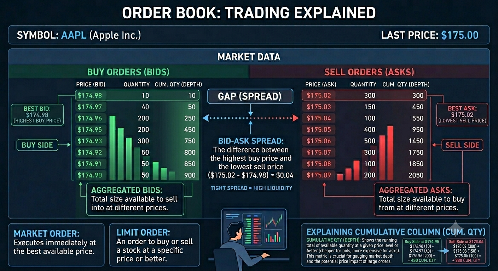

***Figure 1:** The most important data structure in an Exchange - the book.*

> **Key idea:** The order book contains only *resting* orders, those waiting for a counterparty. The current "market price" is derived from the book (as the mid of best bid and ask) or from the last trade, not from a stored field.

Think of it as two sorted lists:

**The bid side**, all resting buy orders, sorted from the highest price (most attractive for sellers) down to the lowest. A buyer bidding $150.34 is at the top of the bid side if no one else is bidding more.

**The ask side** (also called the **offer side**), all resting sell orders, sorted from the lowest price (most attractive for buyers) up to the highest. A seller asking $150.35 is at the top of the ask side if no one is asking less.

**What a real order book looks like.** At any given moment, a simplified snapshot of the AAPL book might be:

| Bid Qty | Bid Price |                                  | Ask Price | Ask Qty |
|--------:|:---------:|----------------------------------|:---------:|:--------|
|   2,000 |  $150.34  | ← **best bid** \| **best ask** → |  $150.35  | 1,500   |
|   1,500 |  $150.33  |                                  |  $150.36  | 2,800   |
|   3,200 |  $150.32  |                                  |  $150.37  | 1,000   |
|     800 |  $150.31  |                                  |  $150.38  | 4,200   |

The **spread** here is $150.35 − $150.34 = $0.01. The **mid price** is ($150.34 + $150.35) / 2 = $150.345. If a market sell order for 3,500 shares arrives, it sweeps bid size: 2,000 shares at $150.34 (exhausting that level), then 1,500 at $150.33 (also exhausting that level). The new best bid after the sweep is $150.32 with 3,200 shares remaining at that price level.

### A Note on Implementation

It is probably safe to say that no other data structure in an exchange is as heavily optimised as the order book. A modern exchange may maintain tens of thousands of order books simultaneously (one per tradeable symbol) and process millions of operations per second across them. Shaving a microsecond ($10^{-6}$s) from each operation or reducing the per-order memory footprint by a few bytes can translate directly into measurable throughput and latency gains at scale. Understanding *why* involves looking at how software architecture is shaped by hardware constraints.

#### Principles of order book design

**Constant-time best price access.** The single most frequent operation is reading or modifying the best bid or best ask. Any design that requires traversal to find the top of book is immediately disqualified. Real implementations maintain direct pointers or indices to the best price level on each side, updated as levels are created or exhausted.

**O(1) insertion at an existing price level.** Once the correct price level is located, appending an order to the back of the queue at that level must be constant time. A doubly-linked list per price level is the classic choice: it gives O(1) append and O(1) removal by pointer (important for cancellations, which are the most common message type in modern markets).

**Efficient price-level lookup.** Finding the correct price level for a new limit order requires a structure keyed on price. Options include sorted arrays, red-black trees, skip lists, and direct-indexed arrays (when the price range is bounded and the tick size is fixed). Direct indexing by price offset is $O(1)$ and is preferred when applicable, at the cost of pre-allocated memory for the entire price range.

**Minimise allocations on the hot path.** Dynamic memory allocation (malloc/new) is unpredictable in latency due to fragmentation and system calls. High-performance engines pre-allocate pools of order objects and price-level nodes at startup, then dispense and recycle from the pool during trading, achieving deterministic allocation latency.

#### Aligning software architecture with hardware

Modern CPUs are fast enough that raw instruction throughput is rarely the bottleneck. Instead, the limiting factor is **memory access latency**: an L1 cache hit takes ~1ns, an L3 hit takes ~10ns, but a main-memory fetch costs 50–100ns. A single cache miss during a match can dominate total processing time. This hardware reality drives several architectural choices:

**Cache-line-friendly data layout.** Order book structures are laid out so that the data accessed together during a match (the top-of-book price level, the first few orders in the queue, the quantity and price fields) resides in adjacent cache lines. This often means using arrays of structs (AoS) or structs of arrays (SoA) tuned so that the hot fields pack into 64-byte cache-line boundaries.

**Hot-path fits in L3 (or even L2).** Engineers measure the working set of the critical matching path, the code and data touched for every single incoming order, and ensure it fits within the processor's L2 or L3 cache. If the hot path spills to main memory on every invocation, latency degrades dramatically. This constrains both the code size (keeping the matching loop tight and branchless where possible) and the data footprint per book.

**NUMA awareness.** On multi-socket servers, accessing memory attached to a remote socket costs 2–3x more than local memory. Exchange engines pin each matching thread to a specific CPU core and ensure that the order books it manages reside in the same NUMA node's memory.

**Branch prediction and prefetching.** Critical paths are written to minimise unpredictable branches. Where future memory accesses are known (e.g. walking a price-level queue), software prefetch instructions are inserted manually so data arrives in cache before it is needed.

#### How real exchanges achieve speed

**Single-threaded-per-book design.** Rather than using locks to protect a shared book from concurrent access, most production exchanges assign each order book to exactly one thread (or one core). All messages for that symbol are routed through a single sequencer thread. This eliminates lock contention entirely, which is the single largest source of latency variance in concurrent systems.

**Kernel bypass networking (DPDK / FPGA NICs).** The operating system's network stack adds 5–15μs of latency per packet. Exchanges bypass the kernel entirely using user-space networking frameworks (like DPDK or Solarflare's OpenOnload) or offload protocol parsing to FPGA-based network cards. Messages arrive directly in user-space memory, often with hardware timestamps accurate to nanoseconds.

**Busy-polling instead of interrupts.** Rather than sleeping and waiting for an interrupt when no message is pending, the matching thread continuously polls the network ring buffer. This trades CPU power for lower latency: when a message arrives, processing begins within nanoseconds rather than waiting for an interrupt-to-thread-wake cycle (~2–5μs).

**FPGA and ASIC acceleration.** Some exchanges (and many trading firms) implement parts of the matching logic or the entire order book in FPGAs, achieving sub-microsecond matching latency. The trade-off is development complexity and reduced flexibility for protocol changes.

**Huge pages and locked memory.** Using 2MB or 1GB huge pages reduces TLB (Translation Lookaside Buffer) misses, which are another source of unpredictable latency. Critical memory regions are also locked (mlock) to prevent the OS from swapping them to disk.

**Co-location and deterministic networking.** Exchanges offer co-location services where participants place their servers in the same data centre, with equalised cable lengths to ensure fair, low-latency access. The exchange's own matching infrastructure is connected via cut-through switches with sub-microsecond forwarding latency.

The cumulative effect of these techniques is that a modern exchange can process an order, match it against resting liquidity, update the book, generate execution reports, and publish market data within a few tens of microseconds of the network packet arriving, and the fastest venues advertise internal latencies in single-digit microseconds.

### The Data Structure in Detail: Three Operations, Step by Step

The principles above describe *what* properties the structure must have. This section shows *how* they fit together, by walking through the three operations that every order book must support, against one concrete arrangement of data structures. The goal is not to prescribe the only correct design, it is to make the abstract complexity claims ("O(1) cancel by pointer", "O(1) best-price access") tangible enough to implement.

**The concrete layout.** We assume the classic arrangement the previous sections described:

- Each **side** (bid, ask) owns a price-indexed map from price to a **price-level** object. For a bounded, fixed-tick instrument this map is a direct-indexed array (price offset → slot); for an unbounded one it is a balanced tree or skip list. Either way, we treat "find the level for price P" as its own step, and note its cost.
- Each **price level** holds a **doubly-linked list** of resting orders in strict time priority: head = oldest (front of queue), tail = newest (back of queue). It also caches its own `total_quantity` so depth queries need not walk the list.
- Each **side** caches a pointer to its **best** price level (`best_bid_level` / `best_ask_level`), so top-of-book access never searches.
- A global **order-ID → order-node** hash map lets a cancel or amend find the exact node in O(1) without knowing its price. Each order node stores back-pointers to its price level and its neighbours in the linked list.

```
Side (ASK)
 ├── best_ask_level ───────────────┐
 ├── price_map: {                   ▼
 │     15035 ──► PriceLevel(150.35, total=1500)
 │                 head► [O:501 q=1000 t=09:31:02] ◄──► [O:502 q=500 t=09:31:40] ◄tail
 │     15036 ──► PriceLevel(150.36, total=2800)
 │                 head► [O:503 q=2800 t=09:30:59] ◄tail
 │   }
 └── ...

order_index: { 501 ► node@150.35, 502 ► node@150.35, 503 ► node@150.36, ... }
```

Every claim of speed in the previous sections is a claim about one of the three walk-throughs that follow.

#### Operation 1: Insert a resting limit order

A limit buy for 400 shares at $150.33 arrives and does **not** cross the ask (we handle the crossing case as Operation 3). It must be filed at the back of the queue for its price level, creating that level if it does not yet exist.

```
function insert_resting(order):                 # order: {id, side, price, qty, ts}
    level = side(order.side).price_map.find(order.price)
    if level is null:
        level = pool.acquire_level(order.price)  # from pre-allocated pool, no malloc
        side(order.side).price_map.insert(order.price, level)
        update_best_pointer_on_insert(order.side, level)   # see note below
    node = pool.acquire_node(order)              # from pre-allocated pool
    list_append_tail(level, node)                # O(1): level.tail.next = node; ...
    level.total_quantity += order.qty            # keep cached depth correct
    order_index[order.id] = node                 # O(1) handle for later cancel/amend
    publish_market_data_add(order.price, order.qty)
```

Cost analysis, tying back to the design principles:

- `price_map.find` / `insert` is the *only* step whose cost depends on the price-map choice: O(1) for a direct-indexed array, O(log n) for a tree. Everything else is strictly O(1).
- `list_append_tail` is O(1) because the level caches its tail pointer, this is why time priority (append at back) is cheap, while an order that sets a new best price is handled purely by the best-pointer update.
- `update_best_pointer_on_insert` compares the new level's price to the current best on that side and, for a buy, replaces `best_bid_level` only if the new price is higher (for a sell, only if lower). This is the entire cost of a new order improving the top of book, one comparison, no search.
- Both `acquire_level` and `acquire_node` come from startup-allocated pools, honouring "no allocation on the hot path."

#### Operation 2: Cancel a resting order

Cancellation is the most common message type in modern markets, so it must be the cheapest. This is exactly what the order-ID index and the doubly-linked list buy us:

```
function cancel(order_id):
    node = order_index.get(order_id)
    if node is null: return REJECT_UNKNOWN_ORDER     # already filled/cancelled
    level = node.level
    list_unlink(node)                 # O(1): node.prev.next = node.next; node.next.prev = node.prev
    level.total_quantity -= node.qty
    order_index.remove(order_id)
    publish_market_data_delete(level.price, node.qty)
    if list_is_empty(level):
        side(node.side).price_map.remove(level.price)
        if side(node.side).best_pointer == level:
            recompute_best_pointer(node.side)   # only when the *best* level empties
        pool.release_level(level)
    pool.release_node(node)
```

The critical detail is `list_unlink`: because the list is *doubly* linked and the node holds pointers to both neighbours, removal is a couple of pointer writes with no traversal, regardless of where in the queue the order sat. A singly-linked list would force an O(queue-length) walk to find the predecessor, which is why the doubly-linked list is not a stylistic preference but a requirement. Note also that `recompute_best_pointer`, potentially the most expensive step, runs *only* when the level that emptied was itself the best on its side; a cancel deep in the book never touches the best pointer.

#### Operation 3: An aggressive order sweeps the book

Now the case that generates trades. A market buy for 3,500 shares (or a **marketable** limit buy, one whose limit price is high enough to trade immediately) arrives against the ask side. It must consume resting liquidity from best price outward, in time priority within each level, until filled or until it runs out of book (or, for a limit, out of acceptable price).

```
function match_aggressive_buy(incoming):        # incoming: {qty, limit_price or ∞ for market}
    while incoming.qty > 0:
        level = ask_side.best_ask_level
        if level is null: break                       # book exhausted on this side
        if incoming.limit_price < level.price: break  # limit no longer marketable
        node = level.head                             # oldest order first: time priority
        while node is not null and incoming.qty > 0:
            traded = min(incoming.qty, node.qty)
            emit_trade(buyer=incoming, seller=node, price=level.price, qty=traded)
            incoming.qty     -= traded
            node.qty         -= traded
            level.total_quantity -= traded
            if node.qty == 0:                         # resting order fully filled
                next_node = node.next
                list_unlink(node)
                order_index.remove(node.id)
                pool.release_node(node)
                node = next_node
            else:
                break                                 # resting order partly filled: incoming is done
        if list_is_empty(level):
            ask_side.price_map.remove(level.price)
            pool.release_level(level)
            recompute_best_pointer(ASK)               # advance to next-best level
    if incoming.qty > 0 and incoming.is_limit:
        insert_resting(incoming)                      # unfilled remainder rests (Operation 1)
```

Trace it against the book from the start of this chapter, best ask $150.35 × 1,500, next $150.36 × 2,800:

1. `level` = $150.35. `traded = min(3500, 1500) = 1500`. Trade printed at **$150.35**. Incoming now needs 2,000; the level empties, is released, best pointer advances.
2. `level` = $150.36. `traded = min(2000, 2800) = 2000`. Trade printed at **$150.36**. Incoming is filled. The $150.36 level keeps 800 shares and becomes the new best ask.

Two properties of this loop are worth making explicit because both were asserted earlier in the chapter without proof:

- **Every fill in a sweep can print at a different price** (here $150.35 then $150.36). The single-price rule is a property of *auctions* (covered later), never of continuous sweeps, this loop is precisely where "market impact" and "slippage" come from.
- **The inner loop preserves time priority**: it always starts at `level.head`, the oldest order, and moves to the next order only when the one in front is completely filled. A partial fill of a resting order (`node.qty > 0` after trading) can only happen when the incoming order has run out of quantity, so the sweep ends there, and the partly filled order keeps its place at the front of the queue. If instead the sweep ends because the book or the limit price is exhausted, any remaining incoming quantity either rests (limit) or is dropped (market).

> **Key idea:** The three operations, insert, cancel, sweep, are the entire contract of an order book, and each one's cost is dominated by a single step: the price-map lookup on insert, the pointer unlink on cancel, and the level-by-level walk on sweep. Every optimisation in the preceding sections (best-price pointers, doubly-linked queues, the order-ID index, pooled allocation) exists to make exactly one of those steps constant time. If you can implement these three functions with the costs annotated above, you have implemented the core of a matching engine; everything else is order types, risk checks, and protocol.

#### A note on determinism

Nothing in the three functions above reads a clock, consults a random source, or depends on iteration order of a hash map during matching (the `order_index` is used only for direct point lookups, never iterated during a match). This is deliberate, and it is what makes the engine replayable in the sense the *Determinism, Replay, and Persistence* chapter requires: given the same book state and the same ordered input, these functions produce identical trades in identical order. Introducing, say, a `map` whose iteration order varies between runs, or reading wall-clock time to break a tie, would silently destroy that guarantee.

### The Spread

The **spread**, first met in *The Language of the Market*, is the gap between the best bid (highest price a buyer will pay) and the best ask (lowest price a seller will accept). If the best bid is $150.30 and the best ask is $150.35, the spread is $0.05.

The spread represents the immediate cost of trading: if you need to buy right now, you pay the ask price; if you need to sell right now, you receive the bid price. The round-trip cost of buying and immediately selling is the spread.

A **tight spread** (small gap) indicates a liquid, efficiently-priced market. A **wide spread** indicates illiquidity, less competition between market participants, higher trading costs. Market makers earn the spread: they buy at the bid and sell at the ask, pocketing the difference.

The **mid price** is the arithmetic average of the best bid and best ask: (150.30 + 150.35) / 2 = $150.325. This is often used as the "current price" of an instrument when no trade has occurred recently.

### Depth

**Depth** refers to how much quantity is resting at each price level. A market with 50,000 shares resting within $0.05 of the best bid is "deep", you can trade a large size without moving the price much. A market with only 100 shares available near the best price is "shallow", a single large order will sweep through multiple price levels.

**Level 1 data** shows only the best bid price, best ask price, and quantities. **Level 2 data** (also called **market depth** or **market-by-price**) shows the aggregated quantity at several (sometimes all) price levels. **Level 3 data** (**market-by-order**) goes further and shows every individual resting order, still without revealing who placed it. Professional traders subscribe to depth data because it reveals information about near-term price pressure.

### Measuring Depth

Depth is not a single number, it is a shape. Practitioners and algorithms use several derived measures to quantify it for different purposes.

**Quantity at a price level.** The simplest measure: the total resting quantity at a single specific price. If there are three sell orders at $150.35 for 200, 500, and 300 shares respectively, the quantity at $150.35 is 1,000 shares. This is what Level 2 data shows at each row. (Note that this is exactly the `level.total_quantity` field the implementation above maintains incrementally, precisely so this query never walks the queue.)

**Cumulative depth within N ticks.** More useful than a single level is knowing how much total quantity is available within a price range. If AAPL has a best ask of $150.35 and you sum all resting ask quantities from $150.35 to $150.45 (10 ticks), you get the total shares you could buy while moving the price at most 10 cents. A large cumulative depth within a few ticks indicates a resilient, liquid market; a small cumulative depth means a single large order will sweep many levels quickly.

**Bid-ask imbalance (depth ratio).** Compare the total resting quantity on the bid side to the total on the ask side, within some symmetric window around the mid price:

```
Imbalance = bid_depth / (bid_depth + ask_depth)
```

A value of 0.5 means the book is balanced, roughly equal buying and selling interest. A value near 1.0 means the bid side is much heavier: many buyers, few sellers. This is often interpreted as short-term upward price pressure. A value near 0.0 means the ask side is dominant: selling pressure. Market microstructure research consistently finds that order book imbalance is a short-term predictor of price direction. Many trading algorithms compute it as a continuous signal.

**Market impact estimation.** Given a target order size S, you can compute the *average price* you would pay by sweeping through the book level by level. If you want to buy 5,000 shares and the book is:

| Ask price | Qty |
|---|---|
| $150.35 | 2,000 |
| $150.40 | 1,500 |
| $150.45 | 2,000 |

Your 5,000-share buy sweeps all three levels: 2,000 at $150.35, 1,500 at $150.40, 1,500 at $150.45. The volume-weighted average price is:

```
VWAP = (2000 × 150.35 + 1500 × 150.40 + 1500 × 150.45) / 5000 = $150.395
```

The **market impact** is the difference between this average and the initial best ask: $150.395 − $150.35 = $0.045 per share. Depth data lets a trader estimate their market impact before submitting, which is critical for execution strategy: split into smaller orders, use an iceberg, route to a dark pool, or simply accept the impact if time pressure is high. (This calculation is Operation 3 above, run as a read-only simulation against a copy of the book, rather than an actual match.)

**Available depth at cost.** The inverse of the above: given a maximum acceptable average price (or maximum price movement), how large an order can you execute within that budget? This is how automated execution algorithms compute optimal slice sizes.

**Volume-at-touch vs total book depth.** A useful distinction: *volume at touch* is only the best bid and ask (Level 1). *Total book depth* includes all visible levels. An iceberg order contributes only its visible peak to displayed depth, so total book depth may understate available liquidity if icebergs are present. This is why dark pool liquidity (invisible until matched) and iceberg reserves (invisible until refreshed) are relevant even to participants who believe they can read the full book.

### Price Levels

A **price level** is a single specific price at which one or more orders are resting. All orders at $150.30 form one price level on the bid side. When all orders at a given price level have been filled or cancelled, that price level disappears from the book. (In the implementation above, this is the `pool.release_level` step, and it is also the moment the best pointer may need to advance.)

### The Order Book Is Not the Market Price

This is a subtle but important point: the order book shows only **resting orders**, orders that have not yet traded. The current market price, as quoted in news tickers and trading apps, is typically the price of the **most recent actual trade**, not the price of any resting order. After a trade happens, the market price updates. Between trades, the price is conventionally shown as the mid of the book.

This means there are actually several distinct "prices" in play at any moment, each used for a different purpose:

**Last trade price.** The price at which the most recent fill occurred. This is what scrolling tickers and trading screens display as the "current price" during the session. It updates with every fill, potentially many times per second in a liquid market.

**Mid price.** The average of the best bid and best ask: (best_bid + best_ask) / 2. Used as a proxy for fair value between trades, particularly when no trade has occurred for a while. Derived from the book, not from any actual transaction.

**Previous day's closing price.** Once the session ends, the **official closing price** from the closing auction becomes the reference price for the entire period the market is closed, typically overnight and across weekends. This is the price used to value portfolios at end of day, to calculate overnight profit and loss (**P&L**), to set the reference for the next day's static price collars, and to publish the figures that appear in newspapers, financial reports, and fund valuations.

!!! info "Closing auction and static price collar"

    Two terms in that paragraph have not been explained yet, so here is a short preview.

    The **closing auction** is a special matching procedure that runs at the end of the trading day. Rather than matching orders one at a time as they arrive, the exchange collects buy and sell orders for a few minutes and then finds the single price at which the greatest number of shares can trade, matching all eligible orders at that one price. This gives a more trustworthy closing price than simply taking the last trade of the day, which might have been a small or unusual transaction. The *Opening and Closing Auction* chapter later in this Part covers it in full.

    A **static price collar** (also called a fat-finger filter) is a safety check that rejects any incoming order whose price strays too far from the previous closing price, catching obvious typing errors such as a misplaced decimal point. Because it uses the closing price as its benchmark, it must be recalculated at the start of each new session. The *Risk Controls* chapter in Part III covers price collars in full.

The closing price carries particular weight precisely because it is independently determined by a transparent auction process rather than by a single trade that could be anomalous or thin. A portfolio worth $10 million at 3:59pm might be marked at a slightly different value at 4:00pm if the closing auction produced a different price, but that closing price is considered more authoritative because it reflects the broadest simultaneous expression of supply and demand at that moment of the day.

For exchange developers, the closing price has several concrete implications. It is the reference that the static price collar compares each new day's orders against. It is the benchmark that performance reports are measured against. It is the number that triggers overnight margin calls if positions have moved far enough. And it is the price that must be persisted at end of session, broadcast to all downstream systems, and made available when the exchange reopens the following morning.

### What the World Sees vs What the Engine Knows

Most market participants see only an **aggregated view** of the book: total quantity at each price level, without knowing how many individual orders make up that quantity or who placed them. The exchange itself knows the full detail, every individual order, its owner, its arrival time, its type. Publishing the aggregated view is part of the exchange's **market data** service; it's how participants observe the market. (The engine's private, per-order detail is exactly the doubly-linked queue of nodes from the implementation section; the public aggregated view is the `total_quantity` per level. The two are kept consistent by updating the cached total on every insert, cancel, and fill.)

## Price-Time Priority, The Fairness Rule


One of the most fundamental questions an exchange must answer is: when multiple resting orders are at the same price, which one gets filled first?

The universal answer on mainstream exchanges is **price-time priority**:

1. **Better price goes first.** A buyer bidding $150.40 gets priority over a buyer bidding $150.30, because the seller gets a better deal. A seller asking $150.25 gets priority over a seller asking $150.35.

2. **At the same price, earlier arrival goes first.** Among all buy orders at $150.30, the one that arrived first gets filled first. This is **first-in, first-out (FIFO)** ordering within a price level.

This seems simple, but it has profound implications. It means:

- Participants are incentivised to quote good prices, better prices move you to the front of the queue.
- Participants are incentivised to act quickly, at any given price, being early is an advantage.
- It is completely transparent and deterministic, the exchange's matching rules are known in advance, equally to everyone.

Price-time priority is the default on NASDAQ, CME, Eurex, LSE, and virtually every major exchange [1]. (The NYSE is a well-known variation: the order that first *set* the best price gets priority for the first execution there, after which fills at that price are shared on "parity" among the book, the floor brokers and the Designated Market Maker, a legacy of its floor-based past.) Price-time FIFO is dominant in equities markets, but derivatives markets sometimes use alternative allocation rules. The most common alternative is **pro-rata**, where fills at a price level are distributed proportionally to the size of each resting order. To make the difference concrete:

**Example:** 60 lots are available to sell at a price. Two buy orders are resting at that price: Order X for 100 lots (arrived first) and Order Y for 40 lots (arrived second).

- *Under FIFO:* Order X arrived first and has priority. It receives all 60 lots. Order Y receives nothing.
- *Under pro-rata:* The 60 lots are distributed in proportion to order size. Total resting demand = 100 + 40 = 140 lots. Order X receives 60 × (100/140) ≈ 43 lots; Order Y receives 60 × (40/140) ≈ 17 lots. Both orders fill partially.

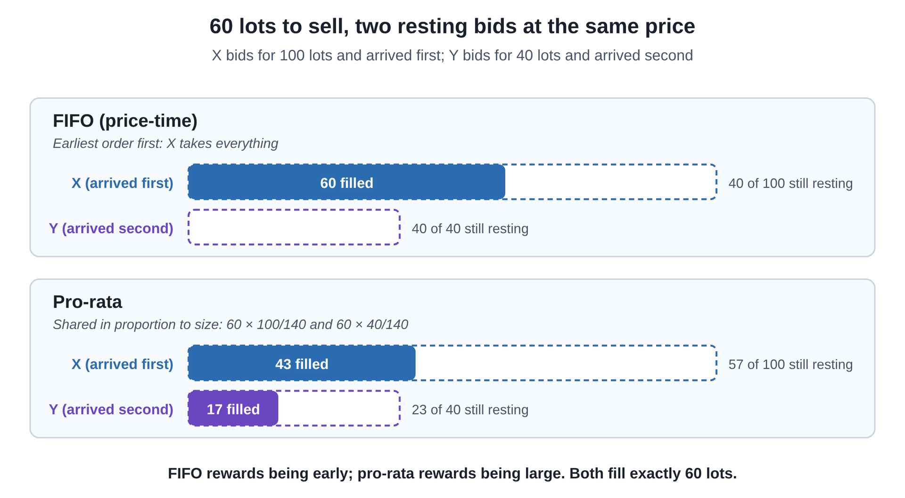

Pro-rata rewards size over speed: a large order gets more even if it arrived later. It is common in interest-rate futures markets (where orders can be very large and the marginal value of nanosecond speed is lower) and in some options markets. CME Group, for example, matches its SOFR (Secured Overnight Financing Rate) futures with an "allocation" algorithm that is largely pro-rata (with priority for the order that first improves the price), matches 2-year Treasury note futures with a configurable FIFO/pro-rata blend, and uses plain FIFO for its equity index futures (E-mini S&P 500, E-mini Nasdaq 100), crude oil, and 10-year Treasury note futures [CME Group Client Systems Wiki, *Supported Matching Algorithms*; Databento, *CME matching algorithms explained*]. The algorithm is configured per product, and occasionally changes, so always look it up. Knowing which rule a venue uses matters enormously for anyone building order-routing or execution logic: an HFT firm optimising for FIFO markets (be first) must use entirely different strategies than one optimising for pro-rata markets (be large).

For the exchange to implement price-time priority correctly, two things must be true: prices must be comparable without ambiguity (which is why exchanges store prices as whole numbers of ticks, as the next chapter explains), and order arrival must be sequenced deterministically. Modern exchange systems use **nanosecond-precision timestamps** as one component of this sequencing. However, the timestamp alone does not fully guarantee fairness, what matters is the order in which messages are **accepted into the exchange system**, which also depends on network routing, gateway sequencing, and in high-performance systems, hardware timestamping infrastructure. The timestamp records when the exchange received the order; the sequencing infrastructure ensures that two orders arriving within the same nanosecond are ordered consistently and reproducibly.

### How Order Amendments Affect Priority

Orders do not always stay unchanged from submission to fill. Participants modify their orders, adjusting price, changing quantity, or occasionally altering other attributes. The question of how an amendment affects queue priority is important, and the rules are consistent across almost all major exchanges.

**The guiding principle:** priority is earned by making a commitment at a specific price at a specific moment in time. When that commitment changes in a way that is beneficial to the participant at the expense of others in the queue, the priority is lost. When the change is a concession, giving up something, priority is retained.

Applied to the three common amendment types:

**Price change → priority is lost.** If a resting buy order at $150.30 is amended to $150.35, it receives a new timestamp and goes to the back of the queue at $150.35. The logic is straightforward: the order at $150.30 was competing for queue position against others who committed to $150.35 earlier. If it could simply "upgrade" its price while retaining the earlier timestamp, it would jump ahead of participants who made the $150.35 commitment first, which is unfair to them.

*Example:* At 10:00:00.000 you submit a buy limit at $150.30 and join the queue behind five other orders at that price. At 10:00:05.000 the market is moving and you amend your price up to $150.31. Your order now has a new timestamp of 10:00:05.000 and joins the back of the queue at $150.31, behind every order that was already resting at $150.31, including those that arrived between 10:00:00 and 10:00:05. Your five seconds of seniority at $150.30 count for nothing at the new price.

**Quantity increase → priority is lost.** If a resting order is amended upward from 500 shares to 1,000 shares, it receives a new timestamp and goes to the back of the queue. The logic: the order now claims twice as much of the available execution as it originally committed to. Participants who arrived later but were waiting behind the 500-share order should not now find themselves behind a 1,000-share version of the same order.

**Quantity decrease → priority is retained.** If a resting order is amended downward from 1,000 shares to 200 shares, the timestamp and queue position are unchanged. The logic: the order is conceding some of its claim, not expanding it. This is a concession that favours other participants (more liquidity becomes available behind it), so there is no fairness reason to penalise it.

These rules hold, with minor local variations, on virtually every major exchange. They are sometimes informally summarised as: *increasing your claim loses priority; decreasing your claim does not.*

**Cancel-and-replace.** Some participants, particularly market makers who update quotes frequently, do not amend orders but instead cancel the old order and submit a new one. The new order always gets a fresh timestamp at the back of the queue, there is no way to retain priority through a cancel-replace. Some systems provide an **order modify** message specifically to allow quantity reductions without losing priority; using a cancel-replace when you only want to decrease size is a mistake that costs queue position unnecessarily.

**Implications for software:** the exchange engine must apply the correct priority rule based on the type of amendment. A modify message that contains only a quantity decrease should leave the order's timestamp unchanged. Any other modification, price change, quantity increase, TIF change, or unknown field change, should assign a new timestamp. The simplest safe implementation: treat all amendments other than quantity decrease as cancel-plus-new-order.

### Ticks: The Minimum Price Increment

Prices in financial markets do not move continuously. They move in discrete steps called **ticks**. The minimum price movement is the **tick size**. Tick size is the reason two prices can be safely compared for priority at all, without it, "better price" would be a question with infinitely many possible answers between any two quotes.

For most US equities, the tick size is $0.01 (one cent); for equity index futures on CME it varies by product; EUR/USD in the interbank market is quoted in **pips** (0.0001 of the exchange rate), and today often in tenths of a pip. This is only the surface of the topic, tick size interacts with price representation, regulation, and market structure in ways that cause real numerical bugs when misunderstood, so it gets a full chapter of its own immediately following this one: *Tick Sizes and Fractional Ticks*.


## Tick Sizes and Fractional Ticks

The previous chapter introduced the tick as the minimum price increment and why fair priority needs prices that compare exactly. This chapter goes deeper: how prices are actually stored, how tick sizes vary, and how they came to be what they are. It matters because tick size is one of the most common sources of subtle numerical bugs in exchange software, and because it has a genuinely interesting history that explains why the rules look the way they do today.

!!! note "The Odd-Eighths Scandal: The Study That Moved a Market (1994–97)"

    Until 2001, US stock prices were not quoted in cents but in fractions of a dollar, and for most of that time the smallest allowed price step was one eighth of a dollar, 12.5 cents (the history is told later in this chapter). A price could therefore end in 0, 1/8, 2/8, 3/8, 4/8, 5/8, 6/8 or 7/8 of a dollar. Four of those simplify to familiar fractions, 0, 1/4, 1/2 and 3/4, and are called the **even eighths**. The other four, 1/8, 3/8, 5/8 and 7/8 (12.5, 37.5, 62.5 and 87.5 cents), cannot be simplified and are called the **odd eighths**.

    In 1994, finance professors William Christie and Paul Schultz published a deceptively simple observation: for a large set of heavily traded NASDAQ stocks, the market makers almost never quoted a price ending in an odd eighth. A stock would be bid at $20 1/4 and offered at $20 1/2, but hardly ever bid at $20 3/8. If only the even eighths are used, the gap between the bid and the ask can never be smaller than a quarter of a dollar (25 cents), even though the rules allowed a spread of one eighth (12.5 cents). Investors were in effect paying twice the minimum spread on every trade, a pattern consistent with tacit coordination among dealers to keep spreads wide. The market's reaction was itself a natural experiment: on 27 May 1994, the day after the findings were reported in the press, quoted spreads on several of the named stocks collapsed by roughly half, overnight, with no rule change of any kind, documented in a companion paper by Christie, Harris, and Schultz in the same issue of the *Journal of Finance*. The Department of Justice and the SEC investigated; the SEC's Section 21(a) report (August 1996) found that NASDAQ dealers had followed a "quoting convention" and that the NASD had failed to police its own market; the follow-on civil class action was settled in 1997–98 for approximately $1.03 billion, then the largest antitrust settlement on record. The regulatory aftermath, the SEC's Order Handling Rules (1997), Regulation ATS (1998), and momentum toward decimalization (2001), reshaped US equity market structure. It remains the cleanest documented case of an academic paper, standing on public quote data, exposing and ending a market-wide pricing convention.<br>&nbsp;<br>

    **References:** William G. Christie and Paul H. Schultz, "Why Do NASDAQ Market Makers Avoid Odd-Eighth Quotes?" *Journal of Finance* 49(5), 1994; William G. Christie, Jeffrey H. Harris, and Paul H. Schultz, "Why Did NASDAQ Market Makers Stop Avoiding Odd-Eighth Quotes?" *Journal of Finance* 49(5), 1994


### Why Integer Tick Counts

In software, storing prices as binary floating-point numbers (like Python's `float` or C's `double`) is dangerous because most decimal fractions have no exact binary representation. The double nearest to 150.30 is actually 150.300000000000011368683772161602973937988281250, and the classic demonstration, `0.1 + 0.2 == 0.3`, evaluates to `False` in almost every programming language (the sum is 0.30000000000000004). Two prices that "should" both be $150.30, one typed in and one computed by adding a tick to $150.29, can therefore differ in their last bit and be treated as different price levels, a subtle but serious bug.

The standard solution is to store prices as **integer tick counts**: the number of minimum increments from zero. $150.30 with a tick size of $0.01 is stored as the integer 15030. Integers are exact. 15030 always equals 15030. All arithmetic, comparison, addition, subtraction, is exact with integers. Prices are only converted back to decimal notation when displaying them to humans, at the output boundary.

**What happens when a non-aligned price is submitted?** If a participant submits a limit buy at $150.305 when the tick size is $0.01, the price is not a valid tick multiple. Validation rejects the order (in the gateway, a dedicated risk layer, or the matching engine itself, depending on the architecture, see the *Technology Architecture* chapter of Part IV) and returns an error message identifying the nearest valid prices on either side ($150.30 and $150.31) so the participant can resubmit correctly. The order receives REJECTED status and never enters the book. This becomes especially important at larger tick sizes, a futures product with a $0.25 tick makes it easy to accidentally submit a price like $150.10 that falls between valid multiples.

### Tick Size Is Not One Number Per Market

A common assumption among developers new to this domain is that a market has *a* tick size, one cent for US stocks, done. In practice tick size is reference data attached to each instrument (see the *Reference Data* chapter of Part IV), and it varies along several axes:

**By price band.** Several major venues use a **banded** or **variable tick regime**, where the tick size itself changes as the price of the instrument changes. The European tick size regime, harmonised across EU venues under MiFID II (and retained, with local adjustments, in the UK), is the clearest example: in the same liquidity band, a share priced at €0.80 might trade in €0.0005 increments, while a share priced at €80 trades in €0.05 increments. The logic is that a fixed absolute tick would be economically meaningless across a 100x price range, one cent is a huge relative increment on a 50-cent stock (2% of the price) and a trivial one on a $500 stock (0.002% of the price). The EU's tick size table under MiFID II defines around twenty price ranges crossed with six liquidity bands (based on how many trades a share sees per day), and each cell of that table has its own tick.

**By product, in derivatives markets.** CME Group sets tick size per contract based on the economics of the underlying: the E-mini S&P 500 futures contract moves in increments of 0.25 index points (worth $12.50 per contract given its $50 multiplier), while a US Treasury futures contract ticks in fractions of 1/32nd of a point, a direct holdover from how Treasury bonds themselves have quoted in fractions for generations (more on this below).

**By listing venue for the same underlying stock.** Because reference data is defined per venue, the same company's shares can carry a different tick size on different exchanges, this is one of several reasons a smart order router (see Part IV) must load tick size per venue per symbol rather than assuming a single global value.

A software system that hardcodes "$0.01" as the tick size, rather than reading it from reference data per instrument and per price band, will work correctly for the common case and then fail unpredictably the first time it encounters a low-priced stock, a bond, or a European listing.

### Sub-Penny Quoting and Rule 612

In the US, **Rule 612 of Regulation NMS** (adopted 2005) prohibits any exchange, ECN, or market maker from displaying, ranking, or accepting a quotation in an NMS stock priced at $1.00 or more in an increment finer than $0.01. This is why a US equity above a dollar cannot be quoted at $150.305, it isn't merely that the reference exchange in this book chooses a penny tick, it is a regulatory floor that applies market-wide. Stocks priced below $1.00 are permitted sub-penny increments (as fine as $0.0001), reflecting the same price-band logic described above: a penny is a huge relative increment on a $0.50 stock. The rule exists because, before it, some venues and market makers competed for order flow by quoting fractions of a cent ahead of a competitor's whole-cent quote, a practice regulators judged to add negligible price improvement while degrading the reliability and comparability of quotes across venues, exactly the "fairness and transparency" promise described in Part I. (The penny floor is not frozen, either: in September 2024 the SEC adopted amendments introducing a half-penny ($0.005) tick for heavily traded stocks whose spreads are routinely pinned at one cent, by industry estimates some 1,800 stocks. The rule survived a court challenge in October 2025, but the SEC has twice postponed the date by which markets must comply, most recently, in June 2026, to November 2027, while it reviews the wider Regulation NMS framework. A tick size, in other words, is a configurable parameter even at the level of national regulation, and one whose effective date a production system cannot take for granted.)

### Fractions, Not Decimals: A Short History

For almost the entire history of the NYSE, from 1792 until 2001, US stocks did not trade in cents at all. They traded in **fractions of a dollar**, initially eighths ($0.125), a convention usually traced to the Spanish silver dollar. That coin circulated widely as money in the young United States, and it was worth eight *reales*, which is why it was called the "piece of eight" and why prices were naturally split into eighths. The quoting habit outlived the coin by well over a century. A stock might be quoted "50 and 1/4" (meaning $50.25) or move by "an eighth" ($0.125). In 1997 the minimum tick was narrowed to sixteenths of a dollar ($0.0625, informally a "teenie"), but the fractional system itself persisted.

This mattered enormously for spreads and trading costs. A market maker quoting a one-eighth-wide spread ($0.125) on an actively traded, high-volume stock was capturing a spread that, in relative terms, was often far wider than the genuine cost of providing liquidity justified, precisely because $0.125 was the smallest increment available; there was no way to compete down to a narrower spread even if a market maker wanted to. Academic microstructure research through the 1990s (see Harris [1] and Hasbrouck [2] in the references), not least the odd-eighths study in the note above, built a substantial body of evidence that the fractional system was inflating trading costs for ordinary investors.

**Decimalization**, the switch from fractions to decimal cents, was mandated by the SEC and phased in across US markets between August 2000 and April 2001 [18], with NYSE and NASDAQ fully converted by April 2001. The effect was immediate: quoted spreads, especially on actively traded stocks, fell sharply, because market makers could now compete for order flow in one-cent increments instead of being locked into sixteenths [Bessembinder, "Trade Execution Costs and Market Quality after Decimalization", *Journal of Financial and Quantitative Analysis* 38(4), 2003]. It remains one of the most-studied natural experiments in market microstructure, precisely because it changed exactly one variable, the tick size, while leaving the rest of market structure intact, and the resulting narrower spreads are the baseline every example of tick size and spread in this book assumes. Decimalization is also the direct reason **Rule 612** exists: having gone through the disruption of moving to a one-cent tick, regulators wanted to prevent competition from immediately re-fragmenting into sub-penny increments, undoing the benefit just achieved.

### The Tick Size Pilot Program (2016–2018)

Narrower ticks are not unambiguously good for every stock. A one-cent tick works well for a heavily traded, liquid large-cap stock, but critics argued that for small, thinly traded companies, a one-cent spread gives market makers too little compensation to justify committing capital and quoting size, potentially *reducing* liquidity for exactly the companies that need it most.

To test this empirically, the SEC approved the **Tick Size Pilot Program**, which ran from October 2016 to September 2018. Eligible stocks were small companies (market capitalisation of $3 billion or less, average daily volume of 1 million shares or less, price of at least $2). From them, 1,200 were randomly assigned to three test groups of 400, quoting (and, in two of the groups, also trading) in five-cent increments under varying rules; the remaining eligible stocks formed a control group that kept the one-cent tick. The results were genuinely mixed. Quoted spreads widened (in the strictest group by about 24%), and so did trading costs for small orders. Displayed size at the best prices, on the other hand, rose dramatically, by several hundred percent, and market makers' profits per share rose too. What did *not* materialise was the hoped-for benefit that justified the experiment: better overall liquidity and more capital formation for small companies [SEC DERA, *Assessment of the Plan to Implement a Tick Size Pilot Program*, 2018] [19]. The SEC let the pilot expire without adopting a wider tick for small caps. The pilot is a useful case study for exchange developers precisely because it treats tick size as an empirical, testable market-structure parameter rather than a fixed constant, and because it shows how one change can improve one metric (displayed depth) while worsening another (spread).

### A Worked Example: Rounding a Midpoint to a Valid Tick

The *Order Types* chapter described **midpoint peg orders**, whose fill price is computed dynamically as (best_bid + best_ask) / 2, and flagged that this calculation "requires care with rounding to the nearest valid tick." Here is exactly why, worked through in ticks rather than dollars so the arithmetic is exact.

Suppose the tick size is $0.01, so prices are stored as integer cent-counts. The best bid is $150.30 (tick count 15030) and the best ask is $150.33 (tick count 15033):

```
sum        = 15030 + 15033 = 30063
midpoint   = 30063 / 2      = 15031.5   ← not an integer!
```

The true mathematical midpoint, $150.315, is **not a whole number of ticks**: it falls exactly halfway between $150.31 (tick 15031) and $150.32 (tick 15032). What happens next depends on the market. US equity rules are, perhaps surprisingly, relaxed about this particular case: Rule 612 restricts sub-penny *quotes and orders*, not executions, so midpoint trades at half-penny prices such as $150.315 are permitted and common, and an engine that stores prices as integer cents must therefore represent them in a finer unit (for example half-cents or hundredths of a cent). In many other markets, including futures, every trade must print on a valid tick, and the matching engine must round 15031.5 to one of its two neighbours. *Which* neighbour it chooses is a real economic decision, not a cosmetic one: rounding up gives the extra half-cent to the seller, rounding down gives it to the buyer.

This is exactly the kind of detail that must be a single, explicit, documented rule rather than "whatever the rounding function in the standard library happens to do." A system with two components that both round tick-and-a-half prices, say, the matching engine and a downstream P&L reconciliation service, must use the *identical* rounding rule, or the two will silently disagree by one cent on what price a given midpoint fill occurred at. In isolation a one-cent discrepancy looks trivial; multiplied across millions of midpoint fills a day, it becomes a real, hard-to-trace reconciliation break between systems that are supposed to be describing the same trade. Common conventions include round-half-up, round-half-to-even ("banker's rounding," which avoids systematically favouring either side over many trades), or a rule that explicitly favours the resting order as compensation for the queue-priority risk it took by waiting. Whichever rule is chosen, the requirement is that it lives in exactly one place and every component that touches a midpoint price calls the same function, the same principle of a single authoritative source that governs reference data generally (see Part IV).

Note that this specific problem, an odd sum of tick counts, arises exactly when the bid and ask are an odd number of ticks apart (here, 3 ticks: 15033 − 15030 = 3), because bid + ask = 2 × bid + spread, which is odd precisely when the spread is odd. When the spread is an even number of ticks (for example, bid 15030 and ask 15032, a two-tick spread), the midpoint lands exactly on a valid tick with no rounding decision required. And a one-tick spread, the tightest a market can be and the normal state of a liquid stock, *always* has the problem: (15030 + 15031) / 2 = 15030.5. In other words, the rounding rule is not an edge case; in liquid markets it is exercised on nearly every midpoint trade.

> **Key idea:** Tick size is reference data, not a universal constant, it varies by price band, by product, and by venue, and must be read from configuration rather than hardcoded. Historically, US markets operated in fractions for two centuries before decimalization in 2001 proved that narrower ticks meaningfully reduce trading costs, which is precisely why Rule 612 now puts a regulatory floor under how fine a tick can go. And because a midpoint (or any other computed, non-stored price) does not always land on a valid tick, every system component that rounds one must use the same rounding rule, or fills that are supposed to describe the same trade will silently disagree.

## The Matching Engine, The Heart of the Exchange


The **matching engine** is the software that receives orders, manages the order book, and executes trades when buy and sell orders are compatible. It is the exchange's most critical, performance-sensitive component.

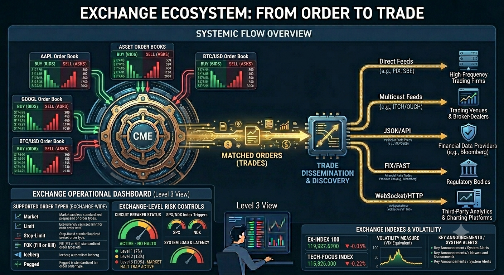

***Figure 1:** The matching engine receives orders from participants, manages the order book, and executes trades when compatible orders are found. It publishes trade and order status events to participants and subscribers.*


### The Core Loop

At its simplest, the matching engine runs an endless loop:

1. Receive an incoming order.
2. Check if it can immediately match against resting orders on the opposite side.
3. If yes, execute the match (create a trade, update quantities, notify participants).
4. If there is remaining unfilled quantity, decide what to do with it (rest it in the book, or cancel it, depending on order type and TIF).
5. Check if any dormant stop orders have now been triggered by the new trade price.
6. Publish the results (trades, order status changes) to participants and subscribers.

<!-- pagebreak:any -->

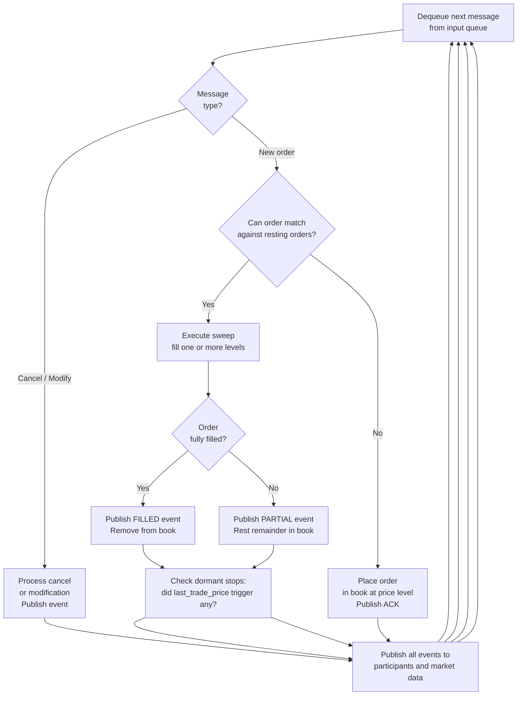

### The Sweep

When an aggressive order arrives and begins filling against the resting book, this process is called **sweeping** the book. The aggressive order works through price levels one by one, from best to worst, until either it is fully filled or it reaches its limit price (or the book runs out of orders).

For example, a market buy order for 5,000 shares arrives:
- Takes 2,000 shares at the best ask of $150.35.
- Takes 1,500 shares at the next level, $150.40.
- Takes 1,200 shares at $150.45.
- Takes 300 shares at $150.50.
- Fully filled. Total cost: a weighted average of these prices.

The price impact of sweeping through multiple levels is called **slippage** or **market impact**, the large order moved the effective price away from the initial best ask.

### Single-Threaded by Design

Perhaps counterintuitively, most matching engines are **single-threaded**, they process orders one at a time, in strict sequence, with no parallel processing of orders. This is not a performance limitation; it is a deliberate design choice.

The order book is a shared, stateful data structure. If two threads tried to modify it simultaneously, you would need complex locking mechanisms to prevent corruption, and you might still end up with non-deterministic outcomes. In a system where fairness and determinism are legally required, this is unacceptable.

By processing orders in a single thread, the engine guarantees that the outcome is perfectly deterministic: given the same sequence of orders, the same sequence of trades will always result.

> **Key idea:** Single-threaded design is a feature, not a limitation. It makes the matching engine auditable, replayable, and legally defensible. Performance comes from algorithmic efficiency, not from parallelism inside a book. (Parallelism *across* books, giving different symbols to different threads or machines, is fine, because the books never interact.)

The performance requirement is achieved through algorithmic efficiency (correct data structures, avoiding unnecessary computation) rather than parallelism. The world's fastest matching engines process an order in a few microseconds or less. For scale: in 2025 CME Group's venues traded a record average of 28.1 million *contracts* per day [CME Group press release, 5 January 2026], and the number of *messages* (new orders, modifications, cancellations) behind those trades is far larger still, because most orders are cancelled or modified without ever trading. Major equity exchanges typically acknowledge an order within tens of microseconds, and the fastest co-located trading firms, often using FPGA hardware, can react to a market data update with an order in well under a microsecond. These numbers drive the entire hardware and architecture design: no garbage-collection pauses, no dynamic memory allocation in the critical path, no operating system calls that can introduce variable latency. (Some well-known engines are written in Java, a garbage-collected language; they get away with it by never creating garbage on the hot path in the first place.)

### One Book Per Symbol

The matching engine maintains one order book per tradeable symbol. AAPL trades in one book, MSFT in another. These books are entirely independent, an order in the AAPL book cannot interact directly with an order in the MSFT book (combo orders handle cross-symbol interaction at a higher level).

Conceptually, one logical order book per symbol is the correct mental model. In production systems, the implementation may be distributed differently, books may be sharded across cores, replicated for high availability, or partitioned by instrument group across multiple machines, but the logical behaviour is identical: each symbol has its own independent price-time priority queue.

**Where symbol independence breaks down:** Several order types and matching mechanisms require coordination *across* symbols, and developers should not over-generalise the "symbols are independent" rule:

- **Spread orders and calendar spreads** (CME): a single order to buy a March futures contract and sell a June contract simultaneously. The exchange must evaluate both legs together, filling only one is leg risk.

- **Implied matching** (derivatives markets): if there is a resting spread order to buy March and sell June, and a resting outright order to sell March, the two together are a synthetic offer to sell June, and the exchange can publish it as an *implied* order in the June book and fill an incoming June buyer against both of them at once. CME Globex implements implied matching across many contract months. This topic gets two full chapters at the end of this Part.

- **Multi-leg options strategies** (Eurex, CBOE): a straddle (buy call + buy put at the same strike) or a strangle requires co-ordination between two different option series, each with its own symbol.

- **Basket orders and index rebalancing**: trading a portfolio of dozens of stocks as a single instruction requires cross-symbol scheduling and coordination.

For exchange system developers, this means the "separate process per symbol" architecture that works cleanly for single-instrument matching must be extended, or wrapped with a higher-level combinator, to handle any multi-leg or implied matching requirements.

### The Role of Data Structures

*The Order Book* chapter already walked through one concrete design in detail; this section steps back to the general picture. The order book needs to answer one question extremely fast: "What is the best available price right now?" Priority queues and heap-like structures are conceptually useful for understanding this, a heap gives O(1) access to the minimum or maximum element, and O(log n) insertion and deletion, which suits the matching engine's primary operations well.

Production exchange engines, however, often use more specialised data structures optimised for FIFO ordering within price levels, cache locality, and deterministic latency: balanced trees, skip lists, or intrusive linked lists indexed by price level are common. The conceptual model of "best price always accessible in O(1)" is correct regardless of the underlying structure; the heap is a pedagogically useful approximation of what these structures achieve.


## The Life of a Trade


Let us trace a single trade from start to finish.

### Order Submission

Participant A, connected through Gateway GW01, submits a limit buy order: "Buy 500 shares of AAPL at $150.30, DAY." The order arrives as a **FIX message** (Financial Information eXchange, the standard protocol for order submission in financial markets, covered in full in *The Technology Architecture* chapter of Part IV). The gateway validates the basic format and forwards it to the matching engine.

The engine receives the order and assigns it:
- A **unique order ID** (a system-wide identifier, discussed in detail in the same chapter)
- A **timestamp** (nanosecond precision)
- An initial status of **NEW** (the order has been accepted and registered)

The engine publishes an **acknowledgment (ACK)** back to GW01 confirming the order is live. The order now rests in the book.

### The Match

Moments later, Participant B, connected through Gateway GW02, submits a sell limit order: "Sell 500 shares of AAPL at $150.30, DAY." Or perhaps a market sell order. Either way, the engine determines that this sell order can match the resting buy order.

The match happens: 500 shares trade at $150.30. Two events occur simultaneously:
- Order A transitions from status NEW to **FILLED**.
- Order B transitions from status NEW to FILLED.

Both GW01 and GW02 receive **fill notifications** (also called **execution reports**) detailing the trade: quantity, price, and any remaining unfilled quantity.

A **trade record** is created, capturing:
- The trade ID
- The symbol
- The price
- The quantity
- The IDs of both orders involved
- The IDs of both gateways (participants)
- The timestamp
- Which side was the **aggressor** (which order arrived and "took" the fill)

The aggressor field is more than just a label. It matters for several reasons. First, for **fee calculation**: most exchanges charge takers (aggressors) a fee and pay makers (resting orders) a rebate, so correctly identifying which side was aggressive determines the billing for each trade. Second, for **market data and surveillance**: many venues (CME among them) publish the aggressor side with every trade, and the exchange's own surveillance team uses it to reconstruct who was pushing the price and in which direction. Third, for **market analysis**: the sequence of buyer-initiated and seller-initiated trades is a standard input to microstructure models that infer order flow direction and predict short-term price movement. Where a venue does not publish the aggressor, analysts have to guess it from prices, which is one reason exchanges that do publish it are popular with researchers.

### Partial Fills

If Order A was for 500 shares but only 300 shares were available at $150.30, a **partial fill** occurs: 300 shares trade, Order A's status becomes **PARTIAL** with 200 shares remaining, and it continues resting at $150.30 waiting for more sellers.

### Publication

Every trade is immediately published over the market data feed to all subscribers. Trading screens, data vendors, the exchange's own statistics database, the clearing system and every other subscriber receive the trade notification within microseconds of it occurring.

### Order Status Lifecycle

An order passes through a defined set of statuses during its lifetime. Understanding these is essential for anyone building order management, reporting, or audit systems.

| Status | Meaning |
|---|---|
| **NEW** | The order has been accepted and acknowledged by the exchange. It is live, either resting in the book (if a limit order) or being matched (if aggressive). |
| **PARTIAL** | At least one fill has occurred but the order quantity is not yet fully satisfied. The remaining quantity continues to rest or be eligible for matching. |
| **FILLED** | The entire order quantity has been executed. The order is complete and leaves the book. |
| **CANCELLED** | The order was withdrawn before it was fully filled, either by the participant or by the exchange (e.g., a kill switch, or self-match prevention). |
| **REJECTED** | The order was refused by the gateway or the engine before entering the book, for example, failing a pre-trade risk check, containing an invalid price, or submitted during a halt. A rejected order never entered the book. |
| **EXPIRED** | The order's time in force ran out before it was fully filled: a DAY order still resting at the end of the trading day, an ATO or ATC order unfilled when its auction ends, or a GTD order that reaches its expiry date. No one asked for it to be withdrawn; its validity simply ended. |

The key transitions: an order starts as NEW. A partial fill moves it to PARTIAL. A final fill completes the transition to FILLED. A cancel message (from the participant) or a kill switch (from the exchange) moves a NEW or PARTIAL order to CANCELLED. A pre-trade rejection produces REJECTED without the order ever becoming NEW. The end of the order's time in force (the close for a DAY order, the end of the auction for ATO and ATC, an elapsed GTD date) produces EXPIRED.

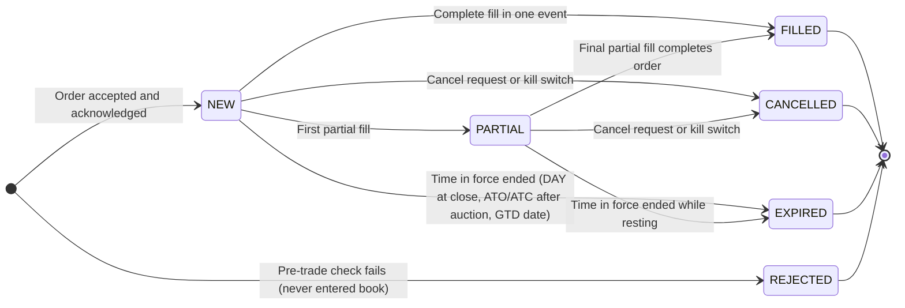

> **Key idea for developers:** REJECTED is fundamentally different from CANCELLED. A rejected order never existed in the book; a cancelled order did. Audit trails must record both, but they have different implications for position tracking (a rejected order has no position impact) and for regulatory reporting.


## Market Makers, The Providers of Liquidity


*The Participants* in Part I introduced market makers as liquidity providers. In this chapter we examine their operational interaction with the exchange in much greater detail: quote lifecycles, formal obligations, protection mechanisms, inventory risk, and the software implications of supporting them.

> **Key idea:** Market making is not a passive activity. The market maker's position, risk, and obligations change with every fill, every second of elapsed quoting time, and every price movement in the market. The exchange system must enforce all of this automatically, in real time, without manual intervention.

### Market Maker Obligations

Being a designated market maker is not a free lunch. The exchange grants privileges, reduced fees or rebates and, in some markets, priority or guaranteed allocations on certain order flow, but in return imposes binding contractual obligations. These are monitored continuously in real time. Failing to meet them results in financial penalties or loss of market maker status.

The typical obligations, in descending order of fundamentality, are:

**1. Two-sided quoting.** The market maker must always have both a live bid and a live ask resting in the book at the same time. Quoting only one side defeats the purpose of providing liquidity and is a contractual breach.

**2. Maximum spread.** The ask price must not be more than a specified number of ticks above the bid. If the market maker agreement specifies a maximum spread of 5 ticks on AAPL (tick size $0.01), the market maker can never quote a bid at $150.30 and an ask at $150.36 simultaneously, the gap of 6 ticks is too wide.

**3. Minimum size.** Both the bid and ask must offer at least a specified minimum quantity. Quoting 50 shares when the minimum is 200 is insufficient; the liquidity must be meaningful.

**4. Maximum distance from mid.** Quotes must remain within a specified distance of the current mid price. Quoting a bid at $100 and an ask at $200 on a $150 stock satisfies the letter of two-sided quoting but not its spirit.

**5. Presence obligation.** The market maker must be actively quoting for at least a specified percentage of the trading session. The figure depends on the venue and the programme: in the EU, MiFID II sets a floor of half the trading day for any formal market-making agreement, and many programmes demand far more, often 80–90%. This prevents market makers from only quoting on easy days and disappearing on volatile ones when liquidity is most needed.

**6. Re-quoting obligation.** After either side of a quote is filled, the market maker must post a fresh replacement quote within a specified maximum delay, typically a few hundred milliseconds to a few seconds depending on the product and exchange. The exchange system must track fill events and monitor whether replacement quotes arrive in time.

### The Two-Sided Dilemma: When One Side Is Taken

The obligations above sound manageable until you think carefully about what happens at the moment of a fill. This is where market making becomes genuinely complex, and where the concept of **adverse selection** becomes central.

**Adverse selection** occurs when the participant trading against a market maker is doing so because they have information that the market maker lacks. The informed trader knows the price is about to move; the market maker does not. The market maker ends up buying at $150.30 just before the price falls, or selling at $150.35 just before the price rises. This is not bad luck; it is the systematic consequence of always being available to trade against anyone who shows up.

The arithmetic makes the danger concrete. Suppose a market maker is quoting AAPL:
- **Bid:** Buy 500 shares at $150.30
- **Ask:** Sell 500 shares at $150.35

An aggressive sell order arrives and hits the bid. The market maker has just bought 500 shares at $150.30. But their ask, "sell 500 shares at $150.35", is still live. The problem: this situation is no longer neutral. The seller was aggressive, they had a reason to sell urgently. If that reason is information (the price is about to fall), the market maker has been adversely selected.

The arithmetic: if the true price falls to $150.10 after the fill, the market maker now holds 500 shares worth $150.10 that they paid $150.30 for. Loss: $0.20 × 500 = **$100**. What did the market maker expect to earn? Buying at the bid, $0.025 below the mid price of $150.325, earns the *half-spread*: $0.025 × 500 = **$12.50** per fill. The full spread, $0.05 × 500 = **$25**, is earned only on a complete round trip, when a matching sale at the ask follows the purchase at the bid. A single adverse selection event of $100 therefore wipes out the revenue of four complete round trips, or eight ordinary fills. If the informed seller keeps hitting the bid repeatedly before the market maker can react, the losses compound rapidly.

The exchange system must have a defined policy about what to do with the surviving side, because these events occur in microseconds with no time for manual decisions.

### Quote Refresh Policies

The **quote refresh policy** is the rule governing what happens to the surviving leg of a two-sided quote when the other leg fills.

**Policy 1, Cancel both sides immediately (most conservative).** The moment either the bid or ask is filled, the entire quote is automatically cancelled. The market maker starts fresh and must submit a new two-sided quote within their re-quoting window. This is the safest policy: no stale inventory, no unintended exposure.

**Policy 2, Cancel only the filled side, leave the other active.** The surviving side remains live. Faster for market liquidity but riskier for the market maker, if prices are moving, the surviving quote may already be stale.

**Policy 3, Leave both sides active.** No automatic action. Riskiest; used only in tightly controlled situations.

The exchange system must implement all variants, configurable per market maker per product, typically via a quote refresh policy setting checked each time a quote leg fills.

### Inventory: The Position That Builds Up

Every fill changes what the market maker owns. Buy 500 shares at the bid and the firm is now **long** 500 shares; if the next few fills are also on the bid, it is long 2,000, and every cent the price falls now costs it $20. This accumulated position is the market maker's **inventory**, and managing it is the other half of the job.

The main tool is **skewing** the quotes. A market maker who is long and wants to get back to flat moves *both* prices down a little: the lower ask attracts buyers who will take the excess shares off its hands, and the lower bid makes it less likely to buy even more. A market maker who is short does the opposite. Skewing does not need any special exchange support; it is simply a stream of cancel-and-replace messages, which is one reason market makers send far more messages than they trade. When inventory grows past what the firm's risk limits allow, the quotes are pulled altogether, and the presence obligation above is what stops that from happening too easily.

### Market Maker Protection (MMP)

Even with careful refresh policies, market makers face a specific danger: **adverse selection at high speed**.

When an algorithm with access to breaking news starts aggressively selling, it does not submit one large order, it sends many small orders in rapid succession, each hitting the market maker's bid before they can react. In milliseconds, the market maker has bought far more inventory than intended at prices that are about to move against them.

**Market Maker Protection (MMP)** is the automated countermeasure. The exchange maintains a rolling time window per market maker and counts fills within it. If fills arrive faster than a configured threshold, MMP fires automatically, cancelling all of that market maker's quotes without waiting for human intervention.

After MMP fires, the market maker enters a **protection period** to assess and decide before re-quoting. MMP parameters (fill count, time window) are configured per market maker per symbol and are formally specified in market maker agreements. An illustrative configuration might be "5 fills within 500 milliseconds" for a liquid equity option: if five fills occur faster than that, the system assumes the market maker is being picked off by an informed algorithm and activates protection automatically. Real implementations usually measure more than a simple fill count. Eurex's T7, for example, lets market makers set "percentage, volume, delta and vega limits" (delta and vega measure how much an options position gains or loses when the underlying price, or the market's expectation of future price swings, moves), so protection can trigger on how much risk has been accumulated rather than on how many trades produced it, and it *inactivates* the quotes (which the market maker can then reactivate) rather than deleting them [Eurex, *T7 Functional and Interface Overview*]. The parameters are different for each product: a highly liquid product like a major equity index option might allow more activity in a given window than an illiquid single-stock option.

**Why exchanges provide MMP:** Without it, market makers would either quote much wider spreads (to compensate for adverse selection risk) or withdraw entirely. MMP is not a favour to market makers, it is infrastructure that makes tight spreads and deep liquidity sustainable for the whole market.

In a typical implementation a fill-counter function tracks fills against the rolling window, and an MMP activation function cancels all resting quotes for that market maker when the threshold is exceeded.

### The Full Lifecycle of a Market Maker Quote

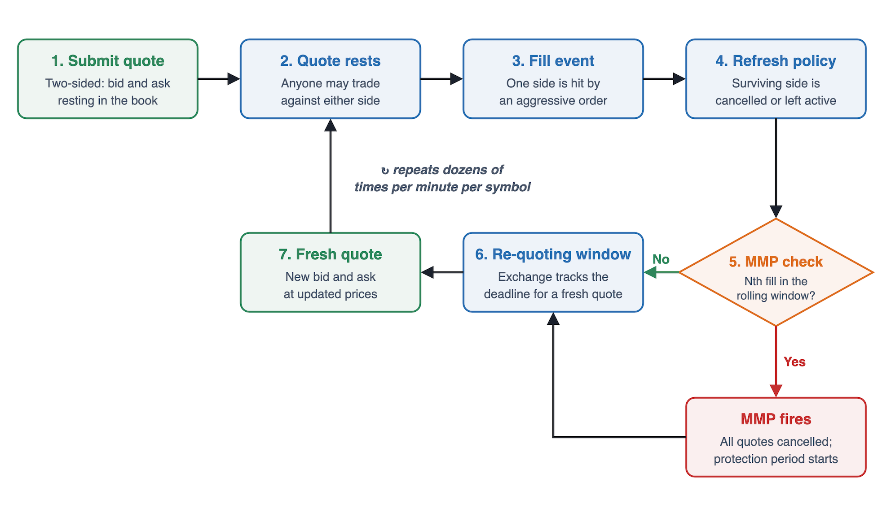

This cycle, repeating dozens of times per minute per symbol, is what "providing liquidity" means operationally. A professional market maker runs sophisticated algorithms that evaluate every fill, update pricing models, and decide within microseconds whether and at what prices to re-quote.


## The Opening and Closing Auction


Trading does not simply start at 9:30am and stop at 4:00pm (for US equities). The transition between closed and open trading is managed through a **call auction** (also called a **fixing**): orders are collected for a while and then matched all at once. The moment of matching is called the **uncross**, because the buy and sell orders that overlap in price (that "cross") are matched against each other until none overlap any more.

### The Problem an Auction Solves

Imagine the exchange has been closed overnight. Many participants have new orders to submit. If the exchange simply opened and started matching immediately, the first few orders would define the opening price, which would be arbitrary and potentially far from "fair value" based on overnight news.

Instead, exchanges run an **opening auction**:

1. During a pre-open period (on NYSE, from early morning until the 9:30am open), participants submit orders. These orders are accepted but not matched. The book quietly accumulates interest on both sides.

2. At the close of the auction period, the exchange's **equilibrium algorithm** finds the single price at which the maximum quantity can trade. This is the **equilibrium price** (also called the **clearing price** or **auction price**).

3. All orders that can trade at the equilibrium price are **uncrossed** (matched) simultaneously, all at that one price. There is no sweeping through levels, everyone trades at the same price.

4. Any remaining unfilled orders transition to the continuous book.

The result is a fair opening price that reflects the overnight information available to all participants simultaneously, rather than favouring whoever happened to submit their order a few milliseconds earlier.

### Finding the Equilibrium Price

The equilibrium price is the price that maximises total traded volume, the **maximum executable volume rule**. For each candidate price, the algorithm calculates:
- How many buy orders would trade at that price or better (buyers willing to pay at least that much)
- How many sell orders would trade at that price or better (sellers willing to accept at most that much)

The executable volume at each candidate price is `min(cumulative_bids, cumulative_asks)`. The price that maximises this is the equilibrium.

**A worked example.** During the pre-open period, the following orders have accumulated:

*Buy orders:* 500 shares at $152, 1,000 shares at $151, 800 shares at $150

*Sell orders:* 600 shares at $150, 900 shares at $151, 800 shares at $152

The equilibrium algorithm evaluates each candidate price:

| Candidate Price | Buyers willing to pay ≥ price | Sellers willing to accept ≤ price | Executable (min) |
|---|---|---|---|
| $150 | 500+1,000+800 = 2,300 | 600 | **600** |
| $151 | 500+1,000 = 1,500 | 600+900 = 1,500 | **1,500** ← maximum |
| $152 | 500 | 600+900+800 = 2,300 | **500** |

The equilibrium price is **$151**, the single price at which the most volume (1,500 shares) can trade. All buyers who bid $151 or more (1,500 shares total) and all sellers who asked $151 or less (1,500 shares total) trade simultaneously at $151, regardless of their individual limit prices. The buyer who bid $152 still pays only $151, $1 per share better than its limit. The seller who asked $150 still receives $151, getting $1 above their minimum. Two orders do not execute: the 800-share buy order at $150 (it will not pay $151) and the 800-share sell order at $152 (it will not accept $151). Both transition to the continuous book, which therefore opens with a best bid of $150 and a best ask of $152.

It helps to see the table as two curves. As the candidate price rises, cumulative buy interest can only fall (fewer buyers are willing to pay that much) and cumulative sell interest can only rise (more sellers are willing to accept it). Executable volume is the smaller of the two, so it is capped by sellers on the low side and by buyers on the high side, and it peaks where the curves meet.


**Tie-breaking when multiple prices produce the same volume:** If two candidate prices both yield 500 shares executable, the algorithm must choose between them. The standard tie-breaking rules, applied in order, are:

1. **Minimise the imbalance.** The imbalance is the unfilled quantity on the heavier side after the uncross. Prefer the price that leaves the smallest imbalance. If at $151 the buy side has 500 executable but 200 additional buy orders remain, the imbalance is 200. A price with a smaller imbalance is preferred.

2. **Match market pressure.** If imbalances remain equal, prefer the price in the direction of the remaining pressure, if there is a surplus of buys, choose the higher of the tied prices; if a surplus of sells, the lower.

3. **Proximity to reference price.** If all else is still equal, choose the price closest to a reference price (typically the previous close or the last traded price from the previous session).

**Indicative pricing during the accumulation period:** While the auction is still accumulating orders and before uncrossing, many exchanges continuously publish an **indicative uncross price**, the price that *would* result if uncrossing happened at that moment. This lets participants adjust their orders as the indicative price evolves. The indicative price is recalculated after every order arrives.

**Auction imbalance messaging:** Exchanges often publish the **imbalance**, how many more shares are on the buy side than the sell side at the indicative price, to help participants decide whether to submit offsetting orders before the uncross. NYSE publishes closing auction imbalance information from 3:50pm, updated as often as every second, giving participants ten minutes to respond before the 4:00pm uncross [NYSE, *Closing Auction Fact Sheet*].

### Auction-Only Order Types

The order types introduced in the *Order Types* chapter are the vocabulary of *continuous* trading. Auctions add a small, specialised vocabulary of their own, order types that exist specifically to participate in an uncross and that behave differently, or do not exist at all, during continuous matching. A developer implementing an auction must handle these as distinct types with their own eligibility rules, not as ordinary limit orders that happen to arrive during the call period.

**Market-on-Open / Market-on-Close (MOO / MOC).** An instruction to trade at whatever price the auction produces, with no price limit. An MOC order says, in effect, "I want to be part of the closing print, at the closing price, whatever it is." Because it names no price, it is always willing to trade and therefore always counts toward executable volume at the eventual equilibrium; its only risk is the auction price itself. MOO is the opening-auction equivalent.

**Limit-on-Open / Limit-on-Close (LOO / LOC).** The same idea with a price limit. An LOC to buy at $151 participates in the closing auction only if the closing price is $151 or lower. It expresses "I want the close, but not above (or below) this price."

**Imbalance-only orders (IO).** This is the auction-specific type most likely to surprise a developer, because it is defined *relative to the auction's own imbalance* rather than as a standalone buy or sell. An imbalance-only order provides liquidity **only on the side that offsets a published imbalance**, and only at prices that do not disturb the auction's price discovery. NASDAQ's Imbalance-Only order is the canonical example: an IO buy order is eligible to execute only against a sell-side imbalance, and NASDAQ constrains its effective price so that it can absorb imbalance without pushing the cross price through the prevailing quote. The purpose is to invite offsetting liquidity into a lopsided auction without letting that liquidity itself become a new source of price distortion.

**Closing Offset orders (CO).** NYSE's Closing Offset order is a close cousin: a CO order is a limit order that "executes only against the opposite side of an imbalance; never adds to an imbalance", and is the lowest-priority interest in the auction, it executes only after other eligible closing interest, and only to the extent it reduces a published imbalance. It lets a participant say "use me only if I am genuinely needed to balance the book," which is attractive to a trader who wants closing-price execution but does not want to add to a one-sided pileup.

**Why these types need dedicated handling.** Each of these interacts with the equilibrium calculation differently:

- MOO/MOC are unconditionally executable and simply add to both the "willing to buy at any price" and "willing to sell at any price" tallies.
- LOO/LOC behave like ordinary limit orders *within* the auction's cumulative-volume calculation.
- IO and CO orders are **conditional on the imbalance itself**, which means they can only be evaluated *after* a provisional imbalance has been computed from the other order types, and they must not be allowed to reverse the imbalance or move the price outside a permitted band. In implementation terms, the uncross is therefore not a single pass: the engine computes the equilibrium and imbalance from price-carrying and market orders first, then admits imbalance-offsetting interest to the extent it reduces (never inverts) the imbalance, then re-derives the final print.

**A note on cut-off times.** Auction order types have entry and cancellation deadlines that differ from continuous-session rules, for example, on NYSE, MOC and LOC orders must be entered by 3:50pm Eastern, after which they may be entered or modified only to offset a published imbalance, and not freely cancelled. These exact times are set by exchange rule, are periodically revised, and differ between venues; treat any specific time in this book as illustrative and verify against the current rulebook of the venue you are building for.

### The Named Crosses: Opening Cross and Closing Cross

Real venues brand and specify their auctions as named mechanisms, and an engineer reading exchange documentation will meet the names rather than the generic term "uncross." The mechanics are the equilibrium algorithm described above; the names denote the specific rule set, order types, and imbalance dissemination each venue attaches to it.

**The NASDAQ Opening Cross and Closing Cross.** NASDAQ runs its opening and closing auctions as the **Opening Cross** and **Closing Cross**. In the run-up to the cross, NASDAQ disseminates order imbalance information, the indicative clearing price, the size of any imbalance, the paired-off quantity, at defined intervals so participants can respond with offsetting or imbalance-only interest. The Closing Cross establishes the **NASDAQ Official Closing Price (NOCP)**, the number used to value NASDAQ-listed securities at end of day. NASDAQ's cross is a fully electronic, rules-based uncross: the equilibrium price is chosen to maximise executable volume, with documented tie-breaks analogous to those above.

**The NYSE close and the Designated Market Maker.** NYSE's closing auction reaches the same kind of single-price print but retains a human-supervised element that reflects NYSE's floor heritage: the **Designated Market Maker (DMM)** for each security is responsible for facilitating the close, and may, within strict rules and electronic constraints, help set the closing auction price when conditions are unusual. In ordinary conditions the process is electronic and formulaic; the DMM's role is a controlled backstop for the difficult cases (large imbalances, news, illiquidity), not a discretionary override of price discovery. NYSE publishes closing imbalance information in the final minutes (as noted above, from 3:50pm) so that offsetting interest can be attracted before the print.

**Why the closing print is worth this much machinery.** The reason both venues invest so heavily in a robust, well-policed close is the same reason the section on manipulation below exists: an enormous quantity of economic activity references the closing price specifically. Index funds must trade at the close to track their benchmark; derivatives settle against it; fund **NAVs** (net asset values, the price of one share in a fund) are struck at it; performance is measured against it. A closing price is not merely the last number of the day, it is a contractually and financially load-bearing benchmark, which is exactly what makes it a target.

### The Closing Auction

The closing auction works identically but at the end of the day, establishing the official **closing price**. This is one of the most important prices in the market, it is used to benchmark fund performance, price derivatives, and compute official valuations of positions. The closing auctions are among the most liquidity-rich events in the US equity market: on a typical day in 2024, US exchanges matched about $50 billion in their closing auctions, roughly 9% of the whole day's trading volume, in a single instant. On index rebalancing days the proportion is far higher, because index funds must trade at exactly the closing price to match their benchmarks: on the Russell reconstitution day of 28 June 2024, over 34% of the day's **notional** volume (the total value of the shares traded) executed in the close [BMLL, *Into the Close*, 2024].

### Manipulating the Close, and Why the Auction Is Policed

Because so much value references the closing price, the close is a standing target for manipulation. The generic abuse is called **marking the close** (or, for a benchmark fixing more generally, **banging the fix**): entering orders near the end of the auction period not to trade on their merits but to push the official price in a direction that benefits a position held elsewhere, a large derivatives position expiring against the close, an index-tracking obligation, a fund's month-end valuation, or simply a book that is marked to the closing price.

The mechanics of the defence are already present in the design above. Imbalance dissemination lets honest offsetting interest arrive to counter an artificial push. The imbalance-only and closing-offset order types exist precisely to attract price-stabilising liquidity. The single-price uncross means a manipulator cannot cherry-pick; they must move the whole equilibrium, which requires committing real, exposed size. And every order into the auction is captured in the audit trail, timestamped and attributed, which is what makes after-the-fact enforcement possible.

> **Historic Note: Marking the Close by Algorithm, Athena Capital, 2014**
>
> In October 2014 the U.S. Securities and Exchange Commission settled charges against **Athena Capital Research**, a high-frequency trading firm, for manipulating the closing prices of thousands of NASDAQ-listed stocks over a six-month period in 2009, the first SEC enforcement action for manipulation brought against a high-frequency trading firm. Athena's algorithm, known internally as **"Gravy,"** concentrated a large volume of aggressive orders in the final seconds before the close, in the securities where Athena held imbalance positions, in order to push the NASDAQ Closing Cross price in its favour. In the affected stocks, this small firm accounted for more than 70% of NASDAQ's trading volume in the final seconds of the day, and its own e-mails, quoted by the SEC, described its grip on the closing price as "owning the game". The order records proved what the strategy did; the e-mails proved why. Athena, without admitting or denying the findings, paid a $1 million penalty. The case is instructive for exchange developers for three reasons: it demonstrates that the closing auction's economic importance makes it a manipulation target; that the very imbalance information published to *improve* the auction can be gamed by a participant willing to trade against it artificially; and that the defence is ultimately the completeness of the timestamped, attributed audit trail, the same infrastructure the *Regulatory Surveillance* and *Determinism and Replay* chapters treat as first-class engineering requirements. [U.S. Securities and Exchange Commission, *In the Matter of Athena Capital Research, LLC*, Administrative Proceeding File No. 3-16199, 16 October 2014; SEC press release 2014-229.]

For the developer, the lesson is that an auction is not only a price-discovery algorithm but a *policed* one. The obligations this places on the system are concrete: disseminate imbalance and indicative-price information accurately and on schedule; enforce the entry and cancellation cut-offs for auction order types exactly; constrain imbalance-offsetting order types so they cannot themselves distort the print; and capture every auction message in the audit trail with the same rigour as continuous-session orders, because the closing print is precisely the number a regulator is most likely to ask you to reconstruct.

> **Key idea:** The opening and closing auctions run the same maximum-executable-volume equilibrium algorithm as any call auction, but the closing print's role as a load-bearing financial benchmark drives everything distinctive about them: dedicated auction-only order types (MOC/LOC, imbalance-only, closing-offset), venue-specific named crosses with imbalance dissemination, a human backstop at NYSE, and an explicit surveillance and audit-trail burden aimed at the ever-present incentive to mark the close.

## Trading Sessions, The Day in the Life of a Market


A trading day is structured into distinct phases, each with different rules about what is allowed.

### Pre-Open / Pre-Market

Before the formal opening, some exchanges accept orders for the day (limit orders, ATO orders, GTC orders from previous days). No matching occurs. This is the accumulation phase for the opening auction.

### Opening Auction

As described in the previous chapter: orders are collected, the equilibrium price is computed, the uncross executes, and continuous trading begins.

### Continuous Trading (the main session)

The normal matching mode. Orders arrive continuously, the engine matches them in real time, trades happen as soon as compatible orders meet. This is the primary trading session, NYSE runs from 9:30am to 4:00pm Eastern time, LSE from 8:00am to 4:30pm London time.

### Intraday Auction (optional)

Some exchanges run a brief scheduled auction during the continuous session, typically at a fixed time such as noon or 1:00pm. These **intraday auctions** serve several purposes.

For exchanges that handle both liquid and illiquid instruments, an intraday auction gives participants a chance to trade illiquid stocks against a concentrated pool of interest, rather than relying on sparse continuous liquidity throughout the day. Large institutional orders that are difficult to execute in continuous trading can be "parked" to the intraday auction where counterparties are known to aggregate.

For derivatives markets, intraday auctions are also used as **volatility auctions**, if a futures contract moves rapidly during continuous trading and triggers a volatility interruption (not a full halt, but a brief pause), the exchange may resume through a short auction rather than returning immediately to continuous matching. Eurex, for example, uses *volatility interruptions*, short auctions triggered when a price moves outside a predefined range, as a softer alternative to a full circuit breaker halt; the London Stock Exchange runs a scheduled intraday auction at midday for its most liquid shares.

From the exchange system perspective, an intraday auction is mechanically identical to the opening or closing auction: orders accumulate during the auction call period, the engine computes the equilibrium price, and the uncross executes simultaneously.

### Post-Close

After the formal close, several important processes run:

**After-hours trading.** Some venues, particularly US equity exchanges and alternative trading systems, run extended-hours sessions before the open and after the close. Volume and liquidity are substantially lower than during the regular session, spreads are wider, and price moves can be exaggerated. Not all order types are supported. The exchange may operate a separate "extended hours" trading mode with different rules from the main session.

**GTC order persistence.** Good-Till-Cancelled orders that did not fill during the session must be saved to durable storage so they can be reloaded into the order book when the next session begins. This is a non-trivial operation: each GTC order must be written to a persistent store with all its parameters (symbol, side, price, quantity, participant ID, original submission timestamp). At start-of-day, these orders are reloaded before the pre-open period begins, and each is re-acknowledged to the originating participant. If a GTC order's participant has disconnected overnight, the exchange must decide whether to hold the order or cancel it.

**End-of-day batch processes.** The close of session triggers a cascade of batch processes: the official closing price is published and broadcast to downstream systems; daily P&L is calculated for all participants; clearing reports are generated; statistics (OHLCV, Open, High, Low, Close, Volume) are finalised and archived; surveillance reports are run against the day's audit trail. These processes are not in the matching engine's critical path, but they must complete before the next session begins. Their failure can delay the next day's open.

**Book state save.** The complete state of the order book, including all resting limit orders that will carry forward, is written to disk. This is the snapshot that will be used as the starting point for warm restart if needed.

### State Machine

A well-designed exchange system models these transitions as a **state machine**, a finite set of states with explicit rules about which transitions are allowed. You cannot jump from PRE_OPEN directly to CLOSED without going through OPENING_AUCTION and CONTINUOUS. This prevents bugs where the engine enters an impossible state due to a software error or out-of-order messages. If the transition is not in the allowed list, the system rejects it.

```{.mermaid width=600}
stateDiagram-v2
    direction TB
    [*] --> PRE_OPEN

    PRE_OPEN --> OPENING_AUCTION : Auction start time
    note right of PRE_OPEN : Orders accepted, no matching

    OPENING_AUCTION --> CONTINUOUS : Equilibrium found, uncross executed
    note right of OPENING_AUCTION : Orders accumulate, no matching yet

    CONTINUOUS --> HALTED : Circuit breaker trip
    HALTED --> RESUMPTION_AUCTION : Halt period expires
    RESUMPTION_AUCTION --> CONTINUOUS : Resumption uncross complete

    CONTINUOUS --> CLOSING_AUCTION : End-of-day signal
    HALTED --> CLOSING_AUCTION : End-of-day signal during halt

    CLOSING_AUCTION --> CLOSED : Closing uncross complete
    note right of CLOSING_AUCTION : Final price determination

    CLOSED --> [*]
    note right of CLOSED : GTC orders persisted, book saved
```

Each arrow represents a permitted transition. Any attempt to trigger a transition not shown is rejected as invalid. This state machine is enforced in the exchange's session scheduler, which issues state change commands to the matching engine at the appropriate times.


## Putting It All Together


Let us trace the life of a complex event through the entire system using the vocabulary we have now built.

**Scenario:** It is 10:47am. Trading is in the CONTINUOUS session. A large institutional investor decides to sell 50,000 shares of AAPL aggressively using a limit order priced at $150.20, while the best bid in the book is $150.35.

**Step 1:** The investor's trading system sends the order to the exchange gateway (GW03). The gateway parses the FIX message, validates the format, and forwards it to the matching engine.

**Step 2:** The engine receives the order, assigns it a unique order ID (say, `f3a7…`, a random 128-bit identifier) and a nanosecond timestamp. Status: NEW. The engine acknowledges to GW03.

**Step 3:** The engine checks the order type: LIMIT SELL at $150.20. Since the best bid is $150.35 (above the limit price), this order will immediately sweep the buy side.

**Step 4:** The engine sweeps. It fills against resting buy orders, starting at $150.35, then $150.30, then $150.25, and it would continue down to $150.20 until either the 50,000 shares are exhausted or all bids at $150.20 and above are consumed, unless something stops it first (see Step 7). Along the way:
- A market maker's GTC bid for 1,000 shares at $150.35 is completely consumed by the sweep. Status: NEW → FILLED.
- An iceberg order's visible 500-share peak at $150.30 gets filled, triggering replenishment from the hidden reserve.
- Several DAY limit orders at $150.25 get partially or fully filled.

**Step 5:** After each fill, the engine updates `last_trade_price`. Some engines also keep the last price per aggressor side; here the seller was the aggressor, so `last_sell_price` follows the fills down as well: $150.35 after the first fill, $150.25 by the end of Step 4. Certain stop-order variants use these per-side prices as their trigger.

**Step 6:** The engine checks dormant stops. Does the new `last_trade_price` trigger any waiting stop orders? Suppose a buy stop at $150.40 was waiting, but the price just moved down, not up, so it does not trigger. A sell stop at $150.30 was waiting, the last trade price of $150.25 is now below $150.30, so this sell stop triggers, converting to a market sell order and immediately joining the sweep.

**Step 7:** Before each fill, the engine checks the price against the stock's **price band**: a limit on how far the price may move away from a reference price within a short time (Part III covers these bands, collars and LULD in detail). Suppose yesterday's closing auction cleared at $153.30 and the band for this stock is ±2%. The lower band is $153.30 × 0.98 = $150.234, which rounds *up* to $150.24, the lowest valid price inside the band. The fills at $150.35, $150.30 and $150.25 were inside the band, but the next resting bids, at $150.20, lie below it. Rather than print a trade outside the band, the engine stops the sweep and a circuit breaker trips. The engine transitions to HALTED state, all market maker quotes are cancelled (stale quotes cannot be maintained during a halt), and a halt notification is published.

**Step 8:** All fill events are published to the participants and to the market data feed. GW03 receives fill notifications for the institutional investor's order (now showing PARTIAL status, 50,000 shares ordered, 38,000 filled before the halt, 12,000 remaining). Each market maker whose bid was hit receives their fill notification on their respective gateways.

**Step 9:** The **drop copy** feed (a real-time duplicate of every fill, sent to a firm's risk and clearing systems; Part III has a chapter on it) receives a copy of all these fill events, tagged with sequence numbers, and forwards them to the clearing broker's risk system.

**Step 10:** The clearing process updates positions. The institutional investor's AAPL position decreases by 38,000. The positions of the market makers and other buyers increase accordingly. P&L is updated for all parties.

**Step 11:** After the halt period (say, 5 minutes), the scheduler sends a RESUME command. Following the state machine of the previous chapter, the engine first runs a short **resumption auction**, so that the price after the halt is found in one fair uncross rather than by whoever is fastest. Market makers re-quote, the auction uncrosses, and the engine returns to CONTINUOUS trading.

**Step 12:** The 12,000-share remainder of the institutional investor's sell order takes part in the resumption auction. The bids at $150.20 that the band blocked in Step 7 are still resting, so the auction can now match against them, at a single price set by the auction and checked against fresh bands. Whatever cannot be matched stays on the ask side at $150.20 and will fill when new buyers willing to pay $150.20 or more appear.

In this single scenario, we used: limit orders, GTC orders, iceberg orders, fill notifications, last trade price, last sell price, stop orders, circuit breakers, price bands, automatic market maker quote cancellation on halt, resumption auctions, drop copy, clearing, P&L, trading sessions, and the state machine. Every piece of vocabulary we have discussed had a role to play.

The message flow between components in steps 1–12 can be visualised as follows:

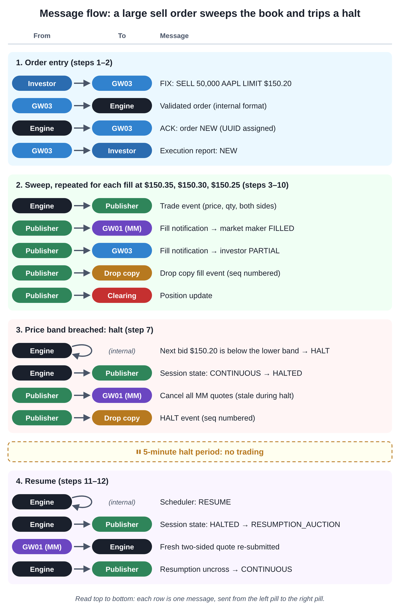


## Implied Orders and Synthetic Liquidity

This concept trips up almost every person who meets a derivatives exchange for the first time, and for good reason: it is the first place in this book where a single incoming order can trade against orders resting in *other* order books. The arithmetic is school-level, but it arrives wrapped in an unusual sign convention, the quantity rules are less obvious than they look, the priority rules are subtle, and the engineering consequences are severe. This chapter therefore climbs in explicit levels. Each level introduces one new idea and works it through with numbers before the next level begins. The numbers carry over from level to level, so read every example even when the idea feels obvious.

By the end of the chapter you should be able to write a correct first-generation implied-matching module: compute implied prices and quantities, execute them atomically, keep them consistent as the books change, and test them. The chapter after this one then asks the obvious follow-up question, *why not imply from implied orders, and from those, and so on?*, and shows why every exchange stops after a few steps.

One promise before we begin, which the rest of the chapter proves over and over: **implied orders do not create liquidity out of nothing.** An implied order is a different *view* of commitments that already rest in other books. It never adds a single lot to the total that can be traded; it only makes existing lots reachable from one more place. Hold on to that sentence. Every level below is, in the end, a demonstration of it.

Here, in one paragraph, is the situation the whole chapter is about. A refinery wants to buy February crude oil. It looks at the February order book and finds it empty. Yet two other traders, one in the January book and one in a book that trades the *difference* between January and February, are between them perfectly willing to sell February. Nothing in the February book says so, and the refinery has no reason to look anywhere else. Implied orders are how an exchange tells the refinery that a seller exists, and lets it trade with a single ordinary order. To show that properly we first need some vocabulary, so the chapter starts with futures (Level 0) and the spread instrument (Level 1), and then returns to the refinery's problem with all the pieces in place.

Implied orders are used almost exclusively in futures markets, because that is where one commodity is listed as many closely related instruments: one per delivery month, plus instruments for the differences between months. Everything in this chapter is therefore about futures.

**A map of the chapter.** Each step depends on the ones before it:

- **Level 0** – futures in one page: what a futures contract is, why different months have different prices, and why traders want to trade the difference between them.
- **Level 1** – the spread instrument, its sign convention, and the four things that confuse every beginner.
- **Why implied orders exist** – too many books, too little liquidity, and the seller who is in the wrong book.
- **Level 2** – the developer's model: every order as a vector, and the one rule (add the vectors) from which all implied prices follow.
- **Levels 3 and 4** – the two basic kinds of implied order, worked through trade by trade, and then both again for a wider March/June spread.
- **Level 5** – the promise kept: why implied orders never create liquidity.
- **Levels 6 to 10** – the engineering details: quantities, priority, price improvement, tick rounding and market data.
- **Engineering deep-dive, history, real-world venues and exercises.**

Readers who only want the concept can stop after Level 5. Readers who will build or test a matching engine need all of it.

### Level 0: Futures in One Page

You do not need a finance background for this chapter, but you do need five facts about futures and the people who trade them.

**1. A futures contract is a promise, not a purchase.** A futures contract is a standardised agreement to buy or sell a fixed quantity of something (crude oil, wheat, a stock index) at a price agreed *today*, for delivery on a fixed date in the *future*. Nothing changes hands at the moment of the trade except a good-faith deposit (the *margin*, covered in the clearing chapter of Part III). If you agree to buy, you are **long**; if you agree to sell, you are **short**. If the price later rises, the long side gains and the short side loses the same amount, and vice versa. Futures are a zero-sum game between the two sides of each trade.

Every contract **expires**. Each contract names a delivery month, and trading in it stops shortly before that month begins (for WTI crude, in the second half of the preceding month). Whoever is still long at that point must take delivery of 1,000 barrels per contract at the delivery point in Cushing, Oklahoma, and whoever is still short must deliver them. Most participants never want physical oil: they close their positions, or *roll* them into a later month, before expiry. Rolling turns out to be one of the main reasons spreads exist.

*A note on words.* A **forward** is the same kind of promise as a future, buy or sell at a fixed price on a later date, but usually agreed privately rather than in standardised form on an exchange. In Swedish both are commonly called "terminskontrakt" or "terminer". Because Swedish has one name for what in English are two distinct instruments, keep the context in mind when discussing them; in practice Swedish traders simply use the English terms when they need to avoid ambiguity.

**2. Everything in this chapter uses crude oil.** The running example is modelled on NYMEX WTI Light Sweet Crude Oil futures (symbol CL) at CME Group. One contract, also called one **lot**, covers **1,000 barrels**. Prices are quoted in **US dollars per barrel**, and the minimum price step (the **tick**, see the *Tick Sizes* chapter) is **$0.01 per barrel, worth $10 per contract** [CME Group, NYMEX Rulebook Chapter 200]. So when this chapter says "a price of $75.00", it means $75.00 per barrel, and one lot at that price represents $75,000 worth of oil.

**3. Every delivery month is a separate instrument with its own order book.** January crude and February crude are *different products*: different delivery dates, different buyers and sellers, different prices. An exchange lists many months at once, and each month has its own independent order book exactly like the ones in the *Order Book* chapter. Throughout this chapter we use two of them, **January** (the *near* month, delivered sooner) and **February** (the *far* month). An ordinary order for a single delivery month is called an **outright** order, and its book an outright book, to distinguish it from the spread instruments introduced next. The whole row of listed months for one commodity (January, February, March, and so on, often for years ahead) is called the **strip**.

**4. Different months have different prices, and the difference means something.** Why should a barrel delivered in February cost anything different from a barrel delivered in January? Because between the two dates somebody has to *hold* the oil. Imagine you own an oil tank. You could buy January oil, take delivery, keep it in your tank for a month, and deliver it against a February sale. That costs money: tank rent, insurance, and the interest on the $75 you tied up in each barrel for a month. The total is called the **cost of carry**.

Suppose carrying one barrel for one month costs $2.00. (That is a generous figure, chosen to keep this chapter's numbers round. In calm markets a month of carry is often well below a dollar; when the world is awash with oil and tanks are filling up, it can be far more.) Then:

- If February traded much more than $2.00 above January, say January at $75.00 and February at $80.00, every tank owner would buy January, store it and sell February, locking in $5.00 − $2.00 = $3.00 per barrel without caring at all where the oil price goes next. Their buying lifts January and their selling depresses February until the gap shrinks back towards the cost of carry.
- So when oil is plentiful today, later months usually trade *above* earlier ones, by up to about the cost of carry. A market in this state is said to be in **contango**.
- When oil is scarce today, the opposite happens. Refiners pay a premium to get barrels *now* rather than later, and January trades *above* February. This is called **backwardation**. Storage puts no ceiling on it, because nobody can carry oil backwards in time.

The difference between two months is therefore not noise. It is the market's price for *time*: for having oil in January rather than in February. That price moves for its own reasons, such as tank space running out, a refinery outage or a cold winter, often quite independently of the overall oil price. That is why people want to trade it.

**5. Traders often care about the *difference* between two months more than about either price.** Four common reasons, each with a typical trader:

1. **Storage (carry) trading.** The tank owner above buys the near month and sells the far month at the same time, and earns the difference minus the cost of storage. Whether oil goes to $50 or to $100 does not matter to the tank owner; only the gap between the two months does.
2. **Rolling a position.** Most futures traders never intend to take delivery (fact 1). A fund that wants to stay long oil beyond January's expiry must sell its January contracts and buy February ones before January expires. Doing that as two separate trades exposes it to the market moving between the two fills.
3. **Relative-value trading.** A trader may believe February is too expensive *relative to* January without having any opinion at all on where oil itself is going. The only thing they want exposure to is the difference.
4. **Margin efficiency.** Long January plus short February is largely protected against the overall oil price moving (if oil rises, one month gains roughly what the other loses), so clearing houses require much less margin for the pair than for two unrelated positions. CME's margin methodology grants explicit *intra-commodity spread credits* for exactly this reason.

The naive way to get exposure to the difference is to submit two ordinary orders and hope both fill. That carries **leg risk**: one part fills, the other does not, and the trader is left holding an outright position they never wanted. Exchanges solved this by listing the difference itself as a tradeable instrument, with its own order book. That instrument is where our story starts.

#### The cast

The traders in this chapter's examples are not just letters. Each has a reason to be in the market, and knowing that reason makes their orders easier to follow:

| Trader | Who they are | What they want |
|---|---|---|
| A | An oil producer | To sell January oil it will pump, at $75.00 or more. |
| B | A tank-farm owner | To buy January and sell February at the same time, as long as February sells for at least $2.00 more than January costs: $2.00 is B's cost of carry. |
| C | A refinery | To buy February crude for its February production runs. |
| D | A refinery | To buy January crude, at $74.40 or less. |
| E | A producer | To sell February output, at $76.60 or more. |
| F | A fund | To *roll* its long position: swap 10 January contracts for 10 February contracts in one step, before January expires. |

Other letters (G, H, K and so on) are bit players who appear in a single example. The exercises use their own letters.

### Level 1: The Spread Instrument and Its Sign Convention

A **calendar spread** is a single listed instrument whose price is *defined* as the difference between two delivery months. Throughout this chapter we use the convention CME and most futures venues use for calendar spreads:

```
spread price   S  =  Near-month price  −  Far-month price
                     (here: S = January − February)
```

**Buying one spread** means buying one lot of the near month *and* selling one lot of the far month, simultaneously, as one instruction. **Selling one spread** is the mirror image: sell the near month, buy the far month. CME's own description of Treasury calendar spreads states this directly: "buying the calendar spread entails buying the nearby month ... and selling the deferred month" [CME Group, *Treasury Futures Calendar Spreads*, 2016]. Each of the two months inside a spread is called a **leg**: the January leg and the February leg.

A memory hook: a spread is named with the near month first ("Jan/Feb"), and **everything follows the first-named month**. Buying the spread buys the first-named month; the spread price is the first-named month *minus* the second. In the cast from Level 0, tank-owner B *buys* the Jan/Feb spread (buy January, sell February), and fund F, rolling its long position forward, *sells* it (sell January, buy February).

!!! warning "Two meanings of the word *spread*"

    Earlier chapters used "spread" for the **bid-ask spread**: the gap between the best bid and the best ask in one order book. This chapter mostly uses it for a **calendar spread**: an instrument that trades the difference between two delivery months. The two are unrelated, and both appear below. A calendar spread has its own order book, and therefore its own bid-ask spread. When the meaning is not obvious from context, this chapter says "bid-ask spread" or "calendar spread" in full.

#### Why this convention makes sense

The convention is chosen so that **buying the spread is a bet that the number S goes up**, exactly as buying anything else is a bet that its price goes up.

Start with what you actually hold. Buying one Jan/Feb spread means you are **long January and short February**. You gain when January rises and lose when February rises. So a rising February is *not* good news for a spread buyer. It is good news only for someone who owns February, and the spread buyer has sold it. What the spread buyer wants is for **January to do better than February**: rise more, or fall less.

Work it through:

- You buy one Jan/Feb spread at S = −$2.00. Concretely, suppose you buy January at $75.00 and sell February at $77.00 (75.00 − 77.00 = −2.00).
- A week later January is $76.00 and February is $77.50, so S = 76.00 − 77.50 = **−$1.50**.
- Your January long gained $1.00 per barrel. Your February short lost $0.50 per barrel. Net: **+$0.50 per barrel**, which is exactly the change in S: (−1.50) − (−2.00) = +0.50.
- Per lot that is $0.50 × 1,000 barrels = **$500**.

Both months rose, but January rose more, and that is all that mattered.

**"But the spread got smaller. Shouldn't its price have fallen?"**

That depends on which meaning of "spread" you have in mind:

| | Before | After | Change |
|---|---|---|---|
| The **gap** between the months (how far apart they are) | $2.00 | $1.50 | narrowed |
| The **spread price** S = Jan − Feb (a signed number) | −2.00 | −1.50 | **rose** |

Both lines describe the same market. On a number line, moving from −2.00 to −1.50 is a move *up*, towards zero, even though the distance between the two months got smaller. The order book, the matching engine and your profit and loss all work with the second line, the signed number S. The first line is only how people sometimes talk about the market.

Don't use "wider" and "narrower" to judge a spread position, because they flip meaning with the sign of S. In contango (S negative), a narrowing gap means S is rising. In backwardation (S positive, January above February), a narrowing gap means S is *falling*. Use one rule instead:

> **Spread buyer's P&L = (S now − S paid) × 1,000 barrels per lot.**
> If S went up, the buyer gained. If S went down, the buyer lost. The sign of S, and whether oil as a whole rose or fell, play no part.

**Three scenarios from the same starting point.**

Start each one with the position above: long January at $75.00, short February at $77.00, S = −2.00.

| Scenario | Jan | Feb | New S | Jan leg | Feb leg | Net per lot |
|---|---|---|---|---|---|---|
| A: January outperforms | 76.00 | 77.50 | −1.50 | +$1.00 | −$0.50 | **+$500** |
| B: both rise equally | 76.00 | 78.00 | −2.00 | +$1.00 | −$1.00 | **$0** |
| C: February outperforms | 75.50 | 78.50 | −3.00 | +$0.50 | −$1.50 | **−$1,000** |

Oil rose in all three scenarios, so the overall oil price tells you nothing. Only the *relative* move of the two months decides the result. Scenario B shows why: when both legs move together, the spread position does not notice. That insensitivity to the overall price is the whole point of trading the spread, and it is why clearing houses give spread positions lower margin (Level 0, fact 5, reason 4). Scenario C is the case where February rising faster helps, but it helps whoever is *short* the spread, not the buyer.

#### The four things that confuse every beginner

The convention is logical, but it produces four effects that look wrong the first time you see them. Name them now, and they will not ambush you later.

**Confusion 1: spread prices are routinely negative.** When the far month is more expensive than the near month (a market in **contango**, normal when oil is plentiful and has to be stored, Level 0 fact 4), S is negative. When the near month is more expensive (**backwardation**, when oil is scarce today), S is positive. Both are completely normal. Read S = −$2.00 in plain words as "the market charges $2.00 per barrel to have the oil one month later", the cost of carry from Level 0:

| Spread price | Meaning | A spread *buyer* does, for example |
|---|---|---|
| S = −$2.00 | January trades $2.00 **below** February | buys Jan at $75.00 and sells Feb at $77.00 |
| S = +$0.50 | January trades $0.50 **above** February | buys Jan at $76.50 and sells Feb at $76.00 |

A negative price is not an error code, and your engine must not treat it as one. Nor are negative prices limited to spreads. On 20 April 2020, with storage at the Cushing, Oklahoma delivery point nearly full and the May 2020 WTI contract one day from expiry, May crude *settled at −$37.63 per barrel* [CFTC, Interim Staff Report, November 2020], while the June contract closed at $20.43 [Congressional Research Service, IN11354]. Holders of May contracts were, in effect, paying people to take oil off their hands, and the May/June spread was roughly −$58 per barrel. CME had warned its clearing members in early April that some energy contracts could trade below zero and had opened a test environment for negative prices [CME Clearing Advisories 20-152 and 20-160, April 2020]. Not every system was ready. The CFTC later found that at one large retail broker "negative prices were not displayed to customers and customers were unable to place orders with negative-priced limit orders", and ordered it to pay a $1.75 million penalty plus about $82.6 million in restitution to customers [CFTC press release 8432-21, 28 September 2021]. An assumption of `price > 0`, buried in one validation function, turned out to be an eight-figure bug.

**Confusion 2: "higher" and "better" need care.** −1.50 is *higher* than −2.00. A spread bid of −1.90 is therefore a *better* (more generous) bid than −2.00, and a spread ask of −2.10 is a better (cheaper) ask than −2.00. Price-time priority works exactly as in any other book, provided your comparison operators are signed. Storing spread prices as signed integer tick counts (−200 ticks for −$2.00) makes this automatic.

**Confusion 3: buying the spread *sells* the far month.** A spread *buyer* is a *seller* of February. So a resting spread **bid** is, among other things, a standing offer to **sell** February. This side-flip is the single most important fact in this chapter, and it is where most implementation bugs come from.

**Confusion 4: subtracting a negative number adds.** Because S = Jan − Feb, it follows that Feb = Jan − S. With S = −2.00 and Jan = 75.00, Feb = 75.00 − (−2.00) = **77.00**. Every time you see "minus a spread price" in this chapter, check the sign twice.

> **Sign-convention cheat sheet.** Keep this box at hand; every formula in the chapter follows from it.
>
> - S = Near − Far = Jan − Feb. Rearranged: Feb = Jan − S, and Jan = Feb + S.
> - **Buy** one spread = buy 1 Jan + sell 1 Feb. Profits when S *rises*.
> - **Sell** one spread = sell 1 Jan + buy 1 Feb. Profits when S *falls*.
> - "Higher" always means "further towards +∞": −1.50 > −2.00 > −2.50.
> - The best bid is the *highest* signed price; the best ask is the *lowest* signed price.
> - A spread bid is (also) an offer to sell Feb; a spread ask is (also) a bid to buy Feb.


> **Convention warning.** Near-minus-far is the norm for calendar spreads on CME, and most futures venues use the same convention, but it is not a law of nature. Inter-commodity spreads, ratio spreads, and some venues' products define their price differently (some as a ratio of legs, some with legs weighted 2:3, and so on). CME's Treasury inter-commodity spreads, for instance, are not quoted as a simple difference of leg prices at all, but as a ratio-weighted difference of each leg's net change since the previous day's settlement [Wilson, CME Group, *Liquidity in implied inter-commodity spread markets*, 2024]. Always read the product's definition before writing a single formula.

#### Leg prices

When a spread trades at −$2.00, the clearing house still needs a concrete price for each leg, because positions, profit and loss, and margin are tracked per month. The exchange assigns leg prices using a documented rule. On CME, for example, one leg is anchored to a recent reference price for that month (its latest trade price, a current price indication, or its settlement price) and the other leg is derived so that the two legs differ by exactly the spread price [CME Group, *Treasury Futures Calendar Spreads*]. The spread traders' economics depend only on the difference; the leg prices exist so every system downstream can do per-instrument bookkeeping. We will return to leg prices at Level 9, where they stop being a formality.

### Why Implied Orders Exist

You now know what a spread is and why people trade one. Before any more arithmetic, it is worth seeing the problem that implied orders solve, because once the problem is clear the solution feels almost inevitable. This is the refinery's problem from the start of the chapter, told properly.

#### The problem: too many books, too little liquidity in each

A futures exchange does not list one crude oil contract; it lists one per delivery month, often for years ahead. Traders also want to trade the *differences* between months (Level 0 showed why), so the exchange lists spread instruments as well, each with its own order book. Count what that means for a modest strip of 12 monthly contracts: 12 outright books, and up to 12 × 11 / 2 = 66 calendar-spread books if every pair of months is listed. That is 78 books for what is, economically, one commodity.

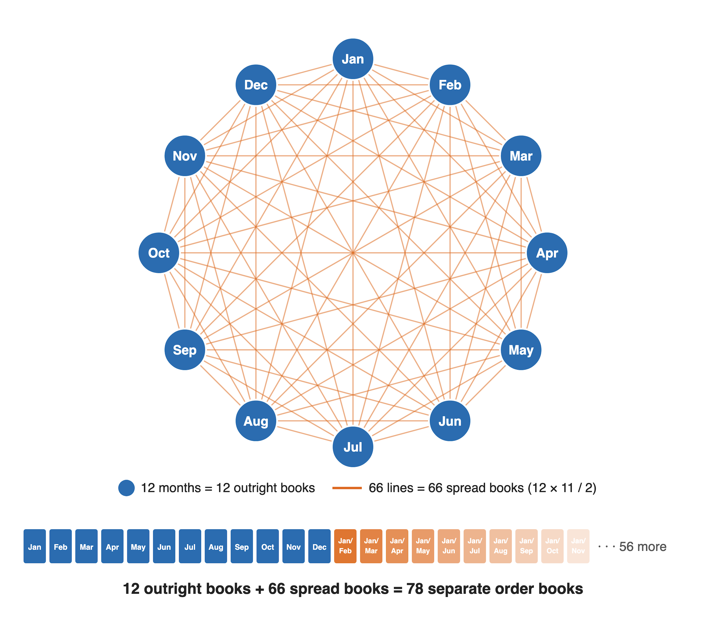

The traders, however, do not multiply. The same population of buyers and sellers is now spread thinly across 78 queues, and each queue can only match orders that happen to arrive in *that* queue. Three symptoms follow, and each will reappear later in this chapter with numbers attached:

1. **Empty or thin books.** A trader who wants to buy a far-dated month may find its book empty. Yet other participants may be perfectly willing to sell that month. They just expressed that willingness as *part* of an order in a different book, so it never shows up where the buyer is looking. The example below shows how that can happen.
2. **Leg risk.** A trader who wants a spread, and finds the spread book empty, can build it by trading the two months separately. Between the two trades the market can move, and the trader may end up with one half of the position and not the other.
3. **Inconsistent prices.** Because nothing connects the books, their prices can drift out of line with each other, creating risk-free gaps that only the fastest arbitrageur can collect.

#### An example: the seller who is in the wrong book

The first symptom sounds like a contradiction: how can nobody be offering February if somebody is willing to sell it? The answer is that a willingness to sell February does not have to be a February order. Consider three order books, each a separate queue in the matching engine, and three traders:

| Book | Resting order | Who | What the trader actually wants |
|---|---|---|---|
| January | Sell 50 lots at $75.00 | Trader A, the producer | To sell January oil. |
| Jan/Feb spread | Buy 30 spreads, February at least $2.00 above January | Trader B, the tank-farm owner | To buy January **and** sell February in one go, as long as February sells for at least $2.00 more than January costs, which covers B's cost of storing the oil for a month. |
| February | *empty* | | |

B's order is the storage business from Level 0: take January oil into the tank, deliver it in February, and keep the $2.00 difference to pay for the tank. The point to notice here is that Trader B's order, although it sits in the spread book, *contains a sale of February*. B is a February seller with a condition attached: B will only sell February if B can buy January at the same moment, at least $2.00 cheaper.

Now Trader C, the refinery, arrives, wanting to buy 20 lots of February. C has no interest in January or in spreads and, quite reasonably, looks only at the February book. It is empty. Without help from the exchange, C concludes that nobody will sell February today.

But look at the three books together:

- B is willing to sell February, *provided* B can buy January at the same time for $2.00 less.
- A is willing to sell January at $75.00, so B's condition can be met: B buys January from A at $75.00.
- B can then sell February at $75.00 + $2.00 = **$77.00**, and that is exactly what C wants to buy.

So a February seller at $77.00 does exist. It is just split across two orders in two other books, and neither of them, on its own, looks like a February offer. C should not have to know about the January book or the spread book, and that is precisely the problem. Nothing in C's own book tells C that a seller is available, and even a C who spotted the opportunity would have to coordinate trades in other books to reach it.

An exchange with implied orders does that work for C. It notices that A's January offer and B's spread order *together* amount to an offer to sell February, and it displays that offer in the February book: **sell 30 lots of February at $77.00**, the quantity limited by the smaller of the two ingredients (B's 30 spreads). When C buys 20 lots, the engine executes all three pieces at once: A sells January to B, B completes its spread, and C receives February. From C's point of view it was an ordinary February trade. B's spread order is now partly filled: 20 of its 30 spreads are done, and the other 10 simply stay in the spread book, exactly as any partly filled limit order would. So the February book keeps showing an implied offer of 10 lots at $77.00 for the next buyer. Level 3 works through this exact example in full, once Level 2 has given us the tool to do it precisely.

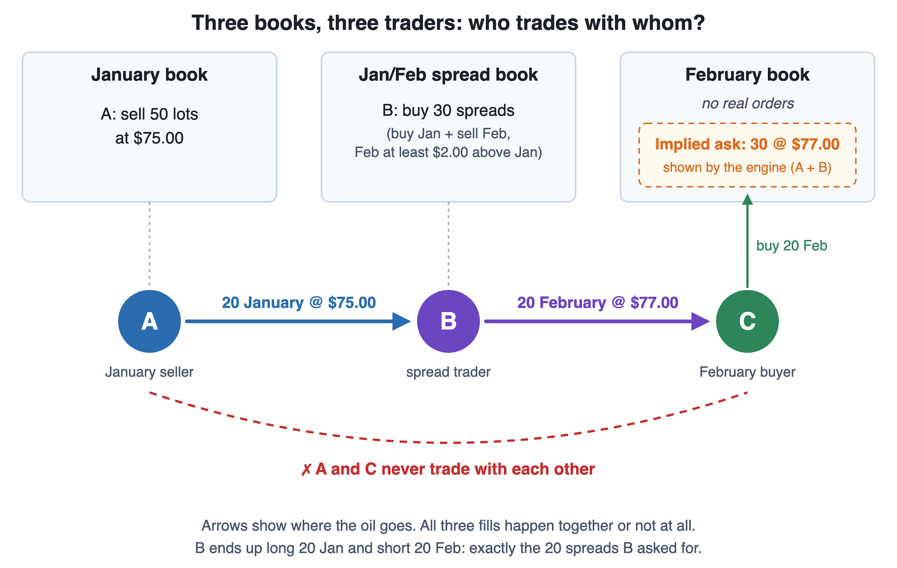

Notice who actually traded with whom. C never dealt with A. C bought February from B, and B bought January from A. A's role was indirect: B was only willing to sell February if it could buy January at the same moment, so A's January offer was what made B's February sale possible. It was a precondition for C's trade, not a part of it. And notice what did *not* happen: no new oil appeared. The February that C bought came from B, who was willing to sell it all along; the engine merely supplied the January purchase that B's order required. This idea, that implied orders connect existing liquidity rather than create new liquidity, runs through the whole chapter.

On a trading floor, the connection between a spread and its legs could be made by people: a trader who heard a spread bid and an outright offer could combine them mentally and act on both. An electronic order book has no such person. Each book is an isolated queue, unless the matching engine itself connects them. **Implied orders are that connection**: the engine continuously asks "which combinations of orders resting in *other* books would amount to an order in *this* book?", displays the answer, and lets it trade. A 2001 patent filing by the New York Mercantile Exchange describes the purpose in one line: implied orders are generated "to provide order combinations which could not be directly entered into a trading system" [US Patent 7,039,610].

### Level 2: The Developer's Model, Orders as Vectors

The rest of the chapter becomes mechanical, and much easier to implement correctly, once you describe every order with two pieces of information.

**The position vector v.** For each instrument, how many lots does *one unit* of this order buy (+1) or sell (−1)?

**The cash amount c.** How much money (per barrel) does one unit of this order *pay*? A negative c means the order *receives* money.

For the four basic kinds of order:

| Order | Position vector v | Cash paid c (per barrel) |
|---|---|---|
| Buy January at price P | (Jan +1) | +P |
| Sell January at price P | (Jan −1) | −P |
| Buy Jan/Feb spread at price S | (Jan +1, Feb −1) | +S (pays the Jan price, receives the Feb price; Jan − Feb = S) |
| Sell Jan/Feb spread at price S | (Jan −1, Feb +1) | −S |

The one rule that powers everything else is this:

> **Combining orders adds their vectors and adds their cash.** If a set of resting orders is executed together, the combined effect on the world is the sum of their position vectors, and the combined money flow is the sum of their cash amounts.

An **implied order** is simply a set of resting orders whose vectors add up to something that *looks like a single order in some other book*. Here is the canonical case. Take one resting January ask at $75.00 and one resting spread bid at −$2.00:

```
  Sell Jan at 75.00          v = (Jan −1)            c = −75.00
+ Buy spread at −2.00        v = (Jan +1, Feb −1)    c = −2.00
  ----------------------------------------------------------------
  Combined                   v = (Feb −1)            c = −77.00
```

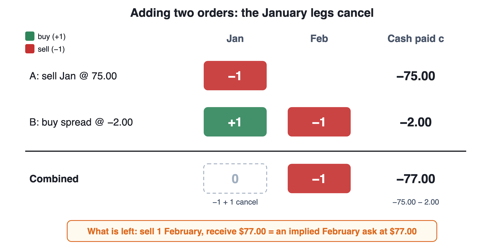

The January legs cancel. What remains sells one February lot and receives $77.00: that is precisely **an offer to sell February at $77.00**, even though nobody has placed an order in the February book. This is the complete theory of implied pricing. Everything else in this chapter (quantities, priority, rounding, market data) is engineering around this addition.

**Whose side is this?** The combined vector describes what the *resting group* of orders does together: A and B, between them, sell one February lot and receive $77.00. The trader who trades against that implied quote does the exact opposite: buys one February lot and pays $77.00. Add the incoming trader's vector and cash to the group's and everything comes to zero, which is why every correct implied trade balances (Level 3 checks it line by line).

**Why the words "implied" and "synthetic"?** Nobody typed a February offer. The February price is *implied by* two other prices: it follows from them logically, the way a conclusion follows from two premises. Some venues prefer "synthetic", for the same reason: the offer is built from parts rather than placed by anyone. Both words mean the same thing, and both make the same point as the chapter's promise: the quote is derived from real orders, not added to them.

Two consequences follow immediately and should be memorised:

1. **Implied prices come from adding cash amounts**, so they are *exact* sums and differences of real order prices, no averaging, no estimation.
2. **Legs must cancel against an order on the opposite side.** The January leg of the spread bid (+1) cancels only against a January *sell* (−1). A January *bid* would add +1 to +1 and produce a two-lot January purchase, which is not an order in any book. This is the formal version of "an implied order needs every leg to be executable".

#### The six first-generation implied prices

Apply the rule to every pair of orders that can cancel a leg, and exactly six implied quotes appear. To turn a combined vector into a quote, use one reading rule:

> **Reading rule.** Once the unwanted legs have cancelled, read the combined vector v and cash c like this:
>
> - +1 in one outright month: an implied **bid** in that month's book, at price c.
> - −1 in one outright month: an implied **ask** in that month's book, at price −c.
> - (near +1, far −1), the shape of a spread purchase: an implied spread **bid**, at price c.
> - (near −1, far +1), the shape of a spread sale: an implied spread **ask**, at price −c.
>
> In words: a group of orders that *pays* is a buyer, and its price is what it pays; a group that *receives* is a seller, and its price is what it receives.

The canonical case above is the second line: v = (Feb −1), c = −77.00, so an ask at −c = $77.00. The table below applies the rule to every pair, and is the reference for the whole chapter.

| Implied quote | Ingredients (both must be resting) | Vector check | Formula |
|---|---|---|---|
| Feb **ask** | Jan ask + Spread **bid** | (Jan −1) + (Jan +1, Feb −1) = (Feb −1) | Jan_ask − S_bid |
| Feb **bid** | Jan bid + Spread **ask** | (Jan +1) + (Jan −1, Feb +1) = (Feb +1) | Jan_bid − S_ask |
| Jan **ask** | Feb ask + Spread **ask** | (Feb −1) + (Jan −1, Feb +1) = (Jan −1) | Feb_ask + S_ask |
| Jan **bid** | Feb bid + Spread **bid** | (Feb +1) + (Jan +1, Feb −1) = (Jan +1) | Feb_bid + S_bid |
| Spread **ask** | Jan ask + Feb **bid** | (Jan −1) + (Feb +1) = (Jan −1, Feb +1) | Jan_ask − Feb_bid |
| Spread **bid** | Jan bid + Feb **ask** | (Jan +1) + (Feb −1) = (Jan +1, Feb −1) | Jan_bid − Feb_ask |

*(Reading the "Spread ask" row: the combined vector is (Jan −1, Feb +1), which is what one unit of a spread **sell** looks like; a resting set of orders that together behave like a seller is an **ask**. Its price is −c = −(−Jan_ask + Feb_bid) = Jan_ask − Feb_bid.)*

Check the sign-flip from Confusion 3 in the table: an implied February **ask** is built from a spread **bid**. The rule of thumb: an implied **near-month** (January) quote has the *same* side as the spread order inside it (Jan ask uses a spread ask, Jan bid uses a spread bid), while an implied **far-month** (February) quote has the *opposite* side (Feb ask uses a spread bid, Feb bid uses a spread ask).

The whole table fits in one picture. There are only three books, and any two of them can imply a quote in the third:

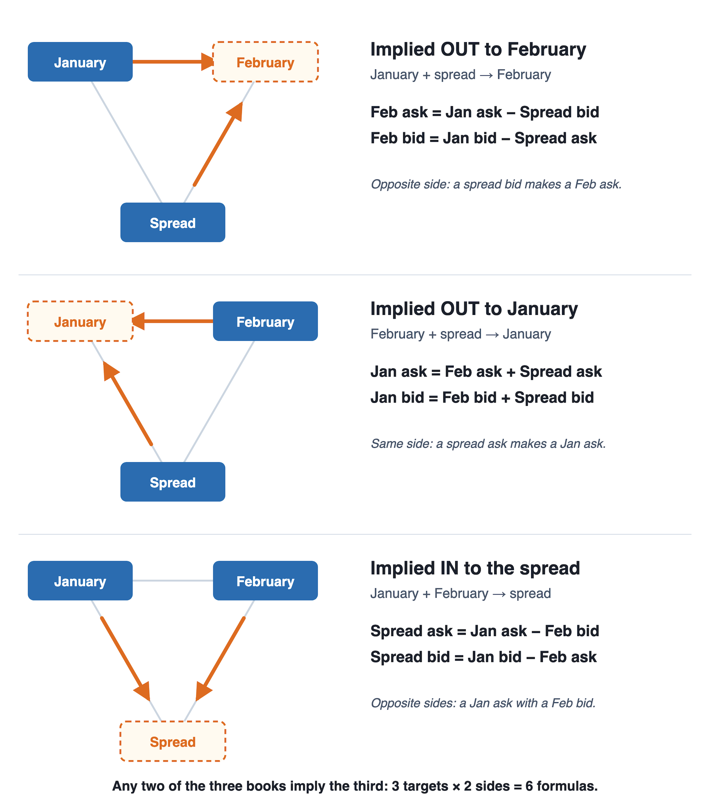

**Terminology.** CME defines the two families as follows [CME Group Client Systems Wiki, *Implied Orders*]:

- **Implied IN**: "an order CME Globex identifies as existing in the spread market based on orders in the outright market" (the bottom two rows: two outrights imply a spread quote).
- **Implied OUT**: "an order CME Globex identifies as existing in the outright market based on orders in the spread market" (the top four rows: a spread plus an outright imply an outright quote).

A mnemonic: implied **in**to the spread book, implied **out** of the spread book. Informal industry usage is not always consistent, so when reading another venue's documentation, check its definitions rather than assuming.

**How to never get a formula wrong.** Do not memorise the table. When you need a formula, write down the two vectors and add them. If the unwanted legs cancel, you have an implied order and its price falls out of the cash sum. If they do not cancel, there is no implied order, however tempting the arithmetic looks. Exercise E2 at the end of the chapter is a deliberate trap built on exactly this point.

### Level 3: Implied OUT, a Complete Worked Example

A spread order plus an outright order jointly produce a quote in a book that may otherwise be completely empty.

**The books before anything happens:**

| Book | Side | Price | Lots | Who |
|---|---|---|---|---|
| January (outright) | Ask | $75.00 | 50 | Trader A |
| Jan/Feb spread | Bid | −$2.00 | 30 | Trader B |
| February (outright) | – | *empty* | – | – |

Trader A, the producer, will sell up to 50 January lots at $75.00 or more. Trader B, the tank-farm owner, will buy up to 30 spreads at −$2.00 or less, meaning B will buy January and sell February whenever February can be sold for at least $2.00 more than January costs.

**The operational question.** Could anyone, right now, firmly *buy* February, even though the February book is empty? Yes. Trader B is willing to sell February, *provided* B can simultaneously buy January $2.00 cheaper. Trader A is willing to sell January at $75.00. Chain the two commitments: B buys January from A at $75.00, so B can sell February at $75.00 − (−$2.00) = **$77.00**. This is row one of the table: implied Feb ask = Jan_ask − S_bid = 75.00 − (−2.00) = 77.00.

**Quantity** is capped by the scarcer ingredient: min(50, 30) = **30 lots**. B only wants 30 spreads, however much January A offers.

The engine therefore publishes in the February book:

| Book | Side | Price | Lots | Source |
|---|---|---|---|---|
| February | Ask | $77.00 | 30 | **Implied** (A's January ask + B's spread bid) |

**Execution.** Trader C, the refinery, submits an order to buy 20 February at $77.00. Matching it against the implied quote requires three fills that happen *together or not at all*:

```{.mermaid width=600}
sequenceDiagram
    participant C as Trader C (Feb buyer)
    participant ME as Matching Engine
    participant A as Trader A (Jan ask 75.00)
    participant B as Trader B (Spread bid −2.00)

    C->>ME: BUY 20 FEB @ 77.00
    Note over ME: Implied Feb ask 77.00 × 30 found.<br/>All three fills validated, then committed atomically.
    ME->>A: Fill 1: A SELLS 20 JAN @ 75.00 (to B)
    ME->>B: Fill 2: B BUYS 20 SPREADS @ −2.00
    ME->>C: Fill 3: C BUYS 20 FEB @ 77.00 (from B)
    Note over ME: Three trade prints: JAN 20@75.00,<br/>SPREAD 20@−2.00, FEB 20@77.00
```

Check that every party got exactly what its order asked for, and nothing it did not ask for:

- **A** sold 20 January at $75.00, precisely A's limit.
- **B** bought 20 spreads at −$2.00: long 20 January at $75.00 and short 20 February at $77.00; 75.00 − 77.00 = −2.00 ✓. B's margin is computed on the much smaller spread risk.
- **C** bought 20 February at $77.00, precisely C's limit. C need not know, and on most venues cannot tell from the fill, that the counterparty's February sale was part of a spread.

And check the vector bookkeeping: A's (Jan −20), B's (Jan +20, Feb −20) and C's (Feb +20) sum to zero in every instrument, and the cash sums to zero too. Using "cash paid" per barrel: A pays −(20 × 75.00) = −1,500, C pays +(20 × 77.00) = +1,540, and B pays 20 × (−2.00) = −40, that is, B *receives* the $2.00 difference on each of its 20 spreads. −1,500 + 1,540 − 40 = 0 (multiply by 1,000 barrels per lot for real dollars). Nothing was created and nothing was lost. Every correct implied execution balances to zero like this, and your test suite should assert it.

**The books after the match:**

| Book | Side | Price | Lots remaining |
|---|---|---|---|
| January (outright) | Ask | $75.00 | 30 *(was 50)* |
| Jan/Feb spread | Bid | −$2.00 | 10 *(was 30)* |
| February (implied) | Ask | $77.00 | **10** = min(30, 10) |

**What happens to B's other 10 spreads?** Nothing dramatic: they stay where they were. B's spread order is an ordinary resting limit order, and, as with any resting limit order (see the chapters on order types and the order book), a partial fill leaves the remainder in the book at the same price and with its time priority intact. After C's trade, B holds a 20-lot spread position and still has a working order to buy 10 more. Three consequences follow:

1. **The implied quote shrinks; it does not disappear.** The engine recomputes the February offer from what is left of its ingredients: min(30 January lots, 10 spreads) = 10 lots at $77.00. The next February buyer can take those 10, or a January/February spread seller can trade directly against B's 10 in the spread book. Whichever arrives first gets them, and once they are gone the implied February offer disappears too.
2. **B is never left half-hedged.** This is why a partial fill is acceptable to B. Each of the 20 spreads B bought came as a complete pair, one January bought and one February sold, both filled in the same atomic event. A partial fill leaves B with *fewer* spreads than wanted, but never with an unmatched January or February leg. That is exactly the leg risk B used a spread order to avoid, and implication does not reintroduce it.
3. **B stays in control.** B can cancel the remaining 10 spreads at any moment. The engine then withdraws the implied February offer, because one of its ingredients has gone.

**What if B would not accept a partial fill?** The conditions that refuse partial fills, Fill-Or-Kill and Immediate-Or-Cancel, apply only to orders that execute on arrival. Such orders never rest in a book, so they never become ingredients of an implied quote. An order only becomes an ingredient by resting, and an order rests on the understanding that it may be filled in pieces. A trader who wants all 30 spreads or none should not leave a resting order. Instead, the trader can wait until 30 lots are available, implied or real, and then send a Fill-Or-Kill order that takes them in one go.

### Level 4: Implied IN, Two Outrights Produce a Spread Quote

Now the other direction: the *spread* book is empty, and the outright books are live.

**The books:**

| Book | Side | Price | Lots | Who |
|---|---|---|---|---|
| January (outright) | Bid | $74.40 | 25 | Trader D (refinery) |
| February (outright) | Ask | $76.60 | 40 | Trader E (producer) |
| Jan/Feb spread | – | *empty* | – | – |

Add the vectors: D's January bid is (Jan +1) with c = +74.40; E's February ask is (Feb −1) with c = −76.60. Together: (Jan +1, Feb −1), which is the shape of a spread **buy**, paying 74.40 − 76.60 = **−$2.20**. The two outrights jointly *bid* −$2.20 for the spread.

In words: anyone who wants to **sell** the spread (sell January, buy February) can do it right now by selling January to D at $74.40 and buying February from E at $76.60, which is a spread sale at 74.40 − 76.60 = −2.20.

```
Implied S_bid = Jan_bid − Feb_ask = 74.40 − 76.60 = −2.20
Quantity      = min(25, 40)       = 25 lots
```

Who would want to sell the spread? Trader F, the fund from Level 0. F is long 10 January contracts, January is about to expire, and F wants to stay long oil without taking delivery in Cushing. So F must *roll*: sell its 10 January and buy 10 February. That is exactly one spread sale per lot. F is willing to pay up to $2.20 per barrel more for February than it receives for January, so it sends an order to sell 10 spreads at −$2.20. The spread book is empty, but the implied bid is there. The engine executes atomically:

1. **January fill:** F sells 10 January at $74.40 to D.
2. **February fill:** F buys 10 February at $76.60 from E.
3. **Spread print:** F sold 10 spreads at 74.40 − 76.60 = −$2.20 ✓.

Look at what F holds now. Its 10 long January contracts are gone (sold to D), and it is long 10 February (bought from E). The roll is complete, in one atomic step, with no moment in which F held neither month or both. Without implied functionality F would have had to sell January and buy February as two separate trades, and the price of the second could have moved after the first had filled: the leg risk from Level 0.

D and E each received an entirely ordinary outright fill at their own limit price. Afterwards the January bid has 15 lots left, the February ask has 30, and the implied spread bid is recomputed as 15 lots (min(15, 30)) at −$2.20.

The *opposite* implied quote needs the opposite ingredients. An implied spread **ask** requires a January *ask* and a February *bid* (Jan_ask − Feb_bid). With only D and E in the books, no implied spread ask exists: add the vectors of D and E any other way and nothing cancels.

#### A wider spread: March/June

Every example so far has used neighbouring months. Venues also list spreads between months further apart, such as March/June: buy March and sell June in one order (a quarter's worth of storage for a tank owner, or a three-month roll for a fund). The convention does not change: S = March − June, and buying the spread buys the first-named month.

**Which outright books does the engine need to look at?** Write down the spread's vector: (Mar +1, Jun −1). It has entries only for March and June. To cancel one of those legs, an ingredient needs an opposite entry in March or June, which only a March order or a June order has. An April order is (Apr ±1) and a May order is (May ±1). Adding either one cancels nothing, so **April and May play no part in first-generation implication for Mar/Jun**, even though they lie between the two legs in time. A spread book forms a triangle with its two leg months and nothing else, however far apart they are, and the six formulas of Level 2 apply unchanged, with March in January's place and June in February's.

Here is a strip with orders in all four months and on both sides of the Mar/Jun spread. Trader N is a tank-farm owner who will store March oil until June for $6.00 a barrel ($2.00 a month, as in Level 0). Trader Z is a fund rolling a long position from March to June, willing to pay up to $5.70 more for June than it receives for March.

| Book | Bid | Ask |
|---|---|---|
| March | $75.90 × 25 | $76.00 × 30 |
| April | $77.85 × 8 | $78.05 × 12 |
| May | $79.90 × 6 | $80.10 × 9 |
| June | $81.80 × 25 | $82.10 × 15 |
| Mar/Jun spread | −$6.00 × 20 (N) | −$5.70 × 10 (Z) |

The six implied quotes, four OUT and two IN:

| Implied quote | Type | Ingredients | Price | Lots | Compared with the real book |
|---|---|---|---|---|---|
| June ask | OUT | March ask + spread bid | 76.00 − (−6.00) = **82.00** | min(30, 20) = 20 | **better** than the real 82.10 |
| June bid | OUT | March bid + spread ask | 75.90 − (−5.70) = 81.60 | min(25, 10) = 10 | worse than the real 81.80 |
| March ask | OUT | June ask + spread ask | 82.10 + (−5.70) = 76.40 | min(15, 10) = 10 | worse than the real 76.00 |
| March bid | OUT | June bid + spread bid | 81.80 + (−6.00) = 75.80 | min(25, 20) = 20 | worse than the real 75.90 |
| Spread ask | IN | March ask + June bid | 76.00 − 81.80 = **−5.80** | min(30, 25) = 25 | **better** than the real −5.70 |
| Spread bid | IN | March bid + June ask | 75.90 − 82.10 = −6.20 | min(25, 15) = 15 | worse than the real −6.00 |

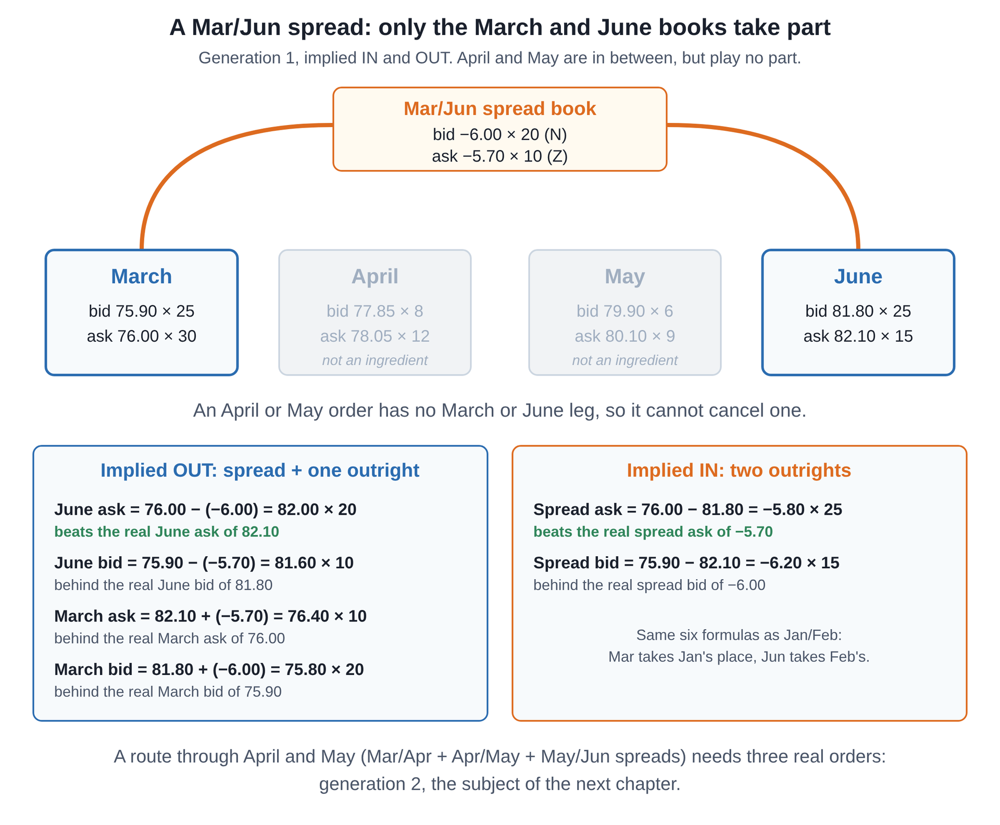

An implied quote that is worse than the real book still exists and is still published. It simply trades only after the better real orders have gone. Two of these quotes are the best prices in their books, so trade them one after the other.

**An OUT trade.** A refinery sends an order to buy 15 June at up to $82.05. The best June ask is the implied $82.00 (the real $82.10 is above the refinery's limit), so 15 lots trade atomically:

1. The March seller sells 15 March to N at $76.00.
2. N buys 15 Mar/Jun spreads at −$6.00.
3. The refinery buys 15 June from N at $82.00, $0.05 better than its limit.

Cash per barrel: the March seller pays −1,140.00, N pays 15 × (−6.00) = −90.00 and the refinery pays +1,230.00, which sums to zero. Afterwards the March ask has 15 lots left and N has 5 spreads left, so the engine recomputes. The implied June ask shrinks to min(15, 5) = **5** lots. So does a quote in another book: the implied spread ask also used the March ask, and it shrinks from 25 to min(15, 25) = **15** lots.

**An IN trade.** A second tank-farm owner sends an order to buy 10 Mar/Jun spreads at −$5.75 or lower. The best spread ask is the implied −$5.80 (the real −$5.70 is above the limit), so 10 lots trade atomically:

1. The tank-farm owner buys 10 March from the March seller at $76.00.
2. The tank-farm owner sells 10 June to the June bidder at $81.80.
3. The spread fill prints at 76.00 − 81.80 = **−$5.80**, 0.05 better than the limit, or $50 per lot.

Cash per barrel: −58.00 for the tank-farm owner, −760.00 for the March seller and +818.00 for the June bidder, which sums to zero. The March ask now has 5 lots left, so both quotes built on it shrink again: the implied spread ask to min(5, 15) = 5 lots, and the implied June ask to min(5, 5) = 5 lots.

Four points carry over to every wider spread:

1. **Only the two leg months count.** At generation 1, every spread book has exactly two relevant outright books, however wide it is. The reverse direction is where the work grows: the June book is a leg of *every* spread that contains June, up to 11 of them in a 12-month strip, so one June order can change quotes in all of them. *Engineering Deep-Dive* below counts this fan-out.
2. **The formulas do not care about distance.** Only the names change.
3. **Wider spreads have larger prices.** Three months of carry makes the spread about three times as wide as a one-month spread (−6.00 rather than −2.00). The tick size and the arithmetic are unchanged.
4. **A route through the middle months is a different, deeper construction.** Mar/Apr, Apr/May and May/Jun spread orders together *do* add up to a Mar/Jun spread, because the April and May legs cancel. But that combination uses three real orders, which makes it a second-generation implied quote, and building implied quotes from spreads alone is a subject of the next chapter.

### Level 5: The Promise Kept, Implied Orders Create No Liquidity

It is time to make the introduction's promise precise, because it is the single most important idea in the chapter, and because misunderstanding it leads directly to the most dangerous bugs.

**Argument 1: an implied trade is a trade anyone could have done by hand.** Go back to Level 3. Trader C wanted February and could have assembled it manually, without any implied functionality:

1. Sell 20 spreads to Trader B at −$2.00. (C now: sell 20 Jan, buy 20 Feb. Selling a spread at S has cash c = −S = −(−2.00) = +2.00, so C *pays* $2.00 per barrel on the difference: the February C bought costs $2.00 more than the January C sold.)
2. Buy 20 January from Trader A at $75.00. (C's January sale and purchase cancel.)

C's net result: long 20 February, having paid $75.00 + $2.00 = $77.00 per barrel. Exactly the implied trade, same counterparties, same prices. The implied engine did not find any liquidity that was not already reachable. It did the legwork **atomically**, eliminating C's leg risk (the danger that A's January offer disappears between C's two trades) and letting C trade with a single ordinary order.

**Argument 2: the same lot must never be counted twice.** In Level 3's books, A's 50 January lots appear on screens in *two places*: as 50 lots in the January book, and (30 of them) inside the 30-lot implied February ask. It is tempting to add up what the screens show and conclude that 80 lots are for sale. That is wrong. If a January buyer takes all 50 of A's lots, the implied February ask **disappears**, because one of its ingredients is gone. The displayed quantities across related books are *alternative* uses of the same underlying commitments, not additional ones.

**Argument 3: the removal test.** Cancel A's January order and the implied February ask vanishes in the same processing step: there is nothing left to build it from. Cancel B's spread order and it vanishes too. An implied quote that survives the cancellation of one of its ingredients is not a harmless display glitch; it is the engine advertising a price it cannot honour.

**Argument 4: conservation in the arithmetic.** In Level 3, before the match, the system held 50 committed January lots and 30 committed spread lots. After C's trade, it held 30 January lots and 10 spread lots, and C held 20 February lots that each consumed *exactly one* of A's lots and *exactly one* of B's spreads. The vector sum of every trade is zero (Level 3). No lot was ever used twice, and none was conjured.

> **Implied orders move liquidity between books; they never add to it.** Every implied lot is a real lot from a real order, reachable by one more route. When it trades through one route, it is gone from all the others.

!!! note "Questions every first-time reader asks"

    **Is the exchange a party to the trade?** No. In every implied trade, each fill is between two real participants: in Level 3, A and B trade January, and B and C trade February. The exchange never buys or sells for itself and never holds a position. It only finds the combination and executes it. (After the trade, the clearing house steps in between buyer and seller, exactly as for any other trade; see the clearing chapter in Part III.)

    **Who owns an implied order, and can it be cancelled?** Nobody owns it, so nobody can cancel it directly. It disappears by itself as soon as one of its ingredients is filled, amended or cancelled (argument 3 above).

    **Can I place an implied order?** No. You place ordinary orders, outright or spread, and the engine derives implied quotes from them. Your resting orders may become ingredients of implied quotes without you doing anything.

    **Did A agree to trade with a spread trader?** A agreed to a price and a quantity, not to a particular counterparty. On an anonymous order book that is all any order ever promises, so A's fill is an ordinary January fill.

    **Does an implied quote keep its place in the queue?** No. Implied quotes have no time priority, and at the same price real orders trade first (Level 7).

    **Is implication always switched on?** No. Each venue decides, product by product, which kinds of implication run (see *Real-World Implementations*, and the next chapter for why the limits exist).

### Level 6: Quantity Rules, min(), Shared Legs, Depth, and Recomputation

The min() rule from Level 3 generalises, and the generalisation is where implementations start to acquire bugs.

**Shared legs.** Suppose a second spread bidder joins Level 3's original books:

| Book | Side | Price | Lots | Who |
|---|---|---|---|---|
| January | Ask | $75.00 | 50 | Trader A |
| Spread | Bid | −$2.00 | 30 | Trader B |
| Spread | Bid | −$2.00 | 15 | Trader H |

Both spread bids combine with the *same* January ask to imply February asks at $77.00. The correct implied quantity is min(50, 30 + 15) = **45**. Here that happens to equal the naive calculation min(50, 30) + min(50, 15) = 45, which is exactly why the naive calculation survives code review. Now shrink A's order to 40 lots. The correct answer is min(40, 45) = **40**. The naive "pairwise min, then sum" still says 30 + 15 = 45 and over-advertises by 5 lots that do not exist. A's January order is a **shared leg**: every construction that uses it draws from the same 40 lots.

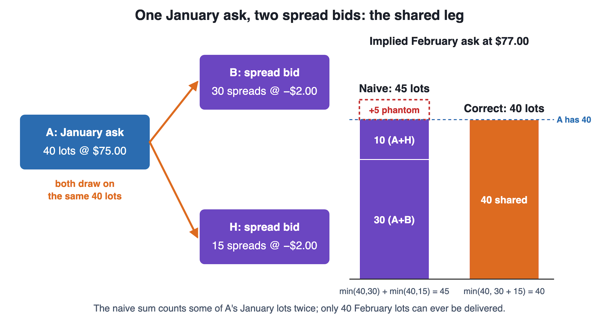

The general statement: *the implied quantity is the largest quantity that can be routed through the contributing orders simultaneously, with no order used beyond its own size.* For a single chain that is the smallest ingredient; when chains share an order, the shared order caps their total. (Readers who know graph algorithms will recognise a maximum-flow problem; for first-generation implieds between two months it reduces to the simple sums and mins shown here.)

**Depth beyond the best price.** Books have more than one price level, and so do implied books. Suppose:

| Book | Side | Price | Lots |
|---|---|---|---|
| January | Ask | $75.00 | 10 |
| January | Ask | $75.01 | 20 |
| Spread | Bid | −$2.00 | 15 |
| Spread | Bid | −$2.02 | 10 |

Each implied February lot costs (January ask) − (spread bid), so the cheapest February lots come from pairing the cheapest January lots with the most generous spread bids. The correct implied February ask ladder is built by walking both ladders together, best against best, exactly like a merge of two sorted lists:

| Implied Feb ask | Lots | Built from |
|---|---|---|
| $77.00 | 10 | Jan 75.00 (all 10) with spread −2.00 (10 of 15) |
| $77.01 | 5 | Jan 75.01 (5 of 20) with spread −2.00 (remaining 5) |
| $77.03 | 10 | Jan 75.01 (10 of remaining 15) with spread −2.02 (all 10) |

Total: 25 lots, which equals min(30 January lots, 25 spread lots), as conservation demands. Now compare a naive implementation that pairs every January level with every spread level independently, taking the min of each pair. It would publish $77.00 × 10, **$77.01 × 15**, **$77.02 × 10** (Jan 75.00 with spread −2.02) and $77.03 × 10: 45 lots in total, when only 25 exist. The $77.02 level is entirely fictitious, because the January lots at $75.00 are already committed to the $77.00 level, and the $77.01 level is overstated, because 10 of the 15 spread lots at −2.00 are likewise already used. Buy everything the naive ladder shows and the engine runs out of January oil before the order is filled. Because a correct implied depth ladder is *path-dependent* in this way, venues typically compute and publish only the top one or two implied levels (see Level 10).

**Recompute, never decrement.** After any event that touches a contributing order (a fill, a cancel, an amendment, a new order at a better price), the engine re-derives the affected implied quotes from the current state of the real books. Level 3's post-trade figure (implied 10 = min(30, 10)) is a recomputation, not "30 minus 20". The two happen to agree there, but Exercise E6 shows a case where they do not.

### Level 7: Priority, Real Orders Before Implied Orders

Suppose the February book contains both a real resting ask and an implied ask at the same price:

| February book | Price | Lots | Source |
|---|---|---|---|
| Ask | $77.00 | 5 | **Real**, Trader G, resting since 09:31 |
| Ask | $77.00 | 30 | Implied (A + B, as in Level 3) |

Trader C's order to buy 20 at $77.00 arrives. Who fills?

On CME, the answer for futures is explicit: "Outrights (generation 0) always trades first, then followed by spreads (1st generation)" [CME Group Client Systems Wiki, *Futures Implied Order Matching Priority*], and "implied quantity in futures markets does not have time priority" [CME, *Implied Orders*]. So at the same price, **real orders trade before implied orders**, no matter how long the implied quote has been displayed. C's order therefore fills 5 lots against G (an ordinary two-party trade) and 15 lots through the implied construction (the three-fill atomic execution from Level 3).

The rationale mirrors the displayed-before-hidden logic from the *Order Types* chapter: a participant who committed directly in this book is rewarded ahead of a price that is only a reflection of commitments elsewhere. There is also an engineering benefit: a two-party fill is cheaper and simpler than a multi-book atomic one, so using real liquidity first minimises the expensive path. When several *implied* constructions compete at the same price, CME breaks the tie with a documented sequence of criteria (strategy type, product codes, leg expirations, number of legs, and finally instrument identifiers), not by time. Treat "real before implied at the same price" as the strong default, and each product's rulebook as the authority.

Two further rules on CME are worth building in from day one [CME, *Implied Orders*]:

- **"Implication requires at minimum two orders in related markets in the proper combination."** An implied quote is never built from a single order.
- **"Implied bids do not trade against implied offers."** Every trade needs at least one real, *incoming* order as the aggressor (the order whose arrival triggers the trade). Implied quotes are only ever passive: they wait to be hit. We will see why this rule is natural in Level 8.

### Level 8: Price Improvement and Closing Cross-Book Gaps

Implication does not just fill empty books; it can *beat* the real book. Suppose:

| Book | Side | Price | Lots |
|---|---|---|---|
| January | Ask | $74.95 | 40 |
| Spread | Bid | −$2.00 | 25 |
| February | Ask (real) | $77.00 | 60 |

The implied February ask is 74.95 − (−2.00) = **$76.95**, which is 5 ticks ($0.05, or $50 per lot) *better* than the real February ask. An incoming order to buy 20 February at $77.00 fills all 20 at $76.95 through the implied construction, and the real $77.00 seller is not touched. The buyer was willing to pay $77.00 and paid $76.95, better than its limit and better than anything the real February book had to offer.

**Closing gaps that would otherwise be free money.** Now add one more resting order: Trader K bids $76.97 for 10 February lots. Is anything wrong with these books?

| Book | Side | Price | Lots |
|---|---|---|---|
| January | Ask | $74.95 | 40 |
| Spread | Bid | −$2.00 | 25 |
| February | Bid (real, Trader K) | $76.97 | 10 |

Yes: they are **crossed across books**. K will buy February at $76.97, while the January seller and B together will sell February at $76.95. In a single book, a bid above an ask can never rest (the incoming one would have traded). Across books, without implied functionality, it can. And then it is free money for whoever notices first. An arbitrageur could:

1. Sell 10 spreads to B at −$2.00 (sell January at some price p, buy February at p + 2.00),
2. buy 10 January from the January seller at $74.95, and
3. sell 10 February to K at $76.97.

The arbitrageur's January trades cancel, the February trades cancel, and the cash is p − 74.95 + 76.97 − (p + 2.00) = **+$0.02 per barrel**, $20 per lot, with no risk, provided all three fills happen before anyone else acts. (The next chapter redraws these three orders as a closed loop in a graph, where "crossed across books" becomes "a loop whose prices add up to a profit".)

With implied functionality this state can never arise, because it could only be reached through an *arrival*, and the arriving order is matched when it arrives. Suppose K's bid rested first and B's spread bid is the last of the three orders to arrive. At that moment the engine already publishes an implied spread **ask** built from A's January ask and K's February bid: Jan_ask − Feb_bid = 74.95 − 76.97 = **−$2.02**. B's incoming bid of −$2.00 is willing to pay up to −2.00, and −2.02 is cheaper, so B trades immediately:

1. B buys 10 January from the January seller at $74.95.
2. B sells 10 February to K at $76.97.
3. B's spread fill prints at 74.95 − 76.97 = **−$2.02**, two ticks better than B's limit.

K's bid is now used up, so the implied spread ask disappears, and B's remaining 15 spreads rest as a bid at −$2.00 (where, together with the 30 January lots still offered, they again imply a February ask at $76.95 × 15).

The $0.02 that an arbitrageur would have pocketed goes instead to B, a real participant, as a better price than B asked for. (Had K's February bid been the last order to arrive instead, K would have been the incoming order: it would have bought 10 February from the implied ask at $76.95, and the same $0.02 would have gone to K. Either way, the improvement goes to whichever real order arrives last, because trades happen at the resting side's price.) This is the deeper purpose of implied functionality: it keeps the whole *family* of related books mutually consistent, so that cross-book gaps are closed by the exchange in favour of real participants rather than harvested by the fastest outsider.

There is one limit to this guarantee, and it explains the rule "implied bids do not trade against implied offers". An arriving order is checked only against real quotes and first-generation implied quotes, which means against combinations of at most two other real orders. An implied bid and an implied offer in the same book together involve **four** real orders, one step beyond what a first-generation engine ever checks. Such a pair can therefore be locked or crossed without any bug, and CME states plainly that implied bids "can exist at the same or inverted price levels with implied offers" and do not trade against them [Wilson, CME Group, *Liquidity in implied inter-commodity spread markets*, 2024]. The rule is not a bug guard but a scope boundary: closing gaps that need more real orders than the engine checks is left to participants. The next chapter, which has the tools to look at four orders at once, works through a concrete example and shows why venues do not simply check deeper.

### Level 9: Tick Alignment and Leg Prices, Where Arithmetic Meets Reality

The formulas of Level 2 are exact arithmetic; real books live on price grids. Two complications follow, both descendants of the *Tick Sizes and Fractional Ticks* chapter.

**Spread grids can differ from outright grids.** Some venues list a spread on a finer tick grid than its legs, because spreads move less than outright prices. The moment the grids differ, an implied outright price computed from a spread price may land *between* valid outright ticks. For illustration, take a hypothetical product whose outright tick is 0.25 and whose spread tick is 0.05:

```
January ask        100.00   (valid outright tick)
Spread bid          −0.35   (valid spread tick)
Implied Feb ask  = 100.00 − (−0.35) = 100.35   ← not a multiple of 0.25
```

The engine cannot print a February trade at 100.35. The standard remedy is to **round outwards**, meaning in the direction that is worse for the party trading against the implied quote: an implied ask is rounded *up*, an implied bid *down*. So the implied Feb ask is published at **100.50**. Carruthers' analysis of CME's Treasury inter-commodity spreads describes exactly this rule: "For price-priority purposes, implied prices are rounded outwards to the nearest tick", with direct liquidity at the rounded price keeping priority over implied liquidity [Carruthers, *Inter-Commodity Spreads and Implied Pricing*, 2018].

Who gets the 0.15 difference when someone buys February at 100.50? Follow the money through the construction: the February buyer pays 100.50; A sells January at 100.00; so B's spread executes at 100.00 − 100.50 = **−0.50**. B was willing to buy the spread at −0.35 or lower, and −0.50 is lower, so B receives the 0.15 as a better price than its limit. Every party trades at or better than its own limit, and all prints are on their grids (−0.50 is a valid 0.05 spread tick). Rounding outwards is what guarantees this: it never forces any real order to trade worse than its limit.

Who receives the rounding gain depends on the direction of implication. In the implied OUT example above, the passive spread order (B) receives it. For **implied IN** (a spread quote built from two outrights), both outright orders fill at their own limit prices, so the spread *aggressor* sees the rounded price on screen but effectively trades at the unrounded one, and the gain goes to the aggressor. CME documents exactly this split for its inter-commodity spread markets [Wilson, CME Group, *Liquidity in implied inter-commodity spread markets*, 2024].

Whatever the rounding rule, it must be documented and implemented in **exactly one function**, shared by matching, market-data publication, and clearing. Two components that round differently will disagree about which prices exist.

**Leg prices must land on-tick and inside limits.** Every leg of every implied execution needs a price that is (a) a valid tick for its instrument, (b) consistent with every order involved, so that each spread's legs still differ by exactly its trade price, and (c) inside that instrument's price limits for the session. In the first-generation examples above, the real outright orders pin down the leg prices naturally. In the multi-layer constructions of the next chapter, some legs trade only *between two spread orders*, where no real outright price exists, and the engine must manufacture one by rule. Venues publish these leg-pricing algorithms. An engine that assigns an off-tick or out-of-limits leg price produces trades that clearing systems reject, a far worse failure than refusing the implied match up front.

### Level 10: How Implied Liquidity Appears in Market Data

Participants need to know that implied liquidity exists, and sophisticated participants need to know *which part* of a displayed quantity is implied, because an implied quote can vanish for reasons invisible in its own book (one of its ingredients in another book was cancelled or filled). Venues handle this in one of three ways:

1. **Publish implied quotes as a separate book** next to the real book. CME's MDP 3.0 market data feed disseminates a "2-deep best bid and ask ... for each implied-eligible futures contract" as a distinct implied book [CME Group Client Systems Wiki, *MDP 3.0 – Implied Book*], and documents how a client should consolidate it with the real book.
2. **Aggregate real and implied quantity** into one displayed number per price level.
3. **Show only the real book**, and let implied liquidity surface only at execution.

To make this concrete, here is the February book from Level 7 as the engine holds it, with a few more resting orders added on both sides: a real ask of 5 lots from Trader G at $77.00, the 30-lot implied ask built from A and B at the same price, one more real ask above it, and two real bids.

| Bid lots | Price | Ask lots (real) | Ask lots (implied) |
|---|---|---|---|
| | $77.05 | 12 | |
| | $77.00 | 5 | 30 |
| 8 | $76.95 | | |
| 15 | $76.90 | | |

Under the three policies, a trader's screen shows the $77.00 level differently:

1. **Separate implied book:** two numbers, "5" in the real book and "30" in the implied book. Many trading screens merge them into one ladder and mark the implied part, for example "5 + 30i".
2. **Aggregated:** a single "35". The trader cannot tell that 30 of those lots will vanish if somebody cancels a *spread* order.
3. **Real only:** "5". The other 30 lots are invisible, but a buyer of 35 at $77.00 would still get all 35.

In every case, a trader who buys at $77.00 gets G's 5 lots first (Level 7) and then the implied 30 through the three-way atomic trade of Level 3.

Even a venue that publishes an implied book may not publish everything it calculates. CME, for example, calculates but does not disseminate implied bids that are locked or crossed with implied offers (Level 8), nor implied OUT quotes from inter-commodity spreads whose leg ratio is not 1:1; that liquidity is hidden but can still be traded against [Wilson, CME Group, *Liquidity in implied inter-commodity spread markets*, 2024].

A market-data consumer must know which policy a venue uses, or its reconstructed book will disagree with the venue's, a classic source of "our depth doesn't match the exchange's" support tickets. And recall Level 6: implied depth beyond the first level or two is path-dependent, which is one reason venues keep the published implied book shallow.

### Engineering Deep-Dive

With the mechanics established, the engineering can be stated precisely.

#### A minimal first-generation algorithm

For one pair of months (January, February) and their spread, the whole of implied matching fits in a page of pseudocode. Prices are signed integer ticks throughout.

```python
## Real books: jan, feb, spr. Each side is a price-time-ordered queue of real orders.

function implied_quotes():                      # recomputed after EVERY event in the group
    return {
      FEB_ASK: pair(jan.asks, spr.bids, price = a.price - b.price),   # Jan_ask - S_bid
      FEB_BID: pair(jan.bids, spr.asks, price = a.price - b.price),   # Jan_bid - S_ask
      JAN_ASK: pair(feb.asks, spr.asks, price = a.price + b.price),   # Feb_ask + S_ask
      JAN_BID: pair(feb.bids, spr.bids, price = a.price + b.price),   # Feb_bid + S_bid
      SPR_ASK: pair(jan.asks, feb.bids, price = a.price - b.price),   # Jan_ask - Feb_bid
      SPR_BID: pair(jan.bids, feb.asks, price = a.price - b.price),   # Jan_bid - Feb_ask
    }

function pair(a_side, b_side, price, max_levels = 2):
    # a_side, b_side: real orders, best price first, in queue order.
    # Returns the implied ladder: [(price, qty, ingredients), ...], best first.
    ladder = []
    if a_side is empty or b_side is empty: return ladder

    i, j = 0, 0
    a_left, b_left = a_side[0].qty, b_side[0].qty   # working copies only

    while i < len(a_side) and j < len(b_side):
        a, b = a_side[i], b_side[j]
        p = round_outwards(price(a, b))             # to the target's grid (Level 9)
        q = min(a_left, b_left)                     # the most this pair can trade

        if ladder is not empty and ladder.last.price == p:
            ladder.last.qty += q                    # same price: same level
        elif len(ladder) == max_levels:
            break                                   # published depth reached
        else:
            ladder.append(level(price = p, qty = q, ingredients = []))
        ladder.last.ingredients.append((a, b, q))

        a_left -= q                                 # consume from both sides, so
        b_left -= q                                 # no lot can be used twice
        if a_left == 0:
            i += 1
            a_left = a_side[i].qty if i < len(a_side) else 0
        if b_left == 0:
            j += 1
            b_left = b_side[j].qty if j < len(b_side) else 0
    return ladder
```

cont.

```python
function on_incoming(order):                    # order is always REAL: implied never aggresses
    while order.qty > 0:
        real = best_real_opposite(order.book)
        impl = best_implied_opposite(order.book, implied_quotes())
        best = better_price(real, impl, tie -> real)   # real before implied (Level 7)
        if best is none or not marketable(order, best): break
        if best is real:
            fill_two_party(order, best)
        else:
            q = min(order.qty, impl.qty)
            validate_all_legs(impl.ingredients, q)      # ticks, limits, risk: all or nothing
            commit_atomically(order, impl.ingredients, q)  # N fills, one sequence number
        # loop re-reads books and recomputes implied quotes: never decrements them
    rest_or_cancel_remainder(order)
    publish_real_and_implied_market_data()
```

`pair()` is the merge from Level 6 written out. Run it on that section's ladders and it produces exactly the table shown there: $77.00 × 10, $77.01 × 5, $77.03 × 10. Three details carry the correctness. Because each side is sorted best first, every step yields a price no better than the one before, so the ladder comes out sorted without a separate sort. Because `q` is subtracted from *both* working quantities, no lot is counted twice, which is the bug in the naive ladder. And because the function only changes its working copies, computing a quote never alters a real order: only `commit_atomically` does that.

Everything else in this section explains why each line of that pseudocode is the way it is.

**Recalculation triggers and fan-out.** Every order event on any instrument in a related group (new order, cancel, amendment, partial fill) can change implied quotes in every *other* book of the group. One cancelled spread order can move implied prices in two outright books at once, each change generating market data. Implied-enabled products therefore have a structurally higher ratio of market-data messages to order messages, which must be budgeted in the publishing path, not discovered in production. The sections *From one triangle to the whole strip* and *What one book change costs* below put numbers on this.

**Atomicity.** All legs of an implied match commit together or not at all. The single-threaded-per-book design from *The Matching Engine* chapter now shows its limits: an implied match spans several books. Either the whole related group of instruments is assigned to one sequencing thread (the common production choice: "partition by symbol" becomes "partition by *related instrument group*"), or a cross-book commit protocol is required, with all the latency and complexity that implies.

**Double-execution prevention.** Trader A's January order participates in the January book *and*, simultaneously, in the implied February ask. If a January buyer and a February buyer arrive in adjacent events, both paths claim A's lots, and only one may win. Serialised processing within the instrument group resolves this naturally: whichever event is sequenced first consumes the lots, and recomputation (Level 6) shrinks or removes the implied quote before the second event is processed. Any design that evaluates implied quotes against a stale copy of the contributing books reintroduces the race.

**Determinism.** Implied recomputation must itself be deterministic: given the same event sequence, the same implied quotes must appear, in the same order, with the same rounding. Iterating over candidate combinations in hash-map order, or letting floating-point arithmetic creep into spread prices, breaks the replay guarantees of the *Determinism, Replay, and Persistence* chapter.

**Testing invariants.** Implied logic is an ideal target for property-based testing, because its correctness conditions are crisp global invariants rather than example-shaped assertions:

1. *Conservation:* every implied execution's fills sum to zero in every instrument and in cash (Level 3), and no real order's quantity is ever consumed twice or driven negative.
2. *Firmness:* every published implied quote is executable at that instant: each ingredient exists with sufficient quantity, including shared legs (Level 6).
3. *Grid consistency:* no published implied price and no assigned leg price is off-grid for its book (Level 9).
4. *No cross-book crossing:* after every event, no combination within the enabled implication depth is crossed (Level 8).
5. *Removal:* cancelling any single ingredient removes or correctly shrinks every implied quote built on it, within the same event.
6. *Limits respected:* every party to every implied execution trades at or better than its own limit price.

A fuzzer that generates random order flow across three related books and asserts these six properties after every event will find more implied-matching bugs than any hand-written example suite.

#### From one triangle to the whole strip

The pseudocode above handles one triangle: January, February and their spread. A 12-month strip with every calendar spread listed has 66 such triangles, one per spread, and each contributes the same six formulas:

**66 triangles × 6 formulas = 396 `pair()` computations**

The formulas are identical for every triangle. Only the names change. With `N` the near month, `F` the far month and `S` their spread:

| Target | Formula | Type |
|---|---|---|
| `F` ask | `N` ask − `S` bid | OUT |
| `F` bid | `N` bid − `S` ask | OUT |
| `N` ask | `F` ask + `S` ask | OUT |
| `N` bid | `F` bid + `S` bid | OUT |
| `S` ask | `N` ask − `F` bid | IN |
| `S` bid | `N` bid − `F` ask | IN |

A new complication appears at strip scale: **one target now has several routes**. February's implied ask can come from January plus the Jan/Feb spread, from March plus the Feb/Mar spread, and so on through all 11 other months. The engine must merge those 11 ladders into one. Written by hand, the code for just one book side looks like this:

```
function recalc_FEB_ASK():
    return merge_best(
        pair(jan.asks, jan_feb.bids, price = a.price - b.price),   # Feb is far
        pair(mar.asks, feb_mar.asks, price = a.price + b.price),   # Feb is near
        pair(apr.asks, feb_apr.asks, price = a.price + b.price),
        pair(may.asks, feb_may.asks, price = a.price + b.price),
        # ... Jun, Jul, Aug, Sep, Oct, Nov ...
        pair(dec.asks, feb_dec.asks, price = a.price + b.price),
    )

function recalc_JAN_FEB_ASK():                     # a spread has one IN route
    return pair(jan.asks, feb.bids, price = a.price - b.price)

## ... and so on: 24 outright functions with 11 routes each (264 pairs)
## plus 132 spread functions with 1 route each (132 pairs): 396 in total.
```

`merge_best()` can safely add quantities at equal prices, because the routes into one target go through different months and therefore never share an order. Quotes in *different* target books can share an order, as Level 6 showed. Each is firm on its own, but they cannot all be traded at once, which is why every fill triggers a recomputation.

Nobody should type this by hand. A single wrong sign among 396 lines produces a plausible-looking price that is wrong, and the list changes whenever a contract expires and a new month is listed. The code is a mechanical function of the product definition, so it should be **generated** from it, together with the table that records which quotes depend on which book side:

```
function generate(months):
    RECALC, ON_CHANGE = {}, {}

    function rule(target, a, b, op):
        RECALC[target].append((a, b, op))
        ON_CHANGE[a].add(target)
        ON_CHANGE[b].add(target)

    for each pair (N, F) in months with N earlier than F:
        S = spread(N, F)
        rule(F.ask, N.ask, S.bid, MINUS)
        rule(F.bid, N.bid, S.ask, MINUS)
        rule(N.ask, F.ask, S.ask, PLUS)
        rule(N.bid, F.bid, S.bid, PLUS)
        rule(S.ask, N.ask, F.bid, MINUS)
        rule(S.bid, N.bid, F.ask, MINUS)

    emit_code_or_tables(RECALC, ON_CHANGE)
```

The generator's output can be source code compiled into the engine or compact tables loaded at the start of the session. Tables are usually the better choice, because a new listing then needs no new engine build. Either way, the six rules exist in one place and can be tested once.

The `ON_CHANGE` table is what makes the fan-out manageable. It lets the engine recalculate only the quotes that a change can affect:

```
ON_CHANGE[JUN_ASK] = [
    JAN_ASK, FEB_ASK, MAR_ASK, APR_ASK, MAY_ASK,                 # OUT
    JUL_ASK, AUG_ASK, SEP_ASK, OCT_ASK, NOV_ASK, DEC_ASK,        # OUT
    JAN_JUN_BID, FEB_JUN_BID, MAR_JUN_BID, APR_JUN_BID, MAY_JUN_BID,  # IN
    JUN_JUL_ASK, JUN_AUG_ASK, JUN_SEP_ASK, JUN_OCT_ASK,
    JUN_NOV_ASK, JUN_DEC_ASK,                                    # IN
]
ON_CHANGE[JUN_SEP_BID] = [ SEP_ASK, JUN_BID ]                    # OUT, OUT

function on_book_side_changed(side):
    for target in ON_CHANGE[side]:
        new = RECALC[target]()                      # merge all of its routes
        if new != published[target]:
            published[target] = new
            queue_market_data(target, new)
```

Note the mixed sides in the June list. A June ask is the *near* leg of June/July, so it feeds that spread's ask. It is the *far* leg of Jan/Jun, so it feeds that spread's bid. The figure shows both cases:


The asymmetry matters. An outright sits in 11 triangles, so one changed side dirties **22 quotes**. A spread sits in only one triangle, so it dirties **2**. But each of those 2 outright quotes has 11 routes to merge, so the work is larger than the count of quotes suggests:

| One side of this book changes | Dirty quotes | pair() computations |
|---|---|---|
| A spread | 2 outright | 2 × 11 = **22** |
| An outright | 11 outright + 11 spread | 11 × 11 + 11 × 1 = **132** |
| Recompute everything instead | all 156 | **396** |

Enabling the spread-from-spread implication of the next chapter (Jan/Feb + Feb/Mar implies Jan/Mar) raises the total from 396 to **1,716**, and every book side, spread or outright, then dirties 22 quotes with 242 pair computations.

#### What one book change costs

To give these counts a time, the recalculation was implemented in C and measured on a single core of an Intel Xeon W-2295 (Cascade Lake, 18 cores, 3.0 GHz base clock, running in turbo). The model holds five aggregated price levels per book side, computes the top two implied levels per quote, and applies random quantity and best-price changes. "Warm" means the books are already in the CPU cache. "Cold" means the L1 and L2 caches were evicted before each event, as they would be after the core has done other work.

| Scenario | Quotes | pair() | Median, warm | Median, cold | p99, cold |
|---|---|---|---|---|---|
| Spread changes, dirty quotes only | 2 | 22 | 0.21 µs | 0.43 µs | 0.57 µs |
| Outright changes, dirty quotes only | 22 | 132 | 1.15 µs | 1.47 µs | 2.16 µs |
| Outright changes, recompute all | 156 | 396 | 3.41 µs | 3.65 µs | 4.65 µs |
| With spread-from-spread: spread changes, dirty only | 22 | 242 | 2.50 µs | 3.01 µs | 5.19 µs |
| With spread-from-spread: spread changes, recompute all | 156 | 1,716 | 13.44 µs | 14.27 µs | 28.48 µs |

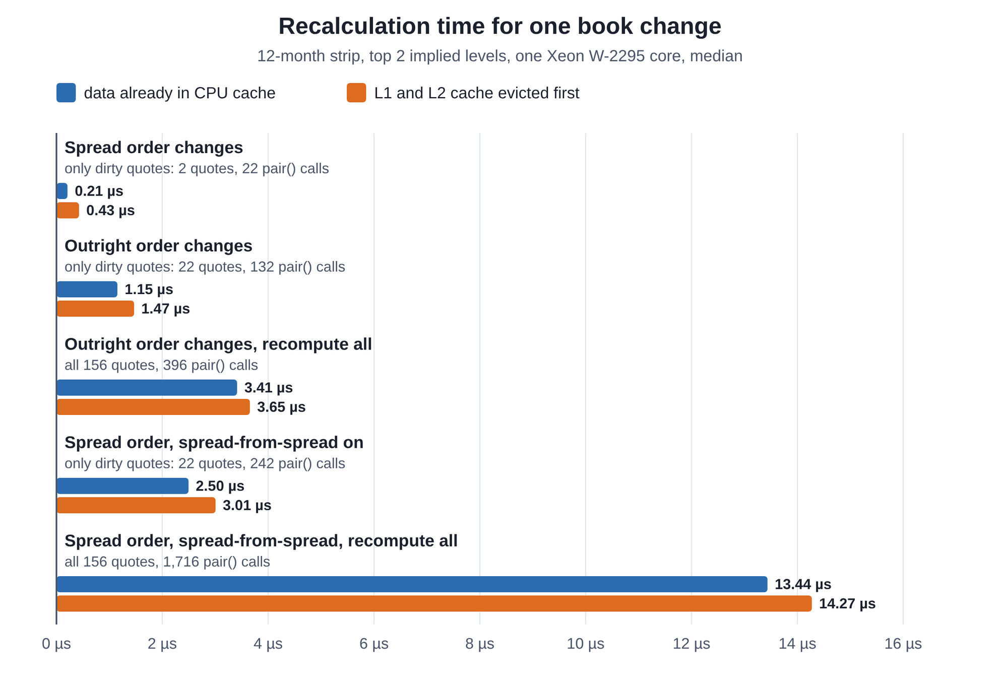

Four conclusions follow:

1. **The dependency table is worth about a factor of 3 to 16.** An outright change costs 1.15 µs instead of 3.41 µs. A spread change costs 0.21 µs instead of about 3.3 µs.
2. **One outright event adds roughly 1 to 1.5 µs.** On an engine whose ordinary matching path takes a microsecond or two, that is a large increase on every event in the product group, including events that never trade.
3. **Aggressive orders pay repeatedly.** The loop in `on_incoming` recomputes after each fill. An implied fill changes at least two book sides, such as a January ask (22 quotes) and a spread bid (2 quotes), or about 1.4 to 1.9 µs per fill. An order that sweeps three implied levels spends roughly 4 to 6 µs on recalculation alone.
4. **Throughput is consumed before latency looks bad.** At 1.47 µs per event, a burst of 200,000 outright events per second uses about 29% of the core for implied recalculation alone. Because the group is serialised on one thread (see *Atomicity* above), that capacity cannot be recovered by adding cores, and queueing delay rises sharply as the core approaches saturation.

Treat these as indicative figures, not a specification. They exclude order validation, matching, persistence, order-level ingredient lists, tick rounding and message encoding. Market data is a real addition: an outright event can change up to 22 quotes, so at an *assumed* 50 to 100 ns to encode each one, publication could add another 1.1 to 2.2 µs, as much as the calculation itself. A server Xeon with a lower all-core clock will be proportionally slower. The measurement core was also not isolated from the operating system, and interrupts pushed the slowest 0.1% of outright events to between 11 and 17 µs when cold, which is why production engines pin and isolate their matching cores. Across two runs the medians agreed within 4%, while the p99 values differed by up to about 65%, so read the p99 column as a rough guide. The benchmark source, with build instructions, is `scripts/implied_fanout_benchmark.c` in the book's source directory.

The practical optimisations follow directly from the table: use `ON_CHANGE` rather than recomputing everything, stop each `pair()` at the published depth, keep the top of each book in compact arrays that fit in the cache, and publish only quotes that actually changed. The next chapter shows why this comfortable microsecond budget disappears once implied quotes may themselves be used as ingredients.

> **Key idea:** Implied orders are not free liquidity. They are the engine expressing, in one book, commitments already resting in others, so that related markets stay consistent, empty months stay tradeable, and cross-book price gaps are closed by the exchange rather than harvested by the fastest participant. When an implied order matches, real orders in real books are consumed, exactly once, atomically. Everything difficult about implementing implied orders (shared-leg quantities, depth, priority, tick rounding, fan-out, double-execution races) follows from taking that atomic, exactly-once consumption seriously.

### A Short History

The precise date and venue of the very first implied order is not well documented in public sources, so this section sticks to what primary documents show.

- **By 2001, first-generation implication was established practice.** The background section of NYMEX's patent application *Implied market trading system* (filed 4 October 2001 by Matt N. Morano, Iain West and Kai Neumann) already treats implied orders derived from real outright and spread orders as known technology. The invention it claimed went one step further: deriving implied markets from other implied, or even non-tradeable "bridge", markets (helper prices that exist only inside the engine), so as to create "all implied markets that are inherent in the combination of futures, calendar spread and inter-commodity spread real orders" [US Patent 7,039,610, granted 2 May 2006]. The patent was filed by NYMEX; patent records now list ICE Futures Europe (the former International Petroleum Exchange of London) as its owner. Chaining implied orders in this way is exactly the subject of the next chapter.
- **2003–2004: implied spreads help move Eurodollars to the screen.** CME's Eurodollar futures (contracts on short-term US dollar interest rates, listed quarterly for years ahead and therefore a long strip with many spreads), then the world's most actively traded short-term interest rate contract, were still traded almost entirely in the Chicago pit: electronic trading accounted for "nearly 4 percent" of total Eurodollar volume in 2003. CME had expanded Globex functionality "to improve spread trading capabilities for Eurodollar futures" in January 2003 [CME news release, 12 January 2004]. By March 2004 Globex offered implied calendar spreads for Eurodollars across "the first five years of the yield curve" [CME press release, 8 March 2004], and in October 2004 CME added implied butterfly spreads (three-month combinations, covered in the next chapter), generating both implied IN and implied OUT prices, "unlike most other futures exchanges". In the same release CME reported that Globex carried about 65 percent of Eurodollar futures volume in September 2004 [CME press release, 18 October 2004]. Many factors drove that migration, but CME's own announcements consistently presented spread and implied functionality as part of making the electronic market usable for the spread-heavy trading that dominated Eurodollars.
- **Today: a standard feature of futures venues.** CME Globex, ICE Futures and Eurex (under the name *synthetic matching*) all offer implied functionality, each with its own rules about which combinations are implied; the *Real-World Implementations* section below summarises them.

The pattern behind this history is the one this chapter has made precise: once trading moves from people to an engine, the engine must take over the job of connecting related books, or liquidity fragments and spread traders stay away.

### Real-World Implementations

**CME Globex** is the reference implementation for futures: implied IN and implied OUT per product, implied depth disseminated on MDP 3.0, and per-product documentation of which implied types are enabled. CME has extended implied functionality steadily for two decades; in 2004, for example, it announced that its revised implied functionality would "link contract liquidity in butterfly spread trades on GLOBEX with that in underlying markets" for Eurodollar futures, then among the most actively traded futures in the world [CME press release, 8 March 2004]. **Eurex T7** offers the same idea under the name *synthetic matching*: "orders of different simple and complex instruments are executed against each other", supported for futures spreads and inter-product spreads [Eurex, *Matching principles*]. **ICE Futures** runs implied pricing across its energy futures and their spreads, including implied prices derived from other implied prices, the subject of the next chapter [ICE, *ICE Futures Implied Prices* FAQ]. The vocabulary differs from venue to venue; the three-book mechanics of this chapter are the common core.

### What You Can Now Do

If the chapter has done its job, you can now:

- Explain why one commodity is listed as dozens of order books, and why months have different prices (cost of carry, contango, backwardation).
- Read a spread price with its sign: say what buying or selling a spread does, who profits when S rises, and why −1.95 is a better bid than −2.00.
- Add order vectors to find every first-generation implied quote, and recognise when two orders imply nothing.
- Walk through an implied trade fill by fill, and check that every party traded within its limit and that positions and cash sum to zero.
- Explain why implied orders never create liquidity, and why recomputation (not decrementing) and shared-leg quantities follow from that.
- Apply the priority, price-improvement, tick-rounding and market-data rules, and state the invariants a test suite must check.
- Explain why a wide spread such as March/June is implied from its two leg months only, and what that means when a June order changes.
- Count how many implied quotes one book change makes dirty across a strip, and estimate what recalculating them costs.

The exercises below test each of these.

### Self-Check Exercises

*Answers follow; attempt each before reading on. Convention throughout: S = Near − Far, and all prices are per barrel with a $0.01 tick.*

**E1.** January: bid $74.20, ask $74.60. February: bid $76.10, ask $76.55. The spread book is empty. Compute the implied Jan/Feb spread bid and ask.

**E2.** The only two orders in the market are a February bid at $76.40 × 12 lots and a Jan/Feb spread ask at −$1.80 × 20 lots. What implied quote do they create, at what price and quantity?

**E3.** In Level 3's original books, Trader C instead submits an order to buy 40 February at $77.00. Describe the outcome, including every book afterwards.

**E4.** January ask $75.00 × 10; two spread bids at −$2.00 of 8 and 6 lots. What implied February quantity is published at $77.00, and why is 8 + 6 = 14 the wrong answer?

**E5.** You bought 3 Jan/Feb spreads at +$0.40. The spread now trades at +$0.15. What is your profit or loss, in dollars? (1 lot = 1,000 barrels.)

**E6.** A colleague's implementation decrements implied quantities on fills in the implied book instead of recomputing them, "for performance". Give a concrete sequence of events in which this publishes a quote the engine cannot honour.

**E7.** The books hold: January ask $75.10 × 10 and a spread bid of −$2.00 × 10, plus a real February bid of $77.05 × 10 that arrived last. What happens when the February bid arrives, and at what prices?

**E8.** The January book is empty. The February book holds a real ask of $76.80 × 15 lots (Trader P). The spread book holds a real ask of −$1.90 × 25 lots (Trader Q). (a) Which implied quote exists, at what price and quantity? (b) Trader R sends an order to buy 10 January at $74.90. List every fill, check that every party traded within its limit, and verify that the cash sums to zero. (c) What do the books look like afterwards?

**E9.** The market is in backwardation. January bid $78.30 × 12 lots (Trader S); Jan/Feb spread ask +$0.45 × 20 lots (Trader T); the February book is empty. (a) Compute the implied quote in the February book. (b) Trader U sends an order to sell 12 February at $77.80. At what price does U trade, and who gives up what?

**E10.** The February book holds two real asks: $77.00 × 4 (Trader G2) and $77.02 × 8 (Trader G). In addition, January ask $75.00 × 10 and spread bid −$2.00 × 12 are resting. Trader V sends an order to buy 20 February at $77.02. Which orders fill, in what sequence, at what prices, and what is V's average price? What remains afterwards?

**E11.** You *sold* 5 Jan/Feb spreads at −$1.20. A week later the spread trades at −$1.65. (a) Did you make or lose money, and how much? (b) In words, what happened to the shape of the market that helped or hurt you?

**E12.** January bid $75.20 × 10 (Trader W); February ask $77.10 × 10 (Trader X); the spread book is empty. Trader Y sends an order to sell 5 spreads at −$2.00. Does Y trade? If so, at what price, and how much better or worse than Y's limit, in dollars?

**E13.** A hypothetical product has an outright tick of 0.25 and a spread tick of 0.05. Resting: January bid 99.75 × 10 (Trader J); spread ask +0.10 × 10 (Trader L). (a) Compute the exact and the published implied February quote. (b) Trader M sends an order to sell 5 February at 99.50. Show every fill. (c) Show why rounding the other way would have broken a rule.

**E14.** A developer stores spread prices as an absolute value plus a "negative" flag and sorts the bid side by absolute value, largest first ("the bigger the number, the better the bid"). Two spread bids arrive: −$2.00 at 09:00:01 and −$1.95 at 09:00:02. Explain what goes wrong when a spread seller arrives, and what the correct design is.

**E15.** Resting orders: April ask $78.00 × 10; May ask $80.10 × 5; July bid $83.95 × 6; Apr/Jul spread bid −$6.20 × 8. No other orders rest. (a) List every first-generation implied quote, with type (IN or OUT), price and quantity. (b) Which resting order plays no part, and why?

**E16.** March asks: $76.00 × 5, then $76.02 × 10. Mar/Jun spread bids: −$6.00 × 8, then −$6.03 × 10. Run `pair()` from the *Engineering Deep-Dive* by hand, with `max_levels = 2`, to build the implied June ask ladder. Show each step and the ingredients of each level.

**E17.** An exchange lists six consecutive months and every calendar spread between them, with implied IN and OUT only. (a) How many order books are there, and how many `pair()` computations does recomputing every implied quote take? (b) One side of an outright book changes. How many implied quotes become dirty, and how many `pair()` computations does recalculating them take? (c) The same for one side of a spread book.

&nbsp;

<div style="page-break-after: always;"></div>

&nbsp;

#### Solutions

**E1.** Implied S_bid = Jan_bid − Feb_ask = 74.20 − 76.55 = **−$2.35**. Implied S_ask = Jan_ask − Feb_bid = 74.60 − 76.10 = **−$1.50**. Sanity check: the implied calendar-spread market is 0.85 wide, which is the January bid-ask spread (0.40) plus the February bid-ask spread (0.45). Trading the calendar spread through the outrights means paying both outright bid-ask spreads at once.

**E2.** This is a trap, and the trap is the point: **these two orders imply nothing.** Add the vectors. The February bid is (Feb +1). The spread ask is a committed spread *seller*: (Jan −1, Feb +1). Their sum is (Jan −1, Feb +2), which cancels nothing and is not the shape of any single order. In words: the spread seller needs to *buy* February to complete its legs, and the only February order present is another *buyer*. Cross-check against the Level 2 table: Feb_bid pairs with S_**bid** (implied Jan bid), and S_ask pairs with Feb_**ask** (implied Jan ask) or Jan_**bid** (implied Feb bid); "Feb_bid + S_ask" appears in no row. If you mechanically computed 76.40 + (−1.80) = $74.60 and published it as an implied January quote, you manufactured a price with nothing executable behind it, precisely the class of bug that testing invariant 2 exists to catch.

**E3.** The implied ask at $77.00 is 30 lots (min(50, 30)). C fills 30 lots through the three-fill construction: A sells 30 January at $75.00, B's spread fills 30 at −$2.00 (B's order is now complete), and C buys 30 February at $77.00. With B's order gone, the implied February ask recomputes to nothing, so C's remaining 10 lots rest as a real February bid at $77.00. Afterwards: January ask $75.00 × 20 (A); spread book empty of real orders; February bid $77.00 × 10 (C). And one more thing happens, which is easy to miss: C's new February bid is itself an ingredient. Together with A's January ask it implies a spread **ask** at Jan_ask − Feb_bid = 75.00 − 77.00 = **−$2.00**, quantity min(20, 10) = **10**. Every new real order is a candidate ingredient in every related book.

**E4.** Published quantity = min(10, 8 + 6) = **10**. The January ask is a shared leg: both spread bids route their February selling through the same 10 January lots, so together they can deliver at most 10. Pairwise-min-then-sum (min(10, 8) + min(10, 6) = 14) counts the shared leg twice and over-advertises by 4 lots that the engine could not deliver if a buyer took them.

**E5.** The spread price fell from +0.40 to +0.15, a change of −0.25 per barrel. You are long the spread, so you lose: −0.25 × 1,000 barrels × 3 lots = **−$750**. (Check with legs: suppose you bought January at $76.40 and sold February at $76.00; later January is $76.00 and February $75.85. January: −0.40; February short: +0.15; net −0.25 per barrel.)

**E6.** Books: January ask $75.00 × 20 (A); spread bid −$2.00 × 20 (B), so implied February ask $77.00 × 20. Event 1: an ordinary January buyer takes 15 of A's lots. A has 5 left, so the true implied quantity is min(5, 20) = 5. The decrement-only implementation saw no fill *in the February implied book* and still advertises 20. Event 2: a February buyer sends an order to buy 12 at $77.00. The engine can construct only 5 lots: it must either reject a fill against a quote it published, fill against a phantom, or (worst of all) begin an atomic commit that cannot complete. Recomputation on every event in the group is not an optimisation opportunity; it is the correctness mechanism.

**E7.** Before the February bid arrives, the engine publishes an implied February ask of 75.10 − (−2.00) = $77.10 × 10. The incoming bid of $77.05 is below $77.10, so it does **not** cross: nothing trades, and the bid rests. Now look for implied quotes involving the new order: January ask plus February bid imply a spread ask of 75.10 − 77.05 = **−$1.95**, and the resting spread bid is −$2.00, which does not reach −1.95 either. The books are consistent and nothing trades. (Had the February bid been $77.10 or higher, it would have traded 10 lots at $77.10 through the implied construction. The price is always the *resting* side's price, and here the resting side is the implied ask.)

**E8.**

*(a) Find the implied quote by adding vectors.* P's February ask is (Feb −1) with c = −76.80. Q's spread ask is a spread *sell*: (Jan −1, Feb +1) with c = −S = −(−1.90) = +1.90. Sum: (Jan −1), c = −76.80 + 1.90 = −74.90. A combined effect of "sell one January, receive $74.90" is an **implied January ask at $74.90**. This is the Level 2 formula Jan_ask = Feb_ask + S_ask = 76.80 + (−1.90) = 74.90. Quantity = min(15, 25) = **15 lots**. Notice the side rule: an implied *near-month* quote has the same side as its spread order (spread ask → January ask).

In words: Q wants to sell January and buy February, as long as February costs no more than $1.90 above January. P sells February at $76.80, so Q can afford to sell January at 76.80 − 1.90 = $74.90.

*(b) Execution.* R's bid of $74.90 meets the implied ask of $74.90, so 10 lots trade atomically:

1. Q sells 10 January to R at $74.90.
2. Q buys 10 February from P at $76.80.
3. Q's spread fill prints at 74.90 − 76.80 = −$1.90.

Limits: R bought at $74.90, exactly R's limit. P sold at $76.80, exactly P's limit. Q sold the spread at −$1.90, exactly Q's limit (a spread seller wants −1.90 *or higher*). All three are satisfied.

Cash (per barrel, "cash paid" convention): R pays 10 × 74.90 = +749.00; P pays −(10 × 76.80) = −768.00 (P receives); Q pays 10 × (−S) = 10 × 1.90 = +19.00. Total: 749.00 − 768.00 + 19.00 = **0**. Positions: R (Jan +10), P (Feb −10), Q (Jan −10, Feb +10) also sum to zero.

*(c) Afterwards:* February ask $76.80 × 5 (P); spread ask −$1.90 × 15 (Q); January book still has no real orders, and the implied January ask is recomputed to $74.90 × min(5, 15) = **5 lots**. R holds a long position of 10 January.

**E9.**

*(a)* S's January bid is (Jan +1), c = +78.30. T's spread ask is a spread sell, (Jan −1, Feb +1), c = −0.45. Sum: (Feb +1), c = 78.30 − 0.45 = 77.85: "buy one February, pay $77.85". That is an **implied February bid at $77.85 × min(12, 20) = 12 lots**, matching the formula Feb_bid = Jan_bid − S_ask. Note the side flip: a spread *ask* produces a February *bid*. The positive spread price simply means January is the more expensive month (backwardation); none of the arithmetic changes.

*(b)* U is willing to sell at $77.80 or more. The best bid available is the implied $77.85, so U trades all 12 lots at **$77.85**, the resting side's price, which is $0.05 better than U's limit ($50 per lot, $600 in total). The fills:

1. T sells 12 January to S at $78.30 (S's limit).
2. T buys 12 February from U at $77.85.
3. T's spread prints at 78.30 − 77.85 = **+$0.45** (T's limit).

Nobody gave anything up: S and T traded exactly at their limits, and U got a better price than its limit because the best available bid happened to be higher than U required. Cash check: S pays 12 × 78.30 = 939.60; U pays −(12 × 77.85) = −934.20; T pays 12 × (−0.45) = −5.40. Sum: 939.60 − 934.20 − 5.40 = 0. Afterwards: S's bid is used up, T has 8 spreads left at +$0.45, and with no January bid left there is no implied February bid.

**E10.**

First, build the February ask side as the engine sees it. The implied ask is Jan_ask − S_bid = 75.00 − (−2.00) = $77.00, quantity min(10, 12) = 10. So:

| February ask | Lots | Source | Priority at that price |
|---|---|---|---|
| $77.00 | 4 | Real (G2) | 1st (real before implied) |
| $77.00 | 10 | Implied (Jan ask + spread bid) | 2nd |
| $77.02 | 8 | Real (G) | 3rd (worse price) |

V wants 20 lots at up to $77.02, so V walks down the ladder (price first, then real before implied):

1. **4 lots at $77.00 from G2** (ordinary two-party trade). V needs 16 more.
2. **10 lots at $77.00 through the implied construction**: the January seller sells 10 January at $75.00 to the spread bidder, the spread bidder buys 10 spreads at −$2.00, and V buys 10 February at $77.00 from the spread bidder. V needs 6 more.
3. The engine recomputes. The January ask is now gone, so there is **no implied ask any more**, even though the spread bid still has 2 lots. The best remaining ask is G's real $77.02.
4. **6 lots at $77.02 from G**.

Average price: (14 × 77.00 + 6 × 77.02) / 20 = (1,078.00 + 462.12) / 20 = **$77.006** per barrel.

Afterwards: February ask $77.02 × 2 (G); January book empty; spread bid −$2.00 × 2. Does that spread bid imply anything? It could only combine with a January ask (none left) or a February bid (none exist), so no implied quotes are published. Step 3 is the lesson: the implied quantity was capped by the January leg, not by the spread leg, and only recomputation reveals that.

**E11.**

*(a)* A spread seller profits when S *falls*. S moved from −1.20 to −1.65, a change of (−1.65) − (−1.20) = −0.45. The number went down (it moved further below zero), so you **made money**: +0.45 per barrel × 1,000 barrels × 5 lots = **+$2,250**.

Leg check: suppose you sold January at $74.80 and bought February at $76.00 (74.80 − 76.00 = −1.20 ✓). Later January is $74.35 and February is still $76.00 (74.35 − 76.00 = −1.65 ✓). Your January short gained 74.80 − 74.35 = +0.45; your February long gained 0. Net +0.45 per barrel, as computed.

*(b)* The market was in contango (February above January) and the contango *deepened*: February's premium over January grew from $1.20 to $1.65. Selling the Jan/Feb spread is a bet on exactly that. A common beginner slip is to think "the spread went from 1.20 to 1.65, it went up". It did not: with signs, −1.65 is lower than −1.20.

**E12.**

The spread book has no real orders, but W and X imply a spread bid: W's January bid (Jan +1, c = +75.20) plus X's February ask (Feb −1, c = −77.10) sum to (Jan +1, Feb −1), the shape of a spread buyer, paying 75.20 − 77.10 = **−$1.90**, quantity min(10, 10) = 10.

Y will sell the spread at −$2.00 *or higher*. Is −1.90 higher than −2.00? Yes: on the number line −1.90 lies to the right of −2.00. So Y trades 5 spreads at **−$1.90** (the resting, implied price):

1. Y sells 5 January to W at $75.20.
2. Y buys 5 February from X at $77.10.
3. Y's spread prints at 75.20 − 77.10 = −$1.90.

Y does better than its limit by 0.10 per barrel × 1,000 × 5 = **$500** compared with its limit. Intuitively: Y was prepared for February to cost up to $2.00 more than the January it sells, and it only cost $1.90 more. Cash check: W pays 376.00, X pays −385.50, Y pays 5 × (−S) = 5 × 1.90 = 9.50; sum 0. Afterwards: January bid $75.20 × 5, February ask $77.10 × 5, implied spread bid −$1.90 × 5.

**E13.**

*(a)* J's January bid (Jan +1, c = 99.75) plus L's spread ask (Jan −1, Feb +1, c = −0.10) sum to (Feb +1), c = 99.65: an implied **February bid**. The exact price 99.75 − 0.10 = 99.65 is not a multiple of 0.25. Rounding outwards means rounding a *bid down* (worse for whoever sells into it), so the published implied bid is **99.50**, quantity min(10, 10) = 10.

*(b)* M sells 5 February at 99.50, which meets the implied bid:

1. L sells 5 January to J at 99.75 (J's limit).
2. L buys 5 February from M at 99.50 (M's limit).
3. L's spread prints at 99.75 − 99.50 = **+0.25**, a valid 0.05 spread tick.

L asked for at least +0.10 and received +0.25: 0.15 better than its limit, the leftover from rounding.

*(c)* Rounding *inwards* would publish the bid at 99.75. If M then sold at 99.75, L's spread would print at 99.75 − 99.75 = 0.00, which is *below* L's limit of +0.10. The engine would have sold L's spread cheaper than L allowed, a violation of the most basic matching rule. Outward rounding is the only choice that guarantees every real order trades at or better than its limit.

**E14.**

The correct bid priority is **−1.95 first**: it is the higher signed price, so it is the more generous bid (that bidder accepts a smaller February premium). Sorting by absolute value puts −2.00 first because 2.00 > 1.95.

Now a spread seller arrives: sell 1 spread at −$2.00. The buggy book matches it against the −2.00 bid at −2.00. The correct book matches it against the −1.95 bid at −1.95. The bug therefore (1) violates price priority, because the better −1.95 bid was skipped, and (2) gives the seller a worse price than the market offered: −2.00 instead of −1.95, 0.05 × 1,000 = $50 per lot. On the ask side the same bug sorts −1.95 ahead of −2.00, so buyers pay more than the best available offer. Note that the bug is invisible while all spread prices are positive, which is exactly why it survives testing in backwardated markets and appears in production on the first day of contango.

The correct design is the one from Confusion 2: store prices as **signed integer ticks** (−200 and −195) and use ordinary numeric comparison. Bids sort descending (−195 before −200), asks sort ascending, with no special cases for sign.

**E15.**

*(a)* The spread's vector is (Apr +1, Jul −1), so only April and July orders can cancel its legs. Three quotes exist:

| Implied quote | Type | Ingredients | Price | Lots |
|---|---|---|---|---|
| July ask | OUT | April ask + spread bid | 78.00 − (−6.20) = **$84.20** | min(10, 8) = 8 |
| April bid | OUT | July bid + spread bid | 83.95 + (−6.20) = **$77.75** | min(6, 8) = 6 |
| Spread ask | IN | April ask + July bid | 78.00 − 83.95 = **−$5.95** | min(10, 6) = 6 |

The other three formulas each need an order that does not exist (a July ask, an April bid or a spread ask). Nothing is crossed: the implied July ask is above the real July bid, the implied April bid is below the real April ask, and the implied spread ask is above the real spread bid.

*(b)* The May ask. Its vector (May −1) has no April or July entry, so adding it to any of the other orders cancels nothing. That May lies between April and July in time is irrelevant. A May order could only take part through spreads that contain May, such as Apr/May and May/Jul, and combining those is a construction for the next chapter.

**E16.** Follow the loop, keeping working copies of the remaining quantities:

1. Best against best: 76.00 − (−6.00) = 82.00, quantity min(5, 8) = 5. New level **$82.00 × 5**, built from (March 76.00 × 5, spread −6.00 × 5). The March level is used up; 3 spreads at −6.00 remain.
2. Next March level against the remaining spreads: 76.02 − (−6.00) = 82.02, quantity min(10, 3) = 3. A new price, and the ladder has room, so new level **$82.02 × 3**. The −6.00 spreads are used up; 7 March lots at 76.02 remain.
3. Next pair: 76.02 − (−6.03) = 82.05. A new price, but the ladder already holds 2 levels, so the loop stops.

Result: $82.00 × 5, $82.02 × 3. Without the depth limit, the next level would be $82.05 × 7. No order is used beyond its size: 5 + 3 = 8 spreads at −6.00, and March lots 5 at 76.00 plus 3 at 76.02.

**E17.**

*(a)* 6 outright books and 6 × 5 / 2 = **15** spread books, **21** in all. Each spread forms one triangle with its two legs, and each triangle has 6 formulas: 15 × 6 = **90** `pair()` computations.

*(b)* An outright month is a leg of 5 spreads, so one changed side dirties 5 outright quotes (OUT) and 5 spread quotes (IN): **10** quotes. Each outright quote has 5 routes, one through each other month, and each spread quote has 1: 5 × 5 + 5 × 1 = **30** `pair()` computations.

*(c)* A spread sits in one triangle, so one changed side dirties **2** outright quotes, each with 5 routes: **10** `pair()` computations.

In general, with M months an outright side dirties 2(M − 1) quotes costing M(M − 1) computations, and a spread side dirties 2 quotes costing 2(M − 1). For M = 12 that gives the chapter's 22 quotes and 132 computations, and 2 quotes and 22 computations. The outright cost grows with the square of the strip length.

## Multi-Layer Implied Orders and the Combinatorial Wall

The previous chapter combined exactly two real orders at a time. A January ask plus a spread bid implied a February ask; a January bid plus a February ask implied a spread bid. A curious developer immediately asks the next question: *if an implied February ask can be traded against, can it also be used as an ingredient?* Combine it with a Feb/Mar spread and you get an implied March ask. Combine that with a Mar/Apr spread and you get an implied April ask. Why stop?

This chapter answers that question. It extends the vector model of the previous chapter to chains of any length, shows a real multi-generation example published by ICE, re-derives the "no liquidity from nothing" promise for chains, and then walks into what this chapter calls **the combinatorial wall**: the reason every exchange that offers implied matching restricts it, whether by the number of steps, by the set of instruments, by the depth it publishes, or by the time it is switched on.

The short version, for readers in a hurry: finding the *single best* implied price through arbitrarily long chains of simple calendar spreads is a well-behaved shortest-path problem. Everything else an exchange must do with implied liquidity (allocate quantity, publish depth, break ties fairly, execute atomically, assign leg prices, support three- and four-legged strategies, and do all of it within microseconds after *every single event*) grows explosively with the number of steps allowed. The explosion, not the arithmetic, is what forces the limit.

### Generations: Counting the Links in the Chain

We need a precise way to say how "deep" an implied quote is. This chapter uses the convention implied by the ICE example below:

- **Generation 0**: a real order, resting in its own book.
- **Generation 1**: an implied quote built from **two** real orders (everything in the previous chapter).
- **Generation 2**: an implied quote that uses a generation-1 implied quote as an ingredient, so it is built from **three** real orders.
- **Generation *k***: built from ***k* + 1** real orders.

Venues word this differently. CME's matching-priority documentation, for instance, labels outright orders "generation 0" and spread orders "1st generation" when ordering sources for allocation [CME Group Client Systems Wiki, *Futures Implied Order Matching Priority*]. What matters is the underlying quantity: *how many real orders must execute together for one implied lot to trade*. That number drives every cost in this chapter.

### A Real Multi-Generation Example (ICE)

ICE Futures publishes the following example of implied prices across generations in a crude-oil-style strip of September, October and November contracts [ICE, *ICE Futures Implied Prices* FAQ]. The real orders are:

| Book | Side | Price |
|---|---|---|
| September | Bid | 75.90 |
| October | Ask | 76.83 |
| Oct/Nov spread | Bid | −0.52 |

(As in the previous chapter, spread price = near month − far month, and a spread bid buys the near month and sells the far month. The months and prices are new, because they are ICE's rather than ours, but every rule from the previous chapter applies unchanged.)

ICE derives, and we can check with the vector rule:

**Generation 1, implied IN: a Sep/Oct spread bid at −0.93.**

```
  Buy Sep at 75.90           v = (Sep +1)              c = +75.90
+ Sell Oct at 76.83          v = (Oct −1)              c = −76.83
  ------------------------------------------------------------------
                             v = (Sep +1, Oct −1)      c =  −0.93   → Sep/Oct spread BID at −0.93
```

**Generation 1, implied OUT: a November ask at 77.35.**

```
  Sell Oct at 76.83          v = (Oct −1)              c = −76.83
+ Buy Oct/Nov at −0.52       v = (Oct +1, Nov −1)      c =  −0.52
  ------------------------------------------------------------------
                             v = (Nov −1)              c = −77.35   → November ASK at 77.35
```

**Generation 2: a Sep/Nov spread bid at −1.45**, built from the real September bid and the *implied* November ask:

```
  Buy Sep at 75.90           v = (Sep +1)              c = +75.90
+ implied Sell Nov at 77.35  v = (Nov −1)              c = −77.35
  ------------------------------------------------------------------
                             v = (Sep +1, Nov −1)      c =  −1.45   → Sep/Nov spread BID at −1.45
```

Unpack the implied November ask and the generation-2 quote is simply the sum of all **three** real orders: 75.90 − 76.83 − 0.52 = −1.45, with the October legs cancelling. The same number appears if you chain the other generation-1 quote instead: implied Sep/Oct bid (−0.93) plus real Oct/Nov bid (−0.52) = −1.45. That is not a coincidence. **An implied quote is a property of the set of real orders it uses, not of the order in which you combine them.** The "generation" is just a count of how many real orders are in the set, minus one.

#### Executing a generation-2 trade

Give the three real orders some sizes and owners:

| Book | Side | Price | Lots | Who |
|---|---|---|---|---|
| September | Bid | 75.90 | 10 | Trader P |
| October | Ask | 76.83 | 8 | Trader Q |
| Oct/Nov spread | Bid | −0.52 | 5 | Trader R |

The implied Sep/Nov spread bid is −1.45 for min(10, 8, 5) = **5 lots**, bottlenecked by R, the smallest ingredient. Trader X now submits an order to **sell** 5 Sep/Nov spreads at −1.45 (sell September, buy November). The engine must commit **four** participants' fills atomically:

| Participant | Does | Position change | Price(s) |
|---|---|---|---|
| X (incoming) | sells 5 Sep/Nov spreads at −1.45 | Sep −5, Nov +5 | Sep 75.90, Nov 77.35 |
| P | buys 5 September | Sep +5 | 75.90 |
| Q | sells 5 October | Oct −5 | 76.83 |
| R | buys 5 Oct/Nov spreads at −0.52 | Oct +5, Nov −5 | Oct 76.83, Nov 77.35 |

The same trade as a sequence of events. Note that the engine validates every fill before committing any of them, exactly as in the previous chapter's three-party example, only with one more participant:

```{.mermaid width=600}
sequenceDiagram
    participant X as Trader X (sells Sep/Nov)
    participant ME as Matching Engine
    participant P as Trader P (Sep bid 75.90)
    participant Q as Trader Q (Oct ask 76.83)
    participant R as Trader R (Oct/Nov bid −0.52)

    X->>ME: SELL 5 SEP/NOV @ −1.45
    Note over ME: Implied Sep/Nov bid −1.45 × 5 found<br/>(generation 2: P + Q + R).<br/>All four fills validated, then committed atomically.
    ME->>P: Fill 1: P BUYS 5 SEP @ 75.90 (from X)
    ME->>Q: Fill 2: Q SELLS 5 OCT @ 76.83 (to R)
    ME->>R: Fill 3: R BUYS 5 OCT/NOV @ −0.52<br/>(Oct 76.83, Nov 77.35)
    ME->>X: Fill 4: X SELLS 5 SEP/NOV @ −1.45<br/>(Sep 75.90, Nov 77.35)
    Note over ME: Prints: SEP 5@75.90, OCT 5@76.83,<br/>OCT/NOV 5@−0.52, SEP/NOV 5@−1.45
```

Follow the oil, month by month: September flows from X to P; October flows from Q to R; November flows from R to X. Each month changes hands exactly once, between exactly two participants.

Check the columns. **Positions** sum to zero in every month: September −5 + 5 = 0; October −5 + 5 = 0; November +5 − 5 = 0. **Leg prices** are consistent with every order: X's legs differ by 75.90 − 77.35 = −1.45 ✓; R's legs differ by 76.83 − 77.35 = −0.52 ✓; P and Q trade exactly at their limits. **Cash**, using the "cash paid" convention of the previous chapter, per barrel: X pays 5 × 1.45 = 7.25 (selling a spread at −1.45 means paying 1.45 per unit), P pays 5 × 75.90 = 379.50, Q pays −5 × 76.83 = −384.15, and R pays 5 × (−0.52) = −2.60. Sum: 7.25 + 379.50 − 384.15 − 2.60 = **0** ✓.

As before, X could have done all of this by hand: sell September to P, buy October from Q, and sell the Oct/Nov spread to R. Three orders, three chances for the market to move in between, and one very unhappy trader if the third fill fails. Implied matching removes that leg risk. It does not add one lot of liquidity: the 5 lots X traded are 5 of P's lots, 5 of Q's lots and 5 of R's spreads, and every one of those is now gone from every book where it used to be visible. **Multi-layer implication, like single-layer implication, only adds routes.**

#### Why go deeper at all?

If deeper implication only adds routes, why would an exchange bother? Because sometimes the deeper route is the *only* route. Compare what two engines would display for the same three real orders P, Q and R, one limited to generation 1 and one allowing generation 2:

| Book | Real orders in this book | Generation-1 engine displays | Generation-2 engine displays |
|---|---|---|---|
| September | P: bid 75.90 × 10 | bid 75.90 × 10 (real) | bid 75.90 × 10 (real) |
| October | Q: ask 76.83 × 8 | ask 76.83 × 8 (real) | ask 76.83 × 8 (real) |
| November | *none* | implied ask 77.35 × 5 (Q + R) | implied ask 77.35 × 5 (Q + R) |
| Sep/Oct spread | *none* | implied bid −0.93 × 8 (P + Q) | implied bid −0.93 × 8 (P + Q) |
| Oct/Nov spread | R: bid −0.52 × 5 | bid −0.52 × 5 (real) | bid −0.52 × 5 (real) |
| Sep/Nov spread | *none* | **nothing** | **implied bid −1.45 × 5 (P + Q + R)** |

Why can the generation-1 engine not price the Sep/Nov spread? A generation-1 Sep/Nov bid needs exactly two *real* orders whose legs cancel: a September bid plus a *real* November ask, or a *real* Sep/Oct bid plus a *real* Oct/Nov bid. The November ask and the Sep/Oct bid exist only as implied quotes, and a generation-1 engine never uses implied quotes as ingredients. So Trader X, who wants to sell the Sep/Nov spread, faces an empty book and must leg three separate trades by hand, with all the leg risk that brings. The generation-2 engine shows X a firm price and executes all of it atomically.

The lesson: deeper implication pays off where the books *between* two instruments are empty or thin, typically longer-dated months and less popular spread combinations. Where a short route already exists, a longer route rarely beats it on price (point 7 of the combinatorial wall below). Exchanges therefore weigh one question: how often does a deeper route provide a price that no shorter route does, and is that worth the cost described in the rest of this chapter?

#### When leg prices must be manufactured

In the ICE example, every month in the chain had a real outright order, so every leg price was pinned down by a real limit price. That is not always the case. Take two spread orders and nothing else:

| Book | Side | Price | Lots |
|---|---|---|---|
| Jan/Feb spread | Bid | −2.00 | 30 |
| Feb/Mar spread | Bid | −1.50 | 20 |

The vectors (Jan +1, Feb −1) and (Feb +1, Mar −1) add up to (Jan +1, Mar −1): an implied **Jan/Mar spread bid** at (−2.00) + (−1.50) = **−3.50**, for min(30, 20) = 20 lots. Only two real orders are involved, so it is a generation-1 quote, but of a third kind that is neither CME's "implied IN" (spread from outrights) nor "implied OUT" (outright from spread): a spread implied from two other spreads.

When a Jan/Mar spread seller hits it for 20 lots, three participants take **six** leg positions (the seller: Jan −20, Mar +20; the Jan/Feb bidder: Jan +20, Feb −20; the Feb/Mar bidder: Feb +20, Mar −20). The two February legs trade *between the two spread bidders*, and nothing in any order says what the February price is. Only differences are fixed: Jan − Feb = −2.00 and Feb − Mar = −1.50. The engine must manufacture the actual prices by rule, typically anchoring one month to a reference price (its last trade or settlement, as in the previous chapter's leg-price discussion). With February anchored at 77.00, the legs become January 75.00, February 77.00, March 78.50, and every spread's legs differ by exactly its price. Every leg price must also be a valid tick and inside that month's price limits, and the anchor rule must be deterministic. The longer the chain, the more legs have no real price of their own and must be manufactured this way.

### The Graph View: Implied Pricing Is a Path Problem

To reason about chains of any length, the vector model becomes a graph.

- Draw one **node** per delivery month, plus one special node **$** that stands for "cash". An outright order swaps a month for cash, so its edge has $ at one end; a spread order swaps one month for another, so its edge joins two months.
- Every resting order becomes a **directed edge** u → v, meaning "this order is willing to go long u and short v". A buy of January is the edge Jan → $ (long January, giving up cash); a sell of January is $ → Jan; a Jan/Feb spread bid is Jan → Feb; a Jan/Feb spread ask is Feb → Jan.
- Give each edge a **weight** equal to the order's cash amount c from the previous chapter: the most it is willing to pay per unit. A negative weight means the order needs to *receive* at least that much.

| Resting order | Edge | Weight (= cash paid c) | Example |
|---|---|---|---|
| Outright bid at P | Month → $ | +P | Jan bid 74.40 → weight +74.40 |
| Outright ask at P | $ → Month | −P | Jan ask 75.00 → weight −75.00 |
| Spread bid at S | Near → Far | +S | Jan/Feb bid −2.00 → weight −2.00 |
| Spread ask at S | Far → Near | −S | Jan/Feb ask −1.80 → weight +1.80 |

Read the spread rows slowly: they are the previous chapter's sign convention in graph form. A spread bid goes *from* the near month (bought) *to* the far month (sold), and its weight is the spread price itself, sign included.

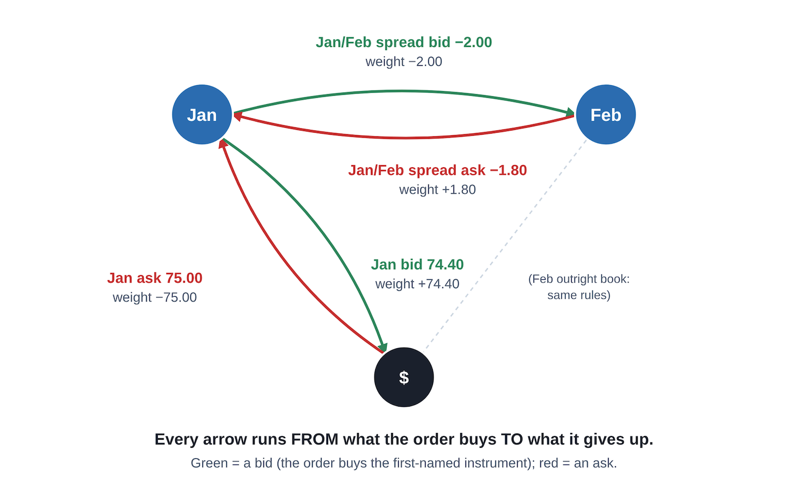

Step back and look at the whole strip this way, and the previous chapter's circle of 78 books takes on a new meaning. Put $ in the middle. Each outright book is now a spoke between a month and $, and each spread book is a chord between two months:

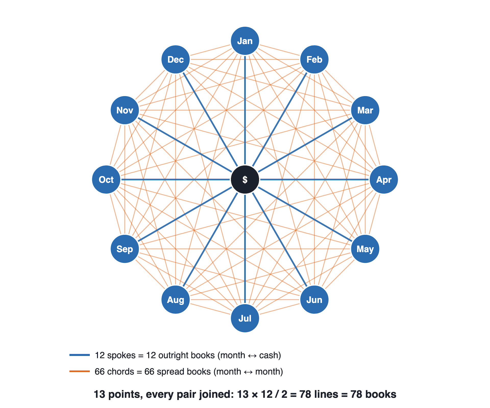

Every one of the 78 books is now a single line, and every pair of the 13 points is joined. An implied quote is a walk along these lines, so the question "which implied quotes exist?" becomes "which walks exist?". The rest of this chapter is about how many walks a picture like this contains.

Now the whole theory of implied pricing fits in one sentence:

> **A path of resting orders from node x to node y is an implied order to go long x and short y, and the most it will pay is the sum of the weights along the path.**

The intermediate nodes cancel, exactly as the October legs cancelled above. Some checks against examples you already know:

- Path $ → Jan → Feb (Jan ask 75.00, weight −75.00; spread bid −2.00, weight −2.00): long nothing, short February, paying −77.00, that is, *receiving* 77.00. An implied **February ask at 77.00** ✓ (previous chapter, Level 3).
- Path Jan → $ → Feb (Jan bid 74.40, weight +74.40; Feb ask 76.60, weight −76.60): long January, short February, paying −2.20. An implied **spread bid at −2.20** ✓ (previous chapter, Level 4).
- Path Sep → $ → Oct → Nov (Sep bid +75.90, Oct ask −76.83, Oct/Nov bid −0.52): long Sep, short Nov, paying −1.45. The ICE generation-2 **Sep/Nov bid at −1.45** ✓.

Figure: the ICE example as a graph. Each arrow is one real order, and together the three arrows form the path of the generation-2 Sep/Nov bid.

```{.mermaid width=560}
flowchart LR
    SEP((Sep))
    CASH(("$"))
    OCT((Oct))
    NOV((Nov))
    SEP == "P: Sep bid 75.90<br/>weight +75.90" ==> CASH
    CASH == "Q: Oct ask 76.83<br/>weight −76.83" ==> OCT
    OCT == "R: Oct/Nov bid −0.52<br/>weight −0.52" ==> NOV
```

Read the picture from left to right and translate each arrow back into words. P will buy September and give up cash (Sep → $). Q will take cash and give up October ($ → Oct). R will take October and give up November (Oct → Nov). Chain them and the intermediate nodes ($ and October) are each entered once and left once, so they cancel: what remains is "long September, short November", the Sep/Nov spread bid. Its price is the sum along the path: +75.90 − 76.83 − 0.52 = −1.45. Every sub-path is an implied quote too: Sep → $ → Oct is the Sep/Oct bid at −0.93, and $ → Oct → Nov is the November ask at 77.35.

The generation of an implied quote is the number of edges in its path, minus one. Only **simple paths** count, meaning paths that never visit the same node twice: revisiting a node would mean going long and short the same month inside one construction, which just wastes orders.

**The best implied bid for "long x, short y" is therefore the maximum-weight path from x to y.** The same search also gives asks, because an ask is just a path in the other direction: the best implied February ask is the maximum-weight path from $ to Feb, and its price is minus that weight (as in the first check above, where weight −77.00 means an ask at 77.00). Equivalently, negate every weight and it becomes a *shortest-path* problem, one of the most thoroughly studied problems in computer science.

**Cycles are crossed markets.** A cycle of resting orders (a path from a node back to itself) has a position vector of zero: its orders could trade with each other and nobody else. They *can* do so exactly when the total they are willing to pay is at least zero, since the cash must balance. A January bid at 75.00 (weight +75.00) and a January ask at 74.99 (weight −74.99) form a cycle of weight +0.01: a crossed book. Because a matching engine trades every crossing it can see the moment it arises (the previous chapter's Level 8), a correctly running engine never has a cycle of non-negative weight at rest *within the scope of implication it has enabled*. (Cycles longer than the enabled depth can stay crossed; closing them is left to arbitrageurs. CME confirms that implied bids can sit at the same or inverted price levels as implied offers, and that they do not trade against each other [Wilson, CME Group, *Liquidity in implied inter-commodity spread markets*, 2024].) In shortest-path terms, **an uncrossed family of books is a graph with no negative cycles** (after negating the weights), which is precisely the condition under which classical algorithms such as Bellman–Ford (which repeatedly relaxes every edge until no path can be improved) find optimal paths in polynomial time, that is, in time that grows only moderately with the number of books and orders. The condition holds fully when implication is unlimited, because then every crossed cycle is traded away on arrival; with a depth limit, longer crossed cycles may exist and the search must also respect the limit.

The previous chapter's "free money" example (Level 8) is exactly such a cycle. A January ask at 74.95, a Jan/Feb spread bid at −2.00 and a February bid form the loop $ → Jan → Feb → $. Whether the books are crossed depends only on the sign of the loop's total weight:


#### A crossed cycle a first-generation engine cannot see

The previous chapter (Level 8) promised an example of why implied bids are allowed to sit above implied offers. The graph view makes it easy to see. Take four real orders across three months:

| Real order | Price | Edge | Weight |
|---|---|---|---|
| January bid | 75.00 | Jan → $ | +75.00 |
| Jan/Feb spread ask | −2.00 | Feb → Jan | +2.00 |
| March ask | 77.40 | $ → Mar | −77.40 |
| Feb/Mar spread ask | −0.45 | Mar → Feb | +0.45 |

The four edges form the cycle $ → Mar → Feb → Jan → $, with weight −77.40 + 0.45 + 2.00 + 75.00 = **+0.05**. The weight is positive, so the family of books is crossed: the four orders could trade with one another with five cents per barrel to spare. In prices: the January bid and the Jan/Feb spread ask imply a February **bid** of 75.00 − (−2.00) = 77.00, while the March ask and the Feb/Mar spread ask imply a February **ask** of 77.40 + (−0.45) = 76.95. The implied February bid sits five cents above the implied February ask.

Why did a first-generation engine not trade it? When the last of the four orders arrived, closing the cycle would have meant combining it with the *three* others, which is a second-generation construction. A first-generation engine only checks an arriving order against combinations of at most two other real orders, so it never saw the crossing. Nothing is broken: the cycle simply has more edges than the engine's depth covers. This is exactly the situation CME describes above, in which crossed implied quotes are calculated but not disseminated, and implied bids do not trade against implied offers. A deeper engine would close this cycle; the rest of this chapter explains what that would cost.


#### Finding the best route, step by step

How does an engine actually search? The core of Bellman–Ford is easy to run by hand, and doing so once makes "shortest path" concrete. Take a fresh three-month strip (new prices, chosen to keep the arithmetic easy) and ask: **what is the cheapest way to buy one March lot?** That is the best (lowest) March ask, real or implied. The resting orders that can help a buyer are:

| Order | Edge | Cost to the buyer of using this edge |
|---|---|---|
| January ask 70.00 | $ → Jan | 70.00 |
| February ask 70.70 | $ → Feb | 70.70 |
| March ask 71.20 (real) | $ → Mar | 71.20 |
| Jan/Feb spread bid −0.60 | Jan → Feb | 0.60 |
| Feb/Mar spread bid −0.45 | Feb → Mar | 0.45 |
| Jan/Mar spread bid −1.10 | Jan → Mar | 1.10 |

The "cost" column is simply the negated weight, which is easier to read when shopping: it is what you pay to move one step along the edge. For example, the Jan/Feb spread bidder will take January from you and give you February, provided February is priced 0.60 above January, so turning one January lot into one February lot costs 0.60.

By now the same number has appeared in three forms: as a **weight** (what the order pays, used in the graph view), as a **cost** (minus the weight, used in this search) and as a **quoted price** (what traders see on screen). This table keeps them apart:

| | Outright ask at 70.00 | Outright bid at 74.40 | Spread bid at −0.60 | Spread ask at −1.80 |
|---|---|---|---|---|
| Weight (what the order pays) | −70.00 | +74.40 | −0.60 | +1.80 |
| Cost (= −weight) | 70.00 | −74.40 | 0.60 | −1.80 |
| Quoted price | 70.00 | 74.40 | −0.60 | −1.80 |

The rule that ties them together: for an **ask**, the quoted price equals the cost; for a **bid**, the quoted price equals the weight. That is why a search for the cheapest *ask* works with costs, and the best *bid* is a maximum-weight path.

The algorithm keeps a table "cheapest known cost to get long each month" and improves it in **rounds**. In round *k* it is allowed to use at most *k* real orders, so round *k* finds the best price up to generation *k* − 1. Each round looks at every edge u → v and asks: "is (best cost of u from the previous round) + (edge cost) cheaper than what I know for v?" If yes, it records the new cost and remembers which edge produced it (so the route can be reconstructed later). This single check is called **relaxing** the edge, and it is the only operation the algorithm performs:

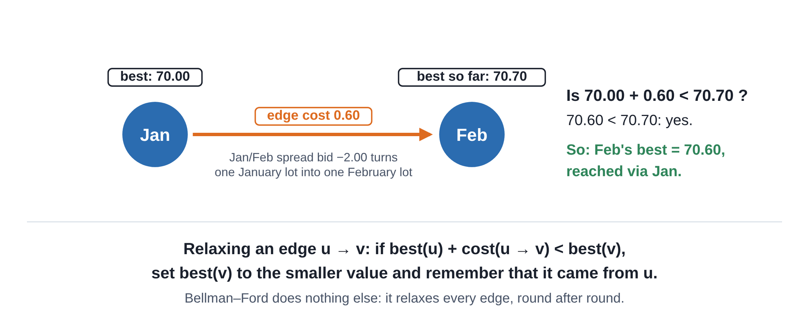

| Round (max orders) | Jan | Feb | Mar | What changed |
|---|---|---|---|---|
| 0 | — | — | — | Start: only $ is reachable, at cost 0. |
| 1 (generation 0) | 70.00 | 70.70 | 71.20 | Each month via its own real ask. |
| 2 (generation ≤ 1) | 70.00 | **70.60** | **71.10** | Feb: 70.00 + 0.60 = 70.60 beats 70.70. Mar: candidates 71.20 (real), 70.70 + 0.45 = 71.15 (via real Feb), 70.00 + 1.10 = 71.10 (via Jan/Mar spread); best 71.10. |
| 3 (generation ≤ 2) | 70.00 | 70.60 | **71.05** | Mar: 70.60 (round-2 Feb) + 0.45 = 71.05 beats 71.10. |
| 4 | 70.00 | 70.60 | 71.05 | No change: stop. |

The same four rounds as pictures:


Read the answer from the table. The best March ask is **71.05**, reached by the route $ → Jan → Feb → Mar (January ask, Jan/Feb bid, Feb/Mar bid): a generation-2 implied quote, 0.15 better than the real March ask. Two observations:

1. **The depth limit is just the number of rounds.** A generation-1 engine stops after round 2 and publishes 71.10; a generation-2 engine runs one more round and finds 71.05. That is how an exchange's "maximum generation" setting turns into code.
2. **The search is cheap; this is the good news.** Each round touches every edge once, and the number of rounds is at most the number of months. Finding the best price never required listing routes one by one. The trouble, as the next section shows, starts with everything the exchange must do *besides* finding this one number: here, for instance, the engine must also know that the 71.05 route and the 71.10 route both depend on the same January ask, so they cannot both be sold in full.

!!! info "Bellman–Ford in brief"

    **Origin.** Lester Ford (1956) and Richard Bellman (1958) published the algorithm independently, and Edward Moore found it at about the same time, so it is sometimes called Bellman–Ford–Moore. It solves the *single-source shortest-path* problem: the cheapest route from one starting node to every other node of a graph.

    **The idea.** Give the source cost 0 and every other node "unknown". Relax every edge, then do it again, round after round. After round *k*, every node's cost is at least as good as the cheapest route of at most *k* edges. A route that never visits a node twice has at most V − 1 edges in a graph of V nodes, so V − 1 rounds always suffice: 12 rounds for the 13-node strip graph.

    **Why not Dijkstra?** Dijkstra's algorithm (1959) is faster and better known, but it requires every edge cost to be zero or more. Implied-pricing graphs contain negative costs: every bid edge into $ has cost −P (the bidder pays *you*), and so does a spread bid at a positive price. Bellman–Ford handles negative costs correctly.

    **Negative cycles are crossed markets.** If the costs around a cycle sum to less than zero, every extra lap makes the route cheaper, so the costs never settle. Bellman–Ford detects this with one extra round: if anything still improves in round V, such a cycle exists. In this chapter's terms that is a cycle of positive weight, a crossed family of books. The classic textbook use is the same problem in another market: finding a currency arbitrage, a loop of exchange rates that ends with more money than it started with.

    **Generation limits come almost free.** The textbook version updates costs in place, so a single round can chain several improvements and finish early. To enforce a generation limit, each round must read only the *previous* round's costs, as in the table above. Then round *k* really means "at most *k* real orders", and an engine with maximum generation *g* simply stops after *g* + 1 rounds. Because the engine never leaves a crossed cycle within its own depth at rest, the best route within the limit never needs to visit a month twice, so what the search finds is always a valid construction.

    **One search per starting node.** A search from $ prices the best ask in every outright book at once: a route $ → x means "short x". Bids and spreads need routes that *start* at a month (x → $ is a bid for x; x → y is a bid for the x/y spread), so the engine also searches once from each month: 13 searches in all, which together price both sides of all 78 books.

    **Cost.** Only the best order on each side of each book can lie on a best route, so the full 12-month strip has at most 2 × 78 = 156 edges. One search is at most 12 × 156 = 1,872 additions and comparisons, and all 13 together fewer than 25,000. That is very little work for a modern processor, which is why the best price is not where the wall stands. It is not free, though. The previous chapter's benchmark spent about 9 ns on each first-generation `pair()` computation. Even at a few nanoseconds per step, running all 13 searches from scratch after every event would take tens of microseconds, roughly ten times what first-generation recalculation costs. That is still affordable, and it grows only polynomially with the strip. The explosive costs are elsewhere.

This is a genuinely useful result, and it matches what at least one exchange advertises: ICE states that its engine "will determine the best bid and offer price in each market regardless of the number of generations required", within a given strip type [ICE, *ICE Futures Implied Prices* FAQ]. For the *best price* in a world of simple two-legged calendar spreads, the number of generations is not the problem.

So where is the wall?

### The Combinatorial Wall

The best price is one number per book side. An exchange needs a great deal more than that, and each additional requirement is where the growth hides.

#### 1. The number of routes grows factorially

Start small enough to count by hand. With three months (January, February, March) and every spread listed, the routes from $ to March are:

- **Generation 0:** $ → Mar, the real March ask. 1 route.
- **Generation 1:** $ → Jan → Mar and $ → Feb → Mar. 2 routes.
- **Generation 2:** $ → Jan → Feb → Mar and $ → Feb → Jan → Mar. 2 routes.

That makes five routes in all. Each route picks some of the other months and an *order* in which to visit them, and the number of such choices is what grows. (Exercise E9 asks you to repeat the count for four months.)

Now scale up to a model strip of **M = 12** consecutive monthly contracts, with every outright and every calendar spread between any two months listed: 12 outright books plus 12 × 11 / 2 = 66 spread books. (Real venues list fewer spreads, but many list a lot of them.) In the graph that is 13 nodes (12 months plus $), every pair joined by orders on both sides.

How many distinct *routes* (simple paths) lead from $ to, say, the December node, i.e. how many different constructions could produce an implied December ask? A route with L real orders visits L − 1 intermediate months chosen in order from the 11 others, so there are 11! / (12 − L)! routes of length L. The figure below draws the first four generations for the implied December ask. Each panel's black arrows show one example route. The orange lines show every line that at least one route of that generation uses, darker where more routes share it:

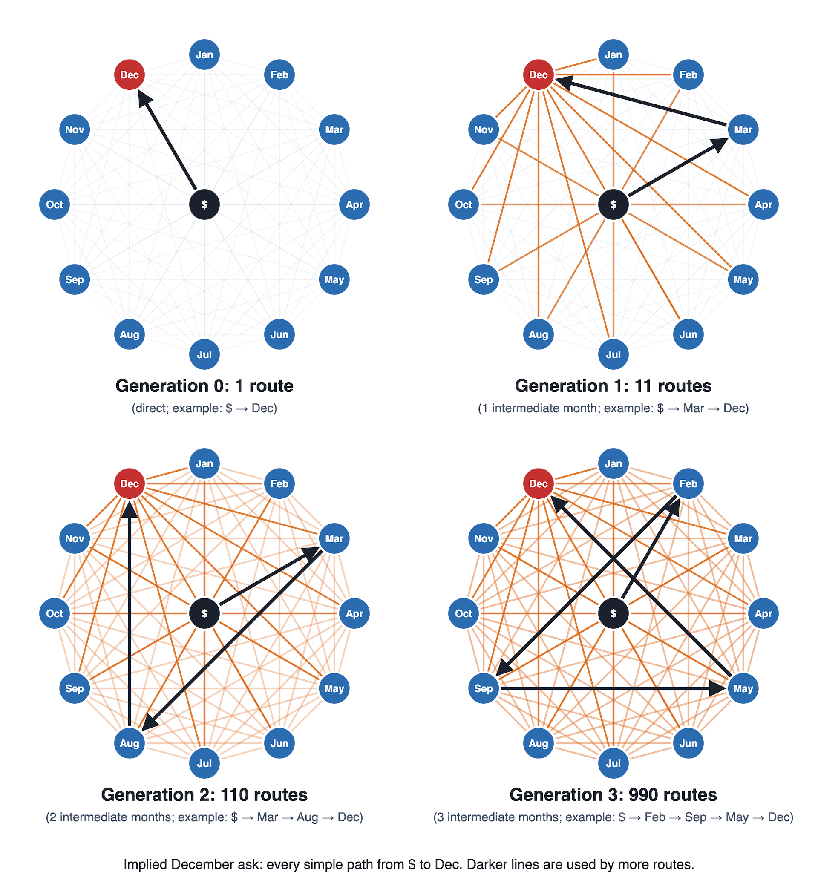

The table counts them all:

| Generation (real orders − 1) | Routes of exactly this length | Cumulative routes up to this generation |
|---|---|---|
| 0 (the real December book) | 1 | 1 |
| 1 | 11 | 12 |
| 2 | 110 | 122 |
| 3 | 990 | 1,112 |
| 4 | 7,920 | 9,032 |
| 5 | 55,440 | 64,472 |
| 11 (no limit) | 39,916,800 | 108,505,112 |

On a logarithmic scale, where each gridline is ten times the one below, the cumulative count looks like this:

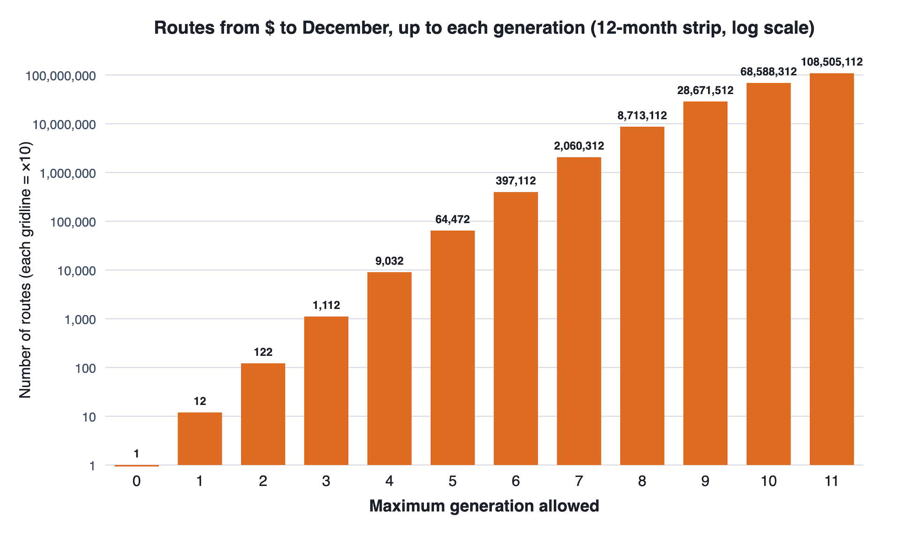

That is for **one** side of **one** of 78 books, with a single price level per book. Every additional resting price level multiplies the possibilities further. A best-price search avoids enumerating these routes, but several of the exchange's other obligations do not.

#### 2. Fair allocation needs the ties, not just the best

When several constructions offer the same implied price, the engine must decide which real orders trade, in a documented and deterministic order. CME sorts competing implied sources by strategy type, product code, leg expirations, number of legs, and instrument identifiers [CME, *Futures Implied Order Matching Priority*]. A shortest-path algorithm returns *a* best path. Fair allocation needs *all* the best paths, ranked, and the number of equal-price paths can be as large as the route counts above.

#### 3. Quantity and depth turn a path problem into a flow problem

The previous chapter showed that quantity is a bottleneck (the smallest ingredient) and that shared orders cap the total. Across many routes that share many orders, "how much can trade at this price, and at the next price, and the next?" is a **minimum-cost flow** problem: route as many lots as possible through the graph, cheapest routes first, never exceeding any order's size. Picture each order as a pipe that can carry at most as many lots as the order's size, and charges a price per lot. The question is how much can flow from one end of the network to the other, and at what prices, when many routes share the same pipes. That is still polynomial in theory, but it is far heavier than one shortest-path search, and it must be redone after every event because every fill and cancel changes the capacities. The previous chapter's warning about naive depth (a fictitious $77.02 level) applies with far more force when routes can be several orders long and share orders in the middle.

#### 4. Every event can change every book

With implication depth unlimited, a single cancel of a single order in the middle of the strip can change the best implied price in *every* book whose best route passed through it: potentially all 78 books, both sides. Each change is a market-data message. The previous chapter's "fan-out" becomes a flood, and it hits hardest precisely when markets are busiest.

Even the tiny ICE example shows the effect. Suppose Trader Q cancels the October ask, one order in one book. A generation-2 engine must, in the same event, update four books:

| Book | Before Q's cancel | After | Why |
|---|---|---|---|
| October | ask 76.83 × 8 (real) | empty | Q's own order is gone. |
| Sep/Oct spread | implied bid −0.93 × 8 | empty | It was built from P + **Q**. |
| November | implied ask 77.35 × 5 | empty | It was built from **Q** + R. |
| Sep/Nov spread | implied bid −1.45 × 5 | empty | It was built from P + **Q** + R. |

One cancel, four market-data updates. A generation-1 engine would have had three (it never published the Sep/Nov quote). Now scale up: in a 12-month strip with generation 2 enabled, an order in a middle month can sit inside routes to dozens of books, and every one of them must be recomputed and republished before the engine processes the next event. That recomputation sits on the critical path of every order, cancel and fill in the group. The previous chapter measured the starting point: at generation 1, one outright change dirties 22 quotes with 11 routes each, and recalculating them took about 1.2 µs. At generation 2 the dirty set can reach all 156 book sides, and an outright book side has 121 implied routes instead of 11.

In the fully connected 12-month strip, the ripple goes further than "dozens". Take a single June ask and ask which books *could* have a quote that depends on it:

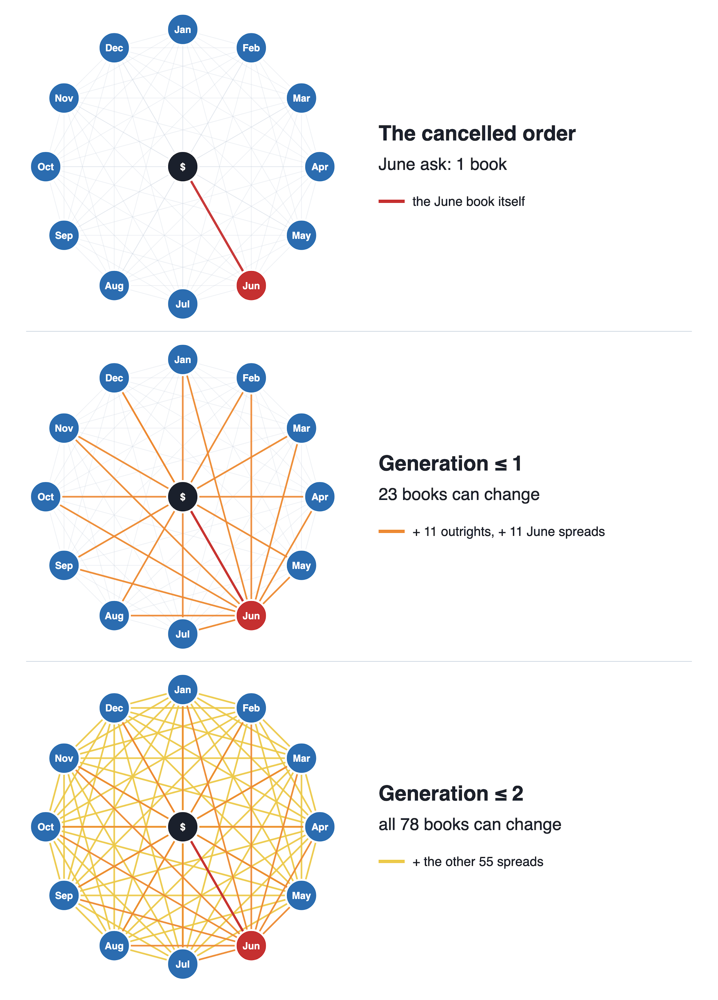

- **Generation 0:** only the June book itself.
- **Generation ≤ 1:** add one other real order to the June ask. A spread order with June as one leg turns it into an implied ask in another month (11 outright books). A bid in another month turns it into an implied spread quote against June (11 spread books). Total 1 + 11 + 11 = **23 books**.
- **Generation ≤ 2:** add two other real orders. A bid in month X, the June ask, and a spread order joining June to month Y form an implied X/Y spread quote, for *any* two months other than June. That reaches the remaining 55 spread books: **all 78 books**.

Not every one of those quotes will change on a given cancel, only those whose best route actually ran through the June ask. But the engine cannot know which ones those are without checking, and with generation 2 enabled it must check all of them.

#### 5. Atomic execution grows with the chain

A generation-*k* trade commits *k* + 1 real orders plus the incoming one, in *k* + 1 or more books, as one indivisible unit. Every leg must pass validation (price limits, tick grid, risk checks, self-match prevention) before anything commits; every internal leg with no real outright price must have its price manufactured; and every participant must receive a correct execution report. The longer the chain, the larger the unit that can fail, and one failed leg voids the whole trade.

#### 6. Multi-legged strategies leave the world of paths

Everything so far assumed two-legged instruments: edges connect exactly two nodes. Real venues also list **butterflies** (buy 1 near, sell 2 middle, buy 1 far: CME launched implied IN *and* implied OUT functionality for Eurodollar butterflies in 2004, describing the new implied OUT functionality as "an industry first", and covered only the first three years of the Eurodollar curve [CME press release, 18 October 2004]), **condors**, **packs and bundles** (a strip of four or more consecutive contracts traded as one), and **ratio inter-commodity spreads** (for example, CME Treasury spreads in which legs trade in ratios such as 3:2, where implied prices can even fall on a grid finer than the direct spread's ticks [Carruthers, 2018]).

A butterfly's vector has entries (+1, −2, +1). It is not an edge between two nodes; it touches three at once, with a weight of 2 in the middle. In graph language it is a **hyperedge**: an edge that touches three or more nodes at once. Finding a set of resting orders whose vectors, with integer multiplicities, sum exactly to a target vector is no longer a path problem. In general it is an **integer programming** problem (roughly: choose a whole number of each order so that everything adds up exactly, like paying an exact amount using coins of awkward sizes), a class for which no efficient general algorithm is known, and whose best-known methods can take exponential time in the worst case. An exchange cannot afford "exponential in the worst case" inside a matching loop that must answer in microseconds, deterministically, after every event.

#### 7. The benefit shrinks while the cost explodes

Remember the promise: implication creates no liquidity. Each extra generation adds only more *routes* to the same real orders. A generation-5 route is bottlenecked by the smallest of six real orders and is usually beaten on price by a shorter one, because every extra link adds another bid-ask spread to cross (the previous chapter's Exercise E1 showed that a single implied calendar spread already costs both outright bid-ask spreads). The marginal value of the sixth link is small; its marginal cost, in latency, fan-out, and failure modes, is large.

### How Real Venues Draw the Line

Every venue that offers implied matching restricts it along one or more of four axes. The examples below are all from the venues' own documentation.

**Limit the number of generations.** CME's implied options functionality is limited to generation 1: "all implied options orders must be built directly from customer orders; implied orders cannot be used to create another implied order (second generation implied)" [CME Group Client Systems Wiki, *Implied Options*].

**Limit the set of instruments.** CME's 2004 implied butterfly functionality covered only the first three years of the Eurodollar curve [CME, 18 October 2004]. ICE implies prices "regardless of the number of generations", but only within a given strip type (month, quarter, season or calendar) [ICE, *ICE Futures Implied Prices* FAQ]. Restricting the instrument set shrinks M, and the route counts in the table above shrink factorially with it.

**Limit what is published.** CME's MDP 3.0 feed carries only a "2-deep best bid and ask" for each implied-eligible futures contract [CME, *MDP 3.0 – Implied Book*]. Two levels of implied depth are cheap to compute and difficult to get wrong; forty would be neither.

**Limit when it runs.** CME implied options are "available *on demand* for a configurable time interval": implication for an options instrument is switched on by a request for quote and switched off again when the timer expires, with "no extension to the specified time under any circumstances" [CME, *Implied Options*]. The engine pays the cost of implication only when a participant has asked for a price, and only briefly.

Two further practical restrictions appear in venue documentation. On some products, implied prices are rounded outwards to whole ticks and direct liquidity at the rounded price keeps priority, so an implied price must be at least a whole tick better than the direct market before implied liquidity is reached first (Carruthers documents this for CME Treasury inter-commodity spreads). And all instruments in the group must be in an open trading state for implication to run at all (CME, *Implied Options*); CME also suspends implied calculation if implication would produce a trade outside price limits [Wilson, CME Group, *Liquidity in implied inter-commodity spread markets*, 2024].

### What This Means When You Build One

If you are designing an implied-capable engine, the lesson is not "implement Bellman–Ford and you are done". It is:

1. **Make the implication depth an explicit, per-product configuration value**, defaulting to 1, and give every increase a measured latency budget. Depth is a product decision with an engineering price tag, not a free feature.
2. **Bound the instrument graph.** Decide which spreads participate in implication and keep the group small enough to live on one sequencing thread, so that atomicity comes from serialisation rather than from a distributed commit protocol.
3. **Compute what you publish, and publish little.** Top-of-book or two levels of implied depth, recomputed after every event, beats a deep ladder that is expensive, path-dependent, and occasionally fictitious.
4. **Keep two-legged and multi-legged implication separate.** Paths are tractable; hyperedges (edges that touch three or more nodes at once, like the butterfly) are not. Support butterflies and packs only through explicitly enumerated, fixed construction templates, never through a general search.
5. **Reuse the invariants from the previous chapter unchanged.** Conservation, firmness, grid consistency, no cross-book crossing, removal, and limits respected are all statements about *sets of real orders*, so they hold for generation 5 exactly as for generation 1. A property-based test that checks them after every event is the only practical way to trust a multi-generation engine.

> **Key idea:** Chains of implied orders are sums of real orders, just like single implied orders, so they create no liquidity, only more routes to it. Finding the single best price through chains of simple calendar spreads is a tractable shortest-path problem. But fair allocation among equal prices, quantity and depth, market-data fan-out, atomic execution, manufactured leg prices, and multi-legged strategies all grow explosively with the number of links allowed. That is why every venue bounds implication, by generation, by instrument set, by published depth, or by time, and why a well-designed engine makes that bound an explicit, measured configuration choice.

### Self-Check Exercises

*Convention: spread price = near − far; all spreads are calendar spreads of one lot per leg.*

**E1.** Real orders: March bid 80.10 × 6; March/April spread ask −0.40 × 9; April/May spread ask −0.35 × 4. What is the best implied May quote, which side is it on, what generation is it, and what quantity?

**E2.** Using the edge-weight rules of the graph view, write down the weights of: a June ask at 81.00; a June/July spread bid at −0.30; a July bid at 81.25. Is there a cycle among these three orders, and if so, is the family of books crossed?

**E3.** In the ICE example, suppose Trader R's Oct/Nov bid is cancelled. Which of the three implied quotes survive?

**E4.** Using the route table, how many routes of generation 2 or less lead from $ to one month in a fully connected strip of M = 12 months? If an exchange restricts implication to adjacent-month spreads only (Jan/Feb, Feb/Mar, … , Nov/Dec), how many routes lead from $ to December, and why?

**E5.** Real orders in a January–March strip: January ask 70.00 × 10 (Trader A); Jan/Feb spread bid −0.60 × 8 (Trader B); Feb/Mar spread bid −0.45 × 6 (Trader C). The February and March outright books are empty. (a) Find the implied March quote, its generation and its quantity. (b) Trader D sends an order to buy 6 March at 71.05. List every participant's fills with leg prices, and check positions and cash. (c) Which implied quotes remain afterwards?

**E6.** Same orders as E5, but every order is now 5 lots, and a fourth order rests: a Jan/Mar spread bid at −1.00 × 5 (Trader E). (a) List both routes to an implied March ask, with price and generation. (b) Build the correct implied March ask ladder. (c) What would a naive engine that prices each route independently publish, and why is it wrong?

**E7.** The only orders are a Feb/Mar spread bid at −0.50 × 10 (Trader F) and a Mar/Apr spread bid at −0.40 × 10 (Trader G). (a) What implied quote exists? (b) Trader H sells 10 Feb/Apr spreads into it. Assign leg prices if the engine's rule anchors March at its reference price of 80.00. (c) Would any of the three traders be better or worse off if the anchor were 85.00 instead?

**E8.** Three spread orders rest: Jan/Feb bid −0.60, Feb/Mar bid −0.45, and Jan/Mar ask −1.00 (all 5 lots). (a) Draw the three edges with weights and evaluate the cycle. Are the books crossed? (b) A new Jan/Mar ask arrives at −1.08 × 5. What happens?

**E9.** A small, fully connected strip has M = 4 months (Jan, Feb, Mar, Apr): 4 outright books and all 6 calendar spreads, each with one resting order on each side. (a) Count the routes from $ to April for each generation by listing them. (b) How many remain if implication is limited to generation 1?

**E10.** Use this convention for a Jan/Feb/Mar **butterfly**: price B = Jan − 2 × Feb + Mar, and buying one butterfly means buying 1 January, selling 2 February and buying 1 March. Resting: Jan/Feb spread bid −0.60 × 8 and Feb/Mar spread ask −0.40 × 5. (a) Which implied butterfly quote do they create, at what price and quantity? (b) Why can a resting butterfly order not be drawn as an edge in the graph view? (c) Does a resting butterfly bid plus a January ask imply anything?

**E11.** Only three spread orders rest, all 10 lots: Mar/Apr bid −2.00, Apr/May bid −2.00, May/Jun bid −1.90. No outright orders rest. (a) What does a first-generation engine with implied IN and OUT only (the previous chapter) publish in the Mar/Jun book? (b) What does an engine that also builds spreads from spreads publish, at generation 1 and at generation 2? (c) If the generation-2 quote trades, which leg prices must be manufactured?

&nbsp;

<div style="page-break-after: always;"></div>

&nbsp;

#### Solutions

**E1.** Chain the orders so that the unwanted legs cancel. The March bid is (Mar +1), weight +80.10. A March/April spread *ask* is a spread seller, (Mar −1, Apr +1), weight +0.40. An April/May spread ask is (Apr −1, May +1), weight +0.35. Sum: (May +1), weight 80.10 + 0.40 + 0.35 = **80.85**. The combination is willing to go long May paying up to 80.85: an implied **May bid at 80.85**. It uses three real orders, so it is **generation 2**, and its quantity is min(6, 9, 4) = **4** lots. (Check in words: someone selling May to this construction delivers May to the Apr/May spread seller, who buys May and sells April 0.35 lower; April goes to the Mar/Apr spread seller, who buys April and sells March 0.40 lower; March goes to the March bidder at 80.10. 80.10 + 0.40 + 0.35 = 80.85.)

**E2.** June ask: edge $ → Jun, weight −81.00. June/July spread bid: edge Jun → Jul, weight −0.30. July bid: edge Jul → $, weight +81.25. They form the cycle $ → Jun → Jul → $, with total weight −81.00 − 0.30 + 81.25 = **−0.05**. The cycle's weight is negative, so the books are **not** crossed. (In prices: the implied July ask from the first two orders is 81.00 + 0.30 = 81.30, which is above the July bid of 81.25: a five-cent-wide, uncrossed market.)

**E3.** The generation-1 Sep/Oct bid at −0.93 survives, because it uses only the September bid and the October ask. The implied November ask at 77.35 disappears, because R's order was one of its two ingredients. The generation-2 Sep/Nov bid at −1.45 disappears too, because it used R's order (through the implied November ask). This is the removal test from the previous chapter, applied to a chain: remove any real order, and every implied quote whose set of real orders contains it must go.

**E4.** From the table: 1 + 11 + 110 = **122** routes. With adjacent-month spreads only, the graph from $ is: $ to every month (the outright books), plus a line Jan – Feb – … – Dec. A simple path from $ to December leaves $ once, enters the line at some month, and walks along the line to December without revisiting a node. It can enter at any of the 12 months, so there are exactly **12** routes: one direct (generation 0) and one for each possible entry month from January to November. Restricting which spreads participate turned a factorial explosion into a straight line, which is exactly why venues restrict the instrument set.

**E5.**

*(a)* Add the vectors, or follow the graph path $ → Jan → Feb → Mar:

```
  Sell Jan at 70.00          v = (Jan −1)              c = −70.00
+ Buy Jan/Feb at −0.60       v = (Jan +1, Feb −1)      c =  −0.60
+ Buy Feb/Mar at −0.45       v = (Feb +1, Mar −1)      c =  −0.45
  ------------------------------------------------------------------
                             v = (Mar −1)              c = −71.05   → March ASK at 71.05
```

January and February cancel, leaving "sell one March, receive 71.05". It uses three real orders, so it is **generation 2**, with quantity min(10, 8, 6) = **6** lots, bottlenecked by C. In words: A sells January at 70.00; B will sell February 0.60 above the January it buys, so at 70.60; C will sell March 0.45 above the February it buys, so at 71.05.

*(b)* All four fills commit atomically:

| Participant | Does | Position change | Leg prices |
|---|---|---|---|
| D (incoming) | buys 6 March | Mar +6 | 71.05 |
| A | sells 6 January | Jan −6 | 70.00 |
| B | buys 6 Jan/Feb at −0.60 | Jan +6, Feb −6 | Jan 70.00, Feb 70.60 |
| C | buys 6 Feb/Mar at −0.45 | Feb +6, Mar −6 | Feb 70.60, Mar 71.05 |

Every leg price is pinned down by A's real January price, so nothing needs to be manufactured. B's legs differ by 70.00 − 70.60 = −0.60 ✓; C's by 70.60 − 71.05 = −0.45 ✓. Positions: January −6 + 6 = 0, February −6 + 6 = 0, March +6 − 6 = 0 ✓. Cash paid per barrel: D +426.30 (6 × 71.05), A −420.00, B 6 × (−0.60) = −3.60, C 6 × (−0.45) = −2.70. Sum: 426.30 − 420.00 − 3.60 − 2.70 = **0** ✓.

*(c)* Afterwards A has 4 lots, B has 2, C has none. The March route needed C, so the implied March ask is gone. But the shorter route $ → Jan → Feb still exists: an implied **February ask** at 70.00 + 0.60 = 70.60, generation 1, quantity min(4, 2) = **2**. Recomputation finds it; decrementing the old March quote never would.

**E6.**

*(a)* Two paths lead from $ to March:

- $ → Jan → Mar (A's January ask, then E's Jan/Mar bid): weight −70.00 − 1.00 = −71.00, so an ask at **71.00**, generation 1.
- $ → Jan → Feb → Mar (A, B, C as in E5): ask at **71.05**, generation 2.

*(b)* Price first: the 71.00 route is better. Its quantity is min(5, 5) = 5, which uses all 5 of A's January lots. The 71.05 route also starts with A's January ask, so after the first level is allocated it has nothing left. The correct ladder is **71.00 × 5**, and nothing more.

*(c)* A naive engine would compute each route's quantity separately, min(5, 5) = 5 and min(5, 5, 5) = 5, and publish 71.00 × 5 **and** 71.05 × 5: ten lots, when the strip contains only five January lots to deliver. This is the shared-leg error of the previous chapter, now hidden inside routes of different lengths. Note also that the shorter route gave the better price, which is typical: each extra link adds another order's price to the chain (point 7 of the combinatorial wall).

**E7.**

*(a)* F's bid is (Feb +1, Mar −1), c = −0.50; G's bid is (Mar +1, Apr −1), c = −0.40. Sum: (Feb +1, Apr −1), c = −0.90: an implied **Feb/Apr spread bid at −0.90** × min(10, 10) = 10. Two real orders, so generation 1, of the spread-from-spreads kind.

*(b)* Only the differences are fixed: Feb − Mar = −0.50 and Mar − Apr = −0.40. With March anchored at 80.00: February = 80.00 − 0.50 = **79.50**, April = 80.00 + 0.40 = **80.40**.

| Participant | Position change | Leg prices | Check |
|---|---|---|---|
| H (sells Feb/Apr at −0.90) | Feb −10, Apr +10 | Feb 79.50, Apr 80.40 | 79.50 − 80.40 = −0.90 ✓ |
| F (buys Feb/Mar at −0.50) | Feb +10, Mar −10 | Feb 79.50, Mar 80.00 | 79.50 − 80.00 = −0.50 ✓ |
| G (buys Mar/Apr at −0.40) | Mar +10, Apr −10 | Mar 80.00, Apr 80.40 | 80.00 − 80.40 = −0.40 ✓ |

The March legs trade between F and G, at a price no order specified.

*(c)* No. With an anchor of 85.00 every leg moves up by 5.00 (Feb 84.50, Mar 85.00, Apr 85.40), but each trader's legs still differ by exactly that trader's spread price, and each trader is long one month and short another by the same quantity, so the 5.00 shift cancels in every trader's profit and loss. The anchor matters to the *systems*, not to the traders' economics: every leg price must be on-tick, inside the month's price limits, and produced by the same deterministic rule in matching, market data and clearing. An anchor far from the market (85.00 when March trades near 80.00) might fall outside the daily price limits and get the whole trade rejected, which is why venues anchor to a recent reference price.

**E8.**

*(a)* Jan/Feb bid: edge Jan → Feb, weight −0.60. Feb/Mar bid: Feb → Mar, weight −0.45. Jan/Mar ask: Mar → Jan, weight −(−1.00) = +1.00. These form the cycle Jan → Feb → Mar → Jan with weight −0.60 − 0.45 + 1.00 = **−0.05**. Negative, so the books are **not crossed**. In prices: the two bids imply a Jan/Mar bid of −0.60 + (−0.45) = −1.05, and the real Jan/Mar ask is −1.00. The bid is below the ask, a market 0.05 wide.

*(b)* The new ask at −1.08 adds the edge Mar → Jan with weight +1.08, and the cycle Jan → Feb → Mar → Jan through it weighs −0.60 − 0.45 + 1.08 = **+0.03**: non-negative, so these orders can trade. The seller is willing to sell at −1.08 or higher; the implied bid of −1.05 is higher (−1.05 > −1.08), so all 5 lots trade at **−1.05**, the resting side's price. The seller does 0.03 × 1,000 = $30 per lot better than its limit. No month has a real outright price here, so the engine must manufacture all three leg prices from its anchor rule (for example February at 70.60 gives January 70.00 and March 71.05; the seller's legs then differ by 70.00 − 71.05 = −1.05 ✓). After the trade both spread bids are used up, so nothing crossed remains: the engine closed the cycle the moment it appeared.

**E9.**

*(a)* A route starts at $, buys into one month through its outright ask, then moves between months through spreads, and ends at April, never revisiting a month. Writing only the months visited:

- **Generation 0** (1 order): Apr. → **1** route.
- **Generation 1** (2 orders): Jan → Apr, Feb → Apr, Mar → Apr. → **3** routes.
- **Generation 2** (3 orders): two intermediate months in order, chosen from Jan, Feb, Mar: Jan → Feb → Apr, Jan → Mar → Apr, Feb → Jan → Apr, Feb → Mar → Apr, Mar → Jan → Apr, Mar → Feb → Apr. → **6** routes.
- **Generation 3** (4 orders): all three intermediate months in some order: 3 × 2 × 1 = **6** routes.

Total: 1 + 3 + 6 + 6 = **16**. The chapter's formula with 3 other months gives the same counts: 3! / (4 − L)! for L = 1, 2, 3, 4 real orders is 1, 3, 6, 6.

Routes like Feb → Jan → Apr look odd (going "backwards" in time) but are perfectly valid: the Feb/Jan step uses a Jan/Feb spread *ask*, which is an edge from Feb to Jan.

*(b)* Generation ≤ 1 keeps 1 + 3 = **4** routes, a quarter of the total. With 4 months the full count is still small; the table in the chapter shows how the same counting reaches tens of millions at 12 months.

**E10.**

*(a)* Jan/Feb bid: (Jan +1, Feb −1), c = −0.60. Feb/Mar ask is a spread *seller*: (Feb −1, Mar +1), c = −(−0.40) = +0.40. Sum: (Jan +1, Feb −2, Mar +1), c = −0.20. That vector is exactly one butterfly *purchase*, so the two orders imply a **butterfly bid at −0.20**, quantity min(8, 5) = **5**. Check with leg prices: anchor February at 70.60; then January = 70.60 − 0.60 = 70.00 and March = 70.60 + 0.40 = 71.00 (from Feb − Mar = −0.40). B = 70.00 − 2 × 70.60 + 71.00 = −0.20 ✓. In words: the butterfly is "Jan/Feb spread minus Feb/Mar spread", so buying it means buying the first spread and selling the second, and its price is S(Jan/Feb) − S(Feb/Mar) = −0.60 − (−0.40) = −0.20.

*(b)* An edge records "long one month, short one month, one lot each". The butterfly is long January, long March, and short *two* February at once: three months, with a 2 in the middle. No single arrow from one node to another can express that. Implying *into* the butterfly from two ordinary spreads (part a) still works, because each ingredient is an ordinary edge. Using a resting butterfly as an *ingredient* is the hard direction: the engine must find other orders whose vectors cancel the right entries in the right multiples, which is the integer-programming search described in point 6.

*(c)* Add the vectors: (Jan +1, Feb −2, Mar +1) + (Jan −1) = (Feb −2, Mar +1). That is "sell two February, buy one March", a 2:1 ratio that matches no listed book, so **nothing** is implied. Compare: butterfly bid + Feb/Mar spread *bid* (Feb +1, Mar −1) gives (Jan +1, Feb −1), a valid Jan/Feb spread. Finding which combinations work requires trying them, and with multi-legged instruments the number of combinations to try is what explodes. That is why point 4 of *What This Means When You Build One* recommends a small set of explicitly listed templates instead of a general search.

**E11.**

*(a)* **Nothing.** Implied IN needs a March order and a June order, and implied OUT needs an outright order plus a spread. No outright orders rest, so none of the previous chapter's six formulas has its ingredients. In particular, the April and May legs of these spreads cannot help: as the previous chapter's March/June example showed, at generation 1 a Mar/Jun quote depends on the March and June books only.

*(b)* Spreads that share a month combine, because that month's legs cancel. At generation 1 (two real orders): Mar/Apr + Apr/May gives a **Mar/May bid at −4.00**, and Apr/May + May/Jun gives an **Apr/Jun bid at −3.90**, each 10 lots. Still nothing in Mar/Jun, which needs all three. At generation 2 (three real orders): (Mar +1, Apr −1) + (Apr +1, May −1) + (May +1, Jun −1) = (Mar +1, Jun −1), paying −2.00 − 2.00 − 1.90 = −5.90: a **Mar/Jun bid at −5.90**, quantity min(10, 10, 10) = 10. The same −5.90 comes from Mar/May (−4.00) plus May/Jun (−1.90), or Mar/Apr (−2.00) plus Apr/Jun (−3.90): the quote belongs to the set of three real orders, not to the order in which they are combined.

*(c)* All four. The seller of Mar/Jun trades March and June, and the April and May legs trade between the spread bidders, but no order states an outright price for any month. The engine anchors one month to a reference price and derives the rest from the spread prices. For example, with March anchored at 76.00: April = 78.00, May = 80.00 and June = 81.90. Each spread's legs then differ by its price, and every derived price must still be on-tick and inside its month's price limits.

## Indexes, The Market's Single Number


Every concept so far has been about a single instrument: one order, one book, one matching engine, one symbol's price. But participants, journalists, regulators, and pension trustees all ask a broader question every day: *how did the market do?* Answering that question with one number is the job of a **market index**.

> **Key idea:** An index is a single number computed from a basket of instruments that summarises the collective movement of a market or a slice of it. It is not itself tradable, it is a *measurement*, but vast sums of real money are invested, settled, and risk-managed against that measurement. Getting it right matters far more than its "just a number" appearance suggests.

### What an Index Is, and Why Exchanges Maintain Them

An index reduces hundreds or thousands of individual prices to one figure that rises and falls with the market it tracks. The S&P 500 summarises 500 large US companies; the FTSE 100 tracks the largest 100 on the London Stock Exchange; the DAX follows 40 major German firms; the Nikkei 225 covers Japan. When the news says "the market was up 1.2% today," it is quoting an index.

Exchanges and specialist index providers maintain indexes for several reasons:

- **A benchmark.** Investors measure their own performance against an index. A fund that returned 8% when its benchmark returned 12% underperformed, even though it made money.
- **A tradable underlying.** You cannot trade the index directly, but you can trade *derivatives* of it: index futures, index options, and exchange-traded funds (ETFs) that hold the basket. These are some of the most heavily traded instruments in the world.
- **A risk-control reference.** As we will see, market-wide safety mechanisms such as circuit breakers are triggered by index moves, not by individual stocks.
- **An economic signal.** Central banks, governments, and businesses watch indexes as a barometer of economic confidence.

A single exchange or index provider typically maintains *many* indexes at once: a broad market index, sector sub-indexes (technology, financials, energy), size-segmented indexes (large-cap, mid-cap, small-cap), and themed indexes. Each is just a different basket and a different set of rules applied to the same underlying prices.

### How Indexes Are Weighted

The central design question for any index is: *when AAPL moves 1% and a small company moves 1%, should they affect the index equally?* The answer is the index's **weighting methodology**, and there are three common approaches.

**Price-weighted.** Each constituent contributes in proportion to its *share price*. The Dow Jones Industrial Average works this way: a $400 stock moves the index four times as much as a $100 stock, regardless of company size. This is a historical accident from the era when adding up prices by hand was the only practical method, and it produces distortions, a stock's influence depends on the arbitrary number of shares it has issued, not on its economic importance.

**Equal-weighted.** Every constituent gets the same weight regardless of size or price. Simple, but it requires constant rebalancing as prices drift apart, and it gives tiny companies the same influence as giants.

**Market-capitalisation-weighted.** Each constituent contributes in proportion to its **market capitalisation**, the total value of its shares. This is how the S&P 500, FTSE 100, DAX, and almost every modern serious index works, and it is the method worth understanding in depth.

#### Market Capitalisation and Normalisation

A company's **market capitalisation** ("market cap") is simply:

```
market cap = share price × shares outstanding
```

A company trading at $200 with one billion shares is worth $200 billion. In a cap-weighted index, that company's influence is its market cap as a fraction of the *total* market cap of all constituents. A $400 billion company in an index whose constituents total $4 trillion drives 10% of the index's movement; a $40 billion company drives 1%. Large companies dominate, which is usually what we want, the index reflects where the market's money actually sits.

But there is a problem. If you just add up the market caps of 500 companies, you get a number in the tens of trillions, an unwieldy figure that means nothing to a human and that jumps every time a company issues shares or is swapped out of the index. The solution is **normalisation against a divisor**.

> **Key idea:** An index level is the aggregate market cap of its constituents divided by a **divisor**, a scaling number chosen so the index reads as a friendly figure (say, 1000 at launch) and, crucially, so the level stays continuous when the basket itself changes.

```
index level = aggregate market cap / divisor
```

At launch, the divisor is set so the index equals its chosen **base value**. If the constituents total $7 trillion and you want the index to start at 1000, you set the divisor to $7 trillion ÷ 1000 = $7 billion. From then on, as prices move, the aggregate cap moves, and dividing by the (mostly fixed) divisor produces the published level.

**A worked example.** Suppose a small index has three constituents:

| Company | Price | Shares outstanding | Market cap |
|---|---|---|---|
| Alpha | $209.50 | 15,000,000,000 | $3,142,500,000,000 |
| Beta | $415.00 | 7,400,000,000 | $3,071,000,000,000 |
| Gamma | $248.00 | 3,200,000,000 | $793,600,000,000 |
| **Total** | | | **$7,007,100,000,000** |

To launch at a base value of 1000:

```
divisor = 7,007,100,000,000 / 1000 = 7,007,100,000
index level = 7,007,100,000,000 / 7,007,100,000 = 1000.00
```

Now if Alpha rises from $209.50 to $230 (up 9.8%), its market cap grows by $20.50 × 15 billion = $307.5 billion, the aggregate cap rises to $7,314,600,000,000, and the index reads 7,314,600,000,000 / 7,007,100,000 ≈ 1043.9, up about 4.4%. Notice that Alpha, the largest constituent, moved the index more than an identical percentage move in tiny Gamma would have. That is cap weighting doing its job.

Most serious indexes refine this further with **free-float adjustment**: instead of *all* shares outstanding, they count only the shares actually available to public trading, excluding blocks held by founders, governments, or strategic owners that never trade. A company that is 60% owned by its founding family has only 40% of its shares influencing supply and demand, so only that 40% should influence the index. The principle is identical; only the share count used in the market-cap formula changes.

### Corporate Actions and the Divisor

Here is where index maintenance becomes genuinely delicate. Companies do things to their share structure that change the raw numbers without changing their economic value, and a naive index would lurch wildly every time.

**Stock splits.** A company does a 2-for-1 split: every share becomes two, and the price halves. A $200 stock becomes a $100 stock with twice as many shares. The market cap is *unchanged*: the company is worth exactly what it was a second earlier. In a cap-weighted index nothing else needs to happen, *provided* the new price and the new share count are switched in at the same moment. If the index plugged in the new $100 price without noticing the doubled share count, it would appear to halve that constituent's contribution, and the index would drop for no real reason. (In a price-weighted index such as the Dow, a split really does change the sum of the prices, so there the divisor must be adjusted.)

**Dividends.** When a company pays a cash dividend, its share price typically drops by roughly the dividend amount on the **ex-dividend date** (from that day, a buyer no longer receives that payout). No value was destroyed, it was handed to shareholders, but the price, and therefore the market cap, falls. Most headline indexes deliberately let ordinary dividends pull the level down: they are **price-return** indexes. Index providers publish a separate **total-return** version that assumes every dividend is reinvested, for anyone who wants to measure the full gain. (Germany's DAX is the famous exception: the headline DAX is itself a total-return, or "performance", index, which is one reason long-run comparisons between the DAX and, say, the S&P 500 can mislead the unwary.) Only *special* dividends (one-off, unusually large payouts) are normally absorbed into the divisor.

**Share issuance, buybacks, mergers, and spin-offs.** Each of these changes the share count or the set of constituents. A company issuing new shares raises its market cap without its price moving. A constituent being acquired must be removed entirely.

> **Key idea:** Whenever a corporate action changes the *aggregate market cap* of the basket for a reason unrelated to genuine price movement, the divisor is adjusted to absorb the change, so the index level does not jump at that instant. Only *future* price movements then change the level.

The mechanism is a simple ratio. If a corporate action changes the aggregate cap from an old value to a new value, the divisor is rescaled by the same ratio:

```
new divisor = old divisor × (new aggregate cap / old aggregate cap)
```

Because the level is `aggregate cap ÷ divisor`, multiplying both the cap *and* the divisor by the same factor leaves the level unchanged at the moment of adjustment. The index glides through the event seamlessly. This is precisely the technique the S&P 500 has used for decades: its divisor is a closely tracked number that changes whenever constituents are added or removed, issue or buy back shares, or pay special dividends [S&P Dow Jones Indices, *Index Mathematics Methodology*].

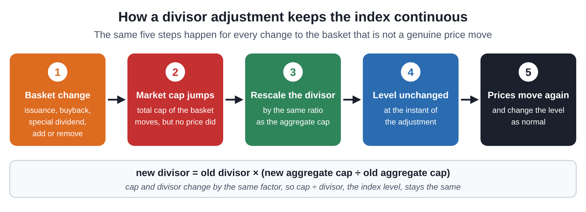

**A worked example.** Continue with the three-company index from above, now standing at 1043.9 after Alpha's rise (aggregate cap $7,314.6 billion, divisor 7,007,100,000). The index committee replaces Gamma (market cap $793.6 billion) with a new company, Delta, worth $1,200 billion. Nothing has happened to any price, but the basket's aggregate cap jumps to 7,314.6 − 793.6 + 1,200 = $7,721.0 billion. Divided by the old divisor that would read 1101.9, a fake 5.6% rise. So the divisor is rescaled:

```
new divisor = 7,007,100,000 × (7,721.0 / 7,314.6) ≈ 7,396,415,265
index level = 7,721,000,000,000 / 7,396,415,265 ≈ 1043.9   (unchanged)
```

From then on, Delta's price moves feed into the index just as Gamma's used to.

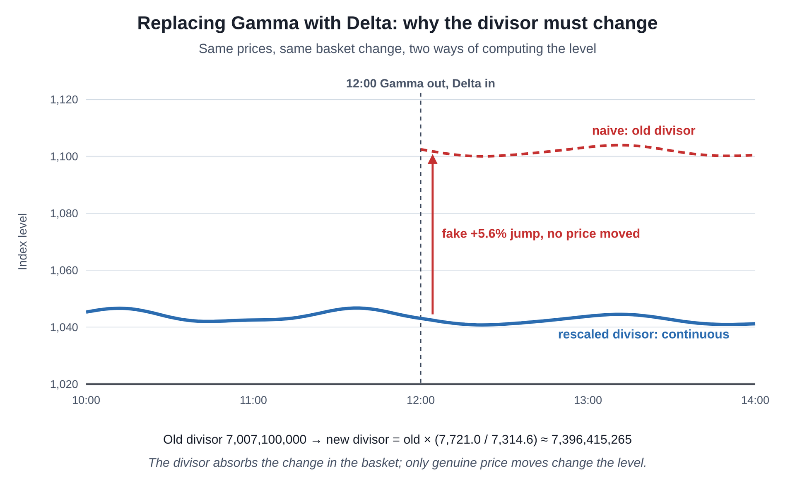

The continuity this provides is not a nicety, it is the whole point. An index is only meaningful if a move from 4000 to 4040 always means "the market rose 1%," never "a constituent happened to split last night."

### Getting Into the Index: The S&P 500 Example

Membership in a major index is coveted, and the criteria are strict. The S&P 500 is instructive because it is *not* purely mechanical, a committee makes the final call, which surprises many people who assume it is simply "the 500 biggest US companies."

To be eligible for the S&P 500, a company must broadly satisfy rules such as [S&P Dow Jones Indices, *U.S. Indices Methodology*]:

- **Domicile.** It must be a US company.
- **Market capitalisation.** It must exceed a minimum threshold that is raised periodically to keep pace with the market (in the billions of dollars, and revised upward over the years).
- **Liquidity.** Its shares must trade actively enough that index funds can buy and sell without distorting the price; there are minimum requirements on float-adjusted value traded.
- **Public float.** A sufficient proportion of its shares must be publicly available for trading, not locked up by insiders.
- **Profitability.** The sum of its most recent four quarters of earnings must be positive, *and* the most recent quarter must be positive. This single rule has kept some very large, fast-growing-but-unprofitable companies out for years.
- **Committee approval.** Even meeting every numeric rule does not guarantee entry. An index committee selects constituents to keep the index representative of the US large-cap economy.

This contrasts with rules-based indexes like the Russell or FTSE families, which reconstitute largely mechanically, on a published schedule, according to published rules. Both philosophies exist; the trade-off is between predictability (rules) and representativeness (committee judgement).

Indexes are **reconstituted** periodically, additions and removals are batched and announced in advance, so that the funds tracking them have time to adjust. And this advance announcement is where the drama begins.

### The Consequences of Being Included

Being added to a major index is one of the most valuable non-operational events that can happen to a public company, because of a structural feature of modern markets: **passive investing**.

Trillions of dollars sit in **index funds** and **ETFs** whose mandate is to hold exactly the index basket, in exactly the index proportions. These funds are not allowed to exercise judgement, when a stock joins the S&P 500, every S&P 500 index fund is *contractually obliged* to buy it, in proportion to its index weight, regardless of price. Collectively that can mean tens of billions of dollars of forced, price-insensitive demand arriving on a known date.

> **Key idea:** Index inclusion converts a stock from something investors *may* buy into something a huge cohort of funds *must* buy. That forced demand, and the front-running of it by other traders, is the **index inclusion effect**.

The textbook illustration is Tesla's addition to the S&P 500 in December 2020. Because of its size, index funds needed to buy on the order of tens of billions of dollars of Tesla stock to mirror the index, and traders who anticipated that demand bought ahead of them. Tesla's share price rose dramatically between the announcement and the actual inclusion date, an enormous move driven substantially by the mechanics of index membership rather than by any change in the company's business that week.

The consequences of inclusion (and its mirror image, *removal*) include:

- **Forced buying or selling** by index funds on the reconstitution date.
- **Anticipatory trading** by others, often pushing the price before the funds even act.
- **A permanently broader shareholder base** and usually improved liquidity and visibility.
- **A lower cost of capital** for the company, since constant index-fund demand supports its share price.
- **Removal pain**, conversely, being dropped from an index forces mass selling and can depress a struggling company further.

This is also why the integrity of index *membership decisions* matters so much: a single inclusion can move billions of dollars, so the rules and the committee must be transparent and free from manipulation.

### Why Correct Index Calculation Is Critical

It is tempting to treat an index as a cosmetic summary. It is anything but. Consider everything that depends, in legally and financially binding ways, on the published number:

- **Derivatives settle against it.** Index futures and index options pay out based on the index level at expiry. If the closing index print is wrong by a fraction of a percent, the settlement payments on billions of dollars of contracts are wrong.
- **ETFs are priced against it.** An ETF's fair value is derived from the basket; errors propagate directly into what investors pay and receive.
- **Performance is judged against it.** Fund manager bonuses, fund inflows, and investor decisions all hinge on the benchmark.
- **Risk controls fire on it.** Market-wide circuit breakers (below) are triggered by index moves.

Because so much rests on it, index calculation must be **deterministic, auditable, and reproducible**. The same inputs must always produce the same output; every divisor adjustment must be recorded so the history can be reconstructed and explained; and the **closing value**, "the print", must be computed with special care, because that is the value that settles derivatives and strikes fund valuations. A calculation error in an index is not a cosmetic blemish; it is a chain reaction that can mis-settle contracts, misprice funds, and trigger or fail to trigger safety mechanisms.

This is exactly why, in real systems, index calculation is kept *separate* from the matching engine. The engine's one job is to match orders deterministically with minimal latency; index calculation involves aggregation, persistence, and historical record-keeping that have no business adding delay to order processing. The index is computed by a dedicated subscriber that *listens* to the trade feed and never interferes with matching.

### What to Watch Out For

Indexes carry a number of subtle hazards that anyone building or relying on them should respect.

**Stale prices.** If a constituent has not traded recently, the index must use its last known price. In a fast-moving or thinly traded market, parts of the index can be "stale," reflecting prices that are minutes old. During stress, this can make the index lag reality.

**The closing auction and "marking the close."** Because the closing print settles so much money, the final minutes of trading attract enormous volume and, occasionally, manipulation attempts, traders pushing a constituent's price at the very close to influence the settlement. Surveillance pays special attention here.

**Reconstitution turbulence.** On the days indexes add and drop members, the forced flows described above create unusual volume and volatility. "Triple witching" days, when index futures, index options, and stock options all expire together, are notorious for this.

**Reflexivity and concentration.** When a huge fraction of investment is passive, the index can start to *drive* the market rather than merely *measure* it. Money flows into index funds, which mechanically buy the largest constituents, which raises their weight, which attracts more flows. The largest few names can come to dominate the index to a degree that worries regulators about concentration risk.

**Survivorship and continuity bias.** Because failing companies are removed and replaced by thriving ones, a long-running index quietly flatters itself, the losers are dropped from the historical record. An index's long-term return is partly an artefact of this constant pruning.

**Free-float and corporate-action edge cases.** Splits with awkward ratios, special dividends, spin-offs that create new entities, rights issues, all are fiddly to handle, and each is an opportunity to introduce a discontinuity if the divisor is adjusted incorrectly.

### Indexes in Risk Control

Finally, indexes are not just measured, they are wired directly into the market's safety machinery. The most important example is the market-wide circuit breaker, which Part III discusses in detail.

**Market-wide circuit breakers** halt trading on *every* US stock exchange at once when the market falls too far, too fast, and in the United States these are triggered by the **S&P 500 index**, not by any single stock. The thresholds are defined as percentage declines from the previous day's closing level [SEC / NYSE / Nasdaq market-wide circuit breaker rules]:

| Level | S&P 500 decline from prior close | Action |
|---|---|---|
| Level 1 | 7% | 15-minute halt (if before 3:25pm) |
| Level 2 | 13% | 15-minute halt (if before 3:25pm) |
| Level 3 | 20% | Trading halted for the remainder of the day |

The logic is the same single-symbol circuit breaker idea you already understand, monitor a reference price, halt when it moves too far, but applied to the *whole market* through its index. The index is the trigger that pauses thousands of individual books at once, giving participants time to absorb information and preventing a cascading crash. (Individual stocks have their own, separate Limit Up-Limit Down protections; the index drives the *market-wide* halt.)

Indexes feed risk control in other ways too:

- **Volatility indexes** such as the VIX are themselves derived from index-option prices and serve as a market-wide "fear gauge" that risk managers and regulators watch closely.
- **Portfolio risk limits** are frequently expressed relative to an index ("our **tracking error**, how far our returns wander from the benchmark's, must stay below 2%").
- **Margin and stress testing** for index derivatives depend on the index level and its volatility.

> **Key idea:** An index is simultaneously a *measurement*, a *tradable reference*, and a *safety trigger*. The same number that tells a journalist "the market is down 2%" can, a few percent lower, automatically halt every order book on the exchange.

### Key Takeaways

- An **index** condenses a basket of instruments into one number; it is a measurement, but enormous sums are invested, settled, and risk-managed against it.
- Modern serious indexes are **market-capitalisation-weighted**, often **free-float adjusted**, so each constituent's influence matches its economic size.
- The index level is the **aggregate market cap divided by a divisor**; the divisor normalises the level to a friendly base value and, when rescaled, keeps the index continuous through changes to the basket.
- **Corporate actions and basket changes** (share issuance, buybacks, special dividends, additions and removals) change the aggregate cap without any price move; the **divisor is adjusted** to absorb them so the level does not jump. Splits need only a consistent price and share-count update, and ordinary dividends are left to pull a price-return index down.
- Major indexes like the **S&P 500** have strict eligibility rules and, in some cases, committee discretion; inclusion is not automatic.
- **Index inclusion** forces passive funds to buy and triggers anticipatory trading, the **index inclusion effect**, with large, real price consequences.
- **Correct, deterministic, auditable** index calculation is critical because derivatives settle on it, funds are priced on it, and risk controls fire on it.
- Watch for **stale prices, closing-print manipulation, reconstitution turbulence, reflexivity, and corporate-action edge cases**.
- Indexes are wired into **risk control**: in the US, **market-wide circuit breakers** halt all trading based on S&P 500 declines of 7%, 13%, and 20%.

## Benchmark Integrity: LIBOR, the FX Fix, and the Anatomy of a Riggable Number


The *Indexes* chapter made a structural argument: because so many instruments and obligations reference a single published number, the integrity of that number is a systemic concern, not a cosmetic one. That chapter mostly treated the failure mode as *accidental*, a stale price, a wrong divisor, a miscalculation propagating downstream. This chapter treats the same structural fact from the other direction. When a widely referenced benchmark is computed from inputs that interested parties can *influence*, the benchmark is not merely fragile, it is **riggable**, and the history of the last two decades contains two enormous, exhaustively documented demonstrations of exactly that: the manipulation of **LIBOR** and the manipulation of the **4pm WM/Reuters foreign-exchange fix**. Together they produced tens of billions of dollars in fines, criminal convictions, the wholesale replacement of one of the most important numbers in finance, and a global re-engineering of how benchmarks are constructed. For anyone building systems that produce or consume reference prices, they are the definitive case studies in benchmark design.

### What Makes a Benchmark Riggable

A benchmark is a number, published on a schedule, that summarises the price of something so that contracts can reference it instead of specifying a price directly. "The interest rate on this loan resets every quarter to three-month LIBOR plus 2%." "This fund is valued at the 4pm London fix." "This structured note pays out based on the closing level of the index." The reference is a convenience of staggering scale: at its peak, LIBOR was referenced by an estimated **$300+ trillion** in financial contracts worldwide, from multi-billion-dollar **interest-rate swaps** (contracts in which two parties exchange fixed interest payments for payments that float with a benchmark such as LIBOR) down to individual adjustable-rate mortgages and student loans.

Three properties, taken together, make a benchmark vulnerable to manipulation. They are worth stating precisely, because a benchmark that avoids all three is very hard to rig, and every reform described later in this chapter is an attack on one of them.

1. **The inputs are submitted or influenceable, not observed from arm's-length transactions.** If the benchmark is computed from numbers that participants *report*, or from a market thin enough that a participant can *move* it with their own trading, then the people who benefit from a particular outcome are, at least partly, the same people who determine the inputs.

2. **The people who set the inputs have positions that the benchmark settles.** Manipulation requires a motive. If a submitting bank also runs a large derivatives book that pays out against the benchmark, every **basis point** (one hundredth of a percentage point, 0.01%) of the published number is worth money to the submitter directly.

3. **The calculation window is narrow and predictable.** If the benchmark is a snapshot taken over a short, known interval, a manipulator knows exactly when to concentrate their influence, and a small amount of activity at the right instant moves the published number by more than the same activity spread across the day would.

LIBOR failed the first two conditions catastrophically. The FX fix failed all three. Neither failure was subtle in retrospect; both were, for years, simply not looked at closely enough.

### Case One: LIBOR, a Benchmark Built on Self-Reported Estimates

**How LIBOR was constructed.** The London Interbank Offered Rate was, in its classic form, not a measurement of transactions at all. Each business day, a panel of major banks was asked a hypothetical question: at what rate could *you* borrow **unsecured** funds (a loan backed by nothing but your promise to repay) from another bank, in a given currency, for a given **tenor** (the length of the loan, such as one week or three months), right now? Each panel bank *submitted an estimate*. The administrator (historically the British Bankers' Association) discarded the highest and lowest quarter of the submissions and averaged the rest, a **trimmed mean**, to produce the day's published rate for each currency and tenor. Rates were published across several currencies and many maturities.

Every one of the three vulnerability conditions was present, and the first two acutely so. The inputs were *self-reported estimates*, not transactions (condition 1, in its strongest possible form, there was frequently no underlying trade to anchor a submission to at all, especially once interbank lending dried up in the crisis). And the submitting banks ran vast derivatives books whose value depended on where LIBOR fixed (condition 2). A trader whose swap position gained value if three-month LIBOR were a basis point higher could, and as the record established, sometimes did, simply ask a colleague on the submissions desk to nudge the estimate.

**The two distinct abuses.** The investigations uncovered two overlapping but separable forms of manipulation:

- **Derivatives-driven skewing.** Traders requested specific submission levels to benefit their own trading positions, sometimes across banks, coordinating so that several panel members skewed the same way and moved the trimmed mean. Internal messages, later quoted in regulatory findings and criminal trials, recorded these requests with damning candour.

- **Crisis-era "lowballing."** During 2007–09, a bank's LIBOR submission was read by the market as a signal of its own creditworthiness: a bank that admitted it could only borrow at a high rate was advertising distress. Several banks submitted artificially *low* rates to appear healthier than they were, distorting the benchmark for reasons of self-preservation rather than trading profit.

**The consequences.** The enforcement wave was among the largest in financial history. **Barclays** was the first to settle, in June 2012, paying roughly **$450 million** across the U.S. CFTC, the U.S. Department of Justice, and the U.K. FSA; the surrounding scandal cost the bank its chairman and chief executive. **UBS** settled in December 2012 for about **$1.5 billion**, and **RBS** in early 2013 for around **$610 million**, both with criminal components attached to subsidiaries. Further settlements followed against other panel banks and interdealer brokers. Aggregate LIBOR-related fines across the industry exceeded **$9 billion**, and several individual traders were criminally convicted and imprisoned. Crucially, the manipulation was possible for years despite the enormous stakes, precisely because no one was checking the submissions against transactions, there were often no transactions to check against.

**The structural fix: replace the benchmark.** LIBOR could not be patched, because its fatal flaw was its foundation, self-reported estimates of an activity (unsecured interbank term lending) that had largely stopped happening. The response was to move the world's benchmarks onto **transaction-based, secured, overnight rates**: rates for one-day loans backed by collateral, computed from observed trades in deep markets. In the United States, the Alternative Reference Rates Committee selected **SOFR** (the Secured Overnight Financing Rate), calculated by the Federal Reserve Bank of New York from actual overnight Treasury **repurchase transactions** ("repo": short-term loans in which US government bonds serve as collateral), more than a trillion dollars of real trades every day, essentially impossible for any single participant to move or misreport. The United Kingdom moved to a reformed **SONIA**; other jurisdictions adopted their own transaction-based overnight rates. Administration of LIBOR itself had already been taken from the BBA and given to a regulated administrator (ICE Benchmark Administration) in 2014, but administration reform was not enough; the number had to be retired. Most USD LIBOR settings ceased to be published after **mid-2023**, ending a benchmark that had underpinned global finance for decades.

The lesson is stated most sharply as a design principle: *a benchmark should be computed from observed transactions in a market too deep for any participant to move, not from the self-interested reports of the parties it enriches.* Every property that made LIBOR riggable is inverted in SOFR.

### Case Two: The 4pm FX Fix, a Benchmark Built on a Narrow Window

If LIBOR is the case study in riggable *inputs*, the WM/Reuters 4pm London fix is the case study in a riggable *window*, condition 3 above, and it shows that even a benchmark computed from *real transactions* can be manipulated if the calculation interval is short and predictable enough.

**How the fix was constructed.** Enormous quantities of foreign exchange, especially the passive, index-tracking flows of pension funds and asset managers, are transacted not at a negotiated price but at a daily **benchmark rate**: the WM/Reuters fix, of which the **4pm London fixing** is the most important. Historically the fix for major currency pairs was computed from actual trades and quotes captured over a short window, on the order of **one minute**, centred on 4:00pm London time. A client who instructed their bank to trade "at the 4pm fix" would receive whatever rate the fix produced, and the bank undertook to fill them at that rate.

Here is the structural problem. The banks knew, in advance, the direction and often the rough size of the client orders they had agreed to fill at the fix, because clients placed those orders ahead of time. That advance knowledge, combined with a one-minute calculation window, created both the motive and the mechanism. A bank sitting on a large "buy euros at the fix" client order could buy euros aggressively *during* the fixing window to push the fix rate up, fill the client at that inflated rate, and pocket the difference between what it paid to accumulate the position and the higher fix at which it sold to the client. The tactic was known, self-descriptively, as **"banging the close."**

**The coordination.** What turned a structural vulnerability into a scandal was collusion. Traders at different banks, holding offsetting or reinforcing fix orders, coordinated in electronic chat rooms, given names by their own participants that read as confessions: **"The Cartel," "The Bandits' Club," "The Mafia."** They shared confidential information about the size and direction of client orders and agreed how to trade the window jointly, so that their combined activity would move the fix reliably in the direction that maximised their collective profit at their own clients' expense.

**The consequences.** In November 2014 a coordinated set of regulators, the U.K. FCA, the U.S. CFTC, the U.S. OCC, and the Swiss FINMA, announced settlements with six major banks totalling roughly **$4.3 billion**, with the FCA's portion (about **£1.1 billion** across five banks) the largest it had ever imposed at that time. Further settlements and, in the United States, criminal pleas followed in 2015, pushing global FX-manipulation penalties well above **$10 billion**. As with LIBOR, individual traders faced prosecution, and the chat-room transcripts became the evidentiary core of the cases, again, an attributed, timestamped audit trail proving intent.

**The structural fix: widen the window and change the incentives.** The FX fix, unlike LIBOR, did not have to be abolished, because it was at least based on real transactions; it had to be made *harder to bang*. Following recommendations from the Financial Stability Board (2014–15), the calculation window for the major fixes was **widened from one minute to five minutes**. The arithmetic of manipulation is unforgiving of this change: moving a five-minute benchmark requires roughly five times the committed capital, and exposes the manipulator to five times the market risk, of moving a one-minute one, for the same effect on the published number. Alongside the wider window came clearer conduct rules separating the handling of client fix orders from proprietary trading, and greater transparency around fixing methodology. The reform is a clean illustration of attacking condition 3 directly: you cannot always change what a benchmark measures, but you can often change *how narrowly in time* it measures it, and a wider window is a structurally more manipulation-resistant one.

### What the Developer Should Take From This

These are conduct-and-regulation stories, but they rest on system-design facts, and the engineering lessons generalise well beyond LIBOR and FX to any system that produces or consumes a reference price, including the closing auction of the *Opening and Closing Auction* chapter and the index calculation of the *Indexes* chapter.

**Prefer observed transactions over reported estimates.** A benchmark anchored to actual, arm's-length trades in a deep market removes the "riggable input" vulnerability at its root. If you are designing a reference price, the first question is whether it can be computed from things that happened rather than things people said.

**Prefer wide, and ideally unpredictable, calculation windows.** The narrower and more predictable the snapshot, the cheaper it is to bang. Volume-weighting over a longer interval raises the capital cost of manipulation in direct proportion. Where a snapshot is unavoidable (an auction *is* a snapshot), the compensating controls are the ones the auction chapter described: imbalance dissemination, offsetting order types, single-price uncrossing, and audit capture.

**Separate the parties who set the inputs from the parties who profit from the output**, or, where you cannot separate them, surveil the boundary relentlessly. The LIBOR submissions desk sitting near the derivatives desk, and the FX fixing desk knowing the client order book, are the same structural conflict that self-match prevention and information-barrier controls exist to police inside an exchange.

**The audit trail is what makes benchmarks enforceable after the fact.** In every one of these cases, the decisive evidence was the timestamped, attributed record, chat logs, submission histories, order timings, that reconstructed intent. This is the same completeness-and-immutability requirement that the *Regulatory Surveillance* and *Determinism, Replay, and Persistence* chapters place on the exchange itself. A benchmark you cannot reconstruct is a benchmark you cannot defend.

> **Key idea:** A benchmark is riggable to the exact extent that interested parties can influence its inputs, hold positions that it settles, and know when its narrow calculation window falls. LIBOR failed on inputs (self-reported estimates by the banks the rate enriched) and was abolished in favour of transaction-based rates like SOFR; the 4pm FX fix failed on its window (one predictable minute, tradeable by banks who knew the client flow) and was hardened by widening the window to five minutes. Both produced fines in the billions and criminal convictions, and both teach the same design rule the *Indexes* chapter began: a number that the whole market leans on must be engineered, measured from deep observed markets, over windows too wide to bang, with the input-setters walled off from the output-beneficiaries, and fully captured in an audit trail, because its importance is precisely what makes it a target.

### References

- U.S. Commodity Futures Trading Commission, U.S. Department of Justice, and U.K. Financial Services Authority: orders and statements of facts in the Barclays LIBOR settlement (June 2012); UBS (December 2012); RBS (February 2013).
- U.K. Financial Conduct Authority, U.S. CFTC, U.S. Office of the Comptroller of the Currency, and Swiss FINMA: final notices and orders in the November 2014 foreign-exchange benchmark settlements; U.S. Department of Justice FX-related guilty pleas (May 2015).
- Financial Stability Board, *Foreign Exchange Benchmarks* (final report, September 2014) and *Reforming Major Interest Rate Benchmarks* (July 2014 and subsequent progress reports), including the recommendation to widen the fix calculation window.
- Martin Wheatley, *The Wheatley Review of LIBOR* (final report, HM Treasury, September 2012), on transferring administration and reforming submission practice.
- Federal Reserve Bank of New York and the Alternative Reference Rates Committee: publications on SOFR and the transition away from USD LIBOR (2017–2023); ICE Benchmark Administration assumption of LIBOR administration (2014); cessation of most USD LIBOR settings (2023).

## Part III: Risk, Compliance, and Post-Trade

*The safeguards that protect markets and participants, before, during, and after each trade, and the regulatory obligations that underpin them.*

---

!!! note "Historic Notes"

    In the last week of February 1995, Peter Baring, chairman of Barings Bank, had to tell the Bank of England that his bank was in trouble. Barings, founded in 1762, Britain's oldest merchant bank and one of the most respected financial institutions in the world, had a problem. One of its traders in Singapore, a 28-year-old named **Nick Leeson**, had accumulated positions in Nikkei 225 futures that nobody at headquarters knew about. The positions totalled approximately $7 billion in notional exposure. Leeson had hidden the losses in an **error account** (an account meant only for correcting small booking mistakes) numbered 88888, exploiting gaps in the firm's controls and the geographic distance between Singapore and London. When the 1995 Kobe earthquake sent Japanese equity markets sharply lower, Leeson's positions collapsed. Barings' total losses were £827 million, more than twice the bank's available capital. On 26 February 1995 the bank was placed in administration, and it was sold to the Dutch bank ING for £1. A bank that had helped finance the Louisiana Purchase in 1803 had ceased to exist as an independent firm [Bank of England Board of Banking Supervision, *Report of the Inquiry into the Circumstances of the Collapse of Barings*, July 1995].

    Barings had risk controls on paper. In practice nobody was checking position limits at the firm level, nobody was watching the error account, and nobody asked why a single trader in Singapore was producing such unusual profits. Worst of all, Leeson ran both the trading desk *and* the back office that recorded and settled his own trades, so the person who should have been checked was also the person doing the checking. The inquiry called this lack of separation a fundamental failure, and "segregation of duties" has been a core principle of trading-firm control ever since.

    Every section of Part III is, in some sense, the answer to the question: "What would have stopped Nick Leeson?" Pre-trade position limits would have flagged his accumulation. A firm-level kill switch, properly monitored, could have halted his trading. A drop copy feed to an independent risk team would have revealed the hidden positions. Regulatory surveillance would have detected the anomalous patterns. And the Knight Capital story at the end of this Part shows that a firm can have many of these controls and still fail, if nobody is able to stop a runaway system for 45 minutes.

---

**Part Summary:**

Focus on market safety and accountability: the controls that prevent bad orders, the mechanisms that stabilize volatility, and the post-trade processes that make executed trades legally and financially final.

**Learning Objectives:**

- Explain why pre-trade controls are separated from matching in production architectures.
- Understand circuit breakers, collars, SMP, and kill switches as layered protections.
- Distinguish routine order-management actions from emergency risk interventions.
- Follow the trade path beyond execution into clearing, settlement, and surveillance.

**Content:**

- Pre-Trade Risk Controls: Before the Matching Engine
- Risk Controls, Protecting the Market
- Self-Match Prevention, When You Would Trade with Yourself
- Drop Copy, The Shadow Record
- Clearing and Settlement, When the Trade Becomes Real
- Trade Busting and Clearly Erroneous Trades
- Regulatory Surveillance, Exchanges Are Not Passive
- A Cautionary Tale, Knight Capital, August 1, 2012


## Pre-Trade Risk Controls: Before the Matching Engine


The matching engine is the heart of the exchange, but many orders never reach it. A layer of **pre-trade risk controls** sits between the participant and the matching engine, rejecting orders that violate size, price, or credit constraints before any matching logic runs. This separation matters architecturally: the matching engine is optimised purely for speed; risk checking is separated so that it can be comprehensive without slowing the core matching path.

### Why a Separate Risk Layer?

A professional trading firm may submit thousands of orders per second. Even a brief software malfunction, a misconfigured algorithm, a bad data feed, a network glitch causing order duplication, can flood the exchange with harmful orders. If each of these reached the matching engine, the damage could propagate to other participants through filled trades that cannot easily be reversed. Pre-trade risk controls are the exchange's first line of defence.

### Common Pre-Trade Checks

**Maximum order quantity.** An order for 1 billion shares is almost certainly an error. Every exchange imposes an upper limit on the quantity of any single order. The limit may be absolute (no order may exceed X shares) or relative (no order may exceed Y% of the recent average daily volume).

**Maximum notional value.** Complementary to quantity limits: the total value of an order (quantity × price) must not exceed a threshold. A limit buy for 1,000 shares at $150.00 has a notional value of $150,000. If the threshold is $10 million, the order passes. If the participant submits 1,000 shares at $15,000 due to a decimal error, the notional is $15 million, rejected.

**Fat-finger price filter.** Orders whose submitted price is far from the current market price are rejected before reaching the matching engine. This catches typographical errors (an extra zero, a misplaced decimal point) before they touch the book. The fat-finger filter is calibrated per instrument based on its typical price range and volatility.

**Position limits and credit limits.** These two controls are frequently grouped together but measure different things and require different data to evaluate.

*Position limits* cap the number of units a participant may hold in a given instrument, long or short. A position limit of 500,000 shares means a participant cannot hold more than 500,000 shares long or be more than 500,000 shares short at any time. Checking a position limit requires knowing the participant's current settled and unsettled position, data fed from the clearing system into the gateway as a continuously updated parameter. They are designed to prevent any single participant from accumulating a position large enough to create settlement or market concentration risk. For example: a participant already long 50,000 shares, with a position limit of 75,000, submits a buy order for 50,000 more; the order would take the position to 100,000, so it is rejected as a position limit breach.

*Credit limits* (also called notional or exposure limits) cap the total financial obligation outstanding at any moment: the **mark-to-market** value of current positions (their value at today's market prices) plus the notional value of all open orders not yet filled. A credit limit of $10 million means the sum of position value plus unfilled order commitments cannot exceed $10 million. Credit limits are harder to check in real time than position limits because they require tracking the full "open order book", every outstanding order submission and cancellation, as well as settled positions. A credit check might reject an order because the notional value of all outstanding orders already exceeds the credit threshold, even if the eventual position itself would be within limits.

**Rate limiting / throttling.** Each participant connection (gateway) is permitted to submit at most N orders per second. If submissions arrive faster than this rate, excess orders are queued or rejected. This protects the exchange from denial-of-service conditions, whether deliberate or accidental.

**Short sale flagging.** In the United States, Regulation SHO (in force since 2005) requires every sell order to be marked "long", "short", or "short exempt", and a short sale to be backed by a **locate** confirming the shares can be borrowed. The division of labour matters for developers. The *broker-dealer* that accepts the client's order is responsible for the locate, and its own pre-trade risk layer checks it; the exchange cannot know who owns what. What the exchange gateway can and must enforce is that the marking field is present and valid, because it drives exchange-side behaviour (for example, the short-sale price test of Rule 201, which restricts short sales in a stock that has already fallen 10% in a day) and is recorded in the audit trail. As described in the short-selling section of *The Language of the Market* in Part I, the locate process itself happens in prime brokerage infrastructure outside the exchange.

**Self-match prevention (SMP).** Detects when an incoming order would match against a resting order from the same participant, a "wash trade." Described fully in the *Self-Match Prevention* chapter of this Part.

### Check Ordering: Fail-Fast by Cost

The sequence in which pre-trade checks run is not arbitrary. Checks requiring external state lookups are more expensive than checks that can be performed on the order message alone. The standard pattern is to fail-fast with the cheapest checks first:

1. **Format and syntax**, Is the message well-formed? Are required fields present and correctly typed? Zero external lookups. Cheapest possible rejection.
2. **Symbol validity**, Is the symbol known, active, and in a session state that accepts orders? Requires only a reference data table lookup.
3. **Rate limiting**, Is this gateway within its message rate allowance? In-memory counter per gateway, no external state.
4. **Fat-finger price check**, Is the submitted price within a configured percentage of the reference price? Requires only a cached reference price per symbol.
5. **Quantity and notional limits**, Does the order exceed size or value thresholds? Requires only the order fields and configured thresholds.
6. **Short sale marking check**, If the order is a sell, is it marked long, short, or short exempt, and does the marking pass any active short-sale restriction?
7. **Position and credit limits**, Would this order breach the participant's position or credit limits? Requires current position data from the clearing system, the most expensive check.
8. **SMP pre-check**, Does an obvious self-match with a resting order exist? (Only a cheap, partial check is possible here, because the gateway does not see the book. The real self-match check runs inside the matching engine's sweep, as the *Self-Match Prevention* chapter explains.)

Failing at step 1 takes nanoseconds. Failing at step 7 takes longer because it requires consulting external state. Running all checks in parallel wastes resources on orders that would be rejected at step 1; running them in this sequence minimises latency for both accepted and rejected orders.


### The Gateway as Risk Layer

In most production architectures, the gateway performs these checks. The gateway is the first system to touch an incoming order; it can reject it immediately without the order ever reaching the matching engine's single-threaded queue. This keeps the matching engine clean and fast.

The consequence for software design: the gateway and the matching engine have different codebases, different deployment configurations, and different update cadences. The gateway can be scaled horizontally (multiple gateway processes); the matching engine is typically single-threaded per symbol.

> **Key idea:** The matching engine is optimised for speed, not safety. Safety is enforced before the order arrives. Developers working on gateway code must treat pre-trade checks as first-class functionality, not as an afterthought.


## Risk Controls, Protecting the Market


An exchange has a duty not just to its participants but to market stability as a whole. The risk controls described in this chapter exist because markets can go very wrong, very fast.

### Circuit Breakers

A **circuit breaker** (also called a **trading curb** in some regulatory contexts) is a mechanism that automatically halts trading when prices move too fast. The name comes from electrical circuit breakers, they "trip" to prevent damage when current (activity) becomes excessive.

**Why they exist:** In modern electronic markets, automated trading algorithms can drive prices far from fundamental value in seconds. The **2010 Flash Crash** saw the Dow Jones Industrial Average fall nearly 1,000 points in minutes before recovering [7]. Circuit breakers prevent such cascades from becoming permanent damage by imposing a mandatory pause during which participants can assess the situation, cancel erroneous orders, re-price their quotes, and allow the market to find equilibrium. A halt that lasts five minutes can prevent a price dislocation that might otherwise take hours or days to unwind.

The origin of circuit breakers is the **Black Monday crash of 19 October 1987**, when the Dow Jones Industrial Average fell 22.6% in a single day. The Presidential Task Force on Market Mechanisms (the Brady Commission) recommended coordinated market-wide pause mechanisms in its January 1988 report, directly leading to the first exchange circuit breakers being implemented. The full history is in the *Black Monday and the Origin of Circuit Breakers* section of Part I.

**The basic mechanism:** After each trade, the exchange calculates how much the price has moved relative to a reference price (typically the most recent auction price, or the price at the start of a defined time window). If the movement exceeds a configured threshold in either direction, trading in that symbol is halted. During the halt, new orders can still be submitted and will rest in the book, but no matching occurs. When the halt ends, trading resumes through a **resumption auction** rather than instantly returning to continuous matching, this ensures that the first post-halt price is determined by the broadest available supply and demand, not by a single resting order that happens to be at the top of a thin book.

The circuit breaker introduces its own small state machine within the trading session, shown in the figure in this section.


Note that this is a sub-machine nested within the full trading session state machine (which is described in Part II). A halt can occur multiple times during a single session; each time the circuit breaker trips in CONTINUOUS, the session cycles through HALTED → RESUMPTION_AUCTION → CONTINUOUS before continuing.

### Should Halt Duration Be Fixed or Proportional to Move Size?

This is a genuine design question, and the answer, confirmed by how major markets actually operate, is that both the trigger thresholds *and* the halt durations should be graduated by severity. The reasoning is straightforward: the purpose of a halt is to allow participants enough time to respond. A 0.5% move may reflect a momentary liquidity gap that resolves in two minutes. A 15% move may reflect genuine macroeconomic news that requires participants to read announcements, consult risk managers, recalculate valuations, and obtain fresh margin collateral, a process that cannot be completed in two minutes no matter how urgently it proceeds.

There is also a clearing-house dimension: a large move triggers margin calls at the CCP. The clearing house must calculate the calls, and participants must fund them. A halt that ends before margin can be collected leaves the clearing house exposed to exactly the counterparty risk that margining is designed to eliminate. Longer halts on larger moves give the clearing infrastructure time to operate correctly.

**The counterargument: predictability has value.** The main argument for a fixed halt duration is that participants value certainty. A fixed 5-minute halt lets every participant set a timer, prepare their re-entry orders, and be ready the instant continuous trading resumes. A variable halt ("somewhere between 5 and 30 minutes depending on severity") creates uncertainty that can itself generate anxiety and cautious behaviour. Some exchanges deliberately publish a fixed duration for this reason, the predictability is considered worth more than the additional precision of proportional calibration.

The practical resolution used by many exchanges is a **minimum halt with conditional extension**: the halt lasts at least the minimum duration, but the resumption auction can be extended in fixed increments (say, 2 minutes at a time) if the indicative uncross price is still far from the reference price when the auction is about to close. This bounds the uncertainty (participants know the halt is at least N minutes) while preventing a forced uncross at a price nobody believes in.

### Tiered Thresholds and Durations: How Major Markets Actually Work

**US market-wide circuit breakers (S&P 500 index)**

The US operates three explicitly tiered halt levels, where the severity of the market drop determines both whether a halt occurs and how long it lasts:

| Level | S&P 500 intraday decline | Halt duration | Notes |
|---|---|---|---|
| **Level 1** | 7% | 15 minutes | Not triggered in last 35 minutes of session |
| **Level 2** | 13% | 15 minutes | Not triggered in last 35 minutes of session |
| **Level 3** | 20% | Remainder of trading day | Triggered at any time; session ends |

Level 3 is effectively infinite for that day: a 20% intraday crash ends all US equity trading. The logic is that such a move cannot be a technical error, it is a market-wide catastrophe requiring the financial system to assess damage, value positions, and meet obligations overnight before resuming trading.

These market-wide halts are rare; Level 1 was triggered four times in March 2020 during the COVID-19 crash. Level 3 has never been triggered under the current rules.

**US single-stock circuit breakers (LULD, Limit Up-Limit Down)**

For individual stocks, the US LULD system takes a complementary approach: rather than varying the halt duration by severity, it varies the *trigger band* by instrument type, acknowledging that normal volatility differs across stocks.

| Tier | Instruments | Band, 9:30am–3:35pm | Band in the last 25 minutes (3:35–4:00pm) |
|---|---|---|---|
| **Tier 1** | S&P 500, Russell 1000, selected ETPs (priced above $3) | ±5% | ±10% (doubled) |
| **Tier 2** | Other NMS stocks (priced above $3) | ±10% | ±10% (not doubled) |
| **Leveraged ETPs** | Band multiplied by the product's leverage factor | Wider, per the plan's rules | Wider still |

(ETPs, exchange-traded products, are the wider family that includes ETFs. Stocks priced at $3 or below have wider bands, which are also doubled near the close. Until February 2020 the bands were doubled in the first fifteen minutes of trading as well, and for every tier near the close; a plan amendment removed both, a reminder that even well-established parameters change and belong in configuration, not code.) The bands are recalculated continuously from a reference price, the average trade price over the preceding five minutes (updated only when it has moved by at least 1%). Trades outside the band are simply not allowed. If the best bid or offer sits exactly at the band (a **limit state**) and does not recover within 15 seconds, a 5-minute trading pause is triggered. The halt duration is fixed at 5 minutes regardless of how far the price moved, but the threshold that triggers the halt reflects the instrument's normal volatility characteristics.

### The 2020 COVID-19 Circuit Breaker Events

The most recent real-world test of the US market-wide circuit breaker system was the four Level 1 halts triggered in March 2020. These remain the only times the modern percentage-based system has halted all US equity trading, and they confirmed both that the mechanism worked as designed and that it had not been calibrated for the specific dynamics of a pandemic-driven crash.

| Date | Trigger time (ET) | Prior S&P 500 close | 7% trigger level (93% of prior close) | Context |
|---|---|---|---|---|
| March 9, 2020 | 9:34 AM | 2,972.37 | 2,764.30 | Saudi–Russia oil price war combined with accelerating COVID-19 spread |
| March 12, 2020 | 9:35 AM | 2,741.38 | 2,549.48 | WHO had declared COVID-19 a pandemic the day before; US announced European travel restrictions |
| March 16, 2020 | 9:30 AM | 2,711.02 | 2,521.25 | Triggered at the opening despite an emergency Fed rate cut the previous evening |
| March 18, 2020 | 12:56 PM | 2,529.19 | 2,352.15 | Intraday halt as liquidity withdrew mid-session |

Each halt lasted the mandatory 15 minutes. Trading resumed through a brief reopening auction each time. The halts functioned as the Brady Commission intended: providing a window for participants to cancel erroneous orders, re-submit with updated prices, and allow the resumption auction to establish a coordinated reopening rather than a scramble into a thin book.

Several operational characteristics of these events are worth noting for exchange system developers:

**Level 2 was not triggered**, even though the Dow Jones Industrial Average fell about 13% on March 16. Two details explain why. First, the market-wide circuit breakers are driven by the **S&P 500**, not the Dow, and the S&P 500 closed down about 12%, never reaching its 13% threshold. Second, every level is measured from the *previous day's close*: the reference does not reset after a Level 1 halt. (Also, a Level 1 or Level 2 halt can occur only once per day; after one Level 1 halt, only a 13% decline can halt trading again that day.) For a developer this is a reminder to implement exactly what the rule says: which index, which reference price, and which percentage.

**Market-wide circuit breakers do not apply before 9:30am.** The March 16 halt triggered at the exact opening bell because the overnight futures market had already been limit-down on CME (CME applies its own limit to equity index futures outside regular hours: 5% at the time, widened since). The circuit breaker mechanism described in this section governs only the regular session. Pre-market and after-hours risk management is handled separately at the futures exchange level.

**Single-stock LULD pauses ran in parallel.** Independently of the four market-wide halts, individual stock LULD pauses were triggered thousands of times throughout March 2020 as individual securities moved outside their instrument-level bands. Market-wide and single-stock circuit breakers are entirely separate systems with different triggers and separate enforcement.


**Eurex and European venues: volatility interruptions**

Eurex uses **volatility interruptions** for individual futures and options products. When the price moves beyond a configured range from the reference price, continuous trading is interrupted and a brief auction is called. The duration is not rigidly fixed: the auction continues until equilibrium is found, with a minimum duration and the ability to extend if the indicative price remains far from the reference. This auction-based resumption (rather than a timed pause followed by immediate continuous trading) means the halt naturally lasts as long as price discovery requires.

**A cautionary counter-example: China's four-day circuit breaker, January 2016**

Every real-world example in this section so far shows circuit breakers working roughly as intended. It is worth pausing on one prominent case where a circuit breaker system made things measurably worse, because it clarifies exactly what careful calibration is protecting against.

On 1 January 2016, China's CSRC introduced a market-wide circuit-breaker system for the CSI 300 index, modelled in broad outline on the US approach described above but with its own thresholds: a 5% decline triggered a 15-minute market-wide halt, and a 7% decline closed the market for the remainder of the day. The system was live for only four trading days. On 4 January 2016, the market fell 5%, triggering the 15-minute halt; trading resumed only to fall through the 7% threshold within minutes, closing the market for the day. On 7 January, the same sequence repeated even faster, the market closed for the day within roughly thirty minutes of the open. The CSRC suspended the entire mechanism after this second event, just four days after introducing it.

The design flaw was the narrow **gap between the two thresholds** (5% and 7%, only two percentage points apart) combined with a **single index-wide trigger for a market with unusually large retail participation**: once the 5% halt was reached, rational participants anticipating that a further, small additional decline would close the market entirely for the day had a strong incentive to sell *immediately* upon resumption, to exit before the second, harsher halt made their positions unsellable until the next session. The circuit breaker, intended to give participants time to calm down and reassess, instead concentrated urgent selling into the narrow reopening window, the opposite of its purpose. This is a direct, real-world confirmation of the design principle raised earlier in this section, that threshold spacing and halt duration must be calibrated together, and it is the reason the wider gaps in the US system (7%, 13% and 20%, with six or seven percentage points between levels) and Japan's continuous-limit approach (below) are not arbitrary choices but responses to exactly this kind of failure mode. [China Securities Regulatory Commission public statements, January 2016; contemporary reporting including *Reuters*, "China scraps circuit breaker after just four days," 7 January 2016.]

**Japan: daily price limits**

JPX (Japan Exchange Group) uses a different paradigm: instead of a halt, the exchange imposes **daily price limits** that prevent the price from moving more than a set percentage from the previous close. If the price hits the limit (up or down), trading can continue at that price but cannot move beyond it. This is a continuous constraint rather than a discrete halt: the market remains open but price movement is bounded. When a stock stays pinned at its limit without trading for consecutive days, the exchange widens the limit. This approach prioritises continuity over interruption.

### Design Implications for Exchange System Developers

A well-designed circuit breaker subsystem is not a single boolean "halt or not halt." It is a configurable, multi-tier system with the following parameters per instrument (or instrument group):

- **Reference price source:** Last auction price? Rolling 5-minute reference? Opening price?
- **Measurement window:** How far back does the comparison look? (Some use the last trade; others use the last 5 minutes of trades to avoid single-trade noise.)
- **Trigger thresholds:** One threshold or multiple tiers (7%, 13%, 20%)?
- **Halt duration per tier:** Fixed time, minimum-plus-extension, or auction-until-equilibrium?
- **Extension condition:** If halt duration is extendable, what is the condition for extension? (Indicative price outside a band? Insufficient volume in the resumption auction?)
- **Maximum halt duration:** Is there a ceiling beyond which the halt automatically transitions to session-end?
- **Day-of-session rules:** Some halts (like US Level 1/2) do not trigger in the last 35 minutes of the session to avoid trapping participants with no time to exit.
- **Resumption mechanism:** Immediate continuous trading or mandatory resumption auction?

All of these should be stored in reference data and readable at runtime without a code deployment. A circuit breaker whose parameters require a software release to adjust is a liability, market conditions and regulatory requirements change, and the ability to tune the parameters independently of the engine is essential operational flexibility.

> **Key idea:** Circuit breakers are not binary on/off switches. They are tiered, configurable risk controls where both the trigger threshold and the halt duration should scale proportionally with the severity of the price movement. A small disruption needs a short pause; a large crash may end the session entirely. The US market-wide circuit breaker system (7%/15min, 13%/15min, 20%/rest-of-day) is the canonical real-world example of this principle in practice.


### Price Collars (Collar Bands)

**Price collars** are price filters that reject individual orders whose submitted price is too far from a reference price. Collars work per order book: each instrument has its own reference prices and its own band widths, read from its reference data, and an order is checked only against the collars of the book it is sent to. A volatile small-cap stock can therefore have much wider bands than a large, liquid one on the same exchange.

There are typically two bands:

**Static collar (fat-finger filter):** Compares the submitted price to the last official close price. If the submitted price is more than X% away from the close, the order is rejected. This catches "fat finger" errors, typing mistakes that accidentally add or remove a zero. A sell order at $15.00 when the stock is trading at $150.00 is almost certainly a typo and should never reach the book.

The term **fat finger** is industry slang for typing errors, accidentally pressing the wrong key. A famous fat-finger incident occurred in 2005 when a Mizuho Securities trader accidentally sold 610,000 shares of a Japanese company at 1 yen each instead of 1 share at 610,000 yen. The resulting chaos cost the firm hundreds of millions of dollars and prompted stricter controls globally. [16]

**Dynamic collar (reference price filter):** Compares the submitted price to the most recent traded price. If the submitted price is more than Y% away from the last trade, the order is rejected. This stops a single order from trading far away from where the market has *just* been trading, even late in a day when the price has legitimately drifted a long way from the close. It cannot stop a slow drift, because each step stays close to the previous trade; capping the total drift over the day is the static collar's job.

The two collars serve different purposes:
- The static collar protects against outright mistakes (orders many times the current price).
- The dynamic collar protects against sudden jumps away from the current market, such as a runaway algorithm sweeping a thin book.


#### Automated Corridor Expansion (ACE)

A corridor is a promise: *this market will not trade outside this band*. On an ordinary day that promise costs nothing. On an extraordinary day it becomes a trap. Suppose a company announces overnight that it has been acquired at a 25% premium. The "right" price really is 25% higher, and a collar of ±10% around yesterday's close now blocks every trade that reflects reality. The venue is left with two bad choices: keep the collar and let nothing trade (the market is effectively closed exactly when participants most need it), or drop the collar and let the first few orders print at whatever price they happen to carry (the collar was there precisely to stop that).

**Automated Corridor Expansion (ACE)** is the family of rules that avoids both. Instead of forcing an immediate yes-or-no decision, the venue *keeps collecting orders* for the affected instrument, repeatedly asks "at what price would these orders trade?", and, if the answer is still outside the band, *widens the band by a predefined step* and asks again. The instrument reopens as soon as the price the orders imply fits inside the (now wider) band. Only that one instrument waits; the rest of the market keeps trading normally.

A note on the name: *Automated Corridor Expansion* is Deutsche Börse's own term. Its Xetra market introduced the "ACE volatility interruption model" on 24 November 2021 for ETFs and other exchange-traded products, whose prices can legitimately jump whenever their underlying markets move, and "corridor" there simply means the price band used during the interruption. Other venues implement the same idea under their own names and parameters (the examples below give several). This book borrows Deutsche Börse's name for the general pattern, and the reference exchange that accompanies this book uses it too.

The Xetra mechanism is publicly described in [Market Model for the Trading Venue Deutsche Börse Xetra](https://www.cashmarket.deutsche-boerse.com/resource/blob/4942824/7f80f5406aab402eb2e5e2436ce0821a/data/T7_Release_14.1_-_Market_Model%20_Xetra.pdf)

**How it works, step by step.** Every ACE design has the same moving parts:

1. **A trigger.** The instrument's price has hit its collar or circuit-breaker threshold, and continuous matching stops *for that instrument*. It enters a **call phase**: orders are accepted and rest in the book, but nothing matches (the same mechanics as the opening auction in Part II).
2. **A latched reference price.** The collar is centred on a reference price captured at the moment of the trigger. It is *latched*, frozen for the duration, so that nothing traded elsewhere can shift the target while participants are responding to it.
3. **A dry-run uncross.** At the end of the call phase, the engine computes the auction equilibrium price (the price that would maximise executable volume) *without executing anything*. This is the **indicative price**.
4. **The decision.** If the indicative price lies inside the collar, the instrument reopens with a normal auction uncross at that price. If it lies outside, the instrument does *not* reopen: the collar is widened by the next step of a published **expansion ladder**, and a new call phase starts. All resting orders stay in the book throughout.
5. **Termination.** Because each step makes the collar wider, it eventually contains any finite price, so the instrument always reopens eventually. Designs differ on what else may end the process: the end of the trading day, a maximum number of steps, or a human decision.

**A worked example.** Take a stock with a reference price of **$100.00**, an initial collar of ±10%, a first widening of 10 percentage points, and later widenings of 20 points each, with 5-minute call phases. A burst of buying after big news produces an indicative price of **$122.00**, which stays put.

| Time | Collar | Indicative price | Inside? | Outcome |
|---|---|---|---|---|
| Trigger (0 min) | $90.00 – $110.00 (±10%) | – | – | Call phase 1 begins |
| End of call 1 (5 min) | $90.00 – $110.00 (±10%) | $122.00 | No | Widen by 10 points, call phase 2 |
| End of call 2 (10 min) | $80.00 – $120.00 (±20%) | $122.00 | No | Widen by 20 points, call phase 3 |
| End of call 3 (15 min) | $60.00 – $140.00 (±40%) | $122.00 | **Yes** | Reopen: uncross at $122.00 |


These are the numbers from the SEC's own illustration of Nasdaq's rule, described below. Notice what the extra ten minutes buy. Every participant can see that the stock is heading for a 22% move and has time to react: sellers who think $122 is too high can enter orders, and if enough of them do, the indicative price falls back and the stock reopens earlier, inside a narrower collar. The expansion does not decide the price; it slows the process down just enough for the market to decide it with everybody watching.

Note also that the widening is **additive on the reference price**: each step adds a percentage of the *original* $100 reference, so the band grows by a fixed number of dollars per step rather than compounding. That keeps the ladder predictable, which is the whole point of publishing it.

**Design choices that differ between venues.**

- **Symmetric or directional.** Nasdaq widens both sides of the collar. NYSE's reopening after a Limit Up-Limit Down pause widens only the side facing the order imbalance: the opposite side stays where it was, since there is no pressure in that direction to accommodate.
- **Step size and interval.** How far to widen and how long each call phase lasts trade speed against safety: big, fast steps reopen quickly but offer less protection; small, slow steps protect but can keep an instrument dark for a long time.
- **Predictable or random end.** If everyone knows the exact moment a call phase ends, the last order to arrive has seen everyone else's and cannot be answered. Many venues therefore end call phases at a random moment after a minimum duration, as Deutsche Börse's Xetra does for its auctions.
- **Automatic or manual last resort.** Some designs never stop widening; others hand the final decision to people. On Xetra, if the potential price lies outside an even wider "extended" price range, the call phase continues until market supervision ends the volatility interruption manually.

**Real-world examples.**

- **NYSE (and the other US primary listing exchanges), 2017.** Since 20 November 2017, when a stock cannot reopen from a Limit Up-Limit Down trading pause inside its auction collar (initially 5% below the auction reference price on the lower side, with the Limit Up-Limit Down upper price band as the upper side), the pause is extended by five minutes and the collar is widened by a further 5% of the reference price, in the direction of the imbalance only, and this repeats until the stock can reopen. With a reference price of $90, each step moves the collar by $4.50 [NYSE, *Enhancement to Reopening Process after LULD Trading Pauses*, 2017].
- **Nasdaq, 2025.** For halts other than LULD pauses (news-pending halts, for example), the SEC approved in February 2025 "Halt Cross" price protections: a reopening must fall within 10% of a reference price; if it cannot, the collar widens by 10% after the first five minutes and by 20% after each subsequent five minutes, exactly as in the worked example above [SEC Release No. 34-102336, 10 February 2025].
- **Xetra (Deutsche Börse).** A volatility interruption extends the auction call phase when the potential price lies outside the static or dynamic price range; the call phase then ends at a random moment after a minimum duration, and an "extended" volatility interruption is ended manually [Deutsche Börse, *Protective Mechanisms in Auctions*].
- **CME agricultural futures.** A simpler, slower cousin: after a contract settles at its daily price limit, the next day's limit is expanded, for example from $0.30 to $0.45 per bushel for corn, so that the market is not locked at the limit day after day [CME Group, *Price Limits*]. No halt is involved at all; the band simply widens for the next session.

**What this means for developers.** ACE turns the collar from a single number into a small state machine: *normal → call phase → (dry-run, widen, call phase)\* → reopen*. The engine needs a dry-run mode of its auction algorithm that computes the indicative price without executing, a latched reference price per instrument, and a ladder read from reference data rather than hardcoded. Every widening must be published to market data and written to the audit trail, because participants need to see the new collar to respond to it and regulators will ask why the instrument reopened when it did. If the end of each call phase is randomised, the random number generator must be treated as an input to the deterministic engine (seeded and recorded), or the replay guarantees of the *Determinism, Replay, and Persistence* chapter are lost. Finally, the ladder needs a defined interaction with the end of the trading day: an instrument still in a call phase at the close must resolve somehow, whether by a forced closing uncross, by rolling its orders into the next session, or by an operator's decision.

> **Key idea:** A fixed collar either blocks a genuine repricing or gives way to an absurd one. Automated Corridor Expansion does neither: it pauses only the affected instrument, keeps collecting orders, and widens the collar in published, predictable steps until the price the orders imply fits, so that large moves are allowed to happen, but slowly enough for the whole market to take part in setting the price.

### Self-Match Prevention (SMP)

A participant should not be able to trade with themselves. If you have a resting sell order at $150.35 and you submit a buy order at $150.40, those orders would match, but both sides belong to you. No real change of ownership has occurred; you have simply generated artificial trading volume. This is called **wash trading** and is illegal under most exchange regulations.

**Self-Match Prevention (SMP)** detects when an incoming order would match against a resting order from the same participant (identified by gateway ID) and applies a policy (the next chapter covers SMP in depth):

- **Cancel Aggressor:** Cancel the incoming order. Your resting order remains. This is a common default, though venues differ (CME's default, for example, cancels the resting order).
- **Cancel Resting:** Cancel the resting order and continue looking for a counterparty. Used when the new order supersedes the old one.
- **Cancel Both:** Cancel both orders. Used when you want a clean slate.

Different strategies suit different circumstances. A market maker who is re-quoting (sending new bids and asks continuously) might prefer Cancel Resting to ensure their latest quote is the active one. A participant who wants to protect their standing orders would choose Cancel Aggressor.

### Kill Switch

A **kill switch** is an emergency control that immediately cancels every resting order and quote associated with a specific participant or gateway connection.

It can be triggered by:
- **The participant themselves:** "Our system is malfunctioning, cancel everything immediately."
- **The exchange:** "This participant's behaviour is disrupting the market; we are cancelling all their orders."
- **Automatic disconnect handling:** If a gateway connection is lost, the exchange may automatically trigger a kill switch to prevent stale orders from sitting in the book without the participant being able to manage them.

After a kill switch, the participant's connection is typically marked as **inactive**. Before they can re-enter orders, they must reconnect and authenticate. This gives a human a chance to assess the situation before resuming trading.

Kill switches are mandatory features under regulations including MiFID II (EU) and the **Market Access Rule (Rule 15c3-5, 2010)** in the United States. As noted in the *How Exchanges Are Regulated* section of Part I, the Market Access Rule, adopted in November 2010 in the year of the Flash Crash, requires broker-dealers to have pre-trade risk controls and post-trade monitoring, including the ability to immediately halt trading. MiFID II additionally mandates that kill switch functionality be **regularly tested**, it is not sufficient to have a kill switch that works only in theory. Every exchange must demonstrate the ability to cancel a participant's orders immediately when required, and must produce evidence of this capability to regulators on request.

### Mass Cancel, Not the Same as a Kill Switch

These two mechanisms are frequently confused because they both result in orders being cancelled. They serve entirely different purposes and have entirely different consequences for the participant.

**Mass cancel** is an order management message, a normal, operational request submitted by the participant themselves to cancel multiple orders at once. It is intentional, deliberate, and routine. Examples:

- "Cancel all my resting orders in AAPL", a trader repositioning ahead of earnings.
- "Cancel all DAY orders across all symbols", an end-of-session cleanup.
- "Cancel all my orders on the bid side", a market maker pausing one side of their quotes while reassessing direction.

After a mass cancel executes, the participant's gateway connection remains **fully active**. The participant can immediately submit new orders. There is no interruption to their session, no authentication required, no human review needed. The mass cancel is simply a fast, convenient way to withdraw multiple resting orders with a single message rather than cancelling each one individually.

A mass cancel generates individual cancellation events for each order in the audit trail, exactly as if the participant had cancelled each order manually. From the exchange's perspective, it is indistinguishable from a burst of individual cancel messages; it just arrives more efficiently.

**The kill switch**, by contrast, is an emergency measure. Its defining characteristics that distinguish it from mass cancel are:

| | Mass Cancel | Kill Switch |
|---|---|---|
| Who initiates | Participant only | Participant, exchange, or auto-triggered |
| Gateway remains active | Yes, participant can send new orders immediately | No, gateway is marked INACTIVE |
| Purpose | Routine order management | Emergency: malfunction, regulatory action, disconnect |
| Reconnect required | No | Yes, human review before resuming |
| Audit log entry | Series of cancel events | GATEWAY_SUSPENDED event + cancel events |
| Can target a subset of orders | Yes (by symbol, side, type) | No, cancels everything for that gateway |
| Used for scheduled cleanup | Yes | No, misusing it would lock out the participant |

A market maker who updates their quotes hundreds of times per second will use mass cancel routinely during the session, for example, withdrawing all quotes when MMP fires, or when they detect a stale data feed. They would never use a kill switch for this; a kill switch would force them to re-authenticate before trading again.

A kill switch is invoked when a system is out of control. A mass cancel is invoked when a system is in control but wants to change its position quickly.

> **Key idea:** Use a kill switch when something has gone wrong and a human must intervene before trading resumes. Use a mass cancel when a participant wants to cancel orders as part of normal operation. The difference is not just functional, it is architectural: the kill switch changes the gateway state; the mass cancel does not.


## Self-Match Prevention, When You Would Trade with Yourself


**Self-match prevention (SMP)** deserves its own treatment because it is one of the most commonly misunderstood features of exchange systems, and because it has both regulatory and operational dimensions.

### The Problem

Imagine a market maker who runs two algorithms simultaneously: one rests bids in the book, the other trades aggressively whenever its model says so. If the first algorithm is bidding $150.30 and the second decides to sell, sending a sell order at $150.30 or lower, the two orders match against each other. No ownership has changed hands; no real trade has occurred. Both sides belong to the same firm.

This is called a **wash trade**. It is problematic for several reasons:

- It generates artificial trading volume, misleading other participants about market activity.
- It creates artificial price pressure (many wash trades in sequence can move a price without genuine supply/demand).
- It is illegal under market manipulation rules in most jurisdictions (for example the EU's Market Abuse Regulation, Section 9(a)(1) of the US Securities Exchange Act for securities, and the Commodity Exchange Act for futures).

### The SMP Mechanism

SMP detects the wash condition and applies one of several policies before any fill occurs:

**Cancel the aggressor** (a common default): The incoming order is cancelled. The resting order remains in the book, available to other participants. Use this when you want to protect your standing quotes from being inadvertently swept by your own algorithms.

**Cancel the resting order**: The resting order is cancelled; the incoming order continues to sweep looking for a different counterparty. Use this when the new order reflects a more current view of value and should supersede the old one.

**Cancel both**: Both the resting and incoming order are cancelled. Use this when you want to eliminate both sides cleanly, for example, when re-positioning and wanting neither order to remain active.

**Allow the match (no SMP)**: Some systems permit self-matching in testing environments or for specific account structures where the "two sides" are legally distinct entities despite sharing a gateway ID. Venues differ in the default: some apply SMP to every order, while others (CME, for example) make it optional and leave it to the participant to tag orders that must never match each other. Defaults for the policy differ too: when a CME participant tags its orders but does not say which side to cancel, Globex cancels the *resting* order.

### How SMP Identifies a Self-Match

How the matching engine identifies orders from the same participant is exchange specific.
Exchanges can identify these traders using one or several of the following mechanisms:

- SMP IDs (Self-Match Prevention Identifiers): Market participants register unique identifiers (called SMP IDs at CME, and self-trade prevention or STP/STPF identifiers at other venues, where STPF stands for "Self-Trade Prevention Functionality") with the exchange. When submitting quotes or orders via APIs like FIX or SBE, the trader tags the message with this ID. The matching engine checks for matching SMP IDs on resting and incoming orders to prevent execution.
- Firm/Trader Identifiers: SMP IDs are often paired with firm-level identifiers (such as a Globex Firm ID or Operator ID) to ensure that the cross-matching is coming from the same organization.
- Account Numbers: In some simplified systems, the clearing account or firm account number is used by the exchange to block two orders from the same overarching entity from crossing.
- Cross-Broker Tagging: Some venues allow a participant to use the same self-match identifier across several executing brokers, so that even if a firm routes orders through different brokers, the exchange still recognises them as the same beneficial trader and prevents self-trading.

#### What is the SBE?

**SBE** stands for *Simple Binary Encoding*. It is a high-performance, non-textual message protocol designed for electronic trading. It was developed by the FIX Trading Community as a faster alternative to traditional text-based protocols.

- **Binary Format:** Unlike standard FIX protocol which sends data as text (e.g., 35=D;49=FIRM), SBE transmits data as raw binary bytes (zeros and ones).
- **Fixed Position:** SBE uses fixed-length fields or highly predictable schemas. The matching engine knows exactly which byte contains the self-match identifier without needing to scan or parse the entire message.
- **Ultra-Low Latency:** Because computers read binary natively, SBE requires almost zero CPU overhead to decode. This allows algorithmic traders to submit orders, complete with their self-match identifiers, in microseconds.

### Why This Matters for Developers

SMP is implemented inside the matching sweep loop, it runs after price compatibility is checked but before any fill is committed. The code path must handle all three cancellation outcomes, generate appropriate event notifications (the cancelled order receives a cancellation event, not a fill), and continue the sweep to look for non-self counterparties if the resting order was cancelled.

> **Key idea:** Wash trading is illegal, and an exchange that facilitates it faces regulatory action. SMP is the tool exchanges give participants to make sure their own orders never trade with each other by accident, so every exchange system must implement it correctly.


## Drop Copy, The Shadow Record

A **drop copy** is a real-time copy of all order lifecycle events for a participant, sent simultaneously to a designated recipient, typically a **clearing broker**, **prime broker**, **risk management system**, or directly to a **regulator**.

The name comes from the physical world: the exchange, or the trader, used to drop a "carbon copy" of each order event to the designated desk as it happened.

### Why Drop Copy Exists

A large institutional investor might have dozens of trading desks, each submitting orders to the exchange through its own gateway. The firm's central risk management system needs to see all order and fill activity in real time to monitor aggregate position and exposure. But having the risk system receive from dozens of separate gateways is complex. Instead, the exchange provides a single drop copy feed that aggregates all activity for that firm, regardless of which gateway originated it.

Clearing brokers use drop copy to see fills on behalf of their clients in real time, so they can begin the clearing and settlement process immediately without waiting for end-of-day reports.

Regulators can mandate drop copy access to monitor for suspicious activity in real time. Under the SEC's 15c3-5 Market Access Rule, broker-dealers are required to have real-time monitoring capabilities; a drop copy feed to an independent risk system is one of the standard ways to satisfy this requirement.

### What a Drop Copy Message Contains

A drop copy event is a complete record of the order lifecycle event. A typical fill notification on the drop copy feed includes:

| Field | Purpose |
|---|---|
| **Sequence number** | Monotonically increasing counter for this feed |
| **Timestamp** | Nanosecond-precision time of the event |
| **Order ID** | The exchange-assigned unique order identifier |
| **Client Order ID** | The participant's own order reference |
| **Gateway ID** | Which connection submitted the order |
| **Symbol** | Which instrument |
| **Side** | BUY or SELL |
| **Order type** | LIMIT, MARKET, etc. |
| **Original quantity** | What the order was for |
| **Filled quantity** | How much filled in this event |
| **Remaining quantity** | What is left after this fill |
| **Fill price** | Price at which this fill occurred |
| **Order status** | NEW / PARTIAL / FILLED / CANCELLED |
| **Aggressor flag** | Was this order the aggressive (taker) side? |

The fill price and aggressor flag are used by the clearing broker to calculate real-time P&L and determine fee billing.

### Drop Copy vs Market Data

Drop copy is a **private** feed, it contains information about a specific participant's orders, which they would not want published to the whole market. Market data (the order book, trades) is **public**, published to all subscribers. Drop copy is delivered on a separate, secured channel, typically authenticated with the participant's credentials.

### Sequence Numbers and Gap Recovery

Each event in the drop copy includes a **sequence number**, a monotonically increasing counter. If the recipient momentarily loses their connection and reconnects, they can request a replay of missed events using the last received sequence number.

Worked example: the clearing broker's risk system receives sequence numbers 1, 2, 3, 4 and then loses connectivity briefly. When it reconnects, it sees sequence number 7 arrive. It immediately knows events 5 and 6 were missed. It sends a retransmission request: "resend from sequence 5." The exchange replays events 5, 6, 7 over a separate unicast channel. The risk system processes them in order and is now fully caught up before sequence 8 arrives.

Without sequence numbers, the risk system would have no reliable way to detect the gap. It might operate with a stale position view, showing a position of, say, 5,000 shares when the true position is 7,000, until the next end-of-day reconciliation. For a real-time risk management system, this is unacceptable.

> **Key idea:** The drop copy sequence number is the risk manager's safety net. A system that processes drop copy events without checking sequence numbers for gaps will eventually make risk decisions based on incorrect positions. Sequence integrity monitoring is not optional.


## Clearing and Settlement, When the Trade Becomes Real


Matching an order creates a **trade agreement**, two parties have committed to exchange shares and money. But the matching is just the beginning. Before ownership actually changes hands, the trade must be **cleared** and **settled**. Many engineers initially believe that matching equals completion. In reality, matching, clearing, and settlement are three distinct processes with different institutions, different timelines, and different risks.

> **Key idea:** Matching creates an agreement. Clearing determines and guarantees obligations. Settlement transfers assets. All three must succeed before the trade is legally complete. Each involves separate systems and separate institutions.

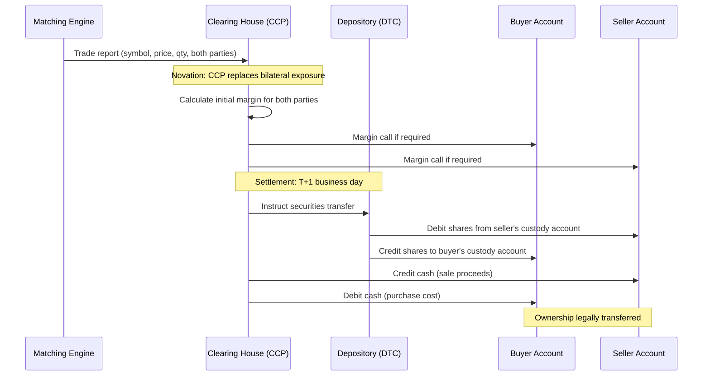

### What Matching Creates

When the matching engine fills two orders, it creates a **trade record**, an agreement that Participant A will sell X shares to Participant B at price P. At this point:
- The shares have not moved.
- The money has not moved.
- The trade is an obligation, not a completed transfer.

Both parties are now **counterparties** to each other. If either defaults, fails to deliver the shares or fails to pay, the other party suffers.

### Clearing: Guaranteeing the Trade

**Clearing** is the process by which a third party, the **Central Counterparty Clearing House (CCP)**, steps between the buyer and seller and guarantees the trade will settle, even if one party defaults.

Through a legal process called **novation**, the CCP becomes:
- The seller to every buyer.
- The buyer to every seller.

After novation, Participant A no longer has a counterparty exposure to Participant B. They have a counterparty exposure only to the CCP. And Participant B has a counterparty exposure only to the CCP. Neither party needs to worry about the other's creditworthiness.


This is transformative for market structure: it means participants can trade with strangers, people they have never met and know nothing about, with confidence that the trade will settle, because the CCP's creditworthiness is the only thing that matters.

**Major CCPs:**
- **OCC (Options Clearing Corporation):** Clears equity options in the US.
- **DTCC (Depository Trust and Clearing Corporation) / NSCC:** Clears most US equity trades.
- **LCH:** Major clearing house in Europe and globally, clearing interest rate swaps, equities, and other products.
- **Eurex Clearing:** Clears Eurex derivatives and selected equity trades.
- **CME Clearing:** Clears futures and options on CME Group exchanges.

### Margin: The Clearing House's Protection

If the CCP guarantees every trade, how does it protect itself from losses if a participant defaults? The answer is **margin**, collateral that participants must post to cover their potential losses.

**Initial margin** is deposited when a position is opened. It represents an estimate of the maximum likely loss over a short period (typically 1–2 days). For a long position in 1,000 shares of a $150 stock, the initial margin might be 10%, meaning $15,000 deposited as collateral before the position can be held overnight.

**Variation margin** (also called **mark-to-market**) is the daily cash settlement of gains and losses. At the end of each trading day, positions are revalued at the current market price. If the price moved against you, cash equal to the loss is transferred from your margin account via the CCP. If it moved in your favour, you receive cash. The key point is that losses are realised in cash *each day* rather than accumulating silently. Worked example: you are long 10,000 shares bought at $150. At day's end the closing price is $145. Your variation margin debit is $5 × 10,000 = **$50,000**, transferred from your account to the CCP. The following day you start with a position valued at $145, not $150. Your total loss can of course keep growing day after day, but the amount the CCP is *owed and has not yet collected* is never larger than one day's move, because every previous day's loss has already been paid in cash.

**Maintenance margin** is the minimum balance that must be maintained. If losses cause the balance to fall below this level, the participant receives a **margin call**, a demand to deposit additional collateral immediately. Failure to meet a margin call results in the position being closed out (liquidated) by the broker or the CCP to recover the deficit.

Margin is especially important for derivatives (futures, options) where positions are leveraged and losses can exceed the initial investment. The most consequential demonstration of what happens when margin requirements are inadequate is the **2008 financial crisis**, and specifically the collapse of **Lehman Brothers** on 15 September 2008.

Lehman filed for bankruptcy with over $600 billion in liabilities [Federal Reserve Bank of New York, 2010]. A large portion of Lehman's derivatives exposure was in **OTC (over-the-counter) derivatives**, bilateral contracts negotiated directly between Lehman and individual counterparties, not cleared through a CCP. These contracts had no daily variation margin settlement, no novation, and no independent collateral calculation. When Lehman defaulted, its counterparties discovered that the bilateral collateral arrangements were insufficient to cover the full exposure. The resulting losses, uncertainty about who held what exposure, and the consequent freeze in credit markets contributed directly to the worst financial crisis since the Great Depression.

The contrast with exchange-traded and CCP-cleared derivatives is direct: CME Clearing required daily mark-to-market variation margin on all futures positions. Because the CCP had collected variation margin every day throughout the life of each position, Lehman's own posted collateral covered the cost of transferring and auctioning off its positions within days, and other clearing members suffered no losses. The same story played out at a far larger scale in London: LCH's SwapClear service had to close out Lehman's interest-rate swap portfolio, some $9 trillion of notional exposure, and did so using only about 35% of the $2 billion of initial margin Lehman had posted [CCP Global, *The Lehman Case*]. The crisis is the strongest argument ever made in favour of mandatory central clearing for derivatives, a principle subsequently enshrined in the Dodd-Frank Act in the US (2010) and the European Market Infrastructure Regulation (EMIR, 2012), both of which require most standardised OTC derivatives to be cleared through authorised CCPs [BIS, 2019].

!!! note "**Historic Note: GameStop and the Margin Call Heard by Everyone, January 2021**"

    The clearest recent illustration that CCP margin is not a paperwork formality, but a real, immediate cash demand, came from an unlikely source: a heavily shorted video-game retailer. In the last week of January 2021, coordinated retail buying (organised substantially through the Reddit community r/WallStreetBets) drove GameStop's share price from under $20 at the start of January to an intraday peak above $480 on 28 January, forcing hedge funds with large short positions to buy back shares at rapidly rising prices to limit their losses (a **short squeeze**), which pushed the price up further still.
    
    The part of the episode most relevant to this chapter happened not on any exchange's matching engine but at the clearing house. As retail brokerages' customer buy orders in GameStop and related stocks surged, the **National Securities Clearing Corporation (NSCC)**, a DTCC subsidiary and the CCP for US equities described earlier in this chapter, recalculated the **initial margin** brokers were required to post against their unsettled customer trades, and, because margin requirements scale with position size and volatility, both of which had exploded, some brokers faced demands for additional collateral reported in the hundreds of millions of dollars, and for the largest of them in the billions, arriving with only hours' notice. One retail brokerage, Robinhood, has stated it received a deposit requirement roughly ten times its normal level overnight. Unable to post the full amount immediately, Robinhood and several other brokers **temporarily restricted customers to selling only**, not buying, GameStop and a handful of other names, for several trading days, a decision that provoked a US congressional hearing and lasting controversy about retail-broker risk management and clearing-house margin methodology.
    
    For exchange and clearing system developers, the episode is the sharpest possible demonstration that the margin mechanics described above are not abstract: variation and initial margin are recalculated continuously against real-time volatility and position size, the resulting demand is due in cash within hours, not days, and a broker unable to meet it has essentially no options that do not involve restricting its own customers' access to the market. It also connects directly to two other threads already in this book: the PFOF and retail-order-flow economics described in the *Smart Order Routing* chapter of Part IV, since payment for order flow is precisely why brokers like Robinhood could offer commission-free trading to the retail participants at the centre of this event, and the borrow-and-locate mechanics of short selling described in Part I, since the underlying trigger was a short squeeze against exactly the hard-to-borrow, heavily-shorted positions that section described. [US House Committee on Financial Services, *Game Stopped: Who Wins and Loses When Short Sellers, Social Media, and Retail Investors Collide*, staff report, June 2021 [20]; DTCC public statements, January 2021.]


### Clearing Members and the Clearing Hierarchy

Not all market participants have direct relationships with the CCP. The clearing infrastructure is organised in layers:

**Direct clearing members** (or **general clearing members**) are firms, typically large banks and broker-dealers, that have a direct legal relationship with the CCP. They post margin directly to the CCP and are responsible for guaranteeing trades cleared in their name. They may also clear trades on behalf of others.

**Non-clearing members** are firms whose trades must be guaranteed by a clearing member. A hedge fund, for example, typically cannot be a direct clearing member of a CCP. Instead, it routes its trades through a **clearing broker** (usually a prime broker who is also a clearing member), who guarantees settlement to the CCP. The hedge fund posts margin to the clearing broker; the clearing broker posts to the CCP.

This hierarchy matters for exchange developers because the clearing system must track not just which firm traded, but which clearing member guarantees each trade. The risk layering determines who bears the loss if a participant defaults. If a client defaults, its own posted margin is used first, and its clearing broker must cover the rest. Only if the clearing member itself defaults does the CCP's **default waterfall** come into play, a fixed order in which resources are used up: first the defaulting member's own margin, then its contribution to the CCP's **default fund** (a pool every clearing member pays into), then a slice of the CCP's own capital (its "skin in the game"), and finally the default-fund contributions of the surviving clearing members. Understanding this chain explains why clearing brokers care so intensely about the credit quality and position size of their clients, and why clearing members watch each other so closely.


!!! note "When the Waterfall Is Used: Einar Aas and Nasdaq Clearing, September 2018"

    Default waterfalls are usually discussed in the abstract. In September 2018 one was used for real, in Stockholm. Einar Aas, an experienced Norwegian power trader who cleared his own trades as a direct member of Nasdaq Clearing, held a large spread position between Nordic and German electricity futures. When the two prices moved sharply apart, he could not meet a margin call on 10 September and was declared in default the next morning. Nasdaq auctioned his portfolio to a handful of other members; the close-out cost €114 million more than all the collateral Aas had posted. The waterfall then ran exactly as drawn above: Nasdaq's own €7 million slice of capital went first, and the remaining €107 million came out of the commodities default fund paid in by the *other* members, roughly two-thirds of the €166 million fund, which those members then had to top up within days. "My position was too big in relation to the market's liquidity," Aas said in a statement. Two lessons stand out. A CCP's margin model must charge extra for *concentration*, because a position that is easy to price can still be impossible to sell quickly. And mutualisation is real: firms that had never traded with Aas, and had no say in his position, paid for most of his loss. <br>&nbsp;<br>

    **References:** Bank for International Settlements, "Two defaults at CCPs, 10 years apart," *BIS Quarterly Review*, December 2018, https://www.bis.org/publ/qtrpdf/r_qt1812x.htm; FIA, "Deconstructing a Default," 27 November 2018.

!!! note "The Panic of 1907 and the Birth of the Lender of Last Resort"

    On 22 October 1907, depositors ran on the Knickerbocker Trust Company in New York after its president was linked to a failed attempt to corner the copper market. The run spread across the trust companies, call-money rates on the NYSE spiked above 100% annualised, and the exchange's president later recounted that the market came within hours of closing outright. There was no central bank; the crisis was contained because J. Pierpont Morgan personally convened the city's bank presidents, famously locking them in his library overnight, and directed pooled liquidity to solvent-but-illiquid institutions, while the US Treasury deposited federal funds with the banks. The near-miss made the structural point unarguable: a financial system without an institutional liquidity backstop depends on the judgement, balance sheet, and mortality of individuals. Congress responded with the Aldrich–Vreeland Act (1908) and the National Monetary Commission, whose work led directly to the Federal Reserve Act of 1913. The margin spirals, circuit breakers, and CCP default waterfalls described in this Part are all, in a sense, institutionalised replacements for Morgan's library.<br>&nbsp;<br>

    **References:** Robert F. Bruner and Sean D. Carr, *The Panic of 1907: Lessons Learned from the Market's Perfect Storm* (Wiley, 2007) ISBN: 978-0470152638


### Delivery versus Payment (DvP)

**Delivery versus payment (DvP)** is the settlement principle that the transfer of securities and the transfer of cash happen simultaneously and conditionally: neither the securities nor the cash are released until both are available. This eliminates the risk of one party delivering while the other fails to pay.

The risk DvP is designed to eliminate has a name in financial history: **Herstatt risk**, after the 1974 failure of Bankhaus Herstatt, a small German bank. On 26 June 1974, German banking regulators withdrew Herstatt's banking licence at 3:30pm local time, after the close of interbank settlement in Germany but while the New York foreign exchange settlement was still open. Herstatt had already received Deutsche Mark payments from its counterparties in Germany but had not yet made the corresponding US dollar payments to banks in New York. Those New York banks had delivered value but received nothing, and the abrupt closure meant they never would. The losses and resulting settlement uncertainty froze parts of the interbank market for days [BIS Committee on Payment and Settlement Systems, 2003]. Herstatt risk, the risk that one leg of a settlement transfers while the other fails, is the foundational motivation for the DvP principle.

Without DvP, a seller might deliver shares and then find the buyer has defaulted before paying. DvP ensures atomicity: either both transfers happen or neither does.

### Settlement: The Actual Transfer

**Settlement** is the final exchange, shares move from the seller's custody account to the buyer's, and cash moves from the buyer's account to the seller's. After settlement, ownership has legally changed.

US equities currently settle on **T+1**, one business day after the trade date. The market previously operated on T+5 (paper certificates and bicycle messengers), then T+3, then T+2 as settlement infrastructure was digitised, and moved to T+1 in 2024 [8]. Some instruments, including many money-market instruments and some US Treasury trades, already settle on the trade date (T+0). Same-day settlement shrinks the window in which a counterparty can fail almost to nothing, but requires that cash and securities be available at the moment of trading.

### Failed Settlement

Not all trades settle on time. A **failed settlement** occurs when one party cannot deliver, the seller lacks the shares (perhaps their own purchase has not yet settled), or the buyer lacks the cash. Failed settlements create a cascading chain of problems, since other participants may be counting on receiving those shares to fulfil their own obligations.

**Buy-ins** are a remedy: if a seller fails to deliver shares, the buyer has the right to purchase the shares in the open market at the seller's expense. Buy-ins are relatively rare in liquid markets but are a meaningful operational risk in illiquid or small-cap stocks.

### Custody and Depositories

**Custody** refers to the safekeeping of securities on behalf of investors. Most investors do not directly hold share certificates, their broker holds shares in a nominee account at a **depository**. The depository maintains the master record of who owns what.

In the US, the **DTCC's Depository Trust Company (DTC)** is the central securities depository, it holds the vast majority of US equity shares. Electronic book-entry transfers between DTC accounts enable settlement without physical movement of certificates.

This dematerialisation (replacing paper certificates with electronic records) is what made T+5→T+3→T+2→T+1 settlement possible. When settlement meant physically moving certificates, five days was genuinely necessary. With electronic records, same-day settlement is technically feasible.

### VWAP and P&L

A clearing system tracks each participant's **position** (how many units they hold, positive for long, negative for short) and their **Profit and Loss (P&L)**.

**VWAP (Volume-Weighted Average Price)** is the average price paid for a position, weighted by quantity filled. If you buy 100 shares at $150 and then 50 more at $160, your VWAP is (100×$150 + 50×$160) / 150 = **$153.33**. Your break-even price is $153.33; selling above this generates profit, selling below generates a loss. Market participants use VWAP both as a benchmark for execution quality (did you beat the average price over the period?) and as the entry price for P&L calculation.

**Unrealised P&L** (also called **open P&L** or **mark-to-market P&L**) is the gain or loss on positions that have not yet been closed. If you hold 150 shares with a VWAP of $153.33 and the current market price is $160, your unrealised P&L is 150 × $160 − $23,000 (what the shares cost you) = $24,000 − $23,000 = **$1,000.00**. (Note that using the *rounded* VWAP, (160 − 153.33) × 150, gives $1,000.50: fifty cents of error created purely by rounding an intermediate value. Real P&L systems keep the exact total cost, or the VWAP at much higher precision, for exactly this reason.) It is "unrealised" because you have not yet sold and may not receive that price. Unrealised P&L is updated continuously as the market price moves.

**Realised P&L** is the gain or loss locked in by completed trades. If you sell all 150 shares at $160, your realised P&L becomes $1,000.00 and the position is closed to zero. Realised P&L does not change after the trade is done; it is a permanent record of what was earned or lost.

For exchange developers, the distinction matters because position monitoring systems must track both: unrealised P&L is what triggers margin calls and risk alerts in real time, while realised P&L is what flows into the official accounting records at end of day.


## Trade Busting and Clearly Erroneous Trades

Every mechanism described so far in this Part, pre-trade risk controls, circuit breakers, price collars, SMP, kill switches, exists to stop a bad trade from happening in the first place. This chapter covers what happens when prevention fails and a bad trade has already executed. The matching engine has already produced a fill, both counterparties have a legally binding trade, and yet the exchange retains a narrow, rules-based power to undo it.

### Why This Power Has to Exist, and Why It Has to Be Narrow

The *Clearing and Settlement* chapter established that a matched trade is an obligation between two counterparties, not yet settled, but real and binding. Undoing a trade after the fact is therefore not a trivial administrative action, it reverses a legal commitment, and if exercised carelessly it would destroy the certainty that makes anyone willing to trade on an exchange in the first place. If trades could be unwound at either party's convenience whenever the price moved against them, the exchange's core promise of a fair, final, and trustworthy market would collapse.

At the same time, electronic markets can produce prices that are obviously not real prices, a market order sweeping an emptied book during a liquidity gap, a fat-finger error that slipped past pre-trade controls, or a software malfunction, and holding participants to those prices as if they reflected genuine supply and demand would be its own kind of unfairness. The resolution every major exchange has converged on is a **clearly erroneous execution (CEE)** rule: a narrowly defined, objectively measured, publicly documented threshold beyond which a trade can be reviewed and, if it qualifies, either adjusted to a different price or cancelled (**busted**) entirely.

### How a Clearly Erroneous Determination Works

The core test is **numerical, not subjective**: how far did the execution price move away from a reference price (typically the last consolidated print before the questionable trade, or the pre-halt reference price during a fast market), expressed as a percentage. US exchanges publish a table of thresholds that widen as the reference price falls and narrow as it rises, reflecting the same logic as tick-size price bands (see the *Tick Sizes and Fractional Ticks* chapter): a given percentage move is far more likely to be a genuine, if sharp, price movement on a low-priced or volatile stock than on a stable, high-priced one.

| Reference price | Regular trading hours | Pre-market and after-hours |
|---|---|---|
| $0.00 – $25.00 | 10% | 20% |
| $25.01 – $50.00 | 5% | 10% |
| Above $50.00 | 3% | 6% |

(These are the US "numerical guidelines" for single stocks [FINRA Rule 11892; the exchanges' parallel clearly-erroneous rules]. For a **multi-stock event**, the thresholds become 10% when 5 to 19 securities are involved and 30% when 20 or more are; leveraged ETFs have their thresholds multiplied by their leverage. Rules are revised from time to time, so always consult the specific venue's current rulebook.)

**A worked example.** A stock's reference price is $150.00, so during regular hours its threshold is 3%. A market sell order sweeps a thin book and executes a slice at $128.00, a (150 − 128) / 150 = 14.7% move: far beyond 3%, so the trade is a candidate for review. A second slice from the same sweep executes at $146.00, a 2.7% move, just inside the 3% threshold, and stands as a valid trade regardless of how the reviewer rules on the $128.00 print. Clearly erroneous review is applied **execution by execution**, not to an entire order or an entire event, which is why a single aggressive order that sweeps through many price levels can have some of its fills busted and others stand.

**The timing window matters as much as the threshold.** A participant (or the exchange itself) must typically file a clearly erroneous request within a short window after the execution, commonly 30 minutes under US rules, precisely because certainty needs to be restored quickly; clearing, margining, and downstream position management (see *Clearing and Settlement*) cannot proceed indefinitely on trades that might still be reversed.

**Multi-stock events require coordination.** Because modern equity markets are fragmented across a dozen or more venues (see the *Smart Order Routing* chapter of Part IV), a single erroneous-price event, a software bug, a bad data feed, a fast market during a broad decline, can generate questionable trades simultaneously across several exchanges in the same symbol. Exchanges coordinate through their self-regulatory functions to reach a single, consistent busting decision across all venues for the same event; it would undermine confidence in the entire market structure if the identical erroneous trade in the identical stock at the identical moment were busted on one exchange and left standing on another.

### Busting vs Adjusting

Two distinct remedies exist once a trade is found clearly erroneous:

**Cancellation (busting).** The trade is voided entirely, as if it never happened. Positions and cash movements are reversed. This is the standard remedy when no reasonable price can be assigned.

**Price adjustment.** Rather than cancelling, the exchange adjusts the trade to a different, non-erroneous price (typically the reference price used in the review, or a price at the edge of the applicable threshold). This preserves the fact that a trade occurred (useful when one party has already acted on the fill, for example, hedged it) while correcting the economically nonsensical part of the print.

### How This Connects to Events Already in This Book

**The 2010 Flash Crash** (see the market-order section of the *Order Types* chapter in Part II) produced the canonical example of both remedies at scale: in the chaotic minutes when the E-mini sell algorithm swept a thinning book, some individual equities briefly traded at $0.01 or as high as $100,000. In the hours that followed, the SEC and the exchanges jointly reviewed the event and **busted trades that were more than 60% away from the pre-crash reference price**, a specific, published, retroactively-applied threshold designed for exactly this kind of extreme, multi-stock, multi-venue event. Positions built on those busted prints were unwound; trades within the 60% band, however uncomfortable, stood.

**Knight Capital** (see the dedicated cautionary tale in this Part) is the instructive negative case. Despite the scale of the disaster, more than 4 million unintended executions, roughly $6.65 billion of unwanted positions, and a loss of over $460 million, almost none of Knight's trades were clearly erroneous in the regulatory sense. Only trades in six stocks, whose prices had been pushed far enough from their reference prices, were busted; the trades in the other 148 stocks stood, because each execution occurred at or near the prevailing market price at the moment it happened. The runaway code was buying at the offer and selling at the bid: real, fair, non-erroneous prices, over and over again. This is precisely the distinction this chapter exists to draw: clearly erroneous review is about whether a *price* was divorced from the market at the moment of execution, not about whether a *participant's overall strategy* made any sense. Knight's trades were all individually "clean"; the catastrophe was in the aggregate, uncontrolled volume, which is exactly why the lesson of that chapter is pre-trade and firm-level risk controls, not post-trade busting. The two mechanisms protect against different failure modes and neither is a substitute for the other.

> **Historic Note: When the Exchange's Own Software Produces the Erroneous Price**
>
> The examples above involve a participant's order producing an erroneous price. Twice in 2012, it was the exchange's own matching software that was at fault, both times during an IPO, the single moment an exchange's opening-auction logic is under the most scrutiny and the least room for error.
>
> On **18 May 2012**, a matching-engine defect in NASDAQ's IPO cross process delayed the opening trade of **Facebook** by roughly 30 minutes and left many participants unable to confirm whether their orders had executed at all for hours afterward. NASDAQ ultimately paid a $10 million SEC penalty, then the largest ever imposed on an exchange, for the design and systems-compliance failures, and separately paid roughly $62 million to compensate member firms for losses caused by the malfunction [SEC Release No. 34-69655, May 2013]. No individual trade was "clearly erroneous" in the price sense described above, the defect was in the auction mechanism itself, not in any single order, which is why NASDAQ's remedy took the form of a regulatory settlement and direct compensation rather than a batch of busted trades.
>
> Eight weeks earlier, on **23 March 2012**, **BATS Global Markets** attempted to list its own shares on its own exchange. A software defect in the BATS matching engine caused BATS stock to collapse from $15.25 to a fraction of a cent within roughly 900 milliseconds of the opening print, and the same underlying bug simultaneously disrupted trading in some unrelated symbols, including briefly affecting Apple shares on BATS. BATS halted trading in its own stock and withdrew the IPO later the same day, cancelling the erroneous prints as part of unwinding the listing entirely. It remains one of the more pointed illustrations in exchange history that a venue's own listing event is not exempt from its own software defects, and that pre-deployment testing (the central theme of the Knight Capital chapter) applies to an exchange's matching engine every bit as much as to a participant's trading algorithm.

> **Key idea:** Pre-trade controls try to stop a bad trade before it happens; clearly erroneous execution rules are the narrow, threshold-based, time-boxed remedy for when one happens anyway. The test is objective (percentage deviation from a reference price, applied trade-by-trade), the window to act is short, and multi-venue events require coordinated, consistent rulings across exchanges. It is not a general-purpose undo button, and, as the Knight Capital case shows, a trade executed at a real market price is not clearly erroneous no matter how disastrous the accumulation of such trades turns out to be for the firm that sent them.

## Regulatory Surveillance, Exchanges Are Not Passive


An exchange does not simply match orders and publish data. It actively monitors for market abuse and is legally required to report suspicious activity to regulators. This chapter introduces the concepts; developers working on exchange infrastructure will eventually need to understand them because audit trail and surveillance requirements shape the design of event logging, data retention, and monitoring systems.

### Types of Market Abuse

**Spoofing.** A participant places a large order with no genuine intention to trade, they want to move the visible order book in a way that influences other participants' decisions. Once the desired movement occurs, they cancel the spoof order before it can fill. Spoofing was used extensively in electronic markets before regulatory crackdowns; it is now explicitly illegal in US futures markets (the Dodd-Frank Act of 2010 wrote a ban on "spoofing" into the Commodity Exchange Act; in securities it is prosecuted under the general anti-manipulation rules) and in the EU (Market Abuse Regulation, 2016).

The most famous spoofing prosecution to date is the case against **Navinder Singh Sarao**, a British trader who operated from his parents' home in suburban London. From 2009 to 2014, Sarao deployed automated software to place large layered sell orders in E-mini S&P 500 futures on CME, orders that were real and visible in the order book but were automatically cancelled before they could fill. These "spoofed" orders created a false impression of selling pressure, causing other algorithms to sell into a book that appeared weaker than it was. The US Department of Justice alleged that Sarao's activity contributed to the market conditions present during the Flash Crash of 6 May 2010. UK authorities arrested Sarao in April 2015; he pleaded guilty in the US in November 2016. The case established that spoofing is prosecutable as market manipulation even when no individual order is fraudulent in isolation, it is the pattern of placement-with-intent-to-cancel that constitutes the offence [DOJ press release, November 2016; CFTC v. Sarao, 2015].

**Layering.** A variant of spoofing: multiple large orders are placed on one side of the book at various price levels to create the appearance of depth and pressure, then cancelled when the deception has served its purpose.

**Wash trading.** As described in the *Self-Match Prevention* chapter of this Part. Trading with oneself to generate artificial volume.

**Front running.** Acting on knowledge of another participant's pending orders before they execute, for example, a broker who sees a large client order about to move the market, and trades for their own account first. Illegal, and a serious breach of the broker's **fiduciary duty** (the legal duty to put the client's interests first).

**Insider trading.** Trading on **material, non-public information**: information that would move the price and that the public does not have yet, such as an unannounced takeover. Not an order flow manipulation but handled by the same regulatory framework. The exchange's audit trail is a key source of evidence in insider trading investigations.

**Marking the close.** Trading in the last minutes of the day, or in the closing auction, to push the official closing price in a direction that benefits a position held elsewhere. The *Opening and Closing Auction* chapter describes it and the Athena Capital case.

**Quote stuffing.** Flooding the exchange with a high volume of orders and cancellations to consume the matching engine's bandwidth and slow down competitors. A high-frequency trading abuse pattern.

### How Exchanges Detect Abuse

Exchanges run **market surveillance systems**, separate processes that consume the complete audit trail of all events and apply pattern detection algorithms. The key inputs are:

- Every order submission, modification, and cancellation, with precise timestamps.
- Every fill, including which gateway was on each side.
- A record of which orders were placed "close in time" to cancellations, from the same gateway.

Modern surveillance systems flag suspicious patterns (a large order placed and cancelled within milliseconds, many times in sequence) for human review. Some use machine learning to detect patterns that do not match known abuse templates.

### The Audit Trail

The **audit trail** is the exchange's complete, immutable record of every event. Every order that arrives, every modification, every fill, every cancellation, every rejection, each is written to the audit log with a high-precision timestamp. The audit trail must be:

- **Complete:** nothing omitted, even rejected orders.
- **Immutable:** no post-hoc modification.
- **Retained:** regulatory requirements mandate multi-year retention, commonly five to seven years depending on the jurisdiction and the type of record (in the US, for example, SEC Rule 17a-4 requires broker-dealers to keep many trading records for six years, and CAT data is retained for six years).
- **Replayable:** given the audit log, regulators must be able to reconstruct the full state of the market at any past moment.

This replayability requirement is not incidental. It is the reason exchange systems are designed for **deterministic replay**: given the same ordered sequence of events from the audit log, the matching engine must reproduce exactly the same fills, cancellations, and book state. Any non-determinism in the matching engine would make audit trail replay unreliable.

**The Consolidated Audit Trail (CAT).** In the US, the SEC requires all exchanges and broker-dealers to report order and trade events to a centralised database called the **Consolidated Audit Trail (CAT)**, operational since 2020. CAT is the most comprehensive market surveillance database ever built: it captures every order, modification, cancellation, and fill across every registered US exchange and FINRA venue, correlated by customer account. Before CAT, regulators had to subpoena records from each exchange separately and then manually correlate them. CAT gives the SEC the ability to reconstruct the entire market activity for any customer on any day within hours. For exchange developers, this means every event must be reported to CAT in the required format, within required latency windows, or the exchange faces regulatory sanctions.

**Suspicious transaction and order reports.** Exchanges are not merely passive data sources. When the surveillance system identifies activity that may constitute market abuse, the venue must act on it. In the EU and UK, the Market Abuse Regulation obliges trading venues (and firms) to file a **Suspicious Transaction and Order Report (STOR)** with the national regulator, such as the FCA. In the US, exchanges, as self-regulatory organisations, investigate and refer suspected abuse to the SEC or CFTC, and broker-dealers file Suspicious Activity Reports. Either way, exchanges have internal compliance teams that review surveillance flags and decide what to escalate. The audit trail is the primary evidence attached to these reports.

> **Key idea:** Every event in the exchange system should be written to the audit log before the response is sent to the participant. The audit log is primary; the matching engine state is derived from it.


## A Cautionary Tale, Knight Capital, August 1, 2012


Everything in the *Pre-Trade Risk Controls* chapter, maximum quantity limits, position limits, kill switches, deployment discipline, exists partly because of what happened to one firm on one morning. The story of Knight Capital is the most important cautionary tale in the history of electronic trading, and every developer who touches exchange-adjacent code should know it.

### The Company

In the summer of 2012, Knight Capital Group was one of the most important firms in US equity markets. As a market maker and broker, Knight handled approximately 10–15% of all US equity trading volume, billions of shares every day across thousands of stocks. It was a highly regarded, well-capitalised firm at the centre of the market structure that had emerged after electronic trading matured.

### The Morning

On August 1, 2012, the NYSE launched a new feature called the **Retail Liquidity Program (RLP)**, designed to attract more retail order flow to the exchange by offering price improvements. Participating firms were required to deploy new software to handle the RLP order types.

Knight deployed new code to its production trading servers. The deployment involved eight servers that handled the firm's market making in NYSE-listed stocks.

Seven of the eight servers received the new code correctly.

One did not.

The eight servers ran Knight's order router, **SMARS (Smart Market Access Routing System)**. Buried in SMARS was a long-unused piece of functionality called **"Power Peg"**, which had not been used since 2003 but had never been removed. The new RLP code *reused* a flag in the order messages that had formerly meant "use Power Peg". On the seven updated servers, the flag now meant "this is an RLP order". On the eighth server, which still ran the old code, it still meant "Power Peg".

Power Peg had been designed to split a large "parent" order into smaller "child" orders and keep sending children until the parent was complete. But years earlier, the code that counted how much of the parent had been filled had been moved elsewhere, so the dormant Power Peg code could no longer tell when to stop. When RLP orders reached the eighth server that morning, it kept sending child orders indefinitely, buying at the offer and selling at the bid, over and over again. It was, in effect, a machine programmed to continuously pay the spread [SEC, *In the Matter of Knight Capital Americas LLC*, Release No. 34-70694, 16 October 2013].

### 45 Minutes

At 9:30am, the NYSE opened for trading.

Knight's SMARS system on the one misconfigured server immediately began sending orders into the market. The orders were technically valid, they passed all of the exchange's pre-trade checks. NYSE processed them correctly. From the exchange's perspective, Knight was simply an aggressive, very active participant.

From Knight's perspective, the firm was haemorrhaging money at a speed no human could track in real time.

Over the next 45 minutes, the misconfigured server's child orders produced more than **4 million executions** in **154 stocks**, for more than 397 million shares. Knight ended up with about $3.5 billion of unwanted long positions in 80 stocks and $3.15 billion of short positions in 74 others, a gross exposure of roughly **$6.65 billion**. The system was continuously entering and exiting trades, losing roughly the bid-ask spread on each round trip, millions of times over, while also accumulating enormous positions that it then had to unwind in a market that knew it was a forced seller.

The warning signs had started even before the open. Between 8:01am and 9:30am, Knight's systems automatically sent 97 e-mails to a group of its staff, each referring to "Power Peg disabled". Nobody treated them as an alarm. Once trading began, the operations desk noticed the anomalous activity almost immediately: error messages appeared, phones rang, and colleagues tried to identify which system was responsible. Then came the cruellest twist. In one attempt to fix the problem, technicians uninstalled the new RLP code from the seven servers where it had been deployed *correctly*, reasoning that the new code must be the culprit. That made things worse: with the new code gone, the reused flag meant "Power Peg" on all eight servers, and the runaway behaviour spread [SEC Release No. 34-70694]. It took roughly 45 minutes to stop it.

By 10:15am the damage was done. Knight announced a pre-tax loss of about **$440 million** the following day; the SEC later put the loss at more than $460 million. Knight's share price fell by roughly three-quarters within two trading days, and the firm no longer had enough capital to continue operating on its own.


### The Aftermath

Knight survived only through an emergency capital injection, negotiated over the following weekend and announced on Monday, 6 August. A consortium of investment firms provided $400 million in rescue financing in exchange for equity stakes that gave them majority ownership. Effectively, Knight Capital ceased to exist as an independent firm. Several months later, what remained of Knight merged with Getco LLC to form KCG Holdings, which was eventually acquired by Virtu Financial in 2017.

### What Went Wrong: A Technical Post-Mortem

The SEC conducted a detailed investigation and published its findings in October 2013, fining Knight $12 million in the first enforcement action under the Market Access Rule. The root causes, in the order they would need to have been addressed to prevent the disaster:

**1. Deployment process without verification.** Eight servers needed the same software. A manual deployment procedure was used, and it was not verified to confirm all eight servers were identically configured. In any production system where a single misconfigured server can cause catastrophic damage, every deployment must include an automated post-deployment verification step that confirms every node is running the correct version with the correct configuration.

**2. Active dangerous code in a production binary.** The Power Peg code had not been removed from the codebase, it had merely been deactivated. In a production trading system, deprecated code that can cause harmful behaviour should be removed entirely, not commented out or conditionally disabled. Code that is not present cannot be accidentally reactivated.

**3. No position limit or notional limit at the firm level.** Knight's pre-trade risk controls were focused on individual order validation, not on accumulated firm-wide exposure. A firm-level position monitor that triggered a circuit breaker when gross exposure exceeded, say, $100 million in a short window would have halted the rogue system after the first few seconds. The system ran for 45 minutes because nothing automatically stopped it when the positions grew to dangerous size.

**4. No kill switch, and no plan for using one.** The SEC found that Knight "did not have supervisory procedures concerning incident response" and "did not have clear guidance for its technology personnel as to when to disconnect a malfunctioning system". In the chaos of the morning, staff diagnosed, guessed, and rolled back code instead of simply disconnecting. A kill switch that nobody is authorised, trained, or instructed to pull is not a kill switch. Emergency controls must be pre-tested, clearly documented, instantly accessible, and operable by a single person under extreme stress, with explicit authority to act first and investigate afterwards.

**5. No automated detection of anomalous trading patterns.** An algorithm producing more than 4 million executions in 45 minutes, accumulating nearly $7 billion in exposure on one server while the other seven servers show normal activity, should have been automatically detectable. A real-time monitor comparing per-server activity, or watching the rate of position accumulation relative to normal levels, would have flagged the anomaly within seconds. Automated detection should not require a human to notice something is wrong.

**6. The exchange cannot protect you from yourself.** This deserves particular emphasis. NYSE processed every single one of Knight's millions of orders correctly. None of them violated any exchange rule. The exchange is not in a position to determine whether a participant's trading strategy makes business sense, only whether the orders are technically valid. Pre-trade risk controls at the exchange level (quantity limits, fat-finger price filters, rate limits) exist to protect the market as a whole from clearly erroneous orders. They are not a substitute for participant-side risk management. Knight's situation could not have been prevented at the exchange level alone.

### The Legacy

The Knight Capital incident triggered a wave of regulatory attention to algorithmic trading risk. The Market Access Rule (Rule 15c3-5, adopted in 2010) was already in effect at the time of the incident and required broker-dealers to have risk controls for market access; the SEC's 2013 order found that Knight's controls had not complied with it.

Subsequently, regulators in the US, EU (under MiFID II), and other jurisdictions tightened requirements for:
- Pre-deployment testing of algorithmic trading systems
- Kill switch accessibility and testing requirements (MiFID II mandates regular kill switch testing)
- Intraday position and notional limits
- Automated anomaly detection

Exchanges themselves did not escape scrutiny: Knight, the Facebook IPO and the BATS IPO, all in 2012, led the SEC to adopt **Regulation SCI** (Systems Compliance and Integrity) in 2014, which requires exchanges and other key market infrastructure to test their systems, keep capacity in reserve, have backup sites, and report serious technology incidents to the SEC.

Every requirement in the *Pre-Trade Risk Controls* chapter of this book, and the kill switch discussion, is grounded in part in the lesson that Knight Capital paid $440 million to teach.

> **Key idea:** The market does not stop when your system malfunctions. Every order your system sends is valid in the exchange's eyes until you cancel it or your gateway is disconnected. The only protection against a runaway algorithm is pre-trade risk controls on your own side, deployed correctly, verified after every deployment, and exercisable instantly under pressure.


## Part IV: Technology, Infrastructure, and Market Ecology

*The engineering stack, distributed-systems concerns, market data, and the broader market ecology in which the exchange operates.*

---

!!! note "Historic Notes"

    Early in 1987, an inspector from NASDAQ visited the office of **Thomas Peterffy**, a Hungarian-born engineer who had become a prolific options and stock trader. Peterffy had done something the market had never anticipated: he had wired his NASDAQ terminal directly to an IBM computer, which generated and submitted orders automatically from his pricing models. The inspector's verdict was blunt: the terminal had to be disconnected from the computer, and all orders had to go through the keyboard, typed one by one, just like everyone else's.

    Peterffy complied, after a fashion. In a frantic week, he and his engineers built a machine that read the prices off the terminal's screen and physically pressed the keys: a robot typist driven by the same computer. The orders now went "through the keyboard", exactly as required. Peterffy went on to found Interactive Brokers and became a billionaire, and he had glimpsed the future of market infrastructure. Every exchange in the world is now built on exactly the principle NASDAQ once tried to prohibit: automated, computer-generated orders, submitted at machine speed, processed by machine logic, without a human hand in the loop [Christopher Steiner, "How the Nasdaq Got Hacked", *Forbes*, 30 August 2012; adapted from his book *Automate This*, 2012].

    Part IV is the technical story of how that future was built. It covers the gateway that receives those automated orders, the matching engine that processes them in microseconds, the market data infrastructure that broadcasts results to thousands of subscribers simultaneously, and the resilience, latency, and operational systems that keep it all running, day after day, from one opening bell to the next.

---

**Part Summary:**

Examine the engineering reality of exchanges at scale: deterministic engines, messaging and market-data distribution, resilience patterns, and the fragmented multi-venue environment where routing and latency shape outcomes.

**Learning Objectives:**

- Understand the roles of gateways, matching engines, buses, and subscribers.
- Evaluate resilience strategies such as replication, failover, and site architecture.
- Explain how market data sequencing, replay, and snapshots preserve correctness.
- Relate routing, venue fragmentation, and latency design to execution quality.

**Content:**

- Speed Bumps, Leveling the Playing Field
- The Technology Architecture
- Conformance Testing and Onboarding
- Primary and Secondary Sites, Resilience Architecture
- Load Balancing, Distributing the Work
- Market Data Architecture, How the Market Sees Itself
- Market Data Economics
- Smart Order Routing and Market Fragmentation
- Fixed Income
- Cryptocurrency and Digital Asset Venues
- Latency and Co-location, The Speed Dimension
- Operational Observability and Incident Response
- Corporate Actions, When the Instrument Changes
- Options Mechanics: Exercise, Assignment, and Expiry
- Determinism, Replay, and Persistence, The Exchange Must Not Forget
- Reference Data, The Exchange's Ground Truth


## Speed Bumps, Leveling the Playing Field


Not all exchange participants operate on equal footing. High-frequency trading (HFT) firms invest heavily in co-location, low-latency network links between venues, and specialised hardware to be a few microseconds faster than competitors. Being faster often means seeing price changes and reacting before others, which can be profitable but is also controversial from a market-structure perspective.

### What Is a Speed Bump?

A **speed bump** is a deliberate artificial delay introduced by the exchange to incoming orders. A fixed delay (for example, 350 microseconds) does **not** erase relative timing differences: if one order is 1 microsecond earlier before the delay, it is still 1 microsecond earlier after the delay. What the speed bump can do is reduce the value of ultra-small latency edges and make some short-horizon race strategies harder, especially when combined with venue rules on cancels, quote updates, and matching behavior.

### IEX: The Most Famous Speed Bump

**IEX (Investors Exchange)**, founded as a company in 2012, began operating as a dark pool in 2013, and became a registered national securities exchange in 2016, introduced the speed bump concept to mainstream exchange operation [6]. IEX routes all orders through 38 miles of coiled fibre-optic cable (housed in a small box nicknamed the "magic shoebox") before they reach the matching engine. The cable introduces a fixed 350-microsecond delay.

IEX's founders, the central characters of Michael Lewis's *Flash Boys* (2014) [6], argued that speed advantages primarily benefit HFT firms at the expense of long-term investors. The speed bump was their answer.

If the delay applies to everyone, how can it help anyone? The trick is that it does *not* apply to IEX itself. IEX watches the prices on every other exchange without delay, and re-prices its own pegged orders (such as the midpoint pegs of Part II) the moment the market elsewhere moves. A fast trader who spots the same move and races to IEX to trade against the old, stale peg price arrives 350 microseconds late, by which time IEX has already moved the peg. The delay does not slow down the honest participant who simply wants to trade; it takes away the profit from being a few microseconds ahead of IEX's own repricing. IEX gained regulatory recognition as a licensed national securities exchange and stimulated substantial regulatory and academic debate about speed bump design, though it has consistently captured a small fraction of total US equity volume (around 2–3%) rather than displacing the established venues. Its significance lies more in having demonstrated that speed bump mechanisms are legally and operationally viable, and in influencing ongoing market structure policy discussions, than in market share.

### Speed Bumps in Broader Design

Speed bumps can also be **asymmetric**: applied to some message types and not others. The common modern design delays *aggressive* orders (those that would trade immediately on arrival) while letting passive orders and cancellations through at full speed. The purpose is to protect liquidity providers from **latency arbitrage**: when the market moves, a fast trader races to hit a market maker's now-stale quote before the market maker can cancel it. Delay the aggressor by a millisecond or two, and the market maker's cancel wins the race. Supporters argue this lets market makers quote tighter and larger, because they are picked off less often; critics argue it gives one class of participant a structural privilege and invites "fading" (quotes that vanish just as you try to trade with them).

Real examples are no longer rare. Canada's TSX Alpha Exchange introduced a randomised delay of 1 to 3 milliseconds on most incoming orders in 2015, exempting post-only orders. Eurex introduced **Passive Liquidity Protection** in 2019, delaying "all aggressive orders" by 1 millisecond in German equity options and 3 milliseconds in French equity options, and by a product-specific time in certain FX futures, before they can interact with the book [Eurex, *Passive Liquidity Protection*]. The design space is wide: symmetric or asymmetric, fixed or randomised, all messages or only some, and every choice shifts advantage between participants in a way the exchange must be able to defend to its regulator.


## The Technology Architecture


Now let us look at how all these concepts are realised in a production technology stack.


### The Gateway

The **gateway** is the participant-facing interface, the "door" through which participants connect to the exchange. Each participant connects through their assigned gateway. The gateway's responsibilities:

- **Authentication:** Verifying the participant's identity and credentials.
- **Session management:** Tracking active connections, handling reconnections.
- **Message translation:** Converting the participant's orders from their format (FIX protocol, binary, or text commands) into the exchange's internal format.
- **Basic validation:** Checking that mandatory fields are present, that the symbol is valid, that quantities are positive.

In many architectures, the gateway performs only structural and session checks, while instrument-specific validation (tick alignment, price collars, and auction/session constraints) is enforced in the matching engine or in a dedicated risk layer fed by reference data. Some venues do cache reference data in gateways and validate there too; the key requirement is consistent enforcement in exactly one authoritative path.

**FIX Protocol:** The industry-standard format for order submission is FIX (Financial Information eXchange), a text-based protocol developed in the early 1990s. A FIX order message looks something like:
```
8=FIX.4.2|35=D|49=CLIENT1|56=EXCHANGE|11=ORDER001|55=AAPL|54=1|38=100|44=150.30|40=2|59=0
```
(Note: the `|` separator here is a display convention. On the wire, FIX uses the SOH character, ASCII value 1, a non-printable control character, as the field delimiter. Tools and documentation almost always substitute `|` or `^A` for readability.)

All eleven fields in this message have meaning. (A complete message on the wire also carries a few mandatory housekeeping fields, such as BodyLength (tag 9), MsgSeqNum (34), SendingTime (52), and a CheckSum (10) at the end, and FIX 4.2 also requires HandlInst (21) and TransactTime (60) on a new order; all omitted here for readability.)

| Tag | Name | Value | Meaning |
|---|---|---|---|
| 8 | BeginString | FIX.4.2 | Protocol version |
| 35 | MsgType | D | New order (single-sided) |
| 49 | SenderCompID | CLIENT1 | Who is sending this message |
| 56 | TargetCompID | EXCHANGE | Who should receive it |
| 11 | ClOrdID | ORDER001 | Client's own order identifier (used to track and cancel) |
| 55 | Symbol | AAPL | Instrument to trade |
| 54 | Side | 1 | 1=Buy, 2=Sell |
| 38 | OrderQty | 100 | Quantity in shares |
| 44 | Price | 150.30 | Limit price |
| 40 | OrdType | 2 | 1=Market, 2=Limit, 3=Stop |
| 59 | TimeInForce | 0 | 0=DAY, 1=GTC, 2=At the Opening, 3=IOC, 4=FOK, 6=GTD, 7=At the Close |

Most exchanges accept FIX for order entry, and many also offer faster binary protocols, described next. (For market data, FIX has a compressed encoding called FAST, "FIX Adapted for STreaming", although most venues now use their own binary formats.) A simplified FIX-inspired text format for internal gateway commands might look like: `NEW|SYM=AAPL|SIDE=BUY|TYPE=LIMIT|QTY=100|PRICE=150.30`.

### Binary Protocols: ITCH and OUCH

FIX is human-readable and widely compatible but inefficient for high-throughput, low-latency environments. Every order message is a text string that must be scanned for field separators and parsed into numeric types. At a million messages per second, this overhead matters.

Production exchanges use **binary protocols** for the critical paths. The most widely deployed are those developed by NASDAQ and adopted or adapted by many exchanges globally:

**NASDAQ ITCH (market data)** is a binary UDP-based protocol for publishing the full order book feed. Instead of text like `35=D|44=150.30`, an ITCH message is a fixed-width binary structure. The 44-byte ITCH 5.0 trade message, for example, contains a message type (1 byte), a stock locate code and a tracking number (2 bytes each), a timestamp in nanoseconds since midnight (6 bytes), the order reference number (8 bytes), side (1 byte), shares (4 bytes), stock symbol (8 bytes, space-padded), price (4 bytes, an integer with four implied decimal places), and a match number (8 bytes). An ITCH message is 2–5× smaller than its FIX equivalent and requires no text parsing; the fields are at fixed offsets and read directly as integers. ITCH 5.0 is the current version and is publicly documented by NASDAQ. Other venues publish protocols in the same spirit, the London Stock Exchange's MITCH, for example [NASDAQ ITCH 5.0 specification].

**NASDAQ OUCH (order submission)** is the binary counterpart for order entry. Where FIX is session-based and feature-rich, OUCH is minimal: an "Enter Order" message is a fixed binary layout of a few dozen bytes. OUCH is transmitted over TCP (for reliability) in the same way FIX is, but the compact binary format dramatically reduces serialisation overhead.

**CME MDP3 (Market Data Platform 3)** is CME Group's binary market data protocol, based on the **SBE (Simple Binary Encoding)** standard. SBE is schema-driven: a protocol specification file defines every message type's field layout, and code generators produce optimised parsers for multiple languages. The generated parsers decode directly from the raw buffer with no heap allocation, which is critical for deterministic latency. CME's GLOBEX matching engine publishes all market data in MDP3 format [CME Group MDP3 specification].

For exchange developers, the practical implication is that systems dealing with high-volume data, market data normalisation, risk engines, algo trading systems, will almost always use binary protocols on the critical path, with FIX reserved for session management and less latency-sensitive channels.

### TCP vs UDP: Why Market Data and Order Submission Use Different Transports

Order submission uses **TCP** (Transmission Control Protocol). TCP guarantees reliable, in-order delivery: if a packet is lost, TCP automatically retransmits it. For order management, this is essential, a lost order acknowledgement or fill notification must eventually arrive. TCP also provides backpressure: if the receiver falls behind, the sender slows down automatically.

Market data uses **UDP multicast**. UDP (User Datagram Protocol) has no reliability guarantee, packets can be lost and are not retransmitted automatically. But UDP's advantages are significant:

- **One-to-many delivery:** A single UDP multicast packet can be received by hundreds of subscribers simultaneously. With TCP, the exchange would need to maintain a separate connection and send a separate copy of each message to each subscriber, which does not scale.
- **No connection overhead:** UDP is connectionless; there is no TCP handshake, no per-connection state.
- **Lower latency:** No TCP acknowledgement flow, no retransmission delay.

How does UDP's unreliability get handled? Through **sequence numbers**. Every ITCH/MDP3 message carries a sequence number. If a subscriber receives message 1000 followed by 1002, it knows 1001 was lost. It requests a retransmission via a separate **TCP unicast recovery channel** (specifically for replay requests). This hybrid design, UDP multicast for the live feed plus a separate recovery path (a TCP replay service, or periodically published snapshots on their own multicast channel), is standard across major exchange market data architectures.


Order submission uses the reverse pattern, TCP from participant to exchange, because every order must be reliably received and acknowledged.

### The Matching Engine

The matching engine is the exchange's core computational component: the software that receives every incoming order, maintains the state of all order books, and executes trades when compatible buy and sell orders can be paired. It sits at the centre of the architecture, receiving from all gateways through a single serialised input queue and publishing results to all subscribers. A single-threaded design, one book per symbol, and deterministic processing are its defining characteristics, each discussed in detail in *The Matching Engine* chapter of Part II. The gateway is the entry point into this pipeline; the engine is where the actual work happens.

### The Message Bus

The matching engine communicates with all other components through a **message bus**, a pub/sub (publish/subscribe) messaging system. The engine publishes events (trades, order status changes, book snapshots) to topics, and subscribers connect to the topics they care about.

**ZeroMQ (ZMQ)** is a commonly used messaging library for educational and smaller production implementations. The engine can use a PUSH/PULL socket pair with the gateways (for commands flowing in) and a PUB socket (for market data and events flowing out to subscribers). In high-performance production environments, alternatives purpose-built for financial infrastructure include **Aeron** (developed by Real Logic, used by several exchanges and clearing houses for its deterministic low latency), **Chronicle Queue** (a persistent, low-latency IPC mechanism), and custom UDP multicast implementations. The conceptual pub/sub model is the same regardless of the underlying transport.

Topics on the PUB socket might include:
- `trade.executed.AAPL`, a trade happened in AAPL
- `order.fill.GW01`, a fill event for Gateway 01's participant
- `book.snapshot.AAPL`, current state of the AAPL order book
- `session.state`, the trading session changed state

Subscribers filter by topic, receiving only the events relevant to them.

### Subscribers

Any process that connects to the engine's PUB socket and processes events is a **subscriber**. Common subscribers:

- **Clearing process:** Tracks positions and P&L for all participants, generates clearing reports.
- **Stats recorder:** Stores OHLCV (Open, High, Low, Close, Volume) statistics to a database for historical analysis.
- **Display processes:** Screens for the exchange's own operations staff that show the current order book, recent trades and a ticker of the latest prices.
- **Audit log:** A complete, immutable record of every event, for regulatory purposes.
- **Market data publisher:** Turns the internal events into the public market data feeds. Participants, including algorithmic traders, never subscribe to the engine's internal bus; they read the public feed and send orders through a gateway like everyone else.

The key design principle: subscribers are passive receivers. They observe the market through event streams. They do not write to the order book.

### Book Snapshots

Subscribers that start up mid-session need a way to get caught up on current book state without replaying every event since the start of day. The engine periodically publishes **book snapshots**, a complete current view of all resting orders, aggregated by price level, to the market data feed. A subscriber that misses events can simply wait for the next snapshot. How often snapshots are published is a design choice (the reference exchange in this book publishes one every 500 milliseconds per symbol); real venues range from sub-second to tens of seconds, often on a separate snapshot channel.

Snapshots include:
- All bid price levels with total resting quantity
- All ask price levels with total resting quantity
- The last trade price and quantity
- Recent trade history (a rolling window of the last N trades)
- The current tick size for the symbol (so subscribers can correctly format prices)


## Conformance Testing and Onboarding

The *Technology Architecture* chapter described the gateway, FIX, and the binary order-entry protocols a participant uses to talk to the exchange. It did not describe how a participant is allowed to start using them in the first place. No serious exchange lets a new participant connect a production gateway and start sending live orders on day one. Between "we have a FIX specification" and "this firm is trading real money" sits a formal process of **onboarding** and **conformance testing**, and it is a substantial engineering surface area in its own right.

### Why This Cannot Be Skipped

A new participant's software has never talked to this specific exchange before. It may misinterpret a field, mishandle a rejection, retry in a way that floods the gateway, or simply have a bug that only manifests against this venue's particular message sequencing. Letting an untested system connect directly to production risks exactly the kind of uncontrolled, unexpected behaviour the *Pre-Trade Risk Controls* and *Knight Capital* chapters spent so much effort defending against, except originating from outside the exchange's own deployment process rather than inside it. Conformance testing exists to catch integration problems in a safe environment, before they can touch a real order book, a real counterparty, or real money.

### The Onboarding Sequence

A typical participant onboarding follows a fixed sequence, each stage gating the next:

1. **Membership and legal agreement.** The prospective participant (or its sponsoring broker) signs a membership or market-access agreement with the exchange, establishing the legal relationship, fee schedule, and regulatory obligations described in the *Participants* and *Regulatory Surveillance* chapters.
2. **Technical onboarding.** The exchange provisions test credentials, network access to a **certification (or UAT, User Acceptance Testing) environment**, and documentation: the FIX or binary protocol specification, a list of supported order types, and, critically, a **conformance test script**.
3. **Conformance testing.** The participant's system executes a prescribed sequence of test cases against the certification environment. Only once every required test case passes does the exchange issue **production credentials**.
4. **Production go-live**, typically with an initial period of closer-than-normal monitoring (sometimes with temporary, tighter risk-control limits) before the participant is treated as a fully established member of the market.

### What a Conformance Test Script Actually Checks

A conformance test script is a checklist of scenarios the participant's system must demonstrably handle correctly, not just "can it connect." Representative test cases include:

- Submit a standard DAY limit order and correctly process the resulting ACK.
- Submit an order that should be rejected by a pre-trade check (a price that is not on a valid tick, see the *Tick Sizes* chapter, or a quantity above the configured maximum) and correctly process the REJECTED response rather than assuming the order is live.
- Submit an IOC order against a partially available book and correctly process a PARTIAL fill followed by an implicit cancellation of the remainder.
- Submit a cancel-replace and confirm the participant's system correctly tracks the resulting change in queue priority (see *Price-Time Priority*).
- Handle a simulated disconnect and reconnect cleanly, including correctly requesting any missed drop-copy or execution-report messages by sequence number (see *Drop Copy* and *Determinism, Replay, and Persistence*).
- Correctly interpret a session-state message (see the *Trading Sessions* state machine) and refrain from submitting order types that are invalid in the current state, for example, not submitting a plain DAY order expecting immediate matching while the session is in a scheduled auction phase.

None of this exercises anything conceptually new, every behaviour tested is something this book has already described from the exchange's side. Conformance testing is simply the exchange verifying, mechanically and in advance, that the participant's system has implemented the *other* side of each of those behaviours correctly.

### Keeping Certification Meaningful: The Drift Problem

A certification environment is only useful if passing it reliably predicts correct behaviour in production. This creates an ongoing engineering obligation for the exchange itself: the certification environment's protocol version, reference data (tick sizes, session schedules, risk-parameter defaults), and matching behaviour must be kept synchronised with production. An exchange that certifies participants against a stale UAT environment, one still running last quarter's protocol version or last year's tick-size table, is effectively certifying nothing; a participant could pass certification cleanly and still fail against the live venue on day one. This is the same "keep test and production identical" discipline the Knight Capital chapter identified as the industry's most important lesson, applied here to the exchange's own certification pipeline rather than to a single participant's deployment.

**Test symbols.** Certification environments typically trade a small set of dedicated **test symbols** (often deliberately unrealistic-looking tickers, so they can never be confused with a real listed instrument) rather than mirrored copies of real production symbols, both to avoid any risk of test activity leaking into real market data and to give the exchange full control over the synthetic order flow a new participant's system is tested against.

**Recertification on exchange-side change.** The relationship runs in both directions. When the exchange itself changes something a connected participant depends on, a new order type, a modified FIX tag, an updated risk-check behaviour, affected participants are typically required to recertify against the change in the UAT environment before it is enabled for them in production. This is the direct mitigation for the deployment-verification failure at the heart of the Knight Capital story: a coordinated recertification requirement forces both sides of a protocol change to confirm, in a safe environment, that they agree on the new behaviour before it goes live with real money behind it.

### Offboarding

Onboarding has a mirror image. When a participant's membership ends, whether by choice, by firm closure, or by regulatory action, the exchange must formally revoke gateway credentials, ensure all resting orders for that participant are cancelled (functionally similar to the kill switch behaviour described in *Risk Controls*, but as a permanent rather than temporary state), and confirm final position and clearing reconciliation with the participant's clearing broker. An exchange's participant reference data must always answer, unambiguously, "is this gateway ID currently allowed to trade," and that answer must be correct within the same tight latency and reliability guarantees as every other pre-trade check described in Part III.

> **Key idea:** A protocol specification describes what messages are legal to send. Conformance testing is the exchange's mechanism for confirming, before real money is at risk, that a participant's system actually implements the *other side* of every documented behaviour correctly, and it is only meaningful if the certification environment itself is kept faithfully in sync with production. Onboarding and offboarding are gateway-side reference-data problems with the same rigour requirements as any other exchange configuration.

## Primary and Secondary Sites, Resilience Architecture


A financial exchange is critical infrastructure. If it goes down unexpectedly, due to hardware failure, software bug, network outage, or even a power cut, the consequences are severe: participants cannot trade, prices cannot be discovered, and confidence in the market is damaged. For this reason, exchanges operate with **redundancy**, duplicate systems at separate locations.

Two metrics define the resilience targets:

**RPO (Recovery Point Objective):** The maximum amount of data loss acceptable. For a matching engine, RPO is effectively **zero**, no committed trade or order acknowledgement can ever be lost. A trade that was confirmed to a participant and then lost in a crash would represent a contractual failure with regulatory and legal consequences.

**RTO (Recovery Time Objective):** The maximum acceptable downtime. Different systems have different RTOs: a batch reporting system might tolerate hours; a matching engine must recover in **seconds to minutes**. NYSE and NASDAQ publish target failover times; for critical components, modern exchanges target sub-minute RTO. On 8 July 2015, NYSE halted trading in all its listed symbols from 11:32am to 3:10pm, more than three and a half hours, after a software update introduced a configuration incompatibility between its customer gateways and its trading systems. Trading in NYSE-listed stocks continued on other venues throughout, but for the exchange itself the outage was widely considered an unacceptable recovery time, and a benchmark against which subsequent resilience investments were made.

### Primary and Secondary Sites

A **primary site** (also called the **primary** or **production site**) is where the live matching engine runs. All orders are processed here, all trades happen here.

A **secondary site** (also called the **backup**, **disaster recovery site**, or **secondary**) is an identical system at a geographically separate location. Its purpose: if the primary site becomes unavailable, the secondary site can take over and continue matching.

Real exchanges take this very seriously. NASDAQ's US equity matching engines run in a data centre in Carteret, New Jersey; NYSE's in Mahwah, New Jersey; CME Globex's in Aurora, Illinois; and each of them maintains a disaster-recovery site in a geographically separate location, ready to take over if the primary is lost.

### Synchronisation: Keeping the Secondary Current

For the secondary to be able to take over instantly, it must be an exact replica of the primary's state at all times. This means every order, trade, and state change on the primary must be reflected on the secondary with minimal delay.

Approaches include:

**State replication:** The primary engine sends every order event to the secondary before or immediately after processing it. The secondary maintains an identical copy of the order book, only it does not publish results or accept new orders from participants, it merely follows along silently.

**Log-based replication:** Every incoming message is written to a durable **write-ahead log (WAL)** before being processed. The secondary replays from the log. If the primary fails, the secondary catches up to the log's tail and takes over. This is architecturally similar to how database replication works (PostgreSQL's streaming replication, for example, uses this approach).

**Consensus protocols:** In the most robust designs (used by clearing houses and critical infrastructure), a consensus algorithm like **Raft** or **Paxos** ensures both the primary and secondary agree on every event before it is considered "committed." Nothing is published to participants until both sites confirm they have the event. This guarantees zero data loss on failover but adds latency.

### Failover

**Failover** is the act of switching from the primary to the secondary. It may be:

- **Automatic (active-passive):** The system detects the primary has stopped responding (via heartbeat monitoring) and automatically promotes the secondary to primary, alerting participants. The challenge: detecting a true failure vs. a temporary network partition without making hasty decisions, the **split-brain problem**: if both sites think the other is dead, both might try to become primary simultaneously, resulting in two active engines accepting conflicting orders.

  The standard distributed-systems solutions are **fencing** (issuing a command that forces the suspected-failed node to stop operating before the secondary takes over, sometimes called **STONITH: Shoot The Other Node In The Head**) and **quorum requirements** (requiring the agreement of a majority of nodes before any single node can assume the primary role). Without one of these mechanisms, split-brain in a matching engine produces a catastrophic situation: two independent order books diverging while both believe they are the authoritative state.

- **Manual (operator-controlled):** A human operator monitors the primary and initiates failover when a problem is confirmed. This is slower (seconds or minutes, not milliseconds) but avoids false failovers.

- **Active-active:** Both sites process orders simultaneously, and a consensus mechanism ensures they produce identical results. Extremely complex but enables zero-downtime failover.

  True active-active matching engines are **rare in production exchanges** because distributed consensus introduces latency, and maintaining deterministic total ordering across two simultaneously-processing sites is a fundamentally hard problem. Most production exchanges prefer active-passive or shadow replication rather than active-active, accepting a brief failover window in exchange for simplicity and predictable latency.

The figure in this section puts the active-passive design together: the secondary follows the primary's write-ahead log, and a missed heartbeat leads to fencing and promotion.


### The Geographic Trade-Off

Placing the secondary site far from the primary protects against geographically localised disasters (earthquakes, floods, building fires). But distance means higher network latency, making synchronisation slower.

A common compromise: a "near" site (same city or region, connected by dark fibre) provides fast synchronisation and fast failover, plus a "far" site (different country or continent) for true disaster recovery.


## Load Balancing, Distributing the Work


A single exchange may serve dozens of gateways simultaneously, each handling orders from hundreds of participants. As trading volume grows, a single matching engine process may become a bottleneck.

### Horizontal Scaling Across Symbols

The most natural scaling approach for an exchange is to distribute different symbols across different matching engine instances. The AAPL book and the MSFT book are completely independent, they can run on different servers, different processes, even in different data centres.

This is called **partitioning by symbol**. It scales well: adding a new server lets you handle more symbols, without requiring coordination between servers (since no order crosses symbol boundaries except through combo order handling at a higher level).

### Gateway Load Balancing

Multiple gateway processes can run in parallel, each accepting connections from different participants. Gateways forward orders to the appropriate matching engine instance based on symbol. This allows gateway capacity to scale independently of matching engine capacity.

In some designs a **load balancer** sits in front of the gateways, distributing incoming participant connections across the available gateway processes, so that participants do not need to know which specific gateway process they are connected to. Many exchanges instead assign each participant session to a specific gateway, because a FIX or binary session carries state (sequence numbers, open orders) that is simplest to keep in one place; spreading the load then means spreading the *sessions* across gateways.

### The Unique Order Number Challenge

This is where scaling creates a genuinely complex problem, and it is worth understanding in detail.

Every order must have a **unique identifier**, a number or string that unambiguously identifies it across the entire system, forever. The order ID appears in trade records, audit logs, regulatory reports, and clearing messages. It must be:

1. **Unique:** No two orders should ever have the same ID.
2. **Monotonically increasing:** A later order should always have a higher (or at least not lower) ID than an earlier order. This property is valuable for sequencing, for detecting missed events, and for regulatory audit trails that can be sorted by order arrival.
3. **Globally consistent across sites:** If the primary site generates order ID 1000 and then the secondary takes over, the secondary must not also generate an order ID 1000 for a different order.

**The straightforward solution:** A single, central counter. Every time an order arrives, atomically increment the counter and assign the result. Order IDs are 1, 2, 3, 4... This is perfectly monotonic and unique.

**The problem:** A single central counter is a single point of failure. If that counter's database is unavailable, no new orders can be accepted, the entire exchange halts. It is also a bottleneck, every order, from every gateway, must go through the same counter.

**Solution 1: Pre-allocated ranges.** An allocation manager hands out *blocks* of IDs. The primary works through its current block, say 1–1,000,000, and asks for the next block before it runs out. If the primary fails, the secondary asks for a fresh block, which is always above every block handed out before, say 1,000,001–2,000,000. No IDs collide, IDs keep increasing, and coordination is needed only once per block rather than once per order. (Giving the secondary a fixed range in advance does not work: once the primary has moved on to a later block, a failover would start issuing *lower* IDs again.)

The challenge: if the primary used IDs 1–50,000 before failing and the secondary starts from 1,000,001, there is a large gap in the ID sequence. This is not strictly a problem (the IDs are still unique and monotonically increasing) but it can confuse monitoring systems that expect dense sequences.

**Solution 2: Site-prefixed IDs.** Each site adds a prefix to its generated IDs: `P-000001` for primary, `S-000001` for secondary. IDs are unique because the prefixes differ. This is simple but makes IDs slightly longer, and "comparing" IDs (which one came first?) requires stripping the prefix.

**Solution 3: Time-based IDs.** Compose the ID from the nanosecond timestamp plus a site identifier plus a sequence number within that nanosecond. For example: `{timestamp_ns}{site_id}{seq}`. This is monotonically increasing (later timestamps = higher IDs), unique per site (different site IDs), and unique within a nanosecond (the sequence counter handles simultaneous orders). Used in various forms by high-volume systems. The challenge: the IDs become very large numbers.

**Solution 4: UUIDs.** A **UUID (Universally Unique Identifier)** is a 128-bit random or time-based identifier. UUID v4 is randomly generated; UUID v1 is based on time and network address. UUIDs are practically guaranteed unique without coordination. The drawback: classic UUIDs are not sequential, and they are large (32 hex characters), so sorting by UUID does not give you arrival order. (The newer UUID v7, standardised in 2024, puts a millisecond timestamp in its leading bits, which restores rough time ordering.)

**In practice:** high-performance matching engines mostly use compact 64-bit integer order IDs (NASDAQ's ITCH feed, for example, carries an 8-byte order reference number), issued by the sequencer or from pre-allocated blocks, because integers are cheap to store, compare and publish. UUIDs are more common in the surrounding systems, where uniqueness without coordination matters more than size. The reference exchange that accompanies this book uses random 128-bit order IDs (written as 32 hexadecimal characters, the same randomness as a UUID v4 without the dashes) together with monotonically increasing nanosecond timestamps and an engine-assigned arrival sequence number. The random ID gives uniqueness without coordination; the sequence number, not the ID, gives the ordering, at the cost of larger messages.

### Monotonic Timestamps Across Sites

The nanosecond timestamp on each order must be monotonically increasing, not just within one machine, but across the entire system. If the primary is generating timestamps and then the secondary takes over, the secondary cannot start generating timestamps smaller than the last one the primary generated.

This requires clock synchronisation (with **NTP** or **PTP**, protocols that keep computer clocks in step; PTP, the Precision Time Protocol, reaches sub-microsecond accuracy), monotonic enforcement via a wrapper that guarantees strictly increasing values, and site coordination when the secondary takes over.

**An important nuance:** in practice, deterministic sequencing identifiers matter more than absolute wall-clock timestamp precision. Production exchange systems frequently tolerate small amounts of clock drift and same-timestamp collisions, because the canonical ordering of events is defined by **sequencing infrastructure**, the order in which the single-threaded engine processes messages from its queue, not by the wall-clock value of the timestamp. Timestamps are primarily for auditability and observability; the sequencing of the input queue defines what actually happens. The monotonic enforcement described here prevents the most obvious failures (a clock jumping backward and assigning a "past" timestamp to a new order), but it is the engine's input queue, not the clock, that ultimately determines priority.


## Market Data Architecture, How the Market Sees Itself


The order book and trade data produced by the matching engine are published as **market data**, real-time feeds that participants and their systems consume to make trading decisions. Market data architecture is a significant engineering domain in its own right.

### Snapshots vs Incremental Updates

A **snapshot** is a complete picture of the current book state: all resting price levels, their quantities, the last trade price, recent trade history. An **incremental update** (also called a **delta**) describes only what changed since the previous message: an order was added, a fill occurred, or a level was removed.

Sending full snapshots is wasteful, most of the book did not change. Production systems send incremental updates continuously and periodic full snapshots (e.g., every second or every 5 seconds) so that subscribers who missed messages can resynchronise.

### Sequence Numbers

Every market data message carries a **sequence number**, a monotonically increasing integer. Subscribers track the last received sequence number. If a message with sequence number 1000 arrives followed by 1002, the subscriber knows message 1001 was lost (a **gap**). The subscriber must either request a replay of message 1001 or wait for the next full snapshot to resynchronise.

Without sequence numbers, a subscriber has no reliable way to detect data loss. A subscriber that silently misses a cancellation event would have a stale view of the book, showing a resting order that no longer exists, and any trading decisions based on that view could be incorrect.

### Sequencing Scope and Session Boundaries

For production feeds, sequence semantics must be explicit in protocol documentation:

- **Scope:** Is sequencing global, per symbol, per channel, or per partition?
- **Reset policy:** Do sequence numbers reset at start-of-day, or continue indefinitely?
- **Wrap behaviour:** What happens at integer limits?
- **Recovery anchor:** Should clients request replay from a sequence number, timestamp, or both?

Without these rules, two clients can implement different recovery logic and both appear correct in normal conditions, then diverge under packet loss or after a session restart.

### Gap Recovery and Replay

Exchanges provide a **replay channel** or **retransmission service**: a subscriber can request resending of specific message sequence numbers it missed. Some exchanges use **multicast** delivery for the live feed (one packet sent to all subscribers simultaneously) and **unicast TCP** for retransmission (individual resend requests).

The replay buffer typically holds the last N seconds of messages, enough to cover a brief network hiccup. A subscriber disconnected for several minutes may not be able to replay from the live feed and must wait for the next full snapshot.

### Conflation

When the exchange is under high load, market data messages may queue behind each other. **Conflation** is the process of merging consecutive updates for the same price level into a single message, reducing message volume at the cost of losing intermediate states. A subscriber using conflated data may not see every individual order addition and cancellation, it only sees the net effect on each price level. This is acceptable for display purposes but not for analytical systems that need complete tick data.

### Tick-to-Trade Latency

**Tick-to-trade latency** is the time between a trading firm's system receiving a market data message (the "tick") and sending out an order in response. It is usually measured at the firm's own network card, so it covers only what the firm controls; some firms also quote the full round trip including the network to and from the exchange. It is a critical performance metric for market makers and HFT firms. Reducing it means optimising every step in the path: data parsing, decision logic, order serialisation, and the network hop to the exchange.

### Top-of-Book vs Depth-of-Book

Some participants subscribe only to **top-of-book** data (best bid and ask prices and quantities only, Level 1). Others subscribe to **depth-of-book** (multiple price levels, Level 2). Depth data requires more bandwidth and processing but enables more sophisticated analysis of near-term price pressure.

> **Key idea:** Market data is not just a convenience, it is the primary input to every trading algorithm and market maker. Its correctness, latency, and sequencing directly affect the quality of market participants' decisions. Exchange developers must treat market data publishing with the same rigour as the matching engine itself.


## Market Data Economics

The *Market Data Architecture* chapter explained how market data is technically produced and distributed, snapshots, incremental updates, sequence numbers, conflation. This chapter covers something quite different: market data as a business, one that has become a major, and increasingly contested, share of exchange revenue, and a recurring subject of regulatory intervention.

### Two Tiers of the Same Information: SIP vs. Proprietary Feeds

In US equities, every trade and quote from every registered exchange is consolidated into a single public feed, the **Securities Information Processor (SIP)**. (Strictly there are two SIPs, one for NYSE-listed and one for Nasdaq-listed stocks, but they work the same way.) The SIP is also the source of the NBBO that the next chapter, *Smart Order Routing*, builds on. The SIP is the feed that ultimately reaches retail brokerage apps and financial news tickers, and its content and pricing are governed by the exchanges collectively, under SEC oversight.

Separately, each exchange also sells its own **proprietary direct feed**, NASDAQ TotalView, NYSE OpenBook, CME's MDP3 (already introduced in the *Technology Architecture* chapter), and equivalents at every other venue. A direct feed typically offers two advantages over the SIP: it carries **more information** (full depth-of-book rather than just top-of-book, and historically, and controversially, sometimes odd-lot and auction-imbalance data not present on the SIP at all), and it arrives with **lower latency**, because it is generated and published directly by the venue's own matching engine rather than being aggregated across venues by a separate SIP processor, a step that necessarily adds processing time.

That latency difference is not academic. As the *Latency and Co-location* chapter explains in more detail, a market maker whose information is even microseconds stale is exposed to adverse selection. A firm subscribing only to the SIP is, by construction, always looking at the market slightly later than a firm subscribing to every exchange's direct feed and its own co-located infrastructure. This means the "public" price and the "fastest available" price are not quite the same thing, and which one a market participant sees depends directly on how much market-data infrastructure they have bought. This is one of the more concrete ways market structure creates a real, monetised speed hierarchy on top of information that is nominally public.

### Market Data as Exchange Revenue

Exchanges earn revenue from three broad sources: **trading fees** (the maker-taker and taker-maker structures described in the next chapter, *Smart Order Routing*), **listing fees** (described in *Listing and Delisting Mechanics*), and **market data and connectivity fees** (direct feed subscriptions, co-location rack space, and cross-connect charges). Over the past two decades, data and connectivity revenue has grown to represent a substantial and increasingly important share of major exchange groups' overall profit, in some cases growing faster than trading-fee revenue, even as headline trading fees themselves have compressed under competitive pressure from the fragmentation described in the next chapter.

This creates a structural tension worth naming explicitly: the exchanges that jointly govern and price the *public* SIP are the same companies competing to sell *proprietary* feeds that outperform it. A pricing or content decision that makes the SIP more competitive with proprietary feeds directly reduces the commercial appeal, and the revenue, of the venue's own premium product. Critics (institutional investors, retail-broker associations, and academic market-structure researchers) have long argued this is an inherent conflict of interest; exchanges counter that data fees fund the substantial technology investment described throughout this Part, and that customers voluntarily choose to pay for a faster or richer product.

### The Regulatory Response

The SEC's **Market Data Infrastructure** rulemaking (finalized 2020, with phased implementation through the following years) was a direct response to this tension. Its core changes: expanding the *content* of the SIP itself to include some previously proprietary-only data (some depth-of-book, auction information, and odd-lot quotes, connecting back to the odd-lot discussion in *The Order: The Fundamental Unit* chapter of Part II), redefining the round lot by share price, and opening the door to competing "consolidators" instead of the two exclusive SIPs. A companion order restructured the *governance* of the SIP plans, including how their revenues are shared among exchanges. Exchange operators challenged both in court: in 2022 the D.C. Circuit upheld the data rule but struck down the governance order. Implementation has been slow and piecemeal (the new round lots arrived in November 2025 and odd-lot quotes in April 2026, while competing consolidators have yet to appear), and the whole area remains one of live regulatory and industry disagreement as of this writing; developers building market-data consumers should treat the exact content and cost of the SIP as something that continues to evolve, rather than a fixed baseline.

Europe's parallel debate under MiFID II centres on the cost and availability of **consolidated tape** data (a SIP-equivalent that, unlike in the US, never existed as a single mandated entity across EU trading venues; the 2024 review of MiFIR finally set up a process to appoint consolidated tape providers, and ESMA has since chosen fairCT for bonds in July 2025, EuroCTP for shares and ETFs in December 2025, with authorisation in July 2026 and service from the autumn, and Etrading Software for OTC derivatives in July 2026) and on capping the fees venues can charge for market data, reflecting the same underlying concern: that a market structure built on competing venues needs some guarantee that the *public* picture of the market remains genuinely accessible, and not merely a degraded version of a product every serious participant is expected to pay to upgrade past.

> **Key idea:** Market data is not a free byproduct of trading, it is priced, tiered, and increasingly central to exchange profitability. The gap between the public SIP and an exchange's own proprietary direct feed is a real latency and content gap with real economic consequences for anyone trading against it, and the governance of that gap, who sets SIP content and pricing, when a venue that also sells competing data can be trusted to do so fairly, is an active and unsettled regulatory question, not a solved problem from decades past.

## Smart Order Routing and Market Fragmentation


Modern equity markets are not a single exchange. In the US, there are over a dozen registered stock exchanges plus dozens of alternative trading venues, all trading the same stocks. This fragmentation has profound implications for participants and exchange systems.

### Why Markets Are Fragmented

Regulatory choices drive fragmentation. In the US, **Regulation NMS** (National Market System), adopted by the SEC in 2005 and phased in through 2007, prohibited venues from trading through a better displayed price on another exchange, which meant a new venue's quotes could not be ignored, creating strong incentives for new venues to compete with NYSE and NASDAQ. In Europe, the original **MiFID** (2007) had a similar effect by abolishing national rules that had concentrated trading on each country's incumbent exchange. Today a heavily traded US stock trades on every exchange at once, no single venue typically handles more than about a fifth of its volume, and a large share (in recent years close to half) executes off-exchange in dark pools and broker internalisers.

### The National Best Bid and Offer (NBBO)

In the US, regulators require that market participants be offered the best available price across all exchanges. The **National Best Bid and Offer (NBBO)** is the highest available bid price and the lowest available ask price, computed in real time across all exchanges. If AAPL's best bid is $150.30 on NYSE and $150.31 on NASDAQ, the NBBO bid is $150.31. A market sell order must be executed at the NBBO price or better, a broker cannot route it to NYSE at $150.30 when $150.31 is available elsewhere.

### Locked and Crossed Markets

Because the NBBO is assembled from independent quotes published by a dozen or more venues, each with its own network path and processing delay, the quotes a smart order router sees are never perfectly synchronised. Two related, slightly disorienting conditions follow directly from this:

A **locked market** occurs when the best bid on one venue equals the best ask on another, for example, NASDAQ shows a bid of $150.30 at the same moment CBOE shows an ask of $150.30. Under normal price-time priority within a single book this could never happen (a marketable order would simply cross and trade), but across two independent venues it can persist for a brief window because neither venue's matching engine can see the other's book directly.

A **crossed market** is more extreme: the best bid on one venue is actually *higher* than the best ask on another, for example, NASDAQ bidding $150.32 while CBOE offers $150.30. To a newcomer reading raw market data this looks like a bug, a bid above an ask should be arbitraged away instantly, but it is a real, if fleeting, artefact of fragmentation and propagation latency: buying at $150.30 on CBOE while simultaneously selling at $150.32 on NASDAQ would in fact be a risk-free arbitrage, and this is exactly the kind of few-microsecond opportunity that latency arbitrageurs (see the *Latency and Co-location* chapter) are built to capture. Regulation NMS requires exchanges to have policies to avoid deliberately displaying locked or crossed quotes, and persistent locking or crossing by a single venue can trigger regulatory scrutiny, but transient locks and crosses lasting a few microseconds during periods of fast quote updates are a normal, expected feature of a fragmented market, not evidence of a broken system. Developers building smart order routers or market-data consumers should treat brief locked/crossed conditions as routine input to handle gracefully, not as an error state to reject.

### Smart Order Routing (SOR)

A **Smart Order Router (SOR)** is software that determines how to route an order across multiple venues to achieve the best overall execution. For a large buy order, the SOR might:
1. Route 200 shares to IEX (cheapest in fees).
2. Route 500 shares to NASDAQ (deepest at the best ask).
3. Route 300 shares to CBOE (additional depth at the next price level).
4. Hold back remaining shares pending fills.

The SOR must evaluate venue fees, available depth, likely price impact, and speed simultaneously. A naive router that always sends everything to the same exchange would often leave better prices on the table elsewhere.

In real implementations, SOR logic also incorporates:

- **Protected-quote obligations** (for example, US trade-through constraints)
- **Queue position probability** (expected fill likelihood if posted passively)
- **Venue toxicity signals** (adverse-selection risk by venue and time of day)
- **Hidden-liquidity interaction** (dark midpoint opportunities versus lit certainty)

These constraints are why production SORs are stateful optimisation systems rather than simple price sorters.

### Dark Pools and Hidden Liquidity

A **dark pool** is a trading venue, often operated by a bank or broker-dealer, where orders are not displayed in a public order book. Participants submit orders to the dark pool and are matched against other participants' dark pool orders, typically at the midpoint of the NBBO. The trade is only publicly reported after it occurs.

Why would anyone use a dark pool? A large institutional investor trying to buy 1 million shares knows that showing their intention in a lit (public) order book would immediately move prices against them as other participants react. By routing to a dark pool, they hide their intent and may receive fills at better prices with less market impact.

The trade-offs: dark pools offer less market impact for large orders but provide no pre-trade transparency (you cannot see what orders are resting, or whether a counterparty exists at all). **Lit markets** (public order books on regulated exchanges) offer full pre-trade transparency but more information leakage.

The existence of dark pools explains why the displayed order book is not the whole market. At any moment, significant liquidity may be available in dark venues that is invisible to standard Level 2 data.

> **Key idea:** When working on exchange software, be aware that "the market" is larger than "the exchange." Smart order routing, fragmented liquidity, and dark pools are the reality in which the exchange you are building operates. Features like the NBBO, order routing decisions, and market data aggregation all exist because of fragmentation.

### Payment for Order Flow (PFOF)

**Payment for Order Flow (PFOF)** is a practice in which retail brokers sell their clients' order flow to wholesale market makers, large firms such as Citadel Securities, Virtu Financial, and G1 Execution Services, rather than routing orders to lit exchanges. The market maker pays the broker a per-share fee for the right to execute the orders internally.

Why do market makers pay for retail flow? Retail orders have low **adverse selection risk**, retail investors are statistically less likely to be trading on superior information than institutional investors or HFT firms. A market maker can fill a retail order at or near the NBBO and earn the spread with relatively low risk of being "picked off." The retail flow is essentially a stream of low-risk, profitable execution opportunities.

Why do brokers accept PFOF instead of routing to exchanges? The payment from market makers subsidises the broker's operations, enabling the zero-commission trading that many retail brokers now offer. Platforms like Robinhood derive a significant fraction of their revenue from PFOF.

**The controversy.** PFOF supporters argue that retail orders receive **price improvement**, fills at prices better than the NBBO bid or ask, because market makers compete for the flow. Critics argue that by routing to market makers rather than lit exchanges, retail orders never contribute to public price discovery; the market maker captures the profit that would otherwise benefit the investor through tighter spreads; and the broker has a structural conflict of interest (paid to route to a market maker, not to find genuinely best execution).

PFOF is effectively **banned in the United Kingdom**, where the regulator concluded in 2012 that it conflicts with a broker's duty to its clients, and the **European Union**'s 2024 review of MiFIR bans it EU-wide, with the ban applying from 30 June 2026. In the US, the SEC proposed significant restrictions (including an "Order Competition Rule" that would have forced many retail orders into auctions) in December 2022, but faced substantial industry opposition, and formally withdrew those proposals in June 2025. PFOF therefore remains legal in the US. Developers building exchange or brokerage infrastructure should monitor this area, as the regulatory position keeps changing.

### Dark Pool Regulatory Scrutiny

Dark pools are legal but have attracted significant regulatory attention when operators have misrepresented how they work. In 2014, the New York Attorney General's office and the SEC brought cases against major dark pool operators:

**Barclays** agreed to pay $70 million in 2016 to settle allegations that it misled clients about the presence of high-frequency traders in its dark pool (LX Liquidity Cross), claiming to offer protection from HFT while actually allowing aggressive HFT firms to trade against institutional clients [SEC v. Barclays, 2016].

**Credit Suisse** paid $84.3 million to settle similar allegations about its CrossFinder dark pool in the same period.

These cases established that dark pool operators have affirmative obligations of transparency to their clients about pool membership and execution policies, not just about prices. For exchange developers, the lesson is that any venue offering dark or non-displayed liquidity must have defensible, auditable, and accurate representations of its matching rules and participant population.

### Exchange Fee Models: Maker-Taker and Taker-Maker

Understanding how exchanges charge for trading is essential for anyone building SOR logic, because fee differences between venues directly affect routing decisions.

**Maker-taker** is the dominant fee model among US equity exchanges. It works as follows:

- **Makers** (participants who post resting limit orders, providing liquidity) receive a **rebate**, the exchange pays them a small amount per share, historically around $0.0020–$0.0030.
- **Takers** (participants who submit aggressive orders that execute against resting orders) pay a **fee**, historically up to $0.0030 per share, the maximum "access fee" Regulation NMS allowed for stocks priced at $1 or more.
- The exchange retains the difference as its revenue.

This model incentivises liquidity provision: market makers are paid to quote, and the payment compensates partly for adverse selection risk. NYSE Arca and NASDAQ use maker-taker structures. A SOR routing a large aggressive order that sweeps through multiple levels pays taker fees on every share executed: for a million-share order at $0.0030 per share, 1,000,000 × $0.0030 = **$3,000**. That is small relative to the value of the shares, but on a routing desk handling billions of shares a month it is real money, and it is often comparable to the spread a patient order might have saved, which is why fee comparison between venues is a significant input to routing decisions. (In September 2024 the SEC adopted amendments cutting the access-fee cap to $0.0010 per share and introducing a half-penny tick for many heavily traded stocks; the rule survived a court challenge in October 2025, but the SEC has since twice postponed the compliance date, most recently to November 2027, so check its current status before hard-coding any fee.)

**Taker-maker** (sometimes called the **inverted model**) reverses the incentives: takers are paid a rebate and makers are charged a fee. This sounds counterintuitive, but it makes sense once you think about queues. In a heavily traded stock whose spread is pinned at one cent, the queue at the best price on a maker-taker venue can be very long, and a new passive order may wait a long time for its turn. On an inverted venue fewer participants want to post (posting costs money), so the queue is shorter, and a patient trader who is willing to pay a small fee to post gets filled sooner. Takers, meanwhile, are paid to come and trade there. Cboe BYX and Nasdaq BX are examples of inverted venues.

**Zero-fee models:** Some venues, particularly in the EU, charge neither makers nor takers a per-trade fee, instead monetising through subscription data fees, co-location charges, or flat access fees. Aquis Exchange operates on a subscription model.

For SOR logic: a venue with a large rebate for makers may be preferred for posting passive orders even if its spread is fractionally wider, because the rebate income offsets the spread cost. This creates visible patterns in routing decisions that can appear irrational without understanding the fee structure.

**Best execution** is the regulatory obligation for brokers and investment firms to take all reasonable steps to achieve the best possible outcome for their clients when executing orders. "Best" is not simply the highest price or lowest cost in isolation, regulators define it as the best overall result considering price, execution costs, speed, likelihood of execution, market impact, and other relevant factors.

In the EU, best execution is mandated by MiFID II, which requires firms to maintain an order execution policy, disclose it to clients, and regularly monitor whether it actually delivers the best result. In the US, best execution is a long-standing legal duty of brokers towards their clients, codified for broker-dealers in FINRA Rule 5310, with similar intent.

Best execution is the regulatory foundation that makes smart order routing necessary. Without a best execution obligation, a broker could route all orders to whichever market maker pays the highest PFOF, regardless of the execution quality. Best execution compliance creates the legal obligation to have and use a SOR that genuinely seeks the best available outcome for the client, and to document that process.

For exchange developers, best execution manifests in several observable ways: exchanges must be fast (slow fills mean worse prices), transparent (firms need accurate data to compare venues), and competitive on fees. An exchange that is consistently expensive or slow will be deprioritised by SOR systems fulfilling their best execution duty.

### Trade Reporting Obligations

An exchange's matching engine does not operate in regulatory silence. Every executed trade must be reported to regulators and/or public reporting facilities within strict time limits. For exchange developers, these obligations manifest as mandatory downstream subscribers that cannot be missed or delayed.

**US equity markets:** Trades on registered exchanges are reported automatically by the exchange to the **Securities Information Processor (SIP)**, which consolidates all exchange trades into the public tape. Off-exchange trades (from dark pools, internalised retail flow, or OTC transactions) must be reported by broker-dealers to a **FINRA Trade Reporting Facility (TRF)** within 10 seconds of execution, which then publishes them to the consolidated tape.

**EU markets under MiFID II:** Investment firms must report every trade to a regulator via an **Approved Reporting Mechanism (ARM)** within T+1, and publish the trade to the market via an **Approved Publication Arrangement (APA)** as close to real time as technically possible (within one minute for shares; publication of very large or illiquid trades may be deferred, in some cases by days). Large exchanges typically operate their own APAs and ARMs as part of their data services.

**Derivatives under EMIR (EU) and Dodd-Frank (US):** Derivatives trades must be reported to a **Trade Repository (TR)** (called a swap data repository in the US); DTCC and ICE operate some of the largest. Both counterparties must report, or one must be designated to report on both sides.

For exchange developers, these obligations mean the clearing and audit systems must produce reports in multiple formats to multiple regulatory recipients within multiple latency windows, without impacting the matching engine's performance. The reporting infrastructure is a first-class engineering component, not an afterthought.

### Execution Algorithms, Slicing Large Orders

An individual investor buying 100 shares submits a single order. An institutional investor buying 5 million shares cannot. Sending a single 5-million-share market order would sweep through every level of the book, move the price dramatically, and fill at disastrous average prices. Instead, institutions break large orders into many small pieces and execute them over time, typically using standardised **execution algorithms** (called **algos**).

Understanding execution algorithms matters for exchange developers because they generate the vast majority of order flow in real markets. What looks like continuous random order activity in the book is largely the output of algos executing institutional orders. Algos also interact directly with exchange features: smart order routing, dark pool access, iceberg orders, and closing auctions are all used by algos as tools.

**VWAP (Volume-Weighted Average Price) algorithm.** The most common benchmark for institutional execution. The goal: execute the large order throughout the day such that your average price is close to, or better than, the day's overall VWAP. A VWAP algo estimates the expected volume profile of the stock throughout the day (typically heavier at open and close, lighter mid-day) and participates proportionally, sending more orders during high-volume periods. Performance is measured by comparing the average execution price to the day's VWAP; beating VWAP is good, lagging it is bad.

**TWAP (Time-Weighted Average Price) algorithm.** Simpler than VWAP: divide the total quantity evenly across equal time slices. If you need to buy 1 million shares over 2 hours with 1-minute slices, send approximately 8,333 shares per minute regardless of volume. TWAP is predictable and easy to verify but leaves performance on the table relative to VWAP in markets with a non-uniform volume profile. Used when the trader wants mechanical simplicity or when the stock is illiquid and has no reliable volume profile.

**Implementation Shortfall (IS) / Arrival Price.** More sophisticated than VWAP or TWAP. The benchmark is the *decision price*, the market price at the moment the investment decision was made (the "arrival price"). The algorithm minimises the difference between this theoretical price and the actual average execution price. IS algos trade faster when the price is moving away from you (urgency increases to avoid further shortfall) and slower when the price moves in your favour. They adapt dynamically to market conditions rather than following a fixed schedule. IS is often preferred by quantitative funds whose models predict short-term price moves, they want to execute before the predicted move happens, not passively over the full day.

**Percentage of Volume (POV) / In-Line.** Participate at a fixed percentage of the market's traded volume, for example, "be 10% of whatever the market trades." If the market trades 100,000 shares in an interval, the algo sends 10,000. This limits market impact (you are never the dominant force in the market) and adapts naturally to varying liquidity throughout the day.

> **Key idea:** The vast majority of exchange order flow originates from execution algorithms, not from humans pressing buttons. Understanding how these algos work helps explain patterns visible in market data, clustering of activity near the open and close (VWAP/ATC algos), evenly-spaced order arrivals (TWAP), and bursts of activity when prices move (IS algos increasing urgency).


## Fixed Income Market Structure: Where the Order Book Model Breaks Down

Every chapter so far has quietly assumed a particular kind of market: many participants trading a modest number of fungible instruments, meeting in a single continuous **central limit order book** (**CLOB**), matched by price-time priority, with a tight two-sided quote available almost all the time. That model fits equities and listed futures extremely well. It fits most of the **bond market** hardly at all, and a developer who carries the CLOB mental model unmodified into fixed income will build the wrong system. This chapter exists to inoculate against that, by explaining *why* bonds are different and *what structure* they use instead.

The stakes are not marginal. The global bond market is larger than the global equity market, and the U.S. Treasury market alone, the debt of the U.S. government, is the single largest and most important securities market in the world, the risk-free asset against which nearly everything else is priced. Yet for most of its history the Treasury market has had no central limit order book that a retail investor could see, and the corporate bond market still largely does not. Understanding why is understanding a genuinely different market structure.

### Why Bonds Break the Central-Limit-Order-Book Model

Three facts about bonds, none of which is true of a typical stock, jointly dismantle the assumptions behind a continuous order book.

**1. Instrument proliferation.** A company has, in the ordinary case, *one* class of common stock. That same company may have *dozens* of distinct bonds outstanding, each a separate instrument with its own coupon, maturity date, **seniority** (its place in the queue for repayment if the company fails), **covenants** (promises the company makes to its bondholders), and **callability** (whether the company may repay it early). A single large issuer, or a government, can have hundreds of individual bond lines. Apple has one ticker for its equity; it has issued many separate bonds, each with its own **CUSIP** (the nine-character identifier every US security carries), across different maturities and coupons. So where equities concentrate all interest in a handful of instruments per issuer, bonds *shatter* it across a vast number of instruments, each with only a small slice of the total interest.

**2. Infrequent trading.** The direct consequence of proliferation is that most individual bonds trade rarely, many go days or weeks between trades, and a large fraction of outstanding bonds do not trade on any given day at all. A great deal of the bond market is **buy-and-hold**: insurers, pension funds, and central banks buy bonds to hold to maturity for the income, not to trade them. An instrument that trades a handful of times a month cannot sustain a continuous two-sided order book; there is simply not enough flow to keep resting bids and offers meaningfully populated.

**3. No continuous two-sided liquidity to rest.** A central limit order book presumes that at almost every instant there are participants willing to post firm resting bids and offers. For an infrequently traded bond there are not. There is no standing crowd; liquidity has to be *summoned* when a trade is wanted, rather than *found* sitting in a book. This single fact is the hinge of the entire chapter: if liquidity must be summoned on demand rather than read off a book, the market's structure reorganises around a completely different primitive, the **dealer** and the **quote request**, rather than the order and the match.

> **Key idea:** Equities concentrate interest into few instruments with continuous resting liquidity, which is exactly what a central limit order book is built to match. Bonds fragment interest across a huge number of rarely traded instruments with no continuous resting liquidity, which is exactly what a central limit order book cannot serve. The bond market therefore did not adopt the CLOB; it built a dealer-intermediated, quote-driven structure instead.

### The Dealer-Intermediated, Quote-Driven Market

In place of a matching engine crossing anonymous orders, the classic bond market is organised around **dealers** (also called **market makers** in this context, typically the fixed-income desks of large banks) who stand ready to buy bonds into their own inventory and sell bonds out of it. A customer who wants to trade a bond does not post an order to a book and wait; they *ask a dealer for a price*. The dealer, drawing on their inventory, their read of the market, and their willingness to take the position, quotes a bid and an offer. The customer trades against the dealer's balance sheet, not against another customer.

This is a **quote-driven** market (as opposed to the **order-driven** markets of the rest of this book), and its defining workflow is the **Request for Quote (RFQ)**:

1. A customer decides they want to buy (or sell) a particular bond in a particular size.
2. They send an RFQ, historically by phone, now overwhelmingly electronically, to one or several dealers, specifying the bond and the size.
3. Each solicited dealer responds with a firm quote (or declines).
4. The customer compares the responses and trades against the best one, or none.

Contrast every step with the CLOB. There is no anonymous continuous book; there is a bilateral solicitation. There is no price-time priority; the customer chooses among dealer quotes on price (and relationship, and certainty). The "liquidity" is not resting in a data structure; it is manufactured on request from a dealer's balance sheet and appetite. And critically, the dealer takes **principal risk**, when they buy a bond from a customer, they own it, and bear the risk of its price moving until they can sell it on. The dealer's compensation for that risk and that service is the **bid-offer spread**, which in illiquid bonds can be far wider than the penny-wide spreads of a liquid stock.

**Electronification, but not "CLOB-ification."** It is a common misconception that bond markets are simply "less electronic" than equities and slowly catching up to a CLOB. That is wrong. Bond markets have electronified enormously, platforms such as **MarketAxess**, **Tradeweb**, and **Bloomberg** now intermediate a large and growing share of corporate-bond and government-bond trading, but what they electronified is the **RFQ workflow**, not the order book. An electronic RFQ platform lets a customer fire a request to many dealers at once and receive competing quotes back in seconds, which is a massive efficiency gain over sequential phone calls, but the underlying market structure is still request-and-quote, still dealer-intermediated, still principal-based. The technology accelerated the dealer model; it did not replace it with a matching engine.

**All-to-all trading: a partial move toward the book.** The one genuine structural evolution is **all-to-all** trading, in which platforms allow *any* participant, not only designated dealers, to respond to an RFQ or provide liquidity. This lets an asset manager who happens to want the exact bond another asset manager is selling trade directly, with the platform as intermediary, rather than each paying a dealer spread. All-to-all blurs the sharp dealer/customer distinction and imports a little of the anonymous-matching flavour of equities, and it has grown significantly, especially in corporate credit. But it operates *alongside* the dealer RFQ model rather than replacing it, and the deepest, largest, or most illiquid trades still route to dealers who can commit balance sheet.

### The Two Very Different Halves: Governments vs Corporates

"Fixed income" spans a spectrum from the most liquid security on earth to instruments that trade twice a year, and the market structure differs sharply along it.

**Government bonds (U.S. Treasuries), the liquid end.** Treasuries are the exception that partly proves the rule. Because they are homogeneous, enormous in size, and central to the whole financial system, the most recently issued, **on-the-run**, Treasuries are liquid enough to support something much closer to the order-driven markets of this book. The **interdealer** market for on-the-run Treasuries does run on **central limit order books** with price-time priority, operated by platforms such as **BrokerTec** and **Dealerweb**, and increasingly populated by the same principal-trading and high-frequency firms that trade equity futures. This is why the low-latency world of the *Latency and Co-location* chapter reaches into Treasuries at all: the on-the-run interdealer market is a genuine low-latency CLOB. But step one issue back to the **off-the-run** bonds (everything not most-recently-issued), and liquidity thins dramatically and the market reverts to the dealer/RFQ structure. So even within Treasuries, the CLOB model holds only for a thin, liquid sliver at the front; the vast bulk trades like the rest of fixed income.

**Corporate bonds, the illiquid end.** Corporate bonds sit firmly in the dealer-intermediated, RFQ world, for all the reasons in the previous section, magnified: enormous instrument proliferation, mostly buy-and-hold holders, and long gaps between trades for any given CUSIP. There is essentially no continuous central limit order book for a typical corporate bond, and building one would be pointless, there is not enough continuous interest to populate it. Electronic corporate-bond trading is RFQ and, increasingly, all-to-all, layered on top of the dealer model.

**Municipals, mortgage-backed, and the rest** occupy various points on the same spectrum, but the organising principle is identical: the more homogeneous and heavily traded the instrument, the closer it gets to an order book; the more fragmented and buy-and-hold, the more purely it lives in the dealer/RFQ world.

### Post-Trade Transparency: TRACE and the End of the Opaque Quote

An order-driven market is *pre-trade* transparent almost by definition: the order book *is* a public display of resting supply and demand, and (in equities) consolidated tapes publish trades in near real time. A quote-driven bond market has no book to display, and for most of its history it had strikingly little transparency of any kind. A customer asking a dealer for a price had no reliable, independent way to know where that bond had recently traded, which left the dealer's spread almost entirely to the dealer's discretion and the customer's negotiating skill.

The decisive reform in the U.S. was **TRACE** (the **Trade Reporting and Compliance Engine**), introduced by the NASD (now FINRA) in **2002**, which for the first time required dealers to *report* their corporate-bond transactions and made much of that post-trade information public. TRACE did not create a central limit order book, and it did not make the market order-driven; it created **post-trade transparency**, so that a customer, or a regulator, could see the prices at which bonds had actually traded. The documented effect was a measurable narrowing of bid-offer spreads and a reduction in customers' transaction costs, particularly for smaller trades, precisely because information asymmetry between dealer and customer shrank. TRACE is the fixed-income analogue of the consolidated tape: not a matching mechanism, but a transparency mechanism, and it is the reason a modern bond RFQ can be checked against recent trade prints at all.

For the developer, TRACE and its equivalents are a reminder that "transparency" in a quote-driven market is a *reporting* problem, not a book-display problem: the system's obligation is to capture, disseminate, and archive completed trades accurately and promptly, not to publish a live book that does not exist.

### Pricing Conventions: Yield, Price, and the 32nds

Bonds also differ from equities at the granular level of how a price is even *expressed*, and a system handling bonds must model these conventions natively, exactly the kind of reference-data detail that the *Reference Data* chapter at the end of this Part shows is dangerous to get wrong.

**Price and yield are two views of the same trade.** A bond can be quoted as a **price** (a percentage of face value, so a bond at "98.50" costs $985 per $1,000 of face) or as a **yield** (the annualised return an investor earns holding it to maturity). Price and yield move inversely and are linked by the bond's coupon and maturity through a standard present-value calculation. Different instruments are conventionally quoted different ways, some markets quote price, some quote yield, some quote a **spread** to a benchmark bond, and a system must convert correctly among them.

**Clean price vs dirty price.** Because bonds pay periodic coupons, a buyer partway between coupon dates owes the seller the interest **accrued** since the last coupon. The **clean price** is the quoted price excluding accrued interest; the **dirty price** (or **invoice price**) is what the buyer actually pays, clean price plus accrued interest. Quoting is conventionally in clean price; settlement is in dirty price. A system that conflates the two will misprice every trade between coupon dates, i.e., almost all of them.

**Fractional quoting in 32nds.** U.S. Treasuries are, by long convention, quoted in **32nds of a point** rather than in decimals, a price shown as "99-16" means 99 and 16/32, i.e., 99.50% of face, and finer gradations are quoted in halves or quarters of a 32nd, and on some platforms in eighths of a 32nd (that is, in 256ths of a point). This is a direct descendant of the fractional-quoting history the *Tick Sizes and Fractional Ticks* chapter described for equities before decimalisation, except that Treasuries never decimalised, and a system parsing or displaying Treasury prices must handle the 32nds convention explicitly rather than assuming decimal prices.

### Settlement and the Move to Central Clearing

**Settlement timing.** U.S. Treasuries have long settled on a next-business-day basis (**T+1**). U.S. corporate and municipal bonds settled on a **T+2** basis until the market-wide U.S. move to **T+1** in **May 2024** (the same shortening that applied to equities), so post-2024 most U.S. cash bond settlement is next-day. As always with settlement cycles, the exact convention is jurisdiction- and instrument-specific and periodically shortened, verify against current rules for the market you are building for.

**Central clearing, arriving late to Treasuries.** A striking structural fact is that, unlike equities and listed derivatives, a large portion of the U.S. Treasury market has historically **not** been centrally cleared: many trades settled bilaterally between counterparties, without a central counterparty novating and guaranteeing them in the way the *Clearing and Settlement* chapter described as standard elsewhere. The clearing house that does exist for Treasuries, the **Fixed Income Clearing Corporation (FICC)**, a DTCC subsidiary, historically cleared only a fraction of the market. Regulators, concerned about the systemic risk of an enormous, systemically central market resting on bilateral, uncleared exposures (an echo of earlier collapses built on opaque bilateral exposures: the hedge fund LTCM, whose 1998 failure forced a Federal Reserve-organised rescue by its banks, and the family office Archegos, whose 2021 collapse cost its banks more than $10 billion), moved to **mandate central clearing** of a broad set of Treasury cash and repurchase (repo) transactions. The SEC adopted rules to this effect in **December 2023**, with a **phased implementation** that has already been extended once: as this edition goes to press, eligible cash trades must be centrally cleared from 31 December 2026 and repo trades from 30 June 2027, and new Treasury clearing houses (from CME and ICE) have been approved to compete with FICC. Treat these dates as live and changeable, and verify the current deadlines rather than relying on any date printed here. The direction of travel is unambiguous, however: the Treasury market is being pushed toward the central-clearing model that the rest of this book treats as the norm, precisely because its size makes bilateral, uncleared counterparty risk a systemic concern.

### The Primary Market: Auctions and Syndication

The *primary market* mechanics of the *Before the Exchange* chapter also look different in fixed income.

**Government issuance by auction.** Governments issue debt through **auctions**. The U.S. Treasury sells new securities via a **single-price (uniform-price, or "Dutch") auction**: competitive bidders submit the yield they are willing to accept and the quantity they want; the Treasury fills bids from the lowest yield upward until the issue is sold; and, crucially, *all* winning bidders pay the *same* price, the highest accepted yield (the "stop-out" yield), regardless of the yield they individually bid. Non-competitive bidders (typically smaller investors) agree in advance to accept whatever that clearing yield turns out to be, guaranteeing them an allocation. The single-price format, and the rules constraining how much of an issue any one bidder may take, are not arbitrary; they are the direct product of a manipulation scandal, described in the historic note below.

**Corporate issuance by syndication.** Corporate bonds are typically brought to market by a **syndicate** of investment banks (analogous to IPO underwriters) who build a book of investor demand and price the new issue, rather than by open auction. The mechanics resemble the equity underwriting of the *Before the Exchange* and *Listing and Delisting Mechanics* chapters more than they resemble a Treasury auction.

> **Historic Note: The Salomon Brothers Treasury Auction Scandal, 1991**
>
> The rules that govern U.S. Treasury auctions today, in particular the strict limit on how much of a single issue any one bidder may acquire, exist because of a deliberate abuse of the old rules by one firm. In 1991, **Salomon Brothers**, then a dominant force in government-bond trading, repeatedly violated the Treasury's rule limiting any single bidder to **35%** of an auction. Salomon submitted bids in the names of customers *without their authorisation*, using them to acquire far more than 35% of certain issues, and in the May 1991 two-year note auction it thereby gained control of a dominant share of the issue. Cornering the supply of a specific note let Salomon **squeeze** the market: participants who had sold the note short and needed to buy it back to deliver found that almost the entire supply was controlled by one firm, and were forced to pay artificially high prices. When the conduct came to light, the consequences were severe: Salomon paid roughly **$290 million** in fines and penalties, then among the largest ever imposed on a securities firm; its senior management resigned; and the firm was saved from potential collapse only when its largest shareholder, **Warren Buffett**, stepped in as interim chairman and pledged the firm's cooperation to regulators to preserve its ability to trade government debt. In the aftermath, the Treasury and its regulators overhauled the auction process, tightening bidder-identity and bidding rules and, over the following years, moving from the old multiple-price format toward the **single-price (uniform-price) auction** now standard, tested from 1992 and adopted for all marketable Treasury securities by **1998**, a format that reduces both the incentive and the ability to game the auction. The episode is the fixed-income counterpart to the manipulation cases elsewhere in this book: it shows that a primary-market mechanism is as much a target as a secondary-market benchmark, and that auction rules, like matching rules, are written in the scar tissue of specific abuses. [U.S. Securities and Exchange Commission and U.S. Department of the Treasury actions against Salomon Brothers, 1991–92; Joint Report on the Government Securities Market (Department of the Treasury, SEC, and Board of Governors of the Federal Reserve System), January 1992.]

### What the Developer Should Carry Away

If you move from an equities or futures exchange to a fixed-income venue or platform, the mental adjustments are specific and large:

- The core primitive is the **RFQ and the dealer quote**, not the order and the match. Your central workflow is soliciting and comparing quotes, not maintaining a crossing book, except in the narrow on-the-run interdealer Treasury niche, where a genuine CLOB does apply.
- **Liquidity is summoned, not resting.** Do not model a bond market as a sparsely populated order book; model it as a network of dealers from whom quotes are requested on demand.
- **Transparency is a post-trade reporting obligation** (TRACE-style), not a live-book display, because there is no live book to display for most instruments.
- **Pricing conventions are richer and must be modelled natively**: price *and* yield, clean *and* dirty price, 32nds for Treasuries, spread quoting, **day-count** conventions (the rule for counting days when computing accrued interest) and accrued-interest calculations, all of which are reference-data and calculation correctness problems of exactly the kind the *Reference Data* chapter describes as high-consequence.
- **Instrument reference data dominates.** With hundreds of bonds per issuer, each with its own coupon, maturity, seniority, and call schedule, the instrument master is far larger and more intricate than an equity venue's, and errors in it mispricing accrued interest or a call date corrupt every trade in that bond.

> **Key idea:** Fixed income is the largest securities market in the world and almost none of it looks like the central-limit-order-book, price-time-priority, continuous-matching model that the rest of this book describes. Because bonds fragment interest across a vast number of rarely traded instruments with no continuous resting liquidity, the market is dealer-intermediated and quote-driven, organised around the request-for-quote and the dealer's balance sheet, with a genuine order book surviving only in the thin, liquid on-the-run Treasury interdealer niche. Electronification accelerated the RFQ workflow rather than replacing it with a matching engine; transparency arrived as post-trade reporting (TRACE) rather than a public book; pricing carries its own conventions (yield, clean/dirty, 32nds); and central clearing is only now being extended to the Treasury market it had long bypassed. Carry the CLOB model into bonds unmodified and you will build for a market that does not exist.


## Cryptocurrency and Digital Asset Venues

Every chapter so far has quietly assumed a particular model of "exchange": a regulated entity, operating within defined trading sessions, settling trades some fixed number of days later through a central counterparty, under the supervision of a single national regulator. Cryptocurrency and digital asset venues share a great deal of underlying mechanics with that model, order books, price-time priority, matching engines, are recognisably the same ideas, but they also break several of the traditional model's assumptions simultaneously. Because a growing number of developers move between traditional and digital-asset exchange systems over the course of a career, it is worth making those differences explicit rather than leaving them implicit.

### What Carries Over Unchanged

The core matching concepts from Part II transfer directly. A crypto exchange's order book is still two sorted lists of resting orders; it still resolves priority by price and then arrival time; limit, market, and IOC orders behave exactly as described earlier in this book; and a single-threaded, deterministic matching engine (see *The Matching Engine*) is just as valuable here as anywhere else, arguably more so, since many digital asset venues have historically had thinner regulatory audit-trail requirements than traditional exchanges, making internal determinism and replay the operator's main defence against disputed trades.

### What Does Not: Continuous, Global, 24/7 Trading

Traditional exchanges are built around the **trading session state machine** described in Part II: pre-open, opening auction, continuous trading, closing auction, close, GTC orders persisted overnight. Most cryptocurrency venues have no such structure at all. Trading is continuous, 24 hours a day, 365 days a year, with no defined open or close and, historically, no opening or closing auction establishing an official daily reference price (some larger venues have begun introducing scheduled auctions, but it is far from universal). There is no overnight batch window, no "GTC orders reloaded at start of day," because there is no start of day. This single difference cascades: features described earlier in this book as anchored to the official close, the static price collar's reference price, end-of-day P&L, the settlement price used for margin, all need a different anchor (often a rolling time window, such as a trailing 24-hour or 8-hour **mark price**, the reference price a venue uses to value open positions) when there is no closing auction to provide one.

### What Does Not: Settlement

The *Clearing and Settlement* chapter described a model with three distinct steps, matching, clearing through a novating CCP, and settlement, deliberately separated in time (T+1 in current US equities) to allow risk management to happen in between. Digital asset venues diverge from this in two quite different ways depending on their design:

**Centralised exchanges (CEXs)**, such as the major custodial trading platforms most retail and institutional crypto activity flows through, typically operate their matching engine much like a traditional exchange, but settlement between the trade and the underlying blockchain is decoupled: a trade executed on the exchange is recorded as an internal ledger entry between the exchange's own custodial accounts, not as a blockchain transaction in real time. Moving the actual asset onto or off the blockchain (a deposit or withdrawal) is a separate, much slower operation, subject to blockchain confirmation times rather than the exchange's own matching latency. Critically, there is typically no independent, regulated CCP standing between counterparties the way DTCC or a CME-style clearing house does in traditional markets (see *Clearing and Settlement*); the exchange itself is commonly both the matching venue and the de facto custodian and counterparty for its users' balances.

**Decentralised exchanges (DEXs)** dispense with a matching engine and an order book altogether for many products, replacing it with an **automated market maker (AMM)**: a smart contract holding a pool of two assets and pricing trades algorithmically from the pool's current ratio, most commonly via a *constant product* formula, `reserve_A × reserve_B = k`, where `k` is held constant. A trade that adds some quantity of asset A to the pool must remove enough of asset B to keep the product constant, and the price a trader receives is determined entirely by the size of their trade relative to the pool's depth, not by matching against another participant's resting order at all. There is no bid, no ask, and no price-time priority in the traditional sense; "depth," in the sense introduced in the *Order Book* chapter of Part II, is replaced by pool size, and a trade *is* its own settlement, executed atomically as a single blockchain transaction with no separate clearing step, because there is no intermediary institution left to clear through.

### What Is New: Perpetual Futures

The most heavily traded crypto derivative has no real equivalent on traditional exchanges. A **perpetual future** ("perp") behaves like the futures contracts of Part II but **never expires**, so there is no delivery date that pulls its price back to the price of the underlying asset. Instead, the venue uses a **funding rate**: every few hours (commonly every eight), holders on one side pay holders on the other side a small amount based on the gap between the perp's price and an index of the underlying's spot price. If the perp trades above spot, longs pay shorts, which makes holding a long position less attractive and nudges the price down; if it trades below, shorts pay longs. For an exchange developer, a perp adds a recurring, scheduled cash transfer between every open position, computed from the mark price, on top of all the usual matching and margin machinery.

### What Does Not: A Single Regulator

Part I described how equity markets operate under a specific regulator (the SEC in the US, the FCA and ESMA-governed regimes in Europe) whose rules are, in practice, an engineering specification. Digital asset markets have no equivalent single authority: oversight is split across securities regulators, commodities regulators, money-transmission licensing regimes, and, for many offshore venues, jurisdictions with comparatively little oversight at all. A digital asset venture operating across multiple countries may face materially different, sometimes contradictory, regulatory obligations depending on where its users and its corporate entities are located, a sharp contrast with the relatively unified regulatory picture (SEC/Reg NMS domestically, MiFID II across the EU) that the rest of this book has been able to describe with reasonable confidence.

### Precision: Why Tick Size Gets Harder, Not Easier

The *Tick Sizes and Fractional Ticks* chapter explained why prices are stored as integer tick counts rather than floating-point decimals. Digital assets make the same lesson more demanding rather than less: Bitcoin is commonly denominated down to one hundred-millionth of a unit (the "satoshi"), and many Ethereum-based tokens use eighteen decimal places. The satoshi still fits comfortably in a 64-bit integer (all the bitcoin that will ever exist is 2.1 × 10¹⁵ satoshis), but eighteen decimal places do not: a signed 64-bit integer runs out at about 9.2 × 10¹⁸, which is barely nine whole tokens. Exchange systems handling these assets typically require wider fixed-point or arbitrary-precision integer arithmetic throughout the matching and ledger path, the same "never use floating point for money" principle from Part II, just with a much larger number of ticks between whole units.

> **Historic Note: FTX, November 2022**
>
> The clearest illustration of what goes wrong when a venue collapses the separation between matching, custody, and independent clearing is the collapse of **FTX**, at the time one of the world's largest cryptocurrency exchanges, in November 2022. FTX was simultaneously the operator of a customer-facing trading platform and, through an affiliated trading firm, a major participant trading against its own exchange's customers, and customer deposits were commingled with, and used to fund, that affiliated firm's activities. When a liquidity crunch triggered a wave of customer withdrawal requests, FTX was unable to meet them and filed for bankruptcy within days; its founder was convicted of fraud in November 2023 and sentenced to 25 years in prison. There was no independent CCP standing between FTX's customers and the risk they were actually taking, no novation of the kind DTCC or CME Clearing provide in the traditional markets described in the *Clearing and Settlement* chapter, so when the exchange itself failed, customer assets were directly exposed, precisely the concentration of counterparty risk that the introduction of central clearing was designed to eliminate in traditional markets after events like the 2008 Lehman collapse discussed earlier in this book. For exchange system developers, the FTX case is the digital-asset-era companion to Barings and Knight Capital: a reminder that the institutional separation of duties this book describes throughout, matching engine, independent risk layer, independent custodian, independent clearing house, is not bureaucratic overhead, it is the specific structure that prevents any single point of failure from taking the whole system down with it. [US Department of Justice, *United States v. Samuel Bankman-Fried*, 2023 conviction; US Securities and Exchange Commission and Commodity Futures Trading Commission civil complaints, December 2022 [21].]

> **Key idea:** Digital asset venues prove that the order book, price-time priority, and deterministic matching concepts in this book are more general than the regulated-exchange context they are usually taught in, but they also show, sometimes at great cost, what is lost when the surrounding institutional structure, session boundaries, independent clearing, unified regulation, is missing or deliberately collapsed into a single entity.

## Latency and Co-location, The Speed Dimension


Speed is not incidental to electronic markets, it is a primary competitive dimension. Understanding why latency matters, and what mechanisms exchange systems use to minimise it, is essential background for exchange developers.

### Why Latency Matters

At any moment, the same stock is trading on multiple exchanges simultaneously. If the price of AAPL changes on NYSE, that information takes time to propagate to NASDAQ. During that window, even if only 50 microseconds, participants who know the price has changed on NYSE can trade on NASDAQ before NASDAQ's quotes adjust. This is called **latency arbitrage**.

Market makers must continuously update their quotes faster than latency arbitrageurs can act. A market maker whose quotes are 10 microseconds stale will find themselves adversely selected on the stale side. The entire market structure is shaped by this dynamic: venue design, technology choices, and the physical geography of data centres all aim to reduce or equalise latency.


!!! note "Reuter's Pigeons: The First Latency Arbitrage Infrastructure (1850)"

    In 1850 the European telegraph network had a hole in it: the Prussian line ended at Aachen and the Belgian–French line began at Brussels, roughly 120 kilometres apart. Market-moving information, above all, closing stock prices, crossed the gap by train, taking many hours. Paul Julius Reuter's solution was a fleet of carrier pigeons flying the Aachen–Brussels route in around two hours, giving his subscribers Brussels prices from Berlin (and vice versa) many hours before anyone relying on the railway. The service lasted about a year before the telegraph gap was closed, at which point Reuter moved to London and built the news agency that still bears his name. The structure of the trade is precisely the one the rest of this chapter describes: identify the slowest link in the information path between two markets, replace it with a faster physical medium, and monetise the interval before the infrastructure catches up. Pigeons, dedicated dark fibre, microwave towers, and millimetre-wave links are one continuous story separated only by technology. <br>&nbsp;<br>

    **References:** Donald Read, *The Power of News: The History of Reuters* (Oxford University Press, 1992), ISBN: 978-0198207689


### Co-location

**Co-location** is the practice of placing a participant's trading servers physically inside the same data centre as the exchange's matching engine. Even tens of kilometres of metro fibre typically add hundreds of microseconds of round-trip latency in real paths. A co-located server in the same facility can reduce this to low single-digit microseconds end-to-end on optimised networks.

Exchanges provide co-location as a service: they sell rack space in their data centres to participants who want the lowest possible latency. NYSE's co-location facility in Mahwah, New Jersey, and NASDAQ's in Carteret, New Jersey, host servers for hundreds of trading firms. Eurex runs co-location at its Frankfurt data centre.

### Microwave and Laser Links

The speed of light in fibre-optic cable is roughly two-thirds of the speed of light in a vacuum, light travels somewhat slower through glass than through air. For data links between distant locations (Chicago to New York, London to Frankfurt), microwave and millimetre-wave radio links are faster than fibre because radio waves travel at nearly the speed of light through air.

The economics of this advantage are extreme. **Spread Networks** spent a reported $300 million or so to build a new, nearly straight fibre route between Chicago and New York, opened in 2010, cutting round-trip latency from roughly 14.5–16 milliseconds on existing routes to about 13 milliseconds. The project was a breakthrough, and within a few years it had been overtaken by microwave networks with round trips of around 8.5 milliseconds, faster than even a perfectly straight fibre could ever be, because signals in air travel about 1.5 times faster than light in glass.

Multiple firms have since built dedicated microwave networks between major financial data centres. On the Chicago-to-New York route (roughly 1,150 km as the crow flies), a microwave signal takes about 4 milliseconds *one way*, against well over 6 milliseconds through the best fibre, a decisive advantage in latency-sensitive trading. (A useful rule of thumb for developers: light in fibre covers about 200 km per millisecond, or 5 microseconds per kilometre.) Experimental laser links (which travel through air but require line-of-sight and clear weather) can be even faster.

### Hardware Acceleration

For the most latency-sensitive operations, software running on general-purpose CPUs is too slow. Exchange systems and trading firms use:

**FPGAs (Field-Programmable Gate Arrays):** Reconfigurable hardware chips that can implement logic in dedicated circuits rather than software. An FPGA can parse a market data message and generate an order response in tens of nanoseconds, far faster than any software path.

**Kernel bypass:** Standard network communication on Linux involves the operating system kernel, data travels from the network card through kernel buffers to user-space. This adds microseconds of latency. Kernel bypass technologies (DPDK, OpenOnload) allow applications to communicate directly with the network hardware, eliminating kernel overhead.

**Specialised trading network adapters (SmartNICs):** General-purpose Ethernet cards are designed for throughput, not latency. A dedicated class of network interface cards, sometimes called **SmartNICs** or **ultra-low-latency NICs**, is built specifically for trading environments. The most widely deployed in financial markets are the **AMD Solarflare** cards (originally from Solarflare Communications, acquired by Xilinx, then by AMD), along with **NVIDIA Mellanox ConnectX** adapters.

What distinguishes these cards from commodity NICs:

- **Onload / kernel bypass stack built into the card driver.** Solarflare's *OpenOnload* and *TCPDirect* technologies implement a full user-space TCP/IP stack that runs inside the application process, entirely bypassing the Linux kernel for every send and receive. A packet sent with OpenOnload never touches the kernel, it goes directly from application memory to the NIC hardware. Round-trip latency for a network message drops from the 20–50 microseconds typical of a standard Linux kernel path to roughly 1–5 microseconds.

- **Hardware timestamping with nanosecond precision.** When a packet arrives at the NIC, the card itself records the arrival time in hardware, before any software has seen the packet. This timestamp is far more accurate than a software timestamp applied by the operating system (which may be delayed by scheduling jitter, interrupt coalescing, or kernel overhead). Hardware timestamps are important for two reasons: regulatory compliance (audit trails require accurate order-arrival times), and latency measurement (calculating the precise round-trip time of a market data message requires knowing exactly when each packet arrived at the wire, not when software noticed it).

- **Kernel-free packet capture.** Solarflare's *SolarCapture* allows applications to capture every packet at line rate, 10 Gbps, 25 Gbps, or 100 Gbps, without packet loss and with hardware timestamps on each frame. Trading firms use this for post-trade analysis and regulatory audit trails without impacting the latency of the live trading path.

- **CPU offload.** Certain networking operations, checksum calculation, TCP segmentation, flow steering, are offloaded to the NIC hardware entirely, freeing the CPU to run trading logic rather than network stack operations.

A typical co-location deployment for a market making firm might use Solarflare or Mellanox adapters for all connections to the exchange gateway, running OpenOnload or NVIDIA's equivalent kernel-bypass library (VMA) in the application. The same physical server that sends thousands of orders per second also hardware-timestamps every incoming market data packet, providing a complete, nanosecond-accurate audit trail of every event the system observed and every action it took.

For developers building exchange infrastructure rather than trading clients, the significance is slightly different: the exchange's own gateway servers and matching engine servers commonly use the same class of hardware to minimise the latency of accepting, processing, and acknowledging orders, and to generate the authoritative hardware timestamps that appear in the regulatory audit trail.

**Deterministic latency:** In high-frequency systems, not just average latency but **worst-case latency** matters. A response that is usually 5 microseconds but occasionally spikes to 500 microseconds due to garbage collection or OS scheduling jitter is unacceptable. Systems are designed with deterministic, bounded latency using techniques like memory pre-allocation, real-time OS scheduling, and CPU pinning.

### PTP Clock Synchronisation

When events across multiple machines must be compared, all machines must share a common, accurate time source. **PTP (IEEE 1588 Precision Time Protocol)** synchronises clocks across a network to sub-microsecond accuracy, far more precise than NTP (which typically achieves milliseconds over the internet and, at best, tens to hundreds of microseconds on a well-engineered local network). Regulators now require this kind of precision: under MiFID II, trading venues and firms engaged in high-frequency trading must keep their business clocks within 100 microseconds of UTC, with timestamps recorded to at least microsecond granularity. Exchange systems and co-location facilities use PTP or dedicated hardware timing signals (GPS-disciplined oscillators) to ensure that timestamps on events from different machines are directly comparable.

> **Key idea:** In exchange infrastructure, latency is not just a performance metric, it determines who gets to trade at what price. Every architectural decision (data structures, networking, hardware) has latency implications. Understanding this context helps you make better design choices even in components not directly in the critical path.


## Operational Observability and Incident Response

Production readiness depends not only on matching correctness, but on fast, reliable detection and recovery when something degrades. An exchange that matches perfectly but cannot tell when it is sick, or cannot recover quickly when it is, is not production-grade. Observability and incident response are first-class engineering features, and in many jurisdictions they are also regulatory obligations.

### The Four Golden Signals

A useful framework for deciding *what* to measure is the set of **four golden signals** popularised by site reliability engineering. Each maps directly onto an exchange:

- **Latency:** how long operations take, for example order ACK and fill time. Measure successful and failed requests separately, a fast rejection is not the same as a fast fill.
- **Traffic:** demand on the system, for example orders per second, cancels per second, and market-data messages published.
- **Errors:** the rate of failed operations, for example rejects by reason code.
- **Saturation:** how full the system is, for example ingress queue depth, CPU and cache pressure, and WAL write latency. Saturation is the leading indicator: it rises *before* latency and errors degrade.

The value of the framework is that it turns an open-ended "what should we monitor?" into four concrete questions that every component, gateway, matcher, market-data publisher, must answer.

### Core Production Signals

Building on the golden signals, exchanges track and alert on:

- End-to-end order ACK/fill latency (p50/p95/p99/p99.9)
- Ingress queue depth and backlog age per gateway and per symbol partition
- Market-data publish latency and subscriber lag
- Sequence-gap and retransmission rates on each market-data channel
- Replay buffer utilisation and replay hit/miss ratios
- Reject rates by code (risk, syntax, session, throttling)
- Order-to-trade and cancel-to-fill ratios per participant
- Business-level events: halts, MMP and LULD firings, extreme auction imbalances
- Failover readiness (replication lag, last durable offset, heartbeat health)

These metrics should be broken out by venue session state (auction, continuous, halt), because acceptable baselines differ by phase. A p99 latency that is healthy during continuous trading may be meaningless during an auction uncross.

### Clock and Time-Synchronisation Health

An exchange is a time machine: every order is sequenced, every event is timestamped, and the audit trail is only as trustworthy as the clocks that produced it. **Clock health** is therefore a first-class signal unique to exchange infrastructure.

Operators monitor the **offset** between each host's clock and a reference (via PTP or NTP), the drift rate, and the synchronisation source's own health. A gateway whose clock has drifted from the matching engine can produce timestamps that appear out of order, corrupting sequencing logic and regulatory reporting. Because clock degradation is silent, it must be alerted on directly rather than inferred after the fact.

### The Three Pillars: Metrics, Logs, Traces

Mature observability rests on three complementary data types:

- **Metrics** are aggregated numeric time series (the signals above). They are cheap to store and ideal for dashboards and alerting, but they cannot explain *why* a single order behaved oddly.
- **Logs** are structured, timestamped records of discrete events. In an exchange they overlap heavily with the **audit trail**, every accept, reject, fill, and cancellation, and must be structured (machine-parseable fields, not free text) to be searchable under pressure.
- **Traces** follow a single request across components. By attaching a **correlation ID** (typically the order ID) to every message, an operator can reconstruct an order's full path, gateway → risk checks → matcher → market-data publish, and locate exactly where latency or an error was introduced.

Metrics tell you *that* something is wrong, traces tell you *where*, and logs tell you *why*.

### Service-Level Objectives and Error Budgets

To distinguish "degraded" from "normal", a venue defines **Service-Level Indicators (SLIs)**, the precise metrics it cares about, and **Service-Level Objectives (SLOs)**, the target values for those metrics, for example "99.9% of order ACKs within 200 microseconds during continuous trading."

The gap between an SLO and 100% is the **error budget**: the amount of degradation the venue is willing to tolerate over a period. Error budgets convert reliability into an explicit, shared currency, when the budget is healthy, teams can ship changes faster; when it is exhausted, the priority shifts to stability. Because acceptable performance differs by session phase, SLOs are usually defined per phase rather than as a single daily number.

### Alerting Design

More monitoring is not automatically better. Poorly designed alerting produces **alert fatigue**, where operators learn to ignore a noisy channel and miss the one alert that mattered.

Good practice favours **symptom-based alerts** (page when participants are affected, for example fills are slow) over **cause-based alerts** (page on every elevated CPU reading), and separates **paging** alerts (wake a human now) from **ticketing** alerts (review during business hours). Critically, the monitoring system must itself be monitored: a **dead-man's-switch** or **heartbeat** alert fires when expected signals *stop arriving*, catching the dangerous case where the exchange looks healthy only because telemetry has silently failed.

### Runbooks and Recovery Drills

A professional venue maintains tested runbooks for:

- Gateway degradation and targeted traffic shedding
- Symbol-partition isolation (quarantine one partition without halting all trading)
- Primary-to-secondary failover with deterministic replay verification
- Market-data incident handling (gap storms, replay saturation, stale snapshots)

Runbooks should include operator decision thresholds, not just command sequences. Drills should be rehearsed under load and during controlled session simulations, not only in staging idle conditions. **Determinism and replay** (covered later in this Part) are themselves incident-response tools: the ability to replay an exact input sequence lets operators reproduce a failure offline while live trading continues, and the **kill switch** and **mass cancel** controls (from Part III) are the operator's primary levers for containing a runaway participant.

### Incident Command and Postmortems

When an incident exceeds routine handling, an explicit structure prevents chaos. Incidents are assigned a **severity level** (for example SEV1 for a trading-impacting outage down to SEV3 for a contained, non-customer-facing fault), which drives escalation and communication expectations.

A defined **incident command** model assigns clear roles, an **Incident Commander** who coordinates and decides, and a separate **communications lead** who keeps participants and stakeholders informed, so that responders are not simultaneously fixing and explaining. Afterwards, a **blameless postmortem** records the timeline, measures **mean time to detect (MTTD)** and **mean time to recover (MTTR)**, and produces concrete corrective actions that feed back into runbooks, alerts, and tests. The goal is organisational learning, not individual blame; engineers who fear punishment hide the very information that prevents recurrence.

### Participant Communication and Regulatory Obligations

An exchange outage is not a private engineering matter. Participants need timely, accurate notice through **status pages** and **market notices** so they can manage their own risk, and silence during an incident erodes trust faster than the outage itself.

In many jurisdictions, incident handling is mandated. In the US, **Regulation SCI (Systems Compliance and Integrity)** requires covered market infrastructure to maintain capacity and resilience, to report significant systems issues to the regulator, and to conduct business-continuity testing. Observability and incident response are therefore compliance functions as much as engineering ones: the venue must be able to *demonstrate*, with evidence, that it detected, communicated, and resolved an incident appropriately.

> **Key idea:** Low latency is valuable, but operational predictability is what keeps markets open during stress. A venue is production-grade only when observability and incident response, signals, tracing, SLOs, alerting, runbooks, incident command, and regulatory communication, are engineered as first-class features rather than added after the first outage.


## Corporate Actions, When the Instrument Changes


An exchange does not just serve static instruments. Companies whose shares trade on an exchange undergo **corporate actions**, events that change the structure of the instrument itself. These events have significant operational consequences for every component of an exchange system.

### Stock Splits

A **stock split** divides each existing share into multiple new shares, reducing the price proportionally. If AAPL trades at $200 and does a 4-for-1 split, each shareholder receives 4 shares for every 1 they held; the price adjusts to approximately $50. The total market capitalisation is unchanged.

Exchange implications:
- Open limit orders must be either adjusted (an order to buy 100 shares at $200 becomes an order to buy 400 shares at $50) or, as many venues prefer, cancelled before the split takes effect so that participants re-enter them at the new price. Whichever policy the venue uses must be applied to every resting order, without exception.
- Historical price data must be adjusted (or marked as pre-split) to avoid false apparent price changes.
- Tick size may change (a lower price may use a different tick increment).
- Reference data (symbol metadata) must be updated.

A **reverse split** works in the opposite direction: multiple shares are consolidated into one, and the price rises proportionally. A company trading at $0.50 might do a 10-for-1 reverse split to bring the price to $5, typically to meet exchange listing requirements.

### Dividends

A dividend comes with a fixed sequence of dates: the **declaration date** (the board announces it), the **ex-dividend date**, the **record date** (whoever is on the shareholder register that day is paid; in the US, since T+1 settlement, it falls on the same day as the ex-date) and the **payment date**. Shares trade **cum-dividend** (with dividend entitlement) up to the **ex-dividend date**, after which they trade **ex-dividend** (without dividend entitlement). The price typically drops by approximately the dividend amount on the ex-dividend date.

Open orders spanning the ex-dividend date may require handling, some exchanges cancel all open orders; others adjust prices.

### Spin-offs and Rights Issues

In a **spin-off**, a company separates part of its business into a new, independently listed company and hands the new shares to its existing shareholders. On the spin-off date a brand-new symbol appears, and the parent's price drops by roughly the value of what was given away. In a **rights issue**, existing shareholders get the right to buy new shares at a discount, in proportion to what they already own; the rights themselves often trade as a separate, short-lived instrument. Both events create instruments that did not exist the day before and change the economics of one that did, so they touch reference data, open orders, positions and historical prices all at once.

### Mergers and Acquisitions

When a company is acquired, its shares may be converted to shares in the acquirer, cash, or a combination. The target company's shares are eventually **delisted**, removed from trading on the exchange. All open orders in the target must be cancelled. Open positions must be settled.

### Symbol Changes and Delistings

Companies change their ticker symbols (rebranding, mergers). Systems that track positions and orders by symbol must handle symbol remapping without losing continuity. **Delistings** require orderly unwinding of all open orders and positions in the symbol.

### Why Corporate Actions Matter to Developers

Corporate actions are among the most operationally complex events an exchange system handles (the *Indexes* chapter showed how index providers have to absorb the same events in their divisors). They require coordination across: the order book engine (cancel or adjust open orders), the clearing system (adjust positions and cost bases), the market data system (update reference data), the audit trail (record the adjustment events), and downstream applications that may have cached the old instrument parameters.

A developer who underestimates corporate action complexity will eventually face a bug report like: "after the split, the order that was resting at $200 for 100 shares is now resting at $200 for 100 shares instead of $50 for 400 shares." The split was never propagated to the open order book.

> **Key idea:** Instruments are not static. Every system that touches order, position, or price data must be prepared to handle corporate action adjustments. Reference data management is a discipline in its own right in production exchange systems.


## Options Mechanics: Exercise, Assignment, and Expiry

Options have appeared throughout this book, the OCC as an options CCP in *Clearing and Settlement*, Cboe as the largest US options exchange group, straddles and strangles as combo-order examples in Part II, the VIX as an index derived from option prices, but always as a supporting reference rather than a subject in its own right. This chapter closes that gap by covering what actually happens to an option contract at the end of its life, which is a distinct set of mechanics from anything else already covered.

### A Brief Recap

An **option** is the right, but not the obligation, to buy (a **call**) or sell (a **put**) an underlying instrument at a fixed **strike price** on or before a specified **expiry date**. The option's seller (the "writer") takes on the corresponding *obligation* if the buyer chooses to exercise. **American-style** options can be exercised any time up to expiry; **European-style** options (including most cash-settled index options) can only be exercised at expiry itself. This distinction matters directly for what follows: only American-style contracts create exercise, and therefore assignment, risk before expiry day arrives.

### Exercise: The Holder's Decision

**Exercise** is the option holder invoking their right, instructing their broker to convert the option into the underlying transaction it represents: buying the underlying at the strike (for a call) or selling it at the strike (for a put). A rational holder exercises only when the option is **in-the-money**, that is, when doing so is more favourable than the current market price (a call struck at $150 is in-the-money whenever the underlying trades above $150).

**Automatic exercise.** Rather than requiring every holder to submit an explicit exercise instruction, the OCC automatically exercises any expiring equity option that is in-the-money by as little as $0.01 (measured against the OCC's closing price for the underlying), unless the holder has filed a specific **contrary instruction** telling it not to. This threshold, deliberately set at a single cent, exists precisely because leaving it to manual action would mean some holders forget to exercise a position that is unambiguously profitable, a similar spirit to the pre-trade safety-net logic seen elsewhere in this book, just applied to an investor's own inaction rather than to a runaway order.

### Assignment: The Writer's Obligation

When a holder exercises (or is auto-exercised), someone on the other side of that contract must fulfil the obligation. Because options are cleared through the OCC exactly as described in *Clearing and Settlement*, no option writer is directly paired with a specific holder, the OCC's novation means every writer's counterparty is the OCC itself, and every holder's counterparty is also the OCC. This means the OCC must select, from among all the writers of that identical option series, which one (or which several, if the exercised quantity is larger than any single writer's position) is actually obligated to deliver.

This selection process is **assignment**. The OCC assigns the exercise notice to a specific clearing member (a broker), and that broker then allocates the assignment among its own clients who hold short positions in that option series, using an allocation method disclosed in advance, commonly either **random allocation** or **FIFO** (the earliest-opened short position is assigned first), echoing the same FIFO fairness principle already familiar from *Price-Time Priority*, just applied to which existing position gets the obligation rather than to which new order gets a fill. A writer of an option genuinely does not know, until assignment notices are processed, whether they specifically will be the one required to perform, only that *someone* holding the aggregate short position will be.

### Cash Settlement vs. Physical Delivery

As the *Reference Data* chapter at the end of this Part also notes, every option contract specifies its **settlement method**:

**Physical delivery** is standard for individual equity options: exercise and assignment result in an actual transfer of shares, one standard US equity option contract corresponds to 100 shares, at the strike price. A writer who is assigned on a call must deliver 100 shares per contract. If the writer already owns the shares (a **covered call**), it simply hands them over; if not (a **naked** or uncovered call), it must acquire them in the market, potentially at a materially worse price than the strike that triggered the assignment.

**Cash settlement** is standard for most broad index options (SPX on the S&P 500, and products like VIX options; the VIX itself was introduced in the *Indexes* chapter of Part II), since physically delivering "the S&P 500" is not a meaningful operation. Instead, the difference between the strike and the index's official settlement value (itself a carefully defined, deterministically computed print, echoing the closing-price integrity discussion in the *Indexes* chapter of Part II) is simply paid in cash from the assigned writer to the exercising holder, via the OCC.

### A Worked Example: Pin Risk

**Pin risk** is the practical hazard that follows directly from automatic exercise operating on a one-cent threshold. Suppose a trader has written (sold) one call option, strike $150.00, physically settled, 100-share multiplier, and the underlying closes on expiry Friday at exactly **$150.03**.

Because $150.03 is more than one cent above the $150.00 strike, the option is in-the-money and is automatically exercised, assuming the holder filed no contrary instruction. The writer, if assigned, must deliver 100 shares at $150.00 regardless of where the stock opens the following Monday. If the writer did not already hold the shares (an uncovered position) and the stock gaps up over the weekend to $155.00 on unrelated news, the writer must buy 100 shares at $155.00 to deliver them at the $150.00 strike, a loss of $500 on a position that, at Friday's close, looked like it was only three cents in-the-money.

The genuinely uncomfortable part of pin risk is that the writer does not know, at the moment trading closes on expiry Friday, whether they will actually be assigned, assignment depends on the final settlement print (which can differ slightly from the last continuous-trading price if the closing auction, see Part II, produces a different value) and on which specific writers the OCC's allocation process selects. A position that appears to close just barely out-of-the-money, and therefore safe, can still be exercised if the official settlement value lands a cent on the wrong side of the strike, and a position that looks assigned can turn out not to be. On top of that, holders may still submit (or cancel) exercise instructions for a short window after the close (in the US until late afternoon on expiry day), so news that breaks after the closing bell can change their decision while the writer can no longer trade. This uncertainty is sharpest for the underlying stocks and index products involved in **triple witching**, the quarterly expiry of stock options, index options, and index futures simultaneously, already flagged in the *Indexes* chapter of Part II as a source of unusual volume and volatility, for exactly this reason: a large number of positions across multiple related instruments are all resolving their exercise and assignment status at the same closing print.

> **Key idea:** Exercise and assignment are a distinct lifecycle stage that sits after an option trade is matched and cleared but before it is truly finished, closer in spirit to the corporate-action adjustments described elsewhere in this Part than to an ordinary trade. Automatic exercise at a one-cent threshold, OCC-mediated assignment to writers who do not know in advance whether they specifically will be selected, and the choice between cash and physical settlement all have to be correctly modelled by any system that carries option positions through to expiry, and pin risk is the direct, sometimes costly, consequence of getting the timing or the settlement-price precision wrong.

## Determinism, Replay, and Persistence, The Exchange Must Not Forget


These three properties, determinism, replay, and persistence, are the engineering foundations that allow an exchange to be trusted over long periods. They are closely related and each depends on the others.

### Deterministic Replay

A matching engine is **deterministic** if, given the same initial state and the same ordered sequence of input messages, it always produces exactly the same outputs: the same fills, the same cancellations, the same book state, and the same sequence of events.

Determinism matters because:

**Auditing.** Regulators must be able to reconstruct what happened in the market at any past moment. If the exchange keeps a complete ordered log of every input message, a regulator (or an internal audit team) can replay that log and recreate the exact state of the book at any point. Non-determinism would make replay unreliable, replaying the log might produce different results from the original run.

**Debugging.** When a bug is discovered in exchange software, the developer needs to reproduce the exact sequence of events that triggered it. A deterministic engine with a complete message log can be replayed in a test environment to reproduce the bug precisely.

**Disaster recovery.** If the primary matching engine crashes, the secondary can recover by replaying the input log from the last known good snapshot. The state it reconstructs will be identical to the primary's last state.

The key implication for software design: the matching engine must have no hidden sources of non-determinism. Random number generators (if used), system clock reads, and any external state must be eliminated from the matching path, or be made deterministic inputs from the log. In practice, this means the `now` timestamp used for order sequencing is passed in as an input parameter, not read from the system clock mid-execution.

> **Key idea:** The matching engine's determinism is a design requirement, not an implementation detail. Every decision that could introduce non-determinism, reading the clock, using a hash map with randomised iteration order, calling OS functions, must be carefully controlled.

### Sequence Numbers

Exchange systems use **sequence numbers** pervasively. Every message on every channel carries a monotonically increasing sequence number. This enables:

- **Gap detection:** A subscriber that receives sequence 1001 after 999 knows it missed 1000.
- **Replay:** A subscriber can request retransmission of specific sequence numbers.
- **Ordered reconstruction:** In disaster recovery, replaying messages in sequence-number order guarantees correct reconstruction.
- **Practical exactly-once semantics through duplicate detection:** True exactly-once delivery is notoriously difficult in distributed systems. Production exchanges achieve it in practice by sequencing every message and detecting duplicates at the receiver: if a message with sequence number N has already been processed, a second arrival of the same N is discarded. This gives the effect of exactly-once processing without requiring distributed coordination, each receiver maintains the last processed sequence number and silently discards retransmissions.

Sequence numbers are distinct from order IDs. An order ID identifies an order throughout its lifetime; a sequence number identifies a message in a specific channel at a specific moment. The same order generates multiple messages (new, partial fill, fill, cancel), each message has its own sequence number.

### Persistence and Recovery

A production exchange cannot lose state across restarts or failures. This requires deliberate persistence design.

**Write-ahead logging (WAL):** Before processing any input message, the engine writes it to a durable, append-only log. The log is the source of truth. The in-memory state (the order book) is a derived, transient representation. If the engine crashes, it recovers by replaying the WAL from a recent **snapshot**, a complete dump of the book state at a known point, and then replaying subsequent WAL entries.

**Snapshots:** Taking a full snapshot of the order book periodically reduces the amount of WAL that must be replayed on recovery. A snapshot taken every 5 minutes means recovery replays at most 5 minutes of WAL entries regardless of how long the engine has been running.

**Warm restart:** A restart where the engine begins from a snapshot and replays recent WAL entries, typically completing in seconds. Distinguished from a **cold start** (starting from the beginning of the day, replaying all entries) which takes longer.

**GTC persistence:** Good-Till-Cancelled orders survive session boundaries. They must be persisted at end-of-day and reloaded at start-of-day. This requires a separate persistence layer beyond the WAL, typically a structured file or database holding the open GTC order set with all their parameters.

**Failover:** When the primary engine fails, the secondary takes over. For failover to be seamless, the secondary must have been receiving and processing all input messages in parallel (shadow mode), maintaining an up-to-date copy of the book state. When the primary fails, the secondary's warm state is already current; it only needs to begin accepting new inputs and publishing outputs.

> **Key idea:** The exchange cannot lose a single order or trade. Persistence is not optional. Every production exchange system is built around the assumption that hardware will fail, software will crash, and the system must recover to exactly the state it had before the failure.


## Reference Data, The Exchange's Ground Truth


Every component of an exchange system depends on a common set of facts about the instruments it handles: what symbols exist, what their tick sizes are, what their trading hours are, and dozens of other parameters. This is called **reference data** (also called **static data** or **instrument master data**), and it is the foundational layer that every other component reads from.

Reference data is not glamorous. It does not move prices or fill orders. But a disproportionate fraction of real exchange outages, including some very expensive ones, originate from bad reference data, not from bugs in the matching engine. A matching engine with perfect logic will produce wrong results if given incorrect tick sizes, wrong price scales, or stale contract specifications.

### What Reference Data Contains

For each tradeable symbol, the exchange maintains:

**Identity**
- **Symbol / Ticker:** The exchange-assigned code (AAPL, ESH4, EURUSD).
- **ISIN (International Securities Identification Number):** A 12-character global identifier for the underlying security, independent of which exchange it trades on. AAPL has one ISIN regardless of whether it trades on NYSE, NASDAQ, or a European exchange.
- **CUSIP (US) / SEDOL (UK):** Alternative identification systems used in clearing and settlement.
- **Full name and issuer:** Apple Inc., the US Treasury, the underlying company.

**Price parameters**
- **Tick size:** The minimum price increment. For AAPL on NASDAQ, $0.01. For E-mini S&P 500 futures on CME, 0.25 index points.
- **Tick decimals / price scale:** The number of decimal places in a price. Used to convert between human-readable display prices and the integer tick counts used internally.
- **Price currency:** USD, EUR, GBP, JPY. An exchange may list instruments denominated in different currencies.
- **Contract multiplier (derivatives):** For futures and options, the dollar value of one price unit. The E-mini S&P 500 has a multiplier of $50, a 1-point move in the index is worth $50 per contract.

**Quantity parameters**
- **Minimum lot size:** The smallest tradeable quantity. In some Asian markets, equities trade in lots of 100 or 1000 shares.
- **Quantity increment:** Orders must be whole multiples of this quantity.

**Lifecycle and schedule**
- **Trading status:** ACTIVE, SUSPENDED, HALTED, DELISTED, PRE-IPO.
- **Session schedule:** When pre-open, continuous, and close auction periods begin and end. Different instruments on the same exchange may have different session schedules (bonds vs equities, for example).
- **Expiry date (derivatives):** Futures and options expire. The matching engine must stop accepting new orders, and the clearing system must settle the remaining open positions.
- **Last trading day:** For futures, the last day orders can be submitted.
- **Settlement method (derivatives):** Cash settlement (positions are closed with a final cash payment at an official final settlement price; for futures, daily variation margin has already paid out everything up to that point) or physical delivery (the underlying asset is actually delivered).

**Risk parameters**
- **Price collars:** Static and dynamic collar band percentages specific to this instrument.
- **Circuit breaker thresholds:** How much the price must move in a window before a halt is triggered.
- **Position limits:** Maximum position any single participant may hold.

### Why Reference Data Is So Dangerous to Get Wrong

Because reference data is read by every component, matching engine, gateway, clearing, market data, surveillance, a single wrong value can corrupt all of them simultaneously.

**Tick size error:** If the reference data says the tick size for AAPL is $0.10 instead of $0.01, the matching engine will reject every order whose price is not a multiple of ten cents as "tick-misaligned." The exchange will appear broken, even though the matching engine itself is working correctly.

**Contract multiplier error:** If a futures contract's multiplier is loaded as 500 instead of 50, every P&L calculation, every margin requirement, every risk check is ten times too large. Participants' risk limits will be breached on positions that should be well within bounds.

**Expiry date error:** If a futures contract's expiry is recorded as one day late, the matching engine will continue accepting orders for a contract that has already expired. Trades that should be impossible will be committed.

**Session schedule error:** If the closing auction is scheduled to begin 30 minutes earlier than intended, orders will stop matching during normal continuous trading for 30 minutes.

All of these have happened in real exchanges. Reference data errors have caused trading halts, regulatory interventions, and significant financial losses.

A prominent real-world example, already met in *Primary and Secondary Sites*: on **8 July 2015, NYSE halted all trading for approximately 3.5 hours**. The cause was a software configuration mismatch introduced during a gateway update deployed the previous evening. The new gateway software version was incompatible with the version running on some internal systems, causing connectivity failures that propagated into a halt of the entire venue. Trading migrated to NASDAQ and other venues, demonstrating both the fragility of reference data and system configuration, and the resilience of the fragmented US equity market structure as a whole, since the market continued to function on other venues while NYSE was dark [NYSE Inc. statement, July 2015; SEC review].

### Reference Data as an Exchange Engineering Problem

For developers, reference data has several important architectural properties:

**It changes rarely but critically.** Most reference data for a given instrument is stable for months. But corporate actions (the *Corporate Actions* chapter earlier in this Part) change it: a stock split can move a stock into a different tick-size band, any split or reverse split changes the prices and quantities of resting orders, and a name change can alter the symbol. These changes must be propagated atomically, all components must switch to the new values at the same moment, not over a period of minutes.

**It is loaded at startup and cached aggressively.** The matching engine reads tick sizes and price scales for every order it processes. If it had to query a database for each order, latency would be unacceptable. Reference data is loaded into memory at engine startup and cached. The flip side: if a cached value is stale, every order processed during the stale period is affected.

**Version control and audit matter.** Reference data changes must be versioned and audited. Regulators may ask: "What were the circuit breaker parameters for AAPL at 2:43pm on the day of the halt?" If reference data is overwritten rather than versioned, that question cannot be answered.

> **Key idea:** Reference data is the configuration that all exchange software depends on. Treat it with the same rigour as code changes, version controlled, tested before deployment, applied atomically, and auditable after the fact. A wrong tick size is just as dangerous as a bug in the matching loop.


## References

The following sources were drawn upon in writing this document. 


**[1]** Harris, Larry. *Trading and Exchanges: Market Microstructure for Practitioners*. Oxford University Press, 2003. ISBN 978-0-19-514470-3.

The standard academic and practitioner reference for exchange mechanics and market microstructure. Covers order types, price-time priority, the order book, spreads, market makers, adverse selection, and much of the vocabulary in this document. Recommended as the primary companion text for anyone building exchange software.


**[2]** Hasbrouck, Joel. *Empirical Market Microstructure: The Institutions, Economics, and Econometrics of Securities Trading*. Oxford University Press, 2007. ISBN 978-0-19-530164-3.

A rigorous academic treatment of the order book and matching process. Covers the econometrics of market data, information in order flow, and the theory underlying price-time priority. More mathematical than [1] but an authoritative source on how order books actually behave in practice.


**[3]** Brealey, Richard A., Stewart C. Myers, and Franklin Allen. *Principles of Corporate Finance*. 13th edition. McGraw-Hill Education, 2020. ISBN 978-1-260-01390-0.

The leading corporate finance textbook, used in business schools worldwide. Covers equity, bonds, dividends, IPOs, cost of capital, and the relationship between primary and secondary markets. The source for concepts in Part I of this document (equity, bonds, how companies raise capital).


**[4]** De la Vega, Joseph. *Confusión de Confusiones* (written 1688). Translated by Hermann Kellenbenz. Harvard University Graduate School of Business Administration, Kress Library of Business and Economics, 1957.

The oldest known book about stock market trading, written in Amsterdam in 1688 by Joseph de la Vega, a Spanish-born Sephardic Jewish merchant. Describes, in dialogues, the practices of the Amsterdam VOC share market, including resting orders, market making, and speculative trading. A remarkable primary source demonstrating that many modern concepts are centuries old. The Kellenbenz edition includes a scholarly introduction providing historical context.


**[5]** Petram, Lodewijk. *The World's First Stock Exchange*. Translated by Lynne Richards. Columbia Business School Publishing, 2014. ISBN 978-0-231-16378-1. (Originally published in Dutch as *De bakermat van de beurs*. Uitgeverij Atlas Contact, 2011.)

The definitive modern history of the Amsterdam Exchange and the VOC share market. Covers the founding of the VOC (1602), the development of the first secondary market in shares, Isaac Le Maire's 1609 short selling campaign against VOC stock, the 1610 Amsterdam edict attempting to ban short selling, and the broader financial innovations that originated in 17th-century Amsterdam. Directly cited for the Le Maire material in this document.


**[6]** Lewis, Michael. *Flash Boys: A Wall Street Revolt*. W.W. Norton & Company, 2014. ISBN 978-0-393-24466-3.

A narrative account of the founding of IEX by Brad Katsuyama and colleagues, describing the practice of high-frequency trading, its effects on institutional investors, and the design of the speed bump as a countermeasure. The primary source for the IEX material in the *Speed Bumps* chapter of Part IV. Accessible to non-specialist readers; recommended as background reading for anyone working on exchange latency and fairness.


**[7]** U.S. Securities and Exchange Commission and Commodity Futures Trading Commission. *Findings Regarding the Market Events of May 6, 2010*. Joint Report. 30 September 2010.

The official regulatory investigation into the 2010 Flash Crash, which saw the Dow Jones Industrial Average fall approximately 1,000 points in minutes on May 6, 2010. Analyses the sequence of events, the role of automated trading, and the breakdown of circuit breakers. 

- **Available at:** https://www.sec.gov/news/studies/2010/marketevents-report.pdf


**[8]** U.S. Securities and Exchange Commission. *SEC Adopts T+2 Settlement Cycle for Securities Transactions*. Press Release No. 2017-68. 22 March 2017; and *SEC Finalizes Rules to Reduce Risks in Clearance and Settlement*. Press Release No. 2023-29. 15 February 2023.

The formal SEC announcements of the two most recent shortenings of the US settlement cycle: from T+3 to T+2, effective 5 September 2017, and from T+2 to T+1, effective 28 May 2024. Each release contains the rationale for the change and links to the amended rules.

- **Available at:** https://www.sec.gov/news/press-release/2017-68
- **Available at:** https://www.sec.gov/news/press-release/2023-29


**[9]** CME Group. *CME Group to Close Open Outcry Trading in Most Futures Pits*. Press Release. 4 February 2015. Available at: https://www.cmegroup.com

The formal announcement that CME Group would cease open outcry operations in most of its Chicago futures pits, transitioning those products to fully electronic trading. Marks the practical end of an era of physical floor trading that had defined futures markets for over a century.


**[10]** Michie, Ranald C. *The Global Securities Market: A History*. Oxford University Press, 2006. ISBN 978-0-19-928061-2.

A comprehensive scholarly history of securities markets worldwide from the 17th century to the present. Covers the origins of the NYSE and NASDAQ, the development of settlement practices, short selling regulation, and the transition from physical to electronic trading. Cited for historical facts about exchange foundations and the evolution of market structure.


**[11]** Goetzmann, William N., and K. Geert Rouwenhorst, eds. *The Origins of Value: The Financial Innovations that Created Modern Capital Markets*. Oxford University Press, 2005. ISBN 978-0-19-517571-4.

An edited volume of scholarly essays examining the historical development of financial instruments and markets. Includes detailed coverage of the Dutch East India Company, the Amsterdam Exchange, and the origin of tradeable shares, futures, and options. The chapter by Gelderblom and Jonker, "Amsterdam as the Cradle of Modern Futures Trading and Options Trading, 1550–1650," is particularly relevant to the Amsterdam material in the *Language of the Market* chapter of Part I.


**[12]** Natenberg, S. *Option Volatility and Pricing*. McGraw-Hill, 2nd edition, 1994. ISBN 978-1-55738-486-7.

The practitioner standard. Used as the internal training text at options market making firms for decades. Covers every significant multi-leg strategy, spreads, straddles, strangles, ratio spreads, butterflies, condors, with worked examples from first principles. It explains synthetic positions in depth: synthetic long stock (long call + short put at the same strike), synthetic short stock (short call + long put), synthetic calls and puts, and how put-call parity makes them equivalent. It explains why these constructions exist, delta hedging, volatility trading, arbitrage, not just what they are. The section on volatility spreads directly connects to why exchanges need to support combo orders natively.


**[13]** Hull, John C. *Options, Futures, and Other Derivatives*. 11th edition. Pearson, 2021. ISBN 978-0-13-693997-9.

The authoritative academic and practitioner reference for all derivatives. Chapter 12 covers trading strategies involving options in detail, spreads (bull, bear, box, butterfly), combinations (straddles, strangles, strips, straps), with numerical examples and payoff diagrams. The chapters on futures also cover calendar spreads and the basis. Hull grounds everything in put-call parity and arbitrage relationships, which is what makes synthetics work. More mathematical than Natenberg but more complete.


**[14]** *Oliver Gingold and "blue chip" (1923-1924):* The attribution of the first financial use of "blue chip stocks" to Dow Jones employee *Oliver Gingold* circa 1923-1924 is widely repeated in financial dictionaries (including Merriam-Webster). The reference used here comes from **Philadelphia University**, [Blue Chip term](https://www.philadelphia.edu.jo/academics/bnfarchive/uploads/bluechip.pdf). Note the $200/share figure attached to Gingold's original usage is a nominal 1923 dollar amount; it has no bearing on "blue chip" classification today and should not be read as a price threshold (see the discussion in *Before the Exchange*, Part I).


**[15]** *Edward Calahan and the stock ticker (1867):* Calahan, then working for the American Telegraph Company, demonstrated his stock ticker in New York in November 1867 and received U.S. Patent No. 76,157, "Improvement in Telegraphic Indicators", on 31 March 1868. See the patent itself, [US 76,157](https://patents.google.com/patent/US76157), the National Inventors Hall of Fame entry for [Edward A. Calahan](https://www.invent.org/inductees/edward-calahan), and [Edward A. Calahan](https://en.wikipedia.org/wiki/Edward_A._Calahan) on Wikipedia.


**[16]** *Mizuho Securities fat-finger incident (2005):* The December 2005 incident in which a Mizuho trader submitted an order to sell 610,000 shares at ¥1 rather than 1 share at ¥610,000 was extensively reported in media, e.g. [FinExtra - Mizuho sues TSE over 'fat finger' trade botch-up](https://www.finextra.com/newsarticle/16081/mizuho-sues-tse-over-fat-finger-trade-botch-up), [Guardian](https://www.theguardian.com/business/2005/dec/09/japan.internationalnews1). It has become a standard illustrative example in financial risk management literature. 

- Available at Guardian Newspaper: https://www.theguardian.com/business/2005/dec/09/japan.internationalnews1
- Available at FinExtra: https://www.finextra.com/newsarticle/16081/mizuho-sues-tse-over-fat-finger-trade-botch-up 


**[17]** Lovelock, Mendel, Wright. *An Introduction to the Mathematics of Money*. Springer Verlag, 2007. ISBN 978-0387-34432-4.

A personal favourite, because it quietly dismantles concepts you were certain you understood. Take interest: you think you know what it is? Probably not. At the very least you will come away knowing how the *effective interest rate* on a loan ought to be calculated, and why an effective rate of a few million percent is rather less alarming than it sounds. In the EU this figure must, by law, be quoted on every instalment-based payment, which has inspired businesses to develop a remarkable repertoire of entirely legal "tricks" for arriving at the lowest quotable number.


**[18]** U.S. Securities and Exchange Commission. *Decimalization of Equity Markets*. Phased implementation order, effective through April 2001. See also Bacidore, Battalio, and Jennings, "Order Submission Strategies, Liquidity Supply, and Trading in Pennies on the New York Stock Exchange," and related Rule 612 (sub-penny) rulemaking under Regulation NMS, 2005.

The formal record of the switch from fractional to decimal quoting in US equities. The source for the decimalization history and Rule 612 material in the *Tick Sizes and Fractional Ticks* chapter of Part II.


**[19]** U.S. Securities and Exchange Commission. *Tick Size Pilot Program*, approved as a national market system plan in 2015 and run from October 2016 to September 2018. Final assessment reports prepared for the SEC by academic and industry researchers.

The primary source for the Tick Size Pilot Program discussion in the *Tick Sizes and Fractional Ticks* chapter of Part II, including the pilot's design (control group plus three five-cent test groups across roughly 1,200 small-cap securities) and its mixed empirical findings.

- Available at: https://www.finra.org/rules-guidance/key-topics/tick-size-pilot-program
- Assessment report available at: https://www.sec.gov/files/TICK%20PILOT%20ASSESSMENT%20FINAL%20Aug%202.pdf
- Submission of Tick Size Pilot Plan: https://www.govinfo.gov/content/pkg/FR-2014-06-30/pdf/2014-15205.pdf 
- SEC Landing Page: https://www.sec.gov/data-research/tick-size-pilot-program/tick-size-pilot-data-resources 
- SEC Approval: https://www.sec.gov/files/rules/sro/nms/2015/34-74892-exa.pdf 


**[20]** U.S. House of Representatives, Committee on Financial Services. *Game Stopped: Who Wins and Loses When Short Sellers, Social Media, and Retail Investors Collide*. Majority Staff Report, June 2021.

The primary congressional record of the January 2021 GameStop episode, including the NSCC margin call to Robinhood and other brokers and the resulting trading restrictions. Cited in the *Clearing and Settlement* chapter of Part III.

- Available at: https://democrats-financialservices.house.gov/uploadedfiles/6.22_hfsc_gs.report_hmsmeetbp.irm.nlrf.pdf


**[21]** U.S. Securities and Exchange Commission and U.S. Commodity Futures Trading Commission, civil complaints against Samuel Bankman-Fried and FTX Trading Ltd., December 2022; U.S. Department of Justice, *United States v. Samuel Bankman-Fried*, S.D.N.Y., 2023 conviction.

The primary legal record of the FTX collapse, cited in the *Cryptocurrency and Digital Asset Venues* chapter of Part IV as an illustration of counterparty risk when matching, custody, and clearing are not institutionally separated.

- **Wikipedia:** https://en.wikipedia.org/wiki/Trial_of_Sam_Bankman-Fried
- **SEC:** https://www.sec.gov/news/press-release/2022-219 
- **CFTC:** https://www.cftc.gov/PressRoom/PressReleases/8638-22  
- **DOJ:** https://www.justice.gov/archives/opa/pr/samuel-bankman-fried-sentenced-25-years-his-orchestration-multiple-fraudulent-schemes


## Exchanges' Own Technical References

Publicly available technical specifications and documentation provide exact structural logic and algorithmic details for combo and implied/synthetic orders across major electronic matching engines.

### CME Globex Matching Engine & Implied Logic

CME Group provides open-access engineering wikis that map out their continuous multi-leg matching models.

* **Implied Orders Functionality:** To read the explicit state constraints, calculation boundaries, and engine generation rules for "Implied-In" and "Implied-Out" routing structures, visit the [CME Globex Implied Orders Documentation](https://cmegroupclientsite.atlassian.net/wiki/display/EPICSANDBOX/Implied+Orders).
* **Options-Specific Implied Generation:** For data regarding RFQ-triggered timers and second-generation restriction models, see the [CME Globex Implied Options Documentation](https://cmegroupclientsite.atlassian.net/wiki/spaces/EPICSANDBOX/pages/457327346/Implied+Options).
* **Algorithmic Match Priorities:** To inspect how implied quantities interact with Pro Rata or FIFO allocation passes when competing with outright resting orders, review the [CME Globex Matching Algorithms Reference](https://cmegroupclientsite.atlassian.net/wiki/display/EPICSANDBOX/CME+Globex+Matching+Algorithms).
* **Implied Orders:** CME Group, *Client Systems Wiki, Implied Orders* (overview of implied IN / implied OUT functionality, per-product enablement, and implied dissemination on MDP3): https://cmegroupclientsite.atlassian.net/wiki/ (search: "Implied Orders")


### Cboe US Options Complex Book Architecture

Cboe details its execution logic for multi-leg derivative allocations, net premium sorting, and atomicity verification.

* **Technical Specifications Library:** Access the complete engineering documentation library, covering binary order entry and auction layout parameters, via the [Cboe U.S. Options Technical Specifications](https://www.cboe.com/us/options/support/technical/).
* **Complex Book Fundamentals:** For a structural layout of multi-leg order handling constraints and leg ratio normalization, review the [Cboe Titanium Complex Order Basics](https://www.cboe.com/document/tech-spec/content/technical-specifications/cboe-titanium-u.s.-options-complex-book-process/complex-order-basics).
* **Complex Book Process Guide:** To dive into the complete structural manual—detailing Signed Values on the Complex Book (debit vs. credit), order sorting mechanisms, and Complex Order Auctions (COA)—view the comprehensive [Cboe Titanium Complex Book Process Document](https://www.cboe.com/document/tech-spec/document/technical-specifications/cboe-titanium-u.s.-options-complex-book-process).

### Intercontinental Exchange (ICE) Order Books

ICE manages highly nested energy and financial spreads that utilize synthetic order generation.

* **Implied Prices and Generations:** ICE's FAQ on implied prices, including the Sep/Oct/Nov multi-generation example used in Part II: [ICE Futures Implied Prices](https://www.ice.com/publicdocs/technology/Additional_Implieds_FAQ.pdf).
* **Market Data & Connectivity Controls:** For foundational parameters on data fields, systemic electronic metrics, and electronic volume calculations within the ICE infrastructure, refer to the [Intercontinental Exchange Connect User Guide](https://www.ice.com/publicdocs/Connect_Web_User_Guide_.pdf).

### NYSE Pillar (Equity Trading Platform)

The core documentation for understanding order behavior, priority categories, and amendment rules across the NYSE (New York Stock Exchange) platform

* Pillar is NYSE technology platform which enables members to access NYSE equities and options markets using standard protocols, [NYSE Pillar](https://www.nyse.com/trade/pillar)

* The structural and architectural details are broken down in the official NYSE [Pillar Functional Differences Guide](https://www.nyse.com/publicdocs/nyse/markets/nyse/Functional_Differences_NYSE_Pillar.pdf). This resource outlines how market collars, auction imbalances, and continuous trading interactions operate inside the core matching engine.

* [Order types Matrix (XLSX)](https://www.nyse.com/publicdocs/nyse/NYSE_Pillar_FIX_Gateway_Order_Type_Matrix.xlsx) supported by NYSE 


### Further Sources Cited in the Text

#### Implied orders and spreads

* CME Group Client Systems Wiki, [Futures Implied Order Matching Priority](https://cmegroupclientsite.atlassian.net/wiki/spaces/EPICSANDBOX/pages/457096650/Futures+Implied+Order+Matching+Priority) (real orders before implied orders; tie-breaks between implied sources).
* CME Group Client Systems Wiki, [MDP 3.0 – Implied Book](https://cmegroupclientsite.atlassian.net/wiki/spaces/EPICSANDBOX/pages/457422235/MDP+3.0+-+Implied+Book) (two-deep implied book dissemination).
* CME Group, [Treasury Futures Calendar Spreads](https://www.cmegroup.com/trading/interest-rates/files/treasury-futures-calendar-spreads.pdf), 2016 (spread buy/sell convention; leg-price assignment).
* Brendan Wilson, CME Group, [Liquidity in implied inter-commodity spread markets](https://www.cmegroup.com/articles/2023/liquidity-in-implied-inter-commodity-spread-markets.html), page dated 23 October 2024 (implied IN/OUT rules for ICS; undisseminated and locked/inverted implied quotes; outward rounding and who receives the rounding gain).
* Isaac Carruthers, [Inter-Commodity Spreads and Implied Pricing](https://texnology.com/quant.pdf), 2018 (outward rounding of implied prices; finer implied grids for ratio spreads).
* Eurex, [Matching principles](https://www.eurex.com/ex-en/trade/order-book-trading/matching-principles) (synthetic matching) and [Passive Liquidity Protection](https://www.eurex.com/ex-en/support/initiatives/archive/passive-liquidity-protection).
* CME press releases on implied functionality for Eurodollar calendar and butterfly spreads, [8 March 2004](https://mondovisione.com/media-and-resources/news/cme-to-add-new-eurodollars-on-globex-cme-to-add-new-eurodollars-on-globex-functi-2011124/) and [18 October 2004](https://mondovisione.com/media-and-resources/news/cme-launches-implied-butterfly-spread-functionality-for-electronic-trading-of-cm-2011124/).
* Chicago Mercantile Exchange Holdings Inc., [CME Acquires Liquidity Direct Technology, LLC](https://www.sec.gov/Archives/edgar/data/1156375/000119312504003298/dex991.htm), news release, 12 January 2004 (Eurodollar electronic share in 2003; January 2003 Globex spread-trading enhancement).
* M. N. Morano, I. West, K. Neumann (New York Mercantile Exchange), [US Patent 7,039,610: *Implied market trading system*](https://patents.google.com/patent/US7039610B2/en), filed 4 October 2001, granted 2 May 2006.

#### Crude oil and negative prices

* CME Group, NYMEX Rulebook [Chapter 200: Light Sweet Crude Oil Futures](https://www.cmegroup.com/rulebook/NYMEX/2/200.pdf) (1,000 barrels; $0.01 tick).
* CME Clearing, [Advisory 20-152](https://www.cmegroup.com/notices/clearing/2020/04/Chadv20-152.html), 8 April 2020 (plan for a negative underlying in energy options), and [Advisory 20-160](https://www.cmegroup.com/notices/clearing/2020/04/Chadv20-160.html), 15 April 2020 (testing negative prices in the New Release environment).
* CFTC, [Interim Staff Report on NYMEX WTI Crude Oil Futures Trading around April 20, 2020](https://www.cftc.gov/PressRoom/PressReleases/8315-20), November 2020.
* Congressional Research Service, [Crude Oil Futures Prices Turn Negative (IN11354)](https://www.everycrsreport.com/reports/IN11354.html), 2020.
* CFTC press release [8432-21](https://www.cftc.gov/PressRoom/PressReleases/8432-21), 28 September 2021 (Interactive Brokers: negative-price handling failures).

#### Market events, enforcement and statistics

* SEC and CFTC, [Findings Regarding the Market Events of May 6, 2010](https://www.sec.gov/news/studies/2010/marketevents-report.pdf), September 2010.
* SEC, [In the Matter of Knight Capital Americas LLC](https://www.sec.gov/litigation/admin/2013/34-70694.pdf), Release No. 34-70694, 16 October 2013.
* SEC Division of Economic and Risk Analysis, [Assessment of the Plan to Implement a Tick Size Pilot Program](https://www.sec.gov/files/TICK%20PILOT%20ASSESSMENT%20FINAL%20Aug%202.pdf), 2018.
* FINRA, [Rule 11892: Clearly Erroneous Transactions in Exchange-Listed Securities](https://www.finra.org/rules-guidance/rulebooks/finra-rules/11892).
* NYSE, [Closing Auction Fact Sheet](https://www.nyse.com/publicdocs/nyse/NYSE_Auctions_Closing_Process_Fact_Sheet.pdf); BMLL, [Into the Close: Unpacking U.S. Closing Auction Dynamics](https://www.bmlltech.com/news/market-insight/into-the-close-unpacking-u-s-closing-auction-dynamics-and-the-impact-of-the-russell-reconstitution), 2024.
* Federal Reserve Bank of St. Louis, [FRED series SP500](https://fred.stlouisfed.org/series/SP500) (S&P 500 closing levels, March 2020).
* CME Group, [Record annual ADV of 28.1 million contracts in 2025](https://investor.cmegroup.com/news-releases/news-release-details/cme-group-reports-record-annual-adv-281-million-contracts-2025-6), 5 January 2026.
* Databento, [CME matching algorithms explained](https://databento.com/blog/cme-matching-algorithms-explained).
* Eurex, [T7 Functional and Interface Overview](https://www.eurex.com/resource/blob/304532/1fe112bacf6513a134ce9ce064d09cc5/data/T7-Functional-Interface-Overview.pdf) (Market Maker Protection limits).
* NYSE, [Enhancement to Reopening Process after LULD Trading Pauses](https://www.nyse.com/publicdocs/nyse/markets/nyse/NYSE_Group_LULD_12_testing.pdf), 2017 (auction collar widening in 5% steps).

* SEC, [Order approving Nasdaq Halt Cross price protections](https://www.federalregister.gov/documents/2025/02/10/2025-02386/self-regulatory-organizations-the-nasdaq-stock-market-llc-order-granting-approval-of-a-proposed-rule), Release No. 34-102336, 10 February 2025.

* Deutsche Börse, [Protective Mechanisms in Auctions](https://www.cashmarket.deutsche-boerse.com/cash-en/trading/Xetra/protective-mechanisms/protective-mechanisms-in-auctions) (Xetra volatility interruptions).

* CME Group, [Price Limits](https://www.cmegroup.com/trading/price-limits.html) (daily limits and limit expansion in agricultural futures).

* Deutsche Börse, [Market Model for the Trading Venue Deutsche Börse Xetra](https://www.cashmarket.deutsche-boerse.com/resource/blob/4942824/7f80f5406aab402eb2e5e2436ce0821a/data/T7_Release_14.1_-_Market_Model%20_Xetra.pdf) (section 9, the ACE volatility interruption model); Xetra Circular 080/21, *Amendments to the Rules and Regulations of the Frankfurter Wertpapierbörse* (introduction of ACE for ETFs and ETPs on 24 November 2021).

* LULD Plan Amendment 18, [Order approving the Eighteenth Amendment](https://www.federalregister.gov/documents/2019/04/17/2019-07637/joint-industry-plan-order-approving-the-eighteenth-amendment-to-the-national-market-system-plan-to), April 2019, in effect from 24 February 2020 (end of doubled price bands after the open, and for Tier 2 stocks above $3 before the close).

* SEC, [Order granting temporary exemptive relief from Rules 610(c) and 612](https://www.sec.gov/files/rules/exorders/2026/34-105656.pdf), Release No. 34-105656, 11 June 2026 (half-penny tick and 10-mil access fee cap postponed to November 2027); SEC, [Exemptive order of 31 October 2025](https://www.govinfo.gov/content/pkg/FR-2025-11-17/html/2025-19926.htm) (the first postponement).

* CTA/UTP SIP announcements on odd-lot quotes and the Best Odd Lot Order (activation 27 April 2026; odd-lot depth deferred to May 2028), e.g. [CTA Plan: Odd Lots](https://www.ctaplan.com/odd-lots).

* SEC, [Treasury Clearing Implementation](https://www.sec.gov/securities-topics/treasury-clearing-implementation) (compliance dates 31 December 2026 for cash and 30 June 2027 for repo).

* ESMA, [Consolidated Tape Providers](https://www.esma.europa.eu/esmas-activities/markets-and-infrastructure/consolidated-tape-providers) (selection of fairCT for bonds, EuroCTP for shares and ETFs, and Etrading Software for OTC derivatives).

* Euronext, [Euronext announces the success of the voluntary share exchange tender offer to acquire ATHEX Group](https://live.euronext.com/en/products/equities/company-news/2025-11-19-euronext-announces-success-voluntary-share-exchange), 19 November 2025.

* SEC, [SEC Charges New York-Based High Frequency Trading Firm With Fraudulent Trading to Manipulate Closing Prices](https://www.sec.gov/news/press-release/2014-229), press release 2014-229, 16 October 2014 (Athena Capital Research).

* Bank for International Settlements, ["Two defaults at CCPs, 10 years apart"](https://www.bis.org/publ/qtrpdf/r_qt1812x.htm), *BIS Quarterly Review*, December 2018 (Einar Aas and Nasdaq Clearing); FIA, ["Deconstructing a Default"](https://www.fia.org/marketvoice/articles/deconstructing-default), 27 November 2018.

* Wikipedia, [Initial public offering of SpaceX](https://en.wikipedia.org/wiki/Initial_public_offering_of_SpaceX); CoinDesk, [SpaceX prices shares at $135 in largest IPO ever](https://www.coindesk.com/markets/2026/06/11/spacex-prices-shares-at-usd135-in-largest-ipo-ever), 11 June 2026.
* CME Group, [CME Group to Permanently Close Most Open Outcry Trading Pits](https://www.cmegroup.com/media-room/press-releases/2021/5/04/cme_group_to_permanentlyclosemostopenoutcrytradingpitseurodollar.html), 4 May 2021.
* SEC, In the Matter of The NASDAQ Stock Market, LLC (Facebook IPO), Release No. 34-69655, 29 May 2013.
* CCP Global, [The Lehman Case](https://ccp-global.org/the-lehman-case) (LCH SwapClear close-out of Lehman's portfolio).

#### IPO pricing and valuation

* Jay R. Ritter, [IPO Data](https://site.warrington.ufl.edu/ritter/ipo-data/), University of Florida (first-day returns, money left on the table, gross spreads).
* Aswath Damodaran, interview with The Acquirer's Multiple, 2024 (pricing versus valuing).
* Investor.gov (SEC), [Lockup Agreements](https://www.investor.gov/introduction-investing/investing-basics/glossary/lockup-agreements).
* SEC, [Regulation S-K Item 504: Use of Proceeds](https://www.ecfr.gov/current/title-17/chapter-II/part-229/subpart-229.500/section-229.504).
* European Union, [Prospectus Regulation (EU) 2017/1129](https://eur-lex.europa.eu/eli/reg/2017/1129/oj) and [Listing Act Regulation (EU) 2024/2809](https://eur-lex.europa.eu/eli/reg/2024/2809/oj); Bird & Bird, 2025 (Listing Act overview).
* S&P Dow Jones Indices, [S&P U.S. Indices Methodology](https://www.spglobal.com/spdji/en/documents/methodologies/methodology-sp-us-indices.pdf) (IPO seasoning, profitability rule); S&P DJI announcement, 4 June 2026.
* WeWork Companies Inc., Form S-1 registration statement, 14 August 2019.
* News coverage used for deal details: *Forbes* (Facebook, 17 May 2012; WeWork, 22 April 2019 and 7 November 2023), *The Register* (Google auction, 19 August 2004), CNBC (Snowflake, 15 September 2020; Robinhood, 2 July 2021; Rivian, 9 November 2021), CoreWeave press release and Reuters (27 March 2025), *Fortune* (SpaceX S-1, 20 May 2026).

#### History and etymology

* Christopher Steiner, ["How the Nasdaq Got Hacked"](https://www.forbes.com/sites/christophersteiner/2012/08/30/how-the-nasdaq-got-hacked/), *Forbes*, 30 August 2012 (Thomas Peterffy's robot typist); see also his book *Automate This* (2012).
* Online Etymology Dictionary, [short](https://www.etymonline.com/word/short) ("sell short" attested by 1852) and [bear](https://www.etymonline.com/word/bear) (market sense from 1709, "bearskin jobber"; paired with "bull" from about 1720).
* Wyatt Wells, "Certificates and Computers: The Remaking of Wall Street, 1967 to 1971," *Business History Review* 74(2), 2000; Bank for International Settlements, ["The US paper crunch, 1967–1970"](https://www.bis.org/publ/qtrpdf/r_qt0712z.htm), *BIS Quarterly Review*, December 2007 (the paperwork crisis).
* Hendrik Bessembinder, "Trade Execution Costs and Market Quality after Decimalization", *Journal of Financial and Quantitative Analysis* 38(4), 2003.
* Richard Smitten, *Jesse Livermore: World's Greatest Stock Trader* (Wiley, 2001).

### Notes on Sources Not Cited Inline

Some facts in this book are well established in the financial literature but rest on secondary sources, such as an exchange's own publications, rather than on a single primary academic document. For example:

**Closing auction volume:** The share of daily volume executed in US closing auctions varies by year, instrument, and calendar (it spikes on index rebalancing days); the figures in the text are from BMLL's 2024 analysis cited above. See [The shifting dynamics of the NYSE Closing Auction](https://www.nyse.com/data-insights/nyse-closing-auction-dynamics-2023)


